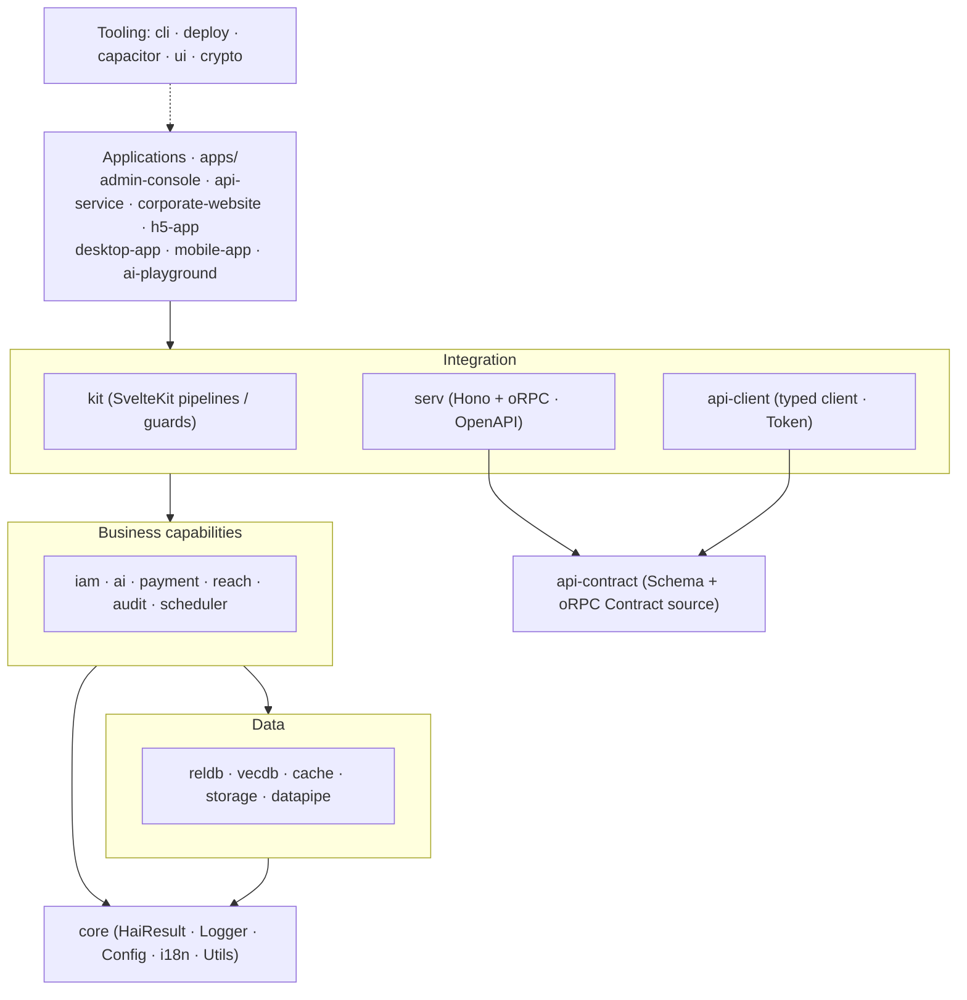

# hai Framework

[简体中文](./README.md) | [English](./README.en.md) | [日本語](./README.ja.md)

> Currently in the `0.1.0-alpha` stage: public contracts are still evolving. Pin versions and validate security and capacity for your own use cases before production adoption.

<p align="center">
  <strong>AI Runtime · Enterprise full-stack modules · Agent Skills · End-to-end type safety</strong>
</p>

<p align="center">
  A TypeScript full-stack framework for AI applications, from a single LLM call to a deployable enterprise application.
</p>

<p align="center">
  <a href="./LICENSE"></a>
  
  
  
</p>

---

## Introduction

hai Framework is a TypeScript full-stack framework **centered on an AI Runtime, with composable enterprise capabilities and APIs optimized for AI coding assistants**.

Start with `@h-ai/ai` for LLM and tool calls. Add `reldb`, `vecdb`, `iam`, `audit`, `serv`, `ui`, and other modules when you need persistence, multitenancy, authentication, auditing, APIs, UI, or deployment. Applications do not need the full stack at once.

A consistent API style brings together four capability groups, helping AI assistants build complete intelligent applications:

- **AI**: LLM chat, image generation, audio (ASR / TTS), MCP, tools, RAG, and vector retrieval.
- **Security**: Chinese national cryptographic algorithms, authentication, RBAC authorization, and audit logs.
- **Data**: relational databases, caches, object storage, and data pipelines.
- **Operations**: payments, notifications, scheduled tasks, and automated deployment.

## Highlights

| Feature                        | Description                                                                                        |
| ------------------------------ | -------------------------------------------------------------------------------------------------- |
| **AI-first design**            | APIs prioritize correct use by AI coding assistants, improving usability for human developers too. |
| **Consistent lifecycle**       | Stateful modules follow `init() → use → close()` with a consistent usage pattern.                  |
| **Explicit failures**          | Domain operations return `HaiResult<T>`, distinguishing success from failure at the type level.    |
| **Validated configuration**    | Zod validates configuration during `init()`, exposing errors at startup.                           |
| **Composable modules**         | 21 independently published modules, with `@h-ai/core` as the minimum dependency, added as needed.  |
| **End-to-end type safety**     | Strict TypeScript with inference across `api-contract → serv → api-client`.                        |
| **Cross-platform UI**          | 92 Svelte 5 Runes components (primitives / compounds / scenes) for desktop and mobile.             |
| **Scaffolding and deployment** | `hai create` scaffolds projects; `hai deploy` targets Vercel or self-hosted machines.              |
| **Built-in Agent Skills**      | Standardized module skills give AI assistants direct access to correct usage.                      |

## Design philosophy

**AI-first means prioritizing whether an AI coding assistant can correctly use each design, rather than limiting the framework to AI users.** Clear, correct usage also improves the human developer experience.

Many frameworks emphasize flexibility and conventions for human developers. AI-generated code can become inconsistent when patterns, errors, and logging lack constraints. hai Framework combines shared contracts, executable conventions, and skills to keep generated code consistent, typed, complete in error handling, and reviewable by people.

This philosophy leads to these decisions:

| Design decision                       | Value for AI                          | Value for developers                         |
| ------------------------------------- | ------------------------------------- | -------------------------------------------- |
| Shared lifecycle `init → use → close` | One usage pattern to learn            | Predictable module behavior                  |
| `HaiResult<T>` domain results         | Explicit failures in the main flow    | Less business try-catch; clearer call chains |
| Zod configuration validation          | Immediate configuration feedback      | Startup validation before runtime            |
| Provider pattern                      | Switch backends through configuration | Migrate between environments                 |
| Strict TypeScript                     | Inference guides correct calls        | Safer refactoring                            |
| Skill files + LLMS.txt                | Discover correct usage automatically  | Better generated code                        |
| Executable coding conventions         | Apply conventions to every change     | Consistent style and easier reviews          |

> **Failure semantics**: domain operations prefer `HaiResult<T>`: `{ success: true, data }` or `{ success: false, error }`. Boundaries that must throw, such as `AsyncIterable`, client transports, callbacks, and SvelteKit control flow, are documented separately in types and guides.

## Technology stack

| Layer                | Technology                                                         |
| -------------------- | ------------------------------------------------------------------ |
| Language             | TypeScript 6 / 7 (strict mode)                                     |
| Runtime              | Node.js 22.22.2+ / 24.15.0+ / 26+                                  |
| Frontend             | Svelte 5（Runes）+ SvelteKit 2                                     |
| UI                   | Tailwind CSS 4 + DaisyUI 5 + Bits UI v2                            |
| API contracts        | oRPC + Zod + OpenAPI 3.1（`api-contract → serv → api-client`）     |
| API service          | Hono + oRPC + Scalar docs                                          |
| Relational databases | SQLite / PostgreSQL / MySQL (raw SQL, no ORM)                      |
| Vector databases     | LanceDB / pgvector / Qdrant / Chroma                               |
| Cache                | Memory / Redis (standalone / Cluster / Sentinel)                   |
| Object storage       | Local filesystem / S3-compatible (AWS / MinIO / Alibaba Cloud OSS) |
| AI                   | OpenAI-compatible API + MCP                                        |
| Cryptography         | Chinese national algorithms SM2 / SM3 / SM4                        |
| Payments             | WeChat Pay / Alipay / Stripe                                       |
| Desktop              | Tauri                                                              |
| Mobile               | Capacitor（Android / iOS）                                         |
| Build                | pnpm + Turborepo + Vite + tsup                                     |
| Deployment           | Vercel (SaaS) · docker-ssh self-hosting · Neon / Upstash / R2      |

## Getting started

### Requirements

- Node.js 22.22.2+ / 24.15.0+ / 26+
- pnpm ≥ 12.11.2

### Create a project

```bash
# 全局安装 CLI
pnpm add -g @h-ai/cli

# 交互式创建项目（选择应用类型与功能模块）
hai create my-app

# 指定模板类型
hai create my-app --type admin      # 管理后台
hai create my-app --type api        # API 服务
hai create my-app --type website    # 企业官网
hai create my-app --type h5         # H5 移动应用

# 进入项目并启动
cd my-app && pnpm install && pnpm dev
```

### Code generation

```bash
hai generate page dashboard         # 生成页面
hai generate component UserCard     # 生成组件
hai generate api users              # 生成 API 路由

# 快捷别名
hai g:page dashboard
hai g:component UserCard
```

### Deploy

```bash
# hai deploy 依据 config/_deploy.yml 中的 provider 选择部署方式

# 方式一：Vercel（SaaS）—— 部署并自动开通云端基础设施（Neon / Upstash / R2 …）
hai deploy                          # 部署到 Vercel
hai deploy --skip-provision         # 跳过基础设施自动开通

# 方式二：docker-ssh —— 容器化后经 SSH 部署到自有 Linux 主机（远程需 docker/podman + compose）
# 按所选功能（_db.yml / _cache.yml / _storage.yml …）自动生成对应 compose sidecar
hai deploy                          # 部署到自有主机
```

### Integrate into an existing project

`@h-ai/core` is required; add other modules as needed:

```bash
pnpm add @h-ai/core                 # 基础能力（必装）
pnpm add @h-ai/ai                   # AI / LLM / MCP / 文生图 / 语音
pnpm add @h-ai/reldb                # 关系数据库
pnpm add @h-ai/vecdb                # 向量数据库
pnpm add @h-ai/iam                  # 身份认证 / 授权
pnpm add @h-ai/ui                   # UI 组件库
# …按需添加其余模块
```

> Run `hai add <module>` at an existing project root to enable modules incrementally; the CLI resolves dependencies and completes configuration.

## Module catalog

The framework provides **21 independently published modules**, organized into five layers.

### Foundation

| Package        | Responsibility                                                                                     | Provider support |                                            Latest on npm                                            |
| -------------- | -------------------------------------------------------------------------------------------------- | :--------------: | :-------------------------------------------------------------------------------------------------: |
| `@h-ai/core`   | Foundation: `HaiResult`, contextual child loggers, configuration, IDs, i18n, errors, and utilities |        —         |   [](https://www.npmjs.com/package/@h-ai/core)   |
| `@h-ai/crypto` | SM2 asymmetric encryption/signatures, SM3 hashes, SM4 encryption, and password hashing             |        —         | [](https://www.npmjs.com/package/@h-ai/crypto) |

### Data

| Package          | Responsibility                                                                     |            Provider support             |                                              Latest on npm                                              |
| ---------------- | ---------------------------------------------------------------------------------- | :-------------------------------------: | :-----------------------------------------------------------------------------------------------------: |
| `@h-ai/reldb`    | Relational databases: DDL, raw SQL, transactions, pagination, CRUD repositories    |         ✅ SQLite / PG / MySQL          |    [](https://www.npmjs.com/package/@h-ai/reldb)    |
| `@h-ai/vecdb`    | Vector databases: collections, vector insertion, similarity search                 | ✅ LanceDB / pgvector / Qdrant / Chroma |    [](https://www.npmjs.com/package/@h-ai/vecdb)    |
| `@h-ai/cache`    | Cache and distributed locks: KV, Hash, List, Set, SortedSet, Lock; Redis-style API |            ✅ Memory / Redis            |    [](https://www.npmjs.com/package/@h-ai/cache)    |
| `@h-ai/storage`  | File storage: upload/download/delete/copy/presigned URLs                           |              ✅ Local / S3              |  [](https://www.npmjs.com/package/@h-ai/storage)  |
| `@h-ai/datapipe` | Data pipelines: cleaning, 7 chunking modes, composition (pure functions, no init)  |                    —                    | [](https://www.npmjs.com/package/@h-ai/datapipe) |

### Business capabilities

| Package           | Responsibility                                                                                                   |         Provider support          |                                               Latest on npm                                               |
| ----------------- | ---------------------------------------------------------------------------------------------------------------- | :-------------------------------: | :-------------------------------------------------------------------------------------------------------: |
| `@h-ai/iam`       | Identity/access management: password/OTP/LDAP authentication, RBAC, sessions, users                              |                 —                 |       [](https://www.npmjs.com/package/@h-ai/iam)       |
| `@h-ai/reach`     | Notifications: email, SMS, API callbacks, templates, do-not-disturb (DND)                                        | ✅ SMTP / Alibaba Cloud SMS / API |     [](https://www.npmjs.com/package/@h-ai/reach)     |
| `@h-ai/ai`        | AI: full/streaming chat, images, ASR/TTS, tools, MCP, embeddings, RAG/knowledge, memory, context, reranking, A2A | ✅ OpenAI-compatible / extensible |        [](https://www.npmjs.com/package/@h-ai/ai)        |
| `@h-ai/payment`   | Payments: order creation, cross-platform initiation, callbacks                                                   |  ✅ WeChat Pay / Alipay / Stripe  |   [](https://www.npmjs.com/package/@h-ai/payment)   |
| `@h-ai/audit`     | Audit logs: recording, paginated queries, statistics, scheduled cleanup                                          |                 —                 |     [](https://www.npmjs.com/package/@h-ai/audit)     |
| `@h-ai/scheduler` | Scheduling: cron, JS/HTTP execution, DB persistence, distributed locks, logs                                     |                 —                 | [](https://www.npmjs.com/package/@h-ai/scheduler) |

### Integration

| Package              | Responsibility                                                                                     | Provider support |                                                  Latest on npm                                                  |
| -------------------- | -------------------------------------------------------------------------------------------------- | :--------------: | :-------------------------------------------------------------------------------------------------------------: |
| `@h-ai/api-contract` | Public HTTP contracts: oRPC + Zod, application domain composition, unified `HaiResult<T>`          |        —         | [](https://www.npmjs.com/package/@h-ai/api-contract) |
| `@h-ai/serv`         | API runtime: Hono + oRPC, contracts/procedures, OpenAPI 3.1 and Scalar docs                        |        —         |         [](https://www.npmjs.com/package/@h-ai/serv)         |
| `@h-ai/kit`          | SvelteKit: hooks, middleware, guards, validation, same-origin endpoints (no public HTTP contracts) |        —         |          [](https://www.npmjs.com/package/@h-ai/kit)          |
| `@h-ai/api-client`   | Cross-platform typed clients: nested contract calls, Bearer/httpOnly tokens, 401 refresh           |        —         |   [](https://www.npmjs.com/package/@h-ai/api-client)   |
| `@h-ai/capacitor`    | Mobile bridge: secure token storage, device info, push, camera, status bar                         |        —         |    [](https://www.npmjs.com/package/@h-ai/capacitor)    |

### UI and tooling

| Package        | Responsibility                                                                     |                             Provider support                              |                                            Latest on npm                                            |
| -------------- | ---------------------------------------------------------------------------------- | :-----------------------------------------------------------------------: | :-------------------------------------------------------------------------------------------------: |
| `@h-ai/ui`     | 92 Svelte 5 Runes components (20 primitives + 36 compounds + 36 scenes), 15 themes |                                     —                                     |     [](https://www.npmjs.com/package/@h-ai/ui)     |
| `@h-ai/cli`    | CLI: project creation, module addition, code generation, deployment                |                                     —                                     |    [](https://www.npmjs.com/package/@h-ai/cli)    |
| `@h-ai/deploy` | Deployment: Vercel with cloud provisioning; docker-ssh with feature-based sidecars | ✅ Vercel / docker-ssh · Neon / Upstash / R2 / Resend / Alibaba Cloud SMS | [](https://www.npmjs.com/package/@h-ai/deploy) |

### Module documentation index

| Category       | Module               | README                                                                       |
| -------------- | -------------------- | ---------------------------------------------------------------------------- |
| Foundation     | `@h-ai/core`         | [`packages/core/README.en.md`](./packages/core/README.en.md)                 |
| Foundation     | `@h-ai/crypto`       | [`packages/crypto/README.en.md`](./packages/crypto/README.en.md)             |
| Data           | `@h-ai/reldb`        | [`packages/reldb/README.en.md`](./packages/reldb/README.en.md)               |
| Data           | `@h-ai/vecdb`        | [`packages/vecdb/README.en.md`](./packages/vecdb/README.en.md)               |
| Data           | `@h-ai/cache`        | [`packages/cache/README.en.md`](./packages/cache/README.en.md)               |
| Data           | `@h-ai/storage`      | [`packages/storage/README.en.md`](./packages/storage/README.en.md)           |
| Data           | `@h-ai/datapipe`     | [`packages/datapipe/README.en.md`](./packages/datapipe/README.en.md)         |
| Business       | `@h-ai/iam`          | [`packages/iam/README.en.md`](./packages/iam/README.en.md)                   |
| Business       | `@h-ai/reach`        | [`packages/reach/README.en.md`](./packages/reach/README.en.md)               |
| Business       | `@h-ai/ai`           | [`packages/ai/README.en.md`](./packages/ai/README.en.md)                     |
| Business       | `@h-ai/payment`      | [`packages/payment/README.en.md`](./packages/payment/README.en.md)           |
| Business       | `@h-ai/audit`        | [`packages/audit/README.en.md`](./packages/audit/README.en.md)               |
| Business       | `@h-ai/scheduler`    | [`packages/scheduler/README.en.md`](./packages/scheduler/README.en.md)       |
| Integration    | `@h-ai/api-contract` | [`packages/api-contract/README.en.md`](./packages/api-contract/README.en.md) |
| Integration    | `@h-ai/serv`         | [`packages/serv/README.en.md`](./packages/serv/README.en.md)                 |
| Integration    | `@h-ai/kit`          | [`packages/kit/README.en.md`](./packages/kit/README.en.md)                   |
| Integration    | `@h-ai/api-client`   | [`packages/api-client/README.en.md`](./packages/api-client/README.en.md)     |
| Integration    | `@h-ai/capacitor`    | [`packages/capacitor/README.en.md`](./packages/capacitor/README.en.md)       |
| UI and tooling | `@h-ai/ui`           | [`packages/ui/README.en.md`](./packages/ui/README.en.md)                     |
| UI and tooling | `@h-ai/cli`          | [`packages/cli/README.en.md`](./packages/cli/README.en.md)                   |
| UI and tooling | `@h-ai/deploy`       | [`packages/deploy/README.en.md`](./packages/deploy/README.en.md)             |

### Typical initialization order

Most projects can initialize in this dependency order, which also helps AI assistants reason about usage:

`core → reldb / cache / storage / vecdb → iam / audit / scheduler / reach → ai / payment → api-contract → serv → kit / api-client / ui / capacitor`

- `iam` requires initialized `reldb` and `cache`.
- `audit` requires initialized `reldb`.
- For persisted `scheduler` tasks, initialize `reldb` first. Initialized `cache` enables distributed locking automatically.
- `reach`, `payment`, and `ai` reuse other module capabilities as needed; see their READMEs for configuration.
- `api-contract` needs no initialization; it defines public HTTP schemas and oRPC contracts only.
- `serv` creates the Hono app after business modules initialize; `contract` and `procedures` must have matching shapes.
- `kit` provides SvelteKit hooks/guards/same-origin endpoints; cross-platform contracts are defined elsewhere.
- `api-client` consumes one application contract on Web / App / SSR and returns `HaiResult<T>` by default.

## Architecture



**Dependency direction**: higher layers depend on lower ones. `@h-ai/core` is the foundation and never depends on other modules. Public HTTP APIs follow **`api-contract` (definition) → `serv` (implementation/mounting) → `api-client` (calls)**. `kit` handles SvelteKit pipelines and same-origin endpoints, not shared cross-platform contracts.

## Examples

These are representative snippets. Supply application-specific variables and schemas. For full APIs, codes, and examples, see module READMEs and [LLMS.txt (Chinese)](./LLMS.txt).

### HaiResult error handling

Domain failures use `HaiResult`. Stream iteration, network clients, framework control flow, and third-party callbacks may throw; catch at the documented API boundary:

```typescript
import type { HaiResult } from '@h-ai/core'
import { core, err, HaiCommonError, ok } from '@h-ai/core'

function divide(a: number, b: number): HaiResult<number> {
  if (b === 0)
    return err(HaiCommonError.VALIDATION_ERROR, 'Division by zero')
  return ok(a / b)
}

const result = divide(10, 2)
if (result.success) {
  const quotient = result.data // 5
}
else {
  core.logger.warn('Division failed', { code: result.error.code, message: result.error.message })
}
```

### Relational databases

```typescript
import { reldb } from '@h-ai/reldb'

const initResult = await reldb.init({ type: 'sqlite', database: './data/app.db' })
if (!initResult.success)
  throw new Error(initResult.error.message)

// DDL — 建表
await reldb.ddl.createTable('users', {
  id: { type: 'TEXT', primaryKey: true },
  email: { type: 'TEXT', notNull: true, unique: true },
  name: { type: 'TEXT' },
}, true)

// 参数化查询与分页
const users = await reldb.sql.query<User>('SELECT * FROM users WHERE name = ?', ['Alice'])
const page = await reldb.sql.queryPage<User>({
  sql: 'SELECT * FROM users',
  pagination: { page: 1, pageSize: 20 },
})

// 事务
await reldb.tx.wrap(async (tx) => {
  await tx.execute('INSERT INTO users (id, email) VALUES (?, ?)', ['1', 'a@b.com'])
  await tx.execute('INSERT INTO logs (action) VALUES (?)', ['user_created'])
})

// CRUD 仓库（自动生成 SQL）
const userRepo = reldb.crud.table<User>({
  table: 'users',
  idColumn: 'id',
  select: ['id', 'email', 'name'],
  createColumns: ['id', 'email', 'name'],
  updateColumns: ['email', 'name'],
  dbType: 'sqlite',
})
await userRepo.create({ id: '1', email: 'a@b.com', name: 'Alice' })
```

### Vector databases

```typescript
import { vecdb } from '@h-ai/vecdb'

const initResult = await vecdb.init({ type: 'lancedb', path: './data/vecdb' })
if (!initResult.success)
  throw new Error(initResult.error.message)

await vecdb.collection.create('docs', { dimension: 1536 })
await vecdb.vector.insert('docs', [
  { id: 'doc-1', vector: embeddings, content: '文档内容', metadata: { source: 'wiki' } },
])
const results = await vecdb.vector.search('docs', queryVector, { topK: 5, minScore: 0.7 })
```

### Cache

```typescript
import { cache } from '@h-ai/cache'

const initResult = await cache.init({ type: 'memory' })
if (!initResult.success)
  throw new Error(initResult.error.message)
// await cache.init({ type: 'redis', url: 'redis://localhost:6379' })

await cache.kv.set('key', { name: 'Alice' }, { ex: 3600 })
const val = await cache.kv.get<{ name: string }>('key')
await cache.zset.zadd('leaderboard', { score: 100, member: 'Alice' })
```

### AI / LLM / images / audio

```typescript
import { ai } from '@h-ai/ai'

// 初始化（OpenAI 兼容 API）；未初始化 reldb/vecdb 时使用进程内临时 Store
const initResult = await ai.init({
  llm: { apiKey: process.env.HAI_AI_LLM_APIKEY, model: 'gpt-4o-mini' },
})
if (!initResult.success)
  throw new Error(initResult.error.message)

// 同步调用
const chat = await ai.llm.chat({
  messages: [{ role: 'user', content: '用一句话解释量子计算' }],
})
if (chat.success)
  void chat.data.choices[0].message.content

// 流式调用
const stream = ai.llm.chatStream({ messages: [{ role: 'user', content: '讲一个故事' }] })
for await (const chunk of stream)
  process.stdout.write(chunk.choices[0]?.delta?.content ?? '')

// 文生图
const image = await ai.image.generate({ prompt: '一只在星空下的猫', size: '1024x1024' })

// 语音合成（TTS）
const speech = await ai.audio.synthesize({ text: '你好，世界', voice: 'default' })
```

### Authentication and authorization

```typescript
import { cache } from '@h-ai/cache'
import { iam } from '@h-ai/iam'
import { reldb } from '@h-ai/reldb'

// 先初始化 reldb 与 cache，IAM 会复用已初始化单例
const dbInit = await reldb.init({ type: 'sqlite', database: './data/app.db' })
if (!dbInit.success)
  throw new Error(dbInit.error.message)
const cacheInit = await cache.init({ type: 'memory' })
if (!cacheInit.success)
  throw new Error(cacheInit.error.message)
const iamInit = await iam.init({ session: { maxAge: 86400, sliding: true } })
if (!iamInit.success)
  throw new Error(iamInit.error.message)

await iam.user.register({ username: 'alice', password: 'StrongPass123!' })
const loginResult = await iam.auth.login({ identifier: 'alice', password: 'StrongPass123!' })

// RBAC 权限控制
await iam.authz.assignRole(userId, 'admin')
const allowed = await iam.authz.checkPermission(userId, 'users:read')
```

### Public APIs: contract → service → client

```typescript
// 1) 契约（api-contract）：只描述“有哪些 API”，纯定义、无业务实现
import { apiContract } from '@h-ai/api-contract'

export const contract = apiContract.create({
  iam: apiContract.iam,
  storage: apiContract.storage,
  ai: apiContract.ai,
})
```

```typescript
// 2) 服务（serv）：挂载 contract + procedures，生成 OpenAPI 与文档页
import { serv } from '@h-ai/serv'
import { createAiProcedures } from '@h-ai/serv/features/ai'
import { createIamProcedures } from '@h-ai/serv/features/iam'
import { createStorageProcedures } from '@h-ai/serv/features/storage'

const app = serv.createApp({
  contract,
  procedures: {
    iam: createIamProcedures({ iam }),
    storage: createStorageProcedures({ storage }),
    ai: createAiProcedures({ ai }),
  },
  http: {
    apiPrefix: '/api/v1',
    openapi: { path: '/openapi.json' },
    docs: { path: '/docs' },
  },
  iam, // 顶层传入后自动派生 access token 校验
})
serv.listen(app, { host: '0.0.0.0', onClose: closeApp })
```

```typescript
// 3) 客户端（api-client）：Web / App / SSR 消费同一份契约，默认返回 HaiResult<T>
import { apiClient } from '@h-ai/api-client'

const initResult = await apiClient.init({ baseUrl: '/api/v1', auth: {} })
if (!initResult.success)
  throw new Error(initResult.error.message)

const login = await apiClient.iam.auth.login({ identifier: 'alice', password: 'xxx' })
if (login.success)
  await apiClient.auth.setTokens(login.data.tokens)
```

### Svelte 5 UI components

```text
<script lang="ts">
  import { Button, Card, DataTable, Input, Modal } from '@h-ai/ui'

  let showModal = $state(false)
  let users = $state([])
</script>

<Card>
  <DataTable
    data={users}
    columns={[
      { key: 'name', label: '姓名' },
      { key: 'email', label: '邮箱' },
    ]}
    keyField="id"
  >
    {#snippet actions(user)}
      <Button size="xs" onclick={() => edit(user)}>编辑</Button>
    {/snippet}
  </DataTable>
</Card>

<Button onclick={() => (showModal = true)}>新建用户</Button>

<Modal bind:open={showModal} title="新建用户">
  <Input label="姓名" bind:value={name} />
  <Input label="邮箱" bind:value={email} type="email" />
</Modal>
```

> See individual READMEs and `LLMS.txt` for `storage` / `datapipe` / `payment` / `audit` / `scheduler` / `reach` / `crypto` / `kit` / `capacitor` / `deploy`.

## Onboarding and help center

`@h-ai/ui/guide` provides `createGuide`, `GuideHost` and `HelpCenter` for first-use cookie invitations, manual replay, navigation to guided pages and searchable Markdown help. Tours follow existing themes; built-in controls support Chinese and English, while business content uses application i18n.

The admin-console example and CLI fullstack Web/App/Desktop enable this by default. Preferences are isolated by user and tour version, with later and dismiss options. See [UI onboarding](packages/ui/README.en.md#onboarding-and-help-center).

## Example applications

`apps/` contains seven runnable examples that serve as scaffolding references and integration samples. `api-service-contract` is their shared API contract package.

| Application         | Description                                         | Modules used                                             |
| ------------------- | --------------------------------------------------- | -------------------------------------------------------- |
| `admin-console`     | Admin console (all-module integration reference)    | core, reldb, iam, cache, storage, crypto, ai, kit, ui    |
| `ai-playground`     | AI playground (LLM / images / memory / audio)       | core, ai, kit, ui                                        |
| `api-service`       | Hono + oRPC API service (contract composition root) | core, reldb, cache, iam, storage, ai, api-contract, serv |
| `corporate-website` | Corporate website + registration + AI support       | core, reldb, cache, storage, ai, reach, kit, ui          |
| `h5-app`            | Mobile H5 (photo recognition / cart / login)        | core, reldb, iam, cache, storage, ai, kit, ui            |
| `desktop-app`       | Tauri desktop application                           | api-client, api-service-contract, crypto, ui             |
| `mobile-app`        | Capacitor Android / iOS application                 | api-client, api-service-contract, crypto, ui, capacitor  |

### Start individual applications

| Application         | Start command                           |
| ------------------- | --------------------------------------- |
| `admin-console`     | `pnpm --filter admin-console dev`       |
| `ai-playground`     | `pnpm --filter ai-playground dev`       |
| `api-service`       | `pnpm --filter api-service dev`         |
| `corporate-website` | `pnpm --filter corporate-website dev`   |
| `h5-app`            | `pnpm --filter h5-app dev`              |
| `desktop-app`       | `cd apps/desktop-app && pnpm tauri:dev` |
| `mobile-app`        | `pnpm --filter mobile-app dev`          |

## Development

### Local development

```bash
pnpm install                    # 安装依赖
pnpm dev                        # 全量开发模式
pnpm typecheck                  # 类型检查
pnpm lint                       # ESLint（含 check:skills）
pnpm test                       # 单元测试
pnpm --filter @h-ai/reldb test  # 只运行某个模块
```

### Project structure

```
hai-framework/
├── packages/            # 21 framework packages (@h-ai/*)
│   └── cli/templates/   # CLI scaffolding and skills distributed to generated apps
├── apps/                # Example applications
├── scripts/             # Validation and release scripts
├── AGENTS.md            # AI assistant workflow entry
├── LLMS.txt             # AI usage index
├── .agents/             # Shared development instructions/ and repository skills/
├── AGENTS.md            # Shared AI entry point and task navigation
└── .github/             # GitHub Actions and lightweight Copilot entry points
```

### AI-first infrastructure

This repository uses [AGENTS.md](AGENTS.md) as its shared entry point, `.agents/instructions/` for detailed conventions, and `.agents/skills/` for repository development skills. Copilot path instructions contain matching metadata and links; Claude and OpenCode entry points reuse the shared rules. Codex reads `AGENTS.md` and discovers `.agents/skills/` natively. Invoke skills such as `$hai-create-module` or `$hai-review-module` in the project and load references as needed. Sources: [Codex skills](https://learn.chatgpt.com/docs/build-skills), [project instructions](https://learn.chatgpt.com/docs/agent-configuration/agents-md).

`hai create` generates the same shared entry points and skills, with application-specific `AGENTS.md` rules:

```
my-app/
├── .agents/
│   └── skills/                       # Shared skill bodies and references; native Codex discovery
├── .github/
│   └── copilot-instructions.md       # References the shared AGENTS.md
├── AGENTS.md                         # Codex / OpenCode / shared AI guidance
├── CLAUDE.md                         # Claude Code guidance reusing @AGENTS.md
└── opencode.json                     # instructions references AGENTS.md directly
```

| AI assistant   | Generated files                                                                                  |
| -------------- | ------------------------------------------------------------------------------------------------ |
| GitHub Copilot | `.github/copilot-instructions.md` → `AGENTS.md` + `.agents/skills/`                              |
| Cursor         | `AGENTS.md` + `.agents/skills/`                                                                  |
| Claude Code    | `CLAUDE.md` + `AGENTS.md` (reuse through `@AGENTS.md`; no native discovery of `.agents/skills/`) |
| Codex          | `AGENTS.md` + `.agents/skills/`                                                                  |
| OpenCode       | `AGENTS.md` + `.agents/skills/` + `opencode.json`                                                |

Skills are managed in `packages/cli/templates/skills/` and distributed by `@h-ai/cli` into user projects' `.agents/skills/`. The **28 built-in templates** include 20 module skills and eight overview/workflow skills (`hai-build`, `hai-spec-review`, `hai-app-create`, `hai-app-review`, `hai-app-tests`, `hai-ci`, `hai-framework-sync`, `hai-pr-review`), supporting application building, tests, reviews, module usage, and convention synchronization. Repository development skills and application templates retain their own task boundaries while sharing public contracts. Run scoped `typecheck → lint → build → test` checks, followed by the relevant E2E gates for UI, routes, or CLI templates.

### Configuration and environment variables

Environment variables following `HAI_<CONFIG_NAME>_<YAML_PATH>` override YAML. Copy the root [`.env.example`](./.env.example) to `.env` and fill needed values. Each `apps/*/.env.example` adds application-specific differences only.

- **Naming**: `HAI_<CONFIG_NAME>_<YAML_PATH>`, levels separated by `_`, camelCase kept intact (such as `llm.apiKey` → `HAI_AI_LLM_APIKEY`).
- **Precedence**: convention-based variables > explicit YAML `${VAR}` > YAML defaults.
- **AI compatibility**: `OPENAI_*` is only a fallback for `@h-ai/ai`.
- **Secrets**: never hardcode, log, or expose secrets through client `PUBLIC_*` / `VITE_*` variables.

| Group          | Example variables                 | Description                                                            |
| -------------- | --------------------------------- | ---------------------------------------------------------------------- |
| Runtime        | `HAI_CORE_ENV`、`HAI_CORE_DEBUG`  | Runtime environment, debugging, and logging                            |
| Database       | `HAI_DB_*`                        | SQLite / PostgreSQL / MySQL in `_db.yml`                               |
| Cache          | `HAI_CACHE_*`                     | Memory / Redis / Upstash for `@h-ai/cache`                             |
| Session / Auth | `HAI_IAM_*`、`HAI_KIT_COOKIE_KEY` | Authentication/security for `@h-ai/iam` and `@h-ai/kit`                |
| API Service    | `PORT`、`HOST`、`PUBLIC_API_BASE` | Listen/frontend addresses for `apps/api-service` / `@h-ai/serv`        |
| Storage        | `HAI_STORAGE_*`                   | Local / S3 for `@h-ai/storage`                                         |
| AI             | `HAI_AI_LLM_*`                    | LLM API keys, base URLs, and models for `@h-ai/ai`                     |
| VecDB          | `HAI_VECDB_*`                     | LanceDB / pgvector / Qdrant / Chroma for `@h-ai/vecdb`                 |
| Reach          | `HAI_REACH_*`                     | SMTP, SMS, webhooks for `@h-ai/reach`                                  |
| Payment        | `HAI_PAYMENT_*`                   | WeChat Pay / Alipay / Stripe merchant settings for `@h-ai/payment`     |
| Deploy         | `HAI_DEPLOY_*`                    | Deployment/infrastructure credentials for `@h-ai/deploy` / `@h-ai/cli` |

The root `.env.example` defines complete fields and defaults. When working on an example app, consult its `README.md` and `.env.example` for additional settings.

### Quality gates

Choose commands by impact scope; use root commands for cross-package contracts or root configuration changes:

| Gate               | Command                   | Scope                                                    |
| ------------------ | ------------------------- | -------------------------------------------------------- |
| Type checking      | `pnpm typecheck`          | All changes                                              |
| Lint               | `pnpm lint`               | All changes, including `check:skills`                    |
| Build              | `pnpm build`              | Build / templates / publishing / cross-package contracts |
| Unit tests         | `pnpm test`               | All changes                                              |
| End-to-end         | `pnpm e2e`                | UI / routes / end-to-end flows                           |
| Release acceptance | `pnpm test:release-local` | Full pre-release validation (installation → E2E)         |

> Use `pnpm.cmd` in Windows PowerShell. Root `pnpm e2e` covers CLI scaffolding and Playwright suites for Admin Console, AI Playground, Corporate Website, H5, and Mobile Web. Container unit tests require working Docker / Podman.

### Commit checks (Leak Hooks)

Git hooks check leakage keywords before `git commit` / `git push`. Create local `.leak-words.json` (ignored by Git and local-only):

```json
["your-leak-word"]
```

The entry points are `.husky/pre-commit`, `.husky/commit-msg`, `.husky/pre-push`, and `scripts/check-leak-words.mjs`.

## License

[Apache-2.0](./LICENSE)
