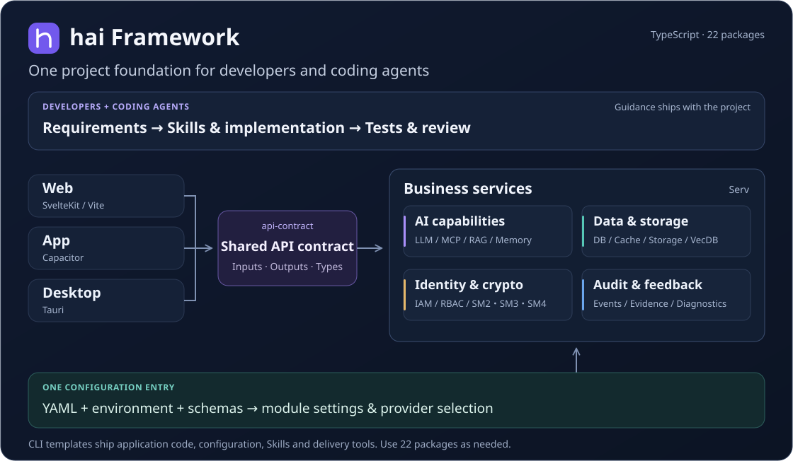
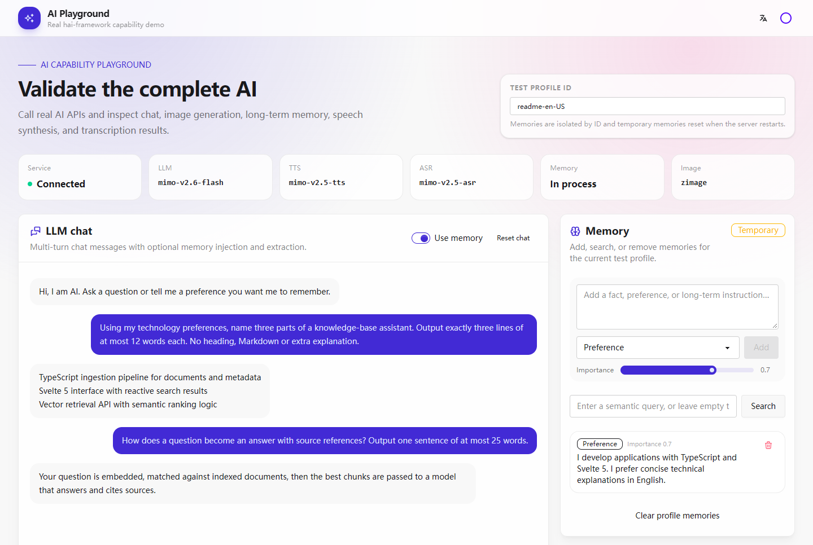
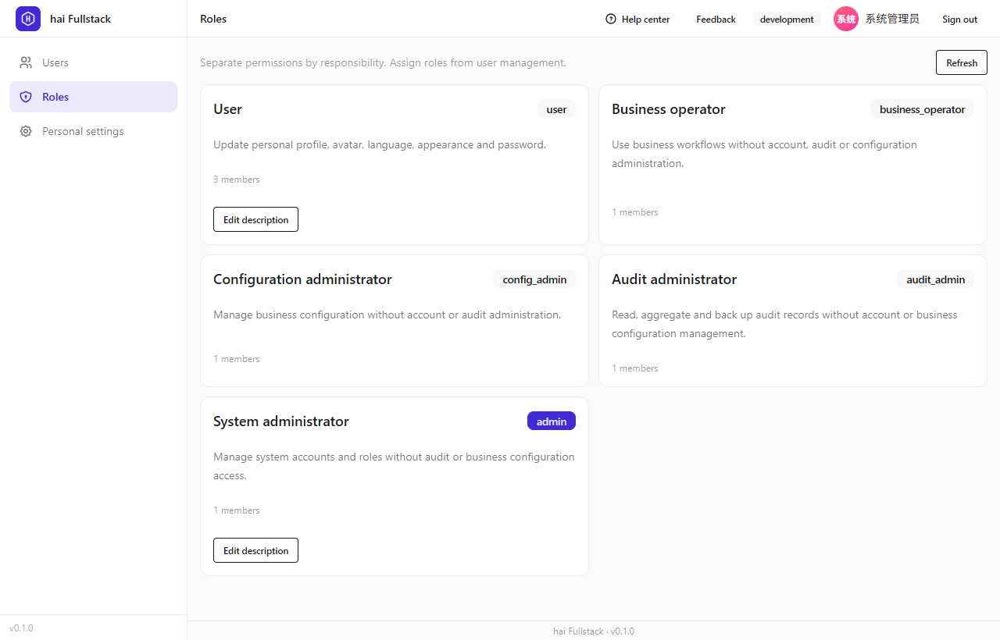
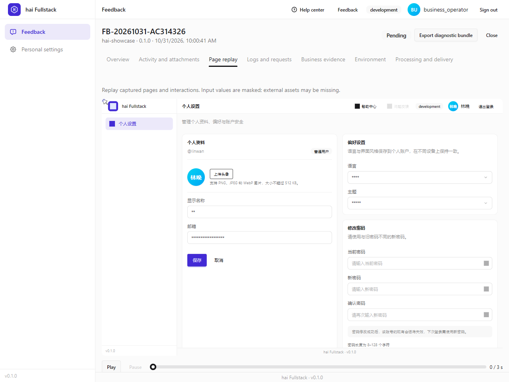
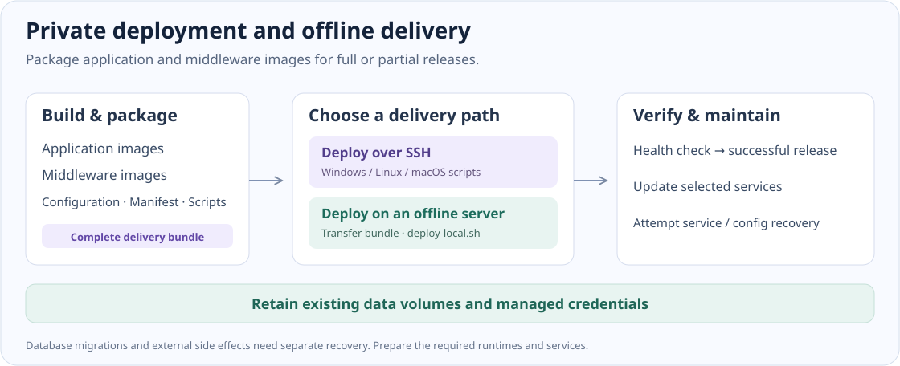

# hai Framework

**An AI-native, configuration-driven, security-first TypeScript application framework.**

[简体中文](README.md) · [English](README.en.md) · [日本語](README.ja.md)

[](https://www.npmjs.com/package/@h-ai/cli)
[](https://github.com/hai-series/hai-framework/actions/workflows/ci.yml)
[](https://github.com/hai-series/hai-framework/actions/workflows/codeql.yml)
[](https://hai-series.github.io/hai-framework/)
[](LICENSE)

[Website and template previews](https://hai-series.github.io/hai-framework/) · [Usage guide](docs/usage/README.en.md) · [Configuration handbook](docs/usage/configuration/README.md) · [Releases](https://github.com/hai-series/hai-framework/releases/latest)

hai-framework is a full-stack application development and delivery framework for the AI era. Its unified, composable TypeScript foundation connects AI, data, security, interfaces and engineering tools. Developers and AI assistants share contracts, configuration, project guidance and validation workflows, from building applications to delivery across platforms and continued evolution. AI becomes part of both the development process and the applications themselves.



_A Fullstack composition: project guidance, clients, contracts and business modules ship together. Choose the modules and clients you need._

## Why hai

### AI-native: coding collaboration and business integration

Generated projects include `AGENTS.md`, module Skills and workflows for reviewing requirements, implementation, testing and review. Coding agents work with the project's public APIs, authorization rules and validation requirements. At runtime, compose model calls, tools/MCP, RAG, conversation memory and multimodal features with application data and services.

[Project guidance and Skills](AGENTS.md) · [AI development and integration](docs/usage/development/ai.md)



_The AI playground connects to a live model and shows multi-turn conversations alongside memory records. Conversations and preferences are demo data._

### Configuration-driven: explicit settings for each environment

Models, databases, caches, files and vector search follow shared conventions for YAML, `HAI_*` environment mappings and schema validation. Select SQLite/PostgreSQL/MySQL, Memory/Redis, Local/S3 and other backends per environment. Development, test and deployment settings have an explicit entry point, while business code uses public module interfaces.

[Configuration handbook](docs/usage/configuration/README.md) · [Data and storage](docs/usage/configuration/data.md)

### Security-first: identity, cryptography and audit together

Built-in SM2/SM3/SM4 and application-layer transport encryption sit alongside authentication and RBAC, account lifecycle, password and session policies, IP/time access rules and security auditing. Identity, business authorization and auditing belong to the same engineering foundation, supporting separation of duties and defense in depth.

[Identity and permissions](docs/usage/configuration/identity.md) · [Cryptography and transport encryption](packages/crypto/README.en.md) · [Request policies](docs/usage/configuration/request-access.md)



_A CLI-generated Fullstack application with separate account, role, configuration and audit responsibilities. Management permissions are split by role; accounts shown are demo data._

### Delivery: shared client contracts and private deployment

Web, App and Desktop share typed API contracts and server-side business capabilities; same-origin Web applications can use SvelteKit and Kit. Delivery tools bundle application and self-hosted middleware images for SSH releases, local deployment on offline servers, selected-service updates and recovery. After release, feedback can associate page replay, logs, requests and business evidence in an exportable diagnostic package.

[Shared API contracts](packages/api-contract/README.en.md) · [Deployment and recovery](docs/usage/configuration/delivery.md) · [Feedback diagnostics](docs/usage/operations/feedback.md)



_From user report to authorized diagnosis: replay page interactions inside the application, with input values masked, and export a diagnostic bundle. Shown with demo records in an isolated environment._

## Create your first application

Use Node.js `^22.23.4 || ^24.22.1 || ^26.12.1` and pnpm 12.11.2. Node.js 24.22.1 matches CI. Use `pnpm.cmd` in Windows PowerShell.

```sh
pnpm dlx @h-ai/cli@latest create my-app --type fullstack --frontends web --defaults
cd my-app
pnpm dev
```

The CLI installs dependencies and initializes Git by default. Sign in as `admin`; find the random initial password in `HAI_ADMIN_DEFAULT_PASSWORD` in the generated `.env.dev`, then change it when prompted. Keep environment files and passwords private.

New projects include the full applicable modules and examples, including server AI/vector dependencies. Use `hai create --defaults` to skip prompts; default containers skip extra CUDA downloads. Follow the generated README for directories, environment files and addresses, or use the [first-run guide](docs/usage/getting-started/create.md).

The installation version follows [npm's latest tag](https://www.npmjs.com/package/@h-ai/cli?activeTab=versions), which the badge reads directly. Run `pnpm view @h-ai/cli@latest version` to query it; replace `@latest` with the returned version for reproducible team installations. npm installation tags and GitHub's Latest presentation setting are managed separately.

### Choose a template

| Template    | Purpose                                               | Creation options                   |
| ----------- | ----------------------------------------------------- | ---------------------------------- |
| Fullstack   | Separate API and multiple clients sharing a contract  | `--type fullstack --frontends web` |
| API         | Independent Node.js service and public APIs           | `--type api`                       |
| Admin       | Same-origin dashboard with account and business pages | `--type admin`                     |
| Website     | Corporate, product and static documentation sites     | `--type website`                   |
| H5 / Mobile | Mobile web or Capacitor application                   | `--type h5` / `--type mobile-app`  |

[Explore real Fullstack, Website, Admin and Mobile previews](https://hai-series.github.io/hai-framework/#template-previews). Website uses SSR by default; follow the [static build instructions](docs/usage/configuration/delivery.md#静态website与github-pages) for static hosting. Native packages require the platform toolchain.

### Build and release

Configure the environment and deployment destination in the generated project, then run:

```sh
pnpm build --target image
pnpm run deploy --env prod --plan
pnpm run deploy --env prod
pnpm run deploy --env prod --build --services "serv,web"
pnpm run deploy --env prod --build --bundle-only
```

`--plan` performs a read-only preflight, `--services` selects services to update, and `--bundle-only` produces a portable offline bundle. Automatic recovery covers services and configuration snapshots; database migrations and external side effects need their own recovery plans. See [delivery configuration](docs/usage/configuration/delivery.md) for real client IPs, subpaths, direct storage access and policy files.



## Find modules by domain

Install `@h-ai/*` as needed in existing projects, or use `hai add <module>` to add modules and configuration to supported templates. Each link documents the public API, configuration and examples.

| Domain                  | Modules and responsibilities                                                                                                                                                                                                                                                                                                                 |
| ----------------------- | -------------------------------------------------------------------------------------------------------------------------------------------------------------------------------------------------------------------------------------------------------------------------------------------------------------------------------------------- |
| Foundation and security | [core](packages/core/README.en.md): results, configuration, logs, lifecycle and request policies; [crypto](packages/crypto/README.en.md): SM2/SM3/SM4 and password hashing; [iam](packages/iam/README.en.md): authentication, sessions and RBAC                                                                                              |
| Data                    | [reldb](packages/reldb/README.en.md): relational data and transactions; [cache](packages/cache/README.en.md): cache and distributed locks; [storage](packages/storage/README.en.md): files and presigned URLs; [vecdb](packages/vecdb/README.en.md): vector search; [datapipe](packages/datapipe/README.en.md): text processing and chunking |
| AI                      | [ai](packages/ai/README.en.md): LLM, tools/MCP, RAG, memory, images, speech and A2A                                                                                                                                                                                                                                                          |
| Business and operations | [feedback](packages/feedback/README.en.md): feedback and diagnostics; [audit](packages/audit/README.en.md): audits and alerts; [reach](packages/reach/README.en.md): messaging; [scheduler](packages/scheduler/README.en.md): scheduled jobs; [payment](packages/payment/README.en.md): payment providers                                    |
| APIs and platforms      | [api-contract](packages/api-contract/README.en.md): shared contracts; [serv](packages/serv/README.en.md): Hono/oRPC runtime; [api-client](packages/api-client/README.en.md): typed clients; [kit](packages/kit/README.en.md): SvelteKit integration; [capacitor](packages/capacitor/README.en.md): native bridge                             |
| UI and engineering      | [ui](packages/ui/README.en.md): Svelte components and themes; [cli](packages/cli/README.en.md): scaffolding, generation and upgrades; [deploy](packages/deploy/README.en.md): Vercel and Docker SSH delivery                                                                                                                                 |

Lifecycle modules follow `init → use → close`, checking `HaiResult.success` at each step. Core, pure functions, contracts and service factories follow their actual type contracts. Consult the [configuration handbook](docs/usage/configuration/README.md) for shared state, provider prerequisites and authorization boundaries.

## Reading paths

| Your task                             | Start here                                                                                                             |
| ------------------------------------- | ---------------------------------------------------------------------------------------------------------------------- |
| Evaluate and create                   | [Capabilities and environment](docs/usage/overview/README.md) → [first delivery](docs/usage/getting-started/README.md) |
| Develop business features or AI       | [Development guide](docs/usage/development/README.md) → module README                                                  |
| Manage configuration and deployment   | [Defaults and configuration index](docs/usage/configuration/README.md) → [operations](docs/usage/operations/README.md) |
| Review security and diagnose problems | [Security review](docs/usage/governance/security-review.md) → [feedback](docs/usage/operations/feedback.md)            |
| Maintain the framework with AI        | [AGENTS.md](AGENTS.md) → [LLMS.txt](LLMS.txt) → task-specific Skills                                                   |

The role-based domain handbook is currently in Chinese; the [English guide](docs/usage/README.en.md) links to the translated creation-to-delivery workflow.

## Development

`packages/*` contains framework packages, `apps/*` contains examples and the documentation site, and `packages/cli/templates/` contains generated applications and shared Skills. Keep callers, configuration examples, documentation, screenshots and tests aligned with feature changes.

```sh
pnpm install --frozen-lockfile
pnpm --filter admin-console dev
pnpm typecheck
pnpm lint
pnpm test
pnpm --filter @h-ai/cli test:scaffold-gates
```

[CI runs in parallel stages](docs/ci.md) and reuses eligible successful results by input fingerprint. **CI** validates types, builds, tests and browser flows. **CodeQL** analyzes JavaScript/TypeScript for security findings, available in GitHub Security. **Leak Checker** checks a maintainer-configured word list. Badges report workflow results; assess findings alongside business authorization and deployment reviews.

npm scans packages before making them available. CI waits up to thirty minutes for every package to become queryable before promoting `latest`; see [release recovery](docs/ci.md#查看结果与重新运行).

Local commit/push hooks use `scripts/check-leak-words.mjs`; keep `.leak-words.json` private. Container gates clean up resources registered for that run. Preview historical test image cleanup with `node scripts/cleanup-test-images.mjs --runtime=podman --legacy` before adding `--apply`. [Verification notes](docs/usage/governance/verification.md) distinguish actual runs, reuse and environment dependencies.

## License

[Apache-2.0](LICENSE)
