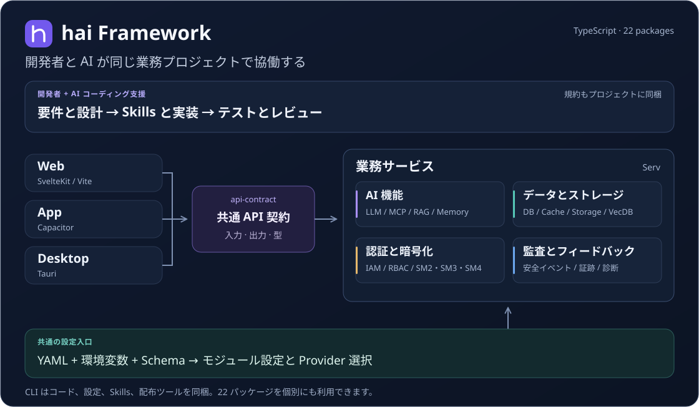
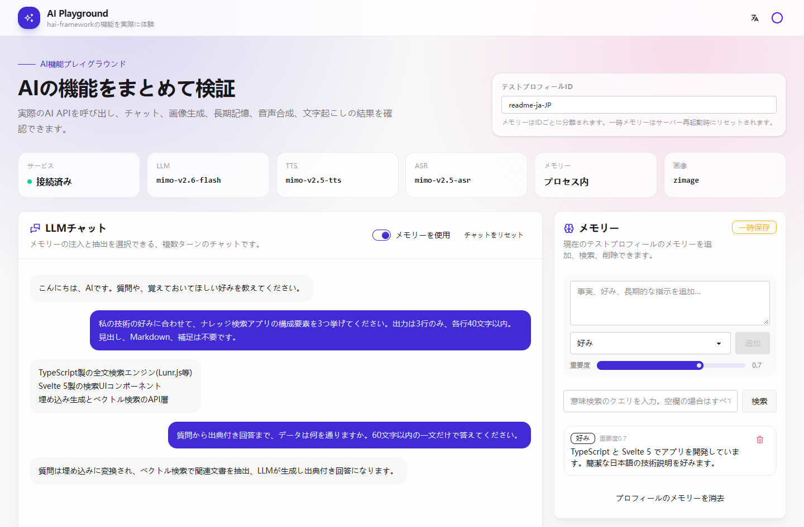
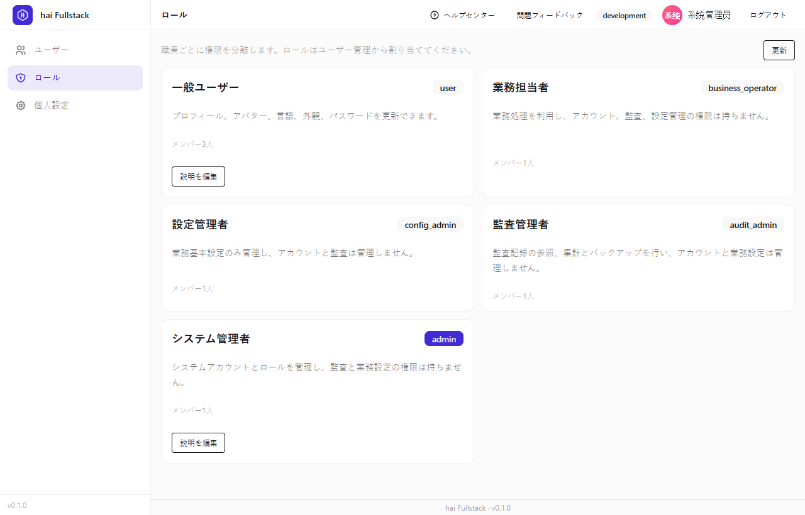
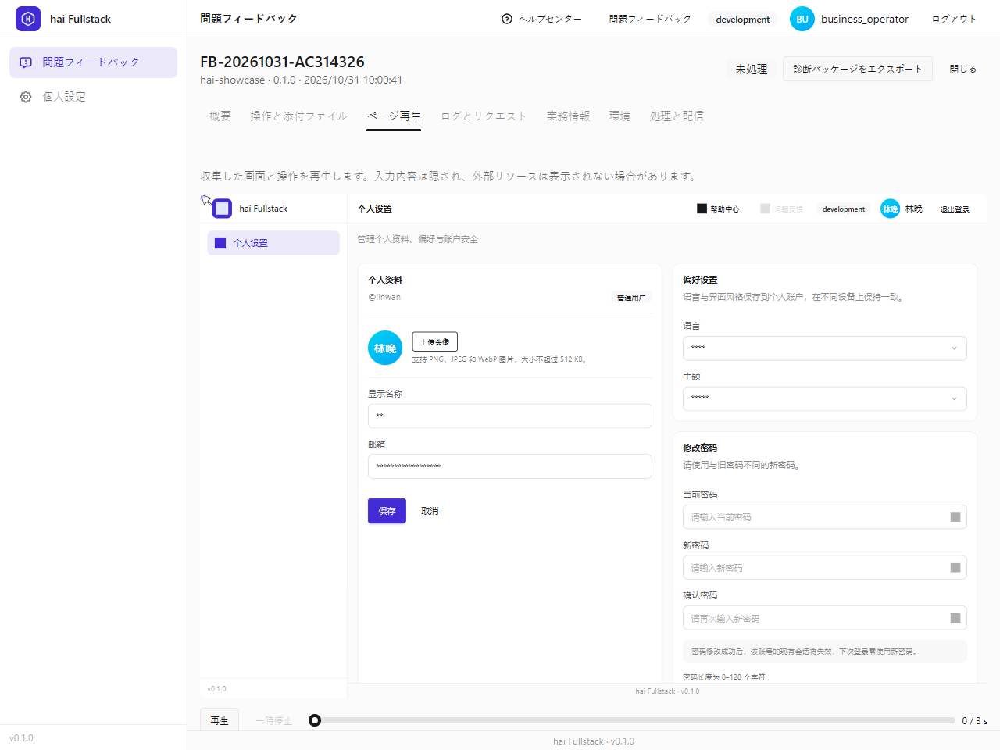
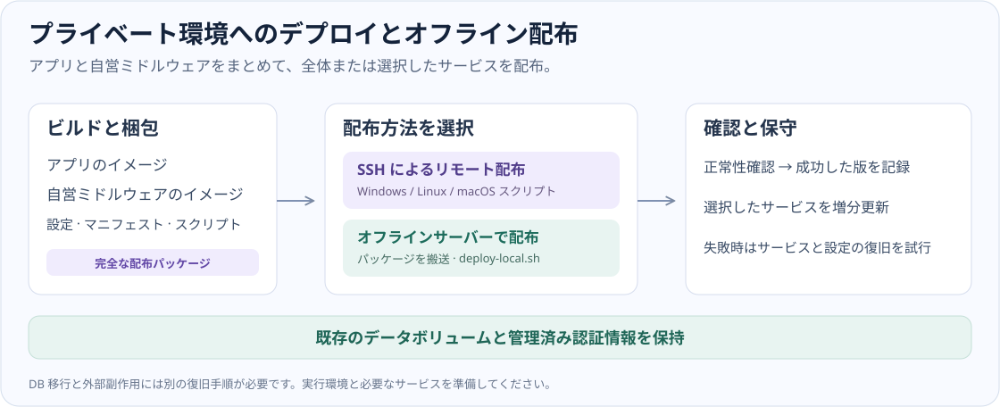

# hai Framework

**AI ネイティブ、設定駆動、セキュリティ優先の TypeScript アプリフレームワーク。**

[简体中文](README.md) · [English](README.en.md) · [日本語](README.ja.md)

[](https://www.npmjs.com/package/@h-ai/cli)
[](https://github.com/hai-series/hai-framework/actions/workflows/ci.yml)
[](https://github.com/hai-series/hai-framework/actions/workflows/codeql.yml)
[](https://hai-series.github.io/hai-framework/)
[](LICENSE)

[公式サイトとテンプレート](https://hai-series.github.io/hai-framework/) · [利用ガイド](docs/usage/README.ja.md) · [設定マニュアル](docs/usage/configuration/README.md) · [リリース](https://github.com/hai-series/hai-framework/releases/latest)

hai-framework は AI 時代のフルスタックアプリ開発と配布を支えるフレームワークです。統一された組み合わせ可能な TypeScript 基盤で、AI、データ、セキュリティ、画面、開発ツールをつなぎます。開発者と AI は契約、設定、規約、検証手順を共有し、アプリの構築から複数プラットフォームへの配布、継続的な進化までを進められます。AI を開発プロセスとアプリ自体の双方に組み込めます。



_Fullstack の構成例：開発規約、クライアント、API 契約、業務モジュールをまとめて提供します。必要なモジュールとクライアントを選べます。_

## hai の特長

### AI ネイティブ：開発協働と業務への組み込み

生成プロジェクトには `AGENTS.md`、モジュール Skills、要件レビュー、実装、テスト、再レビューの手順が含まれます。AI コーディング支援は公開 API、権限規則、検証要件を共有します。実行時はモデル呼び出し、ツール/MCP、RAG、会話メモリ、マルチモーダル機能をアプリのデータとサービスに組み込めます。

[開発規約と Skills](AGENTS.md) · [AI 開発と統合](docs/usage/development/ai.md)



_実際のモデルに接続した AI 実験台で、複数ターンの会話とメモリを表示しています。会話と設定はデモ用データです。_

### 設定駆動：環境ごとの差分を明確な入口で管理

モデル、DB、キャッシュ、ファイル、ベクトル検索は YAML、`HAI_*` 環境変数マッピング、Schema 検証の規約を共有します。環境ごとに SQLite/PostgreSQL/MySQL、Memory/Redis、Local/S3 などを選択し、開発・テスト・配布の設定入口を明確にしながら、業務コードはモジュールの公開インターフェースを利用します。

[設定マニュアル](docs/usage/configuration/README.md) · [データとストレージ](docs/usage/configuration/data.md)

### セキュリティ優先：認証、暗号化、監査をセットで提供

SM2/SM3/SM4 とアプリ層の伝送暗号化に加え、認証と RBAC、アカウントのライフサイクル、パスワードとセッションのポリシー、IP・時間のアクセス制限、安全監査を提供します。認証、業務の認可、監査を共通の開発基盤に組み込み、職務の分離と多層防御を支えます。

[認証と権限](docs/usage/configuration/identity.md) · [暗号化と伝送保護](packages/crypto/README.ja.md) · [リクエストポリシー](docs/usage/configuration/request-access.md)



_CLI で生成した Fullstack アプリです。アカウント、ロール、設定、監査の責務を分け、管理権限をロールごとに分離しています。アカウントはデモ用です。_

### 配布まで対応：共通 API 契約とプライベート環境

Web、App、Desktop は型付き API 契約とサーバーの業務機能を共有し、同一オリジンの Web は SvelteKit と Kit を利用できます。アプリと自営ミドルウェアのイメージをまとめて、SSH 配布、オフラインサーバー上のローカル配布、サービス単位の更新、失敗時の復旧に対応します。公開後はページ再生、ログ、リクエスト、業務証跡をフィードバックに関連付け、診断パッケージを出力できます。

[共通 API 契約](packages/api-contract/README.ja.md) · [配布と復旧](docs/usage/configuration/delivery.md) · [フィードバック診断](docs/usage/operations/feedback.md)



_利用者の報告から権限に基づく診断まで、アプリ内でページ操作を再生し、診断パッケージを出力できます。入力値はマスクされ、記録は隔離環境のデモ用です。_

## 最初のアプリを作成

Node.js `^22.23.4 || ^24.22.1 || ^26.12.1` と pnpm 12.11.2 を用意します。CI と同じ Node.js 24.22.1 を推奨します。Windows PowerShell では `pnpm.cmd` を使用します。

```sh
pnpm dlx @h-ai/cli@latest create my-app --type fullstack --frontends web --defaults
cd my-app
pnpm dev
```

CLI は既定で依存関係をインストールし、Git を初期化します。`admin` でログインし、生成された `.env.dev.local` の `HAI_ADMIN_DEFAULT_PASSWORD` にあるランダム初期パスワードを使用します。画面に従って変更し、環境ファイルとパスワードは公開しないでください。

新規プロジェクトは適用対象の全モジュールとサンプルを含み、サーバーに AI・ベクトル依存も導入します。`--defaults` で対話を省略し、既定コンテナーは追加 CUDA ダウンロードを省きます。ディレクトリ、環境設定、実行 URL は生成された README と[初回起動ガイド](docs/usage/getting-started/create.md)を参照してください。

インストール版は [npm の latest タグ](https://www.npmjs.com/package/@h-ai/cli?activeTab=versions)に従い、バッジは登録情報を直接参照します。`pnpm view @h-ai/cli@latest version` で確認し、再現性が必要な場合は `@latest` を取得した版に置き換えます。npm のインストールタグと GitHub Latest の表示設定は別に管理します。

### テンプレートを選ぶ

| テンプレート | 用途                                                   | 作成オプション                     |
| ------------ | ------------------------------------------------------ | ---------------------------------- |
| Fullstack    | 契約を共有する独立 API と複数クライアント              | `--type fullstack --frontends web` |
| API          | 独立 Node.js サービスと公開 API                        | `--type api`                       |
| Admin        | アカウント管理と業務画面を持つ同一オリジン管理システム | `--type admin`                     |
| Website      | 企業サイト、製品紹介、静的ドキュメント                 | `--type website`                   |
| H5 / Mobile  | モバイル Web または Capacitor アプリ                   | `--type h5` / `--type mobile-app`  |

[公式サイトで Fullstack、Website、Admin、Mobile の実際の画面を確認](https://hai-series.github.io/hai-framework/#template-previews)できます。Website の既定は SSR です。静的公開には[静的ビルド設定](docs/usage/configuration/delivery.md#静态website与github-pages)が必要で、ネイティブパッケージには対象 OS のツールチェーンが必要です。

### ビルドと公開

生成したプロジェクトで環境と配布先を設定して実行します。

```sh
pnpm build --target image
pnpm run deploy --env prod --plan
pnpm run deploy --env prod
pnpm run deploy --env prod --build --services "serv,web"
pnpm run deploy --env prod --build --bundle-only
```

`--plan` は読み取り専用の事前確認、`--services` は更新サービスの選択、`--bundle-only` は持ち運べるオフラインパッケージの生成です。自動復旧はサービスと設定スナップショットが対象です。DB 移行と外部副作用は別の復旧手順を用意します。実 IP、サブパス、ストレージ直結、ポリシーファイルは[配布設定](docs/usage/configuration/delivery.md)を参照してください。



## 分野別モジュール

既存プロジェクトでは必要な `@h-ai/*` をインストールするか、対応するテンプレートで `hai add <module>` を使います。各リンクに公開 API、設定、使用例があります。

| 分野                   | モジュールと役割                                                                                                                                                                                                                                                                                                       |
| ---------------------- | ---------------------------------------------------------------------------------------------------------------------------------------------------------------------------------------------------------------------------------------------------------------------------------------------------------------------- |
| 基盤と安全             | [core](packages/core/README.ja.md)：結果、設定、ログ、ライフサイクル、アクセス制限；[crypto](packages/crypto/README.ja.md)：SM2/SM3/SM4 とパスワードハッシュ；[iam](packages/iam/README.ja.md)：認証、セッション、RBAC                                                                                                 |
| データ                 | [reldb](packages/reldb/README.ja.md)：関係データとトランザクション；[cache](packages/cache/README.ja.md)：キャッシュと分散ロック；[storage](packages/storage/README.ja.md)：ファイルと署名付き URL；[vecdb](packages/vecdb/README.ja.md)：ベクトル検索；[datapipe](packages/datapipe/README.ja.md)：テキスト処理と分割 |
| AI                     | [ai](packages/ai/README.ja.md)：LLM、ツール/MCP、RAG、メモリ、画像、音声、A2A                                                                                                                                                                                                                                          |
| 業務と運用             | [feedback](packages/feedback/README.ja.md)：報告と診断；[audit](packages/audit/README.ja.md)：監査とアラート；[reach](packages/reach/README.ja.md)：メッセージ配信；[scheduler](packages/scheduler/README.ja.md)：定期タスク；[payment](packages/payment/README.ja.md)：決済                                           |
| API とプラットフォーム | [api-contract](packages/api-contract/README.ja.md)：共有契約；[serv](packages/serv/README.ja.md)：Hono/oRPC サービス；[api-client](packages/api-client/README.ja.md)：型付きクライアント；[kit](packages/kit/README.ja.md)：SvelteKit 連携；[capacitor](packages/capacitor/README.ja.md)：ネイティブ連携               |
| UI と開発環境          | [ui](packages/ui/README.ja.md)：Svelte コンポーネントとテーマ；[cli](packages/cli/README.ja.md)：生成と更新；[deploy](packages/deploy/README.ja.md)：Vercel と Docker SSH 配布                                                                                                                                         |

ライフサイクルを持つモジュールは `init → use → close` の順に使い、`HaiResult.success` を確認します。Core、純粋関数、契約、サービス生成関数は実際の型に従います。共有状態、Provider の前提、権限境界は[設定マニュアル](docs/usage/configuration/README.md)を参照してください。

## 役割別の読み方

| 作業               | 読み始める場所                                                                                                 |
| ------------------ | -------------------------------------------------------------------------------------------------------------- |
| 評価と新規作成     | [機能と環境](docs/usage/overview/README.md) → [最初の配布](docs/usage/getting-started/README.md)               |
| 業務機能と AI      | [開発ガイド](docs/usage/development/README.md) → 各モジュール README                                           |
| 設定とデプロイ管理 | [設定と既定値の索引](docs/usage/configuration/README.md) → [運用](docs/usage/operations/README.md)             |
| 安全審査と障害調査 | [安全レビュー](docs/usage/governance/security-review.md) → [フィードバック](docs/usage/operations/feedback.md) |
| 基盤保守と AI 協働 | [AGENTS.md](AGENTS.md) → [LLMS.txt](LLMS.txt) → 作業に合う Skills                                              |

分野別マニュアルは現在中国語です。[日本語ガイド](docs/usage/README.ja.md)から、作成から配布までの日本語手順に進めます。

## 開発とテスト

`packages/*` はフレームワーク、`apps/*` はサンプルと文書サイト、`packages/cli/templates/` は生成アプリと共有 Skills を管理します。機能変更時は呼び出し側、設定例、文書、画像、テストを同期します。

```sh
pnpm install --frozen-lockfile
pnpm --filter admin-console dev
pnpm typecheck
pnpm lint
pnpm test
pnpm --filter @h-ai/cli test:scaffold-gates
```

[CI は段階ごとに並列実行](docs/ci.md)し、入力指紋が一致する有効な成功記録を再利用します。**CI** は型、ビルド、テスト、ブラウザ操作を検証します。**CodeQL** は JavaScript/TypeScript を静的解析し、結果を GitHub Security に登録します。**Leak Checker** は管理者指定の漏えい語リストを確認します。バッジは実行状態を示し、解析結果は業務権限や配布構成と合わせて評価します。

npm は公開前にパッケージをスキャンします。CI は全パッケージを照会できるまで最大三十分待ち、その後 `latest` を更新します。[公開の復旧手順](docs/ci.md#查看结果与重新运行)を参照してください。

ローカルのコミット/プッシュでは `scripts/check-leak-words.mjs` を使い、`.leak-words.json` は非公開に保ちます。コンテナ検証はその実行で登録したリソースを回収します。過去のテストイメージは `node scripts/cleanup-test-images.mjs --runtime=podman --legacy` で確認後、`--apply` を追加します。[検証説明](docs/usage/governance/verification.md)で実行、再利用、環境依存の境界を確認できます。

## ライセンス

[Apache-2.0](LICENSE)
