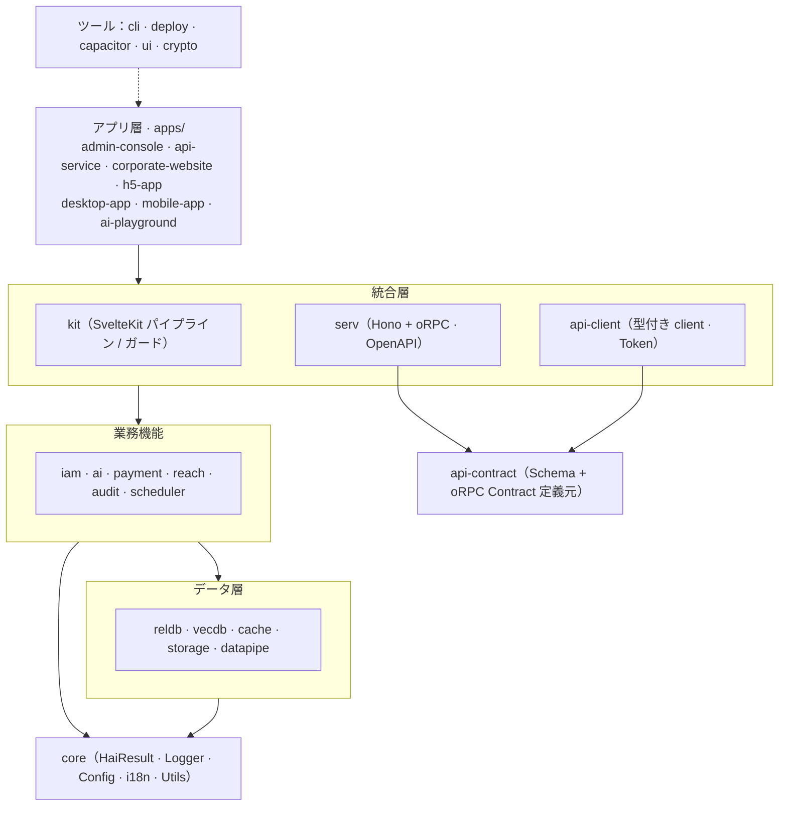

# hai Framework

[简体中文](./README.md) | [English](./README.en.md) | [日本語](./README.ja.md)

> 現在は `0.1.0-alpha` 段階で、公開契約は開発中です。本番導入前にバージョンを固定し、用途に応じた安全性・処理能力を検証してください。

<p align="center">
  <strong>AI Runtime · 企業向けフルスタックモジュール · Agent Skills · エンドツーエンドの型安全性</strong>
</p>

<p align="center">
  AI アプリ向けの TypeScript フルスタックフレームワーク。1 回の LLM 呼び出しから、提供可能な企業向けアプリケーションまで。
</p>

<p align="center">
  <a href="./LICENSE"></a>
  
  
  
</p>

---

## 概要

hai Framework は **AI Runtime を中核に、企業向け機能を必要に応じて組み合わせ、AI コーディング支援向けに最適化した** TypeScript フルスタックフレームワークです。

最小構成では `@h-ai/ai` で LLM とツールを呼び出せます。永続化、マルチテナント、認証、監査、API、UI、デプロイが必要になったときに `reldb`、`vecdb`、`iam`、`audit`、`serv`、`ui` などを組み合わせます。全スタックを一度に導入する必要はありません。

共通の API スタイルで 4 種類の機能を統合し、AI 支援によるアプリ全体の構築を可能にします：

- **AI**：LLM 対話、画像生成、音声（ASR / TTS）、MCP、ツール、RAG、ベクトル検索。
- **安全性**：中国の国家暗号規格、認証、RBAC 認可、監査ログ。
- **データ**：リレーショナル DB、キャッシュ、オブジェクトストレージ、データパイプライン。
- **運用**：決済、通知、定時タスク、自動デプロイ。

## 主な特長

| 特長                   | 説明                                                                                  |
| ---------------------- | ------------------------------------------------------------------------------------- |
| **AI-First 設計**      | AI コーディング支援が正しく使える API を優先し、人にも使いやすくします。              |
| **共通ライフサイクル** | 状態を持つモジュールは `init() → use → close()` の共通パターンに従います。            |
| **明示的な失敗**       | ドメイン操作は `HaiResult<T>` で成功と失敗を型レベルで区別します。                    |
| **設定の検証**         | Zod Schema が `init()` で設定を検証し、起動時にエラーを検出します。                   |
| **必要に応じた構成**   | 独立公開の 21 モジュール。最小依存の `@h-ai/core` から必要に応じて追加します。        |
| **全体の型安全性**     | 厳密な TypeScript と `api-contract → serv → api-client` 全体の型推論。                |
| **複数端末の UI**      | デスクトップ・モバイル向けの 92 Svelte 5 Runes コンポーネント（基本・複合・用途別）。 |
| **生成・デプロイ**     | `hai create` で作成し、`hai deploy` で Vercel・自前ホストへ展開。                     |
| **Agent Skills 内蔵**  | 標準化された Skill により AI 支援が正しい用法を取得できます。                         |

## 設計方針

**AI-First は AI 専用という意味ではなく、各設計を AI コーディング支援が正しく使えるかを優先する方針です。** AI が正しく使える設計は、人の開発体験も改善します。

多くのフレームワークは人の自由度と規約を重視しますが、AI が書く場合は制約不足によりパターン・エラー処理・ログが不統一になりがちです。hai Framework は共通契約、実行可能な規約、Skill を組み合わせ、生成コードの一貫性・型安全性・エラー処理を保ち、人が審査できる成果にします。

この方針を次の設計に反映しています：

| 設計                                    | AI への利点                  | 開発者への利点                          |
| --------------------------------------- | ---------------------------- | --------------------------------------- |
| 共通ライフサイクル `init → use → close` | 共通の使い方を習得           | 予測可能なモジュール動作                |
| `HaiResult<T>` の戻り値                 | 主処理で明示的に失敗を処理   | 業務 try-catch を減らし呼び出しを明確化 |
| Zod の設定検証                          | 設定エラーを即座に確認       | 起動時に検証して障害を予防              |
| Provider パターン                       | 設定でバックエンドを切り替え | 複数環境で移行が容易                    |
| 厳密な TypeScript                       | 型推論が正しい呼び出しへ誘導 | 安全なリファクタリング                  |
| Skill ファイル + LLMS.txt               | 正しい用法を自動取得         | 生成コードの品質改善                    |
| 実行可能なコーディング規約              | 変更ごとに規約を適用         | スタイル統一・審査負担の軽減            |

> **失敗の扱い**：ドメイン操作は `HaiResult<T>` を優先し、`{ success: true, data }` または `{ success: false, error }` を返します。`AsyncIterable`・クライアント通信・コールバック・SvelteKit 制御フローなど throw が必要な境界は型・文書で個別に説明します。

## 技術構成

| 分野                   | 採用技術                                                       |
| ---------------------- | -------------------------------------------------------------- |
| 言語                   | TypeScript 6 / 7（厳密モード）                                 |
| ランタイム             | Node.js 22.22.2+ / 24.15.0+ / 26+                              |
| フロントエンド         | Svelte 5（Runes）+ SvelteKit 2                                 |
| UI                     | Tailwind CSS 4 + DaisyUI 5 + Bits UI v2                        |
| API 契約               | oRPC + Zod + OpenAPI 3.1（`api-contract → serv → api-client`） |
| API サービス           | Hono + oRPC + Scalar 文書                                      |
| リレーショナル DB      | SQLite / PostgreSQL / MySQL（SQL 直接操作、ORM なし）          |
| ベクトル DB            | LanceDB / pgvector / Qdrant / Chroma                           |
| キャッシュ             | メモリー / Redis（単一ノード / Cluster / Sentinel）            |
| オブジェクトストレージ | ローカル / S3 互換（AWS / MinIO / Alibaba Cloud OSS）          |
| AI                     | OpenAI 互換 API + MCP                                          |
| 暗号                   | 中国国家暗号規格 SM2 / SM3 / SM4                               |
| 決済                   | WeChat Pay / Alipay / Stripe                                   |
| デスクトップ           | Tauri                                                          |
| モバイル               | Capacitor（Android / iOS）                                     |
| ビルド                 | pnpm + Turborepo + Vite + tsup                                 |
| デプロイ               | Vercel（SaaS）· docker-ssh 自前ホスト · Neon / Upstash / R2    |

## はじめに

### 必要環境

- Node.js 22.22.2+ / 24.15.0+ / 26+
- pnpm ≥ 12.11.2

### 新規プロジェクト作成

```bash
# 全局安装 CLI
pnpm add -g @h-ai/cli

# 交互式创建项目（选择应用类型与功能模块）
hai create my-app

# 指定模板类型
hai create my-app --type admin      # 管理后台
hai create my-app --type api        # API 服务
hai create my-app --type website    # 企业官网
hai create my-app --type h5         # H5 移动应用

# 进入项目并启动
cd my-app && pnpm install && pnpm dev
```

### コード生成

```bash
hai generate page dashboard         # 生成页面
hai generate component UserCard     # 生成组件
hai generate api users              # 生成 API 路由

# 快捷别名
hai g:page dashboard
hai g:component UserCard
```

### デプロイ

```bash
# hai deploy 依据 config/_deploy.yml 中的 provider 选择部署方式

# 方式一：Vercel（SaaS）—— 部署并自动开通云端基础设施（Neon / Upstash / R2 …）
hai deploy                          # 部署到 Vercel
hai deploy --skip-provision         # 跳过基础设施自动开通

# 方式二：docker-ssh —— 容器化后经 SSH 部署到自有 Linux 主机（远程需 docker/podman + compose）
# 按所选功能（_db.yml / _cache.yml / _storage.yml …）自动生成对应 compose sidecar
hai deploy                          # 部署到自有主机
```

### 既存プロジェクトへの導入

`@h-ai/core` は必須で、ほかは必要に応じて導入します：

```bash
pnpm add @h-ai/core                 # 基础能力（必装）
pnpm add @h-ai/ai                   # AI / LLM / MCP / 文生图 / 语音
pnpm add @h-ai/reldb                # 关系数据库
pnpm add @h-ai/vecdb                # 向量数据库
pnpm add @h-ai/iam                  # 身份认证 / 授权
pnpm add @h-ai/ui                   # UI 组件库
# …按需添加其余模块
```

> 既存プロジェクトのルートで `hai add <module>` を使うと、CLI が依存関係を解決し設定を補って追加します。

## モジュール一覧

現在 **21 の独立公開モジュール**を、5 層に分類して提供しています。

### 基盤機能

| パッケージ     | 役割                                                                      | 対応 Provider |                                             npm 最新版                                              |
| -------------- | ------------------------------------------------------------------------- | :-----------: | :-------------------------------------------------------------------------------------------------: |
| `@h-ai/core`   | 基盤：`HaiResult`、child ログ、設定読み込み、ID、i18n、エラー定義、ツール |       —       |   [](https://www.npmjs.com/package/@h-ai/core)   |
| `@h-ai/crypto` | SM2 非対称暗号・署名、SM3 ハッシュ、SM4 対称暗号、パスワードハッシュ      |       —       | [](https://www.npmjs.com/package/@h-ai/crypto) |

### データ層

| パッケージ       | 役割                                                                         |              対応 Provider              |                                               npm 最新版                                                |
| ---------------- | ---------------------------------------------------------------------------- | :-------------------------------------: | :-----------------------------------------------------------------------------------------------------: |
| `@h-ai/reldb`    | リレーショナル DB：DDL、SQL、トランザクション、ページ分割、CRUD リポジトリー |         ✅ SQLite / PG / MySQL          |    [](https://www.npmjs.com/package/@h-ai/reldb)    |
| `@h-ai/vecdb`    | ベクトル DB：コレクション、ベクトル挿入、類似検索                            | ✅ LanceDB / pgvector / Qdrant / Chroma |    [](https://www.npmjs.com/package/@h-ai/vecdb)    |
| `@h-ai/cache`    | キャッシュ・分散ロック：KV、Hash、List、Set、SortedSet、Lock、Redis 型 API   |            ✅ Memory / Redis            |    [](https://www.npmjs.com/package/@h-ai/cache)    |
| `@h-ai/storage`  | ファイル保存：アップロード・ダウンロード・削除・コピー・署名付き URL         |              ✅ Local / S3              |  [](https://www.npmjs.com/package/@h-ai/storage)  |
| `@h-ai/datapipe` | データパイプライン：テキスト整理、7 分割方式、合成（純粋関数、init 不要）    |                    —                    | [](https://www.npmjs.com/package/@h-ai/datapipe) |

### 業務機能

| パッケージ        | 役割                                                                                                      |           対応 Provider           |                                                npm 最新版                                                 |
| ----------------- | --------------------------------------------------------------------------------------------------------- | :-------------------------------: | :-------------------------------------------------------------------------------------------------------: |
| `@h-ai/iam`       | 認証・アクセス管理：パスワード/OTP/LDAP、RBAC、セッション、ユーザー                                       |                 —                 |       [](https://www.npmjs.com/package/@h-ai/iam)       |
| `@h-ai/reach`     | 通知：メール、SMS、API 通知、テンプレート、DND                                                            | ✅ SMTP / Alibaba Cloud SMS / API |     [](https://www.npmjs.com/package/@h-ai/reach)     |
| `@h-ai/ai`        | AI：通常・ストリーミング対話、画像、ASR/TTS、ツール、MCP、Embedding、RAG/知識、記憶、Context、Rerank、A2A |     ✅ OpenAI 互換 / 拡張可能     |        [](https://www.npmjs.com/package/@h-ai/ai)        |
| `@h-ai/payment`   | 決済：注文作成、複数端末からの開始、通知                                                                  |  ✅ WeChat Pay / Alipay / Stripe  |   [](https://www.npmjs.com/package/@h-ai/payment)   |
| `@h-ai/audit`     | 監査：記録、ページ検索、統計、定期削除                                                                    |                 —                 |     [](https://www.npmjs.com/package/@h-ai/audit)     |
| `@h-ai/scheduler` | 定時実行：cron、JS/HTTP、DB 永続化、分散ロック、ログ                                                      |                 —                 | [](https://www.npmjs.com/package/@h-ai/scheduler) |

### 統合層

| パッケージ           | 役割                                                                                             | 対応 Provider |                                                   npm 最新版                                                    |
| -------------------- | ------------------------------------------------------------------------------------------------ | :-----------: | :-------------------------------------------------------------------------------------------------------------: |
| `@h-ai/api-contract` | 公開 HTTP 契約：oRPC + Zod、用途別のドメイン構成、共通 `HaiResult<T>`                            |       —       | [](https://www.npmjs.com/package/@h-ai/api-contract) |
| `@h-ai/serv`         | API runtime：Hono + oRPC、contract/procedure、OpenAPI 3.1・Scalar 文書                           |       —       |         [](https://www.npmjs.com/package/@h-ai/serv)         |
| `@h-ai/kit`          | SvelteKit：Hook、middleware、guard、検証、同一オリジン endpoint（公開 HTTP contract を持たない） |       —       |          [](https://www.npmjs.com/package/@h-ai/kit)          |
| `@h-ai/api-client`   | 型付き client：ネストした contract 呼び出し、Bearer/httpOnly Token、401 更新                     |       —       |   [](https://www.npmjs.com/package/@h-ai/api-client)   |
| `@h-ai/capacitor`    | モバイル連携：安全な Token 保存、端末情報、通知、カメラ、ステータスバー                          |       —       |    [](https://www.npmjs.com/package/@h-ai/capacitor)    |

### UI・ツール

| パッケージ     | 役割                                                                      |                               対応 Provider                               |                                             npm 最新版                                              |
| -------------- | ------------------------------------------------------------------------- | :-----------------------------------------------------------------------: | :-------------------------------------------------------------------------------------------------: |
| `@h-ai/ui`     | 92 の Svelte 5 Runes 部品（基本 20 + 複合 36 + 用途別 36）、15 テーマ     |                                     —                                     |     [](https://www.npmjs.com/package/@h-ai/ui)     |
| `@h-ai/cli`    | CLI：作成、モジュール追加、コード生成、デプロイ                           |                                     —                                     |    [](https://www.npmjs.com/package/@h-ai/cli)    |
| `@h-ai/deploy` | 自動デプロイ：クラウドを作成する Vercel、機能別 sidecar を伴う docker-ssh | ✅ Vercel / docker-ssh · Neon / Upstash / R2 / Resend / Alibaba Cloud SMS | [](https://www.npmjs.com/package/@h-ai/deploy) |

### モジュール文書一覧

| 分類        | モジュール           | README                                                                       |
| ----------- | -------------------- | ---------------------------------------------------------------------------- |
| 基盤        | `@h-ai/core`         | [`packages/core/README.ja.md`](./packages/core/README.ja.md)                 |
| 基盤        | `@h-ai/crypto`       | [`packages/crypto/README.ja.md`](./packages/crypto/README.ja.md)             |
| データ      | `@h-ai/reldb`        | [`packages/reldb/README.ja.md`](./packages/reldb/README.ja.md)               |
| データ      | `@h-ai/vecdb`        | [`packages/vecdb/README.ja.md`](./packages/vecdb/README.ja.md)               |
| データ      | `@h-ai/cache`        | [`packages/cache/README.ja.md`](./packages/cache/README.ja.md)               |
| データ      | `@h-ai/storage`      | [`packages/storage/README.ja.md`](./packages/storage/README.ja.md)           |
| データ      | `@h-ai/datapipe`     | [`packages/datapipe/README.ja.md`](./packages/datapipe/README.ja.md)         |
| 業務機能    | `@h-ai/iam`          | [`packages/iam/README.ja.md`](./packages/iam/README.ja.md)                   |
| 業務機能    | `@h-ai/reach`        | [`packages/reach/README.ja.md`](./packages/reach/README.ja.md)               |
| 業務機能    | `@h-ai/ai`           | [`packages/ai/README.ja.md`](./packages/ai/README.ja.md)                     |
| 業務機能    | `@h-ai/payment`      | [`packages/payment/README.ja.md`](./packages/payment/README.ja.md)           |
| 業務機能    | `@h-ai/audit`        | [`packages/audit/README.ja.md`](./packages/audit/README.ja.md)               |
| 業務機能    | `@h-ai/scheduler`    | [`packages/scheduler/README.ja.md`](./packages/scheduler/README.ja.md)       |
| 統合        | `@h-ai/api-contract` | [`packages/api-contract/README.ja.md`](./packages/api-contract/README.ja.md) |
| 統合        | `@h-ai/serv`         | [`packages/serv/README.ja.md`](./packages/serv/README.ja.md)                 |
| 統合        | `@h-ai/kit`          | [`packages/kit/README.ja.md`](./packages/kit/README.ja.md)                   |
| 統合        | `@h-ai/api-client`   | [`packages/api-client/README.ja.md`](./packages/api-client/README.ja.md)     |
| 統合        | `@h-ai/capacitor`    | [`packages/capacitor/README.ja.md`](./packages/capacitor/README.ja.md)       |
| UI とツール | `@h-ai/ui`           | [`packages/ui/README.ja.md`](./packages/ui/README.ja.md)                     |
| UI とツール | `@h-ai/cli`          | [`packages/cli/README.ja.md`](./packages/cli/README.ja.md)                   |
| UI とツール | `@h-ai/deploy`       | [`packages/deploy/README.ja.md`](./packages/deploy/README.ja.md)             |

### 一般的な初期化順

多くのプロジェクトは次の依存順で初期化でき、AI 支援にも理解しやすい構成になります：

`core → reldb / cache / storage / vecdb → iam / audit / scheduler / reach → ai / payment → api-contract → serv → kit / api-client / ui / capacitor`

- `iam` は初期化済みの `reldb` と `cache` に依存。
- `audit` は初期化済みの `reldb` に依存。
- DB 永続化の `scheduler` は `reldb` を先に初期化します。`cache` が初期化済みなら分散ロックを自動有効化。
- `reach`・`payment`・`ai` は用途に応じてほかの機能を再利用します。詳細は各 README を参照。
- `api-contract` は初期化不要で、公開 HTTP schema・oRPC contract のみを定義。
- `serv` は業務モジュール初期化後に Hono app を作成し、`contract` と `procedures` の形状をそろえます。
- `kit` は SvelteKit Hook・guard・同一オリジン endpoint を担当し、公開クロスプラットフォーム API は定義しません。
- `api-client` は Web / App / SSR で同じアプリ contract を利用し、既定で `HaiResult<T>` を返します。

## アーキテクチャ



**依存方向**：上位層が下位層に依存します。最下層の `@h-ai/core` はほかのモジュールへ依存しません。公開 HTTP API は **`api-contract`（定義）→ `serv`（実装・接続）→ `api-client`（呼び出し）** に統一し、`kit` は SvelteKit パイプライン・同一オリジン endpoint を担当します。

## 使用例

以下は代表的な断片です。業務変数・schema はアプリに合わせて補ってください。完全な API・エラーコード・例は各 README と [LLMS.txt（中国語）](./LLMS.txt) を参照します。

### HaiResult のエラー処理

ドメインの失敗は `HaiResult` で表します。ストリーミング・通信クライアント・フレームワーク制御・外部 callback は throw する場合があるため、各 API の境界で捕捉してください：

```typescript
import type { HaiResult } from '@h-ai/core'
import { core, err, HaiCommonError, ok } from '@h-ai/core'

function divide(a: number, b: number): HaiResult<number> {
  if (b === 0)
    return err(HaiCommonError.VALIDATION_ERROR, 'Division by zero')
  return ok(a / b)
}

const result = divide(10, 2)
if (result.success) {
  const quotient = result.data // 5
}
else {
  core.logger.warn('Division failed', { code: result.error.code, message: result.error.message })
}
```

### リレーショナル DB

```typescript
import { reldb } from '@h-ai/reldb'

const initResult = await reldb.init({ type: 'sqlite', database: './data/app.db' })
if (!initResult.success)
  throw new Error(initResult.error.message)

// DDL — 建表
await reldb.ddl.createTable('users', {
  id: { type: 'TEXT', primaryKey: true },
  email: { type: 'TEXT', notNull: true, unique: true },
  name: { type: 'TEXT' },
}, true)

// 参数化查询与分页
const users = await reldb.sql.query<User>('SELECT * FROM users WHERE name = ?', ['Alice'])
const page = await reldb.sql.queryPage<User>({
  sql: 'SELECT * FROM users',
  pagination: { page: 1, pageSize: 20 },
})

// 事务
await reldb.tx.wrap(async (tx) => {
  await tx.execute('INSERT INTO users (id, email) VALUES (?, ?)', ['1', 'a@b.com'])
  await tx.execute('INSERT INTO logs (action) VALUES (?)', ['user_created'])
})

// CRUD 仓库（自动生成 SQL）
const userRepo = reldb.crud.table<User>({
  table: 'users',
  idColumn: 'id',
  select: ['id', 'email', 'name'],
  createColumns: ['id', 'email', 'name'],
  updateColumns: ['email', 'name'],
  dbType: 'sqlite',
})
await userRepo.create({ id: '1', email: 'a@b.com', name: 'Alice' })
```

### ベクトル DB

```typescript
import { vecdb } from '@h-ai/vecdb'

const initResult = await vecdb.init({ type: 'lancedb', path: './data/vecdb' })
if (!initResult.success)
  throw new Error(initResult.error.message)

await vecdb.collection.create('docs', { dimension: 1536 })
await vecdb.vector.insert('docs', [
  { id: 'doc-1', vector: embeddings, content: '文档内容', metadata: { source: 'wiki' } },
])
const results = await vecdb.vector.search('docs', queryVector, { topK: 5, minScore: 0.7 })
```

### キャッシュ

```typescript
import { cache } from '@h-ai/cache'

const initResult = await cache.init({ type: 'memory' })
if (!initResult.success)
  throw new Error(initResult.error.message)
// await cache.init({ type: 'redis', url: 'redis://localhost:6379' })

await cache.kv.set('key', { name: 'Alice' }, { ex: 3600 })
const val = await cache.kv.get<{ name: string }>('key')
await cache.zset.zadd('leaderboard', { score: 100, member: 'Alice' })
```

### AI / LLM / 画像 / 音声

```typescript
import { ai } from '@h-ai/ai'

// 初始化（OpenAI 兼容 API）；未初始化 reldb/vecdb 时使用进程内临时 Store
const initResult = await ai.init({
  llm: { apiKey: process.env.HAI_AI_LLM_APIKEY, model: 'gpt-4o-mini' },
})
if (!initResult.success)
  throw new Error(initResult.error.message)

// 同步调用
const chat = await ai.llm.chat({
  messages: [{ role: 'user', content: '用一句话解释量子计算' }],
})
if (chat.success)
  void chat.data.choices[0].message.content

// 流式调用
const stream = ai.llm.chatStream({ messages: [{ role: 'user', content: '讲一个故事' }] })
for await (const chunk of stream)
  process.stdout.write(chunk.choices[0]?.delta?.content ?? '')

// 文生图
const image = await ai.image.generate({ prompt: '一只在星空下的猫', size: '1024x1024' })

// 语音合成（TTS）
const speech = await ai.audio.synthesize({ text: '你好，世界', voice: 'default' })
```

### 認証・認可

```typescript
import { cache } from '@h-ai/cache'
import { iam } from '@h-ai/iam'
import { reldb } from '@h-ai/reldb'

// 先初始化 reldb 与 cache，IAM 会复用已初始化单例
const dbInit = await reldb.init({ type: 'sqlite', database: './data/app.db' })
if (!dbInit.success)
  throw new Error(dbInit.error.message)
const cacheInit = await cache.init({ type: 'memory' })
if (!cacheInit.success)
  throw new Error(cacheInit.error.message)
const iamInit = await iam.init({ session: { maxAge: 86400, sliding: true } })
if (!iamInit.success)
  throw new Error(iamInit.error.message)

await iam.user.register({ username: 'alice', password: 'StrongPass123!' })
const loginResult = await iam.auth.login({ identifier: 'alice', password: 'StrongPass123!' })

// RBAC 权限控制
await iam.authz.assignRole(userId, 'admin')
const allowed = await iam.authz.checkPermission(userId, 'users:read')
```

### 公開 API：契約 → サービス → クライアント

```typescript
// 1) 契约（api-contract）：只描述“有哪些 API”，纯定义、无业务实现
import { apiContract } from '@h-ai/api-contract'

export const contract = apiContract.create({
  iam: apiContract.iam,
  storage: apiContract.storage,
  ai: apiContract.ai,
})
```

```typescript
// 2) 服务（serv）：挂载 contract + procedures，生成 OpenAPI 与文档页
import { serv } from '@h-ai/serv'
import { createAiProcedures } from '@h-ai/serv/features/ai'
import { createIamProcedures } from '@h-ai/serv/features/iam'
import { createStorageProcedures } from '@h-ai/serv/features/storage'

const app = serv.createApp({
  contract,
  procedures: {
    iam: createIamProcedures({ iam }),
    storage: createStorageProcedures({ storage }),
    ai: createAiProcedures({ ai }),
  },
  http: {
    apiPrefix: '/api/v1',
    openapi: { path: '/openapi.json' },
    docs: { path: '/docs' },
  },
  iam, // 顶层传入后自动派生 access token 校验
})
serv.listen(app, { host: '0.0.0.0', onClose: closeApp })
```

```typescript
// 3) 客户端（api-client）：Web / App / SSR 消费同一份契约，默认返回 HaiResult<T>
import { apiClient } from '@h-ai/api-client'

const initResult = await apiClient.init({ baseUrl: '/api/v1', auth: {} })
if (!initResult.success)
  throw new Error(initResult.error.message)

const login = await apiClient.iam.auth.login({ identifier: 'alice', password: 'xxx' })
if (login.success)
  await apiClient.auth.setTokens(login.data.tokens)
```

### Svelte 5 UI コンポーネント

```text
<script lang="ts">
  import { Button, Card, DataTable, Input, Modal } from '@h-ai/ui'

  let showModal = $state(false)
  let users = $state([])
</script>

<Card>
  <DataTable
    data={users}
    columns={[
      { key: 'name', label: '姓名' },
      { key: 'email', label: '邮箱' },
    ]}
    keyField="id"
  >
    {#snippet actions(user)}
      <Button size="xs" onclick={() => edit(user)}>编辑</Button>
    {/snippet}
  </DataTable>
</Card>

<Button onclick={() => (showModal = true)}>新建用户</Button>

<Modal bind:open={showModal} title="新建用户">
  <Input label="姓名" bind:value={name} />
  <Input label="邮箱" bind:value={email} type="email" />
</Modal>
```

> `storage` / `datapipe` / `payment` / `audit` / `scheduler` / `reach` / `crypto` / `kit` / `capacitor` / `deploy` は各 README と `LLMS.txt` を参照してください。

## 初回ガイドとヘルプセンター

`@h-ai/ui/guide` は `createGuide`、`GuideHost`、`HelpCenter` を提供します。Cookie による初回案内、手動再表示、対象ページへの移動と段階的な強調表示、Markdown ヘルプの検索を利用できます。既存テーマに対応し、共通文言は中国語・英語、業務内容はアプリの i18n を使用します。

admin-console と CLI fullstack の Web/App/Desktop で標準搭載されます。ユーザーとガイドのバージョンごとに状態を保存し、後で表示する選択肢と再通知しない選択肢を提供します。[UI ガイド](packages/ui/README.ja.md#初回ガイドとヘルプセンター)を参照してください。

## サンプルアプリ

`apps/` に 7 つの実行可能なアプリがあり、生成の参考と統合例を兼ねます。`api-service-contract` は API 関連アプリが共有する契約パッケージです。

| アプリ              | 説明                                            | 使用モジュール                                           |
| ------------------- | ----------------------------------------------- | -------------------------------------------------------- |
| `admin-console`     | 管理画面（全モジュール統合の参考）              | core, reldb, iam, cache, storage, crypto, ai, kit, ui    |
| `ai-playground`     | AI 実験環境（LLM / 画像 / 記憶 / 音声）         | core, ai, kit, ui                                        |
| `api-service`       | Hono + oRPC API サービス（contract の構成入口） | core, reldb, cache, iam, storage, ai, api-contract, serv |
| `corporate-website` | 企業サイト + 提携登録 + AI サポート             | core, reldb, cache, storage, ai, reach, kit, ui          |
| `h5-app`            | モバイル H5（写真認識 / カート / ログイン）     | core, reldb, iam, cache, storage, ai, kit, ui            |
| `desktop-app`       | Tauri デスクトップアプリ                        | api-client, api-service-contract, crypto, ui             |
| `mobile-app`        | Capacitor Android / iOS アプリ                  | api-client, api-service-contract, crypto, ui, capacitor  |

### アプリ別の起動

| アプリ              | 起動コマンド                            |
| ------------------- | --------------------------------------- |
| `admin-console`     | `pnpm --filter admin-console dev`       |
| `ai-playground`     | `pnpm --filter ai-playground dev`       |
| `api-service`       | `pnpm --filter api-service dev`         |
| `corporate-website` | `pnpm --filter corporate-website dev`   |
| `h5-app`            | `pnpm --filter h5-app dev`              |
| `desktop-app`       | `cd apps/desktop-app && pnpm tauri:dev` |
| `mobile-app`        | `pnpm --filter mobile-app dev`          |

## 開発

### ローカル開発

```bash
pnpm install                    # 安装依赖
pnpm dev                        # 全量开发模式
pnpm typecheck                  # 类型检查
pnpm lint                       # ESLint（含 check:skills）
pnpm test                       # 单元测试
pnpm --filter @h-ai/reldb test  # 只运行某个模块
```

### プロジェクト構成

```
hai-framework/
├── packages/            # 21 のフレームワークパッケージ（@h-ai/*）
│   └── cli/templates/   # CLI と Skill のテンプレート（生成アプリへ配布）
├── apps/                # サンプルアプリ
├── scripts/             # 検証・公開スクリプト
├── AGENTS.md            # AI 支援の作業入口
├── LLMS.txt             # AI 向け使用索引
├── .agents/             # 共通開発規約（instructions/）とリポジトリー Skill（skills/）
├── AGENTS.md            # 共通 AI 入口とタスク案内
└── .github/             # GitHub Actions と Copilot の軽量な入口
```

### AI-First の基盤

本リポジトリーは [AGENTS.md](AGENTS.md) を共通入口とし、詳細な規約を `.agents/instructions/`、開発 Skill を `.agents/skills/` に保存します。Copilot のパス指示にはマッチ条件とリンクのみを置き、Claude/OpenCode の入口も共通規約を参照します。Codex は `AGENTS.md` と `.agents/skills/` を標準で検出し、プロジェクト内で `$hai-create-module`、`$hai-review-module` などを呼び出せます。参考ファイルは必要なタスクに応じて読みます。根拠：[Codex skills](https://learn.chatgpt.com/docs/build-skills)、[プロジェクト指針](https://learn.chatgpt.com/docs/agent-configuration/agents-md)。

`hai create` は同じ共通入口と Skill を生成し、アプリ種別に応じた `AGENTS.md` を提供します：

```
my-app/
├── .agents/
│   └── skills/                       # 共通 Skill 本文と参考（Codex が標準で検出）
├── .github/
│   └── copilot-instructions.md       # 共通 AGENTS.md を参照
├── AGENTS.md                         # Codex / OpenCode / 共通 AI ガイド
├── CLAUDE.md                         # Claude Code ガイド（@AGENTS.md を再利用）
└── opencode.json                     # instructions で AGENTS.md を直接参照
```

| AI 支援ツール  | 生成する主なファイル                                                                       |
| -------------- | ------------------------------------------------------------------------------------------ |
| GitHub Copilot | `.github/copilot-instructions.md` → `AGENTS.md` + `.agents/skills/`                        |
| Cursor         | `AGENTS.md` + `.agents/skills/`                                                            |
| Claude Code    | `CLAUDE.md` + `AGENTS.md`（`@AGENTS.md` で規約再利用、`.agents/skills/` は自動検出しない） |
| Codex          | `AGENTS.md` + `.agents/skills/`                                                            |
| OpenCode       | `AGENTS.md` + `.agents/skills/` + `opencode.json`                                          |

Skill は `packages/cli/templates/skills/` で管理し、`@h-ai/cli` が利用先の `.agents/skills/` へ配布します。**28 テンプレート**は 20 のモジュール Skill と 8 つの全体・作業用 Skill（`hai-build`、`hai-spec-review`、`hai-app-create`、`hai-app-review`、`hai-app-tests`、`hai-ci`、`hai-framework-sync`、`hai-pr-review`）で、アプリ構築・テスト・審査・用法確認・規約同期を支援します。リポジトリー開発 Skill とアプリテンプレートは用途を分け、公開契約を同期します。影響範囲に応じて `typecheck → lint → build → test` を実行し、UI・ルート・CLI テンプレートは対応する E2E 門禁も実行します。

### 設定・環境変数

アプリとテンプレートは `HAI_<CONFIG>_<PATH>` を共用します。ルートの [`.env.example`](.env.example) に変数の用途、列挙値と範囲を掲載しています。各サンプルアプリの `.env.example` に、そのアプリで利用できる全変数を記載しています。

`.env.example` は全項目の説明と制約、`.env` は共通の公開設定、`.env.dev` / `.env.test` / `.env.prod` は環境別の公開設定として Git に登録します。端末固有の秘密情報は登録対象外の `.env.local` に保存します。優先順位はプロセス環境 > `.env.local` > 環境別ファイル > `.env` です。各アプリの `.env.example` に利用できる全項目を掲載します。

公開 Schema、YAML、環境変数の読み取りを変更したら、対象モジュールをビルドして `pnpm generate:env` を実行し、ルート一覧、CLI メタデータ、各サンプルの `.env.example` を更新します。`pnpm check:env` で更新漏れを確認します。生成処理は公開ソースとサンプルのみを読み、`.env.local` やプロジェクト固有の公開設定値を変更しません。用途、型、列挙値、単位、範囲、有効条件を説明し、配列・動的キー・親オブジェクトの上書きは Schema と実行テストで確認します。

`pnpm dev` / `dev:test` / `dev:prod` で環境を選び、ビルド済み Node サービスは `start:test` / `start:prod` で起動します。Vite は `core.config.loadEnvFiles({ mode, envDir })` の成功を確認して注入し、Node は基本・環境・ローカルの順で `--env-file` を読み込みます。`core.init` は dotenv を読みません。ファイルモードの development / production は dev / prod に対応します。Provider 切り替えと移行手順はアプリ skill の[環境設定](packages/cli/templates/skills/hai-app-create/development.md#环境配置)にあります。

- **命名**：`HAI_<CONFIG_NAME>_<YAML_PATH>`。階層を `_` で区切り、camelCase は分割しません（`llm.apiKey` → `HAI_AI_LLM_APIKEY`）。
- **優先順位**：規約の環境変数 > YAML の明示的 `${VAR}` > YAML 既定値。
- **AI 互換**：`OPENAI_*` は `@h-ai/ai` の互換 fallback のみ。
- **秘密情報**：直書き・ログ記録・クライアントの `PUBLIC_*` / `VITE_*` への保存は禁止。

| 分類           | 主な変数                          | 説明                                                       |
| -------------- | --------------------------------- | ---------------------------------------------------------- |
| Runtime        | `HAI_CORE_ENV`、`HAI_CORE_DEBUG`  | 実行環境・デバッグ・ログ                                   |
| Database       | `HAI_DB_*`                        | `_db.yml` の SQLite / PostgreSQL / MySQL                   |
| Cache          | `HAI_CACHE_*`                     | `@h-ai/cache` の memory / Redis / Upstash                  |
| Session / Auth | `HAI_IAM_*`、`HAI_KIT_COOKIE_KEY` | `@h-ai/iam`・`@h-ai/kit` の認証・安全性                    |
| API Service    | `PORT`、`HOST`、`PUBLIC_API_BASE` | `apps/api-service` / `@h-ai/serv` の待受・フロント URL     |
| Storage        | `HAI_STORAGE_*`                   | `@h-ai/storage` の local / S3                              |
| AI             | `HAI_AI_LLM_*`                    | `@h-ai/ai` の LLM API Key・Base URL・モデル                |
| VecDB          | `HAI_VECDB_*`                     | `@h-ai/vecdb` の LanceDB / pgvector / Qdrant / Chroma      |
| Reach          | `HAI_REACH_*`                     | `@h-ai/reach` の SMTP・SMS・Webhook                        |
| Payment        | `HAI_PAYMENT_*`                   | `@h-ai/payment` の WeChat Pay・Alipay・Stripe の加盟店設定 |
| Deploy         | `HAI_DEPLOY_*`                    | `@h-ai/deploy` / `@h-ai/cli` の展開・基盤認証情報          |

全項目・既定値はルートの `.env.example` が基準です。個別アプリでは対応する `README.md` と `.env.example` で追加設定を確認します。

### 品質チェック

影響範囲に合わせてコマンドを選び、複数パッケージ契約・ルート設定の変更はルートで実行します：

| チェック         | コマンド                  | 対象                                              |
| ---------------- | ------------------------- | ------------------------------------------------- |
| 型確認           | `pnpm typecheck`          | 全変更                                            |
| コード規約       | `pnpm lint`               | 全変更（`check:skills` を含む）                   |
| ビルド           | `pnpm build`              | ビルド / テンプレート / 公開 / 複数パッケージ契約 |
| 単体テスト       | `pnpm test`               | 全変更                                            |
| エンドツーエンド | `pnpm e2e`                | UI / ルート / 一連の処理                          |
| 公開前の検証     | `pnpm test:release-local` | 公開前の全体検証（導入 → E2E）                    |

> Windows PowerShell は `pnpm.cmd` を使います。ルートの `pnpm e2e` は CLI 生成と Admin Console・AI Playground・Corporate Website・H5・Mobile Web の Playwright を検証します。コンテナーテストには利用可能な Docker / Podman が必要です。

### コミット確認（Leak Hooks）

Git hooks は `git commit` / `git push` 前に漏洩キーワードを確認します。ローカルの `.leak-words.json` を作成できます（Git 除外・ローカルのみ）：

```json
["your-leak-word"]
```

入口は `.husky/pre-commit`、`.husky/commit-msg`、`.husky/pre-push`、`scripts/check-leak-words.mjs` です。

## ライセンス

[Apache-2.0](./LICENSE)
