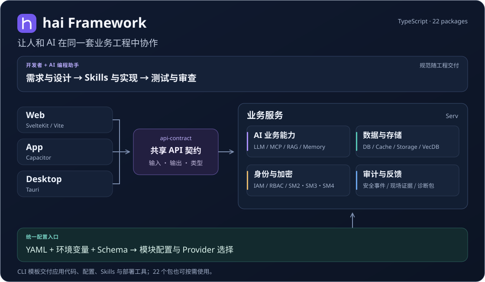
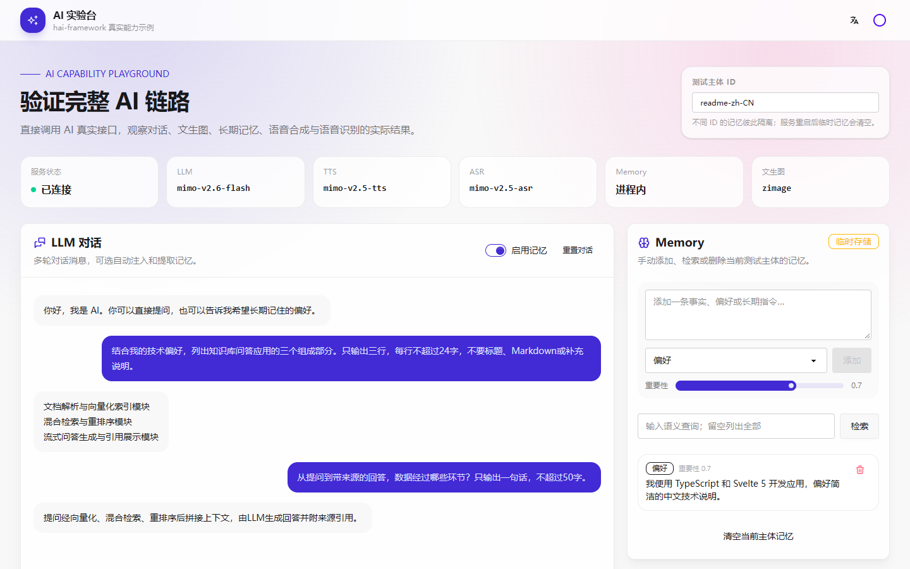
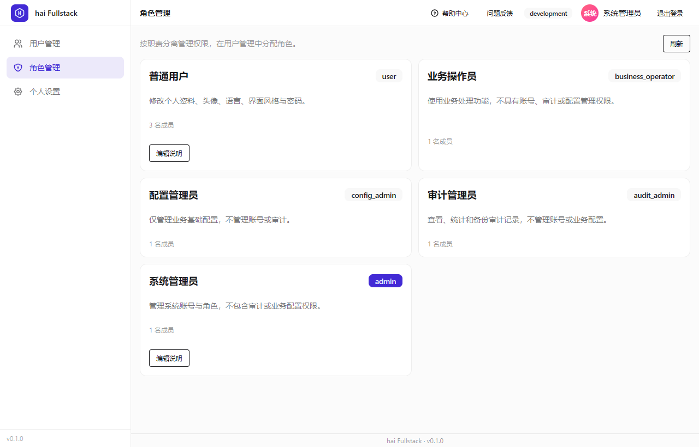
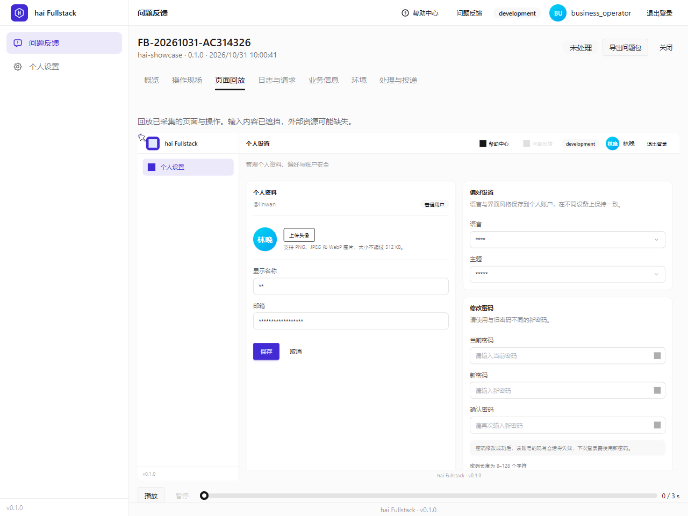
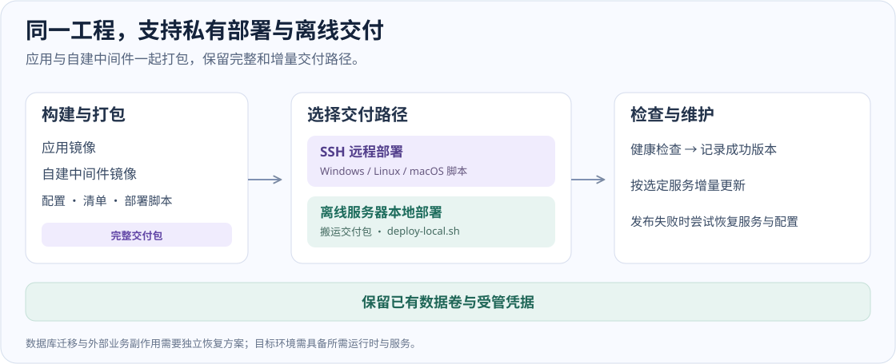

# hai Framework

**AI 原生、配置驱动、安全优先的 TypeScript 应用框架。**

[简体中文](README.md) · [English](README.en.md) · [日本語](README.ja.md)

[](https://www.npmjs.com/package/@h-ai/cli)
[](https://github.com/hai-series/hai-framework/actions/workflows/ci.yml)
[](https://github.com/hai-series/hai-framework/actions/workflows/codeql.yml)
[](https://hai-series.github.io/hai-framework/)
[](LICENSE)

[官网与模板预览](https://hai-series.github.io/hai-framework/) · [使用指南](docs/usage/README.md) · [配置手册](docs/usage/configuration/README.md) · [发布记录](https://github.com/hai-series/hai-framework/releases/latest)

hai-framework 是面向 AI 时代的全栈应用研发与交付框架。它以统一、可组合的 TypeScript 技术体系连接 AI、数据、安全、界面与工程工具，让开发者与 AI 助手共用契约、配置、规范和验证流程，贯通从应用构建、多端交付到持续演进的完整过程。智能能力既融入开发过程，也成为应用本身的一部分。



_以 Fullstack 为例：开发规范、客户端、接口契约和业务模块一起交付，模块与客户端按需组合。_

## 为什么选择 hai

### AI 原生：覆盖开发协作与业务集成

开发时，生成工程自带 `AGENTS.md`、模块 Skills，以及需求审查、实施、测试和复审流程，让 AI 编程助手沿用项目的公开 API、权限规则和验证要求。业务运行时，统一组合模型调用、工具/MCP、RAG、会话记忆与多模态能力，复用应用的数据和服务层。

[工程规范与 Skills](AGENTS.md) · [AI 开发与集成](docs/usage/development/ai.md)



_AI 实验台连接真实模型，展示多轮对话与记忆记录。对话和偏好为演示数据。_

### 配置驱动：把环境差异收敛到配置入口

模型、数据库、缓存、文件和向量检索使用统一的 YAML、`HAI_*` 环境变量映射与 Schema 校验约定。按环境选择 SQLite/PostgreSQL/MySQL、Memory/Redis、Local/S3 等后端，让开发、测试与部署环境的连接和策略有明确入口；业务代码复用模块公开接口。

[配置手册](docs/usage/configuration/README.md) · [数据与存储](docs/usage/configuration/data.md)

### 安全优先：身份、国密与审计配套提供

内置 SM2/SM3/SM4 与应用层传输加密，并提供认证与 RBAC、账号生命周期、密码与会话策略、IP/时间访问规则和安全审计。将身份、业务授权和审计纳入同一工程体系，支持按职责分权与纵深防护。

[认证与权限](docs/usage/configuration/identity.md) · [国密与传输加密](packages/crypto/README.md) · [接口访问策略](docs/usage/configuration/request-access.md)



_CLI 生成的 Fullstack 应用：账号、角色、配置与审计各有职责边界，管理权限按角色分离。图中为演示账号。_

### 面向交付：共享多端契约，支持私有部署

Web、App、Desktop 共用类型化 API 契约与服务端业务能力；同源 Web 可使用 SvelteKit 与 Kit。交付工具将应用和自建中间件镜像一起打包，支持 SSH 发布、服务器本地离线部署、指定服务增量与失败恢复。上线后，用户反馈可关联页面回放、日志、请求和业务证据，导出诊断包。

[共享 API 契约](packages/api-contract/README.md) · [部署与恢复](docs/usage/configuration/delivery.md) · [反馈诊断](docs/usage/operations/feedback.md)



_从用户报送到授权诊断：在应用内回看页面操作，输入内容已遮挡，并可导出问题包。图中为隔离环境的演示记录。_

## 创建第一个应用

准备 Node.js `^22.23.4 || ^24.22.1 || ^26.12.1` 与 pnpm 12.11.2；推荐与 CI 一致的 Node.js 24.22.1。Windows PowerShell 使用 `pnpm.cmd`。

```sh
pnpm dlx @h-ai/cli@latest create my-app --type fullstack --frontends web --defaults
cd my-app
pnpm dev
```

CLI 默认安装依赖并初始化 Git。首次使用 `admin` 登录，随机初始密码在生成工程的 `.env.dev.local` 对应 `HAI_ADMIN_DEFAULT_PASSWORD` 中，首次登录后按页面要求修改。不要公开环境文件或密码。

新工程包含适用的完整模块与示例，服务端也安装 AI 与向量依赖。`--defaults` 跳过交互，默认容器跳过额外 CUDA 下载。目录、环境和运行地址以生成工程 README 为准；[首次运行指南](docs/usage/getting-started/create.md)带你完成登录与验证。

安装版本以 [npm 的 latest 标签](https://www.npmjs.com/package/@h-ai/cli?activeTab=versions)为准，上方徽标直接读取注册表。可运行 `pnpm view @h-ai/cli@latest version` 查询；团队需要固定版本时，将 `@latest` 换成查询得到的具体版本。npm 的安装标签与 GitHub 的 Latest 展示标记分别管理。

### 选择适合的模板

| 模板        | 适用场景                             | 创建选项                           |
| ----------- | ------------------------------------ | ---------------------------------- |
| Fullstack   | 独立 API、多端业务应用，共用接口契约 | `--type fullstack --frontends web` |
| API         | 独立 Node.js 服务与公共接口          | `--type api`                       |
| Admin       | 同源管理后台，快速接入账号与业务页面 | `--type admin`                     |
| Website     | 企业官网、产品站与静态文档站         | `--type website`                   |
| H5 / Mobile | 移动网页或 Capacitor 应用            | `--type h5` / `--type mobile-app`  |

[官网提供 Fullstack、Website、Admin、Mobile 四类模板的实际页面预览](https://hai-series.github.io/hai-framework/#template-previews)。Website 默认 SSR，静态托管需按[静态构建说明](docs/usage/configuration/delivery.md#静态website与github-pages)配置；原生安装包需要对应平台工具链。

### 构建与发布

在生成工程中配置目标环境与部署参数后执行：

```sh
pnpm build --target image
pnpm run deploy --env prod --plan
pnpm run deploy --env prod
pnpm run deploy --env prod --build --services "serv,web"
pnpm run deploy --env prod --build --bundle-only
```

`--plan` 用于只读预检；`--services` 选择本次更新的服务；`--bundle-only` 生成可搬运的离线交付包。自动恢复覆盖服务与配置快照，数据库迁移和外部副作用需另设恢复方案。真实 IP、子路径、存储直连和策略文件见[部署与运行配置](docs/usage/configuration/delivery.md)。



## 按领域查找模块

已有工程可按需安装 `@h-ai/*`，或用 `hai add <module>` 补充适用模板的模块与配置。以下链接进入各包的公开 API、配置与使用示例。

| 领域       | 模块与职责                                                                                                                                                                                                                                                                |
| ---------- | ------------------------------------------------------------------------------------------------------------------------------------------------------------------------------------------------------------------------------------------------------------------------- |
| 基础与安全 | [core](packages/core/README.md)：结果、配置、日志、生命周期与访问策略；[crypto](packages/crypto/README.md)：SM2/SM3/SM4、密码哈希；[iam](packages/iam/README.md)：认证、会话与 RBAC                                                                                       |
| 数据       | [reldb](packages/reldb/README.md)：关系数据与事务；[cache](packages/cache/README.md)：缓存与分布式锁；[storage](packages/storage/README.md)：文件与预签名；[vecdb](packages/vecdb/README.md)：向量检索；[datapipe](packages/datapipe/README.md)：文本处理与分块           |
| AI         | [ai](packages/ai/README.md)：LLM、工具/MCP、RAG、记忆、图像、语音与 A2A                                                                                                                                                                                                   |
| 运营与业务 | [feedback](packages/feedback/README.md)：反馈与诊断；[audit](packages/audit/README.md)：审计与告警；[reach](packages/reach/README.md)：消息触达；[scheduler](packages/scheduler/README.md)：定时任务；[payment](packages/payment/README.md)：支付渠道                     |
| 接口与多端 | [api-contract](packages/api-contract/README.md)：共享契约；[serv](packages/serv/README.md)：Hono/oRPC 服务；[api-client](packages/api-client/README.md)：类型化客户端；[kit](packages/kit/README.md)：SvelteKit 集成；[capacitor](packages/capacitor/README.md)：原生桥接 |
| 界面与工程 | [ui](packages/ui/README.md)：Svelte 组件与主题；[cli](packages/cli/README.md)：创建、生成与升级；[deploy](packages/deploy/README.md)：Vercel 与 Docker SSH 交付                                                                                                           |

有生命周期的模块遵循 `init → use → close`，逐步检查 `HaiResult.success`；Core、纯函数、契约与服务工厂按实际类型使用。多实例共享状态、Provider 前提和权限边界见[配置手册](docs/usage/configuration/README.md)。

## 按角色阅读文档

| 你的工作           | 从这里开始                                                                                             |
| ------------------ | ------------------------------------------------------------------------------------------------------ |
| 评估框架、创建应用 | [能力与环境](docs/usage/overview/README.md) → [首次交付](docs/usage/getting-started/README.md)         |
| 实现业务、接入 AI  | [开发指南](docs/usage/development/README.md) → 对应模块 README                                         |
| 配置与部署管理     | [配置索引与默认值](docs/usage/configuration/README.md) → [部署与运行](docs/usage/operations/README.md) |
| 安全审查、排查问题 | [安全审查](docs/usage/governance/security-review.md) → [反馈与排错](docs/usage/operations/feedback.md) |
| 框架维护、AI 协作  | [AGENTS.md](AGENTS.md) → [LLMS.txt](LLMS.txt) → 按任务选择 Skills                                      |

## 开发测试

`packages/*` 维护框架包，`apps/*` 提供示例与文档站，`packages/cli/templates/` 维护生成应用与共享 Skills。修改功能时同步调用方、配置示例、文档、截图和测试。

```sh
pnpm install --frozen-lockfile
pnpm --filter admin-console dev
pnpm typecheck
pnpm lint
pnpm test
pnpm --filter @h-ai/cli test:scaffold-gates
```

[CI 分阶段并行运行](docs/ci.md)，按输入指纹复用符合条件的成功记录。**CI** 验证类型、构建、测试和浏览器流程；**CodeQL** 执行 JavaScript/TypeScript 静态安全分析，发现项在 GitHub Security 中查看；**Leak Checker** 检查维护者配置的泄漏词表。徽标反映工作流结果，安全分析结果仍需结合业务权限与部署审查判断。

npm 发布后可能先进入扫描阶段。CI 最多等待三十分钟确认所有包可查询，再统一推进 `latest`；处理方式见 [CI 发布说明](docs/ci.md#查看结果与重新运行)。

本地提交/推送钩子使用 `scripts/check-leak-words.mjs`，私有词表 `.leak-words.json` 不提交。容器门禁回收本轮登记的资源；历史测试镜像先运行 `node scripts/cleanup-test-images.mjs --runtime=podman --legacy` 预览，确认后加 `--apply`。[验收说明](docs/usage/governance/verification.md)区分实际运行、复用和环境依赖。

## 许可证

[Apache-2.0](LICENSE)
