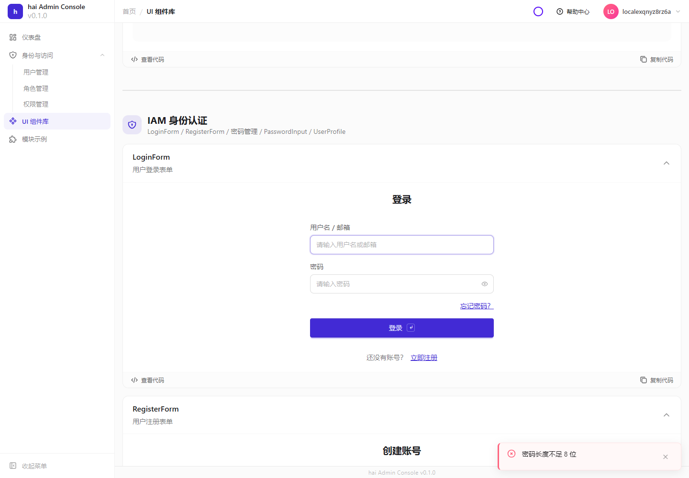

# hai Framework

**把 AI 能力、安全治理与业务交付放进同一套 TypeScript 工程。**

[简体中文](README.md) · [English](README.en.md) · [日本語](README.ja.md)

[](https://www.npmjs.com/package/@h-ai/cli)
[](https://github.com/hai-series/hai-framework/actions/workflows/ci.yml)
[](https://github.com/hai-series/hai-framework/actions/workflows/codeql.yml)
[](https://hai-series.github.io/hai-framework/)
[](LICENSE)

[官网与模板预览](https://hai-series.github.io/hai-framework/) · [使用指南](docs/usage/README.md) · [配置手册](docs/usage/configuration/README.md) · [发布记录](https://github.com/hai-series/hai-framework/releases/latest)

从带权限的业务后台，到 AI 助手、知识库和多端应用，hai-framework 提供 **22 个按需组合的包**、可运行的 CLI 模板、公共 UI 与部署工具。前后端共用类型和接口契约；人类开发者与 AI 助手共用规范、Skills 和验证入口。

## 为什么选择 hai

### AI：从模型调用走到可用的业务功能

统一接入 OpenAI 兼容模型、工具调用与 MCP，组合 RAG、会话记忆、图像、语音和 A2A。业务页面可复用聊天、Markdown、文档与 Mermaid 展示组件，减少模型接入和界面之间的重复工作。


实际组件截图：文档目录、深色主题与 Mermaid 内容展示。模型推理需配置所选 Provider 及其凭据；本图展示内容组件。[AI 开发](docs/usage/development/ai.md) · [模型与知识库配置](docs/usage/configuration/ai.md)

### 安全：把账号、接口和审计一起考虑

提供认证与 RBAC、账号激活/休眠/注销、密码与会话策略、安全审计，以及按路径、方法、IP 和时间生效的访问规则。外部接口可单独选择应用层加密要求，可信代理解析让后端按经过校验的客户端地址判断请求。


实际模板截图：系统管理员可管理全部账号与角色，审计等业务权限仍独立授权。[认证与安全](docs/usage/configuration/identity.md) · [接口访问策略](docs/usage/configuration/request-access.md) · [安全审查](docs/usage/governance/security-review.md)

### 数据：开发时轻装运行，按需求选择后端

关系数据支持 SQLite、PostgreSQL、MySQL；缓存支持 Memory/Redis；文件支持 Local/S3；向量检索可选择 LanceDB、pgvector、Qdrant 或 Chroma。事务、分页、预签名地址与文本分块都有对应模块。

多实例生产环境按共享状态要求选择数据库、Redis 与对象存储，外部服务需另行配置。[数据访问](docs/usage/development/data.md) · [数据与存储配置](docs/usage/configuration/data.md)

### 运营：用户反馈能够进入处理流程

反馈可关联操作现场、页面回放、日志与请求、业务证据；管理员能够筛选、处理、重新打开并导出诊断包。结合审计、通知和定时任务，让业务应用从“能运行”走向“能维护”。


实际示例应用截图：处理记录与状态变化可追溯。图中反馈版本是采集现场的版本；采集范围、脱敏、容量及通知按应用配置启用。[反馈与排错](docs/usage/operations/feedback.md) · [运营配置](docs/usage/configuration/operations.md)

### 界面与交付：从同一模板延续到上线

Svelte 5 公共组件覆盖表单、表格、弹窗、身份认证、引导与帮助；主题和中英日文案贯穿应用。警告和错误统一由 ToastContainer 展示可读说明，按需展开追踪编号。



CLI 可创建同源 SvelteKit 应用，也可创建独立 API 与 Web/App/Desktop 客户端。部署支持镜像、离线包、按服务增量及失败恢复；静态 Website 可发布到 GitHub Pages。[界面开发](docs/usage/configuration/experience.md) · [部署手册](docs/usage/configuration/delivery.md)

## 创建第一个应用

准备 Node.js `^22.23.4 || ^24.22.1 || ^26.12.1` 与 pnpm 12.11.2；推荐与 CI 一致的 Node.js 24.22.1。Windows PowerShell 使用 `pnpm.cmd`。

```sh
pnpm dlx @h-ai/cli@latest create my-app --type fullstack --frontends web --defaults
cd my-app
pnpm dev
```

CLI 默认安装依赖并初始化 Git。首次使用 `admin` 登录，随机初始密码在生成工程的 `.env.dev` 对应 `HAI_ADMIN_DEFAULT_PASSWORD` 中，首次登录后按页面要求修改。不要公开环境文件或密码。

Fullstack 默认包含 DB、Cache、IAM、Crypto、Storage 与 Audit，首次运行不需要 AI 模型或 CUDA。目录、环境和运行地址以生成工程 README 为准；[首次运行指南](docs/usage/getting-started/create.md)带你完成登录与验证。

安装版本以 [npm 的 latest 标签](https://www.npmjs.com/package/@h-ai/cli?activeTab=versions)为准，上方徽标直接读取注册表。可运行 `pnpm view @h-ai/cli@latest version` 查询；团队需要固定版本时，将 `@latest` 换成查询得到的具体版本。npm 的安装标签与 GitHub 的 Latest 展示标记分别管理。

### 选择适合的模板

| 模板        | 适用场景                             | 创建选项                           |
| ----------- | ------------------------------------ | ---------------------------------- |
| Fullstack   | 独立 API、多端业务应用，共用接口契约 | `--type fullstack --frontends web` |
| API         | 独立 Node.js 服务与公共接口          | `--type api`                       |
| Admin       | 同源管理后台，快速接入账号与业务页面 | `--type admin`                     |
| Website     | 企业官网、产品站与静态文档站         | `--type website`                   |
| H5 / Mobile | 移动网页或 Capacitor 应用            | `--type h5` / `--type mobile-app`  |


[官网提供 Fullstack、Website、Admin、Mobile 四类模板的实际页面预览](https://hai-series.github.io/hai-framework/#template-previews)。Website 默认 SSR，静态托管需按[静态构建说明](docs/usage/configuration/delivery.md#静态website与github-pages)配置；原生安装包需要对应平台工具链。

### 构建与发布

在生成工程中配置目标环境与部署参数后执行：

```sh
pnpm build --target image
pnpm run deploy --env prod --plan
pnpm run deploy --env prod
pnpm run deploy --env prod --build --services "serv,web"
pnpm run deploy --env prod --build --bundle-only
```

`--plan` 用于只读预检；`--services` 选择本次更新的服务；`--bundle-only` 生成可搬运的离线交付包。自动恢复覆盖服务与配置快照，数据库迁移和外部副作用需另设恢复方案。真实 IP、子路径、存储直连和策略文件见[部署与运行配置](docs/usage/configuration/delivery.md)。

## 按领域查找模块

已有工程可按需安装 `@h-ai/*`，或用 `hai add <module>` 补充适用模板的模块与配置。以下链接进入各包的公开 API、配置与使用示例。

| 领域       | 模块与职责                                                                                                                                                                                                                                                                |
| ---------- | ------------------------------------------------------------------------------------------------------------------------------------------------------------------------------------------------------------------------------------------------------------------------- |
| 基础与安全 | [core](packages/core/README.md)：结果、配置、日志、生命周期与访问策略；[crypto](packages/crypto/README.md)：SM2/SM3/SM4、密码哈希；[iam](packages/iam/README.md)：认证、会话与 RBAC                                                                                       |
| 数据       | [reldb](packages/reldb/README.md)：关系数据与事务；[cache](packages/cache/README.md)：缓存与分布式锁；[storage](packages/storage/README.md)：文件与预签名；[vecdb](packages/vecdb/README.md)：向量检索；[datapipe](packages/datapipe/README.md)：文本处理与分块           |
| AI         | [ai](packages/ai/README.md)：LLM、工具/MCP、RAG、记忆、图像、语音与 A2A                                                                                                                                                                                                   |
| 运营与业务 | [feedback](packages/feedback/README.md)：反馈与诊断；[audit](packages/audit/README.md)：审计与告警；[reach](packages/reach/README.md)：消息触达；[scheduler](packages/scheduler/README.md)：定时任务；[payment](packages/payment/README.md)：支付渠道                     |
| 接口与多端 | [api-contract](packages/api-contract/README.md)：共享契约；[serv](packages/serv/README.md)：Hono/oRPC 服务；[api-client](packages/api-client/README.md)：类型化客户端；[kit](packages/kit/README.md)：SvelteKit 集成；[capacitor](packages/capacitor/README.md)：原生桥接 |
| 界面与工程 | [ui](packages/ui/README.md)：Svelte 组件与主题；[cli](packages/cli/README.md)：创建、生成与升级；[deploy](packages/deploy/README.md)：Vercel 与 Docker SSH 交付                                                                                                           |

有生命周期的模块遵循 `init → use → close`，逐步检查 `HaiResult.success`；Core、纯函数、契约与服务工厂按实际类型使用。多实例共享状态、Provider 前提和权限边界见[配置手册](docs/usage/configuration/README.md)。

## 按角色阅读文档

| 你的工作           | 从这里开始                                                                                             |
| ------------------ | ------------------------------------------------------------------------------------------------------ |
| 评估框架、创建应用 | [能力与环境](docs/usage/overview/README.md) → [首次交付](docs/usage/getting-started/README.md)         |
| 实现业务、接入 AI  | [开发指南](docs/usage/development/README.md) → 对应模块 README                                         |
| 配置与部署管理     | [配置索引与默认值](docs/usage/configuration/README.md) → [部署与运行](docs/usage/operations/README.md) |
| 安全审查、排查问题 | [安全审查](docs/usage/governance/security-review.md) → [反馈与排错](docs/usage/operations/feedback.md) |
| 框架维护、AI 协作  | [AGENTS.md](AGENTS.md) → [LLMS.txt](LLMS.txt) → 按任务选择 Skills                                      |

## 开发测试

`packages/*` 维护框架包，`apps/*` 提供示例与文档站，`packages/cli/templates/` 维护生成应用与共享 Skills。修改功能时同步调用方、配置示例、文档、截图和测试。

```sh
pnpm install --frozen-lockfile
pnpm --filter admin-console dev
pnpm typecheck
pnpm lint
pnpm test
pnpm --filter @h-ai/cli test:scaffold-gates
```

[CI 分阶段并行运行](docs/ci.md)，按输入指纹复用符合条件的成功记录。**CI** 验证类型、构建、测试和浏览器流程；**CodeQL** 执行 JavaScript/TypeScript 静态安全分析，发现项在 GitHub Security 中查看；**Leak Checker** 检查维护者配置的泄漏词表。徽标反映工作流结果，安全分析结果仍需结合业务权限与部署审查判断。

本地提交/推送钩子使用 `scripts/check-leak-words.mjs`，私有词表 `.leak-words.json` 不提交。容器门禁回收本轮登记的资源；历史测试镜像先运行 `node scripts/cleanup-test-images.mjs --runtime=podman --legacy` 预览，确认后加 `--apply`。[验收说明](docs/usage/governance/verification.md)区分实际运行、复用和环境依赖。

## 许可证

[Apache-2.0](LICENSE)
