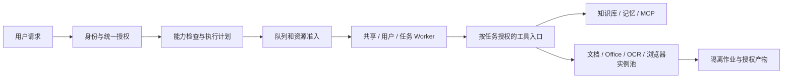

# ai.acp 多用户智能体平台改进方案

日期：2026-11-13。**状态：目标方案，尚未实施。按新架构设计，不保留旧 API、配置或存储结构的兼容层。**

代码核验基线：`main / 89cd4deee1f4eb4c0677e91d5e890c237223e246`，`@h-ai/ai 1.0.0-beta.23`。原始需求见[讨论](thread://01a1d326-dd9c-7c40-bf06-8756d344b83d?hostId=local)。方案覆盖多种 Agent、三种 Worker 模式、镜像选配、多实例工具服务、完整授权、分布式执行、既有能力整合与灵活调用。

建议采用：**统一 ai.acp 调用 + 少量 Agent 适配器 + 独立 runner 执行模块**。Codex、DeepSeek Harness、Goose 使用相同调用方式、三种 Worker 模式和授权规则；原生能力差异由适配器明确处理。普通调用不需要知道镜像、容器和服务实例；管理员配置这些细节。

- [本文](acp-multi-user-platform-plan.md)：怎么用、怎么选、主要安全边界。
- [运行环境、工具服务与授权设计](acp-platform-runtime-design.md)：部署和实现契约。
- [调用参数](acp-call-options.md)：最简用法、可覆盖参数、扩展点及生效规则。
- [性能与容量评估](acp-capacity-evaluation.md)：实测、预算、待验证项目分开说明。
- [启动等待定位](acp-startup-investigation.md)：两段约 5 秒等待的源码及真实网关实验。

## 1. 把几件不同的事分开

| 概念 | 回答什么问题 | 例子 |
| --- | --- | --- |
| 智能体 Agent | 谁理解任务、选择工具？ | Codex、DeepSeek Harness、Goose |
| Worker 模式 | 谁共用一个 Agent 运行进程？ | shared、user、task |
| 运行环境 Environment | 这个进程装了什么、最多能用多少资源？ | 精简、文档、Office、浏览器、开发环境 |
| 工具服务 Tool Service | 哪些能力由独立服务提供？ | 文档提取、Office 转换、OCR、浏览器 |
| 权限 Permissions | 允许访问什么、何时需要批准？ | 当前项目可写、指定域名可访问、允许一次 |

Worker 里可以有多个独立 session，但不能共用用户上下文。session 是业务会话，底层原生 session 和 Worker 可以在安全条件下更换。这里的“任务”是一次业务目标，可以包含多轮对话和工具调用；不是每次模型请求都新建 Worker。单次 run 完成后结束任务，持续交互则由 session.close 或任务期限结束，空闲环境可按恢复能力提前回收。

### 统一支持多个 Agent

| Agent | 当前核验的接入路径 | 适配器负责的差异 |
| --- | --- | --- |
| Codex ACP 2.5.0 / Codex 0.165.0 | stdio；Hai 绑定 Responses 模型 | 启动配置、原生模型/权限/skills 映射，模型目录等待修复 |
| DeepSeek Harness 0.2.1-rc.5 | stdio；原生多 session、单 session 单轮 | 模型协议/能力、reasoning 配置、一次性授权；恢复不重放历史事件 |
| Goose 1.57.0 | 原生 HTTP/WS `/acp` | 原生服务就绪/鉴权、扩展工具、模型/权限映射及有状态连接 |

三者共用创建、prompt/stream、取消、关闭、业务历史和错误处理；不为每个 Agent 编写一套调度器。文件/网络隔离、持久授权、Worker 模式和负载分配由平台提供，不能全部寄托于 Agent 原生功能。原生不支持的可选参数明确报不支持，不静默忽略或用另一功能冒充。[DSH 固定版本契约](https://github.com/deepseek-ai/deepseek-harness/blob/dsh-v0.2.1-rc.5/packages/acp/acp/README.md)、[Goose 固定版本实现](https://github.com/aaif-goose/goose/blob/v1.57.0/crates/goose/src/acp/server.rs)。

共享安全性和每 Worker 并发上限按 Agent/版本验收。某 Agent 原生工具无法受控时，共享模式不能上线；平台仍提供独占运行路径。外部单一服务无法按用户/任务分配独立环境时，也不能仅换一个模式名称就宣称隔离。

### 只拆一个有明确职责的模块

| 模块 | 保留职责 |
| --- | --- |
| `@h-ai/ai` | LLM、知识/记忆/MCP 等既有能力；ai.acp 的 Agent 适配、会话、任务授权和统一调用 |
| 新增 `@h-ai/runner` | 启动和停止进程/容器、限制资源、记录由哪个节点执行、处理失联和清理；同时服务 Agent Worker 与普通工具作业 |

runner 不理解提示词和模型，也不依赖 ai；ai 通过注入的公开 runner 接口调用它。只使用 LLM/RAG 的应用无需启动 runner。业务调用仍用 ai.acp，不需要先向 runner 申请容器再自行拼协议。

首版只维护 **Agent、Environment、Tool Service 三类部署清单**；镜像 digest/能力并入 Environment，不再增加独立 Image CRUD、通用工作流引擎或多套队列后端。授权规则和运行记录属于必要内部状态，不变成每次调用的必填配置。运行时先支持现有 Podman/Docker，集群编排接入保留明确边界，不同时自研 Kubernetes 调度器。

### 单机与分布式使用同一套逻辑

单机可让 API 和执行角色同进程运行；多实例时将它们分开部署。API 可以无状态扩容；执行节点拉取持久任务并持有 Agent 连接。已有会话固定路由到其执行节点，新任务按可用容量、权限、环境和资料位置分配。

共享数据库记录唯一执行归属和租约；同一会话的 prompt、取消和授权不能分别落到不同执行者。租约失效时拒绝旧执行者提交，但不能据此假定它的外部动作已停止。断线可续订事件，节点失联需核对真实进程/工具效果后恢复。负载分配和故障表见[运行设计](acp-platform-runtime-design.md#36-分布式负载和执行归属)。



运行环境只负责提供能力，安装了工具不代表获得使用权限。Skills 提供工作方法，也不能授予文件、网络或凭据权限。

## 2. 三种模式，加一个自动选择入口

| 选择 | 怎么运行 | 推荐用途 | 隔离边界 |
| --- | --- | --- | --- |
| `shared` 共享 | 多用户共用一个或一组 Worker，每个任务独立 session | 问答、知识检索、通过固定工具生成文档 | 会话和工具权限隔离；Agent 进程的内存、CPU 和崩溃影响仍共享 |
| `user` 用户独占 | 同一用户的多个任务复用 Worker，空闲回收 | 个人长期资料、持续开发环境 | 用户之间独立容器与状态；同一用户的任务仍共享进程 |
| `task` 任务独占 | 每个活动任务独立 Worker，完成后回收 | 任意脚本、不可信代码、强隔离、Full Access | 每任务独立进程树、文件挂载、资源限额 |
| `auto` 自动选择 | 按下面的规则选择上述三者 | 默认入口 | 不是第四种隔离方式，不自动增加权限 |

默认采用 `auto`。平台按优先级判断：

1. 组织要求强隔离、运行任意代码、处理不可信工程、使用 Full Access，或无法判断风险：选 task。
2. 明确需要持续个人环境且允许用户内共享：选 user。
3. 仅使用经过验收的受控工具、没有私有文件直挂和跨用户原生权限记忆：选 shared。
4. Agent 或环境不支持所需隔离：auto 尝试合规的 task 环境；没有可用环境则明确报缺少能力。显式指定 shared/user 时不偷偷换模式。

AI 可以建议任务需要什么能力，但最终由服务端规则和实际工具请求决定。不能仅凭一句“这是简单任务”认定安全，也不能为了避开排队而降低隔离。用户看到选择结果和简短原因，例如“需要运行 Python，已选择任务独占”。

同一用户或共享组可能因镜像版本、模型凭据、工作区和权限策略不同拥有多个 Worker；“每用户一个”表示同一可复用环境内的归属规则，不强行把互不兼容的任务塞进同一进程。

### 运行中切换

调用方可在新建时指定模式，也可在两轮之间请求切换。进行中的模型生成、工具、后台子进程和审批必须先结束或取消并确认；然后保存状态、重新授权、准备新环境，再提交切换。切换期间只允许一个执行者。

支持相同 Agent 的原生恢复且状态可安全导出时，沿用原生历史；否则只可显式创建新原生 session，带入经过授权的会话摘要和产物，不能冒充无损恢复。切换不重放写文件、发布或发送操作。回到 shared 必须重新满足全部共享条件，不能把旧用户环境、密钥或宽权限一起搬进去。

更常见的做法是：**Agent 保持原模式，某个重工具单独开任务容器**。例如共享问答 Worker 调用 Office 服务，不需要把整个会话搬到装有 LibreOffice 的 Worker。

## 3. 一个智能体可以提供多个镜像

为每种 Agent 提供经过测试的环境组合，不在每个镜像里默认塞满全部软件：

| 环境 | 包含内容 | 何时选用 |
| --- | --- | --- |
| `minimal` 精简 | Agent、必要运行库、证书、该 Agent 所需沙箱组件 | 默认问答和远程工具调用；不默认安装 Office、浏览器或全套编译器 |
| `documents` 文档 | 精简环境 + Python + 常用 Word/Excel/PDF 库 | Agent 需要自行写文档脚本 |
| `office` Office | 文档环境 + LibreOffice + 明确的字体/语言包 | 确实需要在 Agent 环境直接进行排版、重算和转换 |
| `browser` 浏览器 | Agent + 固定版本浏览器及系统库 | 需要浏览器自动化或页面验证 |
| `developer` 开发 | Git + 项目要求的 Node/pnpm、Python 或 Java/Rust/Go | 工程开发；语言工具链按构建配方选配 |

这是目标镜像系列，当前只存在原有 Agent 镜像及部分语言工具链开关。`minimal` 的新大小尚未测，不能把旧基础镜像的 0.985 GiB 当成新精简镜像大小。

同一份 Office/Python 依赖配方可以供 Agent 镜像和独立工具镜像构建，减少重复维护。每个组合有独立版本和 digest，不用同一个 tag 覆盖不同选项的产物。工作区只描述数据和访问范围，不再绑定某个 Agent 镜像；环境根据能力、架构和安全策略选择。

默认优先使用“精简 Agent + 独立重工具”。单机离线、依赖强耦合或需要自编脚本时，允许选择功能更完整的 Agent 镜像。构建、拉取、预热由管理员管理，模型不能自行替换镜像或启动特权容器。

## 4. 独立工具也有镜像和实例池

工具服务独立登记。例如 `documents`、`office`、`ocr`、`browser` 各自有镜像、版本、资源上限、并发数、最小/最大实例数、超时和健康检查。固定文档/浏览器工具不包含 Agent 运行程序，无需再启动一个智能体或重复调用模型；工具确实需要模型时单独声明和计量。

| 工具部署方式 | 使用方式 | 隔离与多实例 |
| --- | --- | --- |
| 常驻服务 `service` | 稳定 MCP 地址，适合轻检索或成熟的远程 API | 多个服务副本；每请求鉴权，有状态连接按 session 正确路由 |
| 作业池 `job` | 固定工具收到请求后，分配一个隔离作业环境 | 适合 Office、OCR、浏览器和不可信附件；一个活动作业一个执行环境，可预热并限制总数量 |
| 外部服务 `external` | 对接已有 MCP/企业服务 | 平台管理授权、并发、超时；对方负责其内部隔离，不能把它算作本地受管沙箱 |

以 Office 为例：先保留 1 个干净预热环境，最多同时运行 4 个；20 份文档同时到达时，最多处理 4 份，其余留在持久队列。每份文档使用独立输入/输出目录和 LibreOffice profile；完成后校验并上传产物，销毁用过的环境，再补充干净预热环境。

“工具入口”可以多副本，“真正干活的作业环境”也可以多实例，二者分别扩容。所有副本使用共享任务状态、租约和对象存储；不依靠某台服务的内存队列。任务重试沿用稳定业务 ID，外部效果未知时先核对，不能自动重复发送或发布。

单机使用 Podman/Docker；集群可由外部编排平台承接同一资源描述，不在 ai.acp 中重造 Kubernetes。运行控制器可以操作引擎，但 Agent 和工具容器都不能挂载引擎 socket。详细目录、配置和生命周期见[运行设计](acp-platform-runtime-design.md)。

## 5. 授权使用主流名称，范围和有效期分开

### 权限范围

| 名称 | 允许做什么 |
| --- | --- |
| **只读 / Read Only** `read-only` | 读取明确授权的资料、检索；不能修改业务文件或执行写入型工具。允许必要临时计算，不等于允许任意 shell |
| **工作区 / Workspace** `workspace` | 在授权工作区写入和执行已允许工具；访问额外目录、网络或副作用工具时按规则审批 |
| **完全访问 / Full Access** `full-access` | 在当前独占任务环境内使用用户可授权的文件、命令和网络，不重复询问普通操作；必须由用户明确选择 |

Full Access 仍受组织强制拒绝、用户身份、其他用户数据、宿主隔离和资源配额限制。它不表示宿主 root，也不能获得用户本人无权访问的数据。需要它时强制 task 模式，组织还可禁止该选项。

### 每次审批的选择

| 按钮 | 记住什么 |
| --- | --- |
| **允许一次 / Allow Once** | 仅这次具体操作，一次性使用 |
| **本会话允许 / Allow for This Session** | 本业务会话内同一范围的权限，结束、撤销或策略改变后失效 |
| **始终允许此规则 / Always Allow This Rule** | 保存用户明确看到的规则，例如“读取项目 A 的资料目录”；可查看、撤销和设有效期 |
| **拒绝 / Deny** | 拒绝本次；可另存“始终拒绝此规则” |

“相同权限”按真实对象、操作和边界匹配，不按工具标题、提示词或命令前缀猜测。授权读取目录不包含写入；访问域名不包含上传所有文件；批准 Python 脚本不等于批准以后所有 Python。

审批方式使用 **按需询问 / Ask for Approval** `on-request`，以及 **不询问 / Never Ask** `never`。never 在已有权限内自动执行，权限不足直接拒绝，不等于 Full Access。后台任务预先配置授权规则，否则暂停等待审批或超时失败；不因没有在线用户自动放行。

文件规则覆盖读、写、删除、执行及产物下载；网络规则覆盖目的域名/IP、端口、协议，以及必要的上传对象/操作。默认阻断云元数据、未授权内网和绕过代理的出口。模型服务、MCP、浏览器、Git 和脚本分别受控；只限制 shell 的网络不够。当前 Codex 官方文档也明确区分这些控制面。[权限说明](https://learn.chatgpt.com/docs/permissions)。

平台保存授权规则，Agent 不跨用户记住决定。ACP 的 `allow_always` 由 Agent 决定实际作用域，不能直接当作平台用户规则；默认由平台匹配规则，再向原生单次请求返回允许结果。不支持这种边界的适配器不得开启共享模式。[ACP 权限契约](https://agentclientprotocol.com/protocol/v1/tool-calls)。

## 6. 与现有功能自然衔接

| 既有能力 | 接入方式 | 必须补齐的地方 |
| --- | --- | --- |
| 知识库、检索、RAG | Agent 通过受控知识工具读取原文片段及引用；需要成品回答时仍可用 ai.rag | 集合/检索源不是 ACL；服务端限定租户、知识库和文档，过滤发生在内容进入模型前，实体关联和引用也授权 |
| MCP | 复用已有 `ai.mcp`、服务器清单和协议；自建工具服务也暴露 MCP | 增加可信调用身份、按任务凭据、工具白名单与授权；不能直接向 Agent 暴露全部服务器和长期密钥 |
| Skills | 复用 Agent 原生 skills；平台登记可信来源、版本、所需工具能力 | 按需只读加载，脚本经过同一执行授权；仓库中的说明不能改平台权限 |
| 记忆 | 复用 `ai.memory.scoped`，按用户或明确共享空间读取 | 关闭共享 Worker 的原生跨会话记忆；写入有策略和归属，不能把失败产物、密钥或别人的内容记进去 |
| 上下文与历史 | 平台保存稳定会话、事件、引用和产物；Agent 管理原生推理上下文 | 指定唯一的消息提交与记忆提取路径，不叠加两套自动记录/压缩造成重复 |
| 文件、Git、预览、发布 | 复用存储、ACP 工作区/工作树及已有 Git 操作 | 工具用授权文件 ID；Git 凭据与模型凭据分开；发布、下载和预览仍验权 |
| IAM、审计、调度、A2A | 登录态转换为可信主体；权限决定写审计；定时/A2A 请求进入相同执行入口 | 禁止定时任务或外部 Agent 绕过准入与授权；多实例沿用共享存储及租约规则 |

先复用现有框架能力，再新增缺失的连接层。这里列的是整合目标，不宣称当前 ai.acp 已自动拥有所有能力。具体源码依据和变更范围见[运行设计](acp-platform-runtime-design.md)。

### 调用示意

以下是拟新增 API，当前不能直接运行。服务启动时初始化共享依赖、runner，再初始化 ai 并注入 runner；停止时先关闭 ai，再由应用关闭 runner 和基础依赖。ai 不关闭借入的 runner，也不停止其他节点拥有的执行；无需每次请求重复初始化。

```ts
// auth 来自服务端认证；单次任务自动管理临时会话和清理。
const scoped = ai.acp.scoped({ tenantId: auth.tenantId, userId: auth.userId })
const result = await scoped.run({
  agentId: 'office-assistant',
  prompt: '总结已授权的项目资料',
})
if (!result.success) return result
return result.data
```

持续对话使用 `scoped.sessions.create({ agentId })` 和 `session.prompt/stream/close`；切换智能体只需换已登记的 agentId，不换一套业务代码。run 是这套生命周期的一次性便捷封装，不另建一套任务状态或授权逻辑。

可按需覆盖模型、执行模式/环境、上下文、工具、权限、资源、超时、输出格式和事件订阅。普通参数按“部署默认 → 会话 → 本轮”覆盖，组织上限始终生效；Agent 特有参数使用带 Schema 的 native 配置。数组整体替换、未知/不支持的选项报错，镜像、权限和其他用户的 Worker 全局设置不能由任意参数透传修改。详细示例见[调用参数](acp-call-options.md)。上传附件使用已授权文件 ID。

拟增加 `scoped.plan(...)` 查看实际模式、环境、工具和缺少权限；`session.changeExecution({ mode: 'task' })` 请求安全切换。平台执行模式与 Agent 原生的“规划/编码”模式是不同概念，不复用原生 `setMode` 来切 Worker。

## 7. 场景覆盖和明确边界

| 场景 | 推荐组合 |
| --- | --- |
| 问答、知识库、个人偏好 | auto → shared，精简 Agent + 受控知识/记忆工具 |
| Word/Excel/文本 PDF 总结与生成 | shared + documents；需要排版或公式重算再调 office |
| 扫描 PDF、多语言 OCR、大文件 | task 作业池 + OCR/Office；按页分片，结果保留页码和来源 |
| 自编 Python、数据分析、代码生成与测试 | task + documents/developer；资源、依赖与网络明确配置 |
| 个人长期开发和多项目资料 | user + developer；每个任务独立 session，真正互不可信的任务拆 task |
| 网页、登录态、浏览器测试 | task 或按用户绑定的 browser 服务；Cookie/下载/出网独立授权 |
| 图片、音频、其他模态 | 依据模型与 Agent 能力直接输入，或走现有图像/语音工具；不支持时明确说明 |
| 后台批处理、定时任务、A2A | 同一队列与权限入口；预授权、可取消、可恢复，副作用明确幂等 |
| 内网、离线、私有模型 | 预置所需镜像和依赖；授权内网目的地，使用已部署模型，不临时联网安装 |
| GPU/大模型或超重任务 | 专用环境与独立资源队列；同一任务契约，不占普通交互池 |
| 企业强隔离、多租户不可信代码 | task + 加固运行时/独立节点；共享内核容器无法满足的要求使用虚拟机等级隔离 |
| 任意远程 ACP/MCP | 先验证能力、身份和策略；无法证明的隔离不标记为已支持 |

这套结构覆盖主流交互、办公、开发和自动化场景；不承诺任意 Agent、任意文件格式、无限资源或任意远程服务都能自动支持。公开能力矩阵和明确失败原因，让缺少能力可诊断、可扩展。

## 8. 性能结论和实施交付

前轮真实 DeepSeek 对照确认：提供方配置在启动时加载后，`session/new` 中位数 **7,375 ms → 23 ms**，每组 5 次；真实回答通过。该优化尚未落入正式代码，模型首字仍需数秒。[定位记录](acp-startup-investigation.md)。

重工具独立后要计入服务入口、预热实例和作业容器，不能继续只算 Agent 内存。新的容量示例分别计算这些开销；Office/OCR/浏览器冷启动还未实测。[性能与容量评估](acp-capacity-evaluation.md)。

实施以可验收的完整能力交付：先建立 runner 边界和统一适配器/授权契约，再完成三种模式、分布式归属和工具多实例，最后打通知识/记忆/skills、灵活调用、模式切换与场景验收。Codex、DSH、Goose 都进入每阶段的共同验收；Codex 启动修复作为其适配器专项。首版不包含 DAG 工作流、多地域实时迁移、任意协议自动转换和无限插件扩展。

不保留旧接口适配和双结构读取。发布时停止接单、完成或取消在途任务、备份并导出需保留的业务资料，再启用新结构；不在讨论方案时删除现有数据。详细变更、验收矩阵和发布边界见[运行设计](acp-platform-runtime-design.md)。

本轮仅更新设计文档，无运行时代码、公开 API、依赖或镜像变更；前轮测量作为已有证据引用，没有重复调用收费模型。
