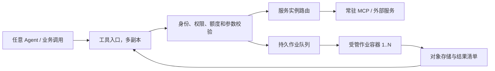
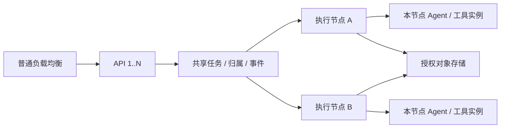

# ai.acp 运行环境、工具服务与授权设计

日期：2026-11-13。状态：拟实施契约，不是现有 API。阅读入口见[总方案](acp-multi-user-platform-plan.md)。不保留旧 API/配置兼容层；既有框架能力按职责复用。

## 1. 管理什么，分别由谁负责

| 对象 | 核心信息 | 管理者 |
| --- | --- | --- |
| AgentDefinition | 原生适配器、固定版本、模型清单、允许环境、工具/skills 范围、默认策略 | 应用管理员 |
| EnvironmentDefinition | 镜像 digest/架构/能力、运行后端、资源限额、挂载模板、网络策略、健康检查 | 构建流程与运维管理员 |
| ToolServiceDefinition | 能力与工具名、service/job/external、环境或外部地址、实例策略、调用限制 | 工具管理员 |
| ExecutionPolicy / Grant | 组织上限、用户权限、任务范围、审批规则、有效期、撤销版本 | 组织及具备权限的用户 |
| Session / Execution / ToolJob | 业务归属、原生会话绑定、具体执行代次、领取者、状态、产物 | 运行控制器 |

管理员只维护 Agent、Environment、Tool Service 三类部署清单。镜像信息并入 Environment，构建配方留在版本库，不建立独立 Image CRUD。清单采用现有“配置只读、数据库可维护、版本化更新”语义；运行记录和授权记录是内部状态，不另造一套配置编排语言。

### 1.1 模块边界：只拆受管执行

建议新增 `@h-ai/runner`，承接从 AI 模块拆出的受管执行。它有两个直接消费者：ACP Agent Worker、独立文档/浏览器等作业，因此有实际复用价值。

| 归属 | 拥有的状态和职责 | 不承担的职责 |
| --- | --- | --- |
| `@h-ai/runner` | Environment、实例/节点容量、持久执行、归属/租约、资源准入、启动/停止/清理、基础执行事件 | 不理解模型、ACP session、知识、skills、记忆和业务 RBAC |
| `@h-ai/ai` | Agent/Tool Service 目录、ACP 适配、业务 session 与原生绑定、消息/审批/工具调用、知识和记忆连接 | 不另写容器控制器、执行领取或另一套资源统计 |
| 应用及既有模块 | IAM 主体和业务权限、共享数据库、对象存储、审计、外部部署 | 普通请求不直接操作容器引擎 |

依赖为 `ai → 注入的 runner 公共接口`；runner 依赖 core/reldb 等基础能力，不反向依赖 ai，也不导入 AI Store 的内部实现。AI Store 继续保存 AI 业务记录，runner 的执行归属只在 runner 存储中维护；AI 保存 execution/worker 引用，不再复制一份可独立修改的 owner/租约。

应用启动顺序为基础依赖 → runner → ai，关闭反序。ai 不关闭借入的 runner；每个执行进程仅排空、停止自己拥有的任务。仅使用 LLM/RAG 不要求初始化 runner；平台受管 ACP/工具才启用它。单机与分布式不维护两套逻辑，只组合或分开 API/执行角色。

Agent 和工具的高层调用始终留在 ai；runner 不公开几十个 Docker 命令作为业务 API。AI 通过少量提交/查询/取消/实例管理操作使用它。内部先支持现有 Podman/Docker 运行路径，采用共享 SQL 状态；不同时引入多个队列后端、通用 DAG、插件总线或自动跨地域迁移。现有 scheduler/A2A 的租约经验可以复用，不能直接复制其私有表和完整状态机。

### 1.2 统一适配器，保留真实差异

所有 Agent 使用同一个 ACP 客户端、多 session 路由、权限入口和执行流程。适配器只负责：声明固定版本支持的能力/参数 Schema，生成原生启动配置，将模型/权限/skills 设置映射到原生机制，以及解释必要的原生扩展。prompt、流、取消、配额和分布式调度不在各适配器里重复实现。

| 适配器 | 已确认输入 | 需要明确处理的差异 |
| --- | --- | --- |
| codex | 当前镜像 Codex ACP 2.5.0 / Codex 0.165.0，stdio | Responses 模型、启动时提供方配置、原生工具/权限、上下文元数据 |
| deepseek-harness | 当前镜像 0.2.1-rc.5，stdio | 当前适配器映射 chat/responses/anthropic；原生模型/推理选项、单次授权、resume 不重放事件 |
| goose | 当前镜像 1.57.0，原生 HTTP/WS | 新增完整受管适配器及服务就绪/鉴权，不再只靠通用远端连接跳过模型与策略校验 |

DSH 已明确同连接多 session、每 session 一轮、独立 close，但没有 `session/load`、终端/客户端文件操作和 elicitation；这些缺失不影响平台使用外层容器和受控工具实现任务运行。恢复按其 resume 契约处理，不伪造 load 或历史重放。[DSH 固定契约](https://github.com/deepseek-ai/deepseek-harness/blob/dsh-v0.2.1-rc.5/packages/acp/acp/README.md)。Goose 的原生会话和权限状态在服务端，负载分配必须考虑其服务实例归属。[Goose 固定实现](https://github.com/aaif-goose/goose/blob/v1.57.0/crates/goose/src/acp/server.rs)。

`scoped.agents.describe(agentId)` 返回经过适配器、部署策略和用户授权校验的能力、支持模式、参数 Schema 和模型选择项。运行前再结合原生握手核验；声明不等于安全验收。常用能力由平台补齐，可选原生能力不支持时返回明确错误；显式要求恢复、原生约束式 JSON 生成或某参数时不能静默丢弃。平台校验最终 JSON 与原生约束生成是不同能力。

资源目录保存期望状态，运行实例单独保存实际状态。修改镜像或策略生成新版本：新任务采用新版本，在途任务记录实际使用版本；强制撤销立即停止相关操作。镜像 tag 只作人类提示，实际执行固定 digest。

工作区只管理文件和仓库，不绑定镜像。挂载位置保持稳定、权限由任务决定；Agent 环境和工具作业环境可以访问同一授权文件的只读副本，不必使用同一镜像。可写项目不能同时交给多个未协调的执行者。

## 2. 镜像如何构建和选择

### 2.1 构建配方

维护共享组件配方，例如 Python 文档库、Office/字体、OCR/语言包、浏览器、开发工具链。Agent 和工具镜像都引用配方，但生成独立产物，不要求工具镜像继承含 Agent 的大镜像。

发布少量受支持的组合：每个 Agent 的 minimal/documents/office/browser/developer，以及独立 documents/office/ocr/browser 工具镜像。组合可按实际需求减少；不穷举所有开关形成难以维护的矩阵。

配方锁定基础 digest、Agent、系统/语言依赖、字体和架构；产生依赖清单、镜像内容摘要和测试记录。不同组件组合产生不同 tag/digest，不能沿用当前构建脚本“可选语言工具链但输出同一 tag”的行为。运行节点只拉管理员准入的镜像，按需预拉；不由模型提交任意 Dockerfile、构建参数或 registry 地址。

Agent 镜像的 minimal 只保留该 Agent 所需运行与隔离组件。安装 Python、LibreOffice 或浏览器既不授予执行权限，也不要求所有任务都加载它们。新镜像的大小、冷启动、就绪时间逐个测量；当前镜像体积不能代替新配方数据。

### 2.2 选择顺序

1. 根据 Agent、工作区、已批准 skills、调用要求形成“必需能力集合”，例如 `documents.extract`、`office.convert`、`browser.navigate`。
2. 剔除架构、Agent/模型协议、隔离、许可或组织策略不符的环境。
3. 先考虑精简 Agent + 已有工具服务；需要本地脚本、离线或同进程依赖时，选择包含这些能力的 Agent 环境。
4. 在符合条件的候选中考虑已缓存镜像、健康实例、资源和排队时间。缓存命中不能覆盖安全条件。
5. 记录实际环境、镜像 digest、选择原因及缺失能力。显式选择环境时缺能力直接报错，不临时安装或改成另一镜像。

模型运行时新增的工具需求仍需做能力检查和授权；预测阶段不能可靠识别全部需求。不支持动态安全配置的 Agent 需要在安全暂停点重建环境，或明确返回需要重启。

## 3. 工具服务多实例设计

### 3.1 调用路径



Agent 只看到逻辑工具，不看到哪台实例被选中。工具入口既承接 ACP Agent，也可被普通应用代码调用，二者通过同一授权和计费/资源口径。工具执行器不包含 LLM；如果某工具本身需要模型，必须单独声明并计入模型用量。

### 3.2 三种执行方式

| 方式 | 合适实现 | 多实例处理 |
| --- | --- | --- |
| service | 受信轻量 MCP/API 服务，自己已经做好请求隔离 | 入口与服务均可多副本；无状态请求负载均衡；有状态 MCP 使用连接归属或可靠共享会话 |
| job | 固定文档转换、OCR、浏览器作业、脚本执行 | 每作业独立容器；可维护一批未处理过用户数据的预热环境；不把不同用户附件放进同一个解析进程 |
| external | 企业 MCP 或外部 API | 连接池按服务、身份和凭据隔离；尊重对方限流/会话语义；平台不能保证远端容器内部隔离 |

stdio MCP 适合受控的本地专属子进程，不能把一个 stdio 字节流交给多个互不认识的客户端。跨实例服务优先采用 Streamable HTTP。MCP session ID 不代表用户身份；请求仍须认证。有状态连接不能仅做随机轮询，否则初始化状态、事件和审批可能落到错误实例。[MCP 传输](https://modelcontextprotocol.io/specification/2025-11-25/basic/transports)。

### 3.3 一个 Office 作业的完整过程

1. 工具入口从可信调用上下文取得主体和 taskId，校验输入文件 ID、输出类型、文件大小/页数、权限及幂等键；提交持久作业后才返回已接收。
2. 调度器按租户/用户公平分配资源，领取作业；记录执行代次、租约和具体环境，拉取或领取干净预热容器。
3. 输入文件复制或挂载为只读；输出和临时目录独立；转换进程默认无网、无模型密钥、无对象存储主密钥。文件传输由受信组件使用限定对象的短期权限完成。
4. 使用 `--headless` 和独立 `-env:UserInstallation=...`；每个活动转换一个 profile，禁止复用其他作业的用户配置。关闭宏、外部链接更新等主动内容，配置是否有效须真实恶意样本验收；headless 本身不是安全措施。[LibreOffice 参数](https://help.libreoffice.org/latest/en-GB/text/shared/guide/start_parameters.html)。
5. 检查退出码、实际输出、文件类型、大小及必要内容正确性。结果先写暂存对象，校验归属和 checksum 后发布结果清单；只有发布成功才向用户报告完成。
6. 停止并确认整个子进程树已结束，删除临时输入/profile/输出，销毁执行环境；再补充干净预热环境。进程失联或清理失败不把它放回池中。

普通 Python 文档作业同样可能接触恶意附件。默认独立作业环境；若以后要顺序复用解析进程，必须提供状态清理和污染检测的证据，不能只靠不同目录隔离。

### 3.4 运行配置示意

以下是待实现的部分配置，省略完整镜像清单、网络和全局配额；`<digest>` 是部署时必须替换的真实摘要。

```yaml
runner:
  environments:
    - id: office-job
      image: registry.example/hai-tools-office@sha256:<digest>
      capabilities: [office.convert, office.recalculate]
      backend: container
      resources: { cpu: 1, memoryMiB: 1024, pids: 128, scratchMiB: 2048 }
      networkPolicy: offline
ai:
  mcp:
    services:
      - id: office
        execution: job
        environmentId: office-job
        capabilities: [office.convert, office.recalculate]
        pool: { minReady: 1, maxRunning: 4, maxTotal: 5 }
        timeoutMs: 120000
        maxInputBytes: 52428800
  acp:
    agents:
      - id: office-assistant
        adapter: codex
        environmentIds: [codex-minimal, codex-documents, codex-office]
        allowedCapabilities: [documents.extract, office.convert, office.recalculate]
        defaults:
          execution: { mode: auto }
          permissions: { profile: workspace, approval: on-request }
```

示例省略了三个 Codex 环境及模型条目；它们必须先登记，Agent 只能选择自身 `environmentIds` 中的环境。`allowedCapabilities` 是管理员给这个 Agent 的能力上限，实际调用还要与用户和任务授权取交集。

这里以应用级 `runner/ai` 两模块配置展示。Tool Service 清单统一托管与外部 MCP 服务；现有 MCP servers 在新方案中纳入这一个目录，不长期维护两份同一服务配置。换成 DSH/Goose 时只更换适配器和已登记环境，Office 服务不变。工具的协议和授权由 ai 处理，作业/实例的实际生命周期由 runner 处理。

`minReady` 表示未使用过的预热环境数目标；`maxRunning` 是运行中作业数上限；`maxTotal` 包括预热、启动中、运行中和销毁中的所有环境。若 maxTotal 已满，先回收再补充，不能把销毁中的资源当作空闲；预热目标服从总资源上限。健康就绪后才能分配作业；所有候选限额需用真实文件压测调整。

常驻 service 使用 `minReplicas/maxReplicas/maxConcurrentPerReplica`，与 job 的预热数量分开。仅在已证明服务能实现请求级隔离时才允许同实例多个请求。服务滚动升级先停止接单并等待在途请求；作业容器固定已领取版本。

### 3.5 扩容、取消和失败

实例数量结合队列长度、等待时长、平均作业时长和 CPU/内存余量决定，不能只看 CPU。副本上限、每用户并发、总资源预算和模型额度共同限制准入。Office、OCR、浏览器、代码编译分别排队，交互任务保留额度；不要让一个大文件占满全部服务。

多节点部署可由 Kubernetes Deployment/Job 及基于队列指标的扩容承接；运行控制器报告期望容量和健康状态，不另造集群调度器。具体集群能力按实际版本验证，扩到零时入口仍需持久排队。[Kubernetes 外部指标扩容](https://kubernetes.io/docs/tasks/run-application/horizontal-pod-autoscale-walkthrough/)。

作业状态至少区分 `queued / starting / running / waiting-approval / succeeded / failed / cancelling / cancelled / unknown`。领取、续租、最终提交使用共享数据库时间和版本条件；失租执行者不能继续发布结果。租约过期不是旧进程已被停止的证据。

取消沿 task → tool job → 实际进程树传播，核验停止后才报告取消成功。网络断开不等于任务取消；重新订阅使用稳定任务 ID 和事件游标。共享入口/实例重启后从持久状态恢复，不能把 HTTP 重新请求变成第二次执行。

纯转换可按相同输入摘要、工具/镜像版本和参数安全重试，在授权范围内去重。邮件、发布、支付及任意外部写入需要接收端幂等或结果核对；未知效果进入 unknown，不承诺 exactly-once。缓存按租户/授权范围、版本和输入摘要隔离，命中时重新鉴权。

### 3.6 分布式负载和执行归属

首版拓扑为：若干 API 实例 + 若干执行节点 + 共享 PostgreSQL/MySQL + 对象存储。API 不持有必须靠原进程存活才能恢复的业务状态；执行节点运行已注册的 ACP/工具执行处理器并持有原生连接。可以同进程部署这些角色，不强制每个组件变成独立微服务。



**负载分配与会话路由分开做：**

- 新任务先检查租户/用户额度、环境/架构、数据位置、资源余量和 Agent 能力，再优先复用相同安全范围的可用 Worker；不只按 CPU 瞬时利用率轮询。
- 无可复用 Worker 的任务由符合条件的执行节点拉取。资源预留和领取在共享事务/条件更新中原子完成；不能先读“还有空闲”再分别启动，导致多个节点超额领取。
- 同一用户环境的创建有唯一复用键；共享池的扩容也受持久总上限约束。节点容量包含启动、预热、运行和清理中的资源，直到确认释放才归还。
- 活跃 session 绑定 workerId；runner 解析唯一 owner 和执行代次。后续 prompt、审批、取消和配置变更通过持久命令交给该 owner，不能随机发给另一台本地 ACP 客户端。
- 每个 session 同时一轮；每 Worker、每用户和每节点的名额分别检查。按用户/租户公平领取并按创建时间推进，避免大客户或短任务永久挤占别人；配额不足留在队列中。
- 取消/审批属于控制消息，不排在已满的普通任务队列后面。即使任务等授权或工具池满，也能响应取消。执行节点以有界批量领取、退避与健康心跳工作，不扫描全量历史。

共享 SQL 是权威状态；通知仅用来唤醒，不是唯一消息记录。首版可使用有界轮询，不强制增加消息中间件。后续若实测通知延迟或查询负载不足，再接入既有通知能力；丢失唤醒仍可从数据库追上，避免双写两个权威队列。

Agent Worker 与子工具作业分开计容量，工具入口保留执行预算；不能让所有内存都被等待工具的 Worker 占住，导致工具永远无法启动。工具名额不足时暂停相应轮次并按时限排队，等待中的原生连接仍计入实际内存。所有等待都有总数和时限，过载明确拒绝，不能无限追加内存队列。

执行 owner 使用进程启动代次，租约及提交条件使用数据库时间；节点名称重复不继承旧权限。原生 stdout、终端句柄、callback 函数留在实际执行节点；API 实例通过持久事件和控制请求访问它们，不能序列化函数或跨节点传文件描述符。

| 故障/并发情况 | 必须保证的行为 |
| --- | --- |
| 请求重试或两个 API 同时提交 | 主体 + idempotencyKey 唯一，参数摘要不同返回冲突；同一次业务操作只获得同一任务/回执 |
| API 重启、浏览器断线、SSE 换节点 | 任务继续按原策略运行；按 taskId/turnId 和事件游标重新订阅，先鉴权；断开订阅不等于取消 |
| 执行节点退出/网络分区/暂停超过租约 | 拒绝旧代次提交，停止续发权限；确认旧进程已停止后才恢复。有未知外部效果或无法隔离旧写入时进入 unknown，不能盲目另起一份 |
| 结果已写但响应丢失 | 读取同一持久结果和产物清单，不重复执行；产物发布按版本/代次校验 |
| 取消与完成竞争 | 以条件提交确定终态；取消请求不冒充取消成功；实际完成的副作用保留结果并核对 |
| 节点滚动升级 | 停止领取新任务，排空已有任务或按明确策略终止；控制消息仍可达，之后才移除 owner |
| 工作区只在某台节点 | 保持节点亲和；该节点不可用时等待/明确失败，或从已验证快照恢复，不把空目录当作原工作区 |

事件分页追加，按 session/turn 保序、带游标和大小上限；可合并小 delta 后持久化再发出，不能每个 token 重写整个会话 JSON。终态、授权和产物事件可靠提交；慢客户端有背压和重连路径。该持久化/路由开销需独立测量，不能用原生 23 ms 新建数字代表分布式请求延迟。

共享盘只解决可见性，不自动解决单写者。旧执行者可能在失联时继续写文件或访问外部系统：通过任务独立临时区、代次受限的提交/工具凭据和停止核验约束影响；不支持结果核对的外部副作用不得自动重试。接管不承诺正在运行的任意进程无损迁移。

Runner 只负责执行归属和资源；AI 的业务 session、审批和消息关联引用该执行。状态不跨模块重复认领。高层流程使用稳定操作 ID、条件提交和补偿清理衔接，不引入跨容器分布式事务。

## 4. 统一身份、权限和授权规则

### 4.1 身份与凭据

服务端从 IAM 或可信服务身份构造主体：tenantId、userId/服务主体、有效角色/空间成员关系及安全代次。工具调用额外绑定业务 sessionId、taskId、executionId、toolCallId。模型参数、MCP 自带 metadata 和 session ID 都不是身份凭据。

Agent 到工具入口使用限定受众、任务、工具/资源范围、期限和策略版本的短期凭据；下游系统凭据由入口按调用者授权解析，不把上游 IAM token 原样传下去。长期第三方 OAuth/模型密钥保留在可信服务，不能放入 prompt、skills、普通工具参数、镜像或审计正文。[MCP 凭据与会话安全](https://modelcontextprotocol.io/specification/2025-11-25/basic/security_best_practices)。

共享进程使用受限模型代理/服务凭据，不能装入所有用户的长期密钥。确需用户自带密钥时，按用户/凭据版本拆 Worker，并验证其工具无法读取不应暴露的环境变量；不满足时只允许独占任务。直连外部服务不满足任务授权契约时，经受控入口代理或明确不支持。

### 4.2 权限如何计算

有效范围同时受组织强制策略、用户自身权限、Agent/环境能力、任务请求及明确授权约束；拒绝规则优先。能力是技术上能做什么，授权是这次能对谁做什么，两者不能替代。

用户可在组织允许范围内扩大本任务授权。工具参数在审批后若改变了目标、数据、操作或脚本，就必须重新校验；不能用批准后的参数替换绕过规则。请求、批准、执行、结果关联同一个操作编号与参数摘要。

| 授权有效期 | 持久规则与匹配 |
| --- | --- |
| once | 绑定本次调用、执行代次、目标及参数摘要；使用共享存储原子消费；重复提交返回原回执，不执行第二次 |
| session | 绑定业务 session 和主体，按规范化权限范围匹配；结束或撤销后失效 |
| rule | 保存经用户确认的目录/资源、动作、目的地、工具版本等范围，可设置过期时间；策略版本变化时重新评估 |

批准的是“读项目 A 的资料目录”或“向指定系统提交这份产物”，不是“以后凡是标题叫上传都允许”。脚本规则不能只匹配 `python`、`bash` 或命令前缀；复合命令、重定向、修改后的脚本和新增目标需要重新判断。无法可靠规范化时不提供保存规则，只提供单次或明确环境范围的授权。

单次文件或网络授权只作用于对应工具调用/执行环境，不能通过临时放宽整个共享 Worker 的挂载或防火墙来实现。Full Access 也不自动取得第三方账户的 OAuth 同意或管理员权限；已连接账户的工具仍受其业务授权及组织强制规则限制。

审批记录可跨 Web 节点读取，但只允许该任务用户或被授权审批人回答。超时、任务取消、权限撤销、旧执行代次的迟到回答均不能自动放行。撤销后阻止新调用，对在途操作尽力取消并核验；已发生的外部副作用不能伪装成回滚完成。

### 4.3 ACP 原生审批的映射

ACP `allow_once / allow_always / reject_once / reject_always` 是 Agent 给出的选项种类；其中记住决定的实际范围由 Agent 管理。平台不能把 `allow_always` 直接映射成自己的“本用户长期允许”，尤其不能在跨用户 Worker 里使用。[ACP 契约](https://agentclientprotocol.com/protocol/v1/tool-calls)。

平台优先保存自己的规则，并对匹配的每次原生请求选择该 Agent 实际提供的单次允许选项；没有可安全映射的选项则拒绝或报能力不足。平台对工具入口仍做独立校验，不能依赖 Agent 每次都会询问。原生内置 shell/文件/网络必须有可验证的执行约束，协议回调不是唯一安全边界。

统一权限档位由适配器翻译为所固定版本的原生配置，且在启动时生效；不直接把平台枚举字符串当成 Codex/DSH/Goose 的参数。升级原生程序后重新做映射验收。能力握手只提供线索，不能证明工具隔离已经实现。

## 5. 文件、网络与执行隔离

| 范围 | 强制规则 |
| --- | --- |
| 输入文件 | 用户上传/选取后转为授权对象 ID；工具不能传任意宿主路径。校验类型、大小、压缩展开量、数量、页数及超时 |
| 目录访问 | 显式声明 read/write/delete/execute。只挂允许目录；处理符号链接、路径穿越和路径解析后被替换的竞态；不能只比较字符串前缀 |
| 输出/下载 | 每作业临时目录，完成后验证实际产物并发布对象清单；下载、预览、引用跳转重新检查权限，不能猜 ID 访问 |
| 任意代码 | 独占环境、非 root、最小 capabilities、只读系统层、独立临时盘、CPU/内存/PID/磁盘/运行时间限制；不挂宿主 socket 或系统目录 |
| 外部网络 | 默认拒绝；规则明确域名/IP、协议和端口，必要时限制 API 操作和上传文件。域名允许不能证明该站点可信，也不能防止所有数据外传 |
| DNS/重定向/代理 | 每次解析和重定向核验目标，覆盖 IPv4/IPv6，阻断未授权回环、内网与云元数据；工具出口强制通过受控路径，不能只设置可被程序忽略的代理变量 |
| 其他网络入口 | 模型、MCP、浏览器/WebSocket、Git、包管理器各有授权路径；模型网络可用不等于工具可任意上网 |
| 权限撤销 | 已打开文件描述符或连接无法仅靠更新数据库规则收回时，终止相应执行环境，再以新策略启动 |

只读意味着不修改用户业务资料，不是绝对不写临时文件；read-only 预设仅暴露固定只读工具。若允许带临时计算的程序，仍独立限制其可见文件和网络。

网络规则与数据出境策略分别判断。向已允许域名提交私有附件仍需数据使用授权；必要时提供固定 API 工具，避免开放任意 HTTP 请求。输入内容、知识片段、网页、MCP 返回值和 skills 文本都是可能含指令的不可信数据，不能改变平台策略或代替人的批准。

共享 Agent 状态区不能挂到工具环境，原生跨会话记忆关闭；严格隔离无法验证就拒绝 shared。对于不可信租户之间的高强度隔离，容器共享内核并不足够，需采用加固沙箱、虚拟机或独立节点；部署能力矩阵必须说明实际等级。

## 6. 自动路由和模式切换的准确语义

`execution.mode` 请求值为 auto/shared/user/task；计划返回 `resolvedMode`，以及环境、镜像 digest、工具服务、权限版本、资源预算和选择原因。auto 规则确定性执行；模型建议只能补充需求，不能通过安全准入。

复用键至少包含租户/共享组或用户/任务、Agent 版本、环境 digest、模型/凭据版本、实际可见数据、skills/MCP 配置、安全策略。不能为了提高命中率忽略任何会影响数据或权限的部分。

同一业务会话任一时刻只有一个活动生成。不同会话可并行，但 Worker 活动槽、已加载会话数和总内存分别有上限；关闭 session 仅卸载该 session。task 模式的独占范围是完整业务任务/session，可连续多轮；run 在一轮结束后关闭其临时 session。空闲回收后只有原生恢复能力满足要求才透明继续，否则明确请求新建会话。Worker 回收不等于删除历史，历史保留与用户删除另有策略。

模式切换以业务会话为稳定 ID，底层执行代次和原生 ID 可变：

1. 锁定切换请求，记录当前会话版本；拒绝并发 prompt 或第二次切换。
2. 等待或取消在途模型/工具/审批，确认真实进程和外部写入状态。无法确认则停止切换并返回需核对。
3. 重新计算授权、能力及资源，保存可恢复状态；只导出该会话需要的历史和文件，不复制整个多用户 `CODEX_HOME`。
4. 准备目标环境并校验。能安全原生恢复则恢复；不能时明确需要新建原生 session，只有调用方显式接受后才导入授权摘要/产物。
5. 以版本条件原子更新绑定，撤销旧执行凭据并释放旧环境；失败保留权威绑定和可核对证据，避免两个执行者。

权限降低、撤销或更强隔离可以自动阻止当前操作；扩大权限、进入 Full Access、从独占回到更弱隔离都需要已有明确策略或用户操作。auto 不默认自动降级到 shared。仅执行一个远程重工具时优先保持 Agent 绑定，独立调度工具作业。

## 7. 与现有框架的连接点

| 现有实现 | 可复用部分 | 本次必须新增或改造 |
| --- | --- | --- |
| [ACP 客户端](../packages/ai/src/acp/ai-acp-client.ts)、[生命周期](../packages/ai/src/acp/ai-acp-functions.ts) | 协议、原生事件、取消、工作区和 Git 操作 | 单 session 连接改为隔离的多 session 路由；拆 Worker 生命周期，持久归属和执行代次 |
| [镜像构建](../packages/ai/models/agents/build.mjs) | 固定 Agent 版本、现有引擎启动 | Agent 专用配方留在 AI；通用环境构建/执行与工具作业进入 runner 边界；digest、就绪和内容验收统一 |
| [资源清单](../packages/ai/src/registry/ai-registry-types.ts) | 配置/数据库合并、版本和 CAS | Agent/环境/工具目录关联与准入，不再把 workspace 与 image 强绑定 |
| [MCP 类型](../packages/ai/src/mcp/ai-mcp-types.ts)、[SDK server 工厂](../packages/ai/src/mcp/ai-mcp-server.ts)、[现有 ACP MCP 查找](../packages/ai/src/ai-functions.ts) | MCP 工具、资源、prompts、服务目录与协议 | 现有 metadata 不是可信主体；新增验证过的调用身份、权限处理、任务凭据及多实例服务管理 |
| [知识库](../packages/ai/src/knowledge/ai-knowledge-types.ts)、[检索](../packages/ai/src/retrieval/ai-retrieval-types.ts)、[RAG](../packages/ai/src/rag/ai-rag-types.ts) | ingest/retrieve、片段/引用、来源过滤、向量能力 | 知识库 ID 到授权 collection 的映射，文档 ACL，实体关联/列表/删除/缓存/引用的同一权限过滤 |
| [记忆](../packages/ai/src/memory/ai-memory-types.ts)、[Context 使用契约](../packages/cli/templates/skills/hai-ai/guide.md) | 主体范围、检索/注入、CAS 和单轮提交 | 用户/空间主体映射，选取授权记忆，确定唯一的提交与提取路径 |
| [IAM](../packages/iam/src/iam-types.ts)、[存储](../packages/storage/src/storage-types.ts)、[审计](../packages/audit/src/audit-types.ts) | 身份、对象服务、版本化审计 | 资源授权适配和决策审计；对象 key 与 token 不自动等于业务授权 |
| [共享状态规则](../.agents/instructions/distributed-state.md) | AI Store、A2A/Context 的租约与幂等模式 | runner 独立执行队列/租约/取消，AI 通过公开接口引用；不反向依赖 AI Store，不把 Reach 队列改作容器队列 |

知识工具优先调用 `knowledge.retrieve` 或受限 `retrieval.retrieve` 返回片段及引用，让当前 Agent 生成回答；默认不嵌套调用 `knowledge.ask`/`rag.query` 再让 Agent 回答一次。需要专门 RAG 成品回答时作为显式工具，单独计费和审计。

`objectId`、sources、collection 和用户提供的 filter 都不能代替 ACL。服务端先确定允许的数据集合/文档，再向检索层施加不可移除的约束；实体扩展、重排序、外部模型、缓存、引用和下载都只能接触授权内容。后端无法执行必要过滤时隔离集合或拒绝操作，不能先把全部片段发给模型再过滤最终答案。

记忆按用户和显式共享空间分别检索；写入策略分 none/用户确认/成功后提取，限定来源与敏感字段。已发生授权撤销时不把旧检索内容继续注入新轮。平台保存业务会话、最终确认结果及引用；原生 Agent 负责自己的推理上下文，不再套用第二个自动 LLM 循环。记忆只在一个明确提交点提取一次。

会话历史、原生状态、工具输入/输出、缓存及长期记忆分别配置保留期限；删除请求需覆盖对应数据库、对象、向量与状态目录，并追踪未完成清理。审计按组织保留要求处理，不能把“删除对话”误报为所有副本都已删除；备份过期和外部提供方保留边界单独说明。

Skills 新增管理清单，但不重造执行协议：支持受信包和当前项目来源，固定版本/摘要、所需能力和可见范围；按任务只读提供或通过受控发现接口返回。任何脚本都落入同一授权/执行器；更新技能后重新评估相关规则。不把含个人凭据的全局技能目录直接挂给共享 Worker。

Git prepare/worktree/publish、浏览器预览和产物保留沿用业务能力，授权统一；有子模块/LFS 等新增需求时用明确环境能力承接，不能把未取回内容当成功。多仓库发布不是原子事务，保留逐仓库结果并核对未知 push。scheduler 负责触发持久任务，A2A 负责外部任务协议，它们调用同一 ACP 准入/权限入口，不直接操作容器绕过检查。

## 8. 易用性与运维界面

普通调用最少只需 Agent ID 和用户消息；默认 auto、workspace、on-request，知识库/记忆/工具采用 Agent 定义中用户有权使用的子集。缺少所需能力或授权明确返回，不静默省掉知识库、附件或工具继续生成貌似成功的结果。

单次任务用 `scoped.run`，持续对话用 sessions；两者共用请求类型、计划、授权和执行状态。常用覆盖项和 Agent 专属参数采用分层 Schema，运行前得到脱敏 effectiveOptions；未知字段、不支持的选项和冲突明确失败。高级用法见[调用参数](acp-call-options.md)。

用户界面展示业务状态：排队、准备环境、思考、处理文档、等待授权、完成；提供取消、重连、产物和引用。授权卡片展示操作、具体资料/目录、目标网站、上传内容、规则范围及有效期，不展示容器启动参数。遇到数据权限不足、能力不支持、资源满、授权待处理、外部效果未知分别给出可操作提示。

管理员界面管理镜像及环境、工具服务实例数/健康、队列、资源峰值、授权规则和审计；可以预拉镜像、暂停接单、排空升级、撤销规则和清理失败环境。任务信息展示实际策略和版本，避免配置声称受限而实际未落实。

日志记录主体标识、任务/调用编号、策略与镜像版本、决策原因、耗时和资源指标，不默认记录完整 prompt、文件内容、命令中的密钥或授权 Header。审计写入失败不可伪装为已授权成功；高风险执行在必要审计前置失败时停止。

## 9. 实施范围与验收门槛

不做旧 API 转发、旧字段别名或双结构读取；最终一次性同步 AI 类型/配置、实际消费者、CLI 模板、README 中英日、使用与配置文档、Hai AI skill、LLMS 导航和文档站源。用户数据迁移是发布操作，不是兼容代码：停接单、排空/核对任务、备份、显式导入授权业务资料，不自动合并原生多用户历史。

| 阶段 | 完整交付 | 必过验收 |
| --- | --- | --- |
| 1 | runner 模块边界、可信主体/授权、三种 Agent 适配器与参数 Schema | 依赖无环、LLM-only 不启动 runner，三种 Agent 基础 prompt/取消/关闭通过；Codex 启动专项通过 |
| 2 | 环境/配额、三种模式、多 session 与分布式执行归属 | 多 API 同时提交不超额领取；会话控制始终到真实 owner；关闭/取消/超时不串话；共享不安全则拒绝 |
| 3 | 工具入口、持久作业、多实例、Office/OCR 等镜像 | 至少两个入口及两个执行实例；断线重连、重复领取、失联旧写、取消、OOM、排空升级均正确；输出独立校验 |
| 4 | 知识/MCP/skills/记忆、模式切换、灵活参数与便捷调用 | 三种 Agent 使用同一调用用例；参数边界/数组/未知选项、配置快照和分布式处理器验收；不重复副作用 |
| 5 | 场景负载、部署与文档交付 | 100 用户 × 5 任务受控；分场景 P50/P95、cgroup/磁盘峰值；完整授权和失败演练 |

安全验收必须包含：伪造身份及句柄、共享 Worker 串话、原生工具绕过回调、路径/符号链接逃逸、压缩炸弹、恶意 Office/技能、DNS 重绑定/重定向/内网访问、修改审批参数、规则跨用户复用、撤销后的旧连接、MCP session 冒用、未知副作用重试和模式切换竞争。不能由 mock、声明能力或非 root 启动代替真实执行验证。

功能矩阵按 Codex、DSH、Goose 的固定版本逐项记录：传输、多 session、并行、恢复、关闭、文件/网络限制、审批映射、MCP、skills、多模态。不支持的项禁用或返回明确失败，不因为都叫 ACP 就假设能力一致。

按实际改动范围执行 typecheck → lint → 必要 build → 定向 test → 真实 ACP/工具 E2E；模板变动执行 scaffold gates。当前只有文档改动，因此未执行实现门禁，也未新建工具镜像或修改用户配置。
