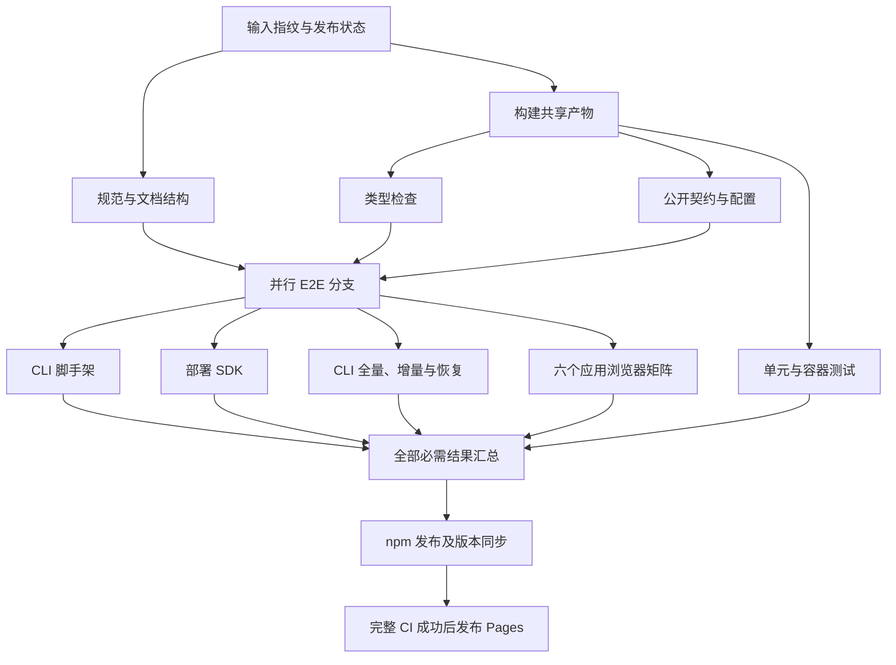

# 框架仓库的 CI 阶段与结果复用

本页面向框架维护者，说明 `.github/workflows/ci.yml` 的执行方式。应用本地验收仍按影响范围选择命令；同一工作区内共用 `dist`、`.svelte-kit`、端口或数据库的任务不能直接并发。

## 阶段与依赖

构建与 lint 在不同 runner 上同时开始。构建完成后，类型、配置/公开契约与单元测试可以并行。静态检查通过后，脚手架、SDK、真实部署和六个应用浏览器分支在各自 runner 执行，不等待单元分支结束；最终汇总等待所有必需结果。

每个 runner 有自己的工作区、容器引擎、端口和测试数据。根单元入口内部仍遵守容器资源预算：普通包有界并发，容器包串行。浏览器矩阵关闭全局 fail-fast，以保留其他应用的独立结果。`pnpm e2e` 的本地串行入口保留，避免在同一工作区同时重写产物。

构建产物和 Turbo 内容缓存由同一轮构建准备，通过 `ci-build-state-<runId>-<attempt>` 传给检查。依赖任务仍由 Turbo 校验输入并恢复必要输出；上游构建失败不启动依赖它的检查。官网额外直接构建一次，确保 `build-metadata.json` 中的提交号属于本次提交。

## 修复后复用哪些结果

通过记录是独立阶段的成功证据，并不要求该轮所有其他阶段也成功。例如某轮单元通过而 Admin E2E 失败，修正 Admin 的独立 Playwright 用例后，符合条件的单元结果仍可复用。

仅当以下条件同时成立，main 推送才复用该阶段：

1. 有精确缓存键对应的成功记录，格式、仓库、阶段、来源提交和运行编号完整。
2. 记录属于本次推送前的实际 main 头提交，GitHub 最新的对应阶段检查仍为成功。API缺失、不完整或最新检查失败、取消、跳过、未结束时重新执行，旧缓存不能遮蔽后来失败。
3. 该阶段的 Git 路径、内容及文件权限指纹一致。依赖锁、工作流、共享脚本、配置与未明确隔离的文件均参与指纹。
4. UTC 日期、runner 系统/架构/镜像版本和实际 Node 版本一致。
5. 未选择强制全量，且不是重跑同一轮的失败任务。

记录只在 main 推送的阶段实际成功或完成上述复用校验后写入，并保留原始执行来源，不含 token、环境值或测试数据。按提交保存记录，可连续传递等价结果；不会用任意历史提交的旧通过覆盖本次基线失败。缓存缺失、损坏、环境身份缺失或变化时重新执行，不根据文件名直接宣称通过。PR、手工验证和失败任务重跑实际执行阶段；PR 不写入可复用的成功记录。GitHub 的分支缓存隔离见[官方缓存说明](https://docs.github.com/en/actions/reference/workflows-and-actions/dependency-caching)。

目前明确隔离的用例是六个已登记应用 `e2e/**/*.spec.ts`。这些文件由 Playwright 执行，不进入应用的单元或类型检查：

| 修改 | 实际执行与复用 |
| --- | --- |
| 仅修改 Admin `e2e/ui-gallery-scenes.spec.ts` | 运行 lint 和 Admin 浏览器阶段；其余阶段仅在证据和环境匹配时复用。构建仍校验任务输入并更新官网元数据 |
| 修改公共 UI、API、配置、依赖锁或 CI 自身 | 保守使所有阶段通过记录失效，重新验证 |
| 修改共享 E2E helper、CLI 中混合收集的测试或未知应用 | 保守重新验证，不把它们等同于已隔离的 Playwright 文件 |
| 其他阶段失败，但本阶段命令已成功且记录完整 | 下次可复用本阶段；失败阶段没有成功记录，继续运行 |
| 缓存淘汰、跨日、runner 镜像或 Node 改变 | 重新验证 |

不得让单元测试导入上述隔离的浏览器 spec。新增应用、修改 Vitest 收集范围、引入交叉读取时，同步审查 `scripts/ci-plan.mjs` 的输入归属与回归用例；不确定的文件保留在所有相关指纹中。构建缓存与成功记录不同：恢复构建缓存不能自行使验证阶段通过。

## 查看结果与重新运行

- 每个阶段的日志和 Job Summary 明确写出实际运行，或复用的来源运行编号、提交及阶段。复用不应报告成当前提交重新执行了全部测试。
- 同一提交的瞬时环境故障，可在 Actions 使用 **Re-run failed jobs**，保留其他独立阶段的结果。断言失败应先定位并修复；新提交按输入指纹决定复用范围。
- 需要重新执行全部验证阶段时，在 Actions 的 **CI → Run workflow** 勾选 `full`（默认勾选）。这会忽略成功记录，保留正常构建任务缓存；手工验证不发布 npm 或 Pages。
- 新流程首次执行、CI 自身改变或没有可信记录时，需要建立一次完整基线；不能用旧串行流程没有生成的记录冒充命中。

汇总沿用原必需检查名称 **Typecheck, Lint, Build, Test and E2E**，兼容已有分支保护。缺失、失败、取消和跳过都不能作为必需阶段成功；main 汇总还核对同一提交的 Leak Checker 已成功，扫描词表仍只在原独立扫描流程使用，不向 PR 或验证脚本公开。只有汇总成功才进入 npm 发布；Pages 仍只使用本仓库 main 推送且**完整 CI 成功**的指定提交制品。发布来源 tag、Beta 标签、缺包恢复及旧官网防回退规则保留。

工作流复用与矩阵语法依据 [GitHub 官方说明](https://docs.github.com/en/actions/how-tos/reuse-automations/reuse-workflows)。workflow、输入归属、缓存可信边界或阶段命令改变时，应同步此页、三语 README、仓库规范、相关 Skills 和测试，并用真实 GitHub 运行验证。
