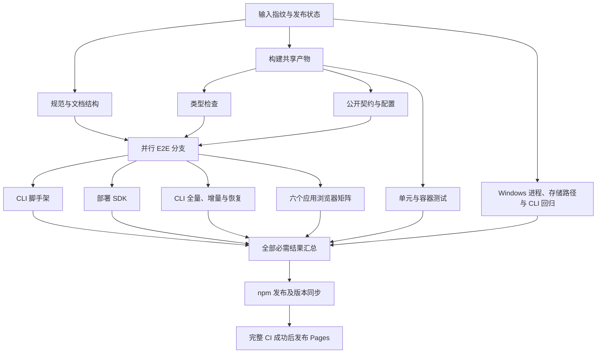

# 框架仓库的 CI 阶段与结果复用

本页面向框架维护者，说明 `.github/workflows/ci.yml` 的执行方式。应用本地验收仍按影响范围选择命令；同一工作区内共用 `dist`、`.svelte-kit`、端口或数据库的任务不能直接并发。

独立的 **Native delivery** 在相关 PR 和 `main` 推送时自动执行，也可从 GitHub Actions 手工运行。PR 和 `main` 推送共用一份路径筛选，覆盖原生示例、共享 API 契约、框架包、原生构建脚本、工作区依赖和构建配置，以及工作流文件本身。相关 PR 合并后，`main` 上的运行验证实际合并提交。具体范围见 [Native delivery 配置](../.github/workflows/native.yml)。

Windows、Android 和 iOS 在各自的 runner 上运行。Windows 和 Android 通过 CLI 构建并上传 `.hai/build` 中的统一命名批次，同时核验 Core 显示名与 SHA-256。Android 还执行 APK 验签。iOS 构建免签名的模拟器 App，并从产物的 `Info.plist` 验证显示名。安装、启动、认证、存储、网络与升级按制品中的验收边界记录。

容器测试通过 `HAI_TEST_CONTAINER_ENGINE=docker|podman` 显式选择宿主引擎，CI 使用已准备的 Docker；指定的引擎不可达时失败，不自动换到另一个引擎。本地未设置时仍先探测 Podman、再探测 Docker。Turbo 的 test/test:e2e 同步传递该选择，并将其纳入测试缓存身份；这只控制仓库夹具，不改变应用构建或部署的默认引擎。

下载源容器门禁在 CI 使用官方镜像和 npm 源，实际构建并运行生成的 Dockerfile，验证 Corepack、pnpm 和已配置的代理。未设置 `CI=true` 的本地门禁仍实测国内预设；国内和自定义源的映射与参数转发同时由单元测试覆盖。

## 阶段与依赖

CI 的 unit 阶段显式启用真实 Storage Chrome 上传取消门禁，该开关进入 Turbo 缓存身份。脚手架生成门禁包含下载源/代理容器验证；部署门禁先准备固定 PostgreSQL/MySQL/Redis/RustFS 镜像，再验证外部中间件配置。Windows 进程回收、存储路径安全与 CLI 参数回归在独立 Windows job 执行，并进入最终必需汇总。脚手架运行器通过 pnpm 的真实入口启动子进程，目录含空格也不经过 shell 重新分词。

发布完成判定同时核验所有包版本、GitHub Release 和全部 npm latest；标签部分推进后重新规划整轮仍会恢复未完成发布。

构建与 lint 在不同 runner 上同时开始。构建完成后，类型、配置/公开契约与单元测试可以并行。静态检查通过后，脚手架、SDK、真实部署和六个应用浏览器分支在各自 runner 执行，不等待单元分支结束；最终汇总等待所有必需结果。

每个 runner 有自己的工作区、容器引擎、端口和测试数据。根单元入口内部仍遵守容器资源预算：普通包有界并发，容器包串行。浏览器矩阵关闭全局 fail-fast，以保留其他应用的独立结果。`pnpm e2e` 的本地串行入口保留，避免在同一工作区同时重写产物。

单元阶段先由 `.github/scripts/ci-acp-test.mjs` 检查 Docker，并从 Agent manifest 读取版本构建 Codex/dsh/Goose 三个基础镜像，使用 Debian 官方镜像源。构建全部成功后，显式设置 `HAI_ACP_E2E_ENGINE=docker`、`HAI_ACP_E2E_IMAGE`、`HAI_ACP_E2E_DSH_IMAGE`、`HAI_ACP_E2E_GOOSE_IMAGE` 再执行无真实模型凭据的 `pnpm test`；任一前置或测试失败均阻断该阶段和发布。这样真实 Agent、volume、恢复和 Git 的 ACP E2E 在 CI 中实际运行，不依靠本地可选镜像开关。PR 仅执行本地 HTTP 模型夹具，不接收上游密钥。Turbo 将这些启用变量纳入 test 的环境和缓存身份，不能复用此前跳过原生用例的结果。测试回收本轮容器与 volume；临时 runner 销毁时回收镜像。可选 Java/Rust/Go 镜像组合不属于该基础验收。

可信 `main` push 额外使用 Actions secret `OPENROUTER_APIKEY` 对接真实模型。调用方仅在该事件传递可选 secret，复用工作流只在执行验证步骤注入，安装依赖、Docker 构建和普通根测试均不接收它。夹具门禁通过后，脚本按 manifest 安装固定版本的宿主 Codex/dsh，定向运行 `ai-acp-openrouter.e2e.test.ts` 和 `ai-acp-goose.e2e.test.ts`，强制启用 Codex/dsh 的 embedded/builtin-service 四组及 Goose HTTP/WS 两组真实验收；缺密钥、模型配置或任何一组最终失败均阻断发布。每组在初始和恢复两轮分别执行固定的写入、独立工具读回请求，检查精确文件内容和完整的测试标记。Codex 与 dsh 的夹具使用每次生成的普通库存记录。写入确认可以是完成摘要，读回必须包含原样内容。当前模型为 `z-ai/glm-5.3-flash`，该模型在 OpenRouter 有多个供应商，已核对 Responses 和 Chat Completions 的工具调用与容量元数据。请求预算由测试单独限制。手工 dispatch 和 PR 继续只跑夹具，避免未授权分支触发真实调用。

当前模型请求明确报告 OpenRouter `429` 且夹具清理成功时，用例等待 30 秒后以新会话和新工作区重新执行整组验收，最多重试两次。工作流在成功和失败后渲染各用例的最终 JSON 记录。已重试的记录保留在 `attempts/`，与最终 JSON、HTML 和 PNG 一起上传至 `acp-openrouter-<sha>-<attempt>` 制品，保留三天。证据需要脱敏。

构建产物和 Turbo 内容缓存由同一轮构建准备，通过 `ci-build-state-<runId>-<attempt>` 传给检查。共享包同时包含 `packages/*/dist`、应用私有包的 `apps/*/dist`、静态站点 `apps/*/build`、SvelteKit/适配器输出和 Turbo 缓存，不只传框架包。启动器直接消费的应用产物必须实际存在；缓存中的压缩记录不能代替这些文件。依赖任务仍由 Turbo 校验输入并恢复必要输出；上游构建失败不启动依赖它的检查。官网额外直接构建一次，确保 `build-metadata.json` 中的提交号属于本次提交。

可信 Linux runner 还会安装 bubblewrap、AppArmor 工具及发行版的沙箱 profile，只加载 `bwrap-userns-restrict`，不关闭全局 user namespace 限制。宿主原生程序安装完成后、真实模型验收开始前，`codex sandbox` 必须在临时工程中实际读写成功；该预检使用隔离 `CODEX_HOME`，不接收上游密钥，退出时删除本轮临时文件。系统依赖、profile 或原生沙箱不可用时直接阻断，避免模型在工具启动失败后猜测内容。前置依据见 [Codex 官方沙箱说明](https://learn.chatgpt.com/docs/sandboxing)。

## 修复后复用哪些结果

通过记录是独立阶段的成功证据，并不要求该轮所有其他阶段也成功。例如某轮单元通过而 Admin E2E 失败，修正 Admin 的独立 Playwright 用例后，符合条件的单元结果仍可复用。

仅当以下条件同时成立，main 推送才复用该阶段：

1. 有精确缓存键对应的成功记录，格式、仓库、阶段、来源提交和运行编号完整。
2. 记录属于本次推送前的实际 main 头提交，GitHub 最新的对应阶段检查仍为成功。API缺失、不完整或最新检查失败、取消、跳过、未结束时重新执行，旧缓存不能遮蔽后来失败。
3. 该阶段的 Git 路径、内容及文件权限指纹一致。依赖锁、工作流、共享脚本、配置与未明确隔离的文件均参与指纹。
4. UTC 日期、runner 系统/架构/镜像版本和实际 Node 版本一致。
5. 未选择强制全量，且不是重跑同一轮的失败任务。

记录只在 main 推送的阶段实际成功或完成上述复用校验后写入，并保留原始执行来源，不含 token、环境值或测试数据。按提交保存记录，可连续传递等价结果；不会用任意历史提交的旧通过覆盖本次基线失败。缓存缺失、损坏、环境身份缺失或变化时重新执行，不根据文件名直接宣称通过。PR、手工验证和失败任务重跑实际执行阶段；PR 不写入可复用的成功记录。GitHub 的分支缓存隔离见[官方缓存说明](https://docs.github.com/en/actions/reference/workflows-and-actions/dependency-caching)。

目前明确隔离的用例是六个已登记应用 `e2e/**/*.spec.ts`。这些文件由 Playwright 执行，不进入应用的单元或类型检查：

| 修改 | 实际执行与复用 |
| --- | --- |
| 仅修改 Admin `e2e/ui-gallery-scenes.spec.ts` | 运行 lint 和 Admin 浏览器阶段；其余阶段仅在证据和环境匹配时复用。构建仍校验任务输入并更新官网元数据 |
| 修改公共 UI、API、配置、依赖锁或 CI 自身 | 保守使所有阶段通过记录失效，重新验证 |
| 修改共享 E2E helper、CLI 中混合收集的测试或未知应用 | 保守重新验证，不把它们等同于已隔离的 Playwright 文件 |
| 其他阶段失败，但本阶段命令已成功且记录完整 | 下次可复用本阶段；失败阶段没有成功记录，继续运行 |
| 缓存淘汰、跨日、runner 镜像或 Node 改变 | 重新验证 |

不得让单元测试导入上述隔离的浏览器 spec。新增应用、修改 Vitest 收集范围、引入交叉读取时，同步审查 `.github/scripts/ci-plan.mjs` 的输入归属与回归用例；不确定的文件保留在所有相关指纹中。构建缓存与成功记录不同：恢复构建缓存不能自行使验证阶段通过。CI内部桥接变量属于该脚本所在的`.github`目录，不进入应用公开配置清单或生成应用的`.env.example`。

## 查看结果与重新运行

GitHub Release 保持 `prerelease: false`，包含版本名带 `-alpha`、`-beta`、`-rc` 的发布；这不改变版本的 SemVer 含义。npm 预发布版先进入 `alpha`、`beta`、`rc` 或 `next`，正式版先进入 `release`；发布包的步骤不直接改写 `latest`。自动发布在现有写入互斥锁内核对 npm `latest` 与 GitHub Latest 的真实 Git tag 来源：只有当前默认来源均为目标来源的祖先或同版本，才将 GitHub Release 设为 Latest 并推进 npm `latest`。未知 tag 或分叉来源保守保留默认值；迟到的旧流水线仍可补齐该版制品，不会覆盖更新的默认版本。判断使用 Git 祖先关系，不以历史预发布名称的 SemVer 排序代替发布顺序。

只需要调整默认安装版本时，先查询 `pnpm view @h-ai/cli dist-tags`，再使用 **Promote npm latest → Run workflow** 填写已存在的目标版本。该人工入口显式传入 `--allow-downgrade`，允许操作者选择回退；自动入口使用 `--automatic`，创建 GitHub Release 前的判定使用 `--check-automatic`。脚本从不可变的 `v<版本>` 标签读取公开包名单，先确认所有目标包版本已存在、所有当前标签可查询，再逐包更新并复核。该流程不安装依赖、不构建、不发布 tarball、不移动 Git 标签；与自动发布共用写入互斥组。npm 标签更新没有跨包事务，中途失败时可以重跑，已完成项不会重复写入。原始发布来源和同版包的内容保持不变。

npm 会在包可安装前进行扫描，发布回执可能先于版本查询可见；[官方说明](https://github.blog/changelog/2026-07-28-npm-publish-time-malware-scanning-and-dual-use-metadata/)指出通常约五分钟，高峰期可能超过十五分钟。推进 `latest` 的预检只对明确的 HTTP 404 每十秒重查一次，最多等待三十分钟；期间不改标签、不重发包。发布任务保留四十五分钟预算，覆盖安装、扫描等待及标签核验。认证、网络或服务错误继续立即报错。

等待超过上限时先核对注册表。即使版本暂时查不到，重新发布也可能返回 `409 Cannot publish over previously staged version`，这不能当作发布完成。应等待目标版本可查询，再从原始发布提交重跑失败阶段；只有全部目标版本可确认后才开始修改标签。已发布版本的内容和来源标签保持原样。

**CodeQL** 在独立工作流中与 CI 并行，按 `security-extended` 查询分析 JavaScript/TypeScript，无需构建或安装应用依赖，结果上传到 GitHub Security。工作流成功代表分析和上传完成，发现项仍需逐项审查。**Leak Checker** 是现有私有词表检查，作用与 CodeQL 不同；两者均不能替代授权边界和实际部署测试。CodeQL Action 固定到已核验的 v4 提交，仓库生成产物不参与分析。

当前 `daisyui@5.7.50` 补丁修复 CSS 构建兼容性，并非安全漏洞补丁。Tailwind 将 join 的 `@scope` 提升后，Lightning CSS 1.33 会错误丢弃两条相对选择器规则，影响焦点/悬停边框层级；补丁只添加零特异性的 `:where(:scope)` 锚点，保持优化开启。依据见 [Tailwind 官方问题](https://github.com/tailwindlabs/tailwindcss/issues/20668)、[DaisyUI 问题](https://github.com/saadeghi/daisyui/issues/4851) 和[尚未合并的上游修复](https://github.com/tailwindlabs/tailwindcss/pull/20671)。真实 compile→optimize 回归检查声明保留且无警告；升级到上游修复版后，核对实际产物再移除补丁与注册。根工作区和生成 UI 工程成套携带补丁；纯 API 不注册未使用的 DaisyUI/deepmerge 补丁。

`deepmerge@4.3.1` 的 [GHSA-gcqx-w48m-w2h4](https://github.com/advisories/GHSA-gcqx-w48m-w2h4) 是真实的返回对象原型污染问题，上游尚无已发布修复版本。工作区与生成 UI 工程通过 `patchedDependencies` 同时修补源码、CommonJS 和 UMD 文件，拒绝两侧输入中的 `__proto__` 键；不能仅升级到同一个 4.3.1 就称已解决。`scripts/tests/dependency-security.test.mjs` 从实际应用依赖树加载发布文件，覆盖普通/空原型输入、嵌套对象、数组元素及浏览器 UMD 入口，并保留正常合并回归。版本型 audit 仍会报告该低危项，不能据此声称补丁失效，也不能隐藏告警；升级到上游正式修复版后，应重新核对实际产物和回归，再移除补丁及模板注册。

- 每个阶段的日志和 Job Summary 明确写出实际运行，或复用的来源运行编号、提交及阶段。复用不应报告成当前提交重新执行了全部测试。
- 同一提交的瞬时环境故障，可在 Actions 使用 **Re-run failed jobs**，保留其他独立阶段的结果。断言失败应先定位并修复；新提交按输入指纹决定复用范围。
- Chrome 下载偶尔会因连接中断失败。浏览器安装最多尝试三次，最后一次仍失败就阻断该阶段；应用测试的失败不自动重试。脚手架和部署浏览器失败时保留截图、页面上下文及 trace，方便区分下载故障与应用错误。
- 需要重新执行全部验证阶段时，在 Actions 的 **CI → Run workflow** 勾选 `full`（默认勾选）。这会忽略成功记录，保留正常构建任务缓存；手工验证不发布 npm 或 Pages。
- 新流程首次执行、CI 自身改变或没有可信记录时，需要建立一次完整基线；不能用旧串行流程没有生成的记录冒充命中。

汇总沿用原必需检查名称 **Typecheck, Lint, Build, Test and E2E**，兼容已有分支保护。缺失、失败、取消和跳过都不能作为必需阶段成功；main 汇总还核对同一提交的 Leak Checker 已成功，扫描词表仍只在原独立扫描流程使用，不向 PR 或验证脚本公开。只有汇总成功才进入 npm 发布；Pages 仍只使用本仓库 main 推送且**完整 CI 成功**的指定提交制品。发布来源 tag、Beta 标签、缺包恢复及旧官网防回退规则保留。

工作流复用与矩阵语法依据 [GitHub 官方说明](https://docs.github.com/en/actions/how-tos/reuse-automations/reuse-workflows)。workflow、输入归属、缓存可信边界或阶段命令改变时，应同步此页、三语 README、仓库规范、相关 Skills 和测试，并用真实 GitHub 运行验证。
