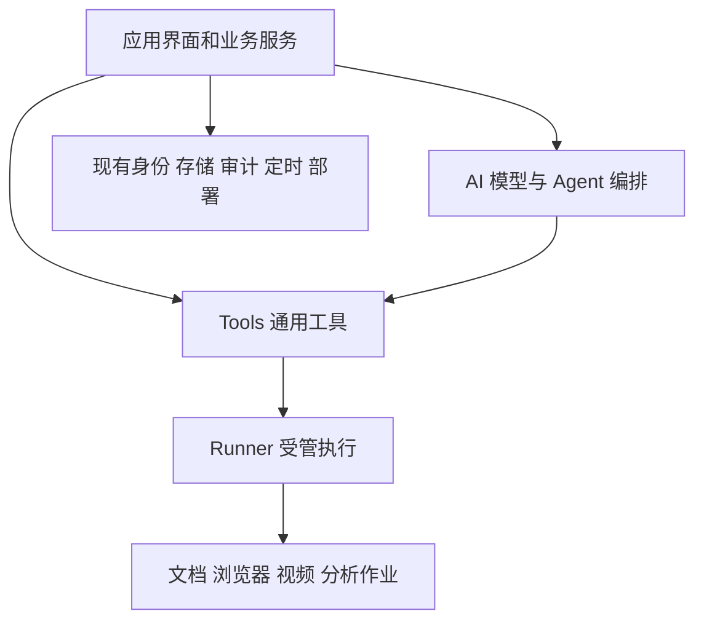

# Codex 对话能力与 hai framework 工具建设建议

日期：2026-11-16。源码基线：`main` / `3261b46e`，仓库版本 `1.0.0-beta.30`。本文是能力盘点与建设建议，未实施新模块或改变现有 API。

hai-framework 已经有不少所需基础：Markdown 文档组件、表格与图表组件、图片和语音模型、受管 Agent、文档处理工具、Runner、存储及定时任务。接下来最值得补的是**把工具结果接成可以查看、编辑、保存和继续修改的产物**，然后补齐网页运行预览、网页资料采集和视频制作。

**建议在下一批工具扩展时新增小型 `@h-ai/tools`。** 它承接与模型无关的工具定义、校验和执行；模型协议适配与 Agent 编排继续由 `@h-ai/ai` 负责，长任务和容器继续由 `@h-ai/runner` 负责。不要把所有能力都搬进 Tools，也不要另建一套任务队列。

阅读顺序：第 1、2 节了解功能；第 3、4 节看如何复用和补齐；第 5、6 节讨论工具清单和拆包；第 7 节看实施顺序。

## 1. 对话中的这些能力是怎样组成的

用户看到的一个功能，通常同时依赖以下几层。

| 层次 | 通俗解释 | 例子 |
| --- | --- | --- |
| 模型 | 理解需求，生成内容，决定下一步 | 写 Markdown、生成网页代码、规划视频分镜 |
| 工具 | 执行一次具体操作 | 搜索网页、生成图片、读取文件、运行渲染器 |
| Skill 工作流 | 说明如何组合多次操作完成任务 | 从网址采集素材，再写脚本、配音、制作视频 |
| 连接器与服务 | 连接外部数据、账号或运行服务 | GitHub、MCP 服务、网站托管、图片模型服务 |
| 产品界面 | 让结果可见、可编辑、可交互 | 文档编辑器、网页预览、图片查看器、任务进度 |

例如，模型返回一段 HTML，并不会自动出现一个可交互的网站；还需要运行或托管 HTML、隔离执行环境，以及前端预览入口。返回 Markdown 也不会自动成为可视化编辑器。

Skill 是可复用的操作指引，插件可以组合 Skill、MCP 和服务连接；它们与底层工具实现的职责不同。[OpenAI Skills 与 Plugins 说明](https://learn.chatgpt.com/docs/skills-and-plugins)

下面以当前会话可见能力和官方产品说明为范围。**客户端、插件安装、账号权限和执行环境会影响实际可用性**：例如官方明确 Codex CLI 和 IDE 扩展不提供 Visualizations 渲染；桌面端、Web 的呈现能力也有差异。当前会话看得到某个入口，不代表所有外部服务都已配置或通过实际运行验证。[Visualizations 客户端范围](https://learn.chatgpt.com/docs/visualizations)

## 2. 比较完整的功能清单

### 2.1 内容生成和可视化交付

这里需要区分三类结果：**可编辑文档、可运行网页、会话中的交互可视化**。它们可以关联，但保存方式和运行方式不同。

| 功能 | 用户可以怎样使用 | 在 hai 中的建设判断 |
| --- | --- | --- |
| 文案与 Markdown 生成 | 写报告、方案、教程、说明书，继续修改某段 | 复用 LLM，补保存为产物和局部更新 |
| Markdown 可视化编辑 | 直接修改正文、标题、表格，选择段落让 AI 改写 | 复用 `AiDocumentEditor`，补内容同步、保存和版本 |
| 文档整理与协作 | 分类、引用资料、评论、分享、长期维护 | 先扩展现有 Library；评论和多人协作按真实需求增加 |
| 网页和小应用生成 | 生成介绍页、看板、计算器、表单、小游戏 | 复用 ACP 与工作区，补网页产物和运行预览 |
| 网页预览与反馈 | 查看效果，指出某个区域需要修改 | 补受控预览服务；选区批注可随后增加 |
| 网站发布 | 保存版本、部署、获得分享地址和访问权限 | 复用现有部署能力，增加面向产物的发布流程 |
| 图表与流程图 | 数据图表、Mermaid、关系图、架构图 | 复用 `Chart` 和文档编辑器的 Mermaid 渲染 |
| 交互式可视化 | 调整参数观察结果，使用模拟器或交互原型 | 普通图表用结构化数据；复杂交互复用隔离网页预览 |
| 图片理解 | 读截图、分析页面、理解参考图 | 使用支持图片输入的模型，复用上传与图片查看 |
| 图片生成与编辑 | 配图、海报、图标素材、参考图改绘、换背景 | 已有 `ai.image.generate`；补 Agent 工具包装和产物展示 |
| 音频与字幕 | 转写录音、生成配音、制作字幕 | 已有 ASR/TTS；补字幕格式、时间对齐及音频产物 |
| 根据网址生成介绍视频 | 提取网站内容和视觉风格，制作分镜、配音和动画 | 新增组合工作流，复用 LLM、Audio、Runner、Storage |
| 视频预览和导出 | 查看时间线、调整场景，导出 MP4、封面和字幕 | 接入 HyperFrames 等渲染工具及视频播放器 |
| 表格编辑与分析 | 生成比较表、修改单元格、计算并展示图表 | 复用 `AiTableEditor`；计算和公式交给确定性程序 |
| PDF、Office 与演示文稿 | 解析资料、生成报告或幻灯片、导出文件 | 已有解析和转换基础；原生文件生成与编辑按格式补工具 |

对应产品中，Sites 提供建站、托管与分享；Pages 是用户和 AI 都能编辑的块文档；生成文件的预览取决于客户端。不能把这三者都归为 Markdown 渲染。[Sites](https://learn.chatgpt.com/docs/sites)、[Pages](https://learn.chatgpt.com/docs/space/pages)、[文件预览](https://learn.chatgpt.com/docs/artifacts-viewer)

图片生成与参考图编辑有专门工具支持；“网址转视频”则主要是网页捕获、脚本、分镜、配音、HTML 动画和渲染组成的工作流，不必首先新增文生视频模型。[图片生成](https://learn.chatgpt.com/docs/image-generation)、[HyperFrames 官网流程](https://hyperframes.app/docs/3-guides/1-website-to-video)

### 2.2 信息获取和实际操作

| 功能 | 用户可以怎样使用 | 在 hai 中的建设判断 |
| --- | --- | --- |
| 联网搜索与研究 | 查最新信息、对照来源、生成带引用的报告 | 接搜索服务或现成 MCP；向量检索不能替代互联网搜索 |
| 网页读取与素材采集 | 获取正文、截图、品牌颜色、图片等 | 新增受控读取/采集工具，作为建站和视频的共同输入 |
| 浏览器操作 | 点击、填表、测试流程、截图 | 需要可交互浏览器服务；现有截图镜像不足以覆盖 |
| 桌面应用操作 | 操作没有 API 的应用，必要时交给用户接管 | 可选远程桌面与驱动，放后续阶段；当前会话未验证驱动可用 |
| 文件读取与格式处理 | 上传资料、提取文字、OCR、格式转换、下载结果 | 优先复用已有文件服务和独立工具镜像 |
| 数据分析与程序计算 | 清洗 CSV、运行分析、生成统计图 | Runner 中运行受限计算作业，避免让模型口算代替计算 |
| 仓库开发和验证 | 搜索修改代码、运行命令、测试、构建 | 已有 ACP、工作区和 Runner，补应用展示即可 |
| Git 和代码协作 | 更新仓库、审查差异、准备提交与 PR | 复用受管工作区和 GitHub 等连接器，保留具体操作授权 |
| 外部业务系统接入 | 查询工单、文档、日历、业务数据或调用业务 API | 复用 MCP 与业务服务；补连接管理、凭据和资源授权 |

搜索返回资料，浏览器操作实际页面，桌面操作控制窗口；三者的执行服务和权限边界不同。

### 2.3 工作组织和可扩展能力

| 功能 | 用户可以怎样使用 | 在 hai 中的建设判断 |
| --- | --- | --- |
| 多步骤与长任务 | 连续执行，查看进度、取消、重试、恢复读取结果 | 复用 Runner 与 ACP 任务事件，增加业务阶段展示 |
| 多代理协作 | 并行调研、分工实现、交叉检查 | 复用 ACP/A2A 基础；子任务调度、预算与汇总还需业务编排 |
| 定时与事件触发 | 定期更新文档、生成周报，事件到来后执行任务 | 复用 Scheduler、应用事件入口和 Runner |
| 记忆和知识问答 | 记住偏好，基于授权资料回答并给出处 | 已有 Memory、Knowledge、Retrieval 和 RAG |
| Skill 与插件 | 把重复流程保存下来，按任务启用工具 | 已有技能及 Agent 接入基础；补按权限发现、版本管理和安装流程 |
| 人工确认与权限 | 在指定范围执行，遇到需要授权的动作请求确认 | 复用 ACP 审批与工具授权钩子，不把确认只写在提示词里 |
| 语音对话 | 用语音输入、听回复，进一步做实时交互 | 先复用 Agent 已有录音/ASR/TTS；全双工通话另行接入 |
| 可选伴随体验 | 动画宠物、状态提示等 | 属于产品扩展，现阶段低优先级 |

定时执行和持续运行是两回事：定时器负责何时启动，执行器负责本次运行。官方 Scheduled 的界面与运行位置也因客户端不同而变化。[Scheduled tasks](https://learn.chatgpt.com/docs/automations)

## 3. hai framework 已有什么

下表依据当前源码。现有设计文档中仍有“拟实施”描述，而部分能力已经实现；判断现状应以当前代码为准。

| 现有能力 | 可以直接复用什么 | 需要留意的边界 |
| --- | --- | --- |
| `ai.tools.define/createRegistry` | Zod 参数校验、工具注册、授权回调、超时与取消透传 | 无需 `ai.init()`；调用定义和返回仍绑定 OpenAI 工具协议 |
| `ai.mcp` 与 `ai.mcp.services.invoke` | 本地 MCP、外部 HTTP 服务、受管作业、工具白名单、Broker 绑定 | 本地 MCP 注册器与 `ai.tools` 注册器并未自动统一 |
| 独立文件工具 | `documents.extract`、`office.convert`、`office.recalculate`、`ocr.recognize` | 已支持受管 MCP 作业；解析、转换不等于原生文档生成和编辑 |
| 浏览器镜像 | `browser.navigate` 生成 HTTPS 页面截图 | 固定 1280×720，关闭 JS、下载和 Service Worker；要求受控代理，尚未接入 MCP job 操作白名单 |
| `ai.image.generate` | 文生图与 `referenceImages` 参考图输入 | 编辑效果依赖 Provider；目前没有统一 mask、透明背景等稳定公共参数 |
| `ai.audio` | `transcribe/transcribeStream/synthesize/synthesizeStream` | 可复用配音与转写；精确字幕时间戳需核对所选 Provider |
| `ai.file/knowledge/retrieval/rag/memory` | 文件理解、知识入库、检索、引用和记忆 | 这些能力不能直接提供联网搜索或网页运行环境 |
| ACP 与 A2A | 原生 Agent 接入、工作区、任务、审批、事件与 Agent 间通信 | A2A 协议本身不等于完整子代理管理器 |
| `@h-ai/runner` | 持久任务、租约、容器、容量、事件、取消和预热池 | 已是独立执行模块；不需要另建通用 Queue/Job 系统 |
| `@h-ai/storage` | 本地/S3 文件、流式读写、预签名访问 | 文档版本、业务所有者和编辑冲突需要应用管理 |
| `@h-ai/scheduler` | cron、HTTP/可信 JS/Hook 任务、执行日志 | 不作为任意用户代码的安全沙箱；重计算任务交给 Runner |
| `AiDocumentEditor/MarkdownRenderer` | 文档、目录、改写入口、工具栏、安全 Markdown、代码和 Mermaid 展示 | 可视化编辑回写、历史、撤销等需要宿主处理，尚非完整文档服务 |
| `AiTableEditor/Chart` | 单元格编辑、CSV、常见图表及看板组件 | 不等于 Excel 公式引擎或原生 XLSX 编辑器 |
| `CodeWorkspace` | 多文件只读浏览、搜索、选区反馈、diff 审阅 | 当前 Monaco 设置为只读，不能称为现成在线 IDE |
| `apps/agent` 工作台 | 对话、附件、审批、事件、引用、ASR/TTS、Library、产物下载与补丁发布 | 产物主要按文件交付，只有补丁等特定预览；需补通用类型分派和编辑保存 |
| `apps/ai-playground` | 图片、语音、工具等能力的已存在调用示例 | 是集成起点，不是已经完成的统一 Agent 产物体验 |

源码入口：[工具定义与执行](../packages/ai/src/llm/ai-llm-tool.ts)、[工具公共类型](../packages/ai/src/llm/ai-llm-types.ts)、[MCP 作业](../packages/ai/src/mcp/ai-mcp-jobs.ts)、[独立工具说明](../packages/ai/tools/README.md)、[Runner 手册](usage/function/runner.md)、[AI 手册](usage/function/ai.md)。

UI 和应用入口：[文档组件与类型](../packages/ui/src/lib/components/scenes/ai/document-types.ts)、[代码预览策略](../packages/ui/src/lib/components/scenes/ai/code-preview.ts)、[文档导出](../packages/ui/src/lib/components/scenes/ai/document-download.ts)、[只读代码工作区](../packages/ui/src/lib/components/scenes/code/CodeWorkspaceEditor.svelte)、[Agent 文件与产物](../apps/agent/src/lib/server/resources.ts)、[Agent 工作台界面](../apps/agent/src/routes/+page.svelte)、[图片面板](../apps/ai-playground/src/lib/components/ImagePanel.svelte)。

两个容易高估的地方：现有 Word 下载是 HTML 包装的 `.doc`，不是原生 `.docx`；现有浏览器 PDF 下载使用 html2canvas 和 jsPDF，主要是栅格化导出。需要可编辑 Office 或高质量分页排版时，应补对应生成工具。

## 4. 四个重点场景怎么实现

### 4.1 Markdown 可视化编辑

**复用 `AiDocumentEditor`，把缺少的宿主服务补齐。** 不需要先换一套编辑器。

建议流程：用户说“生成产品介绍” → AI 创建 Markdown 产物 → 侧栏打开编辑器 → 用户直接编辑或选择一段要求改写 → 保存新版本 → 后续 AI 操作读取当前版本。

需要补齐：

1. **内容读取和版本保存。** 沿用 Agent 的资源归属与 Storage。保存时携带读取的版本，版本已变化则返回冲突，避免 AI 覆盖用户刚编辑的内容。
2. **可视化内容回写。** 当前编辑发生在 `contenteditable` DOM，`onpreviewinput/onpreviewblur` 等回调由宿主处理。应定义支持的 Markdown 子集及回写规则；复用现有 Marked 和编辑器扩展，不直接把 DOM HTML 当 Markdown 保存。
3. **保留复杂内容。** 表格、代码围栏、Mermaid、链接、图片及现有对齐/颜色扩展需要往返验证。暂不能回写的块保留原文，提供源码编辑入口，不静默丢失格式。
4. **选区与 AI 修改。** 改写请求带产物 ID、基础版本、选区及指令；服务器定位并检查基础内容，展示修改后再应用。避免用一次全文替换实现所有局部改写。
5. **历史和恢复。** 接通已有 undo/redo/history 入口，区分当前编辑会话撤销和已保存版本历史。

首期支持单人加 AI 编辑即可；评论、多人实时协作、块级权限可以后续增加。Pages 采用块文档，这不意味着 hai 必须立即复制整套 Pages 数据模型。

验收例子：用户先修改第 1 段，AI 再修改第 3 段，两处修改都保留；旧版本写入明确冲突；刷新后文档、表格和 Mermaid 仍能正确读取。

### 4.2 网页生成与预览

建议分成两种交付。

| 交付 | 实现方式 | 首期范围 |
| --- | --- | --- |
| 单文件 HTML、交互说明、小原型 | 保存 HTML 产物，通过受控 `oncoderun` 结果和隔离 iframe 预览 | 适合无需后端的介绍页、计算器、简单交互 |
| 多文件网站或应用 | ACP 生成代码，Runner 执行固定构建任务，预览网关提供临时地址 | 适合 Svelte/Vite 等项目及真实应用流程 |

`AiDocumentEditor` 已有预览入口，但不能只开启 `allowUnsafeCodePreview` 就宣称完成安全预览。需要独立预览来源、受限 iframe/CSP、受控联网和文件访问；预览页面不携带主应用 Cookie 或服务密钥。

多文件项目还需明确：允许的启动命令、构建失败日志、端口代理、会话归属、有效期，以及停止后的进程和地址回收。先验证 `runner` 对长驻预览任务和网络暴露的支持，再增加最小适配，不把通用容器能力等同于现成托管平台。

网站发布复用 `@h-ai/deploy` 的适用部署流程，补产物版本到部署记录的关联。预览地址与正式发布地址应有不同状态和访问规则。

验收例子：生成页面可打开并操作，修改后显示对应版本；停止预览后地址失效且进程退出；构建失败能查看原因，不显示旧版本为本次成功结果。

### 4.3 根据一个网址生成介绍视频

**优先接入 HyperFrames 一类 HTML 动画与视频渲染工具，按工作流实现。** 它能复用前端技术，不需要先训练或接入视频生成模型。

| 步骤 | 优先复用 | 需要补充 |
| --- | --- | --- |
| 采集 | 现有截图协议可作为参考，文件服务保存素材 | 可处理动态网页的受控采集器；正文、截图、颜色、图片与字体来源 |
| 脚本和分镜 | `ai.llm`、现有 Skill 工作流思路 | 按时长、画幅、受众和语言生成结构化分镜，记录事实来源 |
| 图片和配音 | `ai.image.generate`、`ai.audio.synthesize` | 素材选择、配音片段；精确字幕需要时间对齐服务或对应能力 |
| 动画 | HTML/CSS、受管代码工作区 | 固定版本 HyperFrames 工具链和场景模板，限制渲染资源访问 |
| 预览和渲染 | Runner 任务、事件、取消；网页预览基础 | 浏览器逐帧渲染、编码作业、抽帧检查、失败定位和阶段续作 |
| 交付 | Storage、Agent 的资源和产物归属 | MP4、封面、字幕及工程文件；前端播放器和重新制作入口 |

现有 `browser.navigate` 关闭 JavaScript，只能作有限静态截图，不能直接替代这里的动态网页采集器。

建议把脚本、分镜、配音、场景和最终视频分别保存为有关联的产物。用户说“把第二个场景缩短”时，只重做受影响阶段。Runner 保存执行事实；业务记录保存输入版本和阶段产物引用，不再复制一套执行租约。

成本主要来自网页采集、模型/配音和逐帧渲染。首期限制视频时长、分辨率和并发，展示当前阶段与取消状态；不承诺返回取消回执就已经终止所有外部工作。

本会话安装的 HyperFrames 插件版本为 `0.1.2`；实施时固定 CLI、镜像和 Skill 的兼容版本。当前插件流程默认先交付 Studio 预览，明确要求后再导出 MP4；hai 可自行定义“预览”与“导出”两个产品动作。[OpenAI 插件工作流](https://github.com/openai/plugins/blob/main/plugins/hyperframes/skills/website-to-hyperframes/SKILL.md)

验收例子：输入一个受支持网址，得到内容可核对、时长符合要求的预览和可播放 MP4；修改某个场景后复用其余素材；采集失败、配音失败和渲染失败能分别识别。

### 4.4 图片生成和编辑

**复用现有 `ai.image.generate` 与 Playground 的调用方式。** 需要增加的是对话调用和产物管理。

建议流程：Agent 接受图片需求 → 应用包装工具，读取已授权参考图 → 调用现有图片 API → Storage 保存图片字节 → 返回产物引用 → 对话显示图片并支持继续修改。

生成时保存所用模型、指令、参考图 ID 和结果版本。继续修改默认引用用户选中的图片，避免只凭对话文字猜测目标。取消、超时和重试沿用现有 API 与 Runner 的适用边界。

透明背景、局部 mask、尺寸和多图数量需要按 Provider 能力显式声明。当前已有 `referenceImages`，但不能据此宣称所有模型都有同样的局部编辑能力。

图片工具包装放在应用或 AI 适配层，调用 `ai.image`；不要让通用 Tools 包反向依赖 AI。

## 5. 建议补充的工具和集成层

下面的名称是**拟议的 Agent 工具标识**，用于说明职责，不是现有 hai API，也不要求每行对应一个新模块。UI 按钮可以与 Agent 工具调用同一个业务服务。

| 工具或工具组 | 输入 → 输出 | 实现与复用方式 |
| --- | --- | --- |
| `artifact.read/create/update/list` | 授权资源、类型、内容和基础版本 → 产物引用及版本 | 扩展 Agent 已有资源服务；内容放 Storage，业务版本和归属由应用保存 |
| `document.rewrite/export` | 文档版本、选区、指令或格式 → 修改建议/新文件 | 改写用 LLM；编辑用现有 UI；导出按格式复用或补生成工具 |
| `table.update/analyze` | 行列数据、基础版本、计算要求 → 表格或图表产物 | `AiTableEditor/Chart` 加业务保存；复杂计算提交受限程序作业 |
| `web.search/read` | 查询或允许访问的网址 → 正文、标题、来源与时间 | 接成熟搜索/MCP 服务，增加受控网页读取；不从零做搜索引擎 |
| `web.capture` | 网址和采集范围 → 截图、素材、页面结构的引用 | 用受控浏览器采集，复用 Runner/Storage；供建站和视频共同使用 |
| `browser.*` | 已授权浏览器会话和操作 → 页面状态与截图 | 接可交互浏览器服务；会话、登录态和出网范围由服务端约束 |
| `preview.start/status/stop` | HTML 产物或项目版本 → 有效预览引用与状态 | 单文件走隔离预览，多文件走构建和预览网关；Runner 管执行 |
| `site.publish` | 已确认的产物版本、部署目标 → 部署记录与地址 | 复用 Deploy 与业务授权；失败保留诊断，不把创建记录当发布成功 |
| `image.generate` | 指令、授权参考图和支持的选项 → 图片产物 | 应用/AI 适配层包装现有 `ai.image.generate` |
| `audio.transcribe/synthesize` | 音频或文本 → 转写、配音和可用的时间信息 | 包装现有 `ai.audio`；字幕对齐不足时补专门步骤 |
| `video.create/preview/render` | 网址或素材、脚本、规格 → 分阶段任务与视频产物 | Skill/业务编排加 HyperFrames 等 Runner 作业，避免一个不透明长调用 |
| 现有文档工具 | 授权文件 ID → 文字或转换后文件 | 继续复用四个既有操作，不重复实现 Office/OCR |
| `document.generate` 等格式生成工具 | 结构化内容、模板和输出格式 → DOCX/PPTX/XLSX/PDF | 按真实格式需求增加独立作业；转换工具不能凭空生成原始内容 |
| `analysis.run` | 授权数据和受限分析请求 → 结果、图表、计算依据 | Runner 容器内使用选定分析环境，设置资源与文件范围 |
| 外部业务工具 | 业务参数和可信身份 → 授权范围内结果 | 优先接现成 MCP，或包装已有服务；连接凭据不交给模型 |
| 自动化和 Skill 管理工具 | 时间/事件、工作流与权限 → 定义及运行记录 | Scheduler 触发，Runner 执行；Skill 保存流程，不取代执行器 |

所有产生可展示结果的工具，应尽量返回**摘要、结构化结果、产物引用或任务引用**。大文件通过 Storage 交付，避免把视频和图片 Base64 填入模型上下文或任务事件。

统一产物展示应从现有 Agent 文件/产物服务扩展，按经过校验的类型和 MIME 分派到文档、表格、图表、网页、图片、音频、视频或下载组件。首期不必为此再拆一个 Artifact 框架包。

现有 `saveFile/readFile`、`jobFiles.publish` 已经负责文件和工具产物的归属；项目交付还保存 `workspace.patch`、项目及 Git 基线，并在发布时核验权限和基线。这里的 Git revision 不等于通用文档内容版本，应保留原有发布流程再扩展。当前文件下载主要作为附件返回；内联图片与媒体需补经过校验的 MIME 和授权预览访问，视频还需 Range 流式读取或合适的授权对象 URL。

工具增加后，还要增加**按任务和权限发现工具**：先展示有权使用的工具摘要，再按需加载完整 Schema。名称和版本可检索，注册时检查冲突，执行前重查授权；不要把全部工具定义都塞进每轮模型输入。进程内工具实例注册与配置/数据库服务目录仍是两种不同对象。

## 6. Tools 是否应该独立成模块

### 6.1 建议独立，但先保持小范围

现有文档提取、Office 转换和 OCR 已经具有不依赖模型的使用价值；以后网页采集、视频渲染、数据处理也会被普通页面、定时任务和后台服务调用。因此，现在已有按职责拆分的理由。

独立的价值是：普通业务调用工具时，不必依赖整个 AI 包；参数校验、执行上下文和授权规则可以复用；不同模型协议使用同一工具实现；独立镜像不再作为 AI 模型能力的附属目录持续膨胀。

但当前 `ToolCall/ToolDefinition/ToolMessage` 使用 OpenAI 类型，`toDefinition/getDefinitions/registry.execute` 也包含协议逻辑，还引用 AI 错误码和 i18n。**不能原样搬目录，更不能让新包重新导入 AI 类型形成循环依赖。**

### 6.2 推荐职责边界

| 归属 | 应该负责 | 边界 |
| --- | --- | --- |
| `@h-ai/tools`，拟新增 | 中立工具定义、Schema、注册、直接输入执行、授权钩子、截止时间/取消透传；独立工具操作及实现 | 不理解模型会话，不拥有容器租约，不保存业务文档，不接管 ACP 审批 |
| `@h-ai/ai` | 模型 API、function-calling 编解码、工具选择与 Agent 编排、ACP/A2A、RAG/记忆、图片/语音模型 | 通过适配器使用 Tools；图片/语音的工具包装可在 AI 或应用层组装 |
| `@h-ai/runner` | 作业状态、执行归属、容量、进程/容器、事件、取消与清理 | 继续作为唯一受管执行基础，不在 Tools 中复制 |
| `@h-ai/ui` | 文档、表格、图表、代码和媒体呈现组件 | 不持有服务端凭据，不直接执行高权限工具 |
| 应用与现有基础模块 | 文档/产物业务、资源 ACL、IAM、Storage、Audit、Scheduler、Deploy | 工具获得可信上下文和受限文件访问接口，不从模型参数接受身份或权限 |

依赖方向为 `ai → tools → core`；需要作业时，Tools 的作业适配部分使用注入的 Runner 和文件访问策略。轻量的定义/注册工厂本身无需数据库，也不为它们添加无意义的 `init/close`。

轻量定义和注册入口保持浏览器可用，不加载 Runner 或 Node 依赖；作业适配只在服务端使用。

### 6.3 MCP 怎样处理

MCP 本身是通用协议，长期可以由 Tools 承接协议接入部分。但**首轮不建议同时迁移全部 `ai.mcp`**。

现有 MCP 服务目录、配置合并、AI Store、Broker 和 ACP 授权已经形成调用链。首轮保留现有公开入口和目录归属，先让作业执行委托通用工具实现；后续有清晰的跨应用需求时，再单独迁移 MCP 服务管理，明确配置、数据和调用方升级。

`ai.tools` 注册器与本地 MCP 注册器之间需要明确适配，不能宣称已经统一。也不要再造第三个服务清单来管理同一批 MCP 服务。

### 6.4 建议迁移步骤及影响

1. **确认中立契约。** 区分工具输入输出与 OpenAI 消息；明确上下文、授权、失败、取消及产物引用的责任。本阶段先确认类型和错误映射，不迁数据库。
2. **抽出通用执行内核和独立工具实现。** AI 保留模型协议适配，直接业务调用与 AI 调用使用同一个内核。Runner 的状态、租约和容量保持唯一归属。
3. **迁移实际消费者。** 覆盖 Agent、Playground、AI reasoning/context、MCP 作业和模板。默认采用同批升级并移除旧入口；若发布节奏必须保留临时 `ai.tools` 门面，应明确退出版本和授权范围，门面只委托同一实现。
4. **按需要迁 MCP 底层。** 独立评估服务配置、存储和授权迁移，不与首轮拆内核捆绑。

主要成本是公共类型、错误码、依赖关系和调用方升级，而非文件移动。同步范围包括包导出、浏览器类型入口、构建图、独立镜像构建路径、CLI 模板、API 清单、使用手册、skills 和 LLMS 导航。

授权继续复用既有服务端策略和 ACP 审批。普通工具的授权回调不等于持久人工审批；如果需要在非 ACP 任务中跨重启等待人工确认，再单独设计其公共契约。

还要区分“停止等待”与“停止执行”：当前工具注册器透传 `AbortSignal` 并可中止等待，但不响应信号的处理器可能继续运行。需要进程级停止与清理证明的作业交给 Runner；结果不明的外部写入不能自动重放。

## 7. 建议实施顺序和验收范围

| 阶段 | 交付内容 | 为什么先做 | 核心验收 |
| --- | --- | --- | --- |
| 第一阶段 | 扩展现有产物服务；接通 Markdown、表格、图片查看与编辑保存；把图片/语音能力暴露为授权工具；同步完成最小 Tools 拆分 | 大量复用现有代码，先让用户在对话里看得到、改得动、保存得住 | 版本冲突、资源归属、编辑往返、AI 局部修改、刷新恢复和下载 |
| 第二阶段 | 单文件/项目网页预览、联网搜索与网页采集、结构化图表 | 为网页交付、研究报告和视频提供共同基础 | 真实网页交互、预览回收、构建失败、来源引用、受控联网 |
| 第三阶段 | URL 转介绍视频、预览/渲染、字幕与封面、必要的原生文档生成 | 在资料采集和产物体系稳定后串联较长工作流 | 真实媒体播放、内容与时长、阶段重做、取消与资源回收 |
| 后续按需求 | 持续文档维护、连接器管理、多代理调度、原生 Office 编辑、多人协作、桌面操作 | 这些能力差异较大，不应阻塞前面可交付的功能 | 用真实业务流程分别确定验收和成本上限 |

每阶段都复用已有业务授权、文件归属和审计。重点验证：用户不能读取他人的产物，工具只访问获授权文件；网页脚本与主应用隔离；任务取消有可观察终态；失败结果不冒充成功；产物的内容版本、执行版本和预览版本能对应起来。

验证应按实际差异选择范围：相关包 typecheck、lint，拆包/模板/跨包契约所需 build，工具与版本服务 test，以及对应编辑/网页/视频 E2E。拆包另核对公开 API；修改 CLI 模板再执行 scaffold gates。纯文档分析无需运行这些运行时流程。

本轮只新增分析文档与导航，不修改代码、配置、公共类型、数据库或 CLI 模板。后续实施涉及模块边界和功能输入输出，按 [变更影响与方案确认](../.agents/skills/hai-change-plan/SKILL.md) 对具体方案及影响取得确认后推进。
