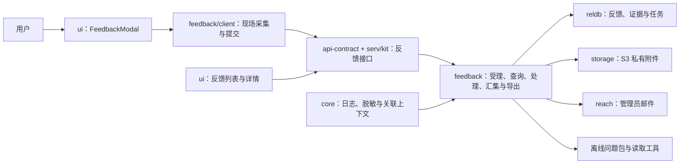

# Feedback 模块设计方案

日期：2026-10-22。本文为实施设计与验收依据；当前实现进度、验证结果及已验收基线见[任务清单](feedback-tasks.md)，不由设计文档的存在推定完成。

需求来源：[Issue #73](https://github.com/hai-series/hai-framework/issues/73) 及本轮补充要求。模块命名为 `@h-ai/feedback`；独立的 telemetry 功能另行设计，不作为本模块的前置依赖。

## 1. 目标与范围

为 hai 应用提供可直接接入的问题反馈闭环：用户打开反馈即可提交；系统保存用户输入与诊断现场，将截图放入 S3，邮件通知管理员；管理员分页查看反馈、检查证据并标记处理状态。生产与开发隔离时，管理员可以导出自包含的问题包，交给开发侧 AI 结合对应版本源码分析。

- 有异常和无异常的问题均可反馈，包括按钮无响应、界面异常、业务结果不符合预期、建议及疑问。
- 描述、分类、联系方式和截图标注均可选；没有描述时，根据页面、时间和已捕获的错误生成事实摘要。
- 业务数据、日志、系统信息、采集结果和处理记录存关系型数据库；截图等二进制附件存 S3，数据库保存附件索引。
- 默认实现包含采集、受理、存储、通知、管理界面和离线导出，产品不必重复实现整套逻辑。
- 业务系统仅提供部署配置、入口位置、权限映射及业务证据扩展。不自动修改源码、不承诺任意问题自动复现。

## 2. 模块与依赖



| 包/入口 | 职责与依赖边界 |
| --- | --- |
| `@h-ai/feedback` | Node 服务端领域模块，依赖 `core`、`reldb`、`storage`、`reach`；负责受理、证据管理、处理状态、任务恢复和导出 |
| `@h-ai/feedback/client` | 浏览器采集与本地兜底；构建产物隔离服务端数据库、S3/SMTP SDK 和凭据；不依赖 Svelte |
| `@h-ai/feedback/bundle` | 无需初始化的包协议、索引和校验工具；离线查看器、回放播放器与 CLI/MCP 通过独立入口按需加载 |
| `@h-ai/api-contract` | 新增 feedback 的共享请求/响应 schema 与 HTTP contract；schema 不导入 feedback 服务实现，避免循环依赖 |
| `@h-ai/serv`、`@h-ai/kit` | 提供可挂载的反馈适配和请求关联；沿用宿主认证、权限及租户上下文 |
| `@h-ai/ui` | 复用并扩展收集界面，新增反馈管理场景；通过 actions 接受数据和操作，不内置数据库、邮件或 HTTP 地址 |
| `@h-ai/cli` | 新增问题包摘要、证据查询和本地查看命令；离线读取不要求初始化服务端模块或 AI Provider |

服务端由宿主依次初始化 `reldb → storage → reach → feedback`，每步检查结果；关闭时先停止 feedback 的采集/任务，再释放依赖。`core` 按现有同步初始化契约使用。feedback 检查前置依赖，不代替宿主管理连接或私有配置。

生产部署采用 `storage` 已有的 S3 兼容 Provider 和私有桶；复用 `reach` 的 SMTP Provider，不另写 S3、SMTP 或日志 Provider。IAM、audit 可通过宿主接入；scheduler/cache 不增加为 feedback 的必需依赖。纯后端应用可直接提交反馈并收集后端证据，无需浏览器或 UI。

## 3. 问题收集界面

基于现有 [FeedbackModal](../packages/ui/src/lib/components/scenes/app/FeedbackModal.svelte) 扩展，既支持全局入口，也支持错误提示、错误页直接打开；另提供适合独立页面承载的同一内容组件。

**默认操作：打开反馈 → 提交。**

1. 打开前固定时间、页面/路由、最近操作、关联错误与请求窗口，并获取不含反馈弹窗的截图；截图超时或失败时照常打开。
2. 主界面显示可选的“一句话说明”、截图预览和提交按钮。类型、联系方式、附件和“自动收集的材料”放在可展开区域。
3. 截图支持添加、预览、圈选、遮挡和删除。自动采集材料显示版本、日志条数、浏览器/后端环境以及已脱敏、缺失或不适用的项目。
4. 提交前生成稳定的客户端提交标识；服务端可靠保存后返回反馈编号。用户可继续使用，上传/补采由后台继续执行。
5. 展示“已受理，材料收集中”或“已受理，材料已收集”。受理失败保留输入和现场；可重试，或将已有材料保存为本地问题包。
6. 截图尚未上传成功时保留客户端待传数据；刷新恢复仅在产品授权允许时使用有期限的 IndexedDB。不能把关闭弹窗等同于删除待传任务。

固定业务现场之后，反馈界面自身的点击、网络请求和日志单独标识并排除，避免递归采集。用户新增说明和标注作为独立反馈材料保存，不混入问题发生前的操作时间线。

## 4. 问题展示界面

提供可复用的 `FeedbackList` 与 `FeedbackDetail` 场景组件，由业务后台挂载路由；本仓库在 `apps/admin-console` 接入示例页面。

列表复用 [CrudPage](../packages/ui/src/lib/components/scenes/crud/CrudPage.svelte)、工具栏与分页组件：

| 项目 | 设计 |
| --- | --- |
| 列表列 | 反馈编号、说明/事实摘要、应用与版本、提交人、提交时间、未处理/已处理、采集状态、通知状态 |
| 筛选 | 处理状态、采集状态、应用、版本、提交时间、关键词；支持按时间排序 |
| 分页 | 服务端分页，返回框架统一 `PaginatedResult<T>`；页大小设置上限，列表不加载完整日志和截图二进制 |
| 行操作 | 查看详情、标记已处理、撤销处理；导出与重试操作按权限和当前状态显示 |
| 处理动作 | 处理备注可选；保存操作者、时间和变更历史；撤销处理保留历史，不删除证据 |

详情以同一界面的详情页/抽屉展示：

- **概览**：用户描述、反馈编号、关联时间、版本/build/commit、处理状态、采集完整度。
- **操作现场**：操作时间线、截图、用户标注、附件和按配置采集的页面回放。
- **日志与请求**：前后端日志分组，突出错误锚点和前后窗口；关联请求、业务失败、异常堆栈与缺失原因；支持分页读取。
- **环境**：后端 OS/运行时、白名单环境变量、浏览器与视口、脱敏 Cookie 和受限业务快照。
- **处理与投递**：处理记录、邮件发送/延迟/失败状态，以及有权限的重试和导出入口。

首版处理状态仅设 `pending`（未处理）和 `handled`（已处理），不引入指派、优先级、SLA 或复杂工单流转。前端按钮显隐与服务端授权同步；列表、详情、日志查询和附件下载均执行相同的数据范围约束。

## 5. 自动采集的内容

所有数据先执行采集策略与脱敏，再进入缓冲、数据库或 S3。数据库保存每一项实际采集结果，以及来源、时间、策略版本、缺失/截断原因；常态环形缓冲不等同于永久保存所有用户会话。

| 类别 | 默认采集 | 扩展与限制 |
| --- | --- | --- |
| 用户输入 | 可选说明、分类、联系方式、截图/标注、主动上传附件 | 不要求必填；联系方式、自由文本同样受可见权限和导出策略约束 |
| 应用版本 | 应用/服务标识、版本、buildId、可用的 commit、环境名 | 分别记录前端与实际响应服务版本，不能假定它们一致；source map 私有保存于开发侧 |
| 前端环境 | 当前路由、脱敏 URL、浏览器/OS 可取得信息、语言、时区、视口、屏幕像素比、在线状态 | 浏览器信息可能降精度；未知字段标明 unknown，不推断为准确硬件信息 |
| 前端异常与日志 | error、unhandledrejection、core.logger；HTTP 失败及失败 HaiResult | 原生 console 采集按配置开启；不通过强制开启全量 debug 扩大生产采集 |
| 请求记录 | requestId、时间、方法、路由、耗时、状态码、业务错误码、重试关联 | 默认不保存完整请求/响应正文；正文、header 按字段白名单及大小限制采集 |
| 后端日志 | core.logger 与已接入的日志源中属于该请求/用户范围的记录、异常堆栈 | 第三方/Rust/任务系统通过受控扩展接入；不能读取其他租户的进程相邻日志 |
| 后端运行环境 | 出错实例 ID、OS 类型/版本/架构、Node/服务运行时版本、进程运行时长、有限资源摘要 | 容器内取得的是容器可见环境；不默认采集主机清单、进程列表、配置文件或数据库内容 |
| 环境变量 | 白名单中的环境名、时区、功能开关及版本标记 | 不遍历导出全部 process.env；密码、token、私钥和带凭据连接串不保存原值 |
| Cookie | 配置允许的普通业务 Cookie，例如语言、主题；必要的 Cookie 存在性 | 凭证类 Cookie 不保存值；服务端也执行同样策略，不通过后端绕过浏览器的保护 |
| 操作与图像 | 时间、稳定动作标识、页面/路由变化、反馈前截图、受限数量的关键操作截图 | 不保存敏感输入；关键截图按稳定操作节点/异常触发并节流，不逐帧截图 |
| 页面回放 | 按需启用的 DOM 快照和增量事件 | 采集启用时启动记录器；与普通视频及运行时确定性回放区分，资源需离线化 |
| 业务扩展 | 授权范围内的订单/任务等 ID、必要状态、脱敏 mock 材料与期望行为 | 扩展有统一 schema、超时、容量、脱敏和权限约束，不要求框架了解业务表 |

浏览器脚本不能读取 HttpOnly Cookie，也不能读取响应中的原始 Set-Cookie。请求 Cookie 不包含其设置时的完整属性，因此服务端也不能凭请求推导所有 Cookie 属性；可从应用自身配置提供已知元数据。[MDN：Set-Cookie](https://developer.mozilla.org/en-US/docs/Web/HTTP/Reference/Headers/Set-Cookie)

敏感字段规则复用 [core.sanitize](../packages/core/src/utils/core-util-sanitize.ts)，并补充自由文本、DOM、截图与附件的独立策略。会话、访问/刷新令牌、CSRF 凭证、数据库密码、SMTP/S3 密钥均不进入反馈材料或离线包。白名单按实际字段显式配置，未知 Cookie/环境变量不默认采集值。

截图可复用仓库已有的 html2canvas 依赖，但需要单独实现页面快照、敏感区域遮挡及超时处理。它基于 DOM 重建图像，存在 CSS、跨域图片及被污染 Canvas 等限制，无法取得的部分必须标注。[html2canvas 官方说明](https://html2canvas.hertzen.com/documentation)

页面回放采用 rrweb 的独立记录/播放入口按需集成；记录器随采集开启，播放器留在管理/离线查看端，避免全部应用打入播放依赖。[rrweb 官方指南](https://github.com/rrweb-io/rrweb/blob/master/guide.md)

## 6. “错误前后各 100 行”的具体语义

默认定义为：**每个日志源中，错误锚点之前最多 100 条结构化日志 + 错误记录本身 + 之后最多 100 条结构化日志**。多行堆栈属于一条记录，另受单条和总字节上限约束。

1. 前端按标签页/采集会话，后端按实例和服务端认证上下文中的 request/job 关联定位。关联 ID 是定位线索，不是日志读取授权。
2. 先确定允许的证据范围，再取前后窗口；不从整个服务器日志中直接截取相邻 200 行。关联上下文缺失时显示缺失，不能扩大到其他用户日志。
3. 错误发生时固定已有的前 100 条，并在后续时间内补采后 100 条；建议最长等待 30 秒。请求结束、来源关闭、超时或采集上限触发时，按实际数量结束。
4. 没有异常时，以打开反馈时间作为锚点，采集此前的操作/日志及有限后续相关记录；标记 `anchorKind=feedback`，不虚构错误。
5. 多个错误窗口重叠时复用/合并日志，保留各错误锚点；错误锚点数和总容量另设上限。超限明确显示被省略数量和原因。
6. 时间线保存来源时间、服务端接收时间和来源局部序号。不同机器的前后关系以关联和局部序号辅助判断，不假定时钟完全同步。

默认缓冲建议：最近 5 分钟，前端每标签页最多 1,000 条/2 MiB；后端每实例最多 10,000 条/16 MiB，并对活跃上下文数量和全部已固定窗口设总容量上限。初始值作为可配置默认值，需在性能验收后确定。无法找到的早期日志明确标为“已过期/缓冲淘汰”，不承诺无限回溯。

截图与页面回放也必须提前维护有界现场。进程/页面崩溃后，只能恢复此前获准持久化的脱敏片段；不能补拍崩溃后的画面。纯后端场景中的截图、浏览器、Cookie 标为“不适用”；启用了采集而失败的项目标为“缺失/失败”。

多实例部署中，本机日志缓冲只覆盖本机。默认实现对已捕获并关联请求的异常窗口，将有界脱敏片段批量写入共享数据库，设置短 TTL 和租户隔离，供另一节点受理时汇集；这些临时证据在提交时关联反馈，未提交则过期清理。不为每次普通请求永久入库。更早的日志、节点突然退出前尚未落库的数据，或未记录的第三方服务日志，需要接实际日志后端，否则如实标缺失。

## 7. 数据库与 S3 存储

采用模块表，不增加另一套数据库访问层；复用 reldb 的 Repository、事务、分页和迁移能力。

| 表 | 主要内容 |
| --- | --- |
| `hai_feedback_reports` | ID/反馈编号、应用与租户范围、服务端确定的提交人、描述/分类/联系方式、版本快照、锚点、处理/采集状态、截止时间、创建/更新时间、幂等键、操作并发版本和独立的证据修订号 |
| `hai_feedback_evidence` | 反馈 ID（临时窗口阶段可空）、受限关联范围、证据 ID/类型/来源、error/request/job 关联、时间/局部序号、结构化内容、分块索引、采集/缺失原因、策略版本和过期时间 |
| `hai_feedback_attachments` | 反馈 ID、截图/附件 ID、S3 object key、MIME、字节数、SHA-256、上传状态、遮挡/标注关系、创建时间和清理状态 |
| `hai_feedback_history` | 处理与撤销处理的前后状态、操作者、时间、可选备注、变更版本 |
| `hai_feedback_jobs` | 汇集、通知、导出、清理任务；状态、去重键、重试次数、下次执行时间、租约/执行节点、每收件人发送结果和脱敏错误 |

长描述、日志和环境上下文通过 `JSON` 字段存储并分块，避免把普通 `TEXT` 当作所有数据库都支持的无限长文本；当前 reldb 的 MySQL `TEXT` 映射为 `VARCHAR(255)`。可筛选字段独立建列和索引，JSON 内容不作为分页扫描大字段。毫秒时间戳使用 `BIGINT`；数据库兼容性覆盖 SQLite/PostgreSQL/MySQL。

重点索引：范围+创建时间、范围+处理状态+创建时间、feedbackId+证据类型+局部序号、受限 request/error 关联、任务状态+下次执行时间。幂等键在“应用/租户/提交身份+客户端提交标识”范围内唯一，不能让其他用户的同名标识命中已有反馈。

S3 key 由服务端生成，示意为 `feedback/<scope>/<feedbackId>/<attachmentId>.png`；客户端不能指定桶或任意 key。生产桶保持私有，数据库不保存永久公开 URL。首版通过受控上传接口将附件写入 S3；需要直传时再签发仅绑定当前附件的短期授权，并在完成后验证实际类型、大小与 checksum，不能只信客户端声明。

数据库、S3、SMTP 不做伪跨系统事务：

- 受理事务保存反馈、基础证据、预期附件和汇集/通知任务；检查每一步结果，任一步失败回滚。事务提交成功才返回“已受理”。
- 提交后续传的证据按“反馈+来源+块序号”幂等入库并返回持久化 ACK；客户端收到确认后才释放待传块，未确认则按同一标识重试。服务端校验关联范围、采集窗口、块大小与总配额，不能接受无限追加。
- 图片写入 S3 后确认 checksum，再把附件标为可用。重复提交/上传复用同一提交与附件标识，防止重复建单、重复附件。
- S3 成功但数据库确认失败的对象进入重试/对账，孤立对象到期清理；数据库已有记录但对象缺失则标“附件缺失”，不渲染成正常图片。
- 到期删除按数据库任务清理报告、证据、附件、历史及含敏感快照的任务，并按前缀删除所有孤立上传 attempt。只暂留不含现场的前缀/24 小时截止墓碑，反复清扫迟到对象后删除；清理故障持续重试，不能仅删记录后永久遗留对象。

## 8. 后台汇集与邮件通知

```text
受理事务提交并返回反馈编号
    → 有界补齐日志/环境/附件
    → 材料完成或截止，记录完整/部分缺失
    → 执行通知任务，通过 reach 发管理员邮件
    → 管理员查看详情并标记已处理
```

反馈处理、材料和通知是三个独立维度：

| 维度 | 状态与含义 |
| --- | --- |
| 处理 | `pending / handled`；只由有权限的人工操作改变，处理失败不改状态 |
| 材料 | `collecting / complete / partial / failed`；可按来源重试，部分失败仍保留可用证据 |
| 通知 | `pending / sending / sent / deferred / failed`；按收件人保存结果，反馈已保存不代表邮件已发送 |

材料汇集设截止时间，建议首版 60 秒；日志后窗口、截图等各自还有更短超时。截止时仍缺材料就标 `partial` 并通知，不让管理员无限等待；后续恢复的材料形成证据修订，默认不重复发送首次通知。

通知复用 reach 模板，收件人由服务端配置。邮件包含反馈编号、应用/版本、时间、脱敏事实摘要、材料状态和后台详情链接；用户文本按邮件渲染方式转义。不附 Cookie/环境原值、原始日志、公开截图地址或可直接取得完整现场的长期 URL。

feedback 的通知任务与反馈记录同库持久化，使用数据库条件更新 claim、租约及过期恢复协调多节点；停止进程不会丢失尚未执行的任务。首次通知按“反馈+收件人+通知类型”唯一，自动重试退避且有次数上限；失败在管理界面可见并可授权重试。

每次 claim 生成独立执行令牌；续租、完成和失败写回均校验当前令牌。过期执行者不能覆盖新执行者的任务状态，S3/证据写入等副作用同时使用稳定业务标识和 checksum 保持幂等；SMTP 的不确定重发仍按下述边界处理。

SMTP 超时等不确定结果可能导致重发，采用至少一次尝试，不能承诺严格只投递一次。`sent` 表示邮件服务已接受发送，不代表进入管理员收件箱；`deferred` 不能计为 sent。

**reach 对接条件（实施时已复核 alpha.68）**：reach 虽已返回 queueId 并提供队列查询，但 DND 入队不接受 feedback 的稳定业务幂等键，队列入库与 feedback 保存回执之间发生崩溃仍可能二次入队。首版 feedback.init 明确拒绝 reach DND enabled=true，由 feedback 唯一持有通知 outbox，调用 reach 立即发送。后续只有补齐稳定入队回执与幂等核对后再支持 DND，不能仅凭已有查询接口宣称闭环。

reach 的 DND 配置作用于整个模块单例，不能只为 feedback 设置独立开关；需要 DND 的宿主暂不满足本版反馈通知前置条件。

## 9. 接口与权限

以下名称是设计草案，实施时按真实调用点确定最小公开 API；生命周期、getter 和纯工具按实际签名处理，领域操作返回 `HaiResult`。

| 接口 | 用途 |
| --- | --- |
| `feedback.submit(input, context)` | 幂等受理用户反馈或纯后端反馈；context 由可信服务端生成，客户端不能指定其他用户/租户身份 |
| `feedback.list(query, context)` | 管理列表与服务端分页；只返回摘要 |
| `feedback.get(id, context)` | 详情、各来源状态、处理和通知摘要 |
| `feedback.getEvidence(query, context)` | 按时间、错误、请求和类型分页查询证据，不一次返回全部日志 |
| `feedback.setStatus(input, context)` | 处理/撤销处理；包含期望版本，使用乐观并发避免覆盖其他管理员操作 |
| `feedback.retry(input, context)` | 对允许重试的采集来源、附件确认、通知或导出重新排队；已成功任务不重复执行 |
| `feedback.export(input, context)` | 创建/取得指定证据修订的问题包任务，返回任务及导出状态 |

HTTP contract 另包含证据分块追加/持久化确认/来源采集完成、受控附件上传/完成/下载、任务状态与安全采集策略查询；这些传输动作不要求全部扩张成顶层业务 API。浏览器后续日志必须经该通道入库，服务端 worker 无法主动读取已关闭页面的内存。后台任务执行函数不暴露为无保护的公网端点。

权限建议：`feedback:create`、`feedback:read`、`feedback:process`、`feedback:reopen`、`feedback:export`；重试按其目标权限控制。使用宿主现有 IAM/守卫和资源授权策略，模块不定义“拥有 admin 角色即可访问一切”的业务规则。

默认登录用户可提交；需开放匿名反馈时由产品显式启用，服务端签发受限提交凭据，并实施配额/限流，避免要求普通用户登录代码托管平台。管理列表不因此对匿名开放。请求、日志和附件的范围必须由服务端认证上下文确定；跨租户 ID 枚举、伪造 requestId、任意 object key 和任意日志路径均应被拒绝。

## 10. 离线问题包

后台详情提供“导出问题包”；服务不可用时，客户端只导出其已经取得的材料，并标出未取得的服务端证据。

```text
feedback-<编号>.zip
  summary.md
  manifest.json
  timeline.ndjson
  evidence/                 日志、请求、环境、业务快照的分块文件
  attachments/              截图和用户附件
  replay/                   按策略采集的事件与允许保留的本地资源
  viewer/                   随包携带的查看器、脚本和样式
```

manifest 记录协议版本、反馈/证据修订、应用/服务版本、build/commit、文件索引、SHA-256、时间范围、脱敏策略及缺失/截断信息。摘要区分“采集事实、用户描述、分析推断”，默认不把推断写成系统事实。

创建导出任务时固定证据修订和不可变的证据/附件 ID、checksum 清单；任务有效期内保护这些材料不被普通 TTL 清理，并限制任务存活时间。迟到材料进入新修订，不能修改正在导出的快照；处理/撤销处理等记录以导出创建时的快照为准。导出失败后仍按同一清单重试，指定修订已过期时明确返回材料不可用。

导出时从数据库读取文本证据、从 S3 取截图/附件，校验并随包带出；允许保留的回放图片/样式改写为包内资源，不依赖生产 URL、CDN 或在线回放服务。读取器禁止路径逃逸、限制解压容量，回放处于隔离环境，不执行原应用脚本或任意附件代码；离线导出本身不携带生产凭据。

提供本地离线查看器与按时间/请求/错误分页查询的 CLI 工具；MCP 可基于同一读取能力接入。查看器可由 CLI 启动只绑定本机的服务，不以浏览器直接打开 file URL 作为唯一方案。开发者自行准备对应版本源码、私有 source map 和测试环境。回放还原观察到的页面状态，重新执行仍依赖业务数据/权限/mock 等复现材料，不能承诺确定性重放。

## 11. 需要补齐的现有扩展点

| 当前源码基础 | 实施改动 |
| --- | --- |
| [core logger 类型](../packages/core/src/core-types.ts)、Node/Browser logger | 增加中立、可取消的结构化日志观察点；沿用输出级别/脱敏规则，失败隔离、容量受限，不同步写数据库，不递归捕获 feedback 自身日志；core 不依赖 feedback |
| [api-client 配置](../packages/api-client/src/api-client-types.ts)及请求执行 | 增加通用请求生命周期观察，区分逻辑请求与刷新/重试；采集失败 HaiResult，传输加密场景在合适的逻辑边界取得白名单证据 |
| [serv 上下文](../packages/serv/src/serv-context.ts)、[kit handle](../packages/kit/src/hooks/kit-handle.ts) | 统一请求 ID 的生成/回传与可信上下文传播；让业务日志及异步任务可关联，不能仅给入口日志挂一个 ID |
| [storage](../packages/storage/src/storage-types.ts) | 复用 S3、流式读写、checksum、私有下载；新增反馈范围内的附件授权与对账逻辑，不开放通用任意 key 操作 |
| [reach](../packages/reach/src/reach-types.ts) | 复用 SMTP/模板；明确受理、发送及 DND 回执边界，按第 8 节决定是否需补回执查询 |
| [FeedbackModal](../packages/ui/src/lib/components/scenes/app/FeedbackModal.svelte)、[CrudPage](../packages/ui/src/lib/components/scenes/crud/CrudPage.svelte) | 扩展收集交互并组合管理列表/详情，沿用 UI/i18n/分页能力 |
| CLI 构建元数据 | 把当前产物的版本/build/commit 注入实际运行应用，反馈读取运行时事实；不能只在部署目录中存在 buildId |

## 12. 实施顺序与验收

| 阶段 | 交付与验收重点 |
| --- | --- |
| 1. 契约与受理闭环 | feedback 生命周期、数据表/迁移、权限、幂等受理、截图 S3、持久化汇集/通知任务及两个基本界面；真实 SMTP 通知和处理/撤销处理 |
| 2. 通用诊断现场 | 前后端有界采集、错误前后各 100 条、版本与环境、Cookie/环境变量白名单、关键操作截图与可选回放、多节点证据关联和崩溃/中断降级 |
| 3. 离线交付与复用 | 自包含导出/校验/查看/查询工具；生产开发隔离实测；第二个应用接入；同步模板、三语 README、使用 skill、LLMS.txt 和配置导航 |

阶段用于实施排程，首个完整交付应贯通上述基础闭环与离线验收。MCP、更多业务专用采集器及更复杂处理流程可后续扩展，不能用它们替代默认可用能力。

- [ ] 无描述、无异常的反馈可直接提交；打不开截图/日志也能提交并看到缺失原因。
- [ ] 反馈、所有实际取得的结构化证据、附件索引、处理历史和任务均可靠入库；截图实际写入 S3 私有桶，可授权读取。
- [ ] 真实发送管理员邮件，主题/摘要/链接正确；SMTP 不可用时反馈不丢、通知状态准确，恢复可重试；不把 Console Provider 当真实邮件验收。
- [ ] 验证错误前 100 条/后 100 条、数量不足、超时、重叠窗口、容量溢出、时钟差及无错误锚点；不混入其他用户/租户日志或反馈自身请求。
- [ ] 列表服务端分页和筛选有效，详情按需加载；处理/撤销处理落历史，两个管理员并发操作不会静默覆盖。
- [ ] 数据库/S3/SMTP 分别故障、上传中断、反馈服务重启和任务租约过期后，已有反馈/证据保留，任务可恢复且不重复建单；检查孤立对象清理。
- [ ] 验证 Cookie、环境变量、日志、截图和附件脱敏；跨租户反馈/日志/附件越权被拒绝，导出包不含生产凭据。
- [ ] 两个业务应用使用同一采集/受理/UI 实现，无需复制核心逻辑；纯后端场景不依赖浏览器采集器。
- [ ] 断开开发侧的生产网络及公共网络，仅用问题包和对应源码能查看截图/回放、分页查询证据并开展 AI 分析；无外链请求，缺失材料明确可见。
- [ ] 覆盖 SQLite/PostgreSQL/MySQL、真实 S3 兼容服务、真实 SMTP 测试服务及多实例任务协调；不能用单元 mock 代替这些验收。

实施验证遵循仓库分轮门禁，执行受影响包的 typecheck、lint、build、test 与 UI E2E；跨包契约变化提升到适用根门禁。AI 文档运行 `pnpm check:skills`，CLI 模板运行 `test:scaffold-gates`。本方案文档本身不改变运行时代码；验收勾选项的完成证据和基线统一记录在任务清单及关联任务记录。
