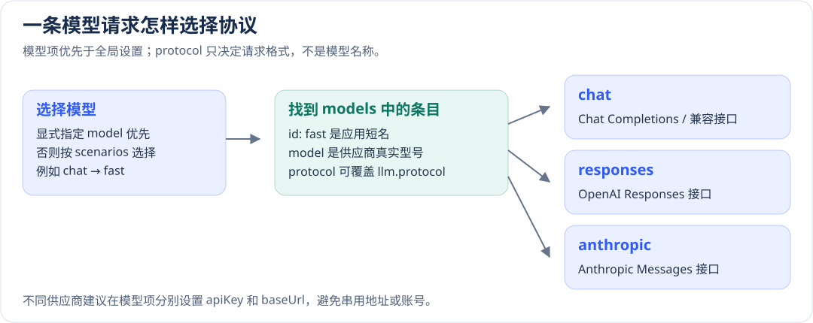

# @h-ai/ai 配置

<a id="ai知识会话记忆与向量配置"></a>

[English](ai.en.md) · [日本語](ai.ja.md)

[配置手册](README.md) · [配置清单](#配置清单) · [AI调用与页面操作](../development/ai.md)

## 配置入口

生成的项目使用 `config/_ai.yml`。启动时应用用 `core.config.get('ai')` 读出设置，再传给 `ai.init()`。用环境变量覆盖时使用 `HAI_AI_` 前缀。[凭据和地址的读取顺序](#凭据和地址按哪个顺序生效)

应用也可通过 `ai.init(config, options)` 的第二个参数接入代码对象。`storeProvider` 决定怎么读写数据，`runner` 负责执行受管任务，`acpPolicy` 决定用户可以创建和操作哪些会话，`mcpJobFiles` 负责访问任务文件，`acpAdapters` 提供原生 Agent 的连接方式。

<a id="configuration-fields"></a>

## 配置清单

下表按功能给出字段和默认值。`llm.models[]` 表示模型列表中的每一项。例如省略整个 `knowledge.chunkOptions` 时，知识库用 Markdown 模式切块，每块最多 1500 个字符，相邻块重叠 200 个字符。若只写 `chunkOptions: { mode: markdown }`，未填的 `overlap` 按 Datapipe 取 `0`。

### 配置与数据库清单

`llm.models`、`audio.models`、`image.models`、`mcp.servers`、`retrieval.sources`、`acp.agents`、`acp.workspaces` 同时读取初始化配置和数据库，按 ID 合并，配置优先且不可修改。对应 API 均提供 list/get/register/update/remove；条目包含 value/source，数据库 get 带 version。更新为完整替换，可附版本拒绝过期写入。配置不会被写入数据库。

ACP 会话通过 `mcpServerIds` 使用外部 MCP 清单；Agent 和远程服务在启动时解析 environmentRefs/headerEnv，受管 Git 在访问登记的远程仓库时解析 gitEnvironmentRefs。运行中的会话保留模型绑定，恢复时检测配置变化。音频同步 getCapabilities 使用最近目录读写或异步调用刷新的快照。目录是可信服务端管理 API，不应直接向浏览器暴露含密钥的模型定义。

错误码 090 只读、091 不存在、092 冲突、093 无效定义、094 存储失败。CLI 生成项目中的 `.agents/skills/hai-ai/resources.md` 包含配置和 CRUD 示例。

### `acp`

Agent 可用 `custom-service`、`embedded` 或 `builtin-service`。先按[接入方式](#acp-接入与模型能力)登记 Agent 和工作区，再设置环境、执行限制与默认参数。

| 配置项                                                | 适用条件                                | 默认值/必填 | 说明                                                                                                                                    |
| ----------------------------------------------------- | --------------------------------------- | ----------- | --------------------------------------------------------------------------------------------------------------------------------------- |
| `acp`                                                 | 通用                                    | 可省略      | ACP 会话与执行限制（仅 Node 服务端）                                                                                                    |
| `acp.agents`                                          | 通用                                    | `[]`        | 配置文件定义的只读智能体，与数据库记录按 ID 合并。可填数组（元素为 `mode=custom-service` 或 `mode=embedded` 或 `mode=builtin-service`） |
| `acp.agents[].id`                                     | 所有 Agent 模式                         | 必填        | 稳定的 Agent ID，应用通过此 ID 选择代理                                                                                                 |
| `acp.agents[].name`                                   | 所有 Agent 模式                         | 必填        | 用于引用或区分这一项的名称。可填字符串，至少 1 个字符                                                                                   |
| `acp.agents[].enabled`                                | 所有 Agent 模式                         | `true`      | 默认启用，禁用后禁止新建和恢复会话                                                                                                      |
| `acp.agents[].adapter`                                | 所有 Agent 模式                         | `"generic"` | 字符串，至少 1 个字符                                                                                                                   |
| `acp.agents[].modelIds`                               | 所有 Agent 模式                         | `[]`        | 绑定 Hai LLM 模型 ID。可填数组（元素为字符串，至少 1 个字符）                                                                           |
| `acp.agents[].defaultModelId`                         | 所有 Agent 模式                         | 可省略      | 默认选择的模型 ID，必须存在于 modelIds。可填字符串，至少 1 个字符                                                                       |
| `acp.agents[].environmentRefs`                        | 所有 Agent 模式                         | `{}`        | 启动代理时注入的环境变量映射，值引用私有变量名                                                                                          |
| `acp.agents[].environmentRefs.<名称>`                 | 所有 Agent 模式                         | 必填        | 键为代理接收的环境变量名，值为运行应用的服务进程中的变量名                                                                                          |
| `acp.agents[].environmentIds`                         | 所有 Agent 模式                         | `[]`        | 可由受管 Runner 使用的已登记环境，首项是默认候选。可填数组（元素为字符串），最多 64 项                                                  |
| `acp.agents[].sharedMode`                             | 所有 Agent 模式                         | `false`     | 由部署方对已验证的内置只读后端启用共享 Worker                                                                                           |
| `acp.agents[].allowedCapabilities`                    | 所有 Agent 模式                         | `[]`        | 此 Agent 可选择的能力上限。可填数组（元素为字符串），最多 64 项                                                                         |
| `acp.agents[].defaults`                               | 所有 Agent 模式                         | 可省略      | 可由每次调用或会话覆盖的受管默认值                                                                                                      |
| `acp.agents[].defaults.model`                         | 所有 Agent 模式                         | 可省略      | 会话缺省模型及推理参数                                                                                                                  |
| `acp.agents[].defaults.model.id`                      | 所有 Agent 模式                         | 可省略      | 会话默认选择的模型 ID                                                                                                                   |
| `acp.agents[].defaults.model.reasoningEffort`         | 所有 Agent 模式                         | 可省略      | 模型声明支持的推理级别。可填字符串，1–100 个字符                                                                                        |
| `acp.agents[].defaults.model.temperature`             | 所有 Agent 模式                         | 可省略      | 模型采样温度，范围 0–2                                                                                                                  |
| `acp.agents[].defaults.model.maxOutputTokens`         | 所有 Agent 模式                         | 可省略      | 模型单次输出的 Token 上限，要求为正整数                                                                                                 |
| `acp.agents[].defaults.execution`                     | 所有 Agent 模式                         | 可省略      | 会话默认执行方式、环境以及资源分配                                                                                                      |
| `acp.agents[].defaults.execution.mode`                | 所有 Agent 模式                         | 可省略      | `"auto"`、`"shared"`、`"user"`、`"task"`                                                                                                |
| `acp.agents[].defaults.execution.environmentId`       | 所有 Agent 模式                         | 可省略      | 默认受管 Runner 环境 ID                                                                                                                 |
| `acp.agents[].defaults.execution.resources`           | 所有 Agent 模式                         | 可省略      | 默认资源覆盖，仍受已登记环境上限约束                                                                                                    |
| `acp.agents[].defaults.execution.resources.cpu`       | 所有 Agent 模式                         | 可省略      | CPU 核心数。可填数值，0–1024（不含下界）                                                                                                |
| `acp.agents[].defaults.execution.resources.memoryMiB` | 所有 Agent 模式                         | 可省略      | 内存 MiB。至少 16 的整数                                                                                                                |
| `acp.agents[].defaults.workspaceId`                   | 所有 Agent 模式                         | 可省略      | 会话默认工作区 ID                                                                                                                       |
| `acp.agents[].defaults.context`                       | 所有 Agent 模式                         | 可省略      | 本次请求引用的业务资料                                                                                                                  |
| `acp.agents[].defaults.context.fileIds`               | 所有 Agent 模式                         | 可省略      | 可授权读取的文件 ID。可填数组（元素为字符串，1–100 个字符），最多 64 项                                                                 |
| `acp.agents[].defaults.context.knowledgeBaseIds`      | 所有 Agent 模式                         | 可省略      | 可授权检索的知识库 ID。可填数组（元素为字符串，1–100 个字符），最多 64 项                                                               |
| `acp.agents[].defaults.context.skillIds`              | 所有 Agent 模式                         | 可省略      | 登记的技能 ID。可填数组（元素为字符串，1–100 个字符），最多 64 项                                                                       |
| `acp.agents[].defaults.context.memory`                | 所有 Agent 模式                         | 可省略      | 会话默认记忆读取和写入范围                                                                                                              |
| `acp.agents[].defaults.context.memory.scope`          | 所有 Agent 模式                         | 必填        | 记忆的用户或空间范围。可填 `"none"`、`"user"`、`"space"`                                                                                |
| `acp.agents[].defaults.context.memory.spaceId`        | 所有 Agent 模式                         | 可省略      | 指定共享空间 ID。可填字符串，1–100 个字符                                                                                               |
| `acp.agents[].defaults.context.memory.write`          | 所有 Agent 模式                         | 可省略      | 记忆写入策略。可填 `"none"`、`"confirm"`、`"on-success"`                                                                                |
| `acp.agents[].defaults.tools`                         | 所有 Agent 模式                         | 可省略      | 会话默认工具白名单                                                                                                                      |
| `acp.agents[].defaults.tools.allow`                   | 所有 Agent 模式                         | 可省略      | 允许使用的已登记工具 ID。可填数组（元素为字符串，1–100 个字符），最多 64 项                                                             |
| `acp.agents[].defaults.capabilities`                  | 所有 Agent 模式                         | 可省略      | 数组（元素为字符串，1–100 个字符），最多 64 项                                                                                          |
| `acp.agents[].defaults.permissions`                   | 所有 Agent 模式                         | 可省略      | 任务权限范围和审批策略                                                                                                                  |
| `acp.agents[].defaults.permissions.profile`           | 所有 Agent 模式                         | 可省略      | 原生权限预设。可填 `"read-only"`、`"workspace"`、`"full-access"`                                                                        |
| `acp.agents[].defaults.permissions.approval`          | 所有 Agent 模式                         | 可省略      | 是否允许发起交互审批。可填 `"on-request"`、`"never"`                                                                                    |
| `acp.agents[].defaults.permissions.ruleIds`           | 所有 Agent 模式                         | 可省略      | 应用可校验的持久授权规则。可填数组（元素为字符串，1–100 个字符），最多 64 项                                                            |
| `acp.agents[].defaults.limits`                        | 所有 Agent 模式                         | 可省略      | 执行、排队、审批和输出上限                                                                                                              |
| `acp.agents[].defaults.limits.queueTimeoutMs`         | 所有 Agent 模式                         | 可省略      | 排队等待上限，毫秒。可填整数，1–86400000                                                                                                |
| `acp.agents[].defaults.limits.runTimeoutMs`           | 所有 Agent 模式                         | 可省略      | 单轮执行上限，毫秒。可填整数，1–86400000                                                                                                |
| `acp.agents[].defaults.limits.approvalTimeoutMs`      | 所有 Agent 模式                         | 可省略      | 单次审批等待上限，毫秒。可填整数，1–86400000                                                                                            |
| `acp.agents[].defaults.limits.maxOutputBytes`         | 所有 Agent 模式                         | 可省略      | 文本输出上限，字节。可填整数，1–8388608                                                                                                 |
| `acp.agents[].defaults.output`                        | 所有 Agent 模式                         | 可省略      | 文本或结构化输出                                                                                                                        |
| `acp.agents[].defaults.output.format`                 | 所有 Agent 模式                         | 必填        | 结果格式。可填 `"text"`、`"json"`                                                                                                       |
| `acp.agents[].defaults.output.schema`                 | 所有 Agent 模式                         | 可省略      | 用于校验最终 JSON 的 Schema                                                                                                             |
| `acp.agents[].defaults.output.schema.<名称>`          | 所有 Agent 模式                         | 必填        | 字符串 或 数值 或 布尔值 或 `null` 或 数组 或 键值对象                                                                                  |
| `acp.agents[].defaults.native`                        | 所有 Agent 模式                         | 可省略      | 由适配器验证的原生选项                                                                                                                  |
| `acp.agents[].defaults.native.adapter`                | 所有 Agent 模式                         | 必填        | 用于校验原生参数的适配器名称                                                                                                            |
| `acp.agents[].defaults.native.options`                | 所有 Agent 模式                         | 必填        | 适配器声明支持的原生参数                                                                                                                |
| `acp.agents[].defaults.native.options.<名称>`         | 所有 Agent 模式                         | 必填        | 字符串 或 数值 或 布尔值 或 `null` 或 数组 或 键值对象                                                                                  |
| `acp.agents[].defaults.metadata`                      | 所有 Agent 模式                         | 可省略      | 有限的业务标签，不作为身份依据                                                                                                          |
| `acp.agents[].defaults.metadata.<名称>`               | 所有 Agent 模式                         | 必填        | 字符串，最多 128 个字符                                                                                                                 |
| `acp.agents[].mode`                                   | `mode=custom-service`                   | 必填        | `"custom-service"`                                                                                                                      |
| `acp.agents[].transport`                              | `mode=custom-service`                   | 必填        | `"http"`、`"ws"`                                                                                                                        |
| `acp.agents[].url`                                    | `mode=custom-service`                   | 必填        | 字符串，URL                                                                                                                             |
| `acp.agents[].headerEnv`                              | `mode=custom-service`                   | `{}`        | 键值对象                                                                                                                                |
| `acp.agents[].headerEnv.<名称>`                       | `mode=custom-service`                   | 必填        | 字符串                                                                                                                                  |
| `acp.agents[].supportedTransports`                    | `mode=custom-service`                   | 必填        | 自定义服务显式声明的原生 HTTP/WS 能力。可填数组（元素为 `"http"`、`"ws"`），至少 1 项                                                   |
| `acp.agents[].command`                                | `mode=embedded`、`mode=builtin-service` | 可省略      | 字符串，至少 1 个字符                                                                                                                   |
| `acp.agents[].args`                                   | `mode=embedded`、`mode=builtin-service` | 可省略      | 数组（元素为字符串）                                                                                                                    |
| `acp.agents[].mode`                                   | `mode=embedded`                         | 必填        | `"embedded"`                                                                                                                            |
| `acp.agents[].transport`                              | `mode=embedded`、`mode=builtin-service` | `"stdio"`   | `"stdio"`                                                                                                                               |
| `acp.agents[].mode`                                   | `mode=builtin-service`                  | 必填        | `"builtin-service"`                                                                                                                     |
| `acp.agents[].image`                                  | `mode=builtin-service`                  | 必填        | 字符串，至少 1 个字符                                                                                                                   |
| `acp.agents[].engine`                                 | `mode=builtin-service`                  | `"auto"`    | auto 优先可用 Podman，再选 Docker；显式选择不自动降级。可填 `"auto"`、`"podman"`、`"docker"`                                            |
| `acp.workspaces`                                      | 通用                                    | `[]`        | 配置文件定义的只读工作区，与数据库记录按 ID 合并                                                                                        |
| `acp.workspaces[].id`                                 | 通用                                    | 必填        | 稳定的工作区 ID，会话可按此字段引用工作区                                                                                               |
| `acp.workspaces[].storage`                            | 通用                                    | 必填        | 持久存储位置；directory 供本机，volume 供托管容器。可填 `type=directory` 或 `type=volume`                                               |
| `acp.workspaces[].storage.type`                       | `type=directory`                        | 必填        | 选择后端或配置方式。可填 `"directory"`                                                                                                  |
| `acp.workspaces[].storage.path`                       | `type=directory`                        | 必填        | 本机绝对或相对目录，运行时归一化为真实绝对路径。可填字符串，至少 1 个字符                                                               |
| `acp.workspaces[].storage.type`                       | `type=volume`                           | 必填        | 选择后端或配置方式。可填 `"volume"`                                                                                                     |
| `acp.workspaces[].storage.name`                       | `type=volume`                           | 必填        | 用于引用或区分这一项的名称                                                                                                              |
| `acp.workspaces[].storage.engine`                     | `type=volume`                           | `"auto"`    | auto 优先可用 Podman，再选 Docker；显式选择不自动降级。可填 `"auto"`、`"podman"`、`"docker"`                                            |
| `acp.workspaces[].storage.image`                      | `type=volume`                           | 必填        | 字符串，至少 1 个字符                                                                                                                   |
| `acp.workspaces[].repositories`                       | 通用                                    | `[]`        | 多个 Git 工程                                                                                                                           |
| `acp.workspaces[].repositories[].id`                  | 通用                                    | 必填        | 工作区内的仓库标识                                                                                                                      |
| `acp.workspaces[].repositories[].url`                 | 通用                                    | 必填        | 字符串，至少 1 个字符                                                                                                                   |
| `acp.workspaces[].repositories[].mainBranch`          | 通用                                    | 必填        | 该工程明确指定的主分支，更新和 merge-main 发布均使用此值。可填字符串，1–240 个字符                                                      |
| `acp.workspaces[].repositories[].remote`              | 通用                                    | `"origin"`  | Git remote 名，默认 origin                                                                                                              |
| `acp.workspaces[].environmentRefs`                    | 通用                                    | `{}`        | 工作区所引用的私有环境变量映射                                                                                                          |
| `acp.workspaces[].environmentRefs.<名称>`             | 通用                                    | 必填        | 键为工作区变量名，值为运行应用的服务进程中的变量名                                                                                                    |
| `acp.workspaces[].gitEnvironmentRefs`                 | 通用                                    | `{}`        | 仅供受管 Git 远程操作使用的环境变量引用，值不传给 Agent 或本地提交                                                                      |
| `acp.workspaces[].gitEnvironmentRefs.<名称>`          | 通用                                    | 必填        | 键为 Git 流程接收的变量名，值为运行应用的服务进程中的变量名                                                                                           |
| `acp.requestTimeout`                                  | 通用                                    | `30000`     | 握手和控制请求超时，毫秒。正整数                                                                                                        |
| `acp.promptTimeout`                                   | 通用                                    | `600000`    | 单轮任务超时，毫秒。正整数                                                                                                              |
| `acp.cancelTimeout`                                   | 通用                                    | `5000`      | 取消后等待终态的上限，毫秒。正整数                                                                                                      |
| `acp.maxContentBytes`                                 | 通用                                    | `8388608`   | 单轮输入和累计输出的字节上限。正整数                                                                                                    |
| `acp.maxPendingEvents`                                | 通用                                    | `1024`      | 等待处理的最大事件数。正整数                                                                                                              |
| `acp.workerIdleTimeoutMs`                             | 通用                                    | `300000`    | 无在途操作的受管 Worker 空闲回收时限，毫秒。可填整数，1000–86400000                                                                     |

### `llm`

| 配置项                                          | 默认值/必填     | 说明                                                                                                                                                              |
| ----------------------------------------------- | --------------- | ----------------------------------------------------------------------------------------------------------------------------------------------------------------- |
| `llm`                                           | 存在，见子项    | 对话模型、默认参数及场景路由                                                                                                                                      |
| `llm.apiKey`                                    | 可省略          | 默认服务密钥；模型项可单独覆盖。未填写时读取 HAI_AI_LLM_APIKEY 或对应供应商密钥变量，真实值只放服务端                                                             |
| `llm.baseUrl`                                   | 可省略          | 默认模型服务地址；使用代理时填写，模型项可覆盖。未填写时按协议读取环境地址或使用供应商默认地址。可填字符串，URL                                                   |
| `llm.model`                                     | `"gpt-4o-mini"` | 默认模型名称                                                                                                                                                      |
| `llm.protocol`                                  | `"chat"`        | 默认请求格式：chat 为 Chat Completions，responses 为 OpenAI Responses，anthropic 为 Anthropic Messages；模型项可覆盖。可填 `"chat"`、`"responses"`、`"anthropic"` |
| `llm.maxTokens`                                 | `4096`          | 单次回答最多生成多少 Token，默认 4096；模型项可覆盖，需符合供应商限制。可填数值，大于 0                                                                           |
| `llm.temperature`                               | `0.7`           | 回答的随机程度，0–2，默认 0.7；较低通常更稳定，模型项可覆盖，部分模型不支持自定义。可填数值，0–2                                                                  |
| `llm.timeout`                                   | `60000`         | 一次模型请求最多等待多少毫秒，默认 60000；模型项可覆盖。可填数值，大于 0                                                                                          |
| `llm.tempModelCacheTtl`                         | `600000`        | 临时模型客户端缓存存活时间（毫秒，默认 `600000` = 10 分钟；超时后临时模型客户端实例失效并重建）。可填数值，大于 0                                                 |
| `llm.models`                                    | 可省略          | 多模型配置列表（各字段可选，未指定时回退到全局默认值）                                                                                                            |
| `llm.models[].id`                               | 必填            | 用于场景路由和应用调用的模型条目 ID                                                                                                                               |
| `llm.models[].capabilities`                     | 可省略          | 模型的上下文容量、输入输出模态和工具调用能力声明                                                                                                                  |
| `llm.models[].capabilities.contextWindow`       | 可省略          | 可用上下文总容量（Token）；未知时省略，不由输出预算推断。正整数                                                                                                   |
| `llm.models[].capabilities.maxOutputTokens`     | 可省略          | 整数，0–9007199254740991（不含下界）                                                                                                                              |
| `llm.models[].capabilities.inputModalities`     | 可省略          | 已确认支持的输入模态；未知时省略。可填数组（元素为 `"text"`、`"image"`、`"audio"`、`"video"`），至少 1 项                                                         |
| `llm.models[].capabilities.outputModalities`    | 可省略          | 已确认支持的输出模态；仍需调用接口支持。可填数组（元素为 `"text"`、`"image"`、`"audio"`、`"video"`），至少 1 项                                                   |
| `llm.models[].capabilities.toolCalling`         | 可省略          | 模型是否支持函数工具调用；未知时省略                                                                                                                              |
| `llm.models[].capabilities.reasoning`           | 可省略          | 推理能力元数据，不自动启用推理请求参数                                                                                                                            |
| `llm.models[].capabilities.reasoning.supported` | 必填            | 是否支持推理能力                                                                                                                                                  |
| `llm.models[].capabilities.reasoning.efforts`   | 可省略          | 已确认可选择的推理级别。可填数组（元素为字符串，至少 1 个字符），至少 1 项                                                                                        |
| `llm.models[].model`                            | 必填            | 供应商 API 使用的实际模型名                                                                                                                                       |
| `llm.models[].protocol`                         | 可省略          | `"chat"`、`"responses"`、`"anthropic"`                                                                                                                            |
| `llm.models[].apiKey`                           | 可省略          | 此模型的独立供应商密钥。可用服务端私有环境变量插值                                                                                                                |
| `llm.models[].baseUrl`                          | 可省略          | 字符串，URL                                                                                                                                                       |
| `llm.models[].maxTokens`                        | 可省略          | 数值，大于 0                                                                                                                                                      |
| `llm.models[].temperature`                      | 可省略          | 数值，0–2                                                                                                                                                         |
| `llm.models[].timeout`                          | 可省略          | 数值，大于 0                                                                                                                                                      |
| `llm.scenarios`                                 | 可省略          | 场景模型映射（场景名 → 模型 ID 或直接模型名称，各场景均可选）                                                                                                     |
| `llm.scenarios.default`                         | 可省略          | 场景 default 使用的模型 ID，须与 llm.models 中的 ID 一致                                                                                                          |
| `llm.scenarios.chat`                            | 可省略          | 场景 chat 使用的模型 ID，须与 llm.models 中的 ID 一致                                                                                                             |
| `llm.scenarios.reasoning`                       | 可省略          | 场景 reasoning 使用的模型 ID，须与 llm.models 中的 ID 一致                                                                                                        |
| `llm.scenarios.plan`                            | 可省略          | 场景 plan 使用的模型 ID，须与 llm.models 中的 ID 一致                                                                                                             |
| `llm.scenarios.execute`                         | 可省略          | 场景 execute 使用的模型 ID，须与 llm.models 中的 ID 一致                                                                                                          |
| `llm.scenarios.extraction`                      | 可省略          | 场景 extraction 使用的模型 ID，须与 llm.models 中的 ID 一致                                                                                                       |
| `llm.scenarios.summary`                         | 可省略          | 场景 summary 使用的模型 ID，须与 llm.models 中的 ID 一致                                                                                                          |
| `llm.scenarios.embedding`                       | 可省略          | 场景 embedding 使用的模型 ID，须与 llm.models 中的 ID 一致                                                                                                        |
| `llm.scenarios.rerank`                          | 可省略          | 场景 rerank 使用的模型 ID，须与 llm.models 中的 ID 一致                                                                                                           |
| `llm.scenarios.ocr`                             | 可省略          | 场景 ocr 使用的模型 ID，须与 llm.models 中的 ID 一致                                                                                                              |
| `llm.scenarios.fast`                            | 可省略          | 场景 fast 使用的模型 ID，须与 llm.models 中的 ID 一致                                                                                                             |

### `mcp`

| 配置项                                 | 默认值/必填 | 说明                                                                                                                       |
| -------------------------------------- | ----------- | -------------------------------------------------------------------------------------------------------------------------- |
| `mcp`                                  | 可省略      | MCP 配置                                                                                                                   |
| `mcp.servers`                          | 可省略      | 外部 MCP 服务只读清单；与数据库记录合并供受管 Agent 使用                                                                   |
| `mcp.servers[].id`                     | 必填        | 字符串，至少 1 个字符                                                                                                      |
| `mcp.servers[].name`                   | 必填        | 用于引用或区分这一项的名称。可填字符串，至少 1 个字符                                                                      |
| `mcp.servers[].transport`              | 必填        | `"stdio"`、`"http"`、`"sse"`、`"job"`                                                                                      |
| `mcp.servers[].environmentId`          | 可省略      | 受管 MCP 执行时使用的 Runner 环境 ID                                                                                       |
| `mcp.servers[].command`                | 可省略      | 字符串，至少 1 个字符                                                                                                      |
| `mcp.servers[].args`                   | `[]`        | 数组（元素为字符串）                                                                                                       |
| `mcp.servers[].url`                    | 可省略      | 字符串，URL                                                                                                                |
| `mcp.servers[].environmentRefs`        | `{}`        | 键值对象                                                                                                                   |
| `mcp.servers[].environmentRefs.<名称>` | 必填        | 键为 MCP 进程接收的变量名，值为运行应用的服务进程中的变量名                                                                              |
| `mcp.servers[].headerEnv`              | `{}`        | 键值对象                                                                                                                   |
| `mcp.servers[].headerEnv.<名称>`       | 必填        | 键为 HTTP 请求头名称，值为提供其内容的运行应用的服务进程中的变量名                                                                       |
| `mcp.servers[].allowedTools`           | 可省略      | 受管工具入口允许调用的名称；省略时不开放给 ai.mcp.services。可填数组（元素为字符串，1–128 个字符），至少 1 项、最多 256 项 |
| `mcp.servers[].timeoutMs`              | 可省略      | 受管工具连接和调用的总超时，单位毫秒；缺省为 30 秒。可填整数，1–300000                                                     |
| `mcp.servers[].pool`                   | 可省略      | 集群范围内该服务允许同时领取的作业数量，仅 job 模式使用                                                                    |
| `mcp.servers[].pool.maxRunning`        | 必填        | 同时执行的实例上限；未配置服务池时默认为 4。可填整数，1–1000                                                               |
| `mcp.servers[].pool.minReady`          | 可省略      | 部署预热池期望保留的干净实例数量。可填整数，0–1000                                                                         |
| `mcp.servers[].pool.maxTotal`          | 可省略      | 集群内预热、启动、运行、销毁中实例的总上限。可填整数，1–1000                                                               |
| `mcp.server`                           | 可省略      | 服务器配置                                                                                                                 |
| `mcp.server.name`                      | 必填        | 服务器名称                                                                                                                 |
| `mcp.server.version`                   | `"1.0.0"`   | 服务器版本                                                                                                                 |
| `mcp.server.capabilities`              | 可省略      | 服务器能力声明                                                                                                             |
| `mcp.server.capabilities.tools`        | `true`      | 是否支持工具调用                                                                                                           |
| `mcp.server.capabilities.resources`    | `true`      | 是否支持资源访问                                                                                                           |
| `mcp.server.capabilities.prompts`      | `true`      | 是否支持提示词模板                                                                                                         |

### `embedding`

| 配置项                 | 默认值/必填 | 说明                                                   |
| ---------------------- | ----------- | ------------------------------------------------------ |
| `embedding`            | 可省略      | Embedding 配置                                         |
| `embedding.dimensions` | 可省略      | 向量维度（可选，部分模型支持指定维度）。正整数         |
| `embedding.batchSize`  | `100`       | 批量大小（单次请求最多处理的文本数，默认 100）。正整数 |

### `knowledge`

| 配置项                                                    | 默认值/必填                               | 说明                                                                                                                                                       |
| --------------------------------------------------------- | ----------------------------------------- | ---------------------------------------------------------------------------------------------------------------------------------------------------------- |
| `knowledge`                                               | 可省略                                    | 知识库集合、清洗、分块、实体提取和检索设置                                                                                                                 |
| `knowledge.collection`                                    | `"hai_ai_knowledge"`                      | 默认向量集合名                                                                                                                                             |
| `knowledge.dimension`                                     | `1536`                                    | 向量维度。正整数                                                                                                                                           |
| `knowledge.enableEntityExtraction`                        | `true`                                    | 是否启用实体提取                                                                                                                                           |
| `knowledge.cleanOptions`                                  | 存在，见 [Datapipe](../function/datapipe.md#call-options) | 导入知识材料前的文本清洗选项                                                                                                                               |
| `knowledge.cleanOptions.removeHtml`                       | `true`                                    | 移除 HTML 标签                                                                                                                                             |
| `knowledge.cleanOptions.removeUrls`                       | `false`                                   | 移除 URL                                                                                                                                                   |
| `knowledge.cleanOptions.removeEmails`                     | `false`                                   | 移除 Email 地址                                                                                                                                            |
| `knowledge.cleanOptions.normalizeWhitespace`              | `false`                                   | 开启后合并连续空格和多余空行，可能改变 Markdown 缩进                                                                                                       |
| `knowledge.cleanOptions.trim`                             | `false`                                   | 开启后去除整篇正文的首尾空白                                                                                                                                 |
| `knowledge.cleanOptions.customReplacements`               | 可省略                                    | 自定义替换规则（正则→替换字符串） ❗ 安全提示：pattern 会通过 `new RegExp()` 构造，如果其值来源于用户输入，请在调用方先行校验以防止 ReDoS 攻击             |
| `knowledge.cleanOptions.customReplacements[].pattern`     | 必填                                      | 用于匹配文本的正则格式字符串                                                                                                                               |
| `knowledge.cleanOptions.customReplacements[].replacement` | 必填                                      | 命中时使用的替换字符串                                                                                                                                     |
| `knowledge.chunkOptions`                                  | Markdown、1500、200                       | 整个对象省略时使用 `mode: markdown`、`maxSize: 1500`、`overlap: 200`                                                                                       |
| `knowledge.chunkOptions.mode`                             | 传入对象时必填                            | 可选 `sentence`、`paragraph`、`markdown`、`page`、`word`、`character` 或 `custom`                                                                          |
| `knowledge.chunkOptions.maxSize`                          | `1500`                                    | 每块上限包含 overlap/分隔符；word 按非空白词，其他按 Unicode code point，默认 1500。正整数                                                                 |
| `knowledge.chunkOptions.overlap`                          | 传入对象时 `0`                            | 相邻块重叠量，单位与 `maxSize` 一致，必须严格小于 `maxSize`                                                                                                |
| `knowledge.chunkOptions.separator`                        | 可省略                                    | 自定义分隔符正则（仅 mode='custom' 时使用） ❗ 安全提示：separator 会通过 `new RegExp()` 构造，如果其值来源于用户输入，请在调用方先行校验以防止 ReDoS 攻击 |
| `knowledge.chunkOptions.markdownMinLevel`                 | `2`                                       | Markdown 标题分割深度（1-6，默认 2，即 # 和 ## 作为分块边界；设为 3 则 ### 也作为分块边界）。可填整数，1–6                                                 |
| `knowledge.chunkOptions.markdownKeepTitle`                | `true`                                    | 是否保留 Markdown 标题在分块内容中                                                                                                                         |
| `knowledge.entityBoostWeight`                             | `0.15`                                    | 实体查询命中的额外加权系数。可填数值，0–1                                                                                                                  |
| `knowledge.entityTypes`                                   | 可省略                                    | 自定义实体类型列表（不指定时使用内置默认类型）。可填数组（元素为字符串）                                                                                   |
| `knowledge.systemPrompt`                                  | 可省略                                    | 自定义实体提取系统提示词（不指定时使用内置默认提示词）                                                                                                     |

### `memory`

| 配置项                          | 默认值/必填 | 说明                                                                                                                                                                                                                                                                                                                                                                                                                               |
| ------------------------------- | ----------- | ---------------------------------------------------------------------------------------------------------------------------------------------------------------------------------------------------------------------------------------------------------------------------------------------------------------------------------------------------------------------------------------------------------------------------------- |
| `memory`                        | 可省略      | Memory 配置                                                                                                                                                                                                                                                                                                                                                                                                                        |
| `memory.provider`               | `"native"`  | 记忆后端：native 使用框架原生存储与批量合并；mem0 将框架提取结果以 Mem0 数据格式写入 Qdrant。可填 `"native"`、`"mem0"`                                                                                                                                                                                                                                                                                                             |
| `memory.vectorNamespace`        | `"default"` | 原生记忆向量命名空间，首次初始化后与关系库绑定                                                                                                                                                                                                                                                                                                                                                                                     |
| `memory.allowEphemeralFallback` | `false`     | 是否允许在配置了持久化向量后端但 mem0 无法映射时退回内存存储（默认 false） 仅影响 `provider='mem0'`：当前框架适配仅映射 qdrant；其它持久化后端使用 native Provider。底层 vecdb 是 lancedb / chroma / 未知后端时，默认 fail-fast（初始化失败），避免服务重启后记忆静默丢失； 仅当显式设为 true 时才在开发或明确 E2E 环境退回内存存储（数据不持久）。 生产始终要求实际持久化连接，不能通过此开关绕过共享状态要求                     |
| `memory.maxEntriesPerObject`    | `1000`      | 单个主体（objectId）的最大记忆条数（默认 1000） native 淘汰按 objectId 分区触发：某个主体写入超过此上限时，只淘汰该主体自身 最低优先级的条目，不会波及其他主体的记忆。正整数                                                                                                                                                                                                                                                       |
| `memory.maxEntriesGlobal`       | `100000`    | 全局最大记忆条数（默认 100000） 跨所有主体的总量上限，作为整体保护阈值；超过时淘汰全局最低优先级条目。正整数                                                                                                                                                                                                                                                                                                                       |
| `memory.systemPrompt`           | 可省略      | 自定义记忆提取 systemPrompt（可选，覆盖内置默认提示词）                                                                                                                                                                                                                                                                                                                                                                            |
| `memory.recencyDecay`           | `0.95`      | 时间衰减系数。可填数值，0–1                                                                                                                                                                                                                                                                                                                                                                                                        |
| `memory.embeddingEnabled`       | `true`      | 是否启用向量检索                                                                                                                                                                                                                                                                                                                                                                                                                   |
| `memory.defaultTopK`            | `10`        | 检索时默认返回数量。正整数                                                                                                                                                                                                                                                                                                                                                                                                         |
| `memory.candidateMultiplier`    | `5`         | 候选池倍数（默认 5） 检索时先从向量后端取回 `topK × candidateMultiplier` 条候选，再按 scope / 重要性等 条件在内存中过滤，最后截取 topK。用于修正「向量后端仅返回 topK，随后被 scope 过滤 掉大部分、导致同一主体下特定主题/角色记忆漏召回」的问题：候选池越大，scope 命中越充分。 native provider 会对全部候选评分，故此值仅影响向量预取宽度；mem0 provider 无法下推 scope，必须依赖更大的候选池才能保证 scope 内记忆被召回。正整数 |
| `memory.writebackRelatedTopK`   | `20`        | 写回 / 合并时检索相关记忆的数量（仅 native，默认 20）。正整数                                                                                                                                                                                                                                                                                                                                                                      |

### `token`

| 配置项             | 默认值/必填 | 说明                                   |
| ------------------ | ----------- | -------------------------------------- |
| `token`            | 可省略      | Token 配置                             |
| `token.tokenRatio` | `0.25`      | Token 估算每字符系数。可填数值，大于 0 |

### `summary`

| 配置项                 | 默认值/必填 | 说明                                                |
| ---------------------- | ----------- | --------------------------------------------------- |
| `summary`              | 可省略      | Summary 配置                                        |
| `summary.systemPrompt` | 可省略      | 自定义摘要 systemPrompt（可选，覆盖内置默认提示词） |

### `compress`

| 配置项                      | 默认值/必填 | 说明                                                           |
| --------------------------- | ----------- | -------------------------------------------------------------- |
| `compress`                  | 可省略      | Compress 配置                                                  |
| `compress.defaultStrategy`  | `"hybrid"`  | 默认压缩策略。可填 `"summary"`、`"sliding-window"`、`"hybrid"` |
| `compress.defaultMaxTokens` | `0`         | 默认 Token 预算。非负整数                                      |
| `compress.preserveLastN`    | `4`         | 默认保留最近消息数。非负整数                                   |

### `retrieval`

| 配置项                           | 默认值/必填 | 说明                                                  |
| -------------------------------- | ----------- | ----------------------------------------------------- |
| `retrieval`                      | 可省略      | Retrieval 配置（预注册检索源）                        |
| `retrieval.sources`              | 可省略      | 预注册检索源列表                                      |
| `retrieval.sources[].id`         | 必填        | 应用在跨源检索时引用的来源 ID                         |
| `retrieval.sources[].collection` | 必填        | 检索来源所用的向量集合名称                            |
| `retrieval.sources[].name`       | 可省略      | 用于引用或区分这一项的名称                            |
| `retrieval.sources[].url`        | 可省略      | 该来源的公开链接，用于关联检索结果                    |
| `retrieval.sources[].topK`       | 可省略      | 最大返回条数。正整数                                  |
| `retrieval.sources[].minScore`   | 可省略      | 最低相似度 0~1（低于此值的结果被过滤）。可填数值，0–1 |
| `retrieval.sources[].filter`     | 可省略      | 元数据过滤条件                                        |

### `file`

| 配置项              | 默认值/必填 | 说明                                       |
| ------------------- | ----------- | ------------------------------------------ |
| `file`              | 可省略      | File 解析配置                              |
| `file.systemPrompt` | 可省略      | OCR 系统提示词（可选，覆盖内置默认提示词） |

### `a2a`

| 配置项                               | 默认值/必填   | 说明                                                                               |
| ------------------------------------ | ------------- | ---------------------------------------------------------------------------------- |
| `a2a`                                | 可省略        | A2A 配置（Agent-to-Agent 协议）                                                    |
| `a2a.execution`                      | `{}`          | 共享执行预算；最终提交同时受数据库租约与绝对执行期限约束                           |
| `a2a.execution.leaseMs`              | `30000`       | 活跃执行租约毫秒数，默认30秒，范围1秒至1天。可填整数，1000–86400000                |
| `a2a.execution.pollIntervalMs`       | `250`         | 共享事件/状态订阅轮询间隔毫秒数，默认250。可填整数，10–5000                        |
| `a2a.execution.maxExecutionMs`       | `300000`      | 单次执行绝对上限毫秒数，默认5分钟；超时标中断，不自动重放。可填整数，1000–86400000 |
| `a2a.agentCard`                      | 必填          | Agent Card 配置                                                                    |
| `a2a.agentCard.name`                 | 必填          | Agent 名称                                                                         |
| `a2a.agentCard.description`          | 可省略        | Agent 描述                                                                         |
| `a2a.agentCard.url`                  | 必填          | Agent 对外 URL                                                                     |
| `a2a.agentCard.version`              | 可省略        | Agent 版本                                                                         |
| `a2a.agentCard.skills`               | 可省略        | Agent 技能列表                                                                     |
| `a2a.agentCard.skills[].id`          | 必填          | 对外公开的能力 ID                                                                  |
| `a2a.agentCard.skills[].name`        | 必填          | 用于引用或区分这一项的名称                                                         |
| `a2a.agentCard.skills[].description` | 可省略        | 对外公开的能力描述                                                                 |
| `a2a.agentCard.skills[].tags`        | 可省略        | 标签列表。可填数组（元素为字符串）                                                 |
| `a2a.security`                       | 可省略        | A2A 安全认证配置                                                                   |
| `a2a.security.apiKey`                | 可省略        | API Key 认证（通过 IAM apiKey.verifyApiKey 验证）                                  |
| `a2a.security.apiKey.in`             | `"header"`    | API Key 的传递位置。可填 `"header"`、`"query"`                                     |
| `a2a.security.apiKey.name`           | `"x-api-key"` | 参数名                                                                             |

### `audio`

| 配置项                       | 默认值/必填 | 说明                                                                                                           |
| ---------------------------- | ----------- | -------------------------------------------------------------------------------------------------------------- |
| `audio`                      | 可省略      | Audio 配置（语音识别 / 语音合成）                                                                              |
| `audio.models`               | 可省略      | 注册的语音模型列表                                                                                             |
| `audio.models[].id`          | 必填        | 用于分配语音操作的模型条目 ID                                                                                  |
| `audio.models[].provider`    | 必填        | `"openai"`、`"mimo"`、`"qwen"`、`"doubao"`、`"whisper"`、`"indextts"`                                          |
| `audio.models[].model`       | 必填        | 语音供应商 API 使用的实际模型名                                                                                |
| `audio.models[].operations`  | 必填        | 模型允许执行的操作；解析模型时会在调用厂商前校验。可填数组（元素为 `"transcribe"`、`"synthesize"`），至少 1 项 |
| `audio.models[].apiKey`      | 可省略      | 该语音模型的供应商密钥，可由服务端私有环境变量注入                                                             |
| `audio.models[].baseUrl`     | 可省略      | 供应商网关或自有服务地址                                                                                       |
| `audio.models[].appKey`      | 可省略      | 需要应用密钥的语音供应商的应用标识                                                                             |
| `audio.models[].accessKey`   | 可省略      | 所选语音供应商的访问密钥                                                                                       |
| `audio.models[].resourceId`  | 可省略      | 所选语音服务的资源 ID                                                                                          |
| `audio.models[].workspaceId` | 可省略      | 所选供应商的工作空间 ID                                                                                        |
| `audio.models[].timeout`     | 可省略      | 数值，大于 0                                                                                                   |
| `audio.inheritLlmApiKey`     | `false`     | 是否允许未单独配置密钥的语音模型继承 LLM 全局密钥；跨供应商部署应保持关闭                                      |
| `audio.transcribeModel`      | 可省略      | 默认识别模型 ID（`ai.audio.transcribe*` 未指定 model 时使用）                                                  |
| `audio.synthesizeModel`      | 可省略      | 默认合成模型 ID（`ai.audio.synthesize*` 未指定 model 时使用）                                                  |
| `audio.maxAudioBytes`        | `10485760`  | 单次音频字节上限。正整数                                                                                       |
| `audio.maxStreamDurationMs`  | `300000`    | 实时连接最长持续时间（毫秒，默认 5 分钟）。正整数                                                              |

### `image`

| 配置项                       | 默认值/必填 | 说明                                                                                                              |
| ---------------------------- | ----------- | ----------------------------------------------------------------------------------------------------------------- |
| `image`                      | 可省略      | Image 配置（文生图）                                                                                              |
| `image.maxImageBytes`        | `20971520`  | 单张图片或参考图的字节上限，默认 20 MiB；JSON 上限为 max(64 KiB, 两倍图片上限)。可填整数，0–104857600（不含下界） |
| `image.maxImages`            | `4`         | 单次生成/参考图数量上限，默认 4，最大 16；临时 URL 串行下载。可填整数，0–16（不含下界）                           |
| `image.models`               | 可省略      | 注册的文生图模型                                                                                                  |
| `image.models[].id`          | 必填        | 文生图路由使用的模型条目 ID                                                                                       |
| `image.models[].provider`    | 必填        | `"openai"`、`"google"`、`"qwen"`、`"seedream"`、`"pollinations"`                                                  |
| `image.models[].model`       | 必填        | 图像供应商 API 使用的实际模型名                                                                                   |
| `image.models[].apiKey`      | 可省略      | 图像供应商密钥，可由服务端私有环境变量注入                                                                        |
| `image.models[].baseUrl`     | 可省略      | 字符串，URL                                                                                                       |
| `image.models[].workspaceId` | 可省略      | 所选供应商的工作空间 ID                                                                                           |
| `image.models[].timeout`     | `120000`    | 整数，0–2147483647（不含下界）                                                                                    |
| `image.generateModel`        | 可省略      | 默认文生图模型 ID                                                                                                 |

## 配置示例

先配置一个模型，用不含敏感信息的提示词测试服务连接。若模型能回答，再分别接入会话记录、知识库和工具。配置检查只能确认字段和格式，供应商密钥、模型名和帐号额度仍需实际请求验证。服务端保存模型密钥，浏览器调用应用自己的 API，由应用核验登录与权限。

### ACP 接入与模型能力

在多用户项目中，可把 Runner 的环境 ID 填到 `acp.agents[].environmentIds`，指定 Agent 能使用哪些容器。下例是传给 `runner.init()` 的配置。把 `<digest>` 替换成已构建镜像的 SHA-256 摘要，避免容器随标签变动而换用其他镜像。单个任务申请的 CPU、内存、进程数和临时空间都不能高于环境上限。

```yaml
nodeId: worker-east
executor: true
engine: podman
environments:
  - id: codex-minimal
    image: registry.example/hai-codex@sha256:<digest>
    networkPolicy: offline
    resources:
      cpu: 1
      memoryMiB: 512
      pids: 128
      scratchMiB: 256
```

`networkPolicy: offline` 适合只访问本地文件的任务。需要连接模型网关或远程工具时，把它们与任务容器放在已配置的隔离网络上，再用 `networkPolicy: internal` 和 `network` 指定该网络。应用的 API 服务与运行任务的服务需要连接同一个数据库，使用相同的 Agent 和容器环境设置。

`acp.requestTimeout` 默认允许请求等待 30 秒，`promptTimeout` 默认给一次提示执行 10 分钟，`cancelTimeout` 默认等待取消请求 5 秒。`maxContentBytes` 和 `maxPendingEvents` 分别把内容大小和待处理的事件数限制在 8 MiB 和 1024 条。可用 `HAI_AI_ACP_REQUESTTIMEOUT` 等环境变量覆盖。Agent 和工作区可写进 YAML，也可通过 `ai.acp.agents` 和 `ai.acp.workspaces` 登记到数据库。会话由实际运行创建。[配置和数据库条目如何合并](#配置与数据库清单)

`llm.models[].capabilities` 可配置 contextWindow、maxOutputTokens、inputModalities、outputModalities、toolCalling、reasoning.supported/efforts；未知时省略。输出预算 maxTokens 不是模型输出容量，maxOutputTokens 不能大于 contextWindow。DSH 自定义模型需要已确认的容量/输入/工具/推理信息；支持推理时还需明确 efforts。Codex 的上游必须原生提供 Responses；Hai 客户端已有协议转换不会提供反向网关。

DeepSeek Harness 连接 DeepSeek Chat 时使用 `protocol: chat`。适配器识别 `api.deepseek.com` 或中继保留的官方原生模型名，例如 `deepseek-flash`、`deepseek-v4-pro`，让 Harness 发送 `system` 指令并保留多轮工具调用所需的推理内容。端点填写 Chat API 的根地址，例如 `https://api.deepseek.com`，不用附加 `/chat/completions`。密钥只在服务端配置。

| Agent 配置 | 接入效果 | 存储与模型 |
| --- | --- | --- |
| `mode: embedded`、adapter、可选 command/args | 本机原生 stdio；Windows 直接提供可执行程序或 Node + JS 入口 | directory 工作区；modelIds 引用 Hai 模型 |
| `mode: builtin-service`、image、engine | 原生 stdio 容器；auto 优先就绪 Podman，再试 Docker | volume 工作区，Agent/workspace 的 image 和引擎须匹配；复用 Hai 模型 |
| `mode: custom-service`、url、transport、supportedTransports、headerEnv | 连接明确声明支持的 HTTP/WS 服务 | 不绑定 Hai 模型；传远端 cwd，服务方维护模型与文件 |

把下例写进 `config/_ai.yml`，并换成自己的模型名、服务地址及工作区路径。每个仓库需填 `url` 和默认分支 `mainBranch`。用 CLI 模板时，删掉相应段落各行开头的注释符 `#`，服务端仍需读取配置并调用 `ai.init()`，再用 `ai.acp` 创建会话。

```yaml schema=@h-ai/ai:AIConfigSchema
llm:
  models:
    - id: coding
      model: your-responses-model
      protocol: responses
      baseUrl: https://models.example.invalid/v1
      apiKey: ${MODEL_API_KEY}
acp:
  agents:
    - id: coder
      name: Codex
      mode: embedded
      adapter: codex
      modelIds: [coding]
  workspaces:
    - id: project
      storage: { type: directory, path: /srv/projects/demo }
      repositories:
        - id: api
          url: https://git.example.invalid/team/api.git
          mainBranch: trunk
```

Goose 原生服务用 `transport: http` 与 `http://.../acp`，或 `transport: ws` 与 `ws://.../acp`；`supportedTransports` 只填实际部署支持的类型。`headerEnv: { X-Secret-Key: HAI_GOOSE_SECRET }` 在启动连接时从运行应用的服务进程中读取认证信息。Goose 自身通过 GOOSE_PROVIDER/GOOSE_MODEL/供应商密钥配置模型；不要给 custom-service 绑定 modelIds，也不要把服务凭据放进 URL。远程 TLS、卷、Git 与服务进程由部署方维护。

在 `acp.workspaces[].gitEnvironmentRefs` 中写 Git 进程要读取的变量名及其对应的服务端环境变量名。框架远程克隆、拉取或推送时，才从服务端进程读取这些变量值。Agent 专用变量在 `acp.agents[].environmentRefs` 中设置。工作区自身的 `environmentRefs` 会给多个进程使用，Git 登录凭据只放在 `gitEnvironmentRefs` 对应的变量中。

| ACP 条目字段 | 默认或要求 | 场景、影响与可观察结果 |
| --- | --- | --- |
| `id` / `name` | id 必填且清单内唯一；Agent name 必填 | id 用于资源引用和受管目录，名称供管理界面识别；不要写秘密或个人信息 |
| Agent `enabled` | `true` | 暂停新任务时设为 `false`，新建和恢复会话被拒绝；不等于已撤销外部正在执行的副作用 |
| Agent `defaultModelId` | 可省略 | 本机/托管 Agent 有多个 `modelIds` 时指定默认项，必须属于该数组；custom-service 不填写模型绑定 |
| `adapter` / `command` / `args` | `generic` / 适配器默认启动方式 | 选择已安装原生 Agent；覆盖命令时提供程序与参数数组，不拼 shell，启动失败返回具体诊断 |
| Agent `sharedMode` | `false` | 对固定的 DeepSeek Harness 0.2.1-rc.5 镜像启用只读共享会话。使用镜像默认命令和环境，关闭内置工具与遥测；个人资料和工具请求由个人或独占环境处理 |
| `storage` | 工作区必填 | directory 指向本机目录，volume 的 `name`、`image` 必填；容器引擎及镜像与 Agent 一致，重启后仍应找到原工程 |
| 仓库 `remote` | `origin` | 多远程工程选择受管 Git 远程名；`url` 与 `mainBranch` 必填，不自动猜主分支 |

初始化后，`ai.acp.agents.get('coder')` 和 `ai.acp.workspaces.get('project')` 会返回相应条目。开始会话还需要已安装的 Agent 程序、有效模型密钥和可访问的仓库地址。测试时可让 Agent 写一个不含敏感信息的临时文件，再确认文件确实写到了指定目录。

运行步骤和 API 示例见 [ACP 智能体与工程会话](../development/ai-acp.md)。

### 模型、协议与场景路由

位置：`config/_ai.yml` 的 `llm`。以下默认来自当前实现，不表示对某供应商或型号的推荐。

| 项 | 框架默认 | 作用和不同取值的影响 |
| --- | --- | --- |
| `llm.model` / `llm.protocol` | `gpt-4o-mini` / `chat` | `model` 填供应商的模型名；`protocol` 选择请求格式：`chat`、`responses` 或 `anthropic` |
| `apiKey`/`baseUrl` | 无Schema默认，按协议解析 | 模型项可覆盖全局；OpenAI与Anthropic的环境回退及地址继承不同，见下表 |
| `maxTokens`/`temperature`/`timeout` | 4096/0.7/60000ms | 输出预算、采样参数和请求期限不同；更大预算可能增加费用/延迟，模型可能不支持某些参数 |
| `tempModelCacheTtl` | 600000ms | 临时模型缓存期限，不是业务会话保留时间 |
| `models` | 可省略 | 注册多个模型，每项 `id`、`model` 必填；`protocol`/`apiKey`/`baseUrl`/`maxTokens`/`temperature`/`timeout` 可分别覆盖全局 |
| `scenarios` | 可省略 | 为 `chat`、`reasoning`、`plan`、`execute`、`extraction`、`summary`、`embedding`、`rerank`、`ocr`、`fast`、`default` 指定模型 `id`；调用显式选择优先 |



#### 凭据和地址按哪个顺序生效

先确定模型的 `protocol`，再按对应行从左到右取第一个有效值。调用级 `tempModel` 显式提供的 `apiKey`/`baseUrl` 优先于下表；常规模型项优先于全局配置。

| 协议与参数 | 生效顺序 |
| --- | --- |
| chat/responses 的 `apiKey` | 模型项 → `llm.apiKey` → `HAI_AI_LLM_APIKEY` → `OPENAI_API_KEY`；都未提供则返回配置错误 |
| chat/responses 的 `baseUrl` | 模型项 → `llm.baseUrl` → `HAI_AI_LLM_BASEURL` → `OPENAI_BASE_URL` → `https://api.openai.com/v1` |
| anthropic 的 `apiKey` | 模型项 → `llm.apiKey` → `HAI_AI_LLM_APIKEY` → `ANTHROPIC_API_KEY`；不读取 `OPENAI_API_KEY` |
| anthropic 的 `baseUrl` | 模型项 → 仅当全局 `llm.protocol=anthropic` 时取 `llm.baseUrl` 或 `HAI_AI_LLM_BASEURL` → `ANTHROPIC_BASE_URL` → `https://api.anthropic.com` |

混合模型池中，Anthropic条目不会继承OpenAI的全局地址，也不读取 `OPENAI_BASE_URL`；它仍会继承全局 `llm.apiKey`。不同供应商最好在各模型项明确自己的凭据和地址，避免把一个供应商的密钥发给另一个端点。OpenAI兼容地址通常包含 `/v1`；Anthropic基地址不要再带 `/v1`，适配器会追加 `/v1/messages`。

```yaml schema=@h-ai/ai:AIConfigSchema
llm:
  apiKey: ${MODEL_API_KEY}
  baseUrl: https://models.example.invalid/v1
  model: example-small
  protocol: chat
  timeout: 60000
  maxTokens: 4096
  temperature: 0.7
  models:
    - { id: fast, model: example-small }
    - { id: deep, model: example-reasoning, timeout: 120000 }
  scenarios: { chat: fast, reasoning: deep, summary: fast }
```

例子是完整形状，域名/模型占位必须替换。模型项的密钥空白/null按可选值处理，不能把空格当有效秘密。明确关闭不用的外部能力，不把可调用工具名当作授权证明。

`id` 是应用为模型取的短名，例如 `fast`；`model` 才是发给供应商的真实型号。`scenarios.chat: fast` 表示普通对话默认使用 `fast` 这一项；单次调用显式指定模型时优先使用该选择。只用一个模型时，可以不写 `models` 和 `scenarios`。

`protocol` 选择当前端点真实支持的协议：Chat Completions 选 `chat`，Responses 选 `responses`，Anthropic Messages 选 `anthropic`。`apiKey` 始终表示凭据；它与协议选择是两个字段。上例的输入是普通对话和推理两种场景，输出应分别由 `fast` 与 `deep` 模型处理，日志只记录安全模型标识和请求关联，不打印密钥。

#### 在不同环境使用不同模型服务

生成的 `_ai.yml` 已为启用项和注释中的可选项给出环境变量。先启用需要的 YAML 块，再在环境文件里填对应变量；变量名沿 YAML 层级连接，数组从 `0` 开始，`baseUrl` 这类名称不再拆词。

| YAML 字段 | 环境变量示例 |
| --- | --- |
| `llm.protocol` | `HAI_AI_LLM_PROTOCOL` |
| `llm.models[0].model` | `HAI_AI_LLM_MODELS_0_MODEL` |
| `llm.models[0].protocol` | `HAI_AI_LLM_MODELS_0_PROTOCOL` |
| `llm.models[0].apiKey` | `HAI_AI_LLM_MODELS_0_APIKEY` |
| `knowledge.collection` | `HAI_AI_KNOWLEDGE_COLLECTION` |
| `audio.models[0].baseUrl` | `HAI_AI_AUDIO_MODELS_0_BASEURL` |
| `image.models[0].apiKey` | `HAI_AI_IMAGE_MODELS_0_APIKEY` |

给第二个模型设置环境变量时，把 `_0_` 改成 `_1_`。测试和生产使用不同模型时，可分别在 `.env.test` 和 `.env.prod` 写模型名。密钥放在未提交的 `.env.local` 或由部署平台提供。例如同一个文件中同时定义 `HAI_AI_LLM` 和 `HAI_AI_LLM_MODEL`，先读前者的整组 JSON，再用后者改模型名。如果更高优先级的文件重设整个 `HAI_AI_LLM`，低优先级文件中原先的模型名也会被替换。[环境来源](runtime.md#配置从哪里来)

<a id="knowledge"></a>

### 知识分块与`embedding`

| 项 | 框架默认（对应对象存在时） | 影响 |
| --- | --- | --- |
| `embedding`.`dimensions`/`batchSize` | 维度无默认/100 | 模型支持时指定输出维度；批次越大不一定越快，受服务上限约束 |
| `knowledge`.`collection`/`dimension` | hai_ai_knowledge/1536 | 集合维度必须与`embedding`一致；换模型/维度需新集合与重建索引 |
| `enableEntityExtraction` | `true` | 提取实体可能增加模型调用；`false` 关闭此步骤，不等于关闭向量化 |
| `cleanOptions` | `removeHtml: true`，其余布尔值为 `false` | 移除 HTML 标签，保留文本空白。按资料内容选择是否清理 URL 或邮件地址 |
| `chunkOptions` | `markdown`、`1500`、重叠 `200` | 按 Markdown 章节分块并保留相邻块的上下文 |
| `entityBoostWeight` | 0.15 | 实体命中分数增益，范围0–1；需用实际查询评估 |
| `entityTypes`/`systemPrompt` | 无配置默认 | 覆盖内置实体类型/提示；只写可信业务规则，不能扩大数据可见范围 |

下例开启 `knowledge.cleanOptions.removeEmails`。`normalizeWhitespace` 和 `trim` 仍为 `false`，因此 Markdown 代码行开头的四个空格会保留，该行内的 `#` 仍是代码内容。对于需要整理空白的纯文本，可显式开启这两项。`customReplacements` 仅接收可信配置中的替换规则。清洗或分块失败时，导入会在生成向量前停止。

`chunkOptions.separator` 仅供 `custom` 模式使用，`markdownMinLevel` 默认 `2`，`markdownKeepTitle` 默认 `true`。独立调用 Datapipe 时，默认 `overlap` 为 `0`，`normalizeWhitespace` 和 `trim` 为 `true`。[文本处理参数](../function/datapipe.md#call-options) · [知识导入示例](../function/ai.md#knowledge)

```yaml schema=@h-ai/ai:AIConfigSchema
llm:
  apiKey: ${MODEL_API_KEY}
  models:
    - { id: embeddings, model: example-embedding }
  scenarios: { embedding: embeddings }
embedding: { dimensions: 1536, batchSize: 20 }
knowledge:
  collection: orders_docs
  dimension: 1536
  enableEntityExtraction: false
  cleanOptions: { removeHtml: true, removeEmails: true }
  chunkOptions: { mode: markdown, maxSize: 1500, overlap: 200 }
```

导入专用测试文档，核对分块、维度、引用和权限；再用已知问题验证召回，不以“有向量结果”代替内容正确和租户隔离。实际语义检索仍需真实`embedding`服务。

### 向量存储

位置：`config/_vecdb.yml`，`type`必填，无默认。生产知识库使用共享网络后端；本地`path`不等于可跨实例持久化。

| Provider/配置 | 默认或必填 | 影响与适用条件 |
| --- | --- | --- |
| lancedb 的 `path` | 必填 | 本地目录，重启/多实例边界按部署存储核对 |
| pgvector 的 `host` / `port` / `database` | localhost/5432/`database`必填 | user/`password`/`url`可提供；服务需要pgvector扩展和所需权限 |
| pgvector 的 `tablePrefix` / `indexType` | vec_/hnsw（索引缺省行为） | 可选ivfflat；选型取决数据量、召回与构建成本，非授权边界 |
| qdrant 的 `url` / `apiKey` | http://localhost:6333/无默认 | 生产显式HTTPS/凭据，不依赖公开本机默认地址 |
| chroma 的 `url`或`path` | 无默认 | `url`连接独立服务，`path`本地启动；`host`/`port`默认localhost/8000，`serverCommand`默认chroma |
| chroma 的 `startupTimeout` / `apiKey` | 30000ms/无默认 | 启动期限和访问凭据；URL仅根端点，不含凭据、路径前缀、查询或片段；apiKey 为受信自托管网关的 Bearer token，不是 Chroma Cloud 配置 |
| `metric` | cosine（默认距离） | 可选euclidean/dot；已有集合应核对是否允许变更 |
| `operationLog` | 可省略 | 读写默认关闭，开启的操作摘要以 `debug` 输出。见 [VecDB 操作日志](vecdb.md#operation-logging)。 |

```yaml schema=@h-ai/vecdb:VecdbConfigSchema
type: qdrant
url: https://vectors.internal.example
apiKey: ${VECTOR_API_KEY}
metric: cosine
```

先建立专用集合，插入已知向量并查询，再验证重启和另一实例可见。

各 Provider 的字段直接放在顶层，不再套同名对象。已有 PostgreSQL/pgvector 服务时可使用：

```yaml schema=@h-ai/vecdb:VecdbConfigSchema
type: pgvector
host: db.internal.example
port: 5432
database: orders
user: orders_vectors
password: ${VECTOR_DB_PASSWORD}
tablePrefix: orders_vec_
indexType: hnsw
metric: cosine
```

本机开发使用 LanceDB，目录需由应用控制：

```yaml schema=@h-ai/vecdb:VecdbConfigSchema
type: lancedb
path: ./data/vecdb
metric: cosine
```

连接独立 Chroma 服务时配置端点；不配置 path 就不会由框架拉起本机进程：

```yaml schema=@h-ai/vecdb:VecdbConfigSchema
type: chroma
url: https://vectors.internal.example
apiKey: ${CHROMA_GATEWAY_TOKEN}
metric: cosine
```

这三份输入选择不同存储实现，预期业务输出仍是相同集合中的ID、内容和相似度。分数统一在0–1之间，越大越相似，不是概率；`minScore` 应按实际样本重新评估。生产共享状态要求不会因目录持久化而放宽，集合维度和已有距离定义也不会被改一行配置自动转换。

### 会话记忆、压缩与检索

`memory`、`token`、`summary`、`compress`、`retrieval` 和 `file` 都可按需配置。例如延长记忆容量只会改变保存条数。要让重启后的服务还能读到原来的会话，应用还需接入数据库等持久存储。可在 `ai.init()` 时提供 `storeProvider`，或使用已初始化的 RelDB、VecDB 及框架提供的默认数据库存储。

| 配置 | 框架默认（对象存在时） | 影响 |
| --- | --- | --- |
| `memory.provider` / `memory.allowEphemeralFallback` | `native` / `false` | `mem0` 是数据格式适配，要求 Qdrant ≥1.19；其它持久化后端使用 native Provider；其他后端不得静默退内存，生产始终要求真实持久连接 |
| `memory.vectorNamespace` | `default` | 原生记忆向量命名空间。首次启动绑定到关系库，同一应用的各节点必须使用相同值 |
| `maxEntriesPerObject`/`maxEntriesGlobal` | 1000/100000 | 原生记忆的主体和全局容量。默认数据库 Store 用事务串行检查写入配额，每批最多读取 64 条淘汰候选 |
| `recencyDecay`/`embeddingEnabled` | 0.95 / `true` | 时间衰减及向量检索开关，需评估旧记忆保留和检索成本 |
| `defaultTopK`/`candidateMultiplier`/`writebackRelatedTopK` | 10/5/20 | 输出条数、候选倍数及写回关联候选，改变检索/写回成本 |
| `memory.systemPrompt`、`summary.systemPrompt`、`file.systemPrompt` | 无配置默认 | 使用实现内置提示；覆盖时保留安全和实际任务约束 |
| `token.tokenRatio` | 0.25 | Token估算比例，不是供应商实际计费凭据 |
| `compress`.`defaultStrategy`/`defaultMaxTokens`/`preserveLastN` | hybrid/0/4 | 0表示按实现自适应预算；压缩前保留原始会话以便追溯 |
| `retrieval.sources` | 可省略 | source的id/`collection`必填；`name`/`url`/`topK`/`minScore`/`filter`可选，权限必须先限定来源/过滤器 |

```yaml schema=@h-ai/ai:AIConfigSchema
memory:
  provider: native
  vectorNamespace: orders-prod
  allowEphemeralFallback: false
  maxEntriesPerObject: 1000
  maxEntriesGlobal: 100000
  defaultTopK: 10
token: { tokenRatio: 0.25 }
compress: { defaultStrategy: hybrid, defaultMaxTokens: 0, preserveLastN: 4 }
retrieval:
  sources:
    - { id: manuals, collection: orders_docs, topK: 5, minScore: 0.6 }
```

使用专用`objectId`写入并重启读取，检查跨用户不可见、容量策略和失败不丢原始材料。`topK`和`filter`不是服务端租户守卫的替代品；只靠调用成功不能声明知识和会话持久化完成。

#### 共用 Qdrant 的应用

每个应用使用独立的关系库，并建议为 `memory.vectorNamespace` 设置能辨认应用和环境的短名称，例如 `orders-prod`。名称为 1 至 20 个 ASCII 字符，以小写字母开头，以小写字母或数字结尾，中间可使用数字、下划线或连字符。Playground 可通过 `HAI_AI_MEMORY_VECTORNAMESPACE` 设置。默认 Store 将名称与随机归属 ID 持久保存在 `hai_ai_memory_vector_namespace`，即使两个应用配置了同名，独立的关系库仍会生成不同的物理集合。共享记忆的节点必须使用同一关系库、向量后端和命名空间；同一关系库改名时 `ai.init` 会失败。pgvector 的表前缀与物理名合计须在 PostgreSQL 的 63 字节内，默认前缀满足此要求。

命名空间限制框架读写和巡检的范围。需要限制某个应用直接访问 Qdrant 的权限时，为各应用分配只允许访问其集合的凭据。关系库备份会保留向量集合归属，适用于替换原部署。独立测试或灾备演练若从备份复制关系库，应把配套向量快照恢复到另一套向量存储。两个同时运行的关系库副本由此各自维护独立集合。`memory.vectorNamespace` 仅用于 `native`。多个 Mem0 应用使用各自的向量后端。

#### 从旧共享集合升级

1. 备份每个应用的关系库与向量库，停止仍会读写旧 `hai_ai_memory_vectors` 的旧版节点。分别为独立应用配置关系库和 `memory.vectorNamespace`。
2. 使用原关系库同时启动新版节点，保持原嵌入维度。对默认 PostgreSQL Store，各节点在建表或补索引时自动排队，结构事务提交后继续初始化。权限或结构冲突会使该事务回滚，修正后重试 `ai.init`。新版读取 `hai_ai_memory` 中已保存的向量，按主键分页重建专用集合。迁移期间可继续使用记忆，查询缺少索引分数时会用关系库中的向量计算。重建使用已保存的向量，旧共享集合保持原样。
3. 确认每个应用的已有记忆能检索，并检查各自 `hai_ai_memory_vector_namespace` 表中 `id = 'namespace'` 的 `data.migrated` 为 `true`。确认没有旧版或其他服务使用旧集合后，可由管理员按备份及保留策略处理旧集合。迁移与巡检的游标均持久化，进程失联后其他节点可接手，重启后可续跑。

已有 MySQL 记忆表在首次升级时会添加虚拟生成列及索引。执行这次初始化的账号需要对 `hai_ai_memory` 有 `ALTER` 和 `INDEX` 权限。新建数据库时，生成列随表创建。

#### 同步、回收和巡检耗时

默认关系数据库 Store 将待同步操作保存在 `hai_ai_memory_vector_outbox`。同步失败按 1 至 30 秒退避，单项领取期限为 45 秒。巡检约每秒全局领取一次，每批最多 32 页、每页 64 个 ID。批次运行约 750 毫秒后不再取下一页，已发出的单页请求可能超过该预算。每页确认后保存一条共享游标，失联时租约最多 90 秒。扫完一轮约暂停 5 秒，然后继续检查迟到的旧写入。单节点同机 Qdrant 1.20.0 与 SQLite 的测试中，10 万个 1,536 维有效点扫完整轮约 52 秒，不含准备和迁移。跨主机往返、并发负载和错误重试会增加耗时。

积压达到 `max(1024, 2 × maxEntriesGlobal)` 时，限制会增加向量同步工作的写入，删除仍可提交。默认 Store 把失败的旧版本删除交给巡检，避免旧版本长期占用待办。自定义 Store 提供 `withRelatedWriteLock` 和有索引的 `queryKeys` 可使用持久补偿。在此基础上，提供 `getMemoryVectorIds`、`scan` 和 `removeMany` 可启用巡检，两种能力齐备且提供按主键读取已提交数据的 `readMemoryVectorPage` 后可启用重建。`upsertMany` 可合并同一批写入。临时 Store 无法跨重启保留待同步状态。

### 音频与图片

| 项 | 框架默认 | 修改的影响 |
| --- | --- | --- |
| `audio.models` | 可省略 | 项目id/`provider`/`model`/`operations`必填，`operations`明确transcribe/synthesize；凭据字段按供应商要求 |
| `inheritLlmApiKey` | `false` | `true` 才允许音频继承 LLM 密钥；默认隔离避免串用账号 |
| `transcribeModel`/`synthesizeModel` | 无默认选择 | 指定注册id；Provider需支持对应操作，不能按名称推断 |
| `maxAudioBytes`/`maxStreamDurationMs` | 10MiB/300000ms | 限制上传与实时流资源，增大需同步HTTP/代理预算 |
| `image`.`models`/`generateModel` | 可省略/无默认选择 | 每项id/`provider`/`model`必填，`apiKey`/`baseUrl`/`workspaceId`按Provider提供 |
| `image`.`maxImageBytes`/`maxImages` | 20MiB/4 | 单张与张数分别限制；允许上限分别100MiB/16，不是建议生产值 |
| `image.models[].timeout` | 120000ms | 图片生成请求期限，超时不代表渠道已撤销任务 |

```yaml schema=@h-ai/ai:AIConfigSchema
audio:
  inheritLlmApiKey: false
  transcribeModel: speech-in
  synthesizeModel: speech-out
  maxAudioBytes: 10485760
  maxStreamDurationMs: 300000
  models:
    - id: speech-in
      provider: openai
      model: whisper-1
      operations: [transcribe]
      apiKey: ${AUDIO_API_KEY}
      timeout: 60000
    - id: speech-out
      provider: openai
      model: tts-1
      operations: [synthesize]
      apiKey: ${AUDIO_API_KEY}
image:
  maxImageBytes: 2097152
  maxImages: 1
  generateModel: pictures
  models:
    - id: pictures
      provider: openai
      model: gpt-image-1
      apiKey: ${IMAGE_API_KEY}
      timeout: 120000
```

`operations` 声明该音频模型能做什么：`transcribe` 把语音转成文字，`synthesize` 把文字转成语音；两个操作需要对应的模型或服务。`transcribeModel` / `synthesizeModel` 填上面注册项的 `id`，不直接填厂商型号。

| 模型项字段 | 什么时候填写 |
| --- | --- |
| `apiKey` | 所选供应商的凭据。音频默认不继承 LLM 密钥，便于分开管理账号 |
| `baseUrl` | 使用代理或自建服务时填写；`whisper` / `indextts` 没有默认地址，必须提供 |
| `appKey` / `accessKey` | 豆包旧版控制台 ASR 的应用和访问凭据，其他音频供应商无需填写 |
| `resourceId` | 豆包控制台的资源标识；省略时按操作选择平台默认资源 |
| `workspaceId` | 百炼业务空间 ID；未使用该空间时省略，图片模型也可按供应商要求填写 |
| `timeout` | 一次厂商调用最多等待多少毫秒。音频默认 60000，图片默认 120000 |

先验证超限输入被本地边界拒绝，再用合法测试材料验证真实Provider。语音/图片记录涉及隐私和费用，不能在手册示例中默默发起外部请求。

音频 Provider 接受 `openai/mimo/qwen/doubao/whisper/indextts`，图片 Provider 接受 `openai/google/qwen/seedream/pollinations`。先按实际服务选择 Provider，再登记该服务支持的模型与操作；枚举值合法不代表任意模型都支持所有操作。上例中输入短录音应由 `speech-in` 返回转写文本，输入文本由 `speech-out` 返回音频，图片提示由 `pictures` 返回生成结果；超出字节/数量预算时应在调用厂商前拒绝，不产生额外外部调用。

源码仓库的 `pnpm model:run <name>` 只发布本机 `127.0.0.1`，在运行命令的终端设置 `HAI_MODEL_API_KEY` 后，命令会把该变量传给容器，客户端使用匹配凭据；Qwen由启动桥接转为vLLM原生环境认证。模型构建、固定树元数据联网前置、可信缓存与离线制品准备见[模型服务](../../../packages/ai/models/README.md)，对外生产服务另行配置网络、HTTPS和资源限额。

### MCP和A2A

MCP配置`server.name`必填，`version`默认1.0.0，能力对象内`tools`/`resources`/`prompts`默认true；能力声明不赋予业务权限。工具调用在服务端授权并约束输入、超时和外部副作用。

外部 MCP 清单位于 `mcp.servers`。每项填写 `id`、`name` 和 `transport`。`stdio` 需要 `command`，`args` 默认空数组。`http` 和 `sse` 需要 HTTP(S) `url`。`environmentRefs` 为 stdio 提供环境变量引用，`headerEnv` 为远程服务提供认证头引用。两者默认是空对象。

通过 `ai.mcp.services` 调用远程 MCP 时，使用 `transport: http`，上游需要支持 Streamable HTTP。`allowedTools` 列出可调用的原生工具名，省略该字段时服务入口拒绝调用。`timeoutMs` 包含授权、连接和工具响应时间，默认 30,000 毫秒，取值范围 1–300,000 毫秒。部署方负责允许可信的 MCP 目的地，并在生产环境使用 HTTPS 或受保护的内部网络。

```yaml schema=@h-ai/ai:AIConfigSchema
mcp:
  servers:
    - id: manual
      name: Manuals
      transport: http
      url: https://tools.example.com/mcp
      headerEnv: { Authorization: HAI_MANUAL_MCP_AUTHORIZATION }
      allowedTools: [search_manual]
      timeoutMs: 10000
```

`HAI_MANUAL_MCP_AUTHORIZATION` 由部署方设置为上游需要的完整请求头值。目录管理员可以维护地址、认证引用和工具列表。应用仍需核验调用主体和实际参数。启动服务后调用一次授权的只读工具，检查其返回内容和上游请求。

固定工具容器使用同一目录中的 `transport: job`，填写 `environmentId`、`allowedTools` 和可选超时。Runner 环境需使用固定镜像摘要、`networkPolicy: offline`，并声明对应的能力。支持 `documents.extract`、`office.convert`、`office.recalculate` 和 `ocr.recognize`。调用参数是授权的 `fileId`。OCR 可传 `language`。应用通过 `AIInitOptions.mcpJobFiles` 在领取节点复核文件 ACL 并暂存产物，只把产物 ID 返回给调用者。

工具作业使用 Runner 的 `toolCapacity` 和 `toolMaxRunning`，为等待工具的 Agent 保留独立的执行额度。每个服务通过 `pool.maxRunning` 限制全体执行节点同时运行的实例数，默认 4。达到任一上限时继续排队，直至额度释放或超时。部署方按节点实际资源配置普通和工具额度，两种任务占用的资源加起来不能超过执行节点的实际容量。

经常使用的服务可在部署配置中增加 `pool.minReady` 与 `pool.maxTotal`。Runner 尽量保留 `minReady` 个未接触任务数据的容器。容器处理一次请求后销毁。预热、启动、运行和销毁中容器均计入集群的 `maxTotal`，实际运行仍受 `maxRunning` 和节点容量限制。`maxTotal` 至少为 `minReady` 和 `maxRunning` 的较大者。API 与执行节点使用相同的服务池配置。数据库动态登记的服务可设置 `maxRunning`，预热池由部署配置维护。

```yaml schema=@h-ai/ai:AIConfigSchema
mcp:
  servers:
    - id: extract-document
      name: Document extractor
      transport: job
      environmentId: documents-job
      allowedTools: [documents.extract]
      timeoutMs: 30000
      pool: { minReady: 1, maxRunning: 2, maxTotal: 3 }
```

A2A的`agentCard`需`name`/`url`，`description`/`version`/`skills`可选；skill需id/`name`，`description`/tags可选。`security.apiKey`默认header、名称x-api-`key`，推荐header避免URL暴露凭据。共享`execution`默认`leaseMs`=30000、`pollIntervalMs`=250、`maxExecutionMs`=300000，分别控制租约、订阅轮询和单次绝对执行上限。

```yaml schema=@h-ai/ai:AIConfigSchema
a2a:
  agentCard:
    name: orders-assistant
    url: https://agent.example.invalid/a2a
    skills: [{ id: query, name: Order lookup }]
  execution: { leaseMs: 30000, pollIntervalMs: 250, maxExecutionMs: 300000 }
  security: { apiKey: { in: header, name: x-api-key } }
```

取消、超时和unknown须核对外部动作和持久事件，不能因为租约已释放就自动重放。多节点最终提交还受数据库租约与绝对期限约束；本章没有用配置校验替代真实行锁、取消和故障演练。
