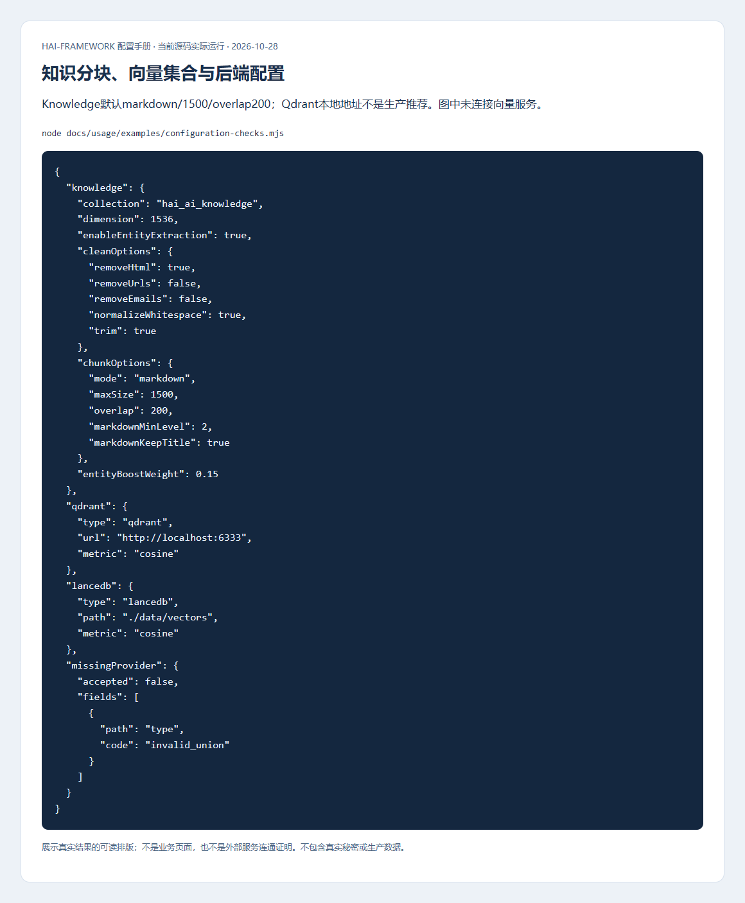
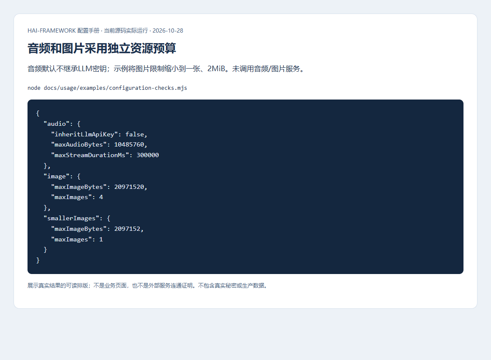

# AI、知识、会话记忆与向量配置

[配置手册](README.md) · [AI调用与页面操作](../development/ai.md)

先让一条无敏感信息的模型请求成功，再接会话、知识库和工具。模型能回答不表示会话已持久保存；Schema通过不表示供应商凭据、模型名或额度可用。密钥保存在服务端，前端通过受权限检查保护的API发起调用。

## 模型、协议与场景路由

位置：`config/_ai.yml` 的 llm。以下默认来自当前实现，不表示对某供应商或型号的推荐。

| 项 | 框架默认 | 作用和不同取值的影响 |
| --- | --- | --- |
| llm.model/api | gpt-4o-mini/chat | api可选chat/responses/anthropic，必须匹配供应商和模型协议 |
| apiKey/baseUrl | 无Schema默认，按协议解析 | 模型项可覆盖全局；OpenAI与Anthropic的环境回退及地址继承不同，见下表 |
| maxTokens/temperature/timeout | 4096/0.7/60000ms | 输出预算、采样参数和请求期限不同；更大预算可能增加费用/延迟，模型可能不支持某些参数 |
| tempModelCacheTtl | 600000ms | 临时模型缓存期限，不是业务会话保留时间 |
| models | 可省略 | 每项id/model必填；api/apiKey/baseUrl/maxTokens/temperature/timeout可覆盖全局 |
| scenarios | 可省略 | 为chat/reasoning/plan/execute/extraction/summary/embedding/rerank/ocr/fast/default指定模型id；调用显式选择优先 |

### 凭据和地址按哪个顺序生效

先确定模型的 `api`，再按对应行从左到右取第一个有效值。调用级 `tempModel` 显式提供的 apiKey/baseUrl 优先于下表；常规模型项优先于全局配置。

| 协议与参数 | 生效顺序 |
| --- | --- |
| chat/responses 的 apiKey | 模型项 → `llm.apiKey` → `HAI_AI_LLM_APIKEY` → `OPENAI_API_KEY`；都未提供则返回配置错误 |
| chat/responses 的 baseUrl | 模型项 → `llm.baseUrl` → `HAI_AI_LLM_BASEURL` → `OPENAI_BASE_URL` → `https://api.openai.com/v1` |
| anthropic 的 apiKey | 模型项 → `llm.apiKey` → `HAI_AI_LLM_APIKEY` → `ANTHROPIC_API_KEY`；不读取 `OPENAI_API_KEY` |
| anthropic 的 baseUrl | 模型项 → 仅当全局 `llm.api=anthropic` 时取 `llm.baseUrl` 或 `HAI_AI_LLM_BASEURL` → `ANTHROPIC_BASE_URL` → `https://api.anthropic.com` |

混合模型池中，Anthropic条目不会继承OpenAI的全局地址，也不读取 `OPENAI_BASE_URL`；它仍会继承全局 `llm.apiKey`。不同供应商最好在各模型项明确自己的凭据和地址，避免把一个供应商的密钥发给另一个端点。OpenAI兼容地址通常包含 `/v1`；Anthropic基地址不要再带 `/v1`，适配器会追加 `/v1/messages`。

```yaml schema=@h-ai/ai:AIConfigSchema
llm:
  apiKey: ${MODEL_API_KEY}
  baseUrl: https://models.example.invalid/v1
  model: example-small
  api: chat
  timeout: 60000
  maxTokens: 4096
  temperature: 0.7
  models:
    - { id: fast, model: example-small }
    - { id: deep, model: example-reasoning, timeout: 120000 }
  scenarios: { chat: fast, reasoning: deep, summary: fast }
```

例子是完整形状，域名/模型占位必须替换。模型项的密钥空白/null按可选值处理，不能把空格当有效秘密。明确关闭不用的外部能力，不把可调用工具名当作授权证明。


先在测试供应商上发送简短请求，核对实际解析到的模型、超时和安全错误；再测试取消/流结束/工具失败时资源释放。图只显示解析结果，本轮没有为手册调用付费模型。

## 知识分块与embedding

| 项 | 框架默认（对应对象存在时） | 影响 |
| --- | --- | --- |
| embedding.dimensions/batchSize | 维度无默认/100 | 模型支持时指定输出维度；批次越大不一定越快，受服务上限约束 |
| knowledge.collection/dimension | hai_ai_knowledge/1536 | 集合维度必须与embedding一致；换模型/维度需新集合与重建索引 |
| enableEntityExtraction | true | 提取实体可能增加模型调用；false关闭此步骤，不等于关闭向量化 |
| cleanOptions | Datapipe默认 | 去HTML、规范空白、trim；是否去URL/邮箱按业务选择 |
| chunkOptions | markdown/1500/overlap200 | 与独立Datapipe默认overlap0不同，分块失败不能静默退回整篇 |
| entityBoostWeight | 0.15 | 实体命中分数增益，范围0–1；需用实际查询评估 |
| entityTypes/systemPrompt | 无配置默认 | 覆盖内置实体类型/提示；只写可信业务规则，不能扩大数据可见范围 |

```yaml schema=@h-ai/ai:AIConfigSchema
llm:
  apiKey: ${MODEL_API_KEY}
  models:
    - { id: embeddings, model: example-embedding }
  scenarios: { embedding: embeddings }
embedding: { dimensions: 1536, batchSize: 20 }
knowledge:
  collection: orders_docs
  dimension: 1536
  enableEntityExtraction: false
  cleanOptions: { removeHtml: true, removeEmails: true }
  chunkOptions: { mode: markdown, maxSize: 1500, overlap: 200 }
```



导入专用测试文档，核对分块、维度、引用和权限；再用已知问题验证召回，不以“有向量结果”代替内容正确和租户隔离。下面的本地函数对比说明overlap变化；实际语义检索仍需真实embedding服务。


## 向量存储

位置：`config/_vecdb.yml`，type必填，无默认。生产知识库使用共享网络后端；本地path不等于可跨实例持久化。

| Provider/配置 | 默认或必填 | 影响与适用条件 |
| --- | --- | --- |
| lancedb.path | 必填 | 本地目录，重启/多实例边界按部署存储核对 |
| pgvector.host/port/database | localhost/5432/database必填 | user/password/url可提供；服务需要pgvector扩展和所需权限 |
| pgvector.tablePrefix/indexType | vec_/hnsw（索引缺省行为） | 可选ivfflat；选型取决数据量、召回与构建成本，非授权边界 |
| qdrant.url/apiKey | http://localhost:6333/无默认 | 生产显式HTTPS/凭据，不依赖公开本机默认地址 |
| chroma.url或path | 无默认 | url连接独立服务，path本地启动；host/port默认localhost/8000，serverCommand默认chroma |
| chroma.startupTimeout/apiKey | 30000ms/无默认 | 启动期限和访问凭据；远端URL拒绝含凭据等非法形式 |
| metric | cosine（默认距离） | 可选euclidean/dot；已有集合应核对是否允许变更 |
| operationLog | 可省略 | read/write默认false，maxLength1000、level debug，只记录安全摘要 |

```yaml schema=@h-ai/vecdb:VecdbConfigSchema
type: qdrant
url: https://vectors.internal.example
apiKey: ${VECTOR_API_KEY}
metric: cosine
```

先建立专用集合，插入已知向量并查询，再验证重启和另一实例可见。配置图不证明网络库已连通或多节点验收通过。

## 会话记忆、压缩与检索

`memory/token/summary/compress/retrieval/file` 均为可选对象。配置对象并不会自动把进程内Store变为共享数据库；按公开Store契约明确装配持久后端。

| 配置 | 框架默认（对象存在时） | 影响 |
| --- | --- | --- |
| memory.provider/allowEphemeralFallback | native/false | mem0当前映射qdrant；pgvector SDK连接不能公开关闭，拒绝使用；其他后端不得静默退内存，生产始终要求真实持久连接 |
| maxEntriesPerObject/maxEntriesGlobal | 1000/100000 | 主体与全局容量限制，主体淘汰不应误删其他主体数据 |
| recencyDecay/embeddingEnabled | 0.95/true | 时间衰减及向量检索开关，需评估旧记忆保留和检索成本 |
| defaultTopK/candidateMultiplier/writebackRelatedTopK | 10/5/20 | 输出条数、候选倍数及写回关联候选，改变检索/写回成本 |
| memory.systemPrompt、summary.systemPrompt、file.systemPrompt | 无配置默认 | 使用实现内置提示；覆盖时保留安全和实际任务约束 |
| token.tokenRatio | 0.25 | Token估算比例，不是供应商实际计费凭据 |
| compress.defaultStrategy/defaultMaxTokens/preserveLastN | hybrid/0/4 | 0表示按实现自适应预算；压缩前保留原始会话以便追溯 |
| retrieval.sources | 可省略 | source的id/collection必填；name/url/topK/minScore/filter可选，权限必须先限定来源/过滤器 |

```yaml schema=@h-ai/ai:AIConfigSchema
memory:
  provider: native
  allowEphemeralFallback: false
  maxEntriesPerObject: 1000
  maxEntriesGlobal: 100000
  defaultTopK: 10
token: { tokenRatio: 0.25 }
compress: { defaultStrategy: hybrid, defaultMaxTokens: 0, preserveLastN: 4 }
retrieval:
  sources:
    - { id: manuals, collection: orders_docs, topK: 5, minScore: 0.6 }
```

使用专用objectId写入并重启读取，检查跨用户不可见、容量策略和失败不丢原始材料。`topK`和filter不是服务端租户守卫的替代品；只靠调用成功不能声明知识和会话持久化完成。

## 音频与图片

| 项 | 框架默认 | 修改的影响 |
| --- | --- | --- |
| audio.models | 可省略 | 项目id/provider/model/operations必填，operations明确transcribe/synthesize；凭据字段按供应商要求 |
| inheritLlmApiKey | false | true才允许音频继承LLM密钥；默认隔离避免串用账号 |
| transcribeModel/synthesizeModel | 无默认选择 | 指定注册id；Provider需支持对应操作，不能按名称推断 |
| maxAudioBytes/maxStreamDurationMs | 10MiB/300000ms | 限制上传与实时流资源，增大需同步HTTP/代理预算 |
| image.models/generateModel | 可省略/无默认选择 | 每项id/provider/model必填，apiKey/baseUrl/workspaceId按Provider提供 |
| image.maxImageBytes/maxImages | 20MiB/4 | 单张与张数分别限制；允许上限分别100MiB/16，不是建议生产值 |
| image.models[].timeout | 120000ms | 图片生成请求期限，超时不代表渠道已撤销任务 |

```yaml schema=@h-ai/ai:AIConfigSchema
audio:
  inheritLlmApiKey: false
  maxAudioBytes: 10485760
  maxStreamDurationMs: 300000
image: { maxImageBytes: 2097152, maxImages: 1 }
```



先验证超限输入被本地边界拒绝，再用合法测试材料验证真实Provider。语音/图片记录涉及隐私和费用，不能在手册示例中默默发起外部请求。

## MCP和A2A

MCP配置server.name必填，version默认1.0.0，能力对象内tools/resources/prompts默认true；能力声明不赋予业务权限。工具调用在服务端授权并约束输入、超时和外部副作用。

A2A的agentCard需name/url，description/version/skills可选；skill需id/name，description/tags可选。security.apiKey默认header、名称x-api-key，推荐header避免URL暴露凭据。共享execution默认leaseMs=30000、pollIntervalMs=250、maxExecutionMs=300000，分别控制租约、订阅轮询和单次绝对执行上限。

```yaml schema=@h-ai/ai:AIConfigSchema
a2a:
  agentCard:
    name: orders-assistant
    url: https://agent.example.invalid/a2a
    skills: [{ id: query, name: Order lookup }]
  execution: { leaseMs: 30000, pollIntervalMs: 250, maxExecutionMs: 300000 }
  security: { apiKey: { in: header, name: x-api-key } }
```

取消、超时和unknown须核对外部动作和持久事件，不能因为租约已释放就自动重放。多节点最终提交还受数据库租约与绝对期限约束；本章没有用配置校验替代真实行锁、取消和故障演练。
