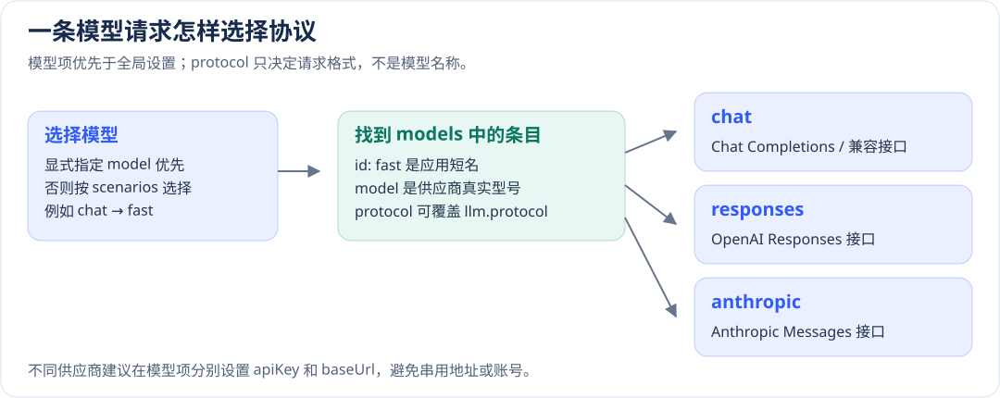

# AI、知识、会话记忆与向量配置

[配置手册](README.md) · [AI调用与页面操作](../development/ai.md)

先让一条无敏感信息的模型请求成功，再接会话、知识库和工具。模型能回答不表示会话已持久保存；Schema通过不表示供应商凭据、模型名或额度可用。密钥保存在服务端，前端通过受权限检查保护的API发起调用。

## 模型、协议与场景路由

位置：`config/_ai.yml` 的 `llm`。以下默认来自当前实现，不表示对某供应商或型号的推荐。

| 项 | 框架默认 | 作用和不同取值的影响 |
| --- | --- | --- |
| `llm.model` / `llm.protocol` | `gpt-4o-mini` / `chat` | `model` 填供应商的模型名；`protocol` 选择请求格式：`chat`、`responses` 或 `anthropic` |
| `apiKey`/`baseUrl` | 无Schema默认，按协议解析 | 模型项可覆盖全局；OpenAI与Anthropic的环境回退及地址继承不同，见下表 |
| `maxTokens`/`temperature`/`timeout` | 4096/0.7/60000ms | 输出预算、采样参数和请求期限不同；更大预算可能增加费用/延迟，模型可能不支持某些参数 |
| `tempModelCacheTtl` | 600000ms | 临时模型缓存期限，不是业务会话保留时间 |
| `models` | 可省略 | 注册多个模型，每项 `id`、`model` 必填；`protocol`/`apiKey`/`baseUrl`/`maxTokens`/`temperature`/`timeout` 可分别覆盖全局 |
| `scenarios` | 可省略 | 为 `chat`、`reasoning`、`plan`、`execute`、`extraction`、`summary`、`embedding`、`rerank`、`ocr`、`fast`、`default` 指定模型 `id`；调用显式选择优先 |



### 凭据和地址按哪个顺序生效

先确定模型的 `protocol`，再按对应行从左到右取第一个有效值。调用级 `tempModel` 显式提供的 `apiKey`/`baseUrl` 优先于下表；常规模型项优先于全局配置。

| 协议与参数 | 生效顺序 |
| --- | --- |
| chat/responses 的 `apiKey` | 模型项 → `llm.apiKey` → `HAI_AI_LLM_APIKEY` → `OPENAI_API_KEY`；都未提供则返回配置错误 |
| chat/responses 的 `baseUrl` | 模型项 → `llm.baseUrl` → `HAI_AI_LLM_BASEURL` → `OPENAI_BASE_URL` → `https://api.openai.com/v1` |
| anthropic 的 `apiKey` | 模型项 → `llm.apiKey` → `HAI_AI_LLM_APIKEY` → `ANTHROPIC_API_KEY`；不读取 `OPENAI_API_KEY` |
| anthropic 的 `baseUrl` | 模型项 → 仅当全局 `llm.protocol=anthropic` 时取 `llm.baseUrl` 或 `HAI_AI_LLM_BASEURL` → `ANTHROPIC_BASE_URL` → `https://api.anthropic.com` |

混合模型池中，Anthropic条目不会继承OpenAI的全局地址，也不读取 `OPENAI_BASE_URL`；它仍会继承全局 `llm.apiKey`。不同供应商最好在各模型项明确自己的凭据和地址，避免把一个供应商的密钥发给另一个端点。OpenAI兼容地址通常包含 `/v1`；Anthropic基地址不要再带 `/v1`，适配器会追加 `/v1/messages`。

```yaml schema=@h-ai/ai:AIConfigSchema
llm:
  apiKey: ${MODEL_API_KEY}
  baseUrl: https://models.example.invalid/v1
  model: example-small
  protocol: chat
  timeout: 60000
  maxTokens: 4096
  temperature: 0.7
  models:
    - { id: fast, model: example-small }
    - { id: deep, model: example-reasoning, timeout: 120000 }
  scenarios: { chat: fast, reasoning: deep, summary: fast }
```

例子是完整形状，域名/模型占位必须替换。模型项的密钥空白/null按可选值处理，不能把空格当有效秘密。明确关闭不用的外部能力，不把可调用工具名当作授权证明。

`id` 是应用为模型取的短名，例如 `fast`；`model` 才是发给供应商的真实型号。`scenarios.chat: fast` 表示普通对话默认使用 `fast` 这一项；单次调用显式指定模型时优先使用该选择。只用一个模型时，可以不写 `models` 和 `scenarios`。

### 从旧版 api 字段迁移

LLM 的协议字段统一叫 `protocol`，取值仍为 `chat | responses | anthropic`。OpenAI Chat Completions 及兼容接口通常选 `chat`，Responses 接口选 `responses`，Anthropic Messages 接口选 `anthropic`。

| 旧配置 | 新配置 |
| --- | --- |
| `llm.api` | `llm.protocol` |
| `llm.models[].api` | `llm.models[].protocol` |
| 调用参数 `tempModel.api` | `tempModel.protocol` |
| `HAI_AI_LLM_API` | `HAI_AI_LLM_PROTOCOL` |
| `HAI_AI_LLM_MODELS_0_API` | `HAI_AI_LLM_MODELS_0_PROTOCOL`，后续项使用对应索引 |

旧字段和旧协议变量会明确报错并提示迁移。供应商密钥仍叫 `apiKey`，`HAI_AI_LLM_APIKEY` 不变。改完重启后端，发送一条短请求，确认模型和协议匹配。

### 在不同环境使用不同模型服务

生成的 `_ai.yml` 已为启用项和注释中的可选项给出环境变量。先启用需要的 YAML 块，再在环境文件里填对应变量；变量名沿 YAML 层级连接，数组从 `0` 开始，`baseUrl` 这类名称不再拆词。

| YAML 字段 | 环境变量示例 |
| --- | --- |
| `llm.protocol` | `HAI_AI_LLM_PROTOCOL` |
| `llm.models[0].model` | `HAI_AI_LLM_MODELS_0_MODEL` |
| `llm.models[0].protocol` | `HAI_AI_LLM_MODELS_0_PROTOCOL` |
| `llm.models[0].apiKey` | `HAI_AI_LLM_MODELS_0_APIKEY` |
| `knowledge.collection` | `HAI_AI_KNOWLEDGE_COLLECTION` |
| `audio.models[0].baseUrl` | `HAI_AI_AUDIO_MODELS_0_BASEURL` |
| `image.models[0].apiKey` | `HAI_AI_IMAGE_MODELS_0_APIKEY` |

第二个模型把变量中的 `_0_` 改为 `_1_`。地址、模型名等环境差异放 `.env.test` / `.env.prod`，真实密钥放 `.env.local` 或由目标环境注入。不要同时填写整个 `HAI_AI` JSON 和这些细项，父对象会覆盖子项。

## 知识分块与`embedding`

| 项 | 框架默认（对应对象存在时） | 影响 |
| --- | --- | --- |
| `embedding`.`dimensions`/`batchSize` | 维度无默认/100 | 模型支持时指定输出维度；批次越大不一定越快，受服务上限约束 |
| `knowledge`.`collection`/`dimension` | hai_ai_knowledge/1536 | 集合维度必须与`embedding`一致；换模型/维度需新集合与重建索引 |
| `enableEntityExtraction` | `true` | 提取实体可能增加模型调用；`false` 关闭此步骤，不等于关闭向量化 |
| `cleanOptions` | Datapipe默认 | 去HTML、规范空白、trim；是否去URL/邮箱按业务选择 |
| `chunkOptions` | markdown/1500/overlap200 | 与独立Datapipe默认overlap0不同，分块失败不能静默退回整篇 |
| `entityBoostWeight` | 0.15 | 实体命中分数增益，范围0–1；需用实际查询评估 |
| `entityTypes`/`systemPrompt` | 无配置默认 | 覆盖内置实体类型/提示；只写可信业务规则，不能扩大数据可见范围 |

```yaml schema=@h-ai/ai:AIConfigSchema
llm:
  apiKey: ${MODEL_API_KEY}
  models:
    - { id: embeddings, model: example-embedding }
  scenarios: { embedding: embeddings }
embedding: { dimensions: 1536, batchSize: 20 }
knowledge:
  collection: orders_docs
  dimension: 1536
  enableEntityExtraction: false
  cleanOptions: { removeHtml: true, removeEmails: true }
  chunkOptions: { mode: markdown, maxSize: 1500, overlap: 200 }
```

导入专用测试文档，核对分块、维度、引用和权限；再用已知问题验证召回，不以“有向量结果”代替内容正确和租户隔离。实际语义检索仍需真实`embedding`服务。

## 向量存储

位置：`config/_vecdb.yml`，`type`必填，无默认。生产知识库使用共享网络后端；本地`path`不等于可跨实例持久化。

| Provider/配置 | 默认或必填 | 影响与适用条件 |
| --- | --- | --- |
| `lancedb.path` | 必填 | 本地目录，重启/多实例边界按部署存储核对 |
| `pgvector.host` / `port` / `database` | localhost/5432/`database`必填 | user/`password`/`url`可提供；服务需要pgvector扩展和所需权限 |
| `pgvector.tablePrefix` / `indexType` | vec_/hnsw（索引缺省行为） | 可选ivfflat；选型取决数据量、召回与构建成本，非授权边界 |
| `qdrant.url` / `apiKey` | http://localhost:6333/无默认 | 生产显式HTTPS/凭据，不依赖公开本机默认地址 |
| `chroma.url`或`path` | 无默认 | `url`连接独立服务，`path`本地启动；`host`/`port`默认localhost/8000，`serverCommand`默认chroma |
| `chroma.startupTimeout` / `apiKey` | 30000ms/无默认 | 启动期限和访问凭据；远端URL拒绝含凭据等非法形式 |
| `metric` | cosine（默认距离） | 可选euclidean/dot；已有集合应核对是否允许变更 |
| `operationLog` | 可省略 | `read`/`write`默认false，`maxLength1000`、`level` debug，只记录安全摘要 |

```yaml schema=@h-ai/vecdb:VecdbConfigSchema
type: qdrant
url: https://vectors.internal.example
apiKey: ${VECTOR_API_KEY}
metric: cosine
```

先建立专用集合，插入已知向量并查询，再验证重启和另一实例可见。

## 会话记忆、压缩与检索

`memory/token/summary/compress/retrieval/file` 均为可选对象。配置对象并不会自动把进程内Store变为共享数据库；按公开Store契约明确装配持久后端。

| 配置 | 框架默认（对象存在时） | 影响 |
| --- | --- | --- |
| `memory.provider` / `memory.allowEphemeralFallback` | `native` / `false` | `mem0` 当前映射 `qdrant`；`pgvector` SDK 连接不能公开关闭，拒绝使用；其他后端不得静默退内存，生产始终要求真实持久连接 |
| `maxEntriesPerObject`/`maxEntriesGlobal` | 1000/100000 | 主体与全局容量限制，主体淘汰不应误删其他主体数据 |
| `recencyDecay`/`embeddingEnabled` | 0.95 / `true` | 时间衰减及向量检索开关，需评估旧记忆保留和检索成本 |
| `defaultTopK`/`candidateMultiplier`/`writebackRelatedTopK` | 10/5/20 | 输出条数、候选倍数及写回关联候选，改变检索/写回成本 |
| `memory.systemPrompt`、`summary.systemPrompt`、`file.systemPrompt` | 无配置默认 | 使用实现内置提示；覆盖时保留安全和实际任务约束 |
| `token.tokenRatio` | 0.25 | Token估算比例，不是供应商实际计费凭据 |
| `compress`.`defaultStrategy`/`defaultMaxTokens`/`preserveLastN` | hybrid/0/4 | 0表示按实现自适应预算；压缩前保留原始会话以便追溯 |
| `retrieval.sources` | 可省略 | source的id/`collection`必填；`name`/`url`/`topK`/`minScore`/`filter`可选，权限必须先限定来源/过滤器 |

```yaml schema=@h-ai/ai:AIConfigSchema
memory:
  provider: native
  allowEphemeralFallback: false
  maxEntriesPerObject: 1000
  maxEntriesGlobal: 100000
  defaultTopK: 10
token: { tokenRatio: 0.25 }
compress: { defaultStrategy: hybrid, defaultMaxTokens: 0, preserveLastN: 4 }
retrieval:
  sources:
    - { id: manuals, collection: orders_docs, topK: 5, minScore: 0.6 }
```

使用专用`objectId`写入并重启读取，检查跨用户不可见、容量策略和失败不丢原始材料。`topK`和`filter`不是服务端租户守卫的替代品；只靠调用成功不能声明知识和会话持久化完成。

## 音频与图片

| 项 | 框架默认 | 修改的影响 |
| --- | --- | --- |
| `audio.models` | 可省略 | 项目id/`provider`/`model`/`operations`必填，`operations`明确transcribe/synthesize；凭据字段按供应商要求 |
| `inheritLlmApiKey` | `false` | `true` 才允许音频继承 LLM 密钥；默认隔离避免串用账号 |
| `transcribeModel`/`synthesizeModel` | 无默认选择 | 指定注册id；Provider需支持对应操作，不能按名称推断 |
| `maxAudioBytes`/`maxStreamDurationMs` | 10MiB/300000ms | 限制上传与实时流资源，增大需同步HTTP/代理预算 |
| `image`.`models`/`generateModel` | 可省略/无默认选择 | 每项id/`provider`/`model`必填，`apiKey`/`baseUrl`/`workspaceId`按Provider提供 |
| `image`.`maxImageBytes`/`maxImages` | 20MiB/4 | 单张与张数分别限制；允许上限分别100MiB/16，不是建议生产值 |
| `image.models[].timeout` | 120000ms | 图片生成请求期限，超时不代表渠道已撤销任务 |

```yaml schema=@h-ai/ai:AIConfigSchema
audio:
  inheritLlmApiKey: false
  transcribeModel: speech-in
  synthesizeModel: speech-out
  maxAudioBytes: 10485760
  maxStreamDurationMs: 300000
  models:
    - id: speech-in
      provider: openai
      model: whisper-1
      operations: [transcribe]
      apiKey: ${AUDIO_API_KEY}
      timeout: 60000
    - id: speech-out
      provider: openai
      model: tts-1
      operations: [synthesize]
      apiKey: ${AUDIO_API_KEY}
image:
  maxImageBytes: 2097152
  maxImages: 1
  generateModel: pictures
  models:
    - id: pictures
      provider: openai
      model: gpt-image-1
      apiKey: ${IMAGE_API_KEY}
      timeout: 120000
```

`operations` 声明该音频模型能做什么：`transcribe` 把语音转成文字，`synthesize` 把文字转成语音；两个操作需要对应的模型或服务。`transcribeModel` / `synthesizeModel` 填上面注册项的 `id`，不直接填厂商型号。

| 模型项字段 | 什么时候填写 |
| --- | --- |
| `apiKey` | 所选供应商的凭据。音频默认不继承 LLM 密钥，便于分开管理账号 |
| `baseUrl` | 使用代理或自建服务时填写；`whisper` / `indextts` 没有默认地址，必须提供 |
| `appKey` / `accessKey` | 豆包旧版控制台 ASR 的应用和访问凭据，其他音频供应商无需填写 |
| `resourceId` | 豆包控制台的资源标识；省略时按操作选择平台默认资源 |
| `workspaceId` | 百炼业务空间 ID；未使用该空间时省略，图片模型也可按供应商要求填写 |
| `timeout` | 一次厂商调用最多等待多少毫秒。音频默认 60000，图片默认 120000 |

先验证超限输入被本地边界拒绝，再用合法测试材料验证真实Provider。语音/图片记录涉及隐私和费用，不能在手册示例中默默发起外部请求。

## MCP和A2A

MCP配置`server.name`必填，`version`默认1.0.0，能力对象内`tools`/`resources`/`prompts`默认true；能力声明不赋予业务权限。工具调用在服务端授权并约束输入、超时和外部副作用。

A2A的`agentCard`需`name`/`url`，`description`/`version`/`skills`可选；skill需id/`name`，`description`/tags可选。`security.apiKey`默认header、名称x-api-`key`，推荐header避免URL暴露凭据。共享`execution`默认`leaseMs`=30000、`pollIntervalMs`=250、`maxExecutionMs`=300000，分别控制租约、订阅轮询和单次绝对执行上限。

```yaml schema=@h-ai/ai:AIConfigSchema
a2a:
  agentCard:
    name: orders-assistant
    url: https://agent.example.invalid/a2a
    skills: [{ id: query, name: Order lookup }]
  execution: { leaseMs: 30000, pollIntervalMs: 250, maxExecutionMs: 300000 }
  security: { apiKey: { in: header, name: x-api-key } }
```

取消、超时和unknown须核对外部动作和持久事件，不能因为租约已释放就自动重放。多节点最终提交还受数据库租约与绝对期限约束；本章没有用配置校验替代真实行锁、取消和故障演练。
