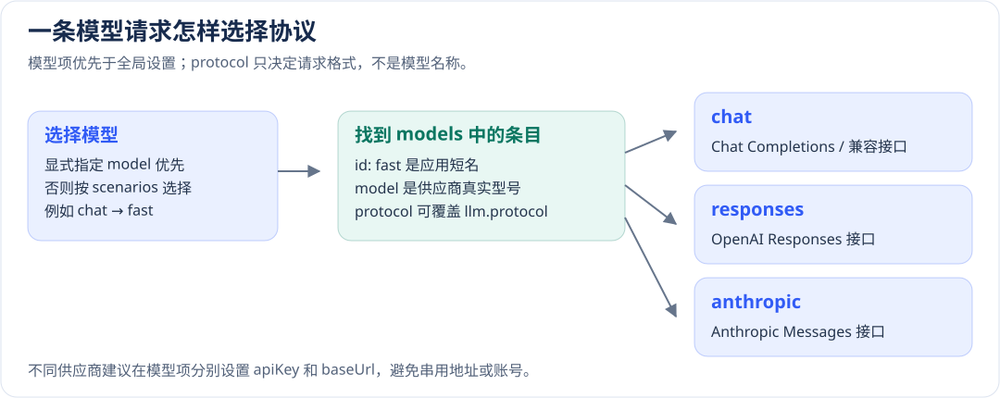

# AI、知识、会话记忆与向量配置

[配置手册](README.md) · [AI调用与页面操作](../development/ai.md)

先让一条无敏感信息的模型请求成功，再接会话、知识库和工具。模型能回答不表示会话已持久保存；Schema通过不表示供应商凭据、模型名或额度可用。密钥保存在服务端，前端通过受权限检查保护的API发起调用。

## ACP 接入与模型能力

多用户部署可登记 `acp.agents[].environmentIds`，引用 Runner 启动配置中具有固定镜像 digest 的环境。下例展示 Runner 配置对象，其中 `digest` 替换为已构建并部署的镜像 ID。环境的 CPU、内存、PID 和临时空间上限同时约束所有按任务传入的覆盖值。

```yaml
nodeId: worker-east
executor: true
engine: podman
environments:
  - id: codex-minimal
    image: registry.example/hai-codex@sha256:<digest>
    networkPolicy: offline
    resources:
      cpu: 1
      memoryMiB: 512
      pids: 128
      scratchMiB: 256
```

`offline` 适合本地工具和不需要联网的夹具。模型网关或 MCP broker 由部署方放在已配置的隔离网络上，Runner 检查该网络为 `internal`。应只允许访问任务需要的服务，任务的网络权限仍以实际部署策略为准。API 节点和执行节点共享数据库、Agent 清单及环境配置。

`acp` 的 requestTimeout（30000ms）、promptTimeout（600000ms）、cancelTimeout（5000ms）、maxContentBytes（8388608）、maxPendingEvents（1024）控制连接、取消和输出边界。环境变量对应 `HAI_AI_ACP_REQUESTTIMEOUT` 等。agents/workspaces 可在配置文件定义或通过 `ai.acp` 写数据库；session 是运行记录，不从配置导入。配置与数据库按 ID 合并的规则见[资源清单](#配置与数据库清单)。

`llm.models[].capabilities` 可配置 contextWindow、maxOutputTokens、inputModalities、outputModalities、toolCalling、reasoning.supported/efforts；未知时省略。输出预算 maxTokens 不是模型输出容量，maxOutputTokens 不能大于 contextWindow。DSH 自定义模型需要已确认的容量/输入/工具/推理信息；支持推理时还需明确 efforts。Codex 的上游必须原生提供 Responses；Hai 客户端已有协议转换不会提供反向网关。

| Agent 配置 | 接入效果 | 存储与模型 |
| --- | --- | --- |
| `mode: embedded`、adapter、可选 command/args | 本机原生 stdio；Windows 直接提供可执行程序或 Node + JS 入口 | directory 工作区；modelIds 引用 Hai 模型 |
| `mode: builtin-service`、image、engine | 原生 stdio 容器；auto 优先就绪 Podman，再试 Docker | volume 工作区，Agent/workspace 的 image 和引擎须匹配；复用 Hai 模型 |
| `mode: custom-service`、url、transport、supportedTransports、headerEnv | 连接明确声明支持的 HTTP/WS 服务 | 不绑定 Hai 模型；传远端 cwd，服务方维护模型与文件 |

下面是本机 Codex 的可加载配置形状。替换真实模型、端点和路径；仓库 url 与每个工程的 mainBranch 明确填写，不推测远端主分支。取消 CLI 模板的一层外层注释只启用配置，还需在服务端初始化 AI 并接入业务。

```yaml schema=@h-ai/ai:AIConfigSchema
llm:
  models:
    - id: coding
      model: your-responses-model
      protocol: responses
      baseUrl: https://models.example.invalid/v1
      apiKey: ${MODEL_API_KEY}
acp:
  agents:
    - id: coder
      name: Codex
      mode: embedded
      adapter: codex
      modelIds: [coding]
  workspaces:
    - id: project
      storage: { type: directory, path: /srv/projects/demo }
      repositories:
        - id: api
          url: https://git.example.invalid/team/api.git
          mainBranch: trunk
```

Goose 原生服务用 `transport: http` 与 `http://.../acp`，或 `transport: ws` 与 `ws://.../acp`；`supportedTransports` 只填实际部署支持的类型。`headerEnv: { X-Secret-Key: HAI_GOOSE_SECRET }` 在启动连接时从宿主变量解析服务认证信息。Goose 自身通过 GOOSE_PROVIDER/GOOSE_MODEL/供应商密钥配置模型；不要给 custom-service 绑定 modelIds，也不要把服务凭据放进 URL。远程 TLS、卷、Git 与服务进程由部署方维护。

受管仓库的读写凭据使用 `acp.workspaces[].gitEnvironmentRefs`，映射的值是宿主变量名，只有框架执行远程克隆、拉取或推送时才解析。Agent 专用变量使用 `acp.agents[].environmentRefs`。工作区 `environmentRefs` 是共用映射，不能在这里放只应交给 Git 的秘密。可信部署方提供认证工具、路径或 HTTP 认证头。

| ACP 条目字段 | 默认或要求 | 场景、影响与可观察结果 |
| --- | --- | --- |
| `id` / `name` | id 必填且清单内唯一；Agent name 必填 | id 用于资源引用和受管目录，名称供管理界面识别；不要写秘密或个人信息 |
| Agent `enabled` | `true` | 暂停新任务时设为 `false`，新建和恢复会话被拒绝；不等于已撤销外部正在执行的副作用 |
| Agent `defaultModelId` | 可省略 | 本机/托管 Agent 有多个 `modelIds` 时指定默认项，必须属于该数组；custom-service 不填写模型绑定 |
| `adapter` / `command` / `args` | `generic` / 适配器默认启动方式 | 选择已安装原生 Agent；覆盖命令时提供程序与参数数组，不拼 shell，启动失败返回具体诊断 |
| `storage` | 工作区必填 | directory 指向本机目录，volume 的 `name`、`image` 必填；容器引擎及镜像与 Agent 一致，重启后仍应找到原工程 |
| 仓库 `remote` | `origin` | 多远程工程选择受管 Git 远程名；`url` 与 `mainBranch` 必填，不自动猜主分支 |

本节 YAML 的输入是模型短名 `coding`、Agent `coder` 与工作区 `project`。初始化后，对应清单的 list/get 应能查到这些只读配置资源；真正创建会话还需原生程序、有效凭据和可访问仓库。用无敏感任务写一份临时文件并独立读回，才能确认工具实际执行；只查到清单不证明模型可用。

运行步骤和 API 示例见 [ACP 智能体与工程会话](../development/ai-acp.md)。

## 模型、协议与场景路由

位置：`config/_ai.yml` 的 `llm`。以下默认来自当前实现，不表示对某供应商或型号的推荐。

| 项 | 框架默认 | 作用和不同取值的影响 |
| --- | --- | --- |
| `llm.model` / `llm.protocol` | `gpt-4o-mini` / `chat` | `model` 填供应商的模型名；`protocol` 选择请求格式：`chat`、`responses` 或 `anthropic` |
| `apiKey`/`baseUrl` | 无Schema默认，按协议解析 | 模型项可覆盖全局；OpenAI与Anthropic的环境回退及地址继承不同，见下表 |
| `maxTokens`/`temperature`/`timeout` | 4096/0.7/60000ms | 输出预算、采样参数和请求期限不同；更大预算可能增加费用/延迟，模型可能不支持某些参数 |
| `tempModelCacheTtl` | 600000ms | 临时模型缓存期限，不是业务会话保留时间 |
| `models` | 可省略 | 注册多个模型，每项 `id`、`model` 必填；`protocol`/`apiKey`/`baseUrl`/`maxTokens`/`temperature`/`timeout` 可分别覆盖全局 |
| `scenarios` | 可省略 | 为 `chat`、`reasoning`、`plan`、`execute`、`extraction`、`summary`、`embedding`、`rerank`、`ocr`、`fast`、`default` 指定模型 `id`；调用显式选择优先 |



### 凭据和地址按哪个顺序生效

先确定模型的 `protocol`，再按对应行从左到右取第一个有效值。调用级 `tempModel` 显式提供的 `apiKey`/`baseUrl` 优先于下表；常规模型项优先于全局配置。

| 协议与参数 | 生效顺序 |
| --- | --- |
| chat/responses 的 `apiKey` | 模型项 → `llm.apiKey` → `HAI_AI_LLM_APIKEY` → `OPENAI_API_KEY`；都未提供则返回配置错误 |
| chat/responses 的 `baseUrl` | 模型项 → `llm.baseUrl` → `HAI_AI_LLM_BASEURL` → `OPENAI_BASE_URL` → `https://api.openai.com/v1` |
| anthropic 的 `apiKey` | 模型项 → `llm.apiKey` → `HAI_AI_LLM_APIKEY` → `ANTHROPIC_API_KEY`；不读取 `OPENAI_API_KEY` |
| anthropic 的 `baseUrl` | 模型项 → 仅当全局 `llm.protocol=anthropic` 时取 `llm.baseUrl` 或 `HAI_AI_LLM_BASEURL` → `ANTHROPIC_BASE_URL` → `https://api.anthropic.com` |

混合模型池中，Anthropic条目不会继承OpenAI的全局地址，也不读取 `OPENAI_BASE_URL`；它仍会继承全局 `llm.apiKey`。不同供应商最好在各模型项明确自己的凭据和地址，避免把一个供应商的密钥发给另一个端点。OpenAI兼容地址通常包含 `/v1`；Anthropic基地址不要再带 `/v1`，适配器会追加 `/v1/messages`。

```yaml schema=@h-ai/ai:AIConfigSchema
llm:
  apiKey: ${MODEL_API_KEY}
  baseUrl: https://models.example.invalid/v1
  model: example-small
  protocol: chat
  timeout: 60000
  maxTokens: 4096
  temperature: 0.7
  models:
    - { id: fast, model: example-small }
    - { id: deep, model: example-reasoning, timeout: 120000 }
  scenarios: { chat: fast, reasoning: deep, summary: fast }
```

例子是完整形状，域名/模型占位必须替换。模型项的密钥空白/null按可选值处理，不能把空格当有效秘密。明确关闭不用的外部能力，不把可调用工具名当作授权证明。

`id` 是应用为模型取的短名，例如 `fast`；`model` 才是发给供应商的真实型号。`scenarios.chat: fast` 表示普通对话默认使用 `fast` 这一项；单次调用显式指定模型时优先使用该选择。只用一个模型时，可以不写 `models` 和 `scenarios`。

`protocol` 选择当前端点真实支持的协议：Chat Completions 选 `chat`，Responses 选 `responses`，Anthropic Messages 选 `anthropic`。`apiKey` 始终表示凭据；它与协议选择是两个字段。上例的输入是普通对话和推理两种场景，输出应分别由 `fast` 与 `deep` 模型处理，日志只记录安全模型标识和请求关联，不打印密钥。

### 在不同环境使用不同模型服务

生成的 `_ai.yml` 已为启用项和注释中的可选项给出环境变量。先启用需要的 YAML 块，再在环境文件里填对应变量；变量名沿 YAML 层级连接，数组从 `0` 开始，`baseUrl` 这类名称不再拆词。

| YAML 字段 | 环境变量示例 |
| --- | --- |
| `llm.protocol` | `HAI_AI_LLM_PROTOCOL` |
| `llm.models[0].model` | `HAI_AI_LLM_MODELS_0_MODEL` |
| `llm.models[0].protocol` | `HAI_AI_LLM_MODELS_0_PROTOCOL` |
| `llm.models[0].apiKey` | `HAI_AI_LLM_MODELS_0_APIKEY` |
| `knowledge.collection` | `HAI_AI_KNOWLEDGE_COLLECTION` |
| `audio.models[0].baseUrl` | `HAI_AI_AUDIO_MODELS_0_BASEURL` |
| `image.models[0].apiKey` | `HAI_AI_IMAGE_MODELS_0_APIKEY` |

第二个模型把变量中的 `_0_` 改为 `_1_`。地址、模型名等环境差异放 `.env.test` / `.env.prod`，真实密钥放 `.env.local` 或由目标环境注入。同一来源的父 JSON 先应用、细项后覆盖；更高来源的父对象会清除低来源细项。尽量只维护一份清晰的基础结构与必要覆盖，完整规则见[环境来源](runtime.md#配置从哪里来)。

## 知识分块与`embedding`

| 项 | 框架默认（对应对象存在时） | 影响 |
| --- | --- | --- |
| `embedding`.`dimensions`/`batchSize` | 维度无默认/100 | 模型支持时指定输出维度；批次越大不一定越快，受服务上限约束 |
| `knowledge`.`collection`/`dimension` | hai_ai_knowledge/1536 | 集合维度必须与`embedding`一致；换模型/维度需新集合与重建索引 |
| `enableEntityExtraction` | `true` | 提取实体可能增加模型调用；`false` 关闭此步骤，不等于关闭向量化 |
| `cleanOptions` | Datapipe默认 | 去HTML、规范空白、trim；是否去URL/邮箱按业务选择 |
| `chunkOptions` | markdown/1500/overlap200 | 与独立Datapipe默认overlap0不同，分块失败不能静默退回整篇 |
| `entityBoostWeight` | 0.15 | 实体命中分数增益，范围0–1；需用实际查询评估 |
| `entityTypes`/`systemPrompt` | 无配置默认 | 覆盖内置实体类型/提示；只写可信业务规则，不能扩大数据可见范围 |

`cleanOptions.removeHtml`、`normalizeWhitespace`、`trim` 默认 `true`，`removeUrls`、`removeEmails` 默认 `false`；`customReplacements` 的每项 `pattern/replacement` 是可信规则，不是允许任意用户提交正则的入口。`chunkOptions.separator` 仅供 custom 模式，`markdownMinLevel` 默认 2、`markdownKeepTitle` 默认 true；具体清洗前后文本与分块结果见[文本处理配置](data.md#文本清洗和分块)。知识导入默认 overlap 为 200，独立 Datapipe 默认 0，不混用两者预算。

```yaml schema=@h-ai/ai:AIConfigSchema
llm:
  apiKey: ${MODEL_API_KEY}
  models:
    - { id: embeddings, model: example-embedding }
  scenarios: { embedding: embeddings }
embedding: { dimensions: 1536, batchSize: 20 }
knowledge:
  collection: orders_docs
  dimension: 1536
  enableEntityExtraction: false
  cleanOptions: { removeHtml: true, removeEmails: true }
  chunkOptions: { mode: markdown, maxSize: 1500, overlap: 200 }
```

导入专用测试文档，核对分块、维度、引用和权限；再用已知问题验证召回，不以“有向量结果”代替内容正确和租户隔离。实际语义检索仍需真实`embedding`服务。

## 向量存储

位置：`config/_vecdb.yml`，`type`必填，无默认。生产知识库使用共享网络后端；本地`path`不等于可跨实例持久化。

| Provider/配置 | 默认或必填 | 影响与适用条件 |
| --- | --- | --- |
| lancedb 的 `path` | 必填 | 本地目录，重启/多实例边界按部署存储核对 |
| pgvector 的 `host` / `port` / `database` | localhost/5432/`database`必填 | user/`password`/`url`可提供；服务需要pgvector扩展和所需权限 |
| pgvector 的 `tablePrefix` / `indexType` | vec_/hnsw（索引缺省行为） | 可选ivfflat；选型取决数据量、召回与构建成本，非授权边界 |
| qdrant 的 `url` / `apiKey` | http://localhost:6333/无默认 | 生产显式HTTPS/凭据，不依赖公开本机默认地址 |
| chroma 的 `url`或`path` | 无默认 | `url`连接独立服务，`path`本地启动；`host`/`port`默认localhost/8000，`serverCommand`默认chroma |
| chroma 的 `startupTimeout` / `apiKey` | 30000ms/无默认 | 启动期限和访问凭据；URL仅根端点，不含凭据、路径前缀、查询或片段；apiKey 为受信自托管网关的 Bearer token，不是 Chroma Cloud 配置 |
| `metric` | cosine（默认距离） | 可选euclidean/dot；已有集合应核对是否允许变更 |
| `operationLog` | 可省略 | `read` 和 `write` 默认 `false`，`level` 默认 `debug`。`maxLength` 默认 1000，限制条数、维度等摘要的字符数，0 省略摘要。 |

```yaml schema=@h-ai/vecdb:VecdbConfigSchema
type: qdrant
url: https://vectors.internal.example
apiKey: ${VECTOR_API_KEY}
metric: cosine
```

先建立专用集合，插入已知向量并查询，再验证重启和另一实例可见。

各 Provider 的字段直接放在顶层，不再套同名对象。已有 PostgreSQL/pgvector 服务时可使用：

```yaml schema=@h-ai/vecdb:VecdbConfigSchema
type: pgvector
host: db.internal.example
port: 5432
database: orders
user: orders_vectors
password: ${VECTOR_DB_PASSWORD}
tablePrefix: orders_vec_
indexType: hnsw
metric: cosine
```

本机开发使用 LanceDB，目录需由应用控制：

```yaml schema=@h-ai/vecdb:VecdbConfigSchema
type: lancedb
path: ./data/vecdb
metric: cosine
```

连接独立 Chroma 服务时配置端点；不配置 path 就不会由框架拉起本机进程：

```yaml schema=@h-ai/vecdb:VecdbConfigSchema
type: chroma
url: https://vectors.internal.example
apiKey: ${CHROMA_GATEWAY_TOKEN}
metric: cosine
```

这三份输入选择不同存储实现，预期业务输出仍是相同集合中的ID、内容和相似度。分数统一在0–1之间，越大越相似，不是概率；`minScore` 应按实际样本重新评估。生产共享状态要求不会因目录持久化而放宽，集合维度和已有距离定义也不会被改一行配置自动转换。

## 会话记忆、压缩与检索

`memory/token/summary/compress/retrieval/file` 均为可选对象。配置对象并不会自动把进程内Store变为共享数据库；按公开Store契约明确装配持久后端。

| 配置 | 框架默认（对象存在时） | 影响 |
| --- | --- | --- |
| `memory.provider` / `memory.allowEphemeralFallback` | `native` / `false` | `mem0` 是数据格式适配，要求 Qdrant ≥1.19；其它持久化后端使用 native Provider；其他后端不得静默退内存，生产始终要求真实持久连接 |
| `maxEntriesPerObject`/`maxEntriesGlobal` | 1000/100000 | 原生记忆的主体和全局容量。默认数据库 Store 用事务串行检查写入配额，每批最多读取 64 条淘汰候选 |
| `recencyDecay`/`embeddingEnabled` | 0.95 / `true` | 时间衰减及向量检索开关，需评估旧记忆保留和检索成本 |
| `defaultTopK`/`candidateMultiplier`/`writebackRelatedTopK` | 10/5/20 | 输出条数、候选倍数及写回关联候选，改变检索/写回成本 |
| `memory.systemPrompt`、`summary.systemPrompt`、`file.systemPrompt` | 无配置默认 | 使用实现内置提示；覆盖时保留安全和实际任务约束 |
| `token.tokenRatio` | 0.25 | Token估算比例，不是供应商实际计费凭据 |
| `compress`.`defaultStrategy`/`defaultMaxTokens`/`preserveLastN` | hybrid/0/4 | 0表示按实现自适应预算；压缩前保留原始会话以便追溯 |
| `retrieval.sources` | 可省略 | source的id/`collection`必填；`name`/`url`/`topK`/`minScore`/`filter`可选，权限必须先限定来源/过滤器 |

```yaml schema=@h-ai/ai:AIConfigSchema
memory:
  provider: native
  allowEphemeralFallback: false
  maxEntriesPerObject: 1000
  maxEntriesGlobal: 100000
  defaultTopK: 10
token: { tokenRatio: 0.25 }
compress: { defaultStrategy: hybrid, defaultMaxTokens: 0, preserveLastN: 4 }
retrieval:
  sources:
    - { id: manuals, collection: orders_docs, topK: 5, minScore: 0.6 }
```

使用专用`objectId`写入并重启读取，检查跨用户不可见、容量策略和失败不丢原始材料。`topK`和`filter`不是服务端租户守卫的替代品；只靠调用成功不能声明知识和会话持久化完成。

## 音频与图片

| 项 | 框架默认 | 修改的影响 |
| --- | --- | --- |
| `audio.models` | 可省略 | 项目id/`provider`/`model`/`operations`必填，`operations`明确transcribe/synthesize；凭据字段按供应商要求 |
| `inheritLlmApiKey` | `false` | `true` 才允许音频继承 LLM 密钥；默认隔离避免串用账号 |
| `transcribeModel`/`synthesizeModel` | 无默认选择 | 指定注册id；Provider需支持对应操作，不能按名称推断 |
| `maxAudioBytes`/`maxStreamDurationMs` | 10MiB/300000ms | 限制上传与实时流资源，增大需同步HTTP/代理预算 |
| `image`.`models`/`generateModel` | 可省略/无默认选择 | 每项id/`provider`/`model`必填，`apiKey`/`baseUrl`/`workspaceId`按Provider提供 |
| `image`.`maxImageBytes`/`maxImages` | 20MiB/4 | 单张与张数分别限制；允许上限分别100MiB/16，不是建议生产值 |
| `image.models[].timeout` | 120000ms | 图片生成请求期限，超时不代表渠道已撤销任务 |

```yaml schema=@h-ai/ai:AIConfigSchema
audio:
  inheritLlmApiKey: false
  transcribeModel: speech-in
  synthesizeModel: speech-out
  maxAudioBytes: 10485760
  maxStreamDurationMs: 300000
  models:
    - id: speech-in
      provider: openai
      model: whisper-1
      operations: [transcribe]
      apiKey: ${AUDIO_API_KEY}
      timeout: 60000
    - id: speech-out
      provider: openai
      model: tts-1
      operations: [synthesize]
      apiKey: ${AUDIO_API_KEY}
image:
  maxImageBytes: 2097152
  maxImages: 1
  generateModel: pictures
  models:
    - id: pictures
      provider: openai
      model: gpt-image-1
      apiKey: ${IMAGE_API_KEY}
      timeout: 120000
```

`operations` 声明该音频模型能做什么：`transcribe` 把语音转成文字，`synthesize` 把文字转成语音；两个操作需要对应的模型或服务。`transcribeModel` / `synthesizeModel` 填上面注册项的 `id`，不直接填厂商型号。

| 模型项字段 | 什么时候填写 |
| --- | --- |
| `apiKey` | 所选供应商的凭据。音频默认不继承 LLM 密钥，便于分开管理账号 |
| `baseUrl` | 使用代理或自建服务时填写；`whisper` / `indextts` 没有默认地址，必须提供 |
| `appKey` / `accessKey` | 豆包旧版控制台 ASR 的应用和访问凭据，其他音频供应商无需填写 |
| `resourceId` | 豆包控制台的资源标识；省略时按操作选择平台默认资源 |
| `workspaceId` | 百炼业务空间 ID；未使用该空间时省略，图片模型也可按供应商要求填写 |
| `timeout` | 一次厂商调用最多等待多少毫秒。音频默认 60000，图片默认 120000 |

先验证超限输入被本地边界拒绝，再用合法测试材料验证真实Provider。语音/图片记录涉及隐私和费用，不能在手册示例中默默发起外部请求。

音频 Provider 接受 `openai/mimo/qwen/doubao/whisper/indextts`，图片 Provider 接受 `openai/google/qwen/seedream/pollinations`。先按实际服务选择 Provider，再登记该服务支持的模型与操作；枚举值合法不代表任意模型都支持所有操作。上例中输入短录音应由 `speech-in` 返回转写文本，输入文本由 `speech-out` 返回音频，图片提示由 `pictures` 返回生成结果；超出字节/数量预算时应在调用厂商前拒绝，不产生额外外部调用。

源码仓库的 `pnpm model:run <name>` 只发布本机 `127.0.0.1`，宿主配置 `HAI_MODEL_API_KEY` 时向容器传入同名变量，客户端使用匹配凭据；Qwen由启动桥接转为vLLM原生环境认证。模型构建、固定树元数据联网前置、可信缓存与离线制品准备见[模型服务](../../../packages/ai/models/README.md)，对外生产服务另行配置网络、HTTPS和资源限额。

## MCP和A2A

MCP配置`server.name`必填，`version`默认1.0.0，能力对象内`tools`/`resources`/`prompts`默认true；能力声明不赋予业务权限。工具调用在服务端授权并约束输入、超时和外部副作用。

外部 MCP 清单位于 `mcp.servers`。每项填写 `id`、`name` 和 `transport`。`stdio` 需要 `command`，`args` 默认空数组。`http` 和 `sse` 需要 HTTP(S) `url`。`environmentRefs` 为 stdio 提供环境变量引用，`headerEnv` 为远程服务提供认证头引用。两者默认是空对象。

通过 `ai.mcp.services` 调用远程 MCP 时，使用 `transport: http`，上游需要支持 Streamable HTTP。`allowedTools` 列出可调用的原生工具名，省略该字段时服务入口拒绝调用。`timeoutMs` 包含授权、连接和工具响应时间，默认 30,000 毫秒，取值范围 1–300,000 毫秒。部署方负责允许可信的 MCP 目的地，并在生产环境使用 HTTPS 或受保护的内部网络。

```yaml schema=@h-ai/ai:AIConfigSchema
mcp:
  servers:
    - id: manual
      name: Manuals
      transport: http
      url: https://tools.example.com/mcp
      headerEnv: { Authorization: HAI_MANUAL_MCP_AUTHORIZATION }
      allowedTools: [search_manual]
      timeoutMs: 10000
```

`HAI_MANUAL_MCP_AUTHORIZATION` 由部署方设置为上游需要的完整请求头值。目录管理员可以维护地址、认证引用和工具列表。应用仍需核验调用主体和实际参数。启动服务后调用一次授权的只读工具，检查其返回内容和上游请求。

固定工具容器使用同一目录中的 `transport: job`，填写 `environmentId`、`allowedTools` 和可选超时。Runner 环境需使用固定镜像摘要、`networkPolicy: offline`，并声明对应的能力。支持 `documents.extract`、`office.convert`、`office.recalculate` 和 `ocr.recognize`。调用参数是授权的 `fileId`。OCR 可传 `language`。应用通过 `AIInitOptions.mcpJobFiles` 在领取节点复核文件 ACL 并暂存产物，只把产物 ID 返回给调用者。

工具作业使用 Runner 的 `toolCapacity` 和 `toolMaxRunning`，为等待工具的 Agent 保留独立的执行额度。每个服务通过 `pool.maxRunning` 限制全体执行节点同时运行的实例数，默认 4。达到任一上限时继续排队，直至额度释放或超时。部署方按节点实际资源配置普通和工具额度，两者的总量需要由宿主承载。

经常使用的服务可在部署配置中增加 `pool.minReady` 与 `pool.maxTotal`。Runner 尽量保留 `minReady` 个未接触任务数据的容器。容器处理一次请求后销毁。预热、启动、运行和销毁中容器均计入集群的 `maxTotal`，实际运行仍受 `maxRunning` 和节点容量限制。`maxTotal` 至少为 `minReady` 和 `maxRunning` 的较大者。API 与执行节点使用相同的服务池配置。数据库动态登记的服务可设置 `maxRunning`，预热池由部署配置维护。

```yaml schema=@h-ai/ai:AIConfigSchema
mcp:
  servers:
    - id: extract-document
      name: Document extractor
      transport: job
      environmentId: documents-job
      allowedTools: [documents.extract]
      timeoutMs: 30000
      pool: { minReady: 1, maxRunning: 2, maxTotal: 3 }
```

A2A的`agentCard`需`name`/`url`，`description`/`version`/`skills`可选；skill需id/`name`，`description`/tags可选。`security.apiKey`默认header、名称x-api-`key`，推荐header避免URL暴露凭据。共享`execution`默认`leaseMs`=30000、`pollIntervalMs`=250、`maxExecutionMs`=300000，分别控制租约、订阅轮询和单次绝对执行上限。

```yaml schema=@h-ai/ai:AIConfigSchema
a2a:
  agentCard:
    name: orders-assistant
    url: https://agent.example.invalid/a2a
    skills: [{ id: query, name: Order lookup }]
  execution: { leaseMs: 30000, pollIntervalMs: 250, maxExecutionMs: 300000 }
  security: { apiKey: { in: header, name: x-api-key } }
```

取消、超时和unknown须核对外部动作和持久事件，不能因为租约已释放就自动重放。多节点最终提交还受数据库租约与绝对期限约束；本章没有用配置校验替代真实行锁、取消和故障演练。

## 配置与数据库清单

`llm.models`、`audio.models`、`image.models`、`mcp.servers`、`retrieval.sources`、`acp.agents`、`acp.workspaces` 同时读取初始化配置和数据库，按 ID 合并，配置优先且不可修改。对应 API 均提供 list/get/register/update/remove；条目包含 value/source，数据库 get 带 version。更新为完整替换，可附版本拒绝过期写入。配置不会被写入数据库。

ACP 会话通过 `mcpServerIds` 使用外部 MCP 清单；Agent 和远程服务在启动时解析 environmentRefs/headerEnv，受管 Git 在访问登记的远程仓库时解析 gitEnvironmentRefs。运行中的会话保留模型绑定，恢复时检测配置变化。音频同步 getCapabilities 使用最近目录读写或异步调用刷新的快照。目录是可信服务端管理 API，不应直接向浏览器暴露含密钥的模型定义。

错误码 090 只读、091 不存在、092 冲突、093 无效定义、094 存储失败。CLI 生成项目中的 `.agents/skills/hai-ai/resources.md` 包含配置和 CRUD 示例。
