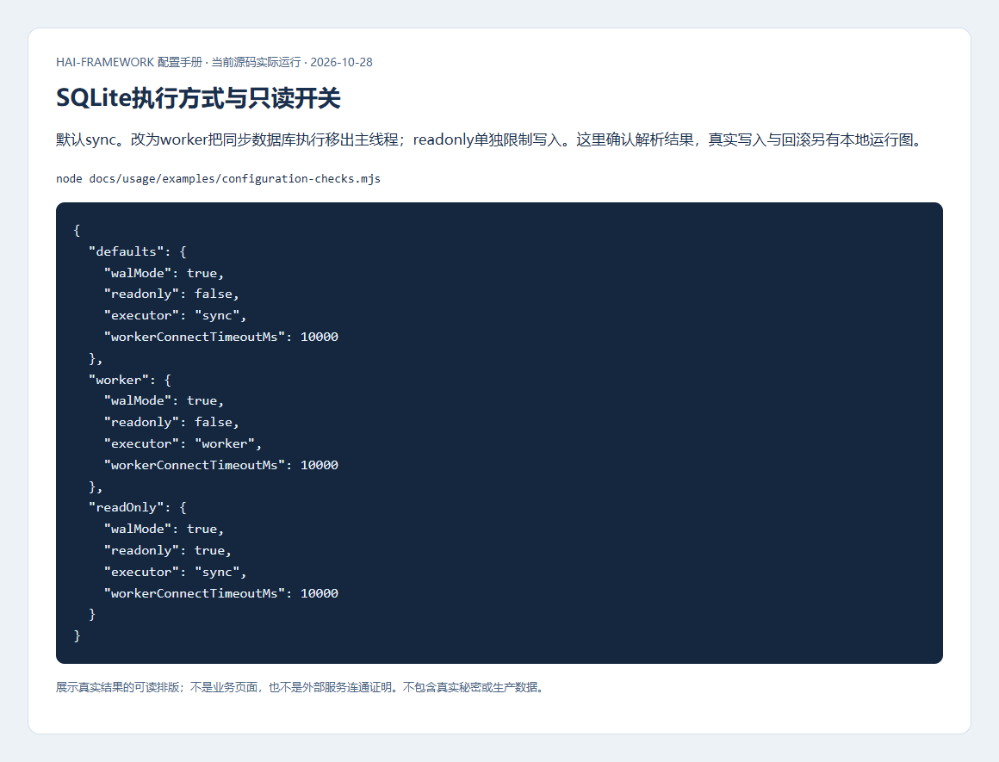
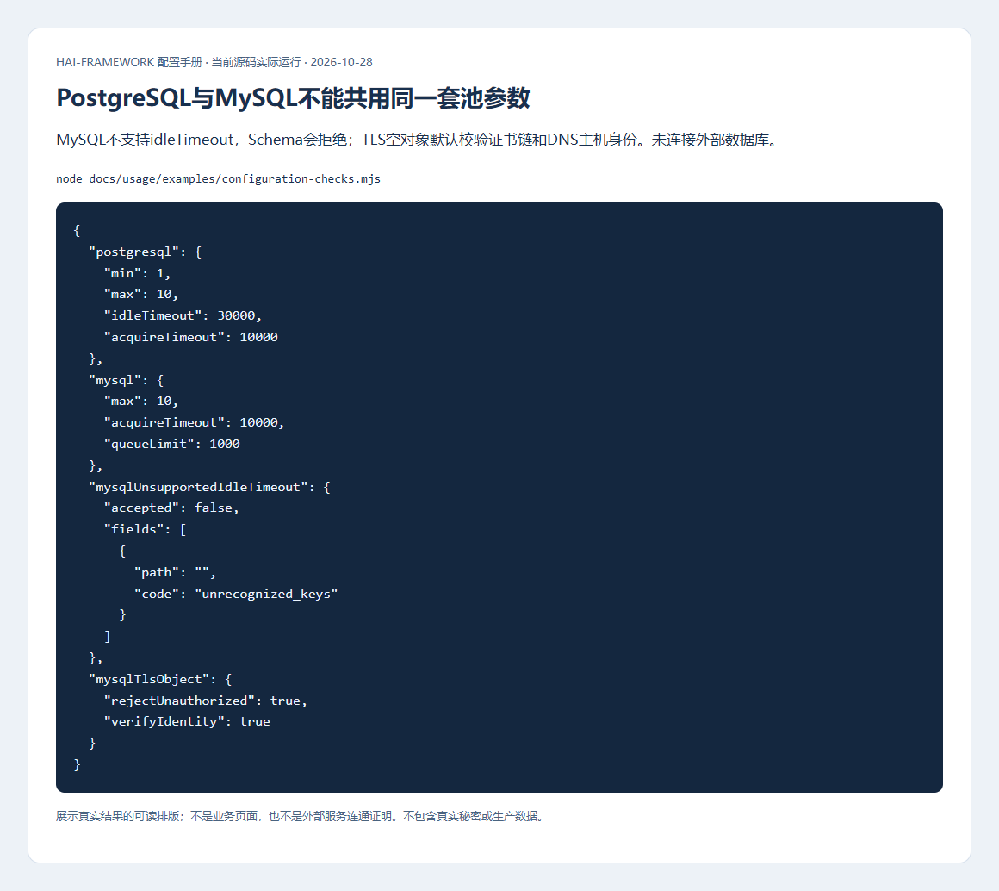
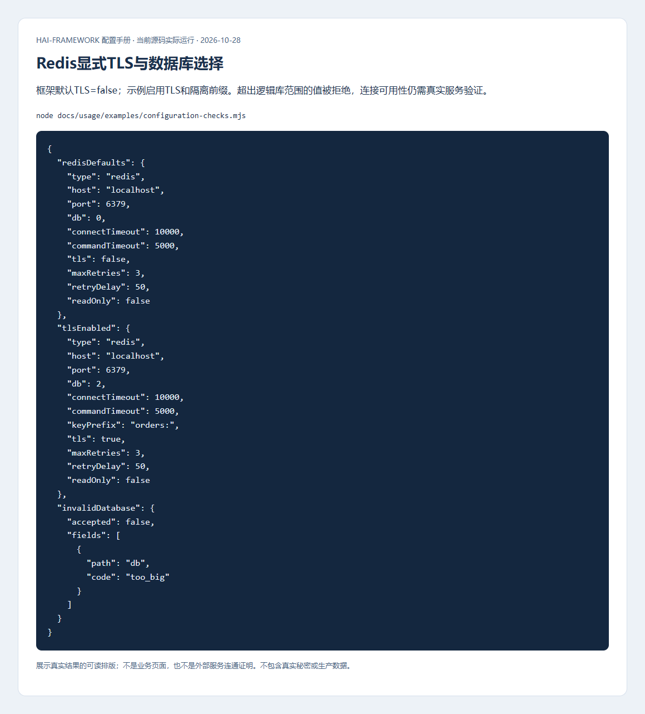
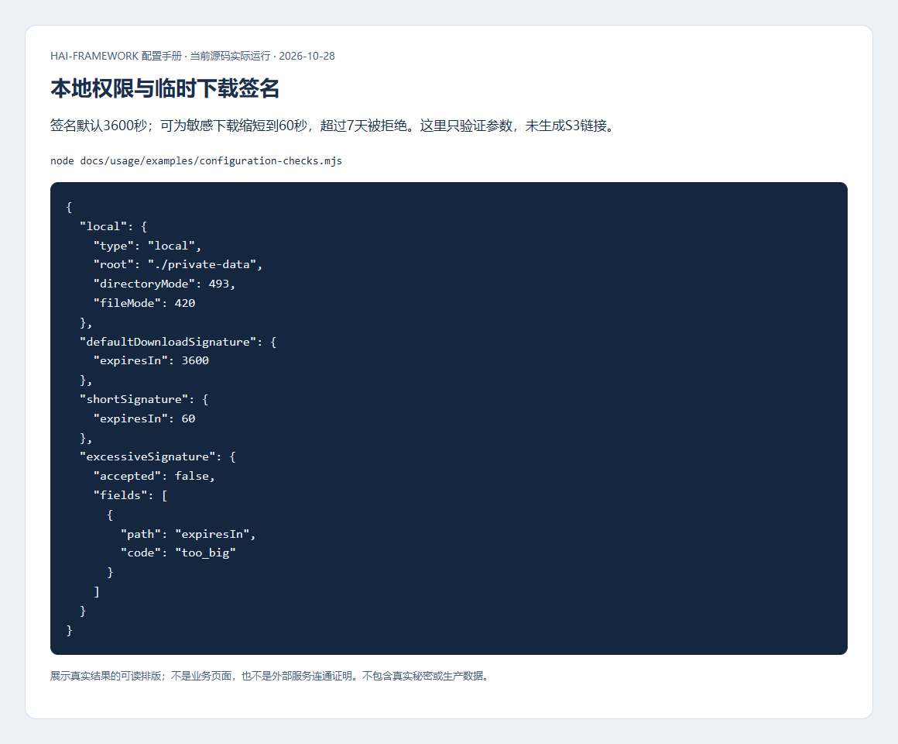
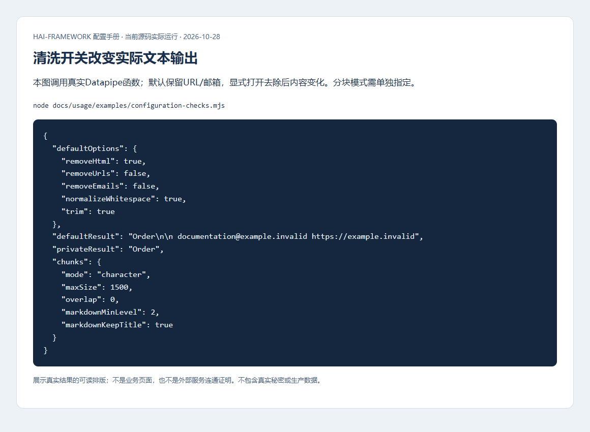
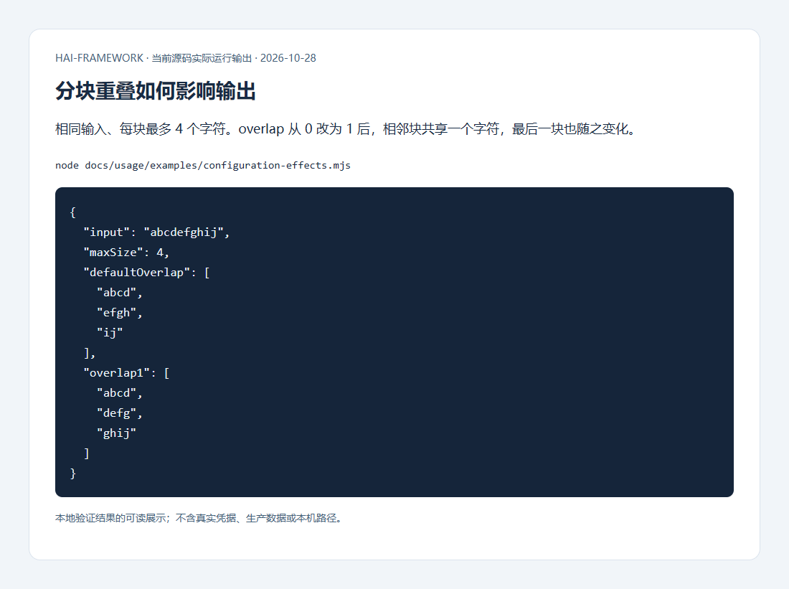

# 数据库、缓存、文件与文本配置

[配置手册](README.md) · [实际写读、事务和清理流程](../development/data.md)

先按数据的使用范围选择后端。开发可使用 SQLite、memory、local；生产即使只有一个应用实例，也要按框架共享状态要求使用 PostgreSQL/MySQL、Redis 和共享文件后端。连接成功只证明能访问，不证明权限、备份、并发和恢复策略正确。

## 数据库类型与地址

位置：`config/_db.yml`，宿主用 `ReldbConfigSchema` 校验后传给 reldb。`type` 没有默认，必须明确 sqlite/postgresql/mysql。

| 项 | 默认与必填 | 影响 |
| --- | --- | --- |
| SQLite `database` | 必填，无默认 | 文件路径持久化；`:memory:` 随连接消失，不适合作为生产持久数据 |
| 网络 `host` / `port` | localhost；运行时 PostgreSQL 5432、MySQL 3306 | 应填可解析的服务地址；容器 localhost 指容器自身 |
| `database` | PostgreSQL 必填；MySQL URL 模式可从 URL 读取，否则必填 | 选择实际数据库，不自动意味着当前用户可建库 |
| `user` / `password` | 无默认 | 按目标服务授权；放私有环境，避免超管账号 |
| `url` | 无默认；提供时优先于分字段 | MySQL 仅 mysql://，不接 query/fragment；不要在日志打印包含密码的 URL |
| `ssl` | 无统一默认，由所选 Provider/服务决定 | 生产显式配置 TLS 与信任；不能以禁用证书校验解决错误 |

```yaml schema=@h-ai/reldb:ReldbConfigSchema
type: postgresql
host: db.internal.example
port: 5432
database: orders
user: orders_app
password: ${DB_PASSWORD}
ssl: { rejectUnauthorized: true }
pool: { min: 1, max: 10, idleTimeout: 30000, acquireTimeout: 10000 }
operationLog: { read: false, write: false, maxLength: 1000, level: debug }
```

示例主机和用户需替换，`${DB_PASSWORD}` 通过私有 Secret 提供。PostgreSQL ssl 可为布尔、require/prefer/allow/disable 或驱动对象；MySQL 的语义不同：只接受 false 或受限对象，不能照抄 PostgreSQL 模式字符串。

### SQLite 执行方式

```yaml schema=@h-ai/reldb:ReldbConfigSchema
type: sqlite
database: ./data/orders.db
sqlite:
  walMode: true
  readonly: false
  executor: worker
  workerConnectTimeoutMs: 10000
```

| 项 | 框架默认 | 不同值的影响 |
| --- | --- | --- |
| `sqlite.walMode` | true | WAL 改善读写锁并发；不消除同步调用占用线程 |
| `sqlite.readonly` | false | true 拒绝写入，适合只读工具；业务启动若需要迁移可能失败 |
| `sqlite.executor` | sync | sync 在调用线程执行 better-sqlite3；worker 使用专用连接线程，减少主线程阻塞 |
| `workerConnectTimeoutMs` | 10000 ms | worker 等待连接打开的上限，不是所有 SQL 的执行上限 |



图中是公开 Schema 的解析结果；真实 SQLite 写读与回滚另见下图。配置改为 readonly 后，要在专用已有库验证读取成功、写入被拒绝；不要用生产库做试验。

### 连接池、TLS 与操作日志

| 项 | 框架默认 | 调整依据 |
| --- | --- | --- |
| PostgreSQL `pool.min` / `max` | 1 / 10 | min 是已建连接保留下限，不预先建连接；总连接预算应按所有实例计算 |
| PostgreSQL `idleTimeout` / `acquireTimeout` | 30000 / 10000 ms，0 关闭对应期限 | 排队/建连与 SQL 执行期限不同，不能靠增大连接数掩盖慢事务 |
| MySQL `pool.max` / `acquireTimeout` / `queueLimit` | 10 / 10000 ms / 1000 | 有界 FIFO；拒绝 min/idleTimeout；acquireTimeout 包括排队与建连，必须大于0 |
| MySQL `ssl.rejectUnauthorized` / `verifyIdentity` | ssl 对象存在时 true / true | 默认校验证书链与 DNS 主机身份；后者不是 IP 身份验证承诺 |
| MySQL `ssl.ca` / `cert` / `key` | 无默认 | PEM 内容，cert/key 成对；省略 ca 使用 Node 信任库 |
| `mysql.charset` | utf8mb4 | 保留完整 Unicode，变更时核对表结构和排序规则 |
| `operationLog.read` / `write` | 对象存在时均 false | 开启输出安全数量摘要，始终不记录 SQL 原文和绑定值 |
| `operationLog.maxLength` / `level` | 1000 字符 / debug | 0 省略摘要，级别同时受全局日志级别过滤 |



确认方式：在隔离库做参数化写入、查询、事务中失败和回滚，再检查连接在超时/关闭后释放。事务回调正常返回会提交，返回失败 HaiResult 并不会自动回滚，业务必须按公开事务机制处理失败。MySQL DDL 隐式提交，迁移步骤必须可重入；数据库结构和数据回退要单独准备。

## 缓存与共享状态

位置：`config/_cache.yml`。type 无默认，memory 仅开发/显式测试；会话、限流、锁和幂等状态在生产使用 Redis。

```yaml schema=@h-ai/cache:CacheConfigSchema
type: redis
host: cache.internal.example
port: 6379
password: ${REDIS_PASSWORD}
db: 0
tls: true
connectTimeout: 10000
commandTimeout: 5000
keyPrefix: 'orders:'
maxRetries: 3
retryDelay: 50
readOnly: false
```

| 项 | 框架默认 | 影响与注意事项 |
| --- | --- | --- |
| host/port/db | localhost/6379/0 | db 范围0–15；按 Redis 拓扑限制使用，Cluster 不等于支持任意逻辑库 |
| url/password | 无默认 | URL 模式优先，密码仅私有配置；不向浏览器公开 |
| tls | false | true 启用 TLS，需服务本身支持；示例 true 是生产选择，不是默认 |
| connectTimeout/commandTimeout | 10000/5000 ms | 分别控制连接和命令等待，0 的语义依驱动，生产保留有界期限 |
| maxRetries/retryDelay | 3 / 50 ms | 限制单请求驱动重试；重试不赋予业务写入幂等性 |
| keyPrefix | 无默认 | 隔离键名，不能代替租户权限，也不能让多个环境共用相同前缀 |
| readOnly | false | Cluster 读路由相关选项；读取副本需接受一致性条件 |
| cluster | 无默认 | 节点数组，每项 host/port 必填；与 sentinel/普通实例按实际拓扑选择 |
| sentinel | 无默认 | sentinels 非空数组及主节点 name 必填，实际故障切换需目标环境验证 |



初始化后做带 TTL 写读、到期读取、条件写与锁释放。`kv.set` 的 success=true 表示调用成功，是否真的条件写入还看 data；不能把未取得锁当作已获授权。

## 文件存储与临时签名

位置：`config/_storage.yml`。type 无默认；local 需要 root，S3 需要 bucket/region/accessKeyId/secretAccessKey。私有反馈材料不得因配置 publicUrl 而公开。

```yaml schema=@h-ai/storage:StorageConfigSchema
type: s3
bucket: orders-private
region: us-east-1
accessKeyId: ${S3_ACCESS_KEY_ID}
secretAccessKey: ${S3_SECRET_ACCESS_KEY}
endpoint: https://s3.internal.example
createBucket: false
forcePathStyle: true
prefix: orders/
operationLog: { read: false, write: false, maxLength: 1000, level: debug }
```

| 项 | 框架默认 | 不同值的影响 |
| --- | --- | --- |
| local.root | 必填 | 指定根目录，调用对象路径仍要防逃逸；开发目录不代表生产共享存储 |
| local.directoryMode/fileMode | 0755 / 0644 | POSIX 权限默认；私有部署需目录访问控制，Windows 使用自身权限模型 |
| S3 endpoint/publicUrl | 无默认 | endpoint 是 API 连接地址；publicUrl 仅地址拼接，不实施访问授权 |
| createBucket | false | true 在初始化时检查并创建缺失桶，需要对应权限；自建部署会明确注入 true |
| forcePathStyle | false | true 使用路径风格寻址，按兼容 S3 服务要求选择 |
| prefix | 空串 | 组织对象路径，不是租户/用户授权边界 |
| operationLog | 可省略 | 启用对象内默认同数据库，只输出安全摘要 |
| 预签名 expiresIn | 调用参数3600秒，允许1–604800 | 越长暴露窗口越大；敏感下载按业务选较短期限，local 不支持预签名 |
| 预签名 responseContentType/Disposition | 无默认 | 控制下载响应；上传签名 contentType 默认 application/octet-stream |



验证普通上传、禁止覆盖、无权限访问、过期签名和删除后不可读。私有对象由服务端检查访问权限后生成短期签名，不能把 accessKey 下发客户端。下图是隔离 SQLite、memory、local 的实际写读/回滚/清理结果，网络后端尚需实际连接。


## 文本清洗和分块

Datapipe 是函数，不通过 `_clean.yml` / `_chunk.yml` 初始化。调用时传选项；没有 close。

| 项 | 框架默认 | 取值影响 |
| --- | --- | --- |
| removeHtml/normalizeWhitespace/trim | true/true/true | 去标签、规范空白与边缘空白；不是安全 HTML 渲染器 |
| removeUrls/removeEmails | false/false | true 去除对应材料，适合隐私准备；保留原件用于追溯 |
| customReplacements | 可省略 | 每项 pattern/replacement 必填，可信业务代码定义规则 |
| chunk.mode | 必填 | character/word/sentence/paragraph/markdown/page/custom；按实际文本结构选择 |
| maxSize/overlap | 1500 / 0 | 重叠必须小于maxSize；增大重叠保留上下文但提高embedding和存储成本 |
| separator | 无默认 | custom 模式的分隔符；不要误认为所有模式使用它 |
| markdownMinLevel/markdownKeepTitle | 2 / true | 控制标题分块边界与保留；AI Knowledge 的默认 overlap 另为200 |





结果来自公开函数的实际输出。先用短文本确认边界，再用真实非敏感文档评估检索效果，不能只看分块数量。
