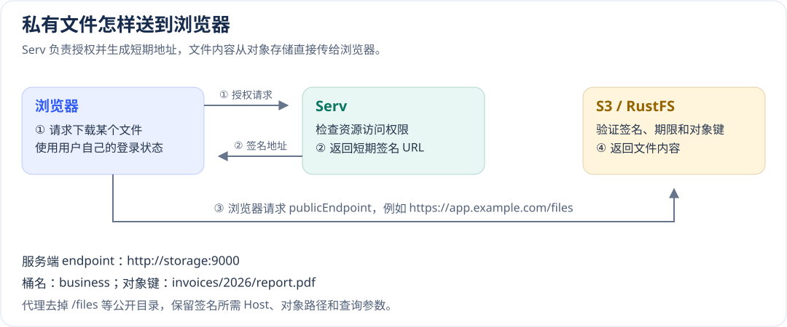

# 数据库、缓存、文件与文本配置

[配置手册](README.md) · [实际写读、事务和清理流程](../development/data.md)

先按数据的使用范围选择后端。开发可使用 SQLite、`memory`、`local`；生产即使只有一个应用实例，也要按框架共享状态要求使用 PostgreSQL/MySQL、Redis 和共享文件后端。连接成功只证明能访问，不证明权限、备份、并发和恢复策略正确。

## 数据库类型与地址

位置：`config/_db.yml`，宿主用 `ReldbConfigSchema` 校验后传给 reldb。`type` 没有默认，必须明确填写 `sqlite`、`postgresql` 或 `mysql`。

| 项 | 默认与必填 | 影响 |
| --- | --- | --- |
| SQLite `database` | 必填，无默认 | 文件路径持久化；`:memory:` 随连接消失，不适合作为生产持久数据 |
| 网络 `host` / `port` | `localhost`；运行时 PostgreSQL 5432、MySQL 3306 | 应填可解析的服务地址；容器中的 `localhost` 指容器自身 |
| `database` | PostgreSQL 必填；MySQL URL 模式可从 URL 读取，否则必填 | 选择实际数据库，不自动意味着当前用户可建库 |
| `user` / `password` | 无默认 | 按目标服务授权；放私有环境，避免超管账号 |
| `url` | 无默认；提供时优先于分字段 | MySQL 仅支持 `mysql://`，不接受查询参数或片段；不要在日志打印包含密码的 URL |
| `ssl` | 无统一默认，由所选 Provider/服务决定 | 生产显式配置 TLS 与信任；不能以禁用证书校验解决错误 |

```yaml schema=@h-ai/reldb:ReldbConfigSchema
type: postgresql
host: db.internal.example
port: 5432
database: orders
user: orders_app
password: ${DB_PASSWORD}
ssl: { rejectUnauthorized: true }
pool: { min: 1, max: 10, idleTimeout: 30000, acquireTimeout: 10000 }
operationLog: { read: false, write: false, maxLength: 1000, level: debug }
```

示例主机和用户需替换，`${DB_PASSWORD}` 通过私有 Secret 提供。PostgreSQL 的 `ssl` 可为布尔值、`require`、`prefer`、`allow`、`disable` 或驱动对象；MySQL 的语义不同：只接受 `false` 或受限对象，不能照抄 PostgreSQL 模式字符串。

### SQLite 执行方式

```yaml schema=@h-ai/reldb:ReldbConfigSchema
type: sqlite
database: ./data/orders.db
sqlite:
  walMode: true
  readonly: false
  executor: worker
  workerConnectTimeoutMs: 10000
```

| 项 | 框架默认 | 不同值的影响 |
| --- | --- | --- |
| `sqlite.walMode` | `true` | WAL 改善读写锁并发；不消除同步调用占用线程 |
| `sqlite.readonly` | `false` | `true` 拒绝写入，适合只读工具；业务启动若需要迁移可能失败 |
| `sqlite.executor` | `sync` | `sync` 在调用线程执行 better-sqlite3；`worker` 使用专用连接线程，减少主线程阻塞 |
| `workerConnectTimeoutMs` | 10000 ms | `worker` 等待连接打开的上限，不是所有 SQL 的执行上限 |

配置改为 `readonly` 后，要在专用已有库验证读取成功、写入被拒绝；不要用生产库做试验。

### 连接池、TLS 与操作日志

| 项 | 框架默认 | 调整依据 |
| --- | --- | --- |
| PostgreSQL `pool.min` / `max` | 1 / 10 | `min` 是已建连接保留下限，不预先建连接；总连接预算应按所有实例计算 |
| PostgreSQL `idleTimeout` / `acquireTimeout` | 30000 / 10000 ms，0 关闭对应期限 | 排队/建连与 SQL 执行期限不同，不能靠增大连接数掩盖慢事务 |
| MySQL `pool.max` / `acquireTimeout` / `queueLimit` | 10 / 10000 ms / 1000 | 有界 FIFO；拒绝 `min`、`idleTimeout`；`acquireTimeout` 包括排队与建连，必须大于0 |
| MySQL `ssl.rejectUnauthorized` / `verifyIdentity` | `ssl` 对象存在时均为 `true` | 默认校验证书链与 DNS 主机身份；后者不是 IP 身份验证承诺 |
| MySQL `ssl.ca` / `cert` / `key` | 无默认 | PEM 内容，`cert`、`key` 成对；省略 `ca` 使用 Node 信任库 |
| `mysql.charset` | `utf8mb4` | 保留完整 Unicode，变更时核对表结构和排序规则 |
| `operationLog.read` / `write` | 对象存在时均为 `false` | 开启输出安全数量摘要，始终不记录 SQL 原文和绑定值 |
| `operationLog.maxLength` / `level` | 1000 字符 / `debug` | 0 省略摘要，级别同时受全局日志级别过滤 |

确认方式：在隔离库做参数化写入、查询、事务中失败和回滚，再检查连接在超时/关闭后释放。事务回调正常返回会提交，返回失败 `HaiResult` 并不会自动回滚，业务必须按公开事务机制处理失败。MySQL DDL 隐式提交，迁移步骤必须可重入；数据库结构和数据回退要单独准备。

## 缓存与共享状态

位置：`config/_cache.yml`。`type` 无默认，`memory` 仅开发/显式测试；会话、限流、锁和幂等状态在生产使用 Redis。

```yaml schema=@h-ai/cache:CacheConfigSchema
type: redis
host: cache.internal.example
port: 6379
password: ${REDIS_PASSWORD}
db: 0
tls: true
connectTimeout: 10000
commandTimeout: 5000
keyPrefix: 'orders:'
maxRetries: 3
retryDelay: 50
readOnly: false
```

| 项 | 框架默认 | 影响与注意事项 |
| --- | --- | --- |
| `host` / `port` / `db` | `localhost` / 6379 / 0 | `db` 范围0–15；按 Redis 拓扑限制使用，Cluster 不等于支持任意逻辑库 |
| `url`/`password` | 无默认 | URL 模式优先，密码仅私有配置；不向浏览器公开 |
| `tls` | `false` | `true` 启用 TLS，需服务本身支持；示例中的 `true` 是生产选择，不是默认 |
| `connectTimeout`/`commandTimeout` | 10000/5000 ms | 分别控制连接和命令等待，0 的语义依驱动，生产保留有界期限 |
| `maxRetries`/`retryDelay` | 3 / 50 ms | 限制单请求驱动重试；重试不赋予业务写入幂等性 |
| `keyPrefix` | 无默认 | 隔离键名，不能代替租户权限，也不能让多个环境共用相同前缀 |
| `readOnly` | `false` | Cluster 读路由相关选项；读取副本需接受一致性条件 |
| `cluster` | 无默认 | 节点数组，每项 `host`/`port` 必填；与 `sentinel`/普通实例按实际拓扑选择 |
| `sentinel` | 无默认 | `sentinels` 非空数组及主节点 `name` 必填，实际故障切换需目标环境验证 |

初始化后做带 TTL 写读、到期读取、条件写与锁释放。`kv.set` 的 `success: true` 表示调用成功，是否真的条件写入还看 `data`；不能把未取得锁当作已获授权。

## 文件存储与临时签名

位置：`config/_storage.yml`。`type` 无默认；`local` 需要 `root`，S3 需要 `bucket`、`region`、`accessKeyId` 和 `secretAccessKey`。私有反馈材料不得因配置 `publicUrl` 而公开。

```yaml schema=@h-ai/storage:StorageConfigSchema
type: s3
bucket: orders-private
region: us-east-1
accessKeyId: ${S3_ACCESS_KEY_ID}
secretAccessKey: ${S3_SECRET_ACCESS_KEY}
endpoint: https://s3.internal.example
publicEndpoint: https://files.example.com
createBucket: false
forcePathStyle: true
prefix: orders/
operationLog: { read: false, write: false, maxLength: 1000, level: debug }
```

| 项 | 框架默认 | 不同值的影响 |
| --- | --- | --- |
| `local.root` | 必填 | 指定根目录，调用对象路径仍要防逃逸；开发目录不代表生产共享存储 |
| `local.directoryMode` / `fileMode` | 0755 / 0644 | POSIX 权限默认；私有部署需目录访问控制，Windows 使用自身权限模型 |
| S3 `endpoint` | 无默认 | 服务端 API 连接地址；省略时 AWS SDK 按 `region` 解析 AWS 端点，自建服务必须显式设置 |
| S3 `publicEndpoint` | 无默认 | 浏览器可访问的 HTTP(S) 地址，可含代理目录；省略时仍按 `endpoint`/AWS 端点签名 |
| S3 `publicUrl` | 无默认 | 公开资源的 URL 拼接地址；不生成签名、不实施访问授权，也不会使私有桶变为公开桶 |
| `createBucket` | `false` | `true` 在初始化时检查并创建缺失桶，需要对应权限；自建部署会明确注入 `true` |
| `forcePathStyle` | `false` | `true` 使用路径风格寻址，按兼容 S3 服务要求选择 |
| `prefix` | 空串 | 组织对象路径，不是租户/用户授权边界 |
| `operationLog` | 可省略 | 启用对象内默认同数据库，只输出安全摘要 |
| 预签名 `expiresIn` | 调用参数3600秒，允许1–604800 | 越长暴露窗口越大；敏感下载按业务选较短期限，`local` 不支持预签名 |
| 预签名 `responseContentType` / `responseContentDisposition` | 无默认 | 控制下载响应；上传签名 `contentType` 默认 `application/octet-stream` |

验证普通上传、禁止覆盖、无权限访问、过期签名和删除后不可读。私有对象由服务端检查访问权限后生成短期签名，不能把 `accessKey` 下发客户端。

`prefix` 相当于给所有对象键加一个统一目录。例如 `prefix: invoices/2026`，调用 `storage.file.put('report.pdf', bytes)` 后，桶内保存的键为 `invoices/2026/report.pdf`。之后读、删、签名仍传 `report.pdf`，不要再手工重复前缀。多个应用可用不同前缀整理文件；访问权限仍由应用和存储策略控制。修改前缀不会搬迁已有对象，切换前先处理数据迁移。

### 配置人员：区分三个访问地址

应用服务器与浏览器不一定在同一个网络。Compose 中的 `http://storage:9000` 能被 Serv 访问，用户电脑通常无法解析这个地址。保留内部 `endpoint`，把 `publicEndpoint` 设为用户实际访问的地址，可包含文件入口目录。对象读写、建桶和启动检查继续连接内部端点。

例如，应用位于 `https://app.example.com/delivery/`，希望文件请求也留在该目录下，私有桶名为 `business-files`：

```yaml schema=@h-ai/storage:StorageConfigSchema
# config/_storage.yml；以下内部地址用于默认自建 Compose
type: s3
bucket: business-files
region: us-east-1
endpoint: http://storage:9000
publicEndpoint: https://app.example.com/delivery/files
forcePathStyle: true
createBucket: true
accessKeyId: ${HAI_STORAGE_ACCESSKEYID}
secretAccessKey: ${HAI_STORAGE_SECRETACCESSKEY}
prefix: private
```

浏览器得到 `/delivery/files/business-files/private/<对象键>`。桶名仍属于 S3 路径，`publicEndpoint` 中不要再写桶名。地址可以带端口；目录段允许字母、数字、下划线、点和连字符，不允许 `.`/`..`、重复斜杠、编码的分隔符、凭据、查询或片段。它不自动跟随网站目录改变，需要配置人员明确选择。

| `publicEndpoint` 的写法 | 浏览器访问路径 | 网关转发给 Storage 的路径 |
| --- | --- | --- |
| `https://app.example.com` | `/business-files/private/<对象键>` | `/business-files/private/<对象键>` |
| `https://app.example.com/delivery/files` | `/delivery/files/business-files/private/<对象键>` | `/business-files/private/<对象键>` |

含目录时，对外预签名采用桶路径风格，内部 CRUD 仍遵循 `forcePathStyle`。Storage 针对外部 Host 和真正的 S3 URI 签名，返回 URL 再加入入口目录；SDK 生成的 Nginx 只去除同一目录，保留原始编码、查询与 Host。这样文件直接到 Storage，上传、大文件和 Range 都不经过 Serv。不能简单让 S3 SDK 对带前缀的整条路径签名，再由代理随意去掉前缀。

外层入口把 `/delivery/` 原样转发到本应用公开端口即可覆盖上例文件入口，`proxy_pass` 不附加替换 URI，保留 Host；只在框架生成的内层网关去除 `/delivery/files`，不要两层都剥离。选择独立文件域名时同样保持该规则。HTTPS 在受管入口配置，修改地址本身不会自动安装证书。

该路由只开放配置桶的对象路径；API、健康探测、框架静态资源冲突会在打包前失败。初次增加网关或改变公开目录需要建立全量部署基线；仅更新应用的增量保留旧代理配置并核对配置摘要，失败恢复仍使用旧网关与旧路径。外部网关由维护人员实现相同的路径与 Host 规则。

生成链接的应用 API 仍受认证、权限和请求策略约束。文件直连由 Nginx 与 S3 校验，**不会再次执行 Serv/Kit 的会话、IP 或时段守卫**；已经发出的链接也不会因退出登录或改变角色立即撤销。下载请求本身需要网络/时间限制时，在受管入口或存储网络策略中配置并实测，同时采用符合业务要求的短有效期。

普通应用通过 Core 的环境覆盖规则加载此项；可在 YAML 写明 `publicEndpoint: ${HAI_STORAGE_PUBLICENDPOINT:https://app.example.com}`，或在私有环境文件整体配置 `HAI_STORAGE`。整体父对象会覆盖 YAML 和其下叶项；部署保存过 `HAI_STORAGE` 时，修改这一有效对象，不能只改已被覆盖的 YAML。Compose 默认自建会替换内部连接和托管凭据，保留桶、区域、`prefix`、`publicEndpoint`、`publicUrl` 和操作日志设置。外部 S3、R2 或既有连接按其自身地址访问，不生成指向本地 Storage 的路由。



### 应用开发者：先授权，再给用户下载链接

默认自建模式在 `bucket`/`region` 为空时补为 `hai` / `us-east-1`；这是部署注入值，Storage Schema 本身仍要求填写这两项。`publicEndpoint` 没有自动猜测值，SSH Host 别名、HTTP 端口与用户实际访问的 HTTPS 地址可能不同，部署前应明确填写。

1. 初始化模块并检查结果。HTTP Storage feature 必须具备资源授权策略；签名 API 仍经过认证、权限及对象归属检查。
2. 调用 `apiClient.storage.presignedUrls.createDownload({ key, expiresIn: 300 })`，确认 `result.success` 后使用 `result.data.url`。下载时浏览器直接请求这条 URL；下载字节不经过生成签名的 Serv 请求。
3. 需要浏览器保存大文件时，可把 URL 用作正常下载链接，并由 `responseContentDisposition` 声明文件名；不要为了下载再让应用 API 读取整个对象。现有 `downloadWithPresignedUrl` 也直连存储，但它为了进度/Blob 保存会占用客户端内存，应按文件规模选择。
4. 失败时重新经过授权获取新链接。返回 URL 已含配置的代理目录，调用方不能再加网站目录、改域名、改桶名或删查询；GET 的签名也不能拿来发送 HEAD 请求。客户端取消只结束本次传输，不撤销已经授予的 URL 或远端上传。

签名默认值仍分入口：Node 省略有效期为 3600 秒，HTTP 为 900 秒，允许整数 1–604800 秒；300 秒是上例建议值。下载签名可以设置响应 `Content-Type`、`Content-Disposition`；上传签名默认 `Content-Type` 为 `application/octet-stream`。上传 URL 只授权 PUT，不保证文件大小或内容符合业务要求，应用须在存储完成后核验实际对象。

### 运维与安全人员：直连路由、增量与回滚

前后端分离部署把桶路由加到已有 Web Nginx；SvelteKit SSR 和独立 API 增加 `gateway`，宿主机公开端口由它持有，应用只在 Compose 网络监听。Storage 的 9000 端口与控制台不直接发布。Nginx 保留签名 Host、原始 URI 和查询，关闭对象请求/响应缓冲及对象路由日志，支持 Range；仅允许 GET/HEAD、PUT 和 OPTIONS，实际对象权限仍由 S3 校验。外层负载均衡、CDN和日志平台也必须清除签名查询；跨源浏览器需要在实际 S3 服务配置精确 CORS，网关不会自动放开来源。

首次从旧拓扑升级、改变公开端点、桶或其他自建 S3 访问配置时使用全量部署。交付包记录代理服务和不含密钥的配置摘要；与已装配置不一致的增量包会在更新服务前拒绝。正常应用/Storage 增量保留未选服务；容器 IP 变化后刷新保留代理的 DNS。失败回滚按原发布的拓扑、端口和健康路径恢复。容器回滚不撤销对象写入，数据仍按原卷和托管凭据保留；改变 `prefix`/`bucket` 前应准备数据迁移与业务核对。

验收时在浏览器 Network 或受控请求工具检查：签名接口只返回小响应；大文件请求的地址是公开桶路径；Range 返回 206；无签名、篡改及过期 URL 返回 403。部署日志不能记录完整 URL。Local 不支持预签名，框架不会把私有文件目录直接映射给 Nginx。

对象响应默认带 CSP `sandbox` 和禁止脚本/表单/基地址的策略、`nosniff`、`no-referrer`、`private, no-store`。即使文件与应用同源，不可信 HTML 也不应获得应用脚本权限；这条路由用于文件交付，不用于托管可执行的网站脚本。对象路由连接超时为 5 秒、连续无读写数据的超时为 300 秒；300 秒不是持续传输的总时限。外部 S3/CDN 须自行配置等价的隔离与日志策略。

## 文本清洗和分块

Datapipe 是函数，不通过 `_clean.yml` / `_chunk.yml` 初始化。调用时传选项；没有 `close()`。

| 项 | 框架默认 | 取值影响 |
| --- | --- | --- |
| `removeHtml` / `normalizeWhitespace` / `trim` | 均为 `true` | 去标签、规范空白与边缘空白；不是安全 HTML 渲染器 |
| `removeUrls` / `removeEmails` | 均为 `false` | `true` 去除对应材料，适合隐私准备；保留原件用于追溯 |
| `customReplacements` | 可省略 | 每项 `pattern`/`replacement` 必填，可信业务代码定义规则 |
| `chunk.mode` | 必填 | `character`、`word`、`sentence`、`paragraph`、`markdown`、`page`、`custom`；按实际文本结构选择 |
| `maxSize`/`overlap` | 1500 / 0 | 重叠必须小于`maxSize`；增大重叠保留上下文但提高`embedding`和存储成本 |
| `separator` | 无默认 | `custom` 模式的分隔符；不要误认为所有模式使用它 |
| `markdownMinLevel`/`markdownKeepTitle` | 2 / `true` | 控制标题分块边界与保留；AI Knowledge 的默认 `overlap` 另为200 |

先用一段短文本确认分块位置和重叠内容，再用真实非敏感文档评估检索效果。
