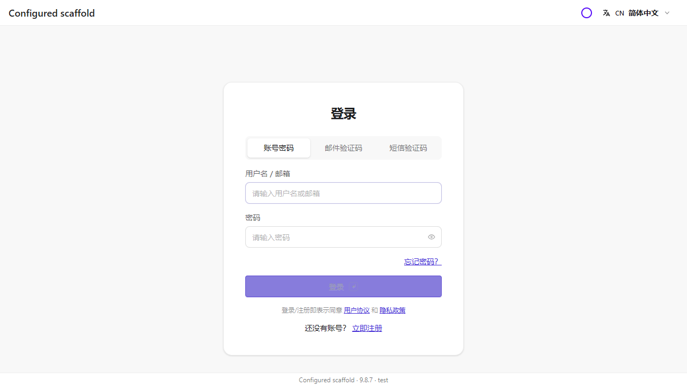
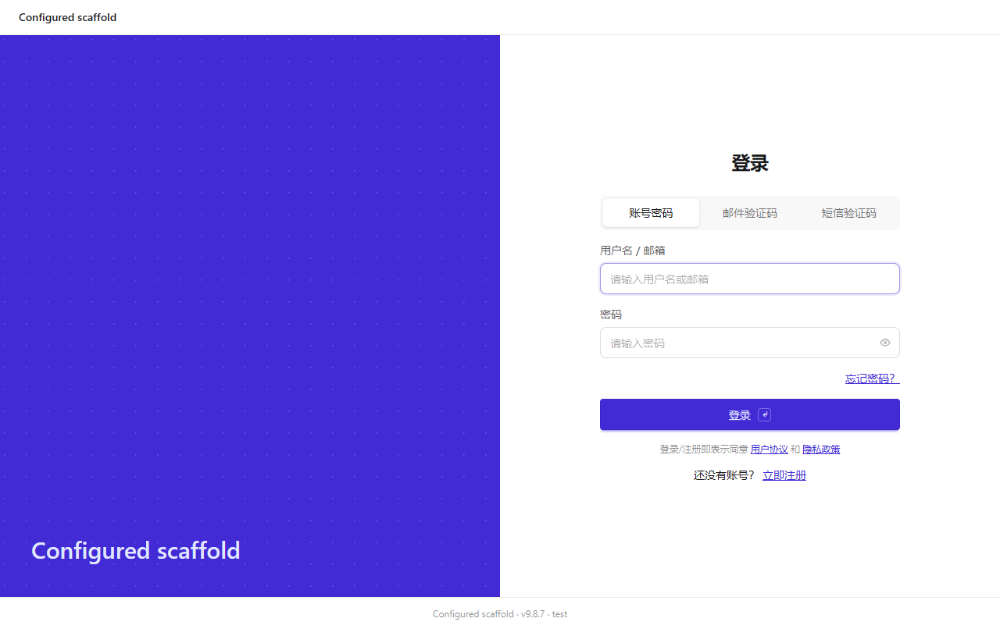
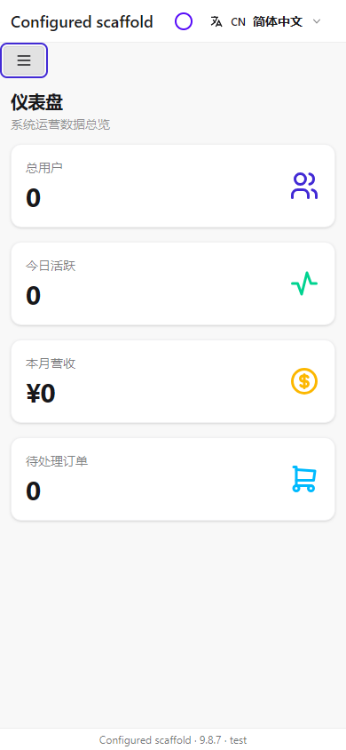
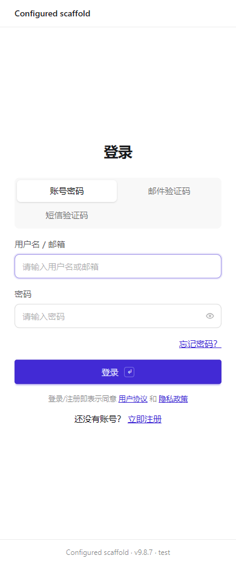
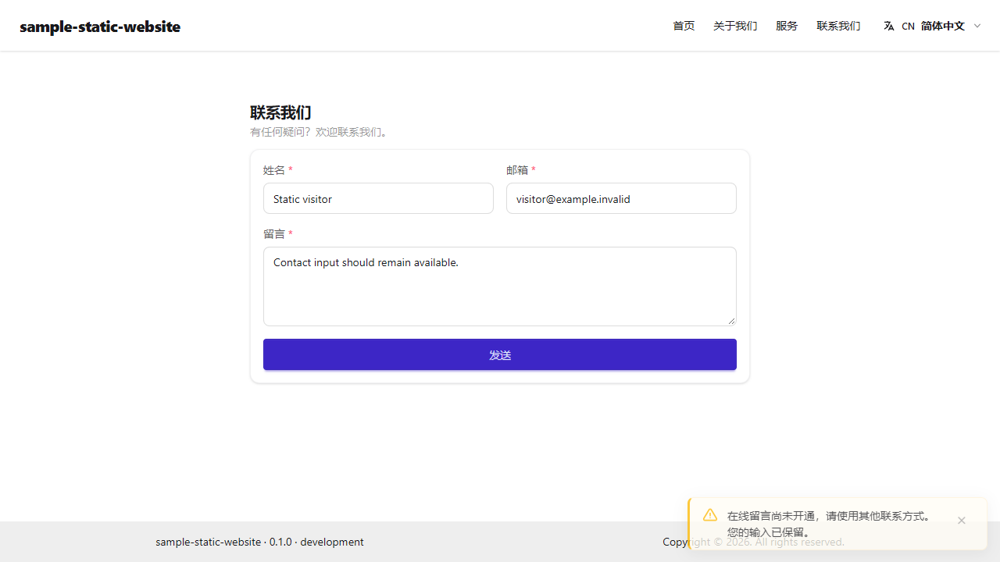
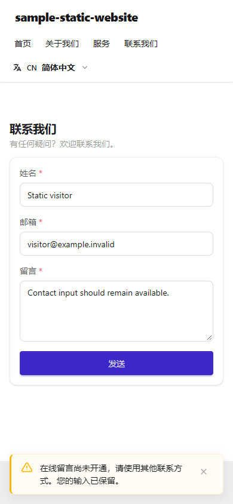
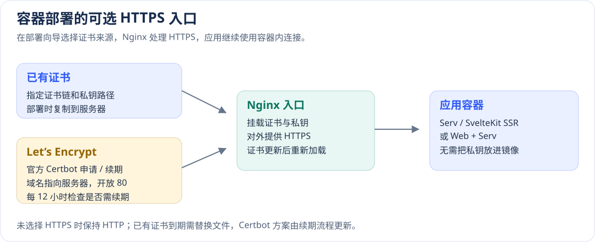

# 构建、部署配置与失败恢复

[配置手册](README.md) · [应用创建步骤](../getting-started/create.md) · [部署操作指南](../operations/deployment.md)

部署可靠性需要制品、环境、成功基线和数据恢复共同成立。全量表示更新本项目完整服务组合，不表示删除数据卷；增量表示基于服务器最后成功状态仅替换选中服务，不是把部分文件随意覆盖到服务器。容器恢复与数据库回退分别设计。

## 配置入口和角色

`package.json.name`是项目资源身份，去scope、转小写并规范非法字符；不能通过目录名猜测，缺失会报错。应用根`version`用于制品版本。`hai.json.build`描述编译/镜像/原生打包，`hai.json.deploy`描述部署；服务目录仅用于扫描依赖和运行配置。

中间件向导选择默认或自定义时，保留同后端的完整有效配置，表单未展示项也会传到运行环境：数据库连接池/操作日志、S3 的 `publicEndpoint/publicUrl/prefix`、Redis 重试/键前缀、向量检索选项、SMTP 发件人和 LDAP 属性映射。自建与云开通只定稿实际连接及凭据，切换后端清除不兼容字段。若旧版已保存缺字段的 `HAI_STORAGE` 父 JSON，须从原配置/备份补回最高优先级父对象，再重新生成部署包；父对象存在时，仅修改 YAML 或叶变量不能恢复公开下载地址。

### 连接已有数据库、缓存和对象存储

在部署向导中为对应服务选择“自定义”，填写已有服务的连接信息。部署会保留同一后端的连接池、TLS、Redis 库编号与键前缀、S3 对象前缀和公开下载地址，不会另外创建该服务的本地容器或数据卷。

| 服务 | 先准备什么 | 部署后怎样确认 |
| --- | --- | --- |
| PostgreSQL / MySQL | 后端容器能访问的地址、数据库、账号、密码和 TLS 配置 | 用应用完成一次新增、查询和事务；保留应用初始化所需的表/索引权限 |
| Redis | 地址、认证、库编号和环境独立的 `keyPrefix` | 写入并读取一个带期限的缓存，核对使用了正确逻辑库 |
| S3 兼容存储 | `bucket`、区域、服务端 `endpoint`、访问凭据；浏览器下载另设 `publicEndpoint` | 上传、读取，再通过生成的签名地址从浏览器下载 |

“已有服务的地址”是从目标后端容器看过去的地址，通常是内网域名或 IP。不要填写开发机的 `localhost`，也不要把仅 Compose 内可用的 `storage:9000` 当成浏览器下载地址。外部对象存储的公开入口、反向代理和跨域策略由该存储环境维护，部署工具不会替它创建本地文件网关。配置文件与凭据的保存位置见本章[环境和秘密的来源](#环境和秘密的来源)。

| 角色 | 用途 | 交付方式 |
| --- | --- | --- |
| serv | 独立API后端 | 容器服务 |
| web | 静态或SSR浏览器站点 | 容器服务，serv+web时配置同源代理 |
| app | Android/`iOS` | 原生安装包，不作为Compose服务 |
| desktop | 桌面应用 | 对应OS安装包，不作为Compose服务 |

```json
{
  "build": {
    "images": [
      { "name": "serv", "context": ".", "dockerfile": "images/serv.Dockerfile", "containerPort": 3000 },
      { "name": "web", "context": ".", "dockerfile": "images/web.Dockerfile", "containerPort": 8080 }
    ],
    "desktop": ["apps/orders-desktop"],
    "app": ["apps/orders-app"]
  },
  "deploy": {
    "provider": {
      "type": "docker-ssh",
      "remote": { "baseDir": "/opt/hai/apps", "runtime": "auto" },
      "expose": { "type": "port", "hostPort": 18080, "containerPort": 3000 }
    },
    "services": {},
    "container": { "s3Engine": "rustfs" }
  }
}
```

这是fullstack结构示例，先核对真实workspace路径，删除不存在的app/desktop项，配置所需环境。镜像需各自Dockerfile；构建不注入运行期密钥，不使用Windows node_modules替代Linux依赖。

| build参数 | 默认/条件 | 影响 |
| --- | --- | --- |
| `--target` | compile | compile编译源码，`image`构建镜像，app/desktop生成对应原生制品 |
| `--images` | 按项目配置 | serv/web或逗号列表，部分构建保留完整`hasWeb`拓扑，不能直接作为首次完整安装 |
| `--concurrency` | 2；仅`image` | 同时构建的镜像数，只接受1或2；`deploy` `--build`也可使用 |
| `--runtime` | `auto` | 本机引擎选择优先Podman；不是远端引擎探测结果 |
| `--network`/`--no-http-proxy` | 默认引擎网络/默认继承规则 | 按网络环境明确设置，完全离线还需基础镜像和依赖缓存 |
| `--sqlite-prebuild-mirror` | 无通用镜像地址默认 | 可信HTTP(S)预编译根地址，需匹配ABI/架构/libc |
| `--platform`/`--arch` | 按目标工具链 | 原生包需对应OS/SDK/签名；同步资源不等于生成安装包 |

构建工具会自动记录应用版本、本次构建编号、网站目录、服务组合及镜像校验和。部署工具据此检查交付内容，用户无需填写或修改清单格式。CLI 与应用框架依赖保持匹配版本；全部镜像导出成功后，才会更新本地最近构建记录。

### 构建并发和缓存

`image` 目标默认最多并行两项镜像，资源紧张时用 `--concurrency 1`。Dockerfile 在源码 COPY 前安装依赖，前后端仅复制各自必要的源码，源码变化可复用下载与安装层。运行镜像移除应用自身的声明文件、源码映射与说明文件。打包按镜像内容 ID 在 `.hai/cache/images` 缓存中间件归档，复用前验证摘要，损坏则重新导出；应用镜像复制时同步计算摘要。速度取决于资源与缓存命中，不承诺固定比例。

旧 `--target docker` 已改为 `--target image`；`--runtime docker|podman` 继续表示引擎，现有 `.hai/build/docker` 制品目录保持可用。

后端探针、模板镜像和 Fullstack 同源代理按最终健康路径生成，支持 `HAI_SERV_HTTP_HEALTH_PATH=/status`；整段 `HAI_SERV` 仍优先于叶字段。已启用的文档页面、OpenAPI JSON 与本地 Scalar 脚本会转发至后端，保留生产关闭与认证限制。路径和路由变更需要重新部署，同步 Nginx 与发布探针。

## 网站部署在子目录

当访问地址是 `https://example.com/yyy/`，浏览器资源、页面路由和服务器守卫都要对应这个目录。只把一处script改为相对地址，还不足以保证登录、API和页面刷新可用。先确定使用哪类模板，再选择托管方式。

### 配置与真实默认值

| 能力 | 配置位置与默认值 | 设置以后的影响 |
| --- | --- | --- |
| SvelteKit的admin、h5、website | 构建进程的`PUBLIC_BASE_PATH`默认空字符串，`kit.paths.base`为空 | `/yyy`使页面、资源及生成模板中的认证地址、登录跳转和守卫都带此前缀；更改后重新构建 |
| Vite的Fullstack Web及独立mobile浏览器端 | `vite.config`默认base为`./`；`runtime-config.js`使用相对引用；页面使用hash导航 | 不指定目录时，同一份构建可以经剥离目录的网关挂载；显式`PUBLIC_BASE_PATH`会将Vite基址固定为该目录加`/` |
| App/Desktop原生包 | Vite资源使用`./`，原生build目标不接受`PUBLIC_BASE_PATH` | 本地资源由原生宿主加载；原生API地址仍按设备配置，网站目录不代表设备API地址 |
| SDK管理的网站目录 | `hai build --target image`读取构建进程的`PUBLIC_BASE_PATH`，默认根目录 | 只传给web镜像；设置后自动生成匹配的Nginx/SSR健康检查和带目录的访问地址 |

`PUBLIC_BASE_PATH`是公开的**构建期进程变量**。例如 `/yyy`、`/portal/admin`有效；根目录用空字符串。各段仅允许ASCII字母、数字、`_`、`.`、`-`，不接受末尾斜杠、外部URL、查询、片段、编码分隔符或单独的`.`/`..`段。`/`应改为空字符串。构建不会从根`.env`或私有`.env.local`读取这个控制值；请在当前终端或CI构建任务中显式设置。

SvelteKit由`kit.paths.base`处理资源和路由，模板不另设Vite base。Vite模板采用相对资源与hash导航，例如 `/yyy/#/roles`；自行引入history路由时，应同时配置固定基址、路由器basename及服务器回退，不能只修改script。

### SvelteKit：同时处理路由、认证与权限

以下以启用IAM的Admin项目为例。先创建项目、安装依赖，并核对开发所需服务；可生成一个受保护的测试API，便于验证匿名请求确实被拒绝：

```sh
hai create portal --type admin --defaults --no-install
cd portal
pnpm install
hai generate api prefix-probe --output src/routes/api
```

然后检查开发路径，停止开发服务后恢复原环境值：

```powershell
$previousBase = $env:PUBLIC_BASE_PATH
try {
  $env:PUBLIC_BASE_PATH = '/yyy'
  pnpm.cmd dev --host 127.0.0.1 --port 5173
}
finally {
  $env:PUBLIC_BASE_PATH = $previousBase
}
```

访问 `http://127.0.0.1:5173/yyy/`，从导航进入登录页，再刷新登录或业务深链接。正式编译时在同样的`PUBLIC_BASE_PATH`下执行 `pnpm build`；生产服务仍须满足数据库、缓存、密钥等配置要求，开发可访问不代表生产配置已验收。

新模板已将base加入`kit.createHandle`的`protectedPaths`/`publicPaths`/`loginUrl`，并为`createAuthActions`设置带base的api/auth地址。已有应用升级时，同步检查自定义fetch、链接、守卫与回调地址；守卫匹配的是实际URL。带目录的私有API应返回401，页面应跳转到同一目录下的登录页。API的401响应保留诊断信息，界面错误继续使用公共Toast。



图为CLI实际生成的Admin在`/yyy/auth/login`的登录页。验收同时执行注册、登录和直接刷新，核对浏览器资源均位于`/yyy/`下；截图本身只展示页面状态。

### 前后端分离：网站目录与API地址分别配置

Fullstack Web的运行配置先于应用模块加载。未指定固定目录时，模板中的`./runtime-config.js`与Vite `base: './'`允许页面挂在`/yyy/`下；网关将该前缀剥离后交给根目录静态服务。访问入口应规范为带末尾斜杠的`/yyy/`，hash导航和刷新保持在这个目录。

Web的API地址按显式`baseUrl`、`runtime-config.js`、构建时`PUBLIC_API_BASE`、当前`origin`的顺序选择；只提供`origin`时补`/api/v1`。独立托管Web时，在公开运行配置中设置实际API的完整地址及前缀，不放密钥。SDK部署Fullstack时，同源运行配置由当前`_serv.http.apiPrefix`生成；额外网关也要转发该API前缀。网站在`/yyy/`，并不自动把API改为`/yyy/api/v1`。详见[HTTP与客户端配置](http.md)。



图为真实生成的Fullstack Web经`/yyy/`反代访问的页面。验收沿该入口执行管理业务流程、hash深链接与刷新；API通过单独的`/api/v1/`代理访问实际服务。

### 所有对外业务路径必须带同一目录

如果网关只允许 `/somepath/`，仅设置前端 `PUBLIC_BASE_PATH` 不够。复用已有配置，把 Serv 的 API、健康和文档路径一起放入目录；不需要额外的 context path 开关：

```yaml
# 服务的 config/_serv.yml；原有 transport、CORS 等配置继续保留。
http:
  apiPrefix: /somepath/api/v1
  health:
    path: /somepath/health
    readyPath: /somepath/ready
  docs:
    path: /somepath/docs
    requireAuth: true
  openapi:
    path: /somepath/openapi.json
```

使用 `PUBLIC_BASE_PATH=/somepath` 构建完整制品，然后全量部署。SDK 从有效 Serv 配置生成 API 运行地址、精确代理和探活路径；上述文档在 `/somepath/_hai/scalar.js` 加载本地脚本，生产环境仍按应用策略关闭文档。显式访问规则和业务中手写的 URL 也须同步，避免旧父级环境变量遮蔽新 YAML。自建 S3 的 `publicEndpoint` 配成实际公开地址，例如 `https://app.example.com/somepath/files`。

额外网关将 `/somepath/` 原样转发给 SDK Web 入口，其他业务路径返回 404。不要只把 Nginx `location` 改成带目录的健康路径：无 URI 的 `proxy_pass` 会把整个路径交给后端，必须与 Serv 配置一致。`/_hai/web-health` 继续供内部探活，外层网关无需公开；Let’s Encrypt HTTP-01 的公网 80 端口及 `/.well-known/acme-challenge/` 则需要单独放行。

验收不仅检查首页：在根路径 `/api/v1/`、`/health` 被网关拒绝时，检查带目录的运行配置、匿名 API 拒绝、登录、导航刷新和文件上传下载。生成工程的浏览器门禁使用仅开放目录的网关，容器门禁另验证实际生成的 Nginx 配置。

### 容器、增量部署与反向代理

CLI 与 Deploy 使用匹配版本。即使只构建后端，也要传入与既有网站一致的公开目录，让增量包保留完整的网站信息：

```powershell
$previousBase = $env:PUBLIC_BASE_PATH
try {
  $env:PUBLIC_BASE_PATH = '/yyy'
  pnpm.cmd build --target image
  $buildId = (Get-Content '.hai/build/docker/latest' -Raw).Trim()
  $manifestPath = Join-Path (Join-Path '.hai/build/docker' $buildId) 'manifest.json'
  Get-Content $manifestPath -Raw | ConvertFrom-Json | Select-Object webBasePath, partial, hasWeb
}
finally {
  $env:PUBLIC_BASE_PATH = $previousBase
}
```

确认 `webBasePath` 为 `/yyy`。SDK 据此配置页面入口、运行配置、健康检查与返回地址；更改目录后重新构建镜像。目录不能占用同源代理的 API 或健康入口，冲突会提前报告。正式部署步骤见[部署操作指南](../operations/deployment.md)。

增量包必须保持既有目录。忘传或改变目录会在替换服务前拒绝；修正构建变量后重建，或在确需改目录时执行新的全量部署。自动失败恢复继续使用旧发布记录的端口与健康路径。容器恢复仍不撤销业务数据和Schema迁移。

额外网关转发到SDK已管理的目录入口时，**保留目录**。SvelteKit直接托管同样保留目录，例如已有`server`内的配置片段：

```nginx
location = /yyy {
  return 308 /yyy/$is_args$args;
}
location /yyy/ {
  proxy_pass http://127.0.0.1:18080;
  proxy_set_header Host $http_host;
  proxy_set_header X-Forwarded-Proto $scheme;
}
# Fullstack同源API的实际前缀，按_serv配置同步修改。
location /api/v1/ {
  proxy_pass http://127.0.0.1:18080;
  proxy_set_header Host $http_host;
  proxy_set_header X-Forwarded-Proto $scheme;
}
```

只有转发到**未配置固定目录、使用相对资源的Vite根目录服务**时，Web `location` 中的 `proxy_pass`才带末尾`/`，以剥离`/yyy/`；API仍单独转发到实际服务：

```nginx
location = /yyy {
  return 308 /yyy/$is_args$args;
}
location /yyy/ {
  proxy_pass http://127.0.0.1:8080/;
  proxy_set_header Host $http_host;
}
location /api/v1/ {
  proxy_pass http://127.0.0.1:3000;
  proxy_set_header Host $http_host;
}
```

这些是已有网关`server`中的片段，替换为实际上游，并按[HTTP配置](http.md)设置HTTPS、公开源和可信代理。SvelteKit adapter-node的ORIGIN使用公网源，不把路径附在`origin`中。Vite剥离模式与SDK保留模式分别使用，不能叠加两次剥离。





两图来自390px真实浏览器，等待实际布局过渡结束后拍摄。Admin菜单按需打开，Escape关闭后焦点回到菜单按钮，导航选中项包含挂载目录。验收还核对运行配置、JS/CSS、注册登录、匿名拒绝、hash导航、页面刷新、无整页横向溢出；真实Nginx另验证多级目录、保查询的308跳转、页面回退和根目录运行配置404。Linux shell夹具验证匹配、遗漏、变化和异常目录元数据的增量边界；这些证据不代表已经在用户生产环境完成灾备演练。

## 静态website与GitHub Pages

用于企业介绍、帮助和文档等纯展示站点。新建 website 统一包含完整模块和示例，默认 SSR；静态发布前须手动移除服务端业务依赖、初始化及 API/`actions`，不能只打开静态开关：

```sh
hai create docs-site --type website --defaults
cd docs-site
```

创建后先完成上述裁剪，保留 Core/Kit/UI，再执行静态构建。现有已裁剪工程仍可直接使用静态构建；不再提供轻量创建参数。

| 构建值 | 默认 | 不同值的影响 |
| --- | --- | --- |
| `HAI_BUILD_STATIC` | 未启用；省略或0为SSR | 1启用website静态预渲染；其他含糊值拒绝，不放宽生产依赖守卫 |
| `PUBLIC_BASE_PATH` | 空，站点根路径 | 项目站填真实仓库路径，例如 `/docs-site`。每段只允许ASCII字母、数字、`_`、`.`、`-`；不含末尾斜杠、查询、片段、外部地址或单独的 `.` / `..` 路径段 |

`HAI_BUILD_STATIC`只用于compile；`PUBLIC_BASE_PATH`也可用于上述Docker网站构建，原生app/desktop目标不接受。两者都是显式公开的构建控制，不从私有`.env`读取。Linux/`macOS`可运行`HAI_BUILD_STATIC=1 PUBLIC_BASE_PATH=/docs-site pnpm build`。PowerShell可在本次终端使用：

```powershell
$previousStatic = $env:HAI_BUILD_STATIC
$previousBase = $env:PUBLIC_BASE_PATH
try {
  $env:HAI_BUILD_STATIC = '1'
  $env:PUBLIC_BASE_PATH = '/docs-site'
  pnpm.cmd build
}
finally {
  $env:HAI_BUILD_STATIC = $previousStatic
  $env:PUBLIC_BASE_PATH = $previousBase
}
```

检查build/index.html、各页面目录、_app、favicon和.nojekyll，默认/api/`health`不发布。自定义API、`actions`、未预渲染页面及服务端业务模块会明确拒绝，不用SPA回退把深链404掩盖为首页。static是公开资产目录：图片、字体、CSS和.well-known等正常资源会原样发布，不能存放任何私密内容；检测到.env/.env.*或符号链接会停止静态构建。根`.env`及config/data不能随静态目录上传。

GitHub仓库Pages选择Actions，上传build时显式include-hidden-files:true保留.nojekyll，并使`PUBLIC_BASE_PATH`与实际项目子路径相同。预览并刷新首页、about/`services`/contact深链，确认CSS/图标和图片没有请求到域名根路径，再检查私有哨兵不在产物。联系表单只是模板演示，提交时通过Toast说明“在线留言尚未开通”并保留输入，纯静态站不会自动得到邮件/API能力；需要真实提交时，应接入实际留言服务，配置输入校验、限流及业务所需的访问控制，再验证加载、成功和失败状态。

下面两图来自实际CLI创建的空业务website：安装当轮本地发布包后，完成类型、lint、静态构建，并在 `/scaffold-static/` 子路径的纯静态服务器中操作。浏览器实际检查了四个页面和刷新、JS/CSS/图片、未知页面与API返回404，以及提交不发送POST并保留输入；不是独立手写官网的替代截图。





图中为合成测试输入；应用页脚版本来自演示配置，不代表npm框架版本。验证入口是框架仓库的 `pnpm --filter @h-ai/cli test:scaffold-gates`；正式网站仍需在自己的Pages地址检查HTTPS、项目路径、缓存及实际业务服务。

## 环境和秘密的来源

应用根需要`.env.<环境>`，例如`.env.prod`。部署SDK额外读取环境私有文件，Core普通加载规则不变。

| 配置类别 | 从高到低 |
| --- | --- |
| `HAI_DEPLOY_`* | 进程 → `.env.prod.local` → `.env.prod` → 旧`.env.local` → `.env` |
| 其他模块 | 进程 → `.env.prod.local` → 旧`.env.local` → `.env.prod` → `.env` |

`${VAR:回退值}`支持插值。`HAI_DEPLOY`按来源合并：高来源父对象清除低来源叶子，同一来源先父后叶；与Core父对象整体优先不同。SSH文本保留前后空格和前导零，不把密码转数字。

公共地址/后端选择放环境公共文件，新SSH与中间件私密值保存在忽略Git的`.env.<环境>.local`；生产密钥可由Secret Manager注入。生成模板可能提供初始凭据候选，部署前必须按本环境管理和轮换，不能因文件可提交就把真实生产秘密放入版本库。

运行时`.env.runtime`在交付tar内，属于私有产物；`NODE_ENV`默认dev→development、test→test、prod及其他模式→production，显式环境可覆盖。构建优化模式不改变部署运行默认。反向代理和加密预算从解析后的Serv/Kit配置推导，容量变化要同时验附件与页面/API。

Node 后端（Serv / SvelteKit SSR）默认在每次启动时重读发布目录的 `.env.runtime`，修改后 `docker restart <容器名>` 或 `podman restart <容器名>` 即可，无需重建镜像或额外 override。旧部署先用新版 CLI 发布一次。删除的字段不会从旧 Compose 注入中复活；服务器托管连接的 `middleware.env` 保持原有更高优先级，私有代理标记和 Node 启动参数仍由部署装配管理。静态 Web、中间件、端口/挂载、Nginx 路由与限额不在该重载范围；改变网关路径、端口或挂载时使用全量部署。手工修改需备份；下一次后端发布会从工程环境重新生成，需要长期保留的配置同步回源环境。

配置路径、保护、解析规则与检查方式见[重启加载运行配置](runtime.md#部署后重启加载运行配置)。请求策略也可引用运维独立 YAML，见[修改后重启生效](request-access.md#44-运维独立管理文件修改后重启生效)。

## SSH、端口、中间件与云服务

| `deploy.provider`字段 | 框架默认/必填 | 影响 |
| --- | --- | --- |
| `type` | 必填，docker-ssh或vercel | Docker-SSH支持本文离线/增量；Vercel只消费已有.vercel/output |
| `ssh.host` / `username` | 实际连接必填 | 文档域名不是可用目标；`--bundle-only`可先不提供完整SSH |
| `ssh.port` / `connectTimeoutSeconds` | 22/10秒 | 连接建立期限，不是整个部署超时 |
| `ssh.auth` | 省略时非空`password`选`password`，否则使用 `key` 或 `agent` | 显式`key`忽略残留`password`；不在命令参数公开密码 |
| `ssh.password` / `identityFile` / `knownHostsFile` | 无默认 | 密码私有，私钥只保存路径，换操作机后路径需有效 |
| `strictHostKeyChecking` | `true` | 实际首次采用 `accept-new`，拒绝指纹变化；敏感环境预置已核实指纹 |
| `remote`.`baseDir`/`runtime` | /opt/hai/apps / auto | auto优先Podman；生产建议固定已验收的docker或podman，后续引擎身份变化会被拒绝。改目录不迁移数据 |
| `expose.hostPort` | 必填，无默认 | 例18080只是示例；核对防火墙、HTTPS入口与端口冲突 |
| `expose.containerPort` | 3000 | 需与应用/制品端口匹配，增量不允许任意改布局 |
| `container.s3Engine` | rustfs | 可选minio；已有成功基线后不能原地切引擎共用旧卷，需要独立目标和迁移方案 |

```json schema=@h-ai/deploy:DeployConfigSchema
{
  "environment": "test",
  "provider": {
    "type": "docker-ssh",
    "ssh": { "host": "server.example.invalid", "username": "deploy", "port": 22, "auth": "key", "identityFile": "/home/operator/.ssh/orders", "strictHostKeyChecking": true, "connectTimeoutSeconds": 10 },
    "remote": { "baseDir": "/opt/hai/apps", "runtime": "auto" },
    "expose": { "hostPort": 18080, "containerPort": 3000 }
  },
  "services": {},
  "container": { "s3Engine": "rustfs" }
}
```

示例是`deploy`对象本身，用于Schema校验，实际放`hai.json.deploy`。私钥路径是操作机路径，不能原样复制占位。SSH密码不得含CR/LF/NUL，UTF-8最多1023字节。离线target只记录`passwordEnv`名称，默认`HAI_DEPLOY_PROVIDER_SSH_PASSWORD`，不存密码值；交互缺失时隐藏输入且不落盘，无交互缺失明确失败。

`services`对象可为空，表示没有在这里声明云开通；并不表示应用无外部依赖。按扫描结果选择自建、已有或云服务，配置完备用`--skip-middleware`跳过向导。

数据库PostgreSQL/MySQL、文件RustFS/MinIO和向量库后端可能各自复用同一逻辑卷名。全量和增量都会核对实际卷与服务器长期保存的后端账本，拒绝把不兼容数据目录交给新引擎。服务从当前拓扑移除，不代表遗留卷变成空白环境；重新加入时仍核对原绑定。更换引擎需要独立身份、新卷及明确的数据迁移方案，不能靠改一个`type`绕过。具体故障处理见下文[持久凭据、数据和发布成功基线](#持久凭据数据和发布成功基线)。

| 可选云开通项 | 无默认的必需信息 |
| --- | --- |
| `services.db` / neon | `apiKey` |
| `services.cache` / upstash | email、`apiKey` |
| `services.storage` / cloudflare-r2 | `accessKeyId`、`secretAccessKey`、`accountId`、`apiToken` |
| `services.email` / resend | from、`apiKey` |
| `services.sms` / aliyun | `signName`、`accessKeyId`、`accessKeySecret` |
| `provider.type`=vercel | `token`；仅prebuilt，无Compose离线/按服务更新 |

云开通需要外网和账号授权，不是完全离线自包含部署。自建中间件镜像随完整包交付，外部服务还需目标网络可达。

## 可选HTTPS证书

所有 Docker-SSH 模板共用 `provider.expose.https`，不区分 fullstack、API、admin、website、h5 或静态 SPA。`pnpm run deploy` 的 HTTPS 环节可选不启用、已有 PEM 证书、Let’s Encrypt；选择保存到当前环境私有文件，`--yes` 复用配置。未配置时保持 HTTP，HTTPS 端口默认 443，`redirectHttp` 默认 true。`expose.hostPort` 仍为 HTTP 端口，必须与 HTTPS 端口不同。

已有证书配置（以下为 `hai.json.deploy` 的内容，也可用环境私有文件覆盖）：

```json schema=@h-ai/deploy:DeployConfigSchema
{
  "provider": {
    "type": "docker-ssh",
    "expose": {
      "hostPort": 80,
      "https": {
        "type": "files",
        "domain": "app.example.com",
        "certificateFile": "./certs/fullchain.pem",
        "privateKeyFile": "./certs/privkey.pem"
      }
    }
  }
}
```

相对路径以工程根为基准。打包校验证书域名、有效期和私钥匹配，并将证书与私钥复制到私有发布包，只读挂载给 Nginx。模板构建上下文排除证书和私钥，运行镜像不含它们。证书源文件变化后生成新的全量发布，不修改旧包或旧发布快照。使用私有 CA 时，访问客户端也须信任该 CA。

Let’s Encrypt 使用同一配置位置：

```json schema=@h-ai/deploy:DeployConfigSchema
{
  "provider": {
    "type": "docker-ssh",
    "expose": {
      "hostPort": 80,
      "https": {
        "type": "letsencrypt",
        "domain": "app.example.com",
        "email": "ops@example.com",
        "acceptTerms": true
      }
    }
  }
}
```

由域名持有者确认[Let’s Encrypt 服务条款](https://letsencrypt.org/repository/)，使公网 DNS 指向目标、外部 80 端口可达，并允许目标访问 CA。仅支持单域名 HTTP-01，不提供 DNS 自动化或通配符。固定版本的官方 Certbot 镜像随完整包交付；打包与 `--plan` 不申请证书。首次发布以临时自签证书启动代理，只有官方客户端申请成功并通过 HTTPS 检查才提交成功状态。

Certbot 每 12 小时检查续期，成功后发布新的证书对，Nginx 检测变化并自动重载。状态在服务器部署根的 `https/acme` 与按域名隔离的 `https/certificates/<域名>`，上级目录保持私有。续期失败保留原证书并写容器日志，需在到期前修复 DNS、80 端口或 CA 网络；无 CA 网络的隔离目标使用已有证书。备份证书状态，清理旧域名前确认没有发布引用。

HTTP 默认 308 跳转至 HTTPS，健康检查及 ACME 挑战保留 HTTP 路由。SDK 与服务器验证实际 HTTPS；SSR 默认 ORIGIN、未明确指定的 API CORS `origin` 使用配置的 HTTPS 域名，已有显式值保持优先。自建 S3 的公开地址仍须配置为实际 HTTPS `origin`。首次启用/关闭 HTTPS、更改模式/域名/端口/本地证书需全量部署。证书状态不随应用版本回退，旧域名发布继续引用自己的证书目录。



## 全量和增量怎样选择

如果服务引用独立 IP/时间策略文件，部署器会把经过验证的文件作为该次发布的只读快照交付，并同步 `.env.runtime` 的容器内路径。更新后端时更换快照，只更新其他服务时保留后端原策略；恢复旧服务时使用它原有的快照。准备文件、环境变量覆盖和恢复条件见[独立请求策略的交付](request-access.md#4-运维人员携带独立-yaml-交付)。

| 场景 | 命令/条件 | 会改变什么 |
| --- | --- | --- |
| 首次安装、拓扑/端口变化 | 完整构建，不传`--services` | 完整服务组合，数据卷按稳定身份保留；旧孤立服务按Compose规则处理 |
| 仅更新web | `--services` web，已有兼容成功完整基线 | 替换web所选镜像/配置，其余服务保持 |
| 同时更新serv和web | `--services` "serv,web" | 两项一起更新，仍校验基线、未选依赖与布局 |
| 仅更新中间件 | 选择对应服务，如`storage` | 无需应用镜像，但必须核对数据/凭据兼容；新桶在下次应用init创建 |
| 使用部分构建制品 | 即使未显式`--services`也为增量 | 根据manifest.partial/`selectedServices`固定范围，首次安装拒绝 |

```sh
pnpm build --target image
pnpm run deploy --env prod --plan
pnpm run deploy --env prod --artifact-dir .hai/build/docker/<buildId>
pnpm run deploy --env prod --build --services web
```

最后两条实际修改目标，执行前核对环境。`--plan`只读，不生成凭据或连接目标；`--inspect-remote`配合plan才读取真实成功基线，不能把not-inspected当验证通过。

计划中的 `root` 是工程根，`serviceDir` 是部署服务源码与配置所在目录（fullstack 通常为 `packages/<项目>-serv`）。`target.https` 仅含模式、域名和端口。`containers` 是本次更新的显式容器名，`retained` 列出保留服务，自建 S3 或 HTTPS 的 SSR/API 网关也在其中。`logicalVolumes` 列出完整拓扑的卷声明，包括未选服务和应用继续挂载的数据卷，不表示要重新创建这些卷；未选中间件的 action 为 keep。对象直连的配置、网络和安全边界见[文件存储](data.md#配置人员区分三个访问地址)。

增量以服务器current成功状态为准，保留未选服务的配置、网络、卷和凭据。先恢复已停止/down的既有基线，检查未选依赖，再仅删除选中旧容器并up `--no-deps` `--no-build` `--pull` never `--no-recreate`；不会整个项目down。先中间件健康，再serv/web。容器替换有服务中断窗口，不能把该方式称为无停机发布；生产按可接受停机窗口安排，需零停机时另设计流量切换。

## 离线交付与服务器条件

`--bundle-only`只打包，不连接SSH。默认归档为 `.tar.gz`，显式 `--output release.tar` 保留未压缩格式。交付目录包含归档、`deploy.sh`、`deploy.ps1`、`deploy-target.json`、`read-target.awk`、`deploy-local.sh`和README；Compose、环境、manifest和`apply.sh`在归档内，README 仅保留外层一份。镜像从本次解包目录直接导入，release 不再复制镜像归档；完整成功后清理本次 incoming 上传与解包目录，失败保留诊断。恢复配置、结果与数据卷继续保留。目录在`.hai/deploy/<环境>/bundle-<项目>-<部署ID>-<版本>/`，自定义output按运行目录生成版本目录，不覆盖旧交付。

```sh
pnpm run deploy --env prod --build --bundle-only
# 到Linux隔离服务器，复制整个交付目录后：
sh deploy-local.sh
```

Windows上传运行`deploy.ps1`（PowerShell5+/OpenSSH），Linux/`macOS`运行`deploy.sh`（sh/awk/ssh/scp）。目标Linux需容器引擎、支持`--pull` never的Compose（Docker Compose v2或podman-compose≥1.6.0）、sh/tar/sha256sum/awk/curl/util-linux flock及目录/容器权限；文件系统支持flock，不需Node/pnpm。凭据导入是独立例外，需要服务器Node。

### 目标服务器的引擎身份

持久卷检查在SSH目标Linux服务器执行`apply.sh`时生效。该服务器使用固定SSH用户和本地daemon/store：Docker要求`default` `context`，Podman必须实际以本地模式运行；非默认`context`、远程连接及显式存储覆盖会被拒绝。不要把操作机和服务器混为一谈：Windows/`macOS`操作机仍可用Docker Desktop或远程Podman VM构建、打包，再经SSH发布到符合条件的服务器。

具体检查目标服务器执行环境中非空的DOCKER_HOST、DOCKER_CONTEXT、CONTAINER_HOST、CONTAINER_CONNECTION、CONTAINERS_STORAGE_CONF、CONTAINERS_CONF、STORAGE_DRIVER、STORAGE_OPTS；这些覆盖值会被拒绝。先核对服务器实际daemon和数据位置，不通过临时删除状态文件掩盖环境变化。该规则不要求移除操作机用于构建的VM连接设置。

框架默认`remote.runtime`为auto，优先可用Podman。生产建议在`hai.json.deploy.provider.remote`中将`runtime`明确设为已经验收的docker或podman。若后续安装Podman，使auto从原Docker切换过来，身份检查会停止发布。先恢复原`runtime`、SSH用户和原存储再重试，无须立即新建项目；只有有意更换服务器、daemon或存储时，才规划独立身份和数据迁移。相同uid、路径或卷名不能证明跨daemon的数据身份，不要删除或编辑账本让检查通过。

## 持久凭据、数据和发布成功基线

自建服务凭据存服务器`managed-secrets.env`（0600），打包机只给首次候选。部署锁内复用服务器值并定稿私有运行文件，交付tar保持不可变。有卷却缺受管凭据时，在改服务前拒绝，不能随机新密码覆盖旧数据。

除密码外，服务器还必须知道卷属于哪种后端。例如PostgreSQL被全量移除后，旧卷仍保留；下次选择MySQL时，即使密码相同，也不能把原目录交给MySQL。以下状态各有职责，需要与数据保护方案一起管理：

| 服务器状态 | 用途与保留方式 |
| --- | --- |
| `managed-secrets.env` | 服务器长期凭据，与数据卷成套备份；凭据导入不等于证明卷的后端类型 |
| persistent-backends | 长期保存项目、引擎/用户/存储身份和实际卷的后端家族，启动前原子保存；服务移除、首次失败和自动恢复均不清掉 |
| releases/部署ID/previous-state-backends | 新发布保存已确认的旧绑定，恢复前据此核对账本及旧卷；只作恢复核验，不回退长期账本 |
| current及result-部署`ID.json` | 分别表示最后成功发布和某次执行结果，不能替代数据卷或凭据备份 |

这些文件是私有部署元数据，没有新增公开配置API。保护访问权限，备份账本、凭据及数据卷，不手工编辑绑定、删除账本或复用旧工具强行认领。

旧部署缺少完整绑定时，只在成功基线的家族已知，且唯一真实服务容器的命名卷挂载和镜像家族吻合时补证接管。已经移除服务留下的未知旧卷不会按名字猜测，应先核实数据来源并执行独立迁移。活动成功基线的卷丢失则停止普通发布，先检查挂载、daemon/store与备份；不会为了恢复可访问性而自动创建空库。没有真正创建卷的失败部署可以重新选型；已经写入卷的失败则继续保留原后端约束。

当前实现支持受控导入：`hai deploy-secrets <目录> --import <私有JSON>`默认只读预检，`--apply`才写。只有核实项目、卷和实际旧凭据后使用，详见[受管凭据导入](../../../packages/deploy/docs/credential-import.md)；不是自动修复密码漂移。

账本尚未认领的旧卷也可以通过这条受控路径补证：合法v2必须绑定准确项目、凭据组和卷，同项目/服务的唯一运行原容器还要以一致的Docker/Podman标签、实际挂载和镜像家族共同证明。停止的容器、FORMAT1或任一证据不符都会拒绝，已有账本或daemon/store身份冲突不会被导入覆盖。导入不建立成功基线；没有current时，使用当前CLI生成**新ID的完整全量包**完成首次接管，不能直接用`--services`或部分制品，成功后才可增量。先核对原数据库记录与对象数据，再恢复业务写入；凭据导入和容器接管都不执行数据库数据恢复或格式转换。

部署用固定`.deploy.lock`内核锁覆盖更新和恢复，不能删/换锁文件或按时间抢锁。current只在服务器本地HTTP成功后原子推进。结果写result-<部署ID>.json，重复同一包会停止；同版本重建的新包可发布。

## 失败恢复与发布后回滚

| 情况 | 结果含义 | 下一步 |
| --- | --- | --- |
| 更新失败，旧版恢复且健康通过 | `recoveryStatus`/`remoteRecovery`=passed | 业务仍应按旧版验一次；修复新版本后生成新包 |
| 旧容器启动但旧健康失败 | failed | 不宣称恢复成功，保留日志/配置，检查依赖、数据兼容和旧端口路径 |
| 无旧成功版本的首次失败 | stopped或对应终态 | 核对本次残留与诊断，再生成修复后的新完整包 |
| 无需恢复 | not-needed | 根据实际失败阶段处理，不假定发布已完成 |
| 本地SSH退出/超时，远端无完整结果 | unknown | 新连接只读核对result/current/容器，不能自动重复发布或回滚 |
| 服务器stage=complete、`exitCode`=0，操作机公开地址复核失败 | 服务器可能已发布成功 | 先排查防火墙/DNS/外部网络；保留部署ID/result路径，不自动把成功状态改回失败 |

自动恢复先核对新发布保存的旧绑定快照、长期账本和旧卷，再按旧发布记录的端口和健康路径验证旧容器与HTTP。快照损坏、卷缺失或绑定冲突会阻止恢复，不把空库启动当恢复成功；只compose up成功同样不能作为恢复完成。SDK通过`getDeployCommandState(error)`给出本地终止、远端执行和恢复状态，CLI分别展示。强杀/断电不执行trap，锁释放也不意味着副作用回退。

图来自当轮五个实际通过的定向Linux脚本场景：真实Podman容器运行公开API生成的Shell、tar、checksum、flock、文件和退出码；Compose/HTTP为确定性故障夹具，用于稳定验证恢复分支，不是实际应用容器/数据库恢复证明。过滤项不计通过。复现完整部署E2E使用`pnpm --filter @h-ai/deploy test:e2e`，runner会启用所需前置；不要直接运行漏掉环境开关的Vitest命令。

成功发布后需要主动回退时：

1. 确认目标版本与数据库Schema/数据兼容；不兼容则先停止写入，按已验证备份方案恢复数据。
2. 取出旧完整应用制品目录、匹配配置/环境备份，核对账本、受管凭据和项目/环境身份，保留当前诊断。
3. 恢复匹配配置，使用**当前CLI**和旧应用制品创建**新的全量发布**：

```sh
pnpm run deploy --env prod --artifact-dir .hai/build/docker/<previousBuildId>
```

4. 不加`--build`（防止把旧源码误构建为新制品），不加`--services`；让新部署ID走校验、更新和健康检查。
5. 核对新current指向回退发布、版本/API/登录/持久数据正确。不要只改current指针，不运行旧bundle或旧工具绕过账本与部署ID校验；离线同样先生成新包。

旧`buildId`通常保留serv/web应用镜像；重新打包的中间件仍由当前CLI固定版本规划，这一步不保证精确回退所有中间件版本。发布前单独核实引擎主版本、数据目录格式与Schema兼容；跨服务器、daemon或数据恢复也要独立验证。

容器/配置回退不恢复已写业务数据、Schema迁移、已发通知和支付副作用。生产发布前准备维护窗口、数据库/卷/账本/凭据备份、兼容迁移、旧制品和实际恢复演练；保留记录直到观察期结束。
