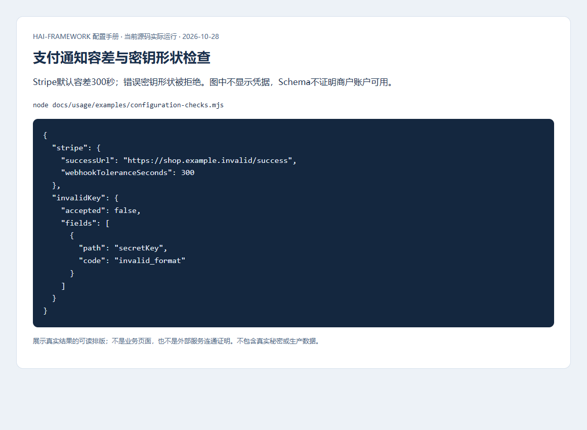
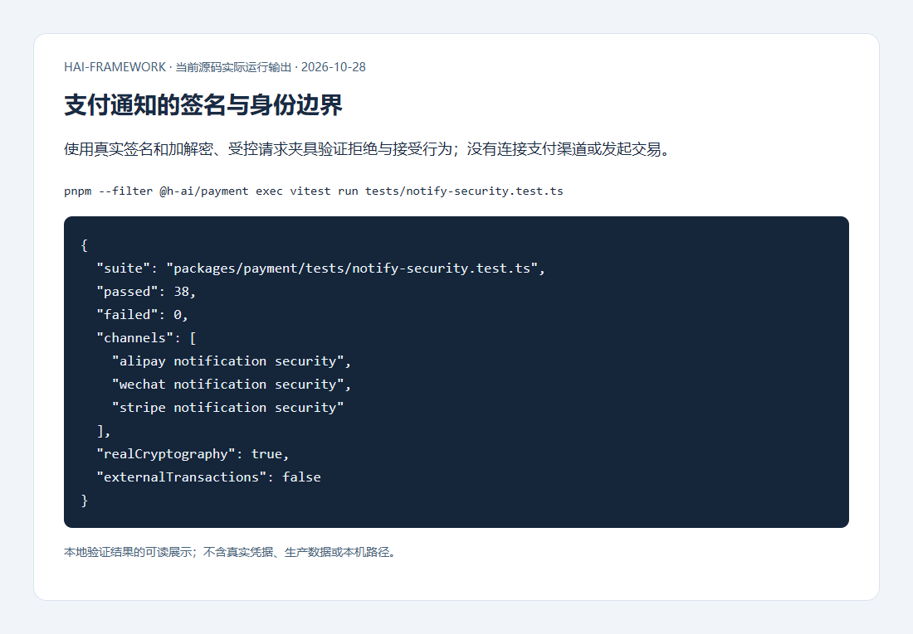

# 页面体验、支付与设备配置

[配置手册](README.md) · [页面操作指南](../development/ui.md) · [支付/原生接入](../development/integrations.md)

这一章的配置分别由组件、支付模块和原生工具消费。它们不共用一个“应用设置”对象；服务器密钥也不能因为前端需要状态展示就放入PUBLIC_/VITE_变量。

## 表单布局与校验

位置：页面组件props，没有 `_ui.yml`。Form/FormLayout默认一列、标签在上；columns=2适合宽容器，labelPosition=left让短标签对齐，labelWidth按实际内容选择。FormField.colSpan默认auto，宽控件占满一行，自定义宽控件用data-form-wide，也可明确1/2。

```svelte
<FormLayout columns={2} labelPosition="left" labelWidth="6rem">
  <FormField label={() => m.userName()} for="name">
    <Input id="name" bind:value={name} required />
  </FormField>
</FormLayout>
```

片段放在已有Svelte页面中，FormLayout/FormField/Input从@h-ai/ui导入，m来自应用翻译，name为页面状态。配置立即改变布局，不需重启后端。


检查标签与for/id关联、Tab顺序、提交失败保留输入和防重复提交。校验错误统一Toast，控件保留aria-invalid/读屏说明；修正后清除旧提示，关闭提示后再次无效提交仍提示。服务端再次校验输入和权限。

## Toast位置、时长和排查信息

根布局只挂载一个ToastContainer。所有警告/错误均由它显示，Alert仅支持info/success持续信息；恢复按钮留在原页面，用户能继续处理。

| 参数 | 默认 | 对用户的影响 |
| --- | --- | --- |
| position | bottom-right | top/bottom各left/center/right共6位置，所有位置共用FIFO队列 |
| duration | toast.add默认3000ms | 0手动关闭；notifyError/notifyWarning默认5000ms，成功默认3000ms |
| dismissible | true | false隐藏关闭按钮，永久不可关闭消息可能阻塞队列，应谨慎 |
| traceId | 无默认 | 有合法编号才显示排查图标；默认正文只显示可读信息 |

```ts
import { toast } from '@h-ai/ui/toast'

toast.add({
  message: '请刷新后重试', // 实际应用使用自己的翻译函数。
  variant: 'warning',
  duration: 5000,
  traceId: 'example-request-id',
})
```


编号用于联系客户支持/开发定位日志，不显示堆栈、SQL或密钥。悬停、聚焦、展开时暂停计时，交互结束按剩余时间恢复；复制拒绝时可手动选择。F8进入/返回提示，Escape关闭并恢复焦点。


## 主题、语言和AI内容显示

主题由宿主选择，没有跨应用固定默认主题。applyTheme/getSavedTheme管理选择和持久化，可选主题须已有CSS。颜色使用主题tokens，长文/深色/错误状态都要实际检查。


Markdown的allowHtmlTags默认false，true只渲染允许的HTML并继续安全清理；不能把它当脚本沙箱。字号、Mermaid与编辑器参数由组件props提供，按公开类型和业务阅读需求选择。修改后同时检查代码复制、图表文字和暗色对比度。


界面文字走zh-CN/en-US/ja-JP翻译，错误使用安全消息；不要通过翻译开关泄露原始异常。上图是指定组件的验证，不代表全部主题和所有业务页面均已验收。

## 支付渠道配置

位置：`config/_payment.yml`，先共享RelDB，再初始化所需渠道。当前微信为JSAPI，支付宝/Stripe为H5，不能推断未实现交易方式已支持。

| 渠道/项 | 默认与必填 | 影响 |
| --- | --- | --- |
| 微信mchId/apiV3Key/serialNo/privateKey/appId/platformKeys | 全部必填，无默认 | platformKeys按受信Wechatpay-Serial精确选键；轮换期间同时保留新旧标识，不能请求自带任意公钥 |
| 支付宝appId/sellerId/privateKey/alipayPublicKey/returnUrl | 全部必填，无默认 | returnUrl必须可信HTTPS，仅导航；核对app/商户/订单/币种金额，不由跳转判付款 |
| 支付宝signType/sandbox | RSA2/false | 沙箱与生产账号分离；不能将开关当真实账户可用性检查 |
| Stripe secretKey/webhookSecret/successUrl | 必填，无默认 | test/live密钥匹配环境；通知验签独立于API密钥 |
| Stripe cancelUrl | 无默认 | 配置才提供取消返回地址，不能作为订单已取消的付款证明 |
| webhookToleranceSeconds | Stripe300秒 | 过短可能拒绝合法延迟，过长增加重放窗口；配合幂等和时钟同步 |

```yaml schema=@h-ai/payment:PaymentConfigSchema
stripe:
  secretKey: ${STRIPE_SECRET_KEY}
  webhookSecret: ${STRIPE_WEBHOOK_SECRET}
  successUrl: https://shop.example.invalid/payment/success
  cancelUrl: https://shop.example.invalid/payment/cancel
  webhookToleranceSeconds: 300
```





先用授权沙箱验证创建、通知、重复通知和未知结果恢复。图片中的加解密/签名来自真实算法和受控请求，不表示连接支付渠道或发生交易。共享幂等记录、服务端订单终态和金额核对才是业务依据，HTTP200或前端跳转都不够。

## 原生地址、权限与安全存储

Capacitor配置由原生工程和能力调用消费，不从同名YAML自动接入。app是Android/iOS安装包，desktop是桌面安装包，web才是浏览器交付角色。

Tauri开发回退API地址为localhost:3000/api/v1；手机上的localhost指手机自身，Capacitor应明确真实可达地址。静态公开runtime-config.js只存公开API地址等白名单，不能放服务端密钥。原生token使用安全TokenStorage，WebView的localStorage不适合敏感凭据。

`hai build --target app --platform android|ios`生成并校验新APK/IPA；build.app指定工程目录，cap:sync只同步。发布会过滤CAPACITOR_SERVER_URL并核对配置，拒绝开发热更新地址。还需平台工程、SDK/JDK或Xcode、签名与设备权限；浏览器验收不能代替设备验证。
