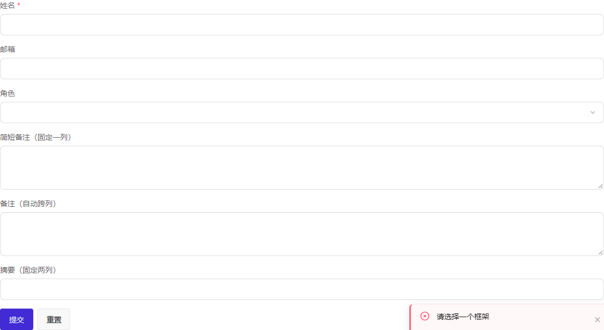
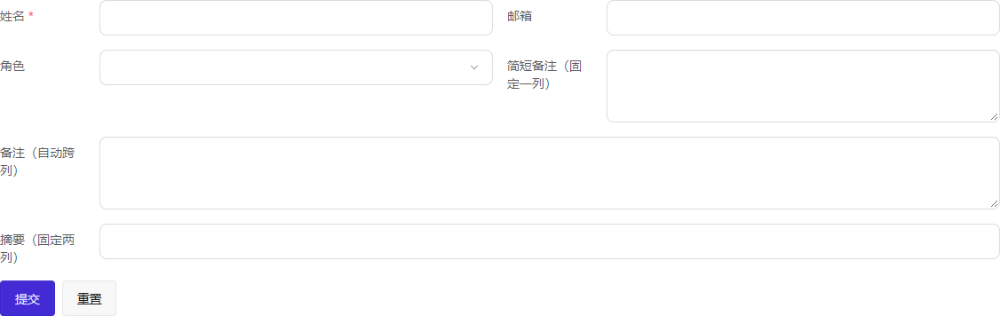
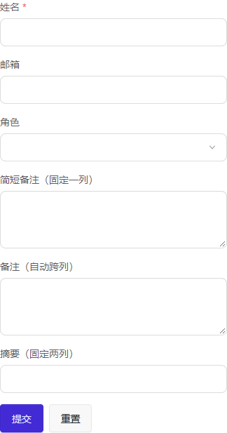
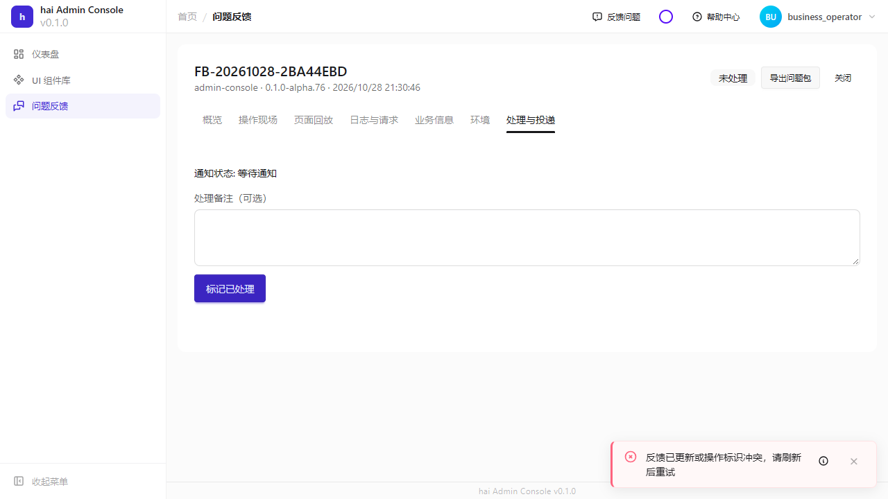
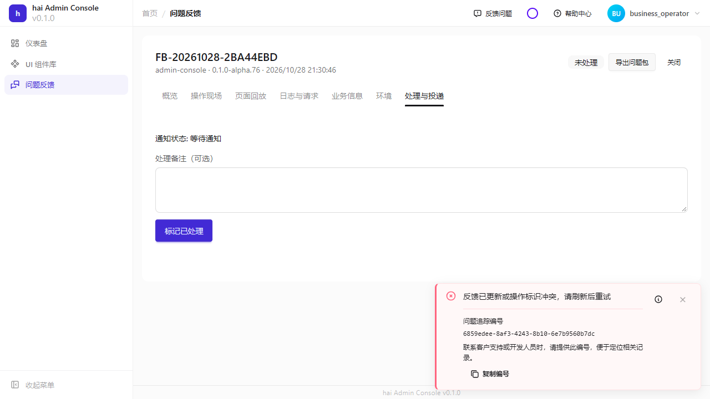
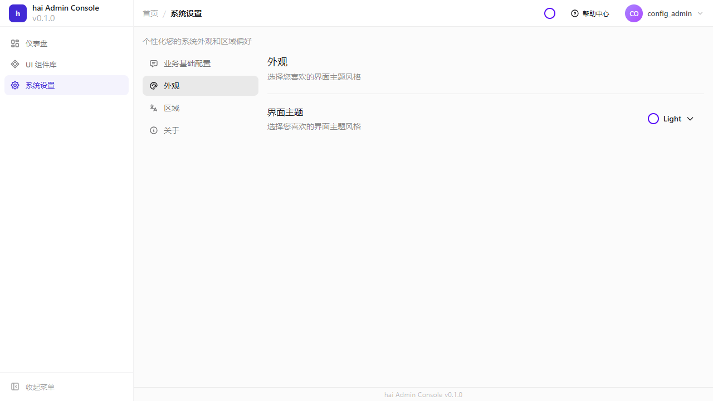
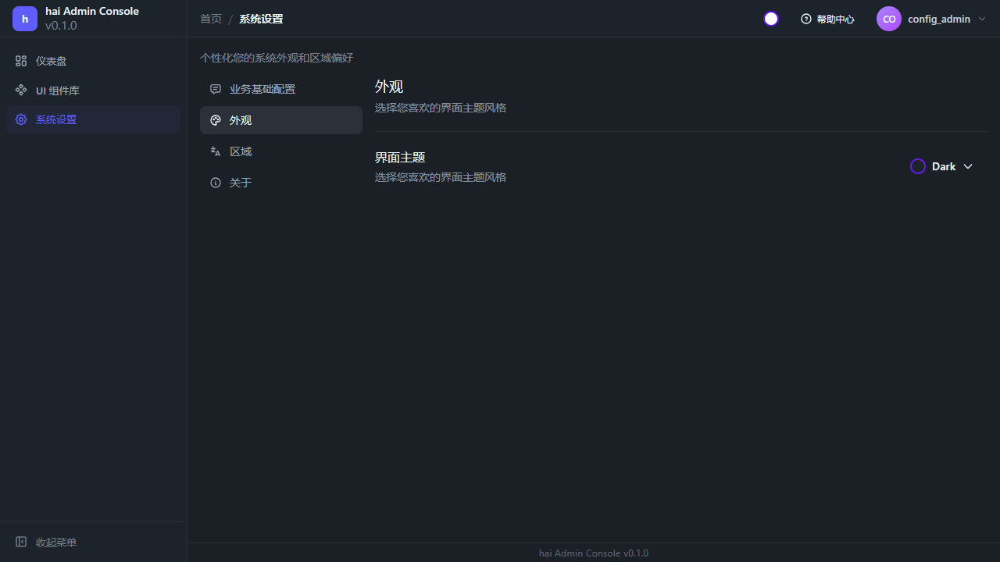
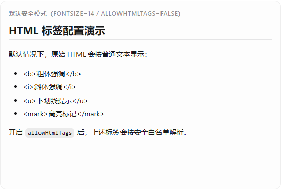
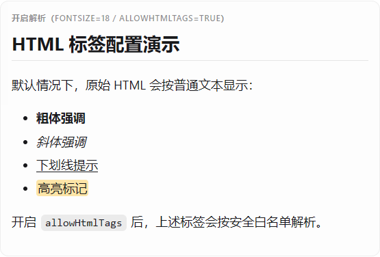
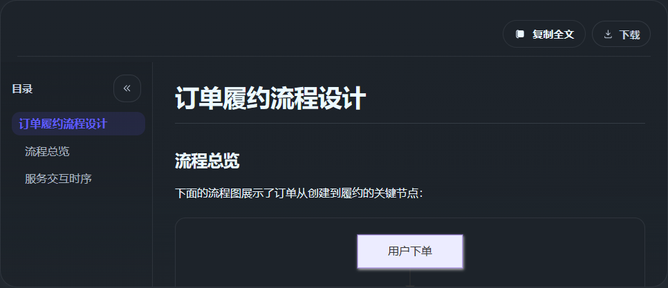

# 页面体验、支付与设备配置

[配置手册](README.md) · [页面操作指南](../development/ui.md) · [支付/原生接入](../development/integrations.md)

这一章的配置分别由组件、支付模块和原生工具消费。它们不共用一个“应用设置”对象；服务器密钥也不能因为前端需要状态展示就放入 `PUBLIC_` / `VITE_` 变量。

## 表单布局与校验

位置：页面组件props，没有 `_ui.yml`。`Form` / `FormLayout` 默认一列、标签在上；`columns={2}` 适合宽容器，`labelPosition="left"` 让短标签对齐，`labelWidth` 按实际内容选择。`FormField.colSpan` 默认 `auto`，宽控件占满一行，自定义宽控件用 `data-form-wide`，也可明确指定 `1` 或 `2`。

```svelte
<FormLayout columns={2} labelPosition="left" labelWidth="6rem">
  <FormField label={() => m.userName()} for="name">
    <Input id="name" bind:value={name} required />
  </FormField>
</FormLayout>
```

片段放在已有Svelte页面中，`FormLayout`、`FormField`、`Input` 从 `@h-ai/ui` 导入，`m` 来自应用翻译，`name`为页面状态。配置立即改变布局，不需重启后端。







检查标签与 `for` / `id` 关联、Tab顺序、提交失败保留输入和防重复提交。校验错误统一Toast，控件保留 `aria-invalid` 和读屏说明；修正后清除旧提示，关闭提示后再次无效提交仍提示。服务端再次校验输入和权限。

保存型场景组件还要明确成功信号。`UserProfile.onsubmit` 接收表单值，返回 `boolean | Promise<boolean>`：只有 `true` 才退出编辑；`false` 或异常保留草稿。输入一个会被服务端拒绝的值时，应看到安全错误提示且仍能继续编辑；不要把“请求结束”当成“保存成功”。

## Toast位置、时长和排查信息

根布局只挂载一个 `ToastContainer`。所有警告/错误均由它显示，`Alert` 仅支持 `info` / `success` 持续信息；恢复按钮留在原页面，用户能继续处理。

| 参数 | 默认 | 对用户的影响 |
| --- | --- | --- |
| `position` | `bottom-right` | `top` / `bottom` 各搭配 `left` / `center` / `right`，共 6 个位置，所有位置共用FIFO队列 |
| `duration` | `toast.add`默认3000ms | 0手动关闭；`notifyError`/`notifyWarning`默认5000ms，成功默认3000ms |
| `dismissible` | `true` | `false` 隐藏关闭按钮，永久不可关闭消息可能阻塞队列，应谨慎 |
| `traceId` | 无默认 | 有合法编号才显示排查图标；默认正文只显示可读信息 |

```ts
import { toast } from '@h-ai/ui/toast'

toast.add({
  message: '请刷新后重试', // 实际应用使用自己的翻译函数。
  variant: 'warning',
  duration: 5000,
  traceId: 'example-request-id',
})
```





编号用于联系客户支持/开发定位日志，不显示堆栈、SQL或密钥。悬停、聚焦、展开时暂停计时，交互结束按剩余时间恢复；复制拒绝时可手动选择。F8进入/返回提示，Escape关闭并恢复焦点。

## 主题、语言和AI内容显示

主题由宿主选择，没有跨应用固定默认主题。`applyTheme`/`getSavedTheme`管理选择和持久化，可选主题须已有CSS。颜色使用主题tokens，长文/深色/错误状态都要实际检查。





Markdown 的 `allowHtmlTags` 默认 `false`，`true` 只渲染允许的HTML并继续安全清理；不能把它当脚本沙箱。字号、Mermaid与编辑器参数由组件props提供，按公开类型和业务阅读需求选择。修改后同时检查代码复制、图表文字和暗色对比度。







界面文字走 `zh-CN`、`en-US`、`ja-JP` 翻译，错误使用安全消息；不要通过翻译开关泄露原始异常。

## 支付渠道配置

位置：`config/_payment.yml`，先共享RelDB，再初始化所需渠道。当前微信为JSAPI，支付宝/Stripe为H5，不能推断未实现交易方式已支持。

| 渠道/项 | 默认与必填 | 影响 |
| --- | --- | --- |
| 微信`mchId`/`apiV3Key`/`serialNo`/`privateKey`/`appId`/`platformKeys` | 全部必填，无默认 | `platformKeys`按受信 `Wechatpay-Serial` 精确选键；轮换期间同时保留新旧标识，不能请求自带任意公钥 |
| 支付宝`appId`/`sellerId`/`privateKey`/`alipayPublicKey`/`returnUrl` | 全部必填，无默认 | `returnUrl`必须可信HTTPS，仅导航；核对app/商户/订单/币种金额，不由跳转判付款 |
| 支付宝`signType`/`sandbox` | `RSA2` / `false` | 沙箱与生产账号分离；不能将开关当真实账户可用性检查 |
| Stripe `secretKey`/`webhookSecret`/`successUrl` | 必填，无默认 | test/live密钥匹配环境；通知验签独立于API密钥 |
| Stripe `cancelUrl` | 无默认 | 配置才提供取消返回地址，不能作为订单已取消的付款证明 |
| `webhookToleranceSeconds` | Stripe300秒 | 过短可能拒绝合法延迟，过长增加重放窗口；配合幂等和时钟同步 |

```yaml schema=@h-ai/payment:PaymentConfigSchema
stripe:
  secretKey: ${STRIPE_SECRET_KEY}
  webhookSecret: ${STRIPE_WEBHOOK_SECRET}
  successUrl: https://shop.example.invalid/payment/success
  cancelUrl: https://shop.example.invalid/payment/cancel
  webhookToleranceSeconds: 300
```

先用授权沙箱验证创建、通知、重复通知和未知结果恢复。共享幂等记录、服务端订单终态和金额核对才是业务依据，HTTP200或前端跳转都不够。

微信 JSAPI 的输入配置包含商户身份、签名私钥和受信平台公钥映射：

```yaml schema=@h-ai/payment:PaymentConfigSchema
wechat:
  mchId: example-merchant
  appId: example-app
  apiV3Key: ${WECHAT_API_V3_KEY}
  serialNo: example-merchant-certificate-serial
  privateKey: ${WECHAT_MERCHANT_PRIVATE_KEY}
  platformKeys:
    example-trusted-platform-serial: ${WECHAT_PLATFORM_PUBLIC_KEY}
```

占位值必须替换为支付平台已登记的真实值，私钥/公钥变量保存完整 PEM 内容。有效支付创建应返回对应渠道的客户端支付参数；验签时只按配置的 `platformKeys` 标识选键。未登记标识、错误签名或金额不符应拒绝，不能从来访通知中接受新公钥。

支付宝 H5 使用自己的身份和 RSA 密钥，不复用微信或 Stripe 凭据：

```yaml schema=@h-ai/payment:PaymentConfigSchema
alipay:
  appId: example-app
  sellerId: example-seller
  privateKey: ${ALIPAY_PRIVATE_KEY}
  alipayPublicKey: ${ALIPAY_PUBLIC_KEY}
  returnUrl: https://shop.example.invalid/payment/result
  signType: RSA2
  sandbox: true
```

输入使用授权沙箱账号。支付宝创建成功后的 `data.clientParams` 是 `{ gateway, fields }` 对象：浏览器向可信的渠道 `gateway` 提交已签名的 `fields` 表单，不把它当成链接或 HTML。`returnUrl` 只是导航，服务端查询或已验签通知才可推进订单状态。生产使用对应账号、密钥及 `sandbox: false`，先验证拒绝错误商户、重复通知和重放。Stripe 的 `data.clientParams.checkoutUrl` 是支付页面地址，也需区分 test/live；`successUrl/cancelUrl` 都不能成为付款事实。

## 原生地址、权限与安全存储

Capacitor配置由原生工程和能力调用消费，不从同名YAML自动接入。`app` 是 Android / iOS 安装包，`desktop` 是桌面安装包，`web` 才是浏览器交付角色。

Tauri开发回退API 地址为 `http://localhost:3000/api/v1`；手机上的 `localhost` 指手机自身，Capacitor应明确真实可达地址。静态公开`runtime-config.js`只存公开API地址等白名单，不能放服务端密钥。原生`token`使用安全 `TokenStorage`，WebView的`localStorage`不适合敏感凭据。

原生工程还需分别配置应用标识、展示名称、打包 Web 目录、平台权限和签名；这些由 `capacitor.config.ts` / Tauri 工程及平台工具链消费，不是 `_core.yml.name` 的替代。输入一个设备真实可达的公开 API 地址后，应能从真机发出健康请求；相机、推送和安全存储还需分别验证授权允许、拒绝和重启恢复。仅同步资源或生成安装包不会证明设备权限、令牌存储与业务请求正常，完整能力选项见[原生接入](../development/integrations.md)。

| 能力参数 | 默认与输入 | 输出、影响和限制 |
| --- | --- | --- |
| `camera.takePhoto` 的 `source` | `prompt`；可选 camera/photos | 选择相机或图库，需要平台权限和对应插件；拒绝授权时返回失败结果 |
| `quality` / `width` / `height` | quality=90（0–100）；宽高可省略、单位像素 | 限制照片质量/尺寸，不是服务器上传大小保证，上传前仍核对真实字节 |
| `resultType` | uri；可选 base64/dataUrl | `data` 分别为可访问路径、Base64字符串、Data URL；`format` 是 jpeg 等扩展名，不是 MIME 类型 |
| `statusBar.configure` 的 `style` | dark/light/default，可省略 | 改变文字样式；backgroundColor 为十六进制颜色，overlay 控制是否覆盖内容，需要按真机安全区检查 |

例如已初始化 Capacitor 后调用 `camera.takePhoto({ source: 'photos', resultType: 'uri', width: 1200 })`，输入是用户选择操作与尺寸预算，成功结果包含 `data/format`。先检查 `success` 再使用内容；关闭页面和模块时释放本轮监听，不能把取图成功当作已经上传或保存。

`pnpm build --target app --platform android --runtime auto --debug` 在容器内打调试 APK，省略 `--debug` 时使用发布签名。iOS 在 macOS/Xcode 上导出 IPA。`build.app` 指定原生工程，归档位于 `.hai/build/app/<平台>/<构建类型>/<buildId>/`。`CAPACITOR_SERVER_URL` 只用于开发，打包会拒绝同步后的热更新地址。签名见 [原生和离线条件](../getting-started/build.md#原生和离线条件)。
