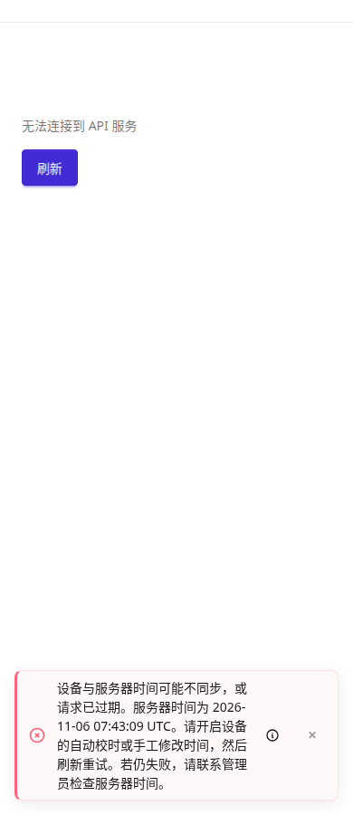

# HTTP、客户端与传输边界

[配置手册](README.md) · [前后端接入操作](../development/frontend-backend.md)

独立的 Node.js API 用 Serv 创建和监听 HTTP 服务。SvelteKit 项目在服务端入口用 Kit 处理请求。页面或原生应用调用 API 时，另外用 `apiClient.init()` 配置客户端要访问的地址和认证方式。

## Serv监听和路由

应用的启动代码读取 `config/_serv.yml`，把路由设置传给 `serv.createApp()`，再把地址和端口传给 `serv.listen()`。应用解析监听设置时，有效的 `HOST` 和 `PORT` 优先于文件中 `server` 的值。例如 `PORT=8080` 使用 8080，`PORT=abc` 会被忽略。

监听、路由和默认值见 [Serv 配置清单](serv.md#配置清单)。生产入口的代理路径、应用 `http.apiPrefix` 与客户端 `baseUrl` 需要一致。

容器部署的后端探针按最终有效的 `http.health.path` 请求，`health: false` 时跳过该 HTTP 探针。Fullstack 同源入口转发实际启用的健康/就绪路径、OpenAPI JSON、docs 和文档目录下的 `_hai/scalar.js`；生产模板按实际 Core 环境关闭文档，代理不绕过 `docs.requireAuth`。同来源以整段 `HAI_SERV` 为基础、细项覆盖；更高来源的整段替换才清除低来源细项，来源优先级见 [运行时配置](runtime.md)。改变路径或文档路由后需重新部署，以同步 Nginx 和部署探针；普通业务配置仍可修改运行文件后重启后端。

文档 HTML 使用相对的脚本和 spec 地址。网关保留 `/somepath/` 时，将 docs 与 OpenAPI 路径一起放在此目录下，例如 `/somepath/docs` 和 `/somepath/openapi.json`；脚本自动位于 `/somepath/_hai/scalar.js`，不会请求其他应用的根路径。网关剥离此前缀时，后端仍可使用 `/docs` 和 `/openapi.json`，浏览器的相对请求同样保留外部前缀。不要只转发页面而漏掉同目录下的资源；文档带尾斜杠时脚本挂在该文档目录内部。

```yaml schema=@h-ai/serv:ServConfigSchema
server: { host: 0.0.0.0, port: 3000 }
http:
  apiPrefix: /api/v1
  trustedProxies: auto
  access: false
  health: { path: /health, readyPath: /ready }
  openapi: false
  docs: false
transport: false
```

默认健康入口为 `/health`；文档未启用时，`/docs` 返回 `404`。自定义路径后，用实际请求检查对应入口。

### Serv 工厂参数与运行时依赖

以下参数由服务端启动代码传给 `serv.createApp()`。应用从 `_serv.yml` 读出 `http` 设置，并在代码中提供接口定义、处理函数和已初始化的模块。

| 参数 | 默认与前置 | 用途、输出和边界 |
| --- | --- | --- |
| `contract` / `procedures` | 必填，形状互相匹配 | `contract` 定义接口的输入输出，`procedures` 实现接口。应用先启动数据库等依赖，再将返回的 App 交给 `serv.listen()` 或接到自己的 Fetch 入口 |
| `http` | 省略采用前述默认值 | 挂载 API、健康和文档路径，实施请求来源与协议策略；与业务依赖分开 |
| `middlewares[].middleware` / `path` | 可省略；每项必须有 middleware，path 省略匹配全部 | 普通中间件在访问策略及解密后、业务路由前执行，提前响应仍走加密；二进制端点须显式排除传输加密。`serv.cors` 的响应头补充在外层，预检仍检查访问策略 |
| `iam` | 可选的已初始化 IAM 实例 | 为 Bearer access token 派生会话校验；启用 refreshCookie 时也提供刷新能力。只创建 IAM procedures 不会代替顶层注入 |
| `verifyToken` | 可选回调，覆盖 `iam.auth.verifyToken` | 输入实际 access token，返回 `HaiResult<ServSession>`；失败不能构造已认证 session |
| `createContext` | 可选回调，优先于 verifyToken 和 iam | 完全接管请求上下文，框架不再自动填充 session。回调须保留传入请求元数据、可信地址并自行验证身份，不能照信用户自报 userId/roles |
| `refreshCookie` | 省略不启用 | 管理 refresh 传输；浏览器 HttpOnly Cookie 与受信原生 body 分开，具体字段见下表 |
| `transport` | 省略不启用 | 显式提供已初始化 crypto、受管 serverKeyRing 与共享 keyStore；容量、时间、路径和排除项见[传输配置](#加密传输与容量)，不能只提供 YAML 而漏私有依赖 |
| `audio` | 省略不挂载 WebSocket | 在服务端传入已初始化的 `ai`、一次性票据的验证函数，以及可选的付费授权函数。在 Node.js 中使用 `serv.listen()` 会处理 WebSocket 协议升级 |

上下文优先级为 **createContext → verifyToken → iam.auth.verifyToken → 只解析请求元数据**。没有验证器时 session 不会凭空出现；即使配置了验证器，资源授权仍由 procedure/业务守卫执行。

| `refreshCookie` 字段 | 默认与单位 | 行为与配置影响 |
| --- | --- | --- |
| `cookieName` | `hai_refresh_token` | 修改后浏览器需要取得新 Cookie；access token 的传输不因此改变 |
| `maxAge` | 2592000 秒（30 天） | 浏览器 Cookie 的保存期限，应与 IAM refresh TTL 对齐，不会延长已失效的服务端令牌 |
| `secure` | 显式 boolean 最优先 | 优先于 `HAI_SERV_REFRESH_COOKIE_SECURE`，两者都省略时由 NODE_ENV/HAI_CORE_ENV 是否 production 决定；测试开关不关闭此默认保护 |
| `onRefresh` | 可选，优先于顶层 iam.session.refresh | 传入刷新令牌，成功时返回新的令牌对。如果未提供此函数，也没有 `iam.session.refresh()`，`serv.createApp()` 会报错，应用应停止启动 |
| `nativeTokenTransport.isRequest` | 可选，无默认信任回调 | 同时核对原生客户端标识及允许的 Origin。匹配时登录/注册/刷新使用 body 中的 refreshToken，不读写浏览器 Cookie；不能只信可伪造的单个头 |

下例创建可处理登录请求的 HTTP 应用。运行示例前先连接数据库和缓存，再调用 `iam.init()`。若 IAM 还未初始化，函数会报错。用户名和密码由用户在登录时提交。

```ts
import { apiContract } from '@h-ai/api-contract'
import { iam } from '@h-ai/iam'
import { serv } from '@h-ai/serv'
import { createIamProcedures } from '@h-ai/serv/features/iam'

export function createAuthApp() {
  if (!iam.isInitialized)
    throw new Error('Initialize IAM before creating the HTTP application')
  const contract = apiContract.create({ iam: apiContract.iam })
  return serv.createApp({
    contract,
    procedures: { iam: createIamProcedures({ iam }) },
    iam,
    http: { apiPrefix: '/api/v1', docs: false, openapi: false },
    refreshCookie: { maxAge: 30 * 24 * 3600 },
  })
}
```

函数返回 App，应用可以把它交给 `serv.listen()` 开始监听。未登录时请求受保护接口应得到 401。登录响应会让浏览器保存刷新 Cookie，刷新成功后旧刷新令牌失效。上例省略 `secure`，因此进程覆盖才有机会生效；生产 HTTPS 无覆盖时 Cookie 带 Secure。它没有启用应用层传输加密、原生 body 通道或 API 文档，应用按所需功能分别装配。关闭先停止 HTTP 句柄，再释放 IAM 及其依赖。

`serv.listen(app, options)` 的 `host`/`port` 省略时为 `127.0.0.1:3000`，不会自行读取 HOST/PORT；应用先解析上述 Serv 配置，再把 `server.host/port` 显式传入监听器。`onListening(info)` 用于记录实际地址，`onClose()` 是可选异步清理回调。提供 onClose 才自动注册信号关闭；手动调用返回句柄的 close() 只停止监听及连接，应用还须显式等待业务模块清理，不能以端口关闭代替数据库、任务和凭据的释放。

### Serv 语音连接的授权与预算

这些字段属于 `serv.createApp({ audio })` 的运行时参数，没有 `_serv.yml.audio`。用途是限制每次 WebSocket 会话能做什么、能消耗多少资源。

| 字段 | 默认与输入 | 输出、影响和限制 |
| --- | --- | --- |
| `ai` / `verifyTicket` | 必填的已初始化实例与回调 | 验证票据并同时标记为已使用，使并发提交同一张票据时也只有一次成功。成功返回会话和可选授权信息 |
| `authorize(session, request, grant)` | 可选回调 | 返回服务端确认的操作/模型/声音等付费参数。省略时只保留操作和音频格式，客户端自报 model/voice/instruction 不生效 |
| `onSessionEnd(session, request)` | 可选异步回调 | 释放套餐并发占用等资源，成功、失败及断连至多调用一次；不把回调当跨系统事务 |
| `path` | `/ai/audio`，相对 apiPrefix | 修改后客户端 WebSocket 地址同步；不是普通 JSON procedure |
| `maxMessageBytes` | 1 MiB | 单条消息上限；不表示整段会话总量 |
| `maxBufferedBytes` | 10 MiB | 单连接累计音频输入预算，超过后失败并结束会话 |
| `maxTextBytes` | 1 MiB | 单连接累计文本输入预算；与音频容量分开 |
| `maxSessionMs` | 300000 毫秒 | 从建立起的最长会话时间；不是单条语音的下游请求超时 |
| `preAuthTimeoutMs` | 5000 毫秒 | 在该期限内完成鉴权并收到 start，否则关闭，防止空连接长期占用 |
| `maxPendingMessages` | 256 条 | 串行处理尚未完成的消息积压上限，过量即关闭，而不是无限排队 |
| `maxSendBufferBytes` | 8 MiB | 服务端发送缓冲高水位，慢客户端超过后以领域错误结束 |

例如把 `maxBufferedBytes` 设为 `2 * 1024 * 1024`、`maxSessionMs` 设为 `60000`，应观察到合法小音频仍可处理，累计超 2 MiB 或连接超 60 秒会失败关闭。用本轮签发票据验证首次允许、重复消费拒绝及越权模型拒绝，真实音频 Provider、设备录音与网络行为还需在目标环境验收。

## CORS与可信代理

跨源 Cookie 需要允许实际浏览器来源并启用 `cors.credentials`，按需放行原生来源和自定义请求头。[Serv](serv.md#配置清单) 与 [Kit](kit.md#配置清单) 都能配置可信代理，具体入口传递地址的方式见[请求访问策略](request-access.md)。

```yaml schema=@h-ai/serv:ServConfigSchema
http:
  trustedProxies: [192.0.2.10]
cors:
  origin: https://app.example.invalid
  credentials: true
  allowedHeaders: [Authorization, Content-Type, X-Requested-With, X-Hai-Reauthentication, X-Hai-Terminal]
  exposedHeaders: []
```

替换文档代理地址后，从允许和拒绝来源分别发预检及真实请求，再验证Cookie和服务端权限。CORS只是浏览器跨源约束，不阻止脚本/后端直接请求；不能作为资源权限守卫。

示例和模板统一向 IAM、审计、限流和业务传递可信地址。受管 Nginx 用经过确认的 remote_addr 覆盖 XFF 和 X-Real-IP；外层负载均衡需显式配置 `provider.trustedEdgeProxies`。rootless 网络是否保留原始地址必须实测，条件和独立文件部署见[真实 IP 与请求策略](request-access.md#3-运维人员先确认真实-ip-的来源)。

## 生产 HTTP 入口的 Serv 刷新 Cookie

Serv 在生产默认给刷新 Cookie 加 `Secure`。使用受控内网或 VPN 的 HTTP 入口时，可在项目所用的 `.env.prod.local` 中设置以下值，然后用更新后的后端重新部署。将示例 Origin 替换为浏览器实际使用的地址和端口。

```dotenv
HAI_CORE_ENV=production
HAI_SERV_CORS_ORIGIN=http://192.0.2.10:12348
HAI_SERV_REFRESH_COOKIE_SECURE=false
```

仅在工厂没有显式设置 `refreshCookie.secure` 时，该变量由后端进程独立读取；同名变量可以覆盖，`HAI_SERV` 父 JSON 不影响它。`false` 省略 `Secure`，`true` 强制添加，留空或省略时沿用环境默认值。工厂硬写 `secure: true` 时，仅修改环境变量不会关闭 Secure。容器部署会拒绝其他值。部署后可通过归档 `APPLY.txt` 的变量名清单确认打包输入。生产安全策略仍要求明确的 CORS 来源并关闭 API 文档。`HttpOnly`、`SameSite=Strict` 和刷新路径限制继续生效，HTTP 会明文传输刷新凭据。

重新登录后，在浏览器网络面板确认登录响应的刷新 Cookie 省略了 `Secure`。重载页面时，确认 `POST /api/v1/auth/refresh` 携带该 Cookie、返回 `200` 并恢复登录。切回 HTTPS 时移除变量或设为 `true`，同步实际 HTTPS Origin，再重新登录确认 Cookie 带 `Secure`。

## Kit、Cookie与请求上下文

Kit 的 YAML 字段与默认值见 [Kit 配置清单](kit.md#配置清单)。

`config/_kit.yml` 的 `server` 默认同Serv，`transport` 默认 `false`；默认协商路径为 `/api/_hai/key-exchange`，与Serv默认不同。Kit 没有 `close()`，应用在 `hooks.server.ts` 调用 `kit.createHandle()` 时传入认证、Cookie、限流和请求处理函数，不能把Serv 整个 `http` 对象放入Kit。

SvelteKit 部署在 `/yyy` 等目录时，在 Vite 的 sveltekit 配置设置 `paths.relative: false`，从 `$app/paths` 用 `resolve('/').replace(/\/$/, '')` 读取构建挂载目录 `base`，在服务端 `crypto.transport` 传入 `basePath: base`，浏览器使用 `kit.client.installBrowserTransport(公开配置, { crypto, basePath: base })`。独立 Kit client 的 `transport.basePath` 采用同一个值。默认空字符串表示根目录；它是宿主构建参数，不在 YAML 重复配置。这样 `/yyy/api/*` 的默认加密范围与页面目录保持一致，交换路径和排除列表仍填写完整请求路径。

```yaml schema=@h-ai/kit:KitConfigSchema
server: { host: 127.0.0.1, port: 3000 }
transport: false
```

使用项目现有 hooks 和标准 procedures，浏览器认证沿用HttpOnly Cookie/内存 `access` `token`流程。生产Cookie需适配HTTPS、`sameSite`、`path`和实际同源/跨源拓扑；不能把完整Token放`localStorage`。SSR locale 用 `runWithLocale` 包裹实际异步resolve，不能给每个请求改进程全局语言。限流store必须支持原子操作，生产使用共享后端。具体factory参数见[Kit公开说明](../../../packages/kit/README.md)。

### Hooks 参数与运行时依赖

在服务端代码中调用 `kit.createHandle()` 时传这些参数。地址等设置可以来自 `_kit.yml`，函数、私钥和已初始化的存储对象由服务端代码提供。

| 参数 | 默认与用途 | 输入改变后的结果和限制 |
| --- | --- | --- |
| `auth.verifyToken` / `operations` | auth 省略时不自动认证；提供 auth 时 verifyToken 必填 | 校验 Bearer/Cookie 并得到会话；operations 可用 `() => iam.auth` 延迟取已初始化实例 |
| `auth.cookieName` / `protectedPaths` / `publicPaths` / `loginUrl` | Cookie名 `hai_access_token`，路径由应用明确配置 | publicPaths 优先；匿名API返回401，页面按 loginUrl 跳转。路径含实际挂载目录 |
| `guards[].guard/paths/exclude` | 可省略，exclude 优先于 paths | auth 自动守卫之后检查业务权限；返回 allowed 不代替资源所有权校验 |
| `rateLimit` | 省略或 false 不启用；对象内 windowMs=60000、maxRequests=100 | 必须提供原子 `store`；超过每窗次数时拒绝。keyGenerator 选择稳定限流主体，onLimitReached 可返回安全响应 |
| `logging` / `logging.logBody` | 默认 true；logBody 默认不启用 | 请求日志用于关联诊断。正文可能有凭据和业务隐私，开启前明确脱敏与采集必要性 |
| `middleware` / `onError` | 可选；默认错误为安全500响应 | 自定义中间件在内置日志/限流之后；自定义异常响应同样不能泄露堆栈、SQL和密钥 |
| `crypto.encryptedCookies` / `cookieEncryptionKey` | 未列Cookie不加密；密钥可从 `HAI_KIT_COOKIE_KEY` 读取 | 指定Cookie保存为认证加密格式 `enc:v2`，读取时先验真；密钥必须为32个十六进制字符，缺失/非法时创建Handle失败 |
| `a2a.operations` / `cardPath` / `rpcPath` / `authenticate` | 显式接入；路径默认 `/.well-known/agent-card.json` 与 `/a2a` | 挂载Agent Card及协议入口；未提供authenticate即匿名，生产按实际需求提供apiKey或认证回调；不自动获得业务权限 |

例如只给业务偏好 Cookie 启用加密：

```ts
import { crypto } from '@h-ai/crypto'
import { kit } from '@h-ai/kit'

const ready = await crypto.init()
if (!ready.success) throw new Error(ready.error.message)
const handle = kit.createHandle({
  crypto: { crypto, encryptedCookies: ['order_preferences'] },
})
// 从 hooks.server.ts 导出 handle，先在服务端环境设置 HAI_KIT_COOKIE_KEY。
```

应用向 `order_preferences` Cookie 写入文本后，浏览器保存密文，服务端读取时解密为原文本。验证时可修改 Cookie 的加密值，确认服务端拒绝读取。示例只开启 Cookie 加密，可把这段设置合并到已有的请求处理函数中。密钥留在服务端。

## API客户端地址、期限和恢复

入口是 `apiClient.init/create` 参数，没有自动加载的 `_api-client.yml`。

完整参数见 [API Client 配置清单](api-client.md#配置清单)。客户端停止等待后，已发送请求可能已在服务端产生结果。遇到超时先按业务 ID 查询，再决定是否重试；原地恢复只恢复同一用户的会话。

```ts
import { apiClient } from '@h-ai/api-client'

const started = await apiClient.init({
  baseUrl: 'https://api.example.invalid/api/v1',
  timeout: 15000,
  auth: {},
  clientName: 'orders-web',
})
if (!started.success) throw new Error(started.error.message)
```

示例显式15秒是业务选择。按真实流程验证请求、401单次恢复、二次认证取消、退出与失败；跨身份请求不能复用旧刷新结果。非 2xx 合法 `HaiResult`保留业务码和`traceId`，5xx仍由实际HTTP状态执行安全隐藏。提示通过`notifyError` / `ToastContainer`，默认不展示编号。

Kit 的 `kit.response.validationError(errors)` 与 `fromError` 使用同一字段白名单，响应 `error.cause` 只含本地化的 `field/message`；rejectedValue、SQL 和其他诊断字段不公开。

## 加密传输与容量

配置是三件事：Serv/Kit启用入口和路径；服务端提供持久私有keyring、共享`keyStore`；客户端提供匹配`crypto`和协商路径。缺任一项都不是完整配置。HTTPS仍负责传输网络身份与通道保护，加密业务载荷不替代它。

Serv 的密钥协商路径是相对于 `http.apiPrefix` 的子路径，Kit 使用服务端完整路径，API Client 相对于 `baseUrl`。例如 Serv 前缀 `/backend/api` 配合子路径 `/_hai/key-exchange`，完整路径为 `/backend/api/_hai/key-exchange`，客户端 `baseUrl` 使用 `/backend/api`。明文预算按 UTF-8 字节计量，使用 `routePlaintextBytes` 为附件等大材料按完整路径段预算。[Serv](serv.md#配置清单) · [Kit](kit.md#配置清单) · [API Client](api-client.md#配置清单) · [Crypto](crypto.md#http-传输与-registry)

```yaml schema=@h-ai/serv:ServConfigSchema
transport:
  maxPlaintextBytes: auto
  maxFutureSkewSeconds: 30
  maxRequestAgeSeconds: 300
  routePlaintextBytes:
    /api/v1/feedback/*/attachments: 8388608
  keyExchangePath: /_hai/key-exchange
  excludePaths: [/health, /ready]
```

用不含敏感信息的小请求测试浏览器能否完成握手并读取响应，再发送超出大小上限的请求，确认服务端拒绝。上传反馈附件时，反向代理和加密路由的大小上限都应能容纳这条请求。服务端从私有变量读取密钥列表。多台服务换钥时保留旧密钥一段时间，让已有会话有机会完成，再验证重启后的老会话和新会话。

### 浏览器版本过低时的提示

Edge 100 缺少加密客户端读取请求正文所用的 `Request.body`，可能把空正文加密发出，导致登录返回 400。Web 入口会先检测已知的低版本浏览器并显示升级说明。检测门槛、适用模板与发布路径见[浏览器启动检测](../getting-started/build.md#浏览器启动检测)。[Chromium 请求流说明](https://developer.chrome.com/docs/capabilities/web-apis/fetch-streaming-requests)

### 时间不同步时的提示与恢复

在服务端 `_serv.yml` 或 `_kit.yml` 的 `transport` 中设置时间窗口，重启服务后生效。请求有效期也计入签发后的网络耗时。各节点应保持时钟和配置一致；共享注册表保留防重放记录至签发时间后 11 分钟，不能为容忍错误时钟而任意扩大请求窗口。

超出窗口时，前端提示显示服务端校验时的 UTC 时间。请开启设备的自动校时或手工修改时间，然后刷新重试。若仍失败，请联系管理员检查服务器时间。服务端时间来自已认证的加密错误；未提供可信时间值时，前端只显示校时建议。



浏览器测试分别模拟设备时间快、慢 10 分钟。校正设备时间后，由用户点击刷新，登录表单重新出现，提示清除。

### Crypto共享注册表与算法参数

先调用 `await crypto.init()` 并检查成功，再在 Serv 或 Kit 中开启服务端加密，并在 API Client 中启用客户端加密。自行接入其他 HTTP 框架时，调用 `crypto.transport.createServer()` 和 `crypto.transport.createClient()`。

为 Redis 或数据库注册表设置 `ttlSeconds: 3600` 后，每次密钥协商会登记一个有效期为一小时的客户端公钥。Serv 和 Kit 在握手响应中返回该期限。用户闲置后再次操作时，客户端按需重新协商，再发送业务请求。登录会话按身份模块的期限单独续期。可在测试环境缩短登记有效期，确认过期后的第一个业务请求使用新的 `X-Client-Id`。

共享 registry 的容量、有效期和生产设置见 [Crypto 配置清单](crypto.md#http-传输与-registry)。数据库 registry 可定期执行 `pruneExpired()`。

请求认证有效期、未来偏差和nonce保留是协议约束，不能为“兼容时钟错误”任意放宽。服务端时钟同步，数据存储故障拒绝请求；nonce防重放不代替业务幂等键。完整SM2/SM3/SM4、密码哈希和协议选项见[Crypto公开用法](../../../packages/crypto/README.md)及[Transport协议](../../../packages/crypto/TRANSPORT-PROTOCOL.md)，它们是API参考，本手册不重复算法接口。
