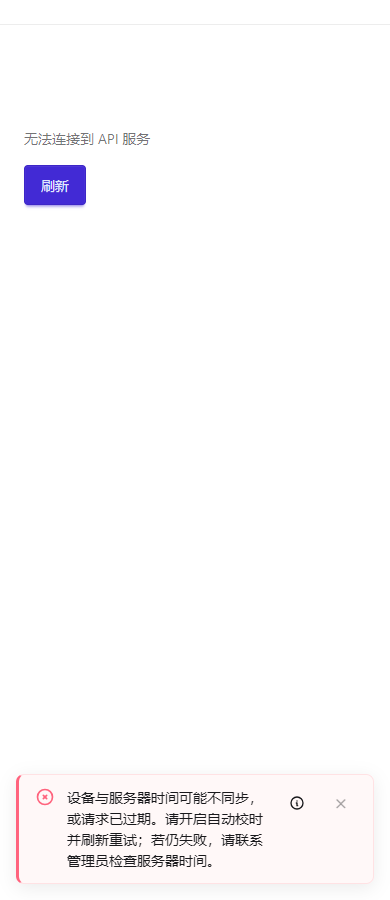

# HTTP、客户端与传输边界

[配置手册](README.md) · [前后端接入操作](../development/frontend-backend.md)

先区分独立 Serv 和 SvelteKit/Kit。Serv 负责 Node API 的监听与路由，Kit 适配 SvelteKit 宿主；浏览器 API Client 还需要自己的地址和认证配置。把服务端 YAML 复制到客户端不会自动接通。

## Serv监听和路由

位置：`config/_serv.yml`，宿主校验后传 `serv.createApp`/`serv.listen`。提供合法 HOST/PORT 进程变量时优先于 `server` 配置，非法 PORT 被忽略并回退；不要依赖这种回退隐藏部署配置错误。

| 项 | 框架默认 | 影响 |
| --- | --- | --- |
| `server`.`host`/`port` | 127.0.0.1/3000 | 本机回环；容器通常明确监听0.0.0.0，暴露端口不代表已做认证 |
| `http.apiPrefix` | /api/v1 | 以 /api/ 开头，客户端 `baseUrl` 与代理路径必须一致 |
| `http.health` | /`health` 和 /ready | false 关闭；健康与依赖就绪分开，检查路径也应同步部署 `health` |
| `http.openapi` | false | 对象启用，默认 `path=/openapi.json`；生产按公开范围选择 |
| `http.docs` | false | 对象启用，默认 `path`=/docs；`requireAuth` 可显式要求认证 |

原生 RPC 入口、`HAI_SERV_HTTP_RPC` 及其子配置和 `ServRpcHttpConfig` 已删除；应用继续通过现有 OpenAPI/REST 路径与 `api-client` 调用业务。

容器部署的后端探针按最终有效的 `http.health.path` 请求，`health: false` 时跳过该 HTTP 探针。Fullstack 同源入口转发实际启用的健康/就绪路径、OpenAPI JSON、docs 和文档目录下的 `_hai/scalar.js`；生产模板按实际 Core 环境关闭文档，代理不绕过 `docs.requireAuth`。整段 `HAI_SERV` 覆盖高于叶子变量。改变路径或文档路由后需重新部署，以同步 Nginx 和部署探针；普通业务配置仍可修改运行文件后重启后端。

文档 HTML 使用相对的脚本和 spec 地址。网关保留 `/somepath/` 时，将 docs 与 OpenAPI 路径一起放在此目录下，例如 `/somepath/docs` 和 `/somepath/openapi.json`；脚本自动位于 `/somepath/_hai/scalar.js`，不会请求其他应用的根路径。网关剥离此前缀时，后端仍可使用 `/docs` 和 `/openapi.json`，浏览器的相对请求同样保留外部前缀。不要只转发页面而漏掉同目录下的资源；文档带尾斜杠时脚本挂在该文档目录内部。

```yaml schema=@h-ai/serv:ServConfigSchema
server: { host: 0.0.0.0, port: 3000 }
http:
  apiPrefix: /api/v1
  trustedProxies: auto
  access: false
  health: { path: /health, readyPath: /ready }
  openapi: false
  docs: false
transport: false
```

默认健康入口为 `/health`；文档未启用时，`/docs` 返回 `404`。自定义路径后，用实际请求检查对应入口。

## CORS与可信代理

| 项 | 框架默认 | 取值影响 |
| --- | --- | --- |
| `http.trustedProxies` / Kit `trustedProxies` | auto | 普通宿主忽略转发头；受管私有 Compose 代理采用实际容器网段。自建代理填写 IP/CIDR，[] 显式忽略转发头 |
| `http.access` / Kit `access` | false | 对每次请求限制 IP、时间和路径；可引用独立 YAML，详细配置见[请求策略](request-access.md) |
| `cors.origin` / `nativeOrigins` | 无默认 | 指定真实浏览器和原生来源；按生成宿主规则解析来源字符串 |
| `cors.credentials` | false | 跨源Cookie需明确true并匹配允许来源；通配来源不能代替身份验证 |
| `cors.allowedHeaders` | Authorization、Content-Type、X-Requested-With、X-Hai-Reauthentication、X-Hai-Terminal | 自定义头需明确加入，保留框架敏感动作和终端头 |
| `cors.exposedHeaders` | [] | 仅向浏览器脚本公开需要读取的响应头，不泄露内部诊断 |

```yaml schema=@h-ai/serv:ServConfigSchema
http:
  trustedProxies: [192.0.2.10]
cors:
  origin: https://app.example.invalid
  credentials: true
  allowedHeaders: [Authorization, Content-Type, X-Requested-With, X-Hai-Reauthentication, X-Hai-Terminal]
  exposedHeaders: []
```

替换文档代理地址后，从允许和拒绝来源分别发预检及真实请求，再验证Cookie和服务端权限。CORS只是浏览器跨源约束，不阻止脚本/后端直接请求；不能作为资源权限守卫。

示例和模板统一向 IAM、审计、限流和业务传递可信地址。受管 Nginx 用经过确认的 remote_addr 覆盖 XFF 和 X-Real-IP；外层负载均衡需显式配置 `provider.trustedEdgeProxies`。rootless 网络是否保留原始地址必须实测，条件和独立文件部署见[真实 IP 与请求策略](request-access.md#3-运维人员先确认真实-ip-的来源)。

## Kit、Cookie与请求上下文

`config/_kit.yml` 的 `server` 默认同Serv，`transport`默认false；默认协商路径为 `/api/_hai/key-exchange`，与Serv默认不同。Kit没有close，认证、Cookie、限流和请求处理由hooks工厂参数装配，不能把Serv整个http对象放入Kit。

SvelteKit 部署在 `/yyy` 等目录时，读取 `$app/paths` 的 `base`，在服务端 `crypto.transport` 传入 `basePath: base`，浏览器使用 `kit.client.installBrowserTransport(公开配置, { crypto, basePath: base })`。独立 Kit client 的 `transport.basePath` 采用同一个值。默认空字符串表示根目录；它是宿主构建参数，不在 YAML 重复配置。这样 `/yyy/api/*` 的默认加密范围与页面目录保持一致，交换路径和排除列表仍填写完整请求路径。CLI 模板已装配，已有应用升级时需核对两端。

```yaml schema=@h-ai/kit:KitConfigSchema
server: { host: 127.0.0.1, port: 3000 }
transport: false
```

使用项目现有 hooks 和标准 procedures，浏览器认证沿用HttpOnly Cookie/内存 `access` `token`流程。生产Cookie需适配HTTPS、`sameSite`、`path`和实际同源/跨源拓扑；不能把完整Token放`localStorage`。SSR locale 用 `runWithLocale` 包裹实际异步resolve，不能给每个请求改进程全局语言。限流store必须支持原子操作，生产使用共享后端。具体factory参数见[Kit公开说明](../../../packages/kit/README.md)。

## API客户端地址、期限和恢复

入口是 `apiClient.init/create` 参数，没有自动加载的 `_api-client.yml`。

| 参数 | 默认与条件 | 影响 |
| --- | --- | --- |
| `baseUrl` | 必填，无默认 | 含API前缀，例 `https://api.example.invalid/api/v1`；原生端不能假定浏览器同源地址 |
| `timeout` | 30000ms | 中断客户端等待，不保证服务端副作用取消；超时后先按业务ID查结果 |
| auth | 省略时不创建TokenManager | 传 `{}` 启用默认HttpOnly Cookie适配，或显式`memory`/原生安全`storage` |
| `auth.refreshPath` | /auth/refresh，相对`baseUrl` | 与服务端刷新入口一致，不要重复拼/api/v1 |
| `auth.refreshTimeoutMs` / `terminalType` | 10000ms/web | 刷新期限独立于请求期限；终端须服务端允许，不证明物理设备 |
| `auth.recoverSession` | 可选回调，无默认 | 原地恢复同一用户，取消或结果不明不能返回true；成功仅重试原请求一次 |
| `auth.onTokenRefreshed` / `onRefreshFailed` | 可选回调，无默认 | 同步状态或引导重登；不抛错或记录`token`，暂时网络失败保留凭据 |
| `clientName` | hai-api-client | 写入x-request-client头，明确业务客户端有助定位 |
| `headers`/fetch | 可选 | 静态/异步头与平台fetch适配，不在通用`headers`放超权限秘密 |
| `transport` | 可省略，默认不启用 | 开启需匹配服务端和`crypto`能力；不能只打开客户端单边加密 |

```ts
import { apiClient } from '@h-ai/api-client'

const started = await apiClient.init({
  baseUrl: 'https://api.example.invalid/api/v1',
  timeout: 15000,
  auth: {},
  clientName: 'orders-web',
})
if (!started.success) throw new Error(started.error.message)
```

示例显式15秒是业务选择。按真实流程验证请求、401单次恢复、二次认证取消、退出与失败；跨身份请求不能复用旧刷新结果。非2xx合法HaiResult保留业务码和`traceId`，5xx仍由实际HTTP状态执行安全隐藏。提示通过`notifyError`/ToastContainer，默认不展示编号。

## 加密传输与容量

配置是三件事：Serv/Kit启用入口和路径；服务端提供持久私有keyring、共享`keyStore`；客户端提供匹配`crypto`和协商路径。缺任一项都不是完整配置。HTTPS仍负责传输网络身份与通道保护，加密业务载荷不替代它。

| 参数 | 默认 | 影响与条件 |
| --- | --- | --- |
| `transport` | false | false明文宿主流程；对象启用后还需运行时私有依赖 |
| `maxPlaintextBytes` | auto，实际1MiB；范围1KiB–64MiB | 双向明文UTF-8预算，超限尽早拒绝；不能只看加密后body长度 |
| `routePlaintextBytes` | 无默认 | 按完整路径段匹配，`*`匹配单段，附件/导出单独给预算 |
| `keyExchangePath` | Serv `/_hai/key-exchange`；Kit `/api/_hai/key-exchange` | 服务端完整路径；客户端是相对`baseUrl`，避免重复前缀 |
| `excludePaths` | [] | 按需要排除健康等非业务入口，不能排除敏感请求逃避策略 |
| 服务端keyring/`keyStore` | 无通用秘密默认 | 同环境各节点共用可持久密钥环和共享状态，禁止每次启动随机生成 |

```yaml schema=@h-ai/serv:ServConfigSchema
transport:
  maxPlaintextBytes: auto
  routePlaintextBytes:
    /api/v1/feedback/*/attachments: 8388608
  keyExchangePath: /_hai/key-exchange
  excludePaths: [/health, /ready]
```

先用受控小请求确认协商与解密，再发超过普通预算的无敏感材料确认拒绝，最后核对反馈预算、代理body限制和指定路由预算一致。私有ring通过Secret装配，示例仅描述路径，不含私钥。多节点轮换应准备新旧重叠、重启和未完成会话验证，不能由Schema结果宣称完成。

### 时间不同步时的提示与恢复

加密请求会校验时间。设备时间偏差过大时，应提示用户开启自动校时并刷新；仍失败时联系管理员核对服务器时间，不通过放宽认证期限绕过保护。



图来自实际部署的生成应用，测试在浏览器中将`Date.now`向未来注入10分钟偏差，受控触发校时失败；没有修改操作系统或服务器时钟。Toast完整显示校时、刷新及联系管理员的说明，默认不显示`traceId`，信息图标保留排查入口。恢复浏览器时钟后，测试明确点击刷新，确认登录表单重新出现、提示清除；不自动重放之前失败的业务请求。该图证明此受控场景的提示与恢复，不代表所有设备或网络时间故障都已验证。

### Crypto共享注册表与算法参数

Crypto通过公开工厂/调用参数装配，不依赖`_crypto.yml`。先执行 `await crypto.init()` 并检查结果，再用Serv/Kit/API Client统一协议；自定义适配才直接`createServer`/`createClient`。

| 工厂/选项 | 默认与条件 | 影响 |
| --- | --- | --- |
| `createServer`的`serverKeyRing`/`keyStore` | 显式提供，无秘密/内存回退 | 多节点必须同一有效ring与共享registry，重启加载原ring；不能每次启动新建 |
| `createRedisTransportKeyStore`的`cache`/`ttlSeconds` | 已初始化`cache`；ttl省略不过期 | 显式ttl为1–2147483647秒；Redis原生TTL，无DB式容量上限，需要noeviction和可靠持久化 |
| `createReldbTransportKeyStore`的reldb/`ttlSeconds`/`maxClients` | 已初始化共享reldb；ttl省略不过期；`maxClients`=10000 | 所有节点容量一致，满时拒绝，不驱逐有效公钥或nonce；定期调用`pruneExpired` |
| `createInMemoryKeyStore(maxClients)` | 显式容量 | 仅开发/测试，不能代替跨节点注册表 |
| `apiClient.transport.maxPlaintextBytes` | 省略跟服务端；显式取较小值 | 本地更严格预算，不放宽服务端限制 |
| 对称encrypt默认 | SM4 CBC+自动随机IV，返回结构化密文 | 保存`mode`/ciphertext/iv/encoding一起解密；同密钥不得复用IV |

请求认证有效期、未来偏差和nonce保留是协议约束，不能为“兼容时钟错误”任意放宽。服务端时钟同步，数据存储故障拒绝请求；nonce防重放不代替业务幂等键。完整SM2/SM3/SM4、密码哈希和协议选项见[Crypto公开用法](../../../packages/crypto/README.md)及[Transport协议](../../../packages/crypto/TRANSPORT-PROTOCOL.md)，它们是API参考，本手册不重复算法接口。
