# 登录、密码、会话与权限策略

[配置手册](README.md) · [认证页面和账号操作](../development/authentication.md)

认证配置同时影响服务端判断和用户看到的步骤。先初始化 RelDB 和 Cache，再初始化 IAM。浏览器只接收 `await iam.getPublicConfig()` 的成功结果，不能下发完整服务端配置；同步 `iam.publicConfig` 是文件快照，不能代替数据库合并后的实际策略。

下文 YAML 均写入 `config/_iam.yml`，是可以合并的功能示例。更改后重启或按宿主生命周期重新初始化；已经存在的会话、账号标记和数据库策略还需按业务核对。

## 登录方式、注册与协议

| 配置 | 框架默认 | 作用和不同取值的影响 |
| --- | --- | --- |
| `login.password` / `otp` | true / true | 启用密码/一次性验证码；OTP 还需配置通道和可用发送回调，可接应用已有服务或可选 Reach，不是打开按钮就能送达 |
| `login.ldap` / `apikey` | false / false | 启用目录/API Key 策略；API Key 不等同于交互网页登录 |
| `register.enabled` | true | false 关闭公开注册；员工应用通常按业务关闭 |
| `register.defaultAccountStatus` | active | active 注册后可登录；dormant 创建为休眠账号，等待管理员激活。仅影响新自助注册账号，管理员创建可另选状态 |
| `agreements.showOnRegister` / `showOnLogin` | true / false | 控制公开认证页协议入口；未提供内容不会自动生成法务文本 |
| `userAgreementMarkdown` / `privacyPolicyMarkdown` | 无默认 | 内嵌内容，须经业务审定；对应 URL 字段也无默认 |
| `userAgreementUrl` / `privacyPolicyUrl` | 无默认 | 可信 HTTP(S) 页面地址，避免任意跳转或含秘密的链接 |

```yaml schema=@h-ai/iam:IamConfigSchema
login: { password: true, otp: false, ldap: false, apikey: false }
register: { enabled: false, defaultAccountStatus: active }
agreements:
  showOnRegister: true
  showOnLogin: true
  userAgreementUrl: https://app.example.invalid/terms
  privacyPolicyUrl: https://app.example.invalid/privacy
```

用未登录账号打开登录页，确认只有配置的登录方式和协议入口；直接调用被关闭的注册/登录方式也应被服务端拒绝。本例不代替 OTP/LDAP 实际连通验收。

只使用密码与权限管理时，不需要初始化 Reach。需要 OTP 或密码重置时，宿主可注入自己的发送回调，也可显式安装、初始化并注入 Reach；回调与模板的完整装配见[IAM通知接入](../../../packages/iam/README.md#使用可选-reach-自动发送)。Console 日志不代表用户已收到验证码。

### 使用组织目录登录

已有 LDAP 目录的应用可启用 `login.ldap`，由服务账号查找用户，再验证用户自己的目录密码。前置条件是目录可达、服务账号拥有必要的查询权限，以及应用信任目录证书；仅打开登录方式不会自动提供这些条件。

| `ldap` 配置 | 框架默认 | 用途与取值影响 |
| --- | --- | --- |
| `url` | 必填，无默认 | 目录地址，协议为 ldap 或 ldaps；LDAPS 直接建立 TLS 连接 |
| `bindDn` / `bindPassword` | 必填，无默认 | 查询目录所用服务账号及密码；使用最小查询权限，密码放私有环境或 Secret |
| `searchBase` | 必填，无默认 | 用户查询的起始 DN；范围过窄找不到用户，范围过宽应核对唯一性 |
| `searchFilter` | `(uid={{username}})` | 账号查找规则；占位符由框架替换并转义，按目录实际属性配置 |
| `usernameAttribute` | uid | 目录条目中作为应用用户名的属性 |
| `emailAttribute` / `displayNameAttribute` | mail / cn | 同步邮箱和显示名称所读取的属性；不改变目录侧权限 |
| `useTls` | false | 对 ldap:// 连接启用 StartTLS；ldaps:// 已使用 TLS，不重复执行 StartTLS |
| `connectTimeout` | 5000 毫秒 | 连接及目录操作的超时预算，最小 1000；提高值会延长依赖故障时的等待 |

```yaml schema=@h-ai/iam:IamConfigSchema
login: { ldap: true }
ldap:
  url: ldaps://directory.example.invalid:636
  bindDn: cn=app-reader,ou=services,dc=example,dc=invalid
  bindPassword: ${HAI_IAM_LDAP_BINDPASSWORD}
  searchBase: ou=people,dc=example,dc=invalid
  searchFilter: '(uid={{username}})'
  usernameAttribute: uid
  emailAttribute: mail
  displayNameAttribute: cn
  useTls: false
  connectTimeout: 5000
```

将域名和 DN 换成实际目录信息，在私有配置中提供绑定密码。重启应用后，用专用目录账号验证正确密码、错误密码、不存在用户、目录不可达和超时；同时检查会话与应用角色。不要以 Schema 校验成功代替目录连通证明，也不要向浏览器下发绑定密码。本文示例未连接真实组织目录，证书和目录策略须在目标环境核验。

## 密码复杂度、初始密码与复用

| 配置（password 下） | 框架默认 | 调整后的影响 |
| --- | --- | --- |
| minLength/maxLength | 8/128 | 范围越严越影响输入体验；最大允许256，示例12不是默认 |
| requireUppercase/requireLowercase/requireNumber | true/true/true | 分别要求大写、小写、数字；关闭一项不代表关闭其他项 |
| requireSpecialChar/minCharacterClasses | false/0 | 可增加特殊字符或最少字符类别；类别计数与显式必含规则一起生效 |
| requireInitialChange | false | true 要求被标记为初始凭据的账号先改密，不会自动把全部老账号标为初始密码 |
| preventSamePassword | false | true 拒绝复用当前密码；不是完整历史密码库 |
| expirationDays | 0 | 0 不启用定期到期策略；正值按天限制，需配套改密和恢复流程 |

```yaml schema=@h-ai/iam:IamConfigSchema
password:
  minLength: 12
  maxLength: 128
  requireUppercase: true
  requireLowercase: true
  requireNumber: true
  requireSpecialChar: false
  minCharacterClasses: 3
  requireInitialChange: true
  preventSamePassword: true
  expirationDays: 0
```

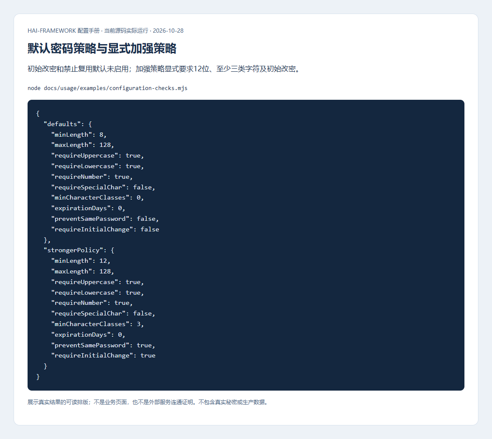

在隔离环境创建受管账号并发初始凭据，登录应进入改密；复用当前密码被拒绝，换不同的新密码后可重新登录。字符串按原始值比较，不裁剪或做 Unicode 归一化。字段提示统一为 Toast，保留错误边框及读屏关联；用户关闭提示后再次提交相同无效内容，仍会重新提示。

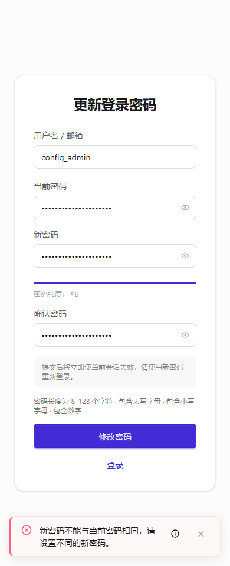

### 邀请和密码重置

`initialCredentials.enabled` 对象内默认 false；true 使用一次性邀请设密，需要联系方式、密码重置入口和真实通知通道。`passwordReset` 可省略，对象内默认 enabled=true、mode=email、tokenExpiresIn=3600秒、maxAttempts=3；resetUrl 无默认，必须是可信 HTTP(S) 地址。mode=phone 使用对应手机号流程，不能沿用邮件接收假设。

```yaml schema=@h-ai/iam:IamConfigSchema
initialCredentials: { enabled: true }
passwordReset:
  enabled: true
  mode: email
  resetUrl: https://app.example.invalid/auth/reset-password
  tokenExpiresIn: 3600
  maxAttempts: 3
```

用专用收件箱检查邀请/重置链接、过期、错误尝试和单次使用。Schema 通过不证明邮件发出；通知结果未知先查接收端和任务回执。

## 会话有效期与终端配额

| 配置（session 下） | 框架默认 | 取值影响 |
| --- | --- | --- |
| maxAge/refreshTokenMaxAge | 86400/604800秒 | 访问凭据与刷新凭据分别计时；访问到期不必然要求用户立即重登 |
| sliding | true | 允许按实现续期；不能绕过绝对/闲置期限 |
| idleTimeout/absoluteTimeout | 0/0秒 | 0 关闭额外限制；正值分别按实际业务闲置、会话总时长限制，自动刷新不延长闲置 |
| endOnPageHide | false | true 尝试在页面隐藏/退出时结束；浏览器送达尽力而为，不能作为唯一撤销保障 |
| singleDevice/singleDeviceMode | false/replace | 开启单设备策略后 replace 替换旧会话，reject 拒绝新登录 |
| maxSessions | 0 | 0 不限额；正数控制总会话数，需用独立上下文确认 |
| terminalLimits/terminalLimitMode | `{}`/reject | 显式列终端后，未列出的 web/app/desktop/api 不能新登录；replace 替换旧配额，终端标识不是硬件证明 |

```yaml schema=@h-ai/iam:IamConfigSchema
session:
  maxAge: 1800
  refreshTokenMaxAge: 604800
  sliding: true
  idleTimeout: 900
  absoluteTimeout: 28800
  maxSessions: 3
  terminalLimits: { web: 2, app: 1 }
  terminalLimitMode: reject
  endOnPageHide: false
```

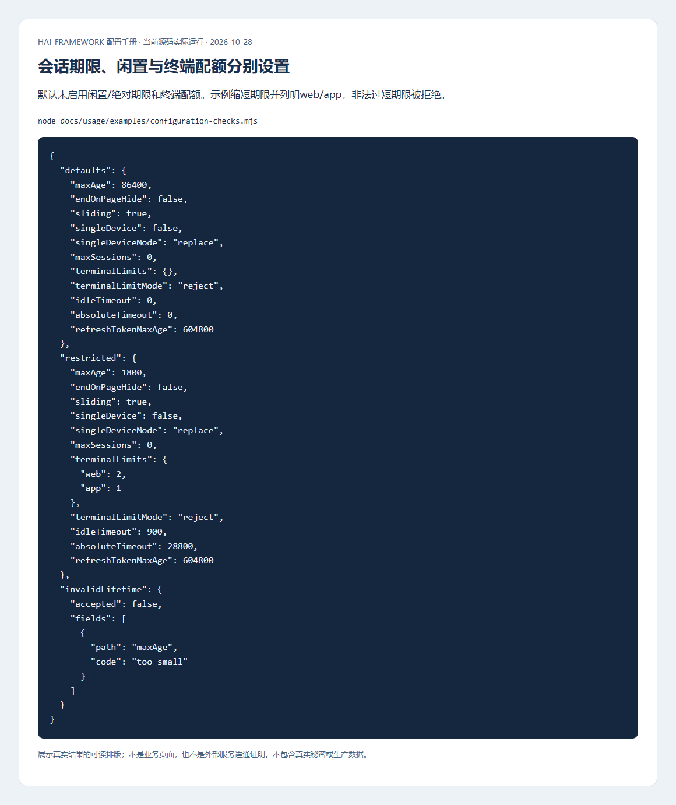

操作：重新登录建立新会话，开独立浏览器上下文直到达到配额；确认额外登录被拒绝，退出一个会话后可恢复。再用可控时钟核对闲置/绝对期限。生产验证使用共享 DB/Redis，不用进程内 memory 冒充多节点会话。

## 锁定、验证码与登录来源

| 配置 | 框架默认 | 作用与条件 |
| --- | --- | --- |
| security.lockoutEnabled | true | 账号失败累计锁定，不替代网络/接口限流 |
| failureWindow/maxLoginAttempts/lockoutDuration | 86400秒/5次/900秒 | 分别是累计窗口、阈值、锁定时长，不能把窗口当锁定期 |
| captcha.enabled | false | 开启自托管计算挑战，标准 AuthPanel 自动接入，自定义请求也要传用途对应挑战 |
| captcha.ttlSeconds/cost/maxCounter | 120秒/5000/100 | 提高计算量可能影响低性能设备，按真实设备耗时选择 |
| otp.email/sms | 对象内 true/true | 能否送达仍需通道，不能由配置替代 |
| otp.length/expiresIn/maxAttempts/resendInterval | 6位/300秒/3次/60秒 | 期限、错误次数和重发冷却分别限制，过期/重放仍服务端拒绝 |

```yaml schema=@h-ai/iam:IamConfigSchema
security:
  lockoutEnabled: true
  failureWindow: 300
  maxLoginAttempts: 3
  lockoutDuration: 600
captcha: { enabled: true, ttlSeconds: 120, cost: 5000, maxCounter: 100 }
otp: { email: true, sms: false, length: 6, expiresIn: 300, maxAttempts: 3, resendInterval: 60 }
```

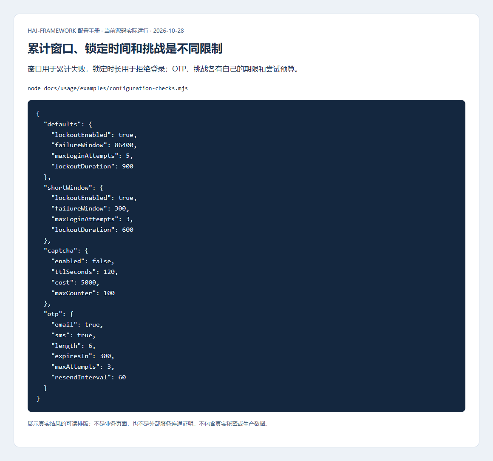

在隔离账号上测试错误尝试、锁定、等待后恢复、挑战过期/错误用途/重复消费；避免对正常用户账号做阈值试验。

公开登录和初始改密统一显示“用户名或密码不正确”。不存在、无本地口令、休眠、注销、到期和锁定账号都采用同一反馈；受限期间即使输入正确密码也不能登录或换密，且不会继续累计失败次数。这能避免通过提示或锁定期间的密码尝试判断账号状态和密码是否命中。用户确认凭据无误后，应联系管理员；管理员在已认证的账号管理中核对生命周期、有效期和锁定状态，再按实际原因处理。密码计算、数据库等依赖故障保留为系统错误供开发人员追踪，不误计为用户输错密码。

`loginAccess` 可省略，默认 enabled=false、allowIps/denyIps/windows为空、timezone=UTC。启用后按可信地址和时间窗限制新登录；days 使用1–7，时段是 HH:mm，时区必须明确。先在 Serv/Kit 装配可信客户端 IP，再应用下面的示例，文档网段必须替换：

```yaml schema=@h-ai/iam:IamConfigSchema
loginAccess:
  enabled: true
  allowIps: [192.0.2.0/24]
  denyIps: []
  timezone: Asia/Shanghai
  windows:
    - { days: [1, 2, 3, 4, 5], start: '09:00', end: '18:00' }
```

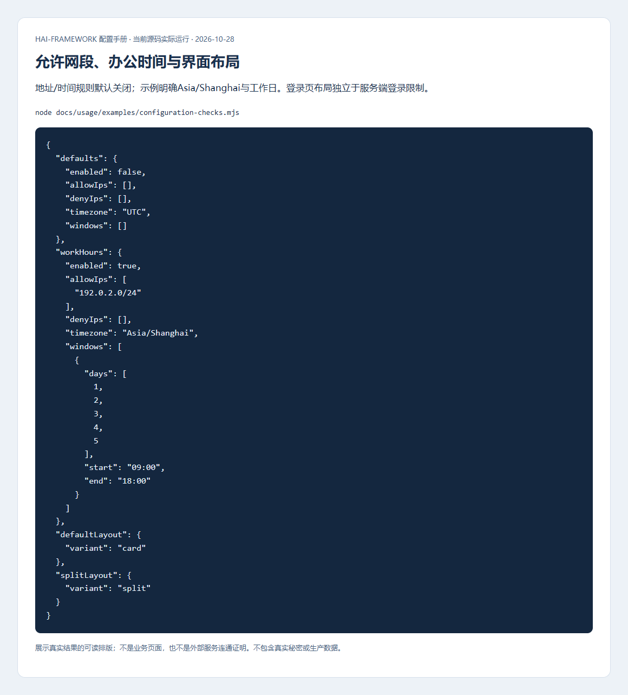

从允许/拒绝网络分别验证直接和代理请求，不能信任凭据 JSON 或任意 X-Forwarded-For。时间窗结束不自动撤销已有会话。

## 权限、二次认证与 API Key

| 配置 | 框架默认 | 影响 |
| --- | --- | --- |
| rbac.enabled/superAdminRole/defaultRole | true/super_admin/user | 默认角色按业务最小权限；示例 admin 不应作为公开注册角色 |
| seedDefaultData | true | 初始化框架默认角色/权限，不代替应用资源授权 |
| reauthentication.enabled/operations/ttlSeconds | 对象内 false/[]/300秒 | 指定敏感操作的一次性证明；仅加操作名不会自动保护自定义接口，两端接同名守卫 |
| apikey.maxKeysPerUser/defaultExpirationDays/prefix | 对象内10/0天/hai_ | 0 表示无默认到期；scopes 只收敛现有角色授权，不授予额外权限 |

```yaml schema=@h-ai/iam:IamConfigSchema
rbac: { enabled: true, superAdminRole: super_admin, defaultRole: user }
reauthentication:
  enabled: true
  operations: [iam.users.delete]
  ttlSeconds: 300
apikey: { maxKeysPerUser: 10, defaultExpirationDays: 30, prefix: 'orders_' }
```

UI 使用 createSensitiveActions/ReauthenticationDialog；服务端仍校验用户、会话、操作、资源范围并单次消费证明。取消验证不发送敏感业务请求。通过普通用户/管理员/跨资源 ID 的请求验证边界，不能只看按钮是否隐藏。

## 账号生命周期与管理

应用开发者先核对统一字段和管理接口；配置人员决定注册默认状态、休眠期限和初始改密要求；运维在升级前核对备份；安全审查人员重点验证会话撤销与职责隔离。以下管理页面能力由 Admin Console 和 Fullstack 模板提供，框架本身不规定每个业务项目的角色名称。

### 账号只有一种生命周期状态

账号统一使用 `accountStatus`，列表、筛选、排序和管理接口使用同一个字段。独立的启用/停用开关已删除，不再要求同时调整两个可能冲突的状态。

| 状态 | 用户会遇到什么 | 管理人员如何处理 |
| --- | --- | --- |
| active，激活 | 可以继续按密码、时间、来源、权限和有效期等策略进行鉴别和访问 | 核对其他策略；激活本身不授予业务权限 |
| dormant，休眠 | 拒绝新登录及旧 access/refresh 凭据 | 核实身份和使用需求后激活，用户重新登录 |
| closed，注销 | 拒绝鉴别与既有凭据，保留账号记录 | 按业务注销及个人数据保留流程处理；物理删除另用 `deleteUser` |

账号默认类型为 permanent（长期），状态为 active。temporary（临时）账号必须提供将来的 `accountExpiresAt`；到期后不能继续使用原会话。更改状态、类型或有效期会推进凭据代际并撤销旧会话，重新激活不会恢复旧凭据。只保存没有变化的状态和资料不会无故登出用户。

在 Fullstack 的“用户管理”中编辑账号，“账号状态”只提供激活、休眠、注销三个选项。保存后核对列表中的状态；选择休眠或注销后，目标用户需要先由管理员恢复为激活，再重新登录。前端隐藏菜单不能代替这些服务端检查。

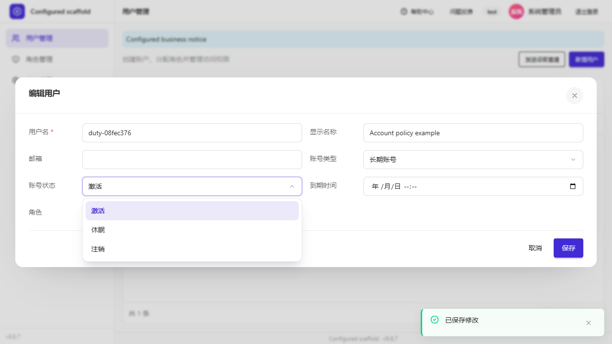

`register.defaultAccountStatus` 默认 active；设为 dormant 后，自助注册创建休眠账号，认证页提示等待管理员激活。该字段不接受 closed，也不会修改已有账号。管理员创建用户可以明确选择状态，不受自助注册默认状态控制。公开注册请求不能自行决定这些管理字段。

自动休眠配置位于 `accounts`。省略该对象不启动扫描；对象内 `dormantAfterDays` 默认 0，表示关闭自动休眠，`scanIntervalSeconds` 默认 3600 秒。设置正数天数后，框架根据最后成功登录时间、无登录记录时的创建时间寻找不活跃账号，并按周期转为休眠。需要立即核对时，从可信后台调用 `iam.user.scanInactiveAccounts()` 并检查返回结果；不能仅凭配置文件判断已经扫描完成。

```yaml schema=@h-ai/iam:IamConfigSchema
register: { defaultAccountStatus: dormant }
accounts: { dormantAfterDays: 90, scanIntervalSeconds: 3600 }
```

此例的 90 天是示例值。生效后，新自助注册账号等待激活，已有长期不活跃账号在扫描后休眠；两项分别作用，不会自动给用户分配更多权限。

### 系统管理员统一管理账号

以下以 Fullstack 为例：以系统管理员登录，进入“用户管理”，点击“新增用户”。填写账号和初始密码，再选择实际承担的职责；默认模板提供系统管理员、审计管理员、配置管理员、业务操作员和普通用户五种角色。创建后可以编辑其资料、角色和生命周期。授权项目自定义角色时，以该项目实际配置为准。

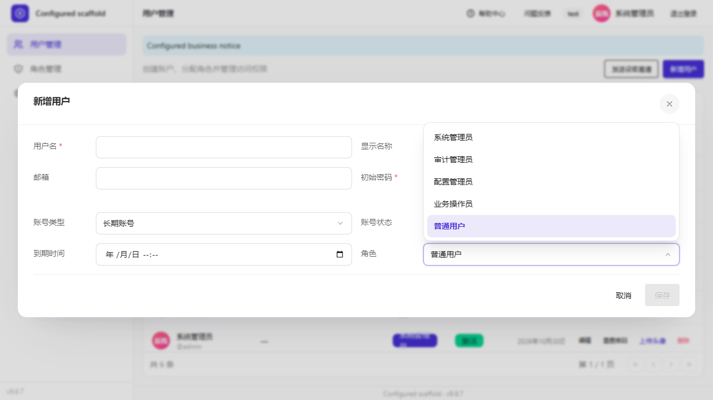

Admin Console 和 Fullstack 模板采用相同的账号管理边界。Fullstack 每个账号选择一个角色；Admin Console 允许基础角色组合，但同一账号不能混合多个内置管理职责，也不能通过管理页面分配隐式超级角色。

业务接口仍按操作时账号的权限鉴权：系统管理员的账号管理权限不自动包含审计读取、审计备份或业务配置权限。角色权限定义、API Key 委托和账号资料管理分别检查，不能用“可以编辑该账号”推导出“可以代发该账号全部业务权限的 Key”。

为防止误操作，当前管理员不能删除自己，或在用户管理中把自己的职责、状态和有效期改为不可继续管理的状态。这些变更应由另一个系统管理员完成；个人资料仍可在个人设置中修改。

### 管理员重置密码

重置允许针对所有职责，以及激活、休眠和注销状态的账号。服务端不要求目标用户的旧密码，但必须先验证操作者的账号管理权限；开启敏感操作证明后，还需验证当前管理员自己的密码。

重置成功会撤销目标用户的旧会话，**不会把休眠或注销账号自动激活**。`password.requireInitialChange: true` 时，用户用新分配的初始密码进入更换流程；false 不额外要求这一步。向用户交付密码时使用项目认可的安全渠道，审计只记录重置事件和目标账号，不记录密码。

验证时使用独立的审计或配置账号：先登录建立会话，由系统管理员重置密码，再确认旧会话失效、新密码按首次更换策略处理；把目标账号设为休眠后再重置，确认它仍然不能登录。

Fullstack 的操作顺序如下：

1. 在目标用户行点击“重置密码”，核对弹窗中的账号，输入新密码并再次确认。输入不一致或不满足策略时，通过统一 Toast 提示原因；修正后再提交。
2. 成功后弹窗关闭，列表显示成功 Toast。核对目标账号状态，例如休眠账号重置后仍显示休眠；自己的管理会话继续使用。
3. 需要恢复使用时，再将目标账号设为激活。目标用户使用新密码重新登录，按初始改密策略完成后续步骤。不要把新密码写入截图、日志或工单。

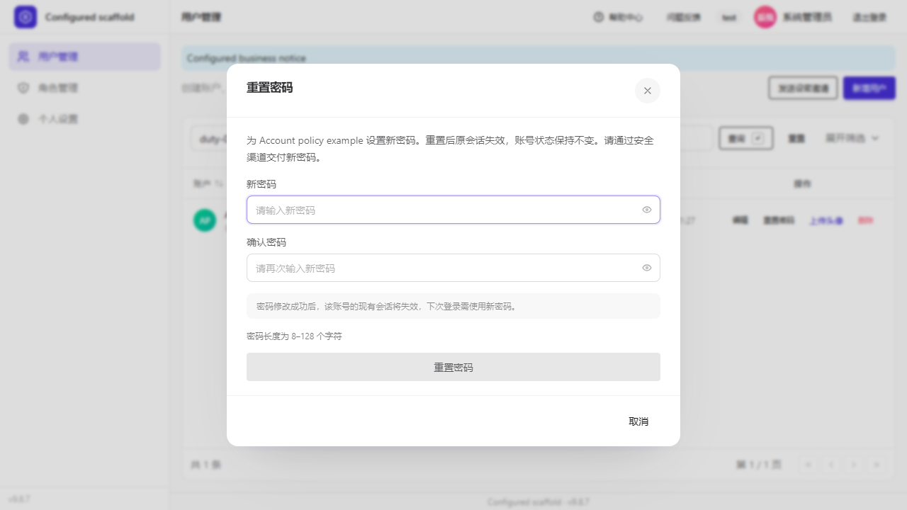

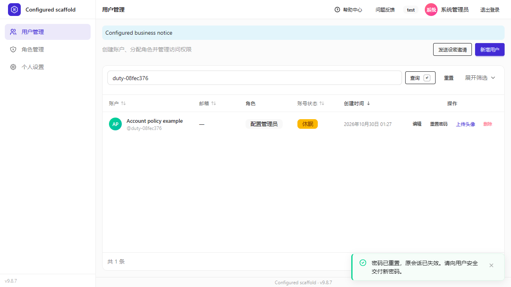

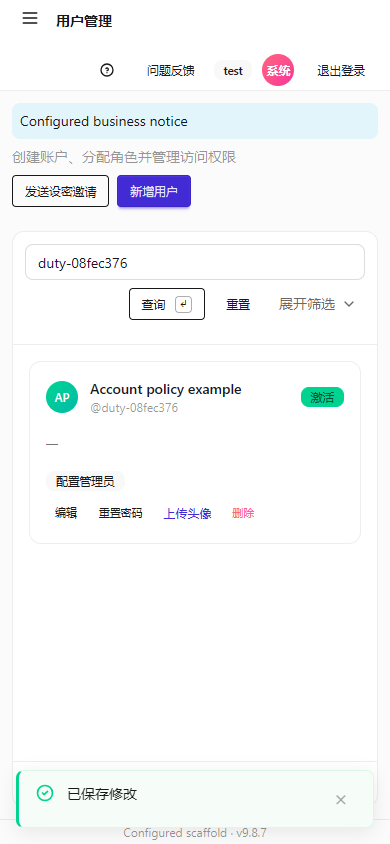

这些页面截图来自当前候选版本实际生成并运行的 Fullstack 项目，使用隔离测试账号。它们展示管理入口和状态变化；会话撤销、旧密码拒绝、重新激活后的新密码登录由对应浏览器流程及 IAM 测试验证。截图页脚的 v9.8.7 是验收应用配置的应用版本，与框架发布版本分别管理。

### 升级与数据恢复

beta.1 删除用户表中的 `enabled` 列。升级前停止旧版本写入，备份数据库，并核对账号和角色清单。迁移 v6 会把旧 enabled 为 false 或不明 NULL、但生命周期仍为 active 的账号转为 dormant，保留已有 dormant/closed 状态，再删除旧列；受影响的旧凭据同时失效。

应用代码、查询字段、配置及客户端应一起升级：使用 accountStatus 替代旧字段，使用 register.defaultAccountStatus 替代旧注册默认值。管理输入带有旧 enabled 字段时会被拒绝，不保留另一套运行时状态入口。

容器镜像回滚不会恢复已经删除的数据库列。需要恢复旧版本时，同时使用经过核验的数据库备份和旧应用制品，按维护窗口恢复；先恢复与数据匹配的配置，再检查登录、状态、角色和业务记录。

## 登录页外观

`ui.variant` 对象内默认 card；split 显示品牌区。title/subtitle/brandTitle/brandText/logoUrl/illustrationUrl 无配置默认，图片接受可信 HTTP(S) 或站内绝对路径。外观不改变认证策略。

```yaml schema=@h-ai/iam:IamConfigSchema
ui:
  variant: split
  brandTitle: IAM flow branding
  illustrationUrl: /iam-illustration.svg
```

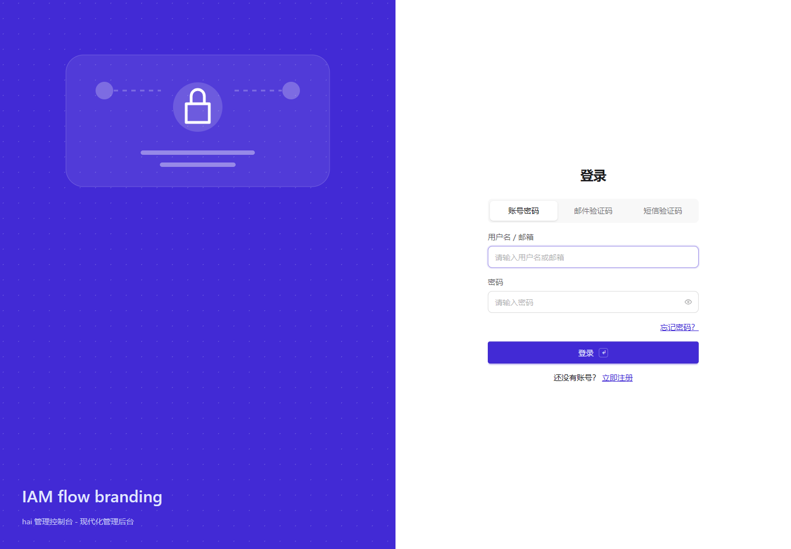

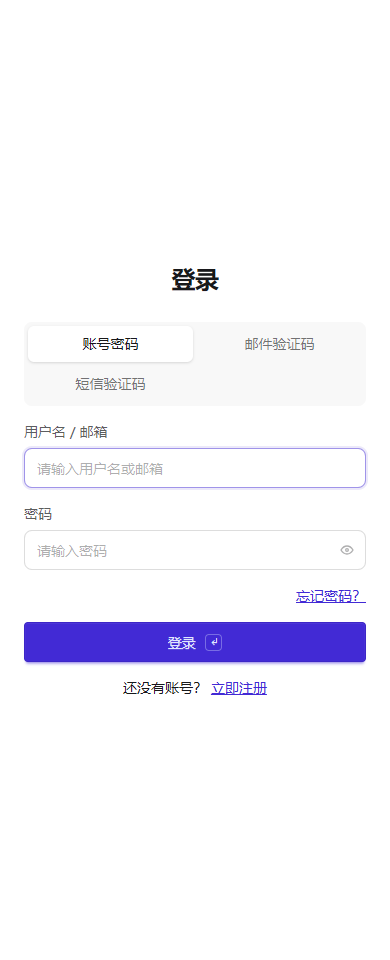

先把图片放应用静态目录，重启后检查桌面和窄屏；再切换三语，确认表单保持可操作。密码错误、改密和追踪信息流程见[认证操作指南](../development/authentication.md)。
