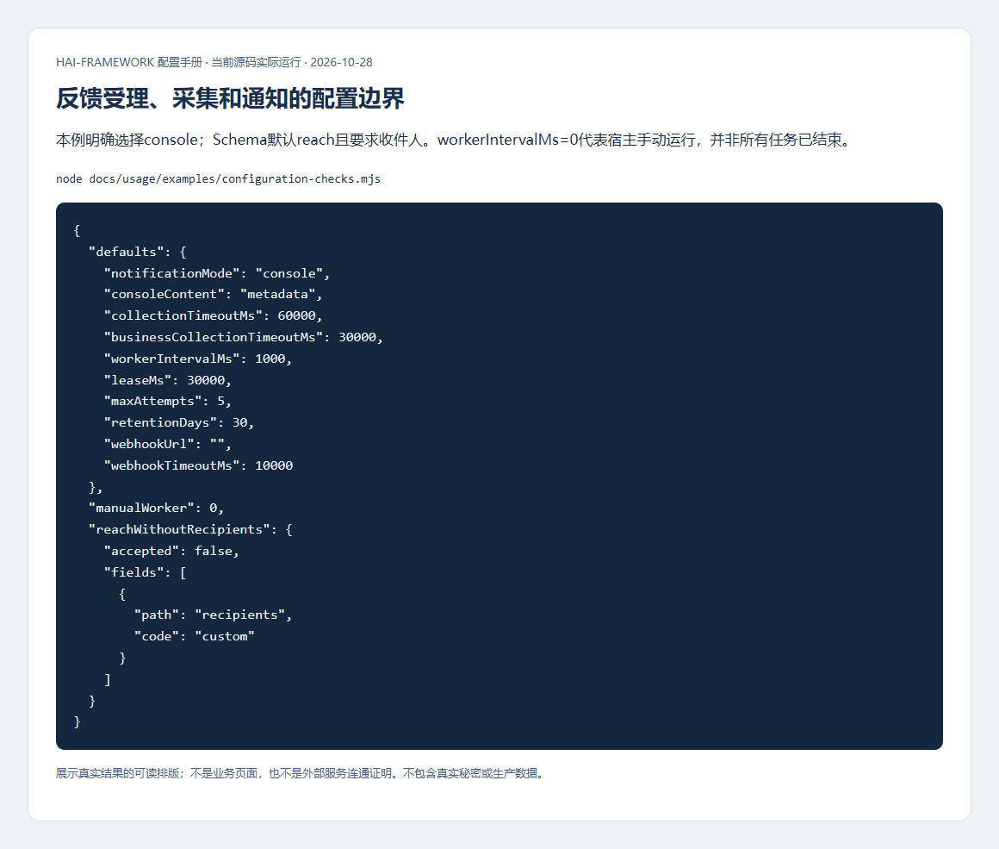
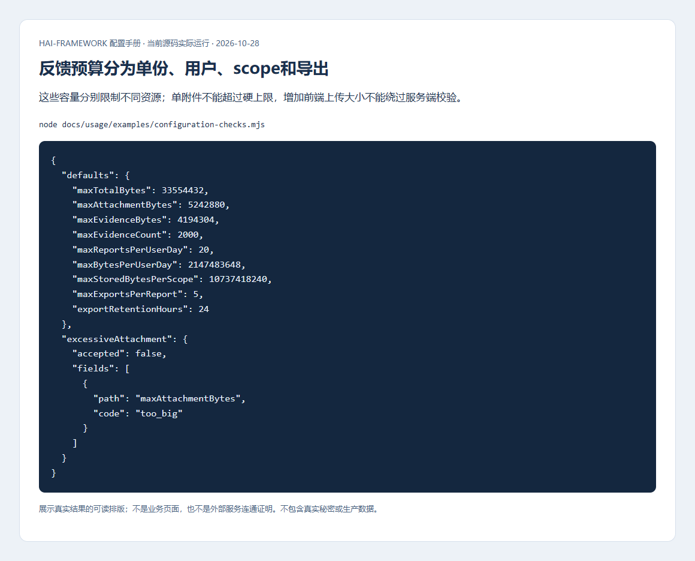
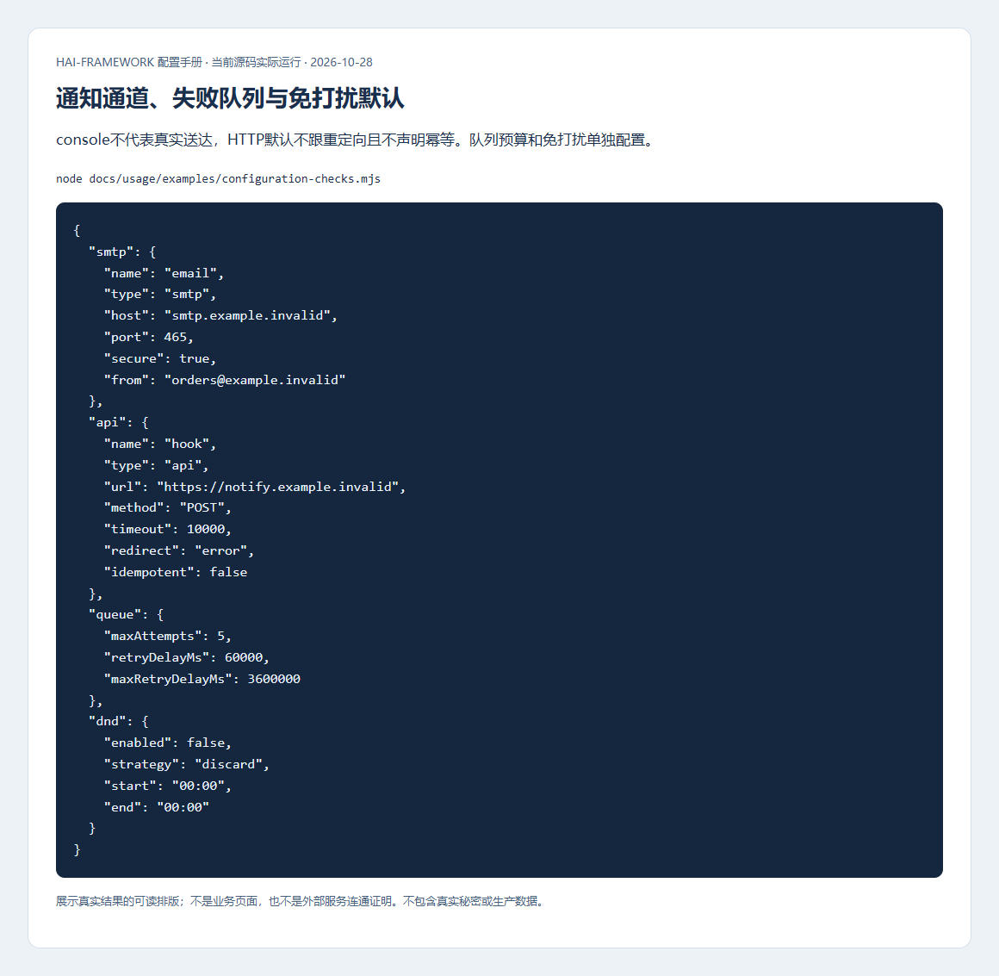
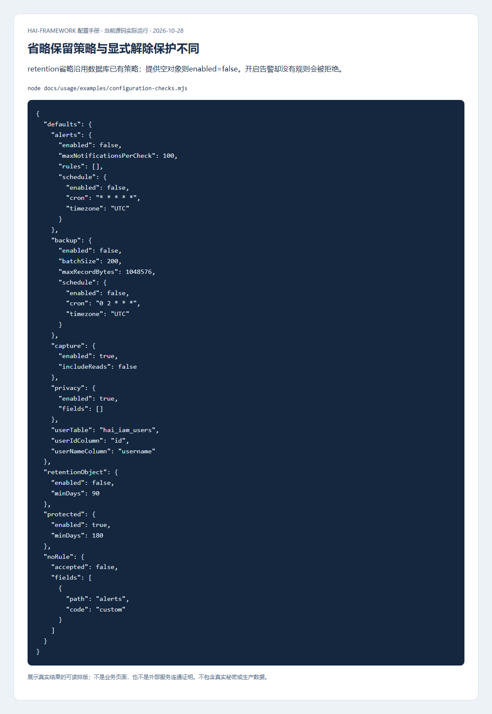
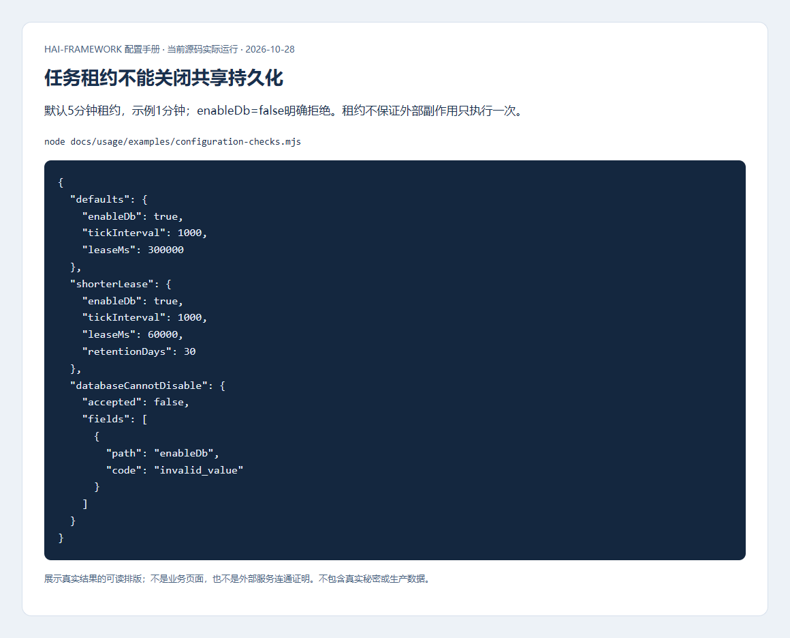

# 反馈、通知、审计与任务配置

[配置手册](README.md) · [收到问题后的操作和排查](../operations/feedback.md)

运行维护要区分业务结果和后台任务结果。反馈受理不等于材料齐全，通知入队不等于接收方收到，任务函数成功不等于执行记录已持久保存。下面按这些边界配置，失败时才知道应恢复哪一步。

## Feedback通知、采集和保留

位置：`config/_feedback.yml`。先RelDB和私有Storage，再初始化Feedback；Reach模式另需已初始化的真实通道。

| 项 | 框架默认 | 影响与条件 |
| --- | --- | --- |
| appId | 必填，无默认 | 服务端、客户端及API必须一致；appVersion/buildId/commit可选，无默认 |
| notificationMode | reach | disabled不通知，console本地日志，reach实际通知；CLI模板明确选console，与框架默认不同 |
| consoleContent | metadata | summary显式加入通用脱敏摘要，正文可能含业务隐私，生产谨慎启用 |
| recipients/notificationProvider | []/email | reach要求至少一位接收方；Provider是注册名称，不是smtp/api类型 |
| adminUrl | 无默认 | 通知内的可信管理页面地址；不能由任意用户输入决定 |
| collectionTimeoutMs/businessCollectionTimeoutMs | 60000/30000ms | 前者材料汇集期限、后者业务回调等待上限，不是相同超时 |
| workerIntervalMs/leaseMs/maxAttempts | 1000/30000ms/5 | 0关闭自动扫描需宿主手动运行任务；租约与最大尝试分别约束并发和失败恢复 |
| retentionDays | 30天 | 到期清理数据/对象；删除成功后才释放预留，不能只改数据库状态 |
| webhookUrl/webhookSecret | 空串/空串 | URL空关闭；secret空未签名，生产HTTPS并显式签名密钥 |
| webhookTimeoutMs | 10000ms | 请求失败进入持久重试；接收方按eventId持久去重，拒绝重定向 |
| envAllowlist | [] | 只采集允许的非敏感环境键，凭据类仍排除；不允许为方便导出全部环境 |

```yaml schema=@h-ai/feedback:FeedbackConfigSchema
appId: orders
notificationMode: console
consoleContent: metadata
collectionTimeoutMs: 60000
businessCollectionTimeoutMs: 30000
workerIntervalMs: 1000
leaseMs: 30000
maxAttempts: 5
retentionDays: 30
webhookUrl: ''
envAllowlist: [NODE_ENV]
```



把console换为reach时，同时配置真实recipients/provider，并用专用接收端确认；只改mode会因缺收件人校验失败。Webhook独立于Reach通知，业务异步采集回调必须被等待，采集终态后才投递固定载荷。

操作：提交专用反馈，记录受理编号，分别查看collection/notification/webhook的jobs；只重试失败的目标。下面是实际受理页面，说明“记录已保存”与“所有任务完成”分开：


### 预算与附件限制

| 项 | 框架默认 | 取值影响 |
| --- | --- | --- |
| maxTotalBytes | 32MiB，范围4–40MiB | 未压缩导出总预算，派生客户端/附件总量和传输预算，不能只改上传控件 |
| maxAttachmentBytes | 5MiB，上限5MiB | 单附件预算，仍受总预算约束 |
| maxEvidenceBytes/maxEvidenceCount | 4MiB/2000条 | 累计证据容量和条数分别限制，增大需考虑导出与存储 |
| maxReportsPerUserDay | 20 | 数据库UTC日累计；幂等重试不重复计数 |
| maxBytesPerUserDay | 2GiB | 每用户报告和历史导出预留，不是浏览器单次body预算 |
| maxStoredBytesPerScope | 10GiB | 应用scope持久预留上限；真正删除对象后释放 |
| maxExportsPerReport/exportRetentionHours | 5次/24小时 | 有效快照复用；过期下载拒绝，后台删除对象 |

```yaml schema=@h-ai/feedback:FeedbackConfigSchema
appId: orders
notificationMode: disabled
maxTotalBytes: 16777216
maxAttachmentBytes: 2097152
maxEvidenceBytes: 2097152
maxEvidenceCount: 1000
maxReportsPerUserDay: 20
maxBytesPerUserDay: 1073741824
maxStoredBytesPerScope: 10737418240
maxExportsPerReport: 3
exportRetentionHours: 12
```



以上是更小预算示例，不是框架默认。验证超限材料被明确拒绝，普通提交/导出仍成功；同步检查服务路由、加密和反向代理大小限制。隐私区域使用data-feedback-private，提交前允许删除不适合上传的材料。

### 页面闲置、退出和重试

无未完成受理任务时，客户端不会因闲置自行创建或补传。已有任务的网络/5xx/408/429失败按1/2/4/8/16秒退避，连续6次失败暂停，其他4xx立即暂停。草稿保留，认证/连接恢复后用flush或再次准备显式重试；不要每秒主动flush绕过退避。这是客户端固定策略，不是`_feedback.yml.maxAttempts`服务端持久任务预算。

退出时先await client.close({ discard: true })，再切身份；等待已开始请求但不继续后续旧草稿操作，不能承诺撤销已经发出的请求。pause只暂停截图/DOM回放，不能替代身份清理。现场闲置错误仍需时间、失败请求和追踪编号确认根因。

## Reach通道、免打扰与失败队列

位置：`config/_reach.yml`。providers至少一项，name唯一且与业务引用一致。console只输出本地结果，不代表真实邮件/短信已送达。

| 配置组 | 默认/必填 | 影响 |
| --- | --- | --- |
| SMTP host/from | 必填 | 发件地址与服务授权对应；port=465、secure=true；user/pass可选且按服务要求提供 |
| API url | 必填HTTP(S) | 默认method=POST、timeout=10000ms、redirect=error、idempotent=false；headers可选 |
| API requireHttps | 无Schema默认；发送时按敏感标记与环境推导 | true拒绝HTTP地址和follow重定向配置；false显式放宽HTTPS检查，包括生产敏感消息，生产应明确true |
| API idempotent | false | 只有接收方按稳定幂等键原子持久去重才选true，声明不会自动改造接收端 |
| Aliyun短信 | accessKeyId/accessKeySecret/signName必填 | endpoint默认dysmsapi.aliyuncs.com；模板和目的地按真实服务授权 |
| templates | 可省略 | 每项name/provider/body必填，subject可选；Provider引用注册名称 |
| dnd.enabled/strategy/start/end | 对象内false/discard/00:00/00:00 | delay需RelDB持久入队，discard是丢弃，不可显示为已发送 |
| queue.maxAttempts/retryDelayMs/maxRetryDelayMs | 5/60000/3600000ms | 有界失败重试；未知非幂等外部结果不得自动重排 |

`requireHttps` 省略时，仅当消息 `sensitive=true` 且运行环境需要生产共享状态时，发送强制HTTPS；普通消息和开发环境不自动强制。生产条件沿用 `NODE_ENV` 或 `HAI_CORE_ENV` 为 production 的判定，显式E2E测试例外。显式false会覆盖此推导，不能因为处于生产就认定HTTP必然被拒绝。敏感消息始终不跟随重定向，与 `requireHttps` 的取值无关。

免打扰的start/end按运行进程的本地时区解释，不继承IAM/Scheduler的UTC或IANA时区设置。部署前明确进程TZ并让同一环境节点保持一致；换时区后要验证实际发送窗口。起点包含、终点不包含，22:00到08:00表示跨午夜；start与end相等表示**没有阻塞时段**。因此只设enabled=true而保留默认00:00/00:00，不会拦截任何通知。需要夜间静默时明确设置不同的起止时间，选择delay还需已初始化的RelDB；discard会丢弃，不能用于必须送达的通知。

```yaml schema=@h-ai/reach:ReachConfigSchema
providers:
  - name: business-hook
    type: api
    url: https://notify.example.invalid/events
    method: POST
    timeout: 10000
    redirect: error
    idempotent: false
queue: { maxAttempts: 5, retryDelayMs: 60000, maxRetryDelayMs: 3600000 }
dnd: { enabled: false, strategy: discard, start: '00:00', end: '00:00' }
```



用专用收件箱/受控接收端发无敏感内容的消息，核对Provider回执和接收端记录。对unknown先查业务事实，确认后sent/discarded处理；dead重排需当前版本防并发覆盖。敏感消息同时使用sensitive/expiresAt/idempotencyKey，避免长期保留和盲目补发。

## Audit采集、保留保护、归档与告警

位置：`config/_audit.yml`，先共享RelDB，归档另需私有Storage，告警需Reach。审计与普通日志的保留目的不同。

| 配置 | 框架默认 | 不同取值的影响 |
| --- | --- | --- |
| capture.enabled/includeReads | true/false | 自动采集重要操作/失败/拒绝；成功读取默认不采集。关闭不阻止显式audit.log |
| privacy.enabled/fields | true/[] | 额外业务字段脱敏；关闭也不公开密码等凭据，不能恢复已脱敏内容 |
| retention | 对象省略沿用数据库设置 | 提供对象时enabled=false、minDays=90；移除配置不解除已持久化保护 |
| backup.enabled/batchSize/maxRecordBytes | false/200/1MiB | 归档批量及单条上限；超限报错不截断原审计，不删除源记录 |
| backup.schedule | enabled=false，cron=`0 2 * * *`，timezone=UTC | 开启还需宿主接入schedulerPlan；北京时间应明确Asia/Shanghai |
| alerts.enabled/maxNotificationsPerCheck/rules | false/100/[] | 开启至少一条规则，目标独立投递，限额防止突发挤占业务 |
| alerts.schedule | enabled=false，cron=`* * * * *`，timezone=UTC | 只配置表达式不会自己启动扫描 |
| userTable/userIdColumn/userNameColumn | hai_iam_users/id/username | 用户快照查询映射，可信配置，不接任意请求输入 |

```yaml schema=@h-ai/audit:AuditInitConfigSchema
capture: { enabled: true, includeReads: false }
privacy: { enabled: true, fields: [customerPhone] }
retention: { enabled: true, minDays: 90 }
backup:
  enabled: true
  batchSize: 200
  maxRecordBytes: 1048576
  schedule: { enabled: false, cron: '0 2 * * *', timezone: Asia/Shanghai }
alerts: { enabled: false, rules: [] }
```



操作：先备份，触发测试事件，查操作者/结果/traceId，确认保护期内删除/覆盖被拒绝，再验证归档对象私有可读。设置保留期不表示到期自动清理；关闭保护是明确安全变更，应留审计和授权。

告警每条rule的id/actions/targets必填；actions精确匹配不支持auth.*通配。默认outcomes=[failure,denied]、minimumSeverity=info、severity=warning、threshold=1、windowSeconds=300；resource可选。每个target需稳定id、已注册Provider名称和实际to。改id视作新规则，多节点去重依赖持久状态。它不代替IAM账号锁定策略。

## Scheduler租约、时间与未知执行

位置：`config/_scheduler.yml`，必须使用共享RelDB。

| 项 | 框架默认 | 取值影响 |
| --- | --- | --- |
| enableDb | true且不能false | 执行状态必须持久化，不能用开关绕过 |
| tickInterval | 1000ms，最小100 | 更小会增加数据库轮询，不保证业务任务更快完成 |
| leaseMs | 300000ms，范围1000–86400000 | 在途每三分之一周期续期；租约成功不证明外部动作只执行一次 |
| nodeId | 省略时生成UUID | 显式稳定节点名便于审计，不作为授权凭据 |
| maxLogs/retentionDays | 无Schema默认 | 需要按业务明确保留策略；不是执行超时 |
| 任务cron/timezone | 时区缺省UTC | 为任务明确IANA时区；不依赖宿主TZ，跨日和夏令时需实际验证 |

```yaml schema=@h-ai/scheduler:SchedulerConfigSchema
enableDb: true
tickInterval: 1000
leaseMs: 60000
nodeId: orders-worker-1
maxLogs: 10000
retentionDays: 30
```



先注册无外部副作用的任务，查看执行与日志，再模拟落库失败用repairLog补写。unknown先停止旧runner、核对实际副作用，再按expectedUpdatedAt调用resolveUnknown；不能只因租约释放重跑。生产多节点行锁、时钟偏差和故障恢复须目标服务验收，配置图不代替。
