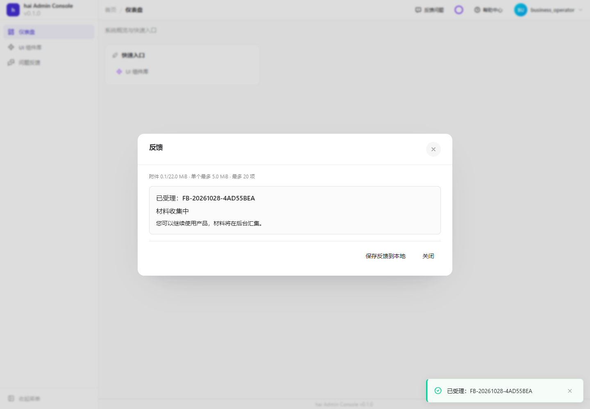
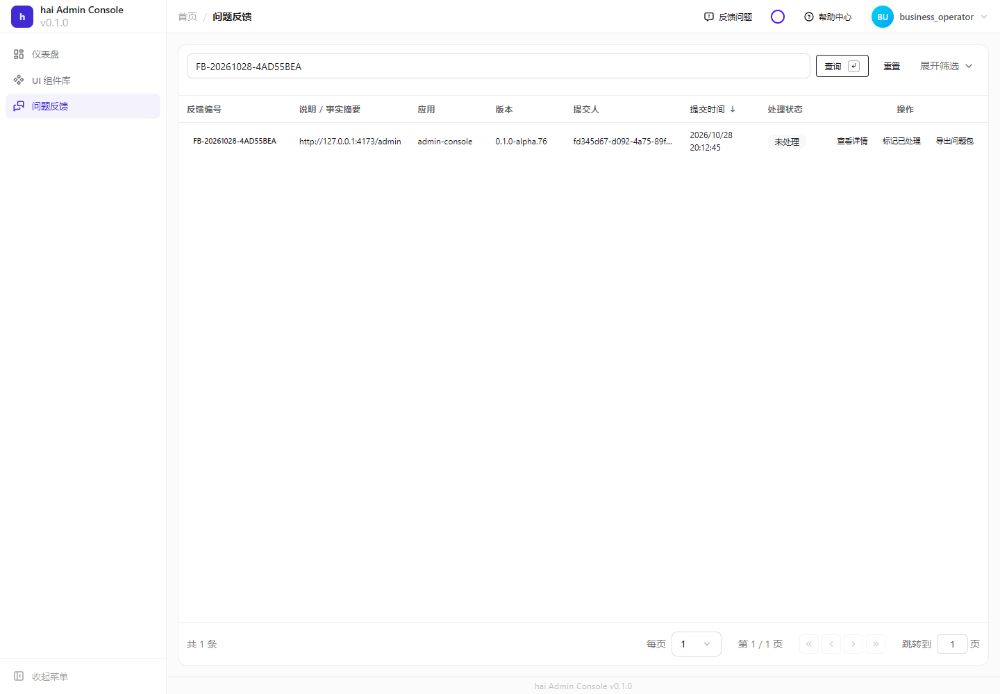
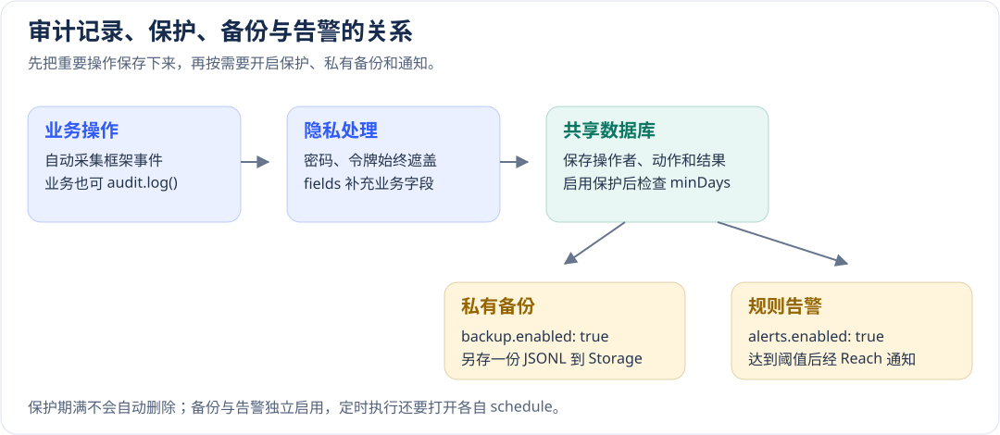

# 反馈、通知、审计与任务配置

[配置手册](README.md) · [收到问题后的操作和排查](../operations/feedback.md)

运行维护要区分业务结果和后台任务结果。反馈受理不等于材料齐全，通知入队不等于接收方收到，任务函数成功不等于执行记录已持久保存。下面按这些边界配置，失败时才知道应恢复哪一步。

## Feedback通知、采集和保留

位置：`config/_feedback.yml`。先初始化关系数据库（RelDB）和私有存储（Storage），再启动 Feedback。需要发送邮件或短信通知时，还要先准备 Reach 通道。

| 项 | 框架默认 | 影响与条件 |
| --- | --- | --- |
| `appId` | 必填，无默认 | 服务端、客户端及API必须一致；`appVersion`/`buildId`/`commit`可选，无默认 |
| `notificationMode` | `reach` | `disabled` 不通知，`console` 只写本地日志，`reach` 通过已配置通道通知。CLI 模板使用 `console`，方便首次启动 |
| `consoleContent` | `metadata` | 默认只记录编号、状态等基本信息；改为 `summary` 后还会写入经过通用脱敏的摘要，可能仍包含业务隐私 |
| `recipients`/`notificationProvider` | `[]`/`email` | `reach` 模式至少需要一位接收方。`notificationProvider` 填 Reach 中注册的通道名称，例如 `email`，而非通道类型 `smtp` 或 `api` |
| `adminUrl` | 无默认 | 通知内的可信管理页面地址；不能由任意用户输入决定 |
| `collectionTimeoutMs`/`businessCollectionTimeoutMs` | 60 秒/30 秒 | 前者是整份反馈等待材料补齐的最长时间；后者是单次业务采集回调最多等待多久。配置值的单位均为毫秒 |
| `workerIntervalMs`/`leaseMs`/`maxAttempts` | 1 秒/30 秒/5 次 | 后台默认每秒扫描待办任务；处理进程失联后，其他进程要等租约到期才能接手。每个任务最多尝试 5 次；`workerIntervalMs: 0` 关闭自动扫描，需由应用主动执行任务 |
| `retentionDays` | 30天 | 到期清理数据/对象；删除成功后才释放预留，不能只改数据库状态 |
| `webhookUrl`/`webhookSecret` | 空串/空串 | URL空关闭；secret空未签名，生产HTTPS并显式签名密钥 |
| `webhookTimeoutMs` | 10000ms | 请求失败进入持久重试；接收方按`eventId`持久去重，拒绝重定向 |
| `envAllowlist` | `[]` | 只采集这里列出的非敏感环境变量；密码、令牌等凭据仍会被排除 |

```yaml schema=@h-ai/feedback:FeedbackConfigSchema
appId: orders
notificationMode: console
consoleContent: metadata
collectionTimeoutMs: 60000
businessCollectionTimeoutMs: 30000
workerIntervalMs: 1000
leaseMs: 30000
maxAttempts: 5
retentionDays: 30
webhookUrl: ''
envAllowlist: [NODE_ENV]
```

把 `notificationMode` 从 `console` 改为 `reach` 时，同时填写 `recipients` 和 `notificationProvider`，再发一条测试通知确认接收端收到。只改通知模式而不填收件人，会在初始化时校验失败。Webhook 单独配置，不依赖 Reach；系统等待材料采集结束后再投递通知载荷。

验证时提交一条测试反馈，保存受理编号，再查看材料采集状态及通知、Webhook 任务结果。已经受理表示记录已保存，不代表所有材料和通知任务都已完成；重试时只选失败的任务。





### 预算与附件限制

| 项 | 框架默认 | 取值影响 |
| --- | --- | --- |
| `maxTotalBytes` | 32MiB，范围4–40MiB | 未压缩导出总预算，派生客户端/附件总量和传输预算，不能只改上传控件 |
| `maxAttachmentBytes` | 5MiB，上限5MiB | 单附件预算，仍受总预算约束 |
| `maxEvidenceBytes`/`maxEvidenceCount` | 4MiB/2000条 | 累计证据容量和条数分别限制，增大需考虑导出与存储 |
| `maxReportsPerUserDay` | 20 | 数据库UTC日累计；幂等重试不重复计数 |
| `maxBytesPerUserDay` | 2GiB | 每用户报告和历史导出预留，不是浏览器单次body预算 |
| `maxStoredBytesPerScope` | 10GiB | 应用scope持久预留上限；真正删除对象后释放 |
| `maxExportsPerReport`/`exportRetentionHours` | 5次/24小时 | 有效快照复用；过期下载拒绝，后台删除对象 |

```yaml schema=@h-ai/feedback:FeedbackConfigSchema
appId: orders
notificationMode: disabled
maxTotalBytes: 16777216
maxAttachmentBytes: 2097152
maxEvidenceBytes: 2097152
maxEvidenceCount: 1000
maxReportsPerUserDay: 20
maxBytesPerUserDay: 1073741824
maxStoredBytesPerScope: 10737418240
maxExportsPerReport: 3
exportRetentionHours: 12
```

以上是更小预算示例，不是框架默认。验证超限材料被明确拒绝，普通提交/导出仍成功；同步检查服务路由、加密和反向代理大小限制。隐私区域使用`data-feedback-private`，提交前允许删除不适合上传的材料。

### 页面闲置、退出和重试

无未完成受理任务时，客户端不会因闲置自行创建或补传。已有任务的网络/5xx/408/429失败按1/2/4/8/16秒退避，连续6次失败暂停，其他4xx立即暂停。草稿保留，认证/连接恢复后用flush或再次准备显式重试；不要每秒主动flush绕过退避。这是客户端固定策略，不是`_feedback.yml.maxAttempts`服务端持久任务预算。

退出时先`await client.close({ discard: true })`，再切身份；等待已开始请求但不继续后续旧草稿操作，不能承诺撤销已经发出的请求。pause只暂停截图/DOM回放，不能替代身份清理。现场闲置错误仍需时间、失败请求和追踪编号确认根因。

## Reach通道、免打扰与失败队列

位置：`config/_reach.yml`。`providers` 至少配置一个通道，每个通道的 `name` 需要唯一，业务通过这个名称选择发送渠道。`console` 通道只写本地日志，不会真的发送邮件或短信。

| 配置组 | 默认/必填 | 影响 |
| --- | --- | --- |
| SMTP `host`/`from` | 必填 | `host` 是邮件服务器地址，`from` 是已获授权的发件地址。端口 `port` 默认 `465`，`secure` 默认 `true`；账号 `user` 和密码 `pass` 按邮件服务要求填写 |
| API `url` | 必填 HTTP(S) 地址 | 默认使用 `method: POST`，`timeout: 10000` 表示等待 10 秒；`redirect: error` 表示拒绝重定向。认证信息等请求头放在 `headers` 中 |
| API `requireHttps` | 未填写时按消息和环境决定 | `true` 拒绝 HTTP 地址及 `follow` 重定向设置；`false` 明确允许 HTTP，包括生产中的敏感消息。生产通道需要强制 HTTPS 时填写 `true` |
| API `idempotent` | `false` | 接收端能按同一个幂等键识别并丢弃重复消息时，才填写 `true`；这个开关不会替接收端实现去重 |
| Aliyun短信 | `accessKeyId`/`accessKeySecret`/`signName`必填 | `endpoint`默认`dysmsapi.aliyuncs.com`；模板和目的地按真实服务授权 |
| `templates` | 可省略 | 每项必须有模板名 `name`、通道名 `provider` 和正文 `body`；邮件主题 `subject` 可选 |
| `dnd.enabled` / `dnd.strategy` / `dnd.start` / `dnd.end` | `false`/`discard`/`00:00`/`00:00` | 开启后，指定时段内的消息按策略处理：`delay` 先存入关系数据库等待发送，`discard` 直接丢弃。丢弃不表示已发送 |
| `queue.maxAttempts`/`queue.retryDelayMs`/`queue.maxRetryDelayMs` | 5 次 / 60000 毫秒 / 3600000 毫秒 | 最多尝试 5 次；首次重试等 1 分钟，以后逐次加倍，最长等 1 小时。修改只影响新入队消息 |

省略 `requireHttps` 时，生产环境中的敏感消息（`sensitive: true`）会强制使用 HTTPS；普通消息和开发环境不自动强制。生产环境按 `NODE_ENV` 或 `HAI_CORE_ENV` 为 `production` 判断，显式 E2E 测试例外。填写 `false` 会覆盖这个自动判断。敏感消息始终不跟随重定向，与 `requireHttps` 的取值无关。

免打扰的 `start` 和 `end` 使用运行进程的本地时区，不继承 IAM 或 Scheduler 的时区设置。部署时设置进程的 `TZ`，并让同一环境的节点保持一致。`22:00` 到 `08:00` 表示跨午夜，包含起点、不包含终点；起止时间相等表示**没有免打扰时段**。因此只打开 `enabled: true`，仍保留 `00:00` 到 `00:00`，不会拦截通知。必须送达的消息选择 `delay` 并先初始化关系数据库；选择 `discard` 会丢弃消息。

```yaml schema=@h-ai/reach:ReachConfigSchema
providers:
  - name: business-hook
    type: api
    url: https://notify.example.invalid/events
    method: POST
    timeout: 10000
    redirect: error
    idempotent: false
queue: { maxAttempts: 5, retryDelayMs: 60000, maxRetryDelayMs: 3600000 }
dnd: { enabled: false, strategy: discard, start: '00:00', end: '00:00' }
```

配置好后，用测试收件箱或受控接口接收一条不含敏感内容的消息，同时核对发送结果和接收端记录。状态为 `unknown` 时，先确认接收端是否已收到，再按事实标记 `sent` 或 `discarded`；重排 `dead` 消息时携带当前版本，防止覆盖其他人的操作。敏感消息同时设置 `sensitive`、到期时间 `expiresAt` 和幂等键 `idempotencyKey`。

## Audit采集、保留保护、归档与告警

`config/_audit.yml` 决定“哪些操作要留记录、敏感字段怎么遮盖、记录多久不能删、是否另存备份、什么时候通知管理员”。审计记录用于回答谁在什么时间做了什么；普通运行日志主要用于排查程序问题，两者不是同一份数据。

Audit 先连接已初始化的 RelDB。只记录审计不需要邮件或对象存储；开启备份才需要私有 Storage，开启告警才需要 Reach 通道。



### 先用最小配置开始记录

```yaml schema=@h-ai/audit:AuditInitConfigSchema
capture:
  enabled: true
  includeReads: false
privacy:
  enabled: true
  fields: [customerPhone]
backup:
  enabled: false
alerts:
  enabled: false
```

这个例子会自动保存已接入框架采集入口的重要操作、失败和拒绝，但不额外记录成功查询。`customerPhone` 出现在审计详情中时会被遮盖。备份和通知均未开启，适合先确认基础记录是否正确。

| 配置 | 默认值 | 怎么理解 |
| --- | --- | --- |
| `capture.enabled` | `true` | 是否接收框架自动采集的事件。关闭后，业务主动调用 `audit.log()` 仍可写记录 |
| `capture.includeReads` | `false` | 是否额外记录成功读取。需要追踪“谁查看过数据”时再开启，日志量会明显增加 |
| `privacy.enabled` | `true` | 是否遮盖额外的业务隐私字段。密码、令牌等凭据的保护不受这个开关影响 |
| `privacy.fields` | `[]` | 要遮盖的详情字段名，例如 `customerPhone`，不区分大小写。这里写字段名，与 `logging.redact` 的对象路径写法不同 |

不要把隐私写进 `action`、`resourceId` 等用于检索的标识，也不要认为脱敏可以从历史记录恢复原文。先用测试账号触发一条操作，在审计列表中确认操作者、操作、结果和遮盖后的详情。

### 让最近 90 天的记录不能被清理

```yaml schema=@h-ai/audit:AuditInitConfigSchema
retention:
  enabled: true
  minDays: 90
```

这表示最近 90 天的审计记录受到修改、覆盖和删除保护。即使调用清理接口要求清空，也不能绕过保护。**满 90 天不会自动删除**，仍需由应用安排清理。

保护设置会写入数据库。删除 YAML 中的 `retention` 段表示沿用数据库已有设置，不表示解除保护。确需关闭时，明确写 `enabled: false`，重启或重新初始化后再核对；这会允许清理程序按其条件删除记录。

`minDays` 默认是 `90`，但仅提供空对象 `retention: {}` 时 `enabled` 默认仍为 `false`。需要保护时，明确填写上例的 `enabled: true`。

### 另外保存一份私有备份

```yaml schema=@h-ai/audit:AuditInitConfigSchema
backup:
  enabled: true
  batchSize: 200
  maxRecordBytes: 1048576
  schedule:
    enabled: true
    cron: '0 2 * * *'
    timezone: Asia/Shanghai
```

上例允许备份，并要求已接入的 Scheduler 每天北京时间 02:00 执行。备份保存到私有 Storage，格式为逐行 JSON；不会删除数据库中的原记录，也不是整个数据库的一致性快照。

| 配置 | 默认值 | 什么时候需要改 |
| --- | --- | --- |
| `backup.enabled` | `false` | 准备好私有存储后开启，允许手动或计划备份 |
| `backup.batchSize` | `200` 条 | 每批从数据库读多少条。机器内存紧张时调小，代价是读取批次增多 |
| `backup.maxRecordBytes` | `1048576` 字节 | 单条记录最多允许多大。超限会报告错误，原始审计不会被截短或删除 |
| `backup.schedule.enabled` | `false` | 是否交给 Scheduler 自动执行；与允许备份是两个开关 |
| `backup.schedule.cron` | `'0 2 * * *'` | 每天 02:00。时间按下面的时区解释 |
| `backup.schedule.timezone` | `UTC` | 北京时间填 `Asia/Shanghai`；UTC 的 02:00 是北京时间 10:00 |

应用需要接入 `audit.schedulerPlan`；生成工程有对应装配入口时复用它。仅保存 Cron 表达式不会凭空启动后台任务。首次开启后手动执行一次备份，确认对象存在、可由授权人员读取且不能匿名下载。

### 失败操作过多时通知管理员

```yaml schema=@h-ai/audit:AuditInitConfigSchema
alerts:
  enabled: true
  maxNotificationsPerCheck: 100
  rules:
    - id: login-failures
      actions: [auth.login]
      outcomes: [failure, denied]
      minimumSeverity: info
      severity: warning
      threshold: 10
      windowSeconds: 300
      targets:
        - id: security-mailbox
          provider: email
          to: security@example.com
  schedule:
    enabled: true
    cron: '* * * * *'
    timezone: Asia/Shanghai
```

这条规则表示：按 5 分钟窗口累计 `auth.login` 的失败和拒绝事件，达到 10 次时给安全邮箱发告警。它统计符合条件的全部事件，**不是每个账号单独累计**，也不会锁定账号。锁定策略由 IAM 单独配置。

| 配置 | 默认值或要求 | 怎么填写 |
| --- | --- | --- |
| `alerts.enabled` | `false` | 开启时至少提供一条规则，并准备真实 Reach 通道 |
| `maxNotificationsPerCheck` | `100` | 一次检查最多尝试多少个通知，防止大量告警占满发送资源 |
| 规则 `id` | 必填且唯一 | 稳定编号，例如 `login-failures`；改名会被视作新规则 |
| `actions` / `resource` | `actions` 必填；`resource` 可省略 | 从实际审计记录复制完整操作名；不支持 `auth.*`。填写 `resource` 可进一步限定资源类型 |
| `outcomes` | `[failure, denied]` | 统计哪些结果；空数组表示所有结果 |
| `minimumSeverity` | `info` | 原始事件低于这个等级时不参与统计 |
| `severity` | `warning` | 通知中显示的告警等级，不修改原记录 |
| `threshold` / `windowSeconds` | `1` 次 / `300` 秒 | 时间窗口中达到几次才通知。例如上例是 5 分钟内 10 次 |
| `targets` | 必填，至少一项 | `id` 是目标编号；`provider` 是 Reach 中注册的名称，如 `email`；`to` 是实际收件地址 |
| `alerts.schedule` | 默认关闭，Cron 为 `'* * * * *'`，时区 `UTC` | 自动检查的计划。还需应用接入 Scheduler |

`provider: email` 必须对应 `_reach.yml` 中某个 Provider 的 `name: email`，不是填写 `smtp` 这个类型名。先发一条测试通知，确认收件箱收到，再启用正式规则。

### 使用自己的用户表

默认从 `hai_iam_users` 表读取操作者名称，主键列为 `id`，名称列为 `username`。只有应用使用不同的用户表结构时才修改：

```yaml schema=@h-ai/audit:AuditInitConfigSchema
userTable: app_users
userIdColumn: id
userNameColumn: display_name
```

这些是应用维护者填写的表和列映射，不接收用户请求中的任意表名。

## Scheduler租约、时间与未知执行

位置：`config/_scheduler.yml`，必须使用共享RelDB。

| 项 | 框架默认 | 取值影响 |
| --- | --- | --- |
| `enableDb` | true且不能false | 执行状态必须持久化，不能用开关绕过 |
| `tickInterval` | 1000ms，最小100 | 更小会增加数据库轮询，不保证业务任务更快完成 |
| `leaseMs` | 300000ms，范围1000–86400000 | 在途每三分之一周期续期；租约成功不证明外部动作只执行一次 |
| `nodeId` | 省略时生成UUID | 显式稳定节点名便于审计，不作为授权凭据 |
| `maxLogs`/`retentionDays` | 无Schema默认 | 需要按业务明确保留策略；不是执行超时 |
| 任务cron/`timezone` | 时区缺省UTC | 为任务明确IANA时区；不依赖宿主TZ，跨日和夏令时需实际验证 |

```yaml schema=@h-ai/scheduler:SchedulerConfigSchema
enableDb: true
tickInterval: 1000
leaseMs: 60000
nodeId: orders-worker-1
maxLogs: 10000
retentionDays: 30
```

先注册无外部副作用的任务，查看执行与日志，再模拟落库失败用`repairLog`补写。unknown先停止旧runner、核对实际副作用，再按`expectedUpdatedAt`调用`resolveUnknown`；不能只因租约释放重跑。生产多节点行锁、时钟偏差和故障恢复须目标服务验收。
