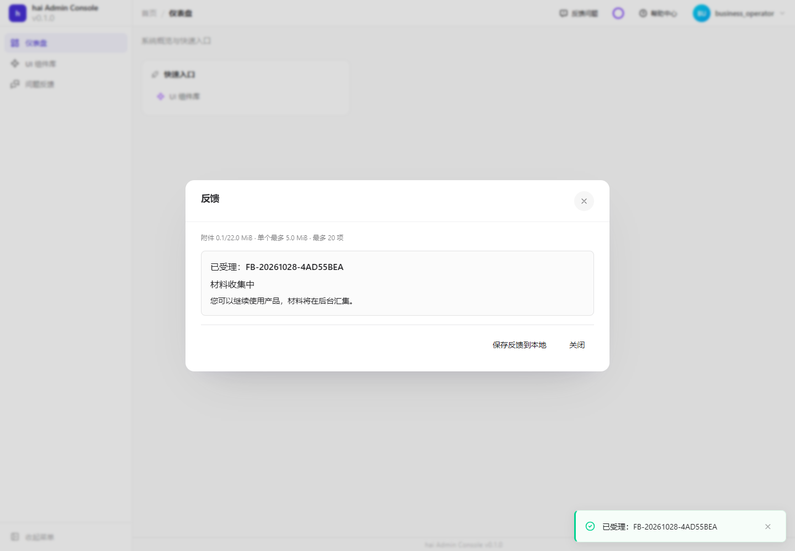
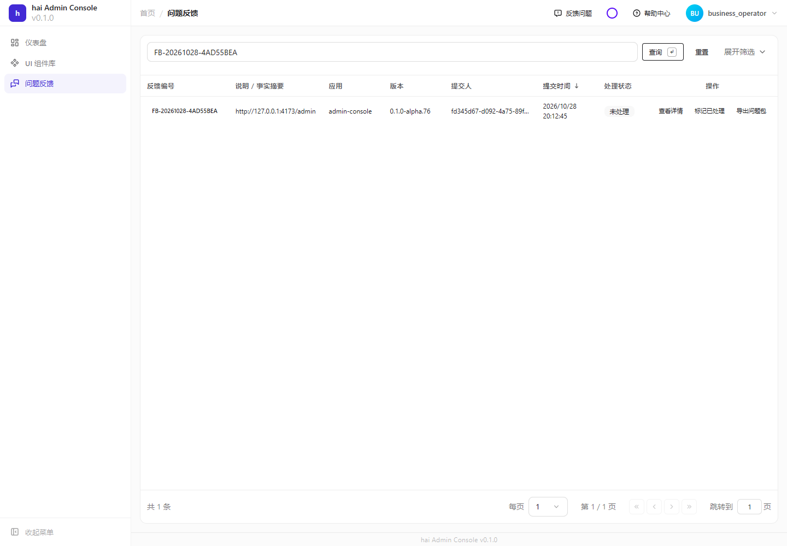
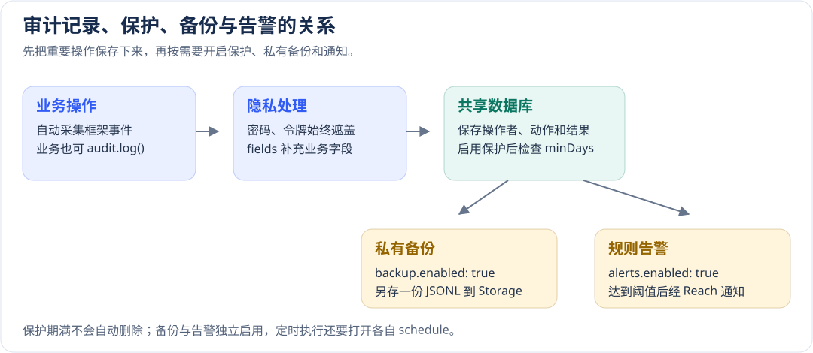

# 反馈、通知、审计与任务配置

[配置手册](README.md) · [收到问题后的操作和排查](../operations/feedback.md)

处理故障时先确定哪一步失败。反馈报告可能已保存，但截图还在上传。通知任务可能已入队，但接收方尚未收到。定时任务可能已经执行，也可能只是在保存执行日志时出错。

## Feedback通知、采集和保留

位置：`config/_feedback.yml`。先初始化关系数据库（RelDB）和私有存储（Storage），再启动 Feedback。需要通过邮件或短信发送通知时，还要先准备 Reach 通道。

服务端字段和默认值见 [Feedback 配置清单](feedback.md#配置清单)。CLI 模板用控制台通知方便本地启动。开启真实通知后要检查收件人及管理页访问，Webhook 接收方按 `eventId` 去重。

```yaml schema=@h-ai/feedback:FeedbackConfigSchema
appId: orders
notificationMode: console
consoleContent: metadata
collectionTimeoutMs: 60000
businessCollectionTimeoutMs: 30000
workerIntervalMs: 1000
leaseMs: 30000
maxAttempts: 5
retentionDays: 30
webhookUrl: ''
envAllowlist: [NODE_ENV]
```

把 `notificationMode` 从 `console` 改为 `reach` 时，同时填写 `recipients` 和 `notificationProvider`，再发一条测试通知确认接收端收到。只改通知模式而不填收件人，会在初始化时校验失败。Webhook 单独配置，不依赖 Reach；系统等待材料采集结束后再投递通知载荷。

验证时提交一条测试反馈，保存受理编号，再查看材料采集状态及通知、Webhook 任务结果。已经受理表示记录已保存，不代表所有材料和通知任务都已完成；重试时只选失败的任务。





### 预算与附件限制

修改 Feedback 的总大小限制后，也检查加密路由和反向代理能否接受相应体量的请求。服务端分别限制一天的提交数、存储大小和历史导出的时间范围，字段含义见 [Feedback 配置清单](feedback.md#配置清单)。

```yaml schema=@h-ai/feedback:FeedbackConfigSchema
appId: orders
notificationMode: disabled
maxTotalBytes: 16777216
maxAttachmentBytes: 2097152
maxEvidenceBytes: 2097152
maxEvidenceCount: 1000
maxReportsPerUserDay: 20
maxBytesPerUserDay: 1073741824
maxStoredBytesPerScope: 10737418240
maxExportsPerReport: 3
exportRetentionHours: 12
```

以上是更小预算示例，不是框架默认。验证超限材料被明确拒绝，普通提交/导出仍成功；同步检查服务路由、加密和反向代理大小限制。隐私区域使用`data-feedback-private`，提交前允许删除不适合上传的材料。

### 页面闲置、退出和重试

页面闲置不会创建新的反馈任务。上传已有材料时，如断网或收到 5xx、408、429，客户端依次等待 1、2、4、8、16 秒再重试。连续 6 次失败或收到其他 4xx 时暂停，草稿仍保留。网络或登录恢复后，可调用客户端的 `flush()` 继续，也可重新打开反馈准备流程。这是客户端固定策略，不是`_feedback.yml.maxAttempts`服务端持久任务预算。

退出时先`await client.close({ discard: true })`，再切身份；等待已开始请求但不继续后续旧草稿操作，不能承诺撤销已经发出的请求。pause只暂停截图/DOM回放，不能替代身份清理。现场闲置错误仍需时间、失败请求和追踪编号确认根因。

## Reach通道、免打扰与失败队列

位置：`config/_reach.yml`。`providers` 至少配置一个通道，每个通道的 `name` 需要唯一，业务通过这个名称选择发送渠道。`console` 通道只写本地日志，不会真的发送邮件或短信。

通道、模板和失败重试字段见 [Reach 配置清单](reach.md#配置清单)。SMTP 需要已获授权的发件地址。仅在实际接收端按幂等键持久去重时设置 `idempotent: true`；重试参数的修改只影响后续新入队消息。

API 渠道默认拒绝重定向。设置 `requireHttps: true` 时，渠道只接受 HTTPS 地址，并使用 `redirect: error`。传验证码或设密链接的 HTTP 渠道用这项设置。

API 的整个 `headers` 字典都作为私密配置处理，不靠 `Authorization` 等特定头名猜测秘密。把 API 请求头的密钥放进私有环境文件或部署平台的密钥管理中。`reach.config` 会隐藏这些请求头的值，只适合检查启用的渠道，重新连接仍应从私有配置读取原值。`timeout: 0` 会在计时器下一次执行时取消请求，不表示无限等待；普通通道应设置能完成实际请求的正数预算。

阿里云直连要求已审核的模板编码，可通过 `templateCodes` 按 Reach 模板名配置。阿里云渠道配置 `gateway` 后，会使用 `POST` 和已签名查询参数，`gateway.url` 填写完整路径。需要空 JSON 时填写 `body: {}`。该网关需要逐次生成请求头或正文时，服务端在 `reach.init(config, { gatewayHooks: { sms: hook } })` 中传入生成数据的函数，`sms` 对应渠道的 `name`。网关默认使用 HTTPS，受信内网的明文地址需显式启用 `gateway.allowInsecureHttp`。查询串包含手机号和模板变量，网关及代理日志应对查询串脱敏。验收时确认网关把签名参数转发到阿里云 `/`，并回传 `Code: OK` 和 `BizId`，最终送达以运营商回执为准。

免打扰的 `start` 和 `end` 使用进程的本地时区。用 `TZ` 让同一环境的节点一致。`22:00` 到 `08:00` 跨午夜，包含起点。起止相等表示没有免打扰时段。普通通知可选择 `delay` 并先初始化关系数据库，或选择 `discard` 拒绝发送。IAM 发内置验证码、密码重置和初始设密邀请时会传 `ignoreDnd: true`。[夜间通知示例](../function/reach.md#reach-quiet-hours)

```yaml schema=@h-ai/reach:ReachConfigSchema
providers:
  - name: business-hook
    type: api
    url: https://notify.example.invalid/events
    method: POST
    timeout: 10000
    redirect: error
    idempotent: false
queue: { maxAttempts: 5, retryDelayMs: 60000, maxRetryDelayMs: 3600000 }
dnd: { enabled: false, strategy: discard, start: '00:00', end: '00:00' }
```

配置好后，用测试收件箱或受控接口接收一条测试通知，核对调用结果和接收端记录。`unknown` 先核对渠道，再登记 `sent` 或 `discarded`。重排 `dead` 时原样传回查询所得的 `updatedAt`。[发送记录](../data/reach.md#send-log)

已有邮件服务或手机消息渠道的应用可使用下列配置。输入凭据来自对应私有变量，模板通过 Provider 的 `name` 路由：

```yaml schema=@h-ai/reach:ReachConfigSchema
providers:
  - name: email
    type: smtp
    host: smtp.example.invalid
    port: 465
    secure: true
    user: ${SMTP_USER}
    pass: ${SMTP_PASSWORD}
    from: noreply@example.invalid
  - name: sms
    type: aliyun-sms
    accessKeyId: ${ALIYUN_ACCESS_KEY_ID}
    accessKeySecret: ${ALIYUN_ACCESS_KEY_SECRET}
    signName: example-sign
    endpoint: dysmsapi.aliyuncs.com
    templateCodes:
      order-ready-sms: SMS_100000003
templates:
  - name: order-ready
    provider: email
    subject: 'Order {orderId}'
    body: 'Order {orderId} is ready.'
  - name: order-ready-sms
    provider: sms
    body: 'Order {orderId} is ready.'
```

为 `order-ready` 提供测试变量 `orderId: demo-42` 时，`email` 渠道投递 `Order demo-42 is ready.`。使用 `order-ready-sms` 时，先将示例编码换为实际获批、接收 `orderId` 变量的编码。渠道受理只是投递过程中的一个状态。启用 `delay` 后，免打扰时段内普通通知先返回持久队列回执，时段结束后才尝试发送。`discard` 返回 `DND_BLOCKED`。

## Audit采集、保留保护、归档与告警

备份、告警、保留和隐私字段都在 [Audit 配置清单](audit.md#配置清单) 中查询；下面按上线顺序分别启用。

`config/_audit.yml` 决定“哪些操作要留记录、敏感字段怎么遮盖、记录多久不能删、是否另存备份、什么时候通知管理员”。审计记录用于回答谁在什么时间做了什么；普通运行日志主要用于排查程序问题，两者不是同一份数据。

Audit 先连接已初始化的 RelDB。只记录审计不需要邮件或对象存储；开启备份才需要私有 Storage，开启告警才需要 Reach 通道。



### 先用最小配置开始记录

```yaml schema=@h-ai/audit:AuditInitConfigSchema
capture:
  enabled: true
  includeReads: false
privacy:
  enabled: true
  fields: [customerPhone]
backup:
  enabled: false
alerts:
  enabled: false
```

这个例子会自动保存已接入框架采集入口的重要操作、失败和拒绝，但不额外记录成功查询。`customerPhone` 出现在审计详情中时会被遮盖。备份和通知均未开启，适合先确认基础记录是否正确。

审计的 `privacy.fields` 填详情字段名，Core 的 `logging.redact` 按对象路径匹配。默认值和范围见 [Audit 配置清单](audit.md#配置清单)。

不要把隐私写进 `action`、`resourceId` 等用于检索的标识，也不要认为脱敏可以从历史记录恢复原文。先用测试账号触发一条操作，在审计列表中确认操作者、操作、结果和遮盖后的详情。

### 让最近 90 天的记录不能被清理

```yaml schema=@h-ai/audit:AuditInitConfigSchema
retention:
  enabled: true
  minDays: 90
```

这表示最近 90 天的审计记录受到修改、覆盖和删除保护。即使调用清理接口要求清空，也不能绕过保护。**满 90 天不会自动删除**，仍需由应用安排清理。

保护设置来自 `_audit.yml`，启动时按配置应用数据库触发器。省略 `retention` 时使用 `enabled: false` 和 `minDays: 90`。多个实例共用数据库时使用相同配置，修改后协调重启。参见[调整保留期限](audit.md#change-retention)。

### 另外保存一份私有备份

```yaml schema=@h-ai/audit:AuditInitConfigSchema
backup:
  enabled: true
  batchSize: 200
  maxRecordBytes: 1048576
  schedule:
    enabled: true
    cron: '0 2 * * *'
    timezone: Asia/Shanghai
```

上例允许备份，并要求已接入的 Scheduler 每天北京时间 02:00 执行。备份保存到私有 Storage，格式为逐行 JSON；不会删除数据库中的原记录，也不是整个数据库的一致性快照。

内存紧张时可调小 `batchSize`。单条记录超过 `maxRecordBytes` 时备份报告错误，原始记录保留。

应用需要读取 `audit.schedulerPlan`，并将其中的备份任务和钩子注册到 Scheduler。CLI 生成项目如已注册任务，修改 Cron 后重启即可。首次开启后手动执行一次备份，确认对象存在、可由授权人员读取且不能匿名下载。

### 失败操作过多时通知管理员

```yaml schema=@h-ai/audit:AuditInitConfigSchema
alerts:
  enabled: true
  maxNotificationsPerCheck: 100
  rules:
    - id: login-failures
      actions: [auth.login]
      outcomes: [failure, denied]
      minimumSeverity: info
      severity: warning
      threshold: 10
      windowSeconds: 300
      targets:
        - id: security-mailbox
          provider: email
          to: security@example.com
  schedule:
    enabled: true
    cron: '* * * * *'
    timezone: Asia/Shanghai
```

这条规则表示：按 5 分钟窗口累计 `auth.login` 的失败和拒绝事件，达到 10 次时给安全邮箱发告警。它统计符合条件的全部事件，**不是每个账号单独累计**，也不会锁定账号。锁定策略由 IAM 单独配置。

保持规则 `id` 稳定，改名会被视作新规则。基于已有记录选择实际 `actions` 和 `resource`；`outcomes: []` 匹配所有结果。

`provider: email` 必须对应 `_reach.yml` 中某个 Provider 的 `name: email`，不是填写 `smtp` 这个类型名。先发一条测试通知，确认收件箱收到，再启用正式规则。

### 使用自己的用户表

默认从 `hai_iam_users` 表读取操作者名称，主键列为 `id`，名称列为 `username`。只有应用使用不同的用户表结构时才修改：

```yaml schema=@h-ai/audit:AuditInitConfigSchema
userTable: app_users
userIdColumn: id
userNameColumn: display_name
```

这些是应用维护者填写的表和列映射，不接收用户请求中的任意表名。

## Scheduler租约、时间与未知执行

位置：`config/_scheduler.yml`，必须使用共享RelDB。

租约、节点和清理配置见 [Scheduler 配置清单](scheduler.md#配置清单)。缩短扫描间隔会增加数据库访问。任务没有指定时区时，调度器按 UTC 解释 Cron。可指定 `Asia/Shanghai` 之类的时区。涉及跨日或夏令时时，先核对日期和执行时间。

```yaml schema=@h-ai/scheduler:SchedulerConfigSchema
enableDb: true
tickInterval: 1000
leaseMs: 60000
nodeId: orders-worker-1
maxLogs: 10000
retentionDays: 30
```

先注册一个不会发消息或修改业务数据的测试任务，确认能查看执行结果和日志。日志保存失败时，用 `scheduler.execution.repairLog()` 补写。若执行结果是 `unknown`，应先确认旧执行进程已停止，再到外部系统核对任务是否已产生效果，最后带当前的 `expectedUpdatedAt` 调用 `scheduler.execution.resolveUnknown()`。生产多节点行锁、时钟偏差和故障恢复须目标服务验收。

使用 PostgreSQL 时，同一分钟重启或多节点同时领取可能遇到已有执行记录或被占用的任务槽，调度器按正常竞争处理。通过 `scheduler.execution.get(occurrenceId)` 核对实际执行状态，保留执行账本和唯一约束以防止任务重复执行。
