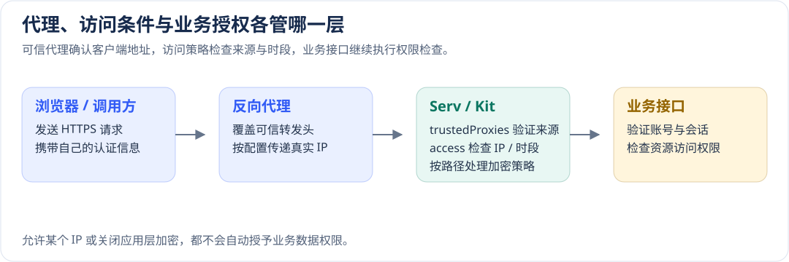

# 请求来源、时段、路径与接口加密

[配置手册](README.md) · [HTTP、代理与加密](http.md) · [登录与账号策略](identity.md) · [部署与恢复](delivery.md)

本章适用于需要限定接口来源、工作时段或传输协议的应用。例如，对外提供的 `/api/v1/external/sync` 通过普通 HTTPS 接收合作方请求，只接受指定网段在工作时间内访问；后台业务接口继续使用框架的双向应用层加密。

先确定受限接口，再配置来源和时间。策略在每次请求时执行：即使用户已经登录，时间窗口结束后的新请求也会被拒绝。IAM 的 `loginAccess` 则只决定能否建立新的登录会话，两者可以分别设置。

## 1. 开发人员：把策略接入正确的入口

### 1.1 选择 Serv 或 SvelteKit

| 应用入口 | 配置位置 | 生效参数 | 默认行为 |
| --- | --- | --- | --- |
| 独立 API、Fullstack 的 Serv 后端 | `config/_serv.yml` | `http.access` → `serv.createApp({ http })` | `false`，不限制请求来源和时段 |
| SvelteKit 的动态页面与接口 | `config/_kit.yml` | `access` → `kit.createHandle({ access })` | `false`，不限制请求来源和时段 |
| 浏览器 Vite、静态导出、Nginx 静态文件 | 由实际入口服务器配置 | 没有 Node 请求处理链 | 本章 Node 策略不处理这些请求 |

当前 CLI 的 API、Fullstack 和 SvelteKit 模板已经装配上述参数。已有应用升级时，核对自己的 `createApp` 或 `createHandle` 调用是否传入配置，避免只增加 YAML 却没有消费它。Kit 的策略和文件路径属于服务端配置；SSR 向浏览器传递配置时，只选取需要公开的字段。

Serv 的最小配置如下。示例网段只用于说明，正式使用前替换为实际可信来源。

```yaml schema=@h-ai/serv:ServConfigSchema
http:
  trustedProxies: auto
  access:
    rules:
      - id: partner-sync
        paths: [/api/v1/external/sync]
        methods: [POST]
        allowIps: [192.0.2.0/24]
        timezone: Asia/Shanghai
        windows:
          - { days: [1, 2, 3, 4, 5], start: '09:00', end: '18:00' }
```

SvelteKit 使用同一种策略内容，配置层级如下：

```yaml schema=@h-ai/kit:KitConfigSchema
trustedProxies: auto
access:
  rules:
    - id: partner-api
      paths: [/yyy/api/v1/external/**]
      allowIps: [192.0.2.0/24]
      timezone: Asia/Shanghai
      windows:
        - { days: [1, 2, 3, 4, 5], start: '09:00', end: '18:00' }
transport: false
```

第二个示例中的 `/yyy` 是实际网站挂载目录。策略匹配完整 URL pathname；应使用用户请求到达后端时的真实路径。Serv 独立 API 的前缀与 Web 网站目录分别配置，不应把网站目录自动加到所有 API 路径上。

### 1.2 策略执行到哪里

Serv 的业务路由和自定义响应都经过访问策略。内置 CORS 保留在加密外层，预检同样检查适用的规则；正常业务的拒绝响应在传输加密管线内返回。客户端可以读到稳定错误码和可读说明。

Kit 对进入 Handle 的动态页面、接口和数据请求执行策略。SvelteKit adapter 或 Nginx 在 Handle 之前直接提供的静态资源不经过这条处理链。

Nginx 直达对象存储的下载也不经过 Node。若文件下载本身需要 IP 或时段约束，应在实际对象入口另行实施；限制“生成下载链接”的 API 并不会提前终止已签发的有效链接。对象访问方式见[文件存储与临时签名](data.md#文件存储与临时签名)。

## 2. 配置管理人员：理解默认值和组合规则

### 2.1 策略入口

| 配置项 | 框架默认 | 用途与取值影响 |
| --- | --- | --- |
| `http.access` / `access` | `false` | `false` 关闭；对象开启内联策略，或用 `{ file: ... }` 引用一个文件 |
| `file` | 无默认 | `.yml` 或 `.yaml` 文件，最大 1 MiB；相对路径按服务工作目录解析 |
| `global` | 省略 | 对宿主处理的全部请求增加条件，包括健康检查和密钥交换 |
| `rules` | `[]` | 按路径和方法选择受限请求；最多 1000 条 |
| `rules[].id` | 必填，无默认 | 唯一的规则编号，用于日志定位；1–64 个字母、数字、下划线、点或连字符 |
| `rules[].paths` | 必填，无默认 | 1–100 个精确路径或末尾 `/**` 路径；不支持任意正则 |
| `rules[].methods` | `[]` | 空数组包含全部方法；指定 POST 后只限制 POST，GET 不自动包含 HEAD |
| `rules[].encryption` | 未设置，沿用宿主 | `required` 强制应用层加密；`disabled` 接收普通明文应用数据；均不改变 HTTPS、认证和 IP/时间条件 |

文件引用与内联的 `global/rules` 二选一，混合配置会报错。文件只包含策略正文，不再包一层 `http`、`access` 或 `serv`。

建议把文件放在 `config/security/request-access.yml`。Core 自动加载配置根目录中的普通 YAML；独立策略放在子目录并显式引用，可以避免它被当作业务配置提前解析。路径按服务工作目录解析，创建该子目录后再放入文件。策略的修改仍需重新装配 App/Handle，不随普通配置缓存自动切换。

全局条件和所有命中规则必须同时满足。例如，全局只允许办公网段，某个接口再要求工作日 09:00–18:00，该接口必须同时满足两项。更具体的路径不会覆盖全局规则；任何一条适用规则拒绝，请求就会停止。没有命中的规则不影响该请求，但仍需满足全局条件。

### 2.2 地址和时间条件

`global` 与每条路径规则均可设置以下字段：

| 字段 | 框架默认 | 含义 |
| --- | --- | --- |
| `allowIps` | `[]` | 空数组不限允许来源；非空时必须匹配至少一个 IPv4、IPv6 或 CIDR |
| `denyIps` | `[]` | 明确拒绝的来源，优先于允许列表 |
| `timezone` | `UTC` | 该条规则使用的 IANA 时区；每条规则独立解释，不继承全局时区 |
| `windows` | `[]` | 空数组不限时间；有窗口时，满足任意一个窗口即可通过该条时间条件 |
| `windows[].days` | 必填 | 周一为 1，周日为 7；跨午夜填写开始日 |
| `windows[].start/end` | 必填 | `HH:mm`，包含开始、不包含结束；结束早于开始表示跨午夜，相同值无效 |

地址列表各最多 1000 项，时间窗口最多 100 个。配置了地址条件却没有可信客户端 IP 时，请求会被拒绝；不会把代理地址或请求正文里的 IP 当作用户地址。

例如，周一 22:00 到周二 02:00 的窗口写为 `days: [1], start: '22:00', end: '02:00'`。周二凌晨属于周一开始的窗口，02:00 起拒绝。全天允许应省略时间窗口，不用相同起止值表达。

### 2.3 路径边界

`/api/v1/external` 只匹配该路径；`/api/v1/external/**` 同时匹配它和子路径，不匹配 `/api/v1/external-other`。路径大小写敏感，末尾斜杠按同一路径处理。

启用策略后会校验路径编码。正常编码先解码一次再匹配；编码斜杠、反斜杠、双重编码、无效编码、控制字符、重复分隔符和点段会被拒绝，避免入口与业务路由对同一地址产生不同解释。

### 2.4 外部接口使用普通 HTTPS，内部接口保持加密

`encryption` 控制框架的应用层加解密，不控制 HTTPS。选择 `disabled` 后，请求体是普通 JSON，响应也是普通 JSON；不需要 `X-Client-Id` 或密钥协商。生产仍须使用 HTTPS，并保留接口需要的认证、签名、API Key、资源归属或重放控制。

| 取值 | 请求和响应如何处理 | 前置条件 |
| --- | --- | --- |
| 省略 | 沿用宿主原有加密范围和 `transport.excludePaths` | 核对该应用实际装配的 `transport`；框架默认不自动开启加密 |
| `required` | 请求必须符合框架传输协议，成功和业务拒绝响应均走加密 | 宿主已经装配 Crypto、受管服务端密钥环和 registry；否则启动失败 |
| `disabled` | 使用普通请求和响应；携带框架加密信封会得到 400，避免密文被误作业务内容 | 调用方按明文接口契约发起 HTTPS 请求；IP、时段和身份守卫仍执行 |

显式模式优先于宿主排除列表。比如，某个路径虽然在 `excludePaths` 中，`required` 仍会要求加密。相同路径和方法如果同时命中 `required` 与 `disabled`，装配时直接失败，不采用“最后一条覆盖前一条”。同一模式可以重叠；不同方法可以分别设置。IP 和时间条件始终取交集，不因加密模式而减少检查。

下面的 Serv 示例将两个接口域分开。路径是业务示例，需要先实现相应路由；网段和工作时段也应替换为实际值。

```yaml schema=@h-ai/serv:ServConfigSchema
transport:
  keyExchangePath: /_hai/key-exchange
http:
  access:
    rules:
      - id: partner-sync
        paths: [/api/v1/external/**]
        encryption: disabled
        allowIps: [192.0.2.0/24]
        timezone: Asia/Shanghai
        windows:
          - { days: [1, 2, 3, 4, 5], start: '09:00', end: '18:00' }
      - id: management
        paths: [/api/v1/internal/**]
        encryption: required
```

使用独立文件时，将上述 `http.access` 内的 `rules` 放入策略文件，`transport` 仍留在宿主配置中。文件的传入、校验和发布快照方式见第 4 节。密钥只从服务端私有环境或 Secret 注入，不能放进策略文件。

SvelteKit 使用相同规则，将其放入 `_kit.yml` 的 `access`，同时配置 `transport`。CLI 创建时选择 `crypto` 和 db：模板会读取密钥环，并使用数据库 registry；浏览器根布局只收到公开的 `transport` 配置。子目录应用还需将宿主的 `base` 同步到两端的运行时 `basePath`，模板已处理，已有应用的接入方法见 [Kit 配置](http.md#kitcookie与请求上下文)。无 db 的 `crypto` 模板仅支持开发/测试的内存 registry，生产启动会拒绝这种装配。模板默认 `transport: false`，显式开启后才装配加密。

Fullstack 管理模板的默认选择不同：它要求启用业务传输加密，并明确拒绝 `transport: false`；需要向外部系统提供普通 HTTPS 接口时，使用独立路径的 disabled 规则。这样不会通过关闭全局传输而意外影响后台管理链路。

现有项目需要同步服务端和浏览器装配，不能仅修改 YAML。仓库的 Admin Console 提供完整示例；未装配传输加密的其他示例会明确拒绝启用该配置。静态 GitHub Pages 没有动态后端，不能依靠这项配置保护已经发布的静态文件。

调用与确认步骤：

1. 对 disabled 接口发送普通 HTTPS 请求，确认没有框架密钥协商要求，响应也不带 `X-Encrypted: true`。
2. 从不允许的地址或时段访问同一接口，确认返回 403、`hai:common:104` 和追踪编号；不能因为“明文”就跳过限制。
3. 对 required 接口发送缺少协议的普通请求，确认业务处理器没有执行；再用框架加密客户端完成正常请求，确认原始响应在线路上为密文。
4. 核对调用方的加密设置。浏览器若安装了全局 fetch 加密，外部接口应使用独立路径前缀，并将该前缀加入公开的 `transport.excludePaths`；该列表按路径段前缀匹配。服务端规则不下发私人 IP/时间条件，也不会让客户端在失败后自动降级到明文。

required 路径也要从客户端的排除列表中移除，否则客户端仍可能发送普通请求并被服务端拒绝。全局 fetch 的排除列表不按 HTTP 方法区分；同一路径按方法选择不同协议时，调用方必须明确选择相应协议。对外服务优先使用独立前缀，可以减少客户端配置冲突。

密钥交换端点是框架协议入口，本身按协议进行协商，不是普通业务加密响应；访问条件仍会检查它。OPTIONS 不携带业务密文，同样继续执行适用的 IP/时间策略。

## 3. 运维人员：先确认真实 IP 的来源



### 3.1 直连与自建代理

Serv 从 Node socket 获取对端地址；Kit 使用平台提供的 `getClientAddress()`。不要将请求 JSON 或任意转发头复制为可信地址。

`trustedProxies` 的默认值是 auto。在普通宿主上，auto 不信任转发头。使用自己的反向代理时，填写它实际连接后端的 IP/CIDR；`[]` 显式忽略全部转发头。只有可信对端提供的 `X-Forwarded-For` 才从右向左解析；没有 XFF 时才读取可信对端的 `X-Real-IP`。无效或过长的转发链不会降级为一个看似有效的客户端地址。

Kit 接入代理解析后，IAM、审计、限流和业务路由的 `getClientAddress()` 使用同一结果。使用 SvelteKit Node adapter 时，保留原始 socket 地址给框架校验，不同时用未经边界校验的 `ADDRESS_HEADER` 覆盖它；其他平台按平台对客户端地址的保证配置。

### 3.2 本框架生成的 Compose

Fullstack 的 Web Nginx，以及自建对象存储所需的 SSR/API 网关，会把后端收口到项目私有容器网络。部署器仅在这种拓扑中向后端注入内部标记 `HAI_DEPLOY_PRIVATE_PROXY=1`。auto 在服务启动时收敛本容器的实际网段，Nginx 则用自己确认的 `$remote_addr` 覆盖 XFF 和 X-Real-IP，清除客户端伪造的转发链。

该模式的条件是后端没有另外发布公网端口，项目容器网络中的成员受同一部署边界管理。不要把该内部标记移植到公网裸机或 `host` 网络模式。自建拓扑应改用明确的代理 IP/CIDR。

如果 Nginx 前面还有可信负载均衡，可在 Docker SSH 部署 Provider 中设置 `trustedEdgeProxies`。未设置时没有可信上游默认值，外部转发头不会被采用。

```yaml schema=@h-ai/deploy:ProviderConfigSchema
type: docker-ssh
expose: { hostPort: 18080, containerPort: 3000 }
trustedEdgeProxies: [192.0.2.10/32]
```

这会让 Nginx 只从指定上游解析 XFF，再向应用发送经过确认的地址。填写的应是入口代理的实际来源，不能填所有公网地址。

`trustedEdgeProxies` 只影响实际生成的 Nginx。直接公开 Node 的部署若没有 Nginx，应在 Serv/Kit 的 `trustedProxies` 中配置连接它的上游，不能只设置部署 Provider。浏览器配置只接收 `transport` 等公共字段，不应包含内部代理网段和策略文件路径。

rootless 端口转发器有时会把外部来源替换为网关地址。已经丢失的地址无法通过增加一个转发头恢复；应选择保留来源的网络模式，或在外层可信入口完成真实 IP 解析，并实际检查后端收到的结果。

## 4. 运维人员：携带独立 YAML 交付

### 4.1 准备文件

在后端应用目录的 `config/security/request-access.yml` 写入完整策略：

```yaml schema=@h-ai/core:RequestAccessPolicySchema
rules:
  - id: partner-read
    paths: [/api/v1/external/**]
    methods: [GET, HEAD]
    allowIps: [192.0.2.0/24, '2001:db8::/32']
    denyIps: [192.0.2.7]
    timezone: Asia/Shanghai
    windows:
      - { days: [1, 2, 3, 4, 5], start: '09:00', end: '18:00' }
  - id: scheduled-sync
    paths: [/api/v1/sync]
    methods: [POST]
    allowIps: [198.51.100.8]
```

规则文件使用字面配置，不解析 dotenv 插值或继续引用其他文件。重复 YAML 键、别名、未知字段、非法地址或时区会导致初始化失败，不会忽略失败后继续开放接口。修改后重新创建服务实例，运行中不监视文件变化。

在 `_serv.yml` 设置 `http.access: { file: ./config/security/request-access.yml }`；SvelteKit 在 `_kit.yml` 设置 `access: { file: ./config/security/request-access.yml }`。

### 4.2 从环境变量选择文件

也可以在所选环境文件中整体覆盖策略入口。下面两项按后端类型选择一项：

```dotenv
# Serv 后端
HAI_SERV_HTTP_ACCESS='{"file":"./config/security/request-access.yml"}'
# SvelteKit 后端
HAI_KIT_ACCESS='{"file":"./config/security/request-access.yml"}'
```

完整 `HAI_SERV` 或 `HAI_KIT` JSON 是基础，同一来源的子字段变量继续覆盖。生成命令优先输出 `HAI_SERV_HTTP_ACCESS_FILE` / `HAI_KIT_ACCESS_FILE` 等细项，JSON 位于对应模块的细项之前。完整环境优先级见[配置来源](runtime.md#配置从哪里来)。

内联规则同样可以用 JSON 传入。例如只对外部同步接口限制来源，并关闭该接口的框架应用层加密：

```dotenv
HAI_SERV_HTTP_ACCESS='{"rules":[{"id":"delivery-sync","paths":["/api/v1/sync"],"allowIps":["192.0.2.10"],"encryption":"disabled"}]}'
```

将示例地址替换为真实允许来源；接口原有认证、API Key 与权限校验继续执行，HTTPS 仍需保留。当前 SDK 的 Node 后端可以修改实际挂载的发布 `.env.runtime` 后重启；已有 `HAI_SERV` 或 `HAI_SERV_HTTP` 上层 JSON 时，分别修改其中的 `http.access` 或 `access`，不能只增加已被覆盖的叶子变量。Kit 同理修改 `HAI_KIT` 的 `access`。具体路径与保护范围见[重启加载运行配置](runtime.md#部署后重启加载运行配置)。

自行维护且只使用 Compose `env_file` 注入环境的容器，修改该文件后需要**重新创建容器**；`docker compose restart serv` 会保留创建时的变量，见[Docker 说明](https://docs.docker.com/reference/cli/docker/compose/restart/)。通常执行 `docker compose up -d --no-deps --force-recreate serv`，无需重建镜像；沿用原项目名和全部 Compose 文件参数。

### 4.3 全量、增量与回滚

部署器在打包前读取当前应用的配置，并验证独立文件。相对路径按所部署的后端应用目录解析。文件内容形成该次交付的 `request-access.yml` 快照，纳入 SHA-256 校验，并以只读文件挂到后端的 `/run/hai/request-access.yml`。

交付包内的 `.env.runtime` 指向容器中的快照路径；生产者的环境文件仍保留原始路径。服务以非 root 用户运行时也可读取该只读快照，服务器的发布父目录继续限制访问。

| 更新方式 | 策略如何处理 |
| --- | --- |
| 全量部署 | 后端与本次策略快照一起启动，按健康检查确认 |
| 包含后端的增量 | 后端切换到新发布目录的策略；可以调整规则或关闭策略 |
| 仅更新其他服务 | 未选择的后端保留其旧配置、旧挂载和旧策略 |
| 本次更新失败后恢复旧版 | 使用旧服务定义及其对应的旧策略快照，再检查旧版健康 |

归档内的 `.env.runtime` 和策略快照都参加交付校验，上传前不要编辑已经校验的包。替换 SDK 管理的策略快照时，修改源文件并生成新包。已部署 Node 后端的挂载运行文件可按 4.2 修改后重启，不能因此改写归档或策略快照。健康接口也受全局条件约束，因此只想限制外部业务 API 时，优先使用路径规则，避免让部署器的本地探测被误拒绝。

镜像和配置回退不会撤销已经完成的业务写入，数据库迁移和数据恢复按业务方案处理。

### 4.4 运维独立管理文件：修改后重启生效

如果需要只修改规则并重启容器，使用**固定文件引用 + 容器只读挂载**。框架在服务实例初始化时读取、校验和编译文件；请求阶段不读取磁盘。保持引用不变，修改宿主上的 YAML 后重启服务，就会重新加载。它不监视文件变化，也不在每次请求时读取文件。

**自行维护 Compose 的项目**可以使用目录挂载，便于在宿主原子替换文件。以下配置合并到现有 Compose，保留原镜像、端口和其他配置：

```yaml
services:
  serv:
    env_file: .env.runtime
    volumes:
      - ./runtime/security:/run/hai/security:ro
```

`.env.runtime` 中固定使用以下入口；SvelteKit 对应改为 `HAI_KIT_ACCESS`：

```dotenv
HAI_SERV_HTTP_ACCESS='{"file":"/run/hai/security/request-access.yml"}'
```

前提是没有完整 `HAI_SERV` 父对象覆盖它；若已经使用父对象，就在父对象的 `http.access` 中设置同一引用，不能同时依赖叶子变量叠加。宿主准备 `runtime/security/request-access.yml`，内容采用 4.1 的完整规则。限制宿主目录的修改权限，并确保容器运行用户可读。新增挂载或首次改变引用时先重新创建容器，此后只改变 YAML：

```sh
docker compose up -d --no-deps --force-recreate serv
# 后续规则文件修改并保存后执行
docker compose restart serv
```

**部署器生成的交付包**默认仍使用 4.3 的不可变快照。若明确由运维独立管理策略，可在交付之外保存一份宿主文件与 Compose override，将已有 `/run/hai/request-access.yml` 挂载替换为外部文件，保持部署器注入的完整 `HAI_SERV` / `HAI_KIT` 引用不变：

```yaml
services:
  serv:
    volumes:
      - type: bind
        source: /opt/hai-config/request-access.yml
        target: /run/hai/request-access.yml
        read_only: true
```

`serv` 要换成实际后端服务名；同源模板可能为 `web`。Compose 按容器目标路径合并挂载，所以只替换这一项。启动或重建时，把该 override 作为**原有完整 `-f` 列表的最后一项**，并使用原项目名。首次应用需要重新创建后端容器；之后原子替换宿主文件并重启同一后端即可。不要编辑校验过的归档或 SDK 策略快照。Node 后端挂载的 `.env.runtime` 按 4.2 更新；它不会改写外部文件或 Nginx。

该 override 及外部文件需要纳入运维自己的部署与备份流程，后续 SDK 发布不会自动保存人工附加的参数。**SDK 回滚不恢复这份外部策略**；如需规则与制品一起自动回滚，继续使用默认快照模式。修改前备份，重启后检查健康状态，并实际请求一条允许路径和一条拒绝路径；规则只限制业务路径时，保留健康探测可达。SvelteKit 可能在首个请求时才创建 Handle，容器显示运行中不足以证明策略已加载。

无效文件或权限错误会阻止服务初始化，不会自动放行。恢复最后可用文件并再次重启，再核对接口响应。对下载或长连接较多的应用，重启前安排连接排空或多实例切换。

## 5. 安全审查与排错

| 现象 | 应检查什么 | 处理方式 |
| --- | --- | --- |
| `hai:common:104` | 当前请求的地址、时间或路径不符合策略 | 用户按提示更换网络或在允许时间重试；管理员用追踪编号查规则编号和原因类别 |
| `hai:iam:026` | 新登录不符合 IAM 的 `loginAccess` | 检查登录来源与时段；与本章请求规则分别核对 |
| 明文接口收到 400 | 请求携带了框架的加密标记或信封 | 调用方关闭该接口的应用层加密；浏览器核对公开排除路径，不关闭 HTTPS |
| required 接口启动失败 | 缺少宿主加密装配，或与另一规则冲突 | 核对路径、方法、Crypto/registry 及密钥来源；不靠声明顺序消除冲突 |
| 配置文件读取/解析失败 | 文件位置、权限、大小、字段和 YAML 格式 | 修正后重启或重新打包；保留原策略及可用制品 |
| 后端只看到网关地址 | Nginx 入口、可信代理设置或 rootless 网络转换 | 先验证地址链，再配置允许列表；不要用扩大允许范围掩盖地址错误 |

用户界面统一通过 ToastContainer 提示。默认只显示可读说明；点击信息图标可查看或复制追踪编号，供客服或开发进一步定位。日志记录规则编号、原因类别、可信客户端 IP 和请求关联，不向用户回显策略文件正文或完整来源列表。

访问策略与账号权限共同生效。它不会授予接口权限，也不会替代 API Key、租户归属或数据范围检查。关闭策略后，原有认证和权限规则继续执行。

本章策略在 Serv/Kit 请求链执行。Nginx 直接返回的静态资源及[对象存储直连](data.md#配置人员区分三个访问地址)不经过这条链；文件下载需依赖 S3 签名及入口网络策略，不能仅靠 Serv/Kit 的全局配置限制已发出的存储链接。

## 6. 性能与验证

### 6.1 初始化与请求阶段分别做什么

文件读取、Schema 校验、CIDR 编译和路径索引在初始化时完成。请求阶段不读取文件，不重新解析全部规则；精确路径走 Map，前缀路径沿路径树查询，只检查命中的条件。相同时区复用时间格式化器和当前分钟的结果，跨分钟重新计算。

默认关闭时，Serv 不注册请求策略中间件。规则越多不意味着每次都检查全部规则；同一路径若刻意叠加许多规则，则需要满足其中每一条。大规模配置应按业务分组，避免无意义的重复条件。

### 6.2 当前版本的本机实测

2026-10-30，在 Windows x64、Node v24.22.1、Intel Core Ultra X7 358H 上，通过已构建的公开入口测量。检查器预热后按轮换顺序运行 9 批；下表是批次平均耗时的中位数，不是单个生产请求的 P95。

| 策略规模 | 每次检查 | 启动验证与编译 |
| --- | --- | --- |
| 单条路径，含 IP 和时段 | 0.51 微秒 | 15.95 毫秒 |
| 1000 条不同路径，命中一条 | 0.51 微秒 | 63.19 毫秒 |
| 1000 条路径，无命中 | 0.15 微秒 | 48.82 毫秒 |
| 单条规则含 1000 个网段，匹配末项 | 0.46 微秒 | 3.32 毫秒 |
| 同一路径叠加 1000 条规则 | 608.84 微秒 | 48.72 毫秒 |

启动列按顺序创建，包含首次时区格式化器及运行时的冷启动开销；不能把冷热差额解释为某项配置的性能收益。另测“访问检查 + 加密模式选择”的组合：单条规则约 0.66 微秒，1000 条路径命中一条约 0.71 微秒；选择器复用同一路径树，未重新计算 IP 或时间。

另外使用 `serv.listen()` 发起真实 TCP 回环请求，预热后每种配置测 1000 次，完整消费响应。关闭策略的中位耗时约 223 微秒，启用单条规则约 250 微秒，1000 条路径中命中一条约 237 微秒。此项包含 HTTP 和路由开销，未启用加密、数据库及外部服务；不把单次测量差额当作稳定的附加成本。

这些数字说明该次本机测量中，增加未命中的路径没有导致逐条规则扫描。同一路径叠加大量规则仍有实际成本；应先合并相同条件，再按业务路径组织规则。运行时调度、GC、硬件和并发会影响结果，生产仍需按实际负载、加密和依赖测量。

### 6.3 如何复核

从源码仓库运行 Core 策略测试和 CLI 真实代理门禁；后者需要可用容器引擎及测试基础镜像：

```sh
pnpm --filter @h-ai/core exec vitest run tests/core-access.test.ts
pnpm --filter @h-ai/cli test:deploy-gates --testNamePattern 私有后端共享客户端
```

分别检查允许与拒绝地址、时间窗口前后、方法与路径边界、文件加载失败和代理伪造。文件要验证全量交付、后端增量、未选后端保留及失败恢复。复核结果与所测版本关联；配置解析、真实网络请求、浏览器流程和生产恢复分别记录，不互相替代。
