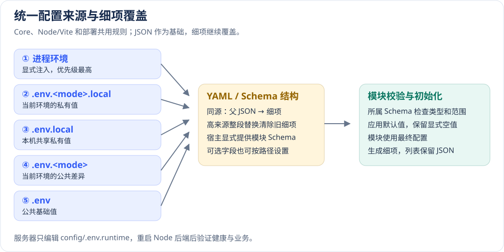

# 基础配置、环境覆盖与生命周期

[配置手册](README.md) · [下一章：数据与共享状态](data.md)

先解决“谁加载、最后哪个值生效、谁消费”三个问题，再调整具体模块参数。生成工程已装配常用入口；自己写启动代码时，也要逐项校验并检查初始化结果。

## 配置从哪里来

运行配置通常放 `config/_<名称>.yml`，例如 `_db.yml` 注册为 `db`。模块名不一定是文件名：数据库模块 `reldb` 的生成配置名是 `db`，所以覆盖变量以 `HAI_DB_` 开头。根 `hai.json` 的 build/`deploy` 由 CLI 读取，UI 和 API 客户端参数由调用方传入。

| 来源 | 普通应用运行时的优先级与用途 |
| --- | --- |
| 进程环境 | 最高；CI/容器/Secret Manager 注入，已有变量不被 dotenv 覆盖；空字符串也是显式输入 |
| `.env.<mode>.local` | 当前环境的私有覆盖，不提交版本库 |
| `.env.local` | 本机私有覆盖，不提交版本库 |
| `.env.<mode>` | 环境公共差异，例如 `.env.prod`；不放真实秘密 |
| `.env` | 公共基础值 |
| YAML 中的 `HAI_<配置名>_<路径>` 覆盖 | 环境值覆盖 YAML；同源先父 JSON 后细项，`camelCase` 不拆词 |
| `${VAR}` / `${VAR:回退值}` | 没有约定节点覆盖时解析插值；必需变量缺失返回 `CONFIG_ENV_VAR_MISSING` |
| Schema 默认 | 最后补齐该 Schema 明确声明的缺省字段，不能补真实服务地址和凭据 |

`core.init()` 不读取 dotenv。Node/Vite 宿主先调用 `core.config.loadEnvFiles` 并检查 success，生成工程的 Node 启动命令复用 `scripts/run-node.mjs`。Core、构建和部署使用相同顺序。更高来源整段替换节点时先清除低来源细项，同来源再按父到子应用，与行序无关。同文件重复变量报错。

例如同一文件有 `HAI_IAM_SESSION='{"maxAge":3600}'` 和 `HAI_IAM_SESSION_MAXAGE=1800`，最终为 1800。宿主显式提供模块 `configSchemas` 后，Schema 中合法的可选路径即使未写入 YAML 也能接收细项；扫描仅使用结构和类型，模块仍执行完整校验。没有 Schema 时按已有 YAML/JSON 结构定位，未知路径不凭空创建。

### JSON 兜底与生成规则

手写 JSON 可用于任何对象或数组，放在对应模块细项之前便于阅读。生成命令优先写细项，数组保留 JSON。动态字典、显式空对象以及本身要求 JSON 文本的字段保留原义；整体替换对象展开时可能留下最上层 `{}` 重置标记，避免旧 YAML 字段重新出现。

```dotenv
# 对象基础在前，细项在后；本例最终公开地址包含 12348 端口。
HAI_STORAGE='{"type":"s3","bucket":"hai","region":"us-east-1"}'
HAI_STORAGE_ENDPOINT=http://storage:9000
HAI_STORAGE_FORCEPATHSTYLE=true
HAI_STORAGE_PUBLICENDPOINT=http://172.30.85.45:12348/files
HAI_STORAGE_CREATEBUCKET=true

# 列表保留一个 JSON；索引只修改已有项，不追加、不生成空洞。
HAI_REACH_PROVIDERS='[{"name":"mail","type":"smtp","host":"smtp.example.com","port":465,"secure":true,"from":"noreply@example.com"}]'
# 密码单独写 .env.test.local：HAI_REACH_PROVIDERS_0_PASS=...
```

生成工具不会同时写一份包含相同属性的大 JSON 和细项。空字符串、false、0、空数组均为显式值；Schema 字符串保留前导零，JSON/环境值中的 `${...}` 不再次插值。数组越界或缺少列表声明时报错。



环境层解决“这个环境用什么值”，YAML 描述字段结构，最后由模块校验并使用。

## 应用信息与语言

配置位置：`config/_core.yml`。用途：统一应用元信息、核心错误语言和日志；不会自动翻译业务页面文案。

| 项 | 框架默认 | 不同值的影响 |
| --- | --- | --- |
| `name` | `hai Admin` | 宿主读取的应用名称，生成应用应明确填业务名称 |
| `version` | `0.1.0` | 应用公开信息；发布制品版本另由根 `package.json` 驱动，不能只改这里 |
| `env` | `development` | 可选 development/production/test/staging；不会自行设置 `NODE_ENV` 或启动依赖 |
| `defaultLocale` | `zh-CN` | 核心默认消息语言；浏览器 UI 还需使用语言入口；每个请求的 locale 应用上下文隔离 |
| `logging` | 整个对象可省略 | 省略对象不会等同于传入 `{}`，见下一节 |

```yaml schema=@h-ai/core:CoreConfigSchema
name: Orders
version: 1.0.0
env: production
defaultLocale: zh-CN
logging:
  level: info
  format: json
  context: { service: orders-serv }
  redact: [customer.email, customer.phone]
```

应用启动后通过公开 app.info/宿主白名单核对名称、版本；切换界面语言确认核心错误和 UI 一起切换。服务端不要下发整个 `_core.yml`，只公开必要字段。Vite 注入的编译默认值要重新构建后才改变，不能承诺任意 YAML 热更新到静态页面。

## 日志采集与隐私

| 项 | 框架默认 | 修改后的影响与检查 |
| --- | --- | --- |
| `logging.level` | 对象存在时 `info` | trace/debug 更多诊断，warn/error 更少输出；检查目标级别是否被过滤 |
| `logging.format` | 对象存在时 `json`；未配置 Logger 初始为 `pretty` | JSON 适合逐行采集；pretty 适合终端且需 pino-pretty，不能靠默认环境推断 |
| `logging.context` | 无默认 | 追加稳定服务/节点标识，不放密码或用户敏感正文 |
| `logging.redact` | `[]` | 追加业务隐私路径，凭据默认脱敏仍生效；已有历史日志不会被追溯清理 |

错误输出走 `core.error.toPublic`，UI 经 ToastContainer 默认显示可读说明，排查图标才展示编号。日志可以保留脱敏 Error 和同一个 `traceId`；不要把 cause、SQL、绑定值或凭据返回用户。默认脱敏覆盖 `passwordHash`/`secretKey` 等已知字段，不保证识别任意无标签秘密；业务隐私要显式清理。

### `logging.redact` 怎么填写

它用来遮盖日志对象里的业务隐私，例如客户邮箱、收件地址。填的是**日志字段路径**，不是配置文件路径，也不是要搜索的文字。路径区分大小写，匹配到的值会替换为 `[REDACTED]`；其他字段照常记录。

例如，应用记录下面这个对象：

```ts
core.logger.info('Order created', {
  orderId: 'order-42',
  customer: { name: 'Alice', email: 'alice@example.com' },
  recipients: [{ phone: '13800000000' }, { phone: '13900000000' }],
})
```

在 `config/_core.yml` 的 `logging` 下配置：

```yaml
logging:
  level: info
  format: json
  redact:
    - customer.email
    - recipients[*].phone
```

日志中的业务部分就会变成：

```json
{
  "orderId": "order-42",
  "customer": { "name": "Alice", "email": "[REDACTED]" },
  "recipients": [{ "phone": "[REDACTED]" }, { "phone": "[REDACTED]" }]
}
```

| 写法 | 匹配内容 |
| --- | --- |
| `email` | 日志对象最外层的 `email`，不代表任意层级的邮箱 |
| `customer.email` | `customer` 对象里的 `email` |
| `recipients[*].phone` | `recipients` 数组每一项里的 `phone` |
| `customers.*.email` | `customers` 下一层每个对象的 `email`；`*` 只匹配一层 |

不要写成 `*.password*` 之类的文字搜索规则，也不要依赖 `**` 表示任意深度。更简单、可靠的做法是先整理日志对象，只记录需要的字段，再为固定路径配置脱敏。

密码、令牌等框架已识别的凭据字段始终会脱敏，`redact: []` 不会关闭这层保护。`logging.redact` 是在此基础上补充业务字段。它不会清理已经写出的历史日志，不会修改原始业务对象，也不能可靠地清理拼接在普通消息文本里的任意个人信息。

```ts
// 结构化字段可以按路径脱敏。
core.logger.info('Customer updated', { customer: { email } })
// 不要把业务隐私拼进消息正文。
```

修改后重启后端，用测试数据产生一条日志，核对字段已经遮盖且 `orderId` 等排查信息仍然保留。不要用真实客户数据验证。

## 部署后重启加载运行配置

Node 后端（Serv / SvelteKit SSR）每次启动读取服务器 `<部署目录>/config/.env.runtime`。应用配置与托管连接在此合并，修改 `HAI_STORAGE_PUBLICENDPOINT` 等细项后重启对应后端即可；同一来源的细项覆盖父 JSON。配置目录只读挂载到 `/run/hai/config`，编辑器原子替换文件也会被下一次启动读取。私有代理标记和 Node 启动参数由部署装配管理；静态 Web、中间件原生环境、端口/挂载、Nginx 路由与限额变更仍需部署。仅更新 Web/中间件保留当前应用配置；后端局部更新保留服务器托管连接，其余值来自新包，全量更新采用新包并按已有凭据状态定稿。手工修改先备份，长期配置同步回源环境。

容器打包时，监听地址采用 `0.0.0.0`，端口采用制品声明值（未声明时采用部署配置），并生成 `HOST`、`PORT` 和 Serv 的对应细项。本机 `.env` 中的回环地址与开发端口继续用于本地运行。修改容器端口时更新制品与部署布局后重新部署。

运行文件固定为服务器 `<部署目录>/config/.env.runtime`，各发布记录在自己的 `config/.env.runtime` 保存快照。宿主部署根目录保护凭据，容器只读挂载配置目录。先备份，再编辑，重启并核对健康和一条受影响的业务请求；加载或 Schema 校验失败时恢复文件再重启。进程启动后不会持续监视文件。

可在服务器查询实际路径（Podman 将命令名换成 `podman`），然后编辑返回的文件并重启同一后端容器：

```bash
docker inspect hai-myapp-test-serv --format '{{range .Mounts}}{{if eq .Destination "/run/hai/config"}}{{.Source}}{{end}}{{end}}'
# 编辑上述目录中的 .env.runtime，然后重启。
docker restart hai-myapp-test-serv
```

环境文件采用 dotenv 字面语法，不执行 shell、变量展开或 Compose 插值；生成器编码保留混合引号、多行、反斜线和 Unicode。单个文件上限 1 MiB；缺失、不可读、重复变量或超限会在导入应用前失败，不打印变量值。同源细项覆盖父 JSON，显式进程 `HAI_*` 注入仍优先。Node 启动选项变更需重新部署。修改连接密码不会自动修改中间件内部密码，托管凭据与数据卷状态必须一致。

SvelteKit SSR 在 Node 服务正常停止后，会先关闭业务模块，再释放其依赖的数据库、缓存等资源，避免后台任务或连接阻止进程退出。

## 保存以后如何生效

以下是独立 Node 宿主的完整装配片段；生成工程已有同类入口时直接复用。

```ts
import { core } from '@h-ai/core'
import { ReldbConfigSchema, reldb } from '@h-ai/reldb'

const env = core.config.loadEnvFiles({ mode: 'dev', envDir: '.' })
if (!env.success) throw new Error(env.error.message)
Object.assign(process.env, env.data)
core.init({ configDir: './config' })
const db = core.config.validate('db', ReldbConfigSchema)
if (!db.success) throw new Error(db.error.message)
const started = await reldb.init(db.data)
if (!started.success) throw new Error(started.error.message)
// 宿主退出时 await reldb.close()，检查关闭结果。
```

这是启动边界的失败退出，不是要求业务 API 改成抛异常。`core.init` 会记录单项加载失败并继续；结束不表示每项有效，必需配置必须 validate。目录扫描/日志设置等异常也可能传播。Core 是同步入口，没有 `core.close()`。

配置缓存变化不表示连接池、会话或外部客户端已经热更新。先停接请求，再按宿主顺序释放旧模块，校验新配置并重新初始化。多模块优先复用 `core.module.createRuntime`：顺序启动，失败回滚，反序关闭；关闭失败保留待清理模块及依赖，不能先关闭仍被使用的数据库。

| 能力 | 前置与关闭顺序 |
| --- | --- |
| IAM | 先 RelDB/Cache，最后关闭存储；OTP/LDAP 按功能补实际通道 |
| Feedback | 先 RelDB/私有 Storage；先停止并排空采集任务，再关依赖 |
| AI 持久化 | RelDB/VecDB 或显式持久 Store；生产不能退回进程内存冒充可用 |
| Audit/Scheduler/Payment | 共享 RelDB；通知按需 Reach，未知副作用先核对再恢复 |
| Serv/Kit/UI/Datapipe | 工厂、宿主适配、组件或纯函数，按公开契约，不统一套 init/close |

本章实际验证覆盖顺序、Schema 默认和错误边界。生产多节点故障及滚动更新应结合目标数据库、缓存和部署环境验收。
