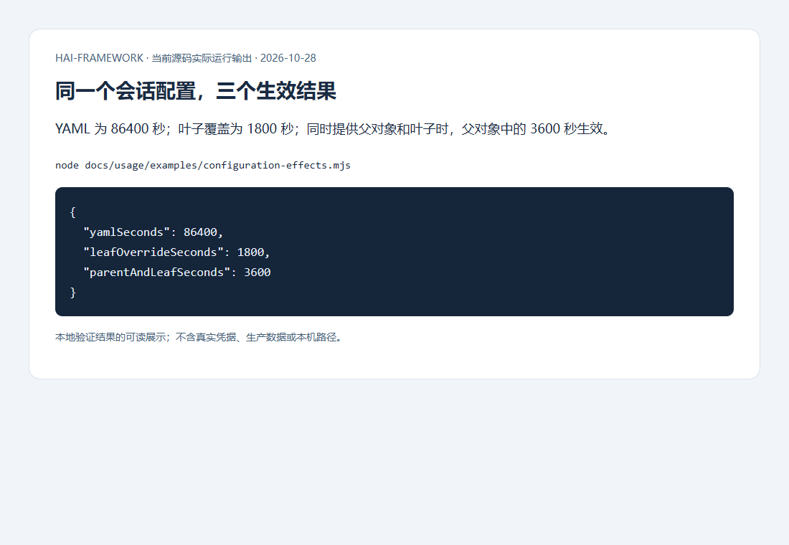
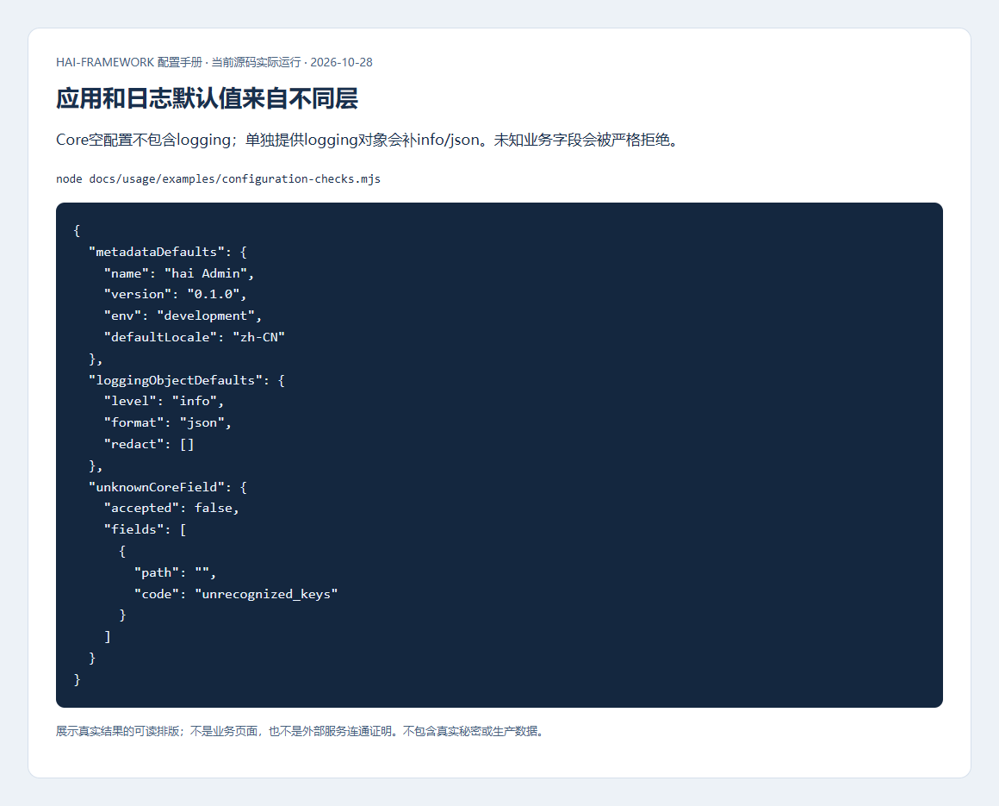
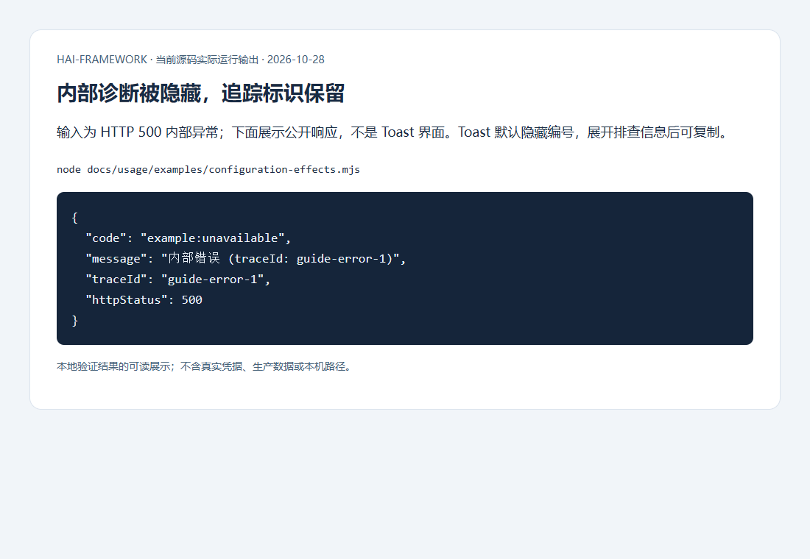
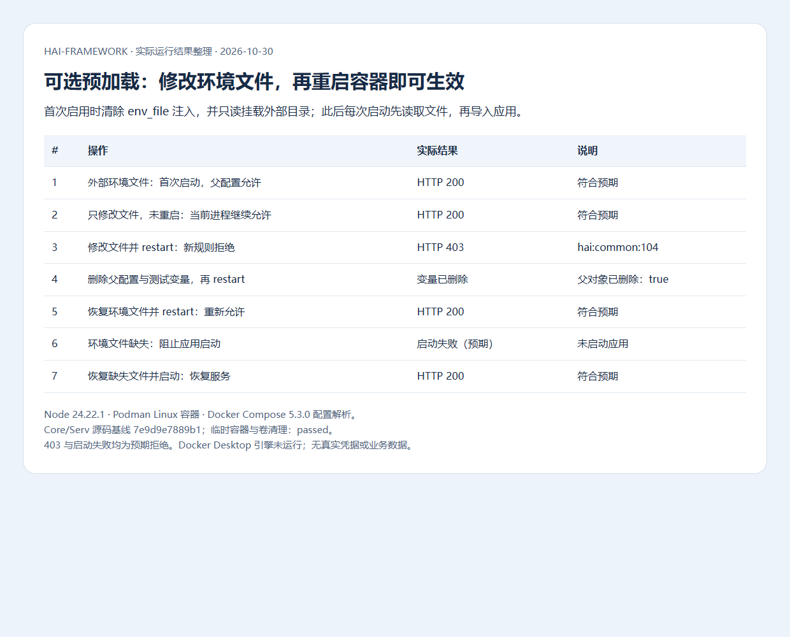

# 基础配置、环境覆盖与生命周期

[配置手册](README.md) · [下一章：数据与共享状态](data.md)

先解决“谁加载、最后哪个值生效、谁消费”三个问题，再调整具体模块参数。生成工程已装配常用入口；自己写启动代码时，也要逐项校验并检查初始化结果。

## 配置从哪里来

运行配置通常放 `config/_<名称>.yml`，例如 `_db.yml` 注册为 `db`。模块名不一定是文件名：数据库模块 `reldb` 的生成配置名是 `db`，所以覆盖变量以 `HAI_DB_` 开头。根 `hai.json` 的 build/deploy 由 CLI 读取，UI 和 API 客户端参数由调用方传入。

| 来源 | 普通应用运行时的优先级与用途 |
| --- | --- |
| 进程环境 | 最高；CI/容器/Secret Manager 注入，已有变量不被 dotenv 覆盖；空字符串也是显式输入 |
| `.env.local` | 本机私有覆盖，不提交版本库 |
| `.env.<mode>` | 环境公共差异，例如 `.env.prod`；不放真实秘密 |
| `.env` | 公共基础值 |
| YAML 中的 `HAI_<配置名>_<路径>` 覆盖 | 加载 YAML 时按约定覆盖节点，父对象整体替换优先于已有子叶；camelCase 不拆词 |
| `${VAR}` / `${VAR:回退值}` | 没有约定节点覆盖时解析插值；必需变量缺失返回 `CONFIG_ENV_VAR_MISSING` |
| Schema 默认 | 最后补齐该 Schema 明确声明的缺省字段，不能补真实服务地址和凭据 |

`core.init()` 不读取 dotenv。Node/Vite 宿主需先调用 `core.config.loadEnvFiles` 并检查 success，或采用生成工程已有装配。部署额外支持 `.env.<mode>.local` 且父/叶合并有不同规则，见[部署配置](delivery.md#环境和秘密的来源)。不要在应用里再实现一套覆盖顺序。

例如 YAML 写 `session.maxAge: 86400`，`HAI_IAM_SESSION_MAXAGE=1800` 可把它改成 1800。若同时设置 `HAI_IAM_SESSION='{"maxAge":3600}'`，父对象整体替换，叶子 1800 不再生效；YAML 没有的任意叶子不会凭空创建，应补字段或覆盖完整父对象。



上图运行 `node docs/usage/examples/configuration-effects.mjs`，实际结果依次为 86400、1800、3600 秒。示例使用独立 guide 配置，不读取应用密钥。排查时核对来源键名，不打印完整配置或私有环境。

## 应用信息与语言

配置位置：`config/_core.yml`。用途：统一应用元信息、核心错误语言和日志；不会自动翻译业务页面文案。

| 项 | 框架默认 | 不同值的影响 |
| --- | --- | --- |
| `name` | `hai Admin` | 宿主读取的应用名称，生成应用应明确填业务名称 |
| `version` | `0.1.0` | 应用公开信息；发布制品版本另由根 package.json 驱动，不能只改这里 |
| `env` | `development` | 可选 development/production/test/staging；不会自行设置 NODE_ENV 或启动依赖 |
| `defaultLocale` | `zh-CN` | 核心默认消息语言；浏览器 UI 还需使用语言入口；每个请求的 locale 应用上下文隔离 |
| `logging` | 整个对象可省略 | 省略对象不会等同于传入 `{}`，见下一节 |

```yaml schema=@h-ai/core:CoreConfigSchema
name: Orders
version: 1.0.0
env: production
defaultLocale: zh-CN
logging:
  level: info
  format: json
  context: { service: orders-serv }
  redact: [customer.email, customer.phone]
```

应用启动后通过公开 app.info/宿主白名单核对名称、版本；切换界面语言确认核心错误和 UI 一起切换。服务端不要下发整个 `_core.yml`，只公开必要字段。Vite 注入的编译默认值要重新构建后才改变，不能承诺任意 YAML 热更新到静态页面。

## 日志采集与隐私

| 项 | 框架默认 | 修改后的影响与检查 |
| --- | --- | --- |
| `logging.level` | 对象存在时 `info` | trace/debug 更多诊断，warn/error 更少输出；检查目标级别是否被过滤 |
| `logging.format` | 对象存在时 `json`；未配置 Logger 初始为 `pretty` | JSON 适合逐行采集；pretty 适合终端且需 pino-pretty，不能靠默认环境推断 |
| `logging.context` | 无默认 | 追加稳定服务/节点标识，不放密码或用户敏感正文 |
| `logging.redact` | `[]` | 追加业务隐私路径，凭据默认脱敏仍生效；已有历史日志不会被追溯清理 |



图中 Core 空配置没有 logging，而单独解析 logging 空对象会补 info/json/空 redact；未知业务字段被严格 Schema 拒绝。来源是 `node docs/usage/examples/configuration-checks.mjs`，并非日志平台截图。

错误输出走 `core.error.toPublic`，UI 经 ToastContainer 默认显示可读说明，排查图标才展示编号。日志可以保留脱敏 Error 和同一个 traceId；不要把 cause、SQL、绑定值或凭据返回用户。默认脱敏覆盖 passwordHash/secretKey 等已知字段，不保证识别任意无标签秘密；业务隐私要显式清理。



## 部署后重启加载运行配置

Node 后端（Serv / SvelteKit SSR）默认在每次启动时重读发布目录的 `.env.runtime`，修改后 `docker restart <容器名>` 或 `podman restart <容器名>` 即可，无需重建镜像或额外 override。旧部署先用新版 CLI 发布一次。删除的字段不会从旧 Compose 注入中复活；服务器托管连接的 `middleware.env` 保持原有更高优先级，私有代理标记和 Node 启动参数仍由部署装配管理。静态 Web、中间件、端口/挂载和 Nginx 限额不在该重载范围。手工修改需备份；下一次后端发布会从工程环境重新生成，需要长期保留的配置同步回源环境。

运行文件在服务器 `<部署目录>/releases/<该后端的发布ID>/.env.runtime`，以该后端容器实际挂载的源文件为准。后续只更新 Web 或中间件时，`current` 可能指向较新的发布记录，后端仍读取其原发布文件。运行文件和托管连接只读挂载给后端，上级发布目录保持 0700，宿主所有者可修改文件。先备份，再编辑，重启并核对健康和一条受配置影响的业务请求；加载或 Schema 校验失败时恢复文件再重启。进程启动后不会持续监视文件。

可在服务器查询实际路径（Podman 将命令名换成 `podman`），然后编辑返回的文件并重启同一后端容器：

```bash
docker inspect hai-myapp-test-serv --format '{{range .Mounts}}{{if eq .Destination "/run/hai/.env.runtime"}}{{.Source}}{{end}}{{end}}'
docker restart hai-myapp-test-serv
```

环境文件采用 dotenv 字面语法，不执行 shell、变量展开或 Compose 插值；双引号字符串支持交付使用的 JSON 转义。单个文件上限 1 MiB；缺失、不可读或超限会在导入应用前失败，不打印变量值。整个 `HAI_SERV` / `HAI_KIT` 父对象仍优先于同名叶字段，调整叶字段时先处理已有父对象。Node 启动选项变更仍需重新部署。

## 可选：Node 容器重启时重读环境文件

### 用途、适用条件与默认行为

普通 Compose 的 `env_file` 在创建容器时注入变量，修改后单纯 `restart` 不会更新。本模式适合需要频繁调整日志、业务开关、请求策略等**应用启动配置**的 Node 后端：固定挂载一份外部 `.env.runtime`，每次启动先解析它，再导入应用。首次设置需要重新创建容器，后续改文件后重启即可，无需重建镜像。

以下仅供旧版交付或自维护镜像接入；当前部署包已默认采用上一节的启动重读，不需要这些额外操作。它不增加 Core 配置项。现有 Node 镜像可通过挂载配套脚本接入，无需覆盖已发布包。SvelteKit 后端与独立 Serv 后端适用；Nginx 静态前端、数据库和其他中间件不使用这个 Node 入口。

### 准备完整、受保护的运行文件

将[预加载脚本](../examples/runtime-env.mjs)保存为 `runtime-env.mjs`，与外部 `.env.runtime` 放在宿主私有目录，例如 `/opt/hai-config/my-app/`。首次应带上后端原有的完整配置与受管凭据，不能只保留需要修改的一项；交付包中的原文件仍作为不可变发布快照保留。

下面只展示常见可调整项，省略已有 DB、Cache、transport 等运行配置，不能直接代替完整生产环境文件：

```dotenv
HAI_CORE_LOGGING_LEVEL=info
HAI_SERV_HTTP_ACCESS='{"rules":[{"id":"delivery-sync","paths":["/api/v1/sync"],"allowIps":["192.0.2.10"],"encryption":"disabled"}]}'
```

文件采用 Node 的 dotenv 字面语法，不执行 shell、变量展开或 Compose 插值。JSON 用单引号包裹；`$` 是字面字符，不写成 Compose 专用的 `$$`。从 Compose 文件导出值时先确认插值已正确还原，不把 Compose 转义直接当作实际密码。

目录仅允许运维修改，容器只读；含秘密的环境文件不能设为所有用户可读。例如镜像以 UID/GID 1000 运行时，可将目录设为 `root:1000`、`0750`，文件设为 `root:1000`、`0640`；其他 UID 按实际调整。脚本也必须处于同一受保护的只读目录，不能让应用进程修改启动代码。

### 覆盖 Compose 启动方式

将以下内容保存为交付目录之外的 `runtime.override.yml`，作为原有完整 Compose 文件列表的最后一项，保留原项目名。需要支持 `!reset` 的 Compose 版本；本轮以 Docker Compose 5.3.0 验证解析。

```yaml
services:
  serv:
    env_file: !reset []
    volumes:
      - type: bind
        source: /opt/hai-config/my-app
        target: /run/hai/runtime
        read_only: true
    command: [node, --import, /run/hai/runtime/runtime-env.mjs, dist/index.js]
```

SvelteKit 模板把服务名换成实际后端（通常是 `web`），最后一项换为 `build/index.js`。`env_file: !reset []` **必须保留**：它清除原文件在创建时的注入，让删除的配置项不会从旧容器环境中复活。若原 Compose 的 `environment` 中也重复写了应用变量，同样应去掉重复项；保留受管私有代理标记等部署基础设置。

本模式的优先级是：**外部文件 > 同名进程/镜像环境 > 原应用配置**。未在文件中设置的值仍可使用镜像默认值或原应用配置。完整 `HAI_SERV` / `HAI_KIT` 仍会覆盖其叶子变量；删除父对象后再使用叶子配置时，不应在其他来源保留该父对象。

首次用原项目名、原来的全部 `-f` 参数及追加的 override，执行 `up -d --no-deps --force-recreate <后端服务>`。此后将新文件写入同一目录的临时文件，校验后原子替换 `.env.runtime`，再用同一组 Compose 参数执行 `restart <后端服务>`。目录挂载可正确反映原子替换，不依赖运行中旧文件的 inode。

### 确认生效与恢复

验证健康接口，以及一条配置前后结果不同的业务请求。例如将测试策略从允许改为拒绝，重启后应得到 `hai:common:104` / HTTP 403，再恢复文件并重启，应回到允许。不要为验证而打印全部环境；`docker inspect` 或独立 `docker exec env` 也不会显示应用预加载后自己的环境对象。

预加载脚本拒绝缺失、不可读、非普通文件及超过 1 MiB 的文件；读取失败在应用导入前终止。解析后由应用按既有 Schema 校验业务配置，解析成功不等于业务配置有效。修改前备份脚本与文件，失败时恢复最后可用内容并重启，再检查健康与业务响应。



图中是本轮真实容器 HTTP 请求与进程状态的验证记录：修改文件尚未重启时仍允许，重启后加载拒绝规则并返回 403，删除的父配置和测试变量未残留，恢复文件后重新允许。底层运行环境为 Podman Linux 容器，Compose 配置由 Docker Compose 实际解析；Docker Desktop 引擎未运行，本图不代表该引擎或客户生产环境的实测。截图不展示环境文件内容、凭据和业务数据。

该模式不用于更改容器端口、网络、挂载、UID、Node 启动选项、编译时公共路径或已生成的 Nginx 限额。中间件凭据与持久卷需要协调轮换，不能只改应用连接密码。外部环境文件与 override 需纳入运维后续发布流程，SDK 自动回滚不恢复它；当前默认方式使用发布目录内的运行文件，手工修改仍需备份并同步源环境。

## 保存以后如何生效

以下是独立 Node 宿主的完整装配片段；生成工程已有同类入口时直接复用。

```ts
import { core } from '@h-ai/core'
import { ReldbConfigSchema, reldb } from '@h-ai/reldb'

const env = core.config.loadEnvFiles({ mode: 'dev', envDir: '.' })
if (!env.success) throw new Error(env.error.message)
Object.assign(process.env, env.data)
core.init({ configDir: './config' })
const db = core.config.validate('db', ReldbConfigSchema)
if (!db.success) throw new Error(db.error.message)
const started = await reldb.init(db.data)
if (!started.success) throw new Error(started.error.message)
// 宿主退出时 await reldb.close()，检查关闭结果。
```

这是启动边界的失败退出，不是要求业务 API 改成抛异常。`core.init` 会记录单项加载失败并继续；结束不表示每项有效，必需配置必须 validate。目录扫描/日志设置等异常也可能传播。Core 是同步入口，没有 `core.close()`。

配置缓存变化不表示连接池、会话或外部客户端已经热更新。先停接请求，再按宿主顺序释放旧模块，校验新配置并重新初始化。多模块优先复用 `core.module.createRuntime`：顺序启动，失败回滚，反序关闭；关闭失败保留待清理模块及依赖，不能先关闭仍被使用的数据库。

| 能力 | 前置与关闭顺序 |
| --- | --- |
| IAM | 先 RelDB/Cache，最后关闭存储；OTP/LDAP 按功能补实际通道 |
| Feedback | 先 RelDB/私有 Storage；先停止并排空采集任务，再关依赖 |
| AI 持久化 | RelDB/VecDB 或显式持久 Store；生产不能退回进程内存冒充可用 |
| Audit/Scheduler/Payment | 共享 RelDB；通知按需 Reach，未知副作用先核对再恢复 |
| Serv/Kit/UI/Datapipe | 工厂、宿主适配、组件或纯函数，按公开契约，不统一套 init/close |

本章实际验证覆盖顺序、Schema 默认和错误边界。生产多节点故障及滚动更新应结合目标数据库、缓存和部署环境验收。
