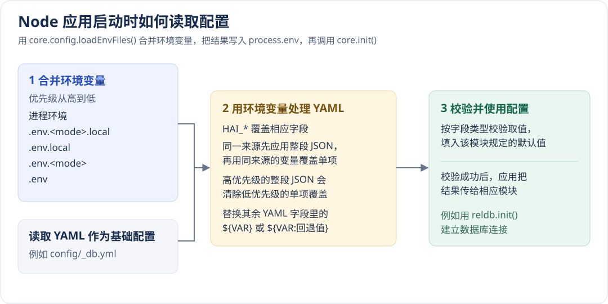

# 基础配置、环境覆盖与生命周期

[配置手册](README.md) · [下一章：数据与共享状态](data.md)

修改配置时先找应用的启动命令，再看它读了哪些文件、哪个值覆盖了其他值、最后将配置传给哪个模块。例如，数据库地址由应用启动代码读取，然后传给 `reldb.init()` 建立连接。CLI 生成的项目已经包含这套启动代码。

## 配置从哪里来

运行配置通常放 `config/_<名称>.yml`，例如 `_db.yml` 注册为 `db`。模块名不一定是文件名：数据库模块 `reldb` 的生成配置名是 `db`，所以覆盖变量以 `HAI_DB_` 开头。根 `hai.json` 的 build/`deploy` 由 CLI 读取，UI 和 API 客户端参数由调用方传入。

启动先从下面这些来源合并环境变量。表中越靠上的来源优先级越高。

| 来源 | 何时使用 |
| --- | --- |
| 进程环境 | 最高；CI/容器/Secret Manager 注入，已有变量不被 dotenv 覆盖；空字符串也是显式输入 |
| `.env.<mode>.local` | 当前环境的私有覆盖，不提交版本库 |
| `.env.local` | 本机私有覆盖，不提交版本库 |
| `.env.<mode>` | 环境公共差异，例如 `.env.prod`；不放真实秘密 |
| `.env` | 公共基础值 |

在自己的 Node 启动代码中，先调用 `core.config.loadEnvFiles()`，确认 `success` 后把返回值写入 `process.env`，再调用 `core.init()`。CLI 生成项目的 Node 启动命令通过 `scripts/run-node.mjs` 完成环境文件加载。环境文件、构建和部署按同样的优先级处理。高优先级来源为整个对象赋值时，会清除低优先级来源写入的子项。一个来源内始终先用整个对象，再用单项变量，文件行序无关。在同一个文件里重复定义变量会报错。

`core.config.loadEnvFiles({ mode: 'prod', envDir: '.' })` 从当前目录读取 `.env`、`.env.prod` 等适用文件，成功时把合并后的变量放在 `result.data`。应用启动代码用 `Object.assign(process.env, result.data)` 安装这些变量。`mode` 决定文件名中的后缀，`_core.yml` 的 `env` 只记录应用运行环境。合并后的变量可能含密码，保存在服务进程中。

`core.init()` 读到 YAML 后按以下顺序处理。这里的顺序与上表的环境变量来源优先级是两件事。

1. 用 `HAI_<配置名>_<路径>` 覆盖对应配置项。例如 `session.maxAge` 对应 `HAI_IAM_SESSION_MAXAGE`，`maxAge` 内部不加下划线。
2. 展开未被覆盖的 YAML 值里的 `${VAR}` 或 `${VAR:回退值}`。变量缺失且没有回退值时返回 `CONFIG_ENV_VAR_MISSING`。
3. 按字段类型校验。模块定义了默认值的字段可省略；必填的地址或凭据需要由应用提供。

例如同一文件有 `HAI_IAM_SESSION='{"maxAge":3600}'` 和 `HAI_IAM_SESSION_MAXAGE=1800`，最终的 `session.maxAge` 是 `1800`。应用启动时可以在 `core.init({ configSchemas })` 中提供字段规则。这样，可选字段即使还没写进 YAML，也可以用环境变量设置。目录扫描用这些规则识别字段和类型，应用还要在初始化模块前检查具体取值。未提供规则时，Core 只按已有的 YAML 或 JSON 结构定位字段。

遇到 `CONFIG_VALIDATION_ERROR` 时，检查对应的 YAML 和环境覆盖。`validate()` 使用最近一次成功加载的 YAML 快照和当前环境重新校验。比如 `code: ${APP_CODE:00123}` 在环境变量未设置时，用字符串 Schema 校验会得到 `'00123'`。编辑 YAML 后调用 `reload()` 读取新内容。单个文件可以直接用 `core.config.load(name, file, schema)` 读取和校验。

### JSON 兜底与生成规则

可以用一个环境变量传入整个对象，例如用 `HAI_STORAGE` 一次设置存储类型、桶名和区域。再在同一个文件里用 `HAI_STORAGE_ENDPOINT` 单独设置地址。CLI 生成环境文件时，普通对象通常拆成单项变量，数组写成一个 JSON 值。如果生成结果同时出现 `{}` 和子项变量，`{}` 会先清空 YAML 中的旧对象，然后再应用子项。

```dotenv
# 对象基础在前，细项在后；本例最终公开地址包含 12348 端口。
HAI_STORAGE='{"type":"s3","bucket":"hai","region":"us-east-1"}'
HAI_STORAGE_ENDPOINT=http://storage:9000
HAI_STORAGE_FORCEPATHSTYLE=true
HAI_STORAGE_PUBLICENDPOINT=http://192.0.2.10:12348/files
HAI_STORAGE_CREATEBUCKET=true

# 先定义一个通知通道。该通道是列表的第 0 项。
HAI_REACH_PROVIDERS='[{"name":"mail","type":"smtp","host":"smtp.example.com","port":465,"secure":true,"from":"noreply@example.com"}]'
# 在 .env.test.local 中给第 0 项设置密码：HAI_REACH_PROVIDERS_0_PASS=...
```

`0` 代表第一项，`1` 代表第二项。上面的列表只有一项，设置 `HAI_REACH_PROVIDERS_1_HOST` 会报错。要增加第二项，先在 YAML 的 `providers` 或 `HAI_REACH_PROVIDERS` 的 JSON 数组里加入第二个通道，再用 `_1_` 修改它的字段。生成工具把列表整体写成一个 JSON 数组。

空字符串、`false`、`0` 和 `[]` 都是明确填写的值。字段的类型决定替换后的值如何读取。例如在 `_core.yml` 写 `version: ${APP_VERSION:00123}`，`APP_VERSION` 未设置时，Core 得到字符串 `"00123"`，前面的两个 `0` 会保留。

Core 只替换原始 YAML 里的占位符。例如 YAML 写 `name: ${APP_TITLE}`，环境变量 `APP_TITLE` 的值如果是字面文本 `${RELEASE_LABEL}`，应用名称就会是 `${RELEASE_LABEL}`。用环境变量 `HAI_CORE='{"name":"${RELEASE_LABEL}"}'` 覆盖名称时，结果也是同一段文本。



## 应用信息与语言

配置位置：`config/_core.yml`。用途：统一应用元信息、核心错误语言和日志；不会自动翻译业务页面文案。

Core 的名称、版本、运行环境、语言和日志配置见 [Core 配置清单](core.md#配置清单)。生成应用应填写业务名称，制品版本另由项目 `package.json` 驱动。通过 `core.i18n.setGlobalLocale()` 设置 Core 消息语言，每个 SSR 请求可单独选择语言上下文。

```yaml schema=@h-ai/core:CoreConfigSchema
name: Orders
version: 1.0.0
env: production
defaultLocale: zh-CN
logging:
  level: info
  format: json
  context: { service: orders-serv }
  redact: [customer.email, customer.phone]
```

页面如果要显示应用名称和版本，可从应用自己的 `app.info` 接口或服务端页面加载函数读取 `name` 和 `version`。构造响应时只复制页面要用、访客可以看到的值，完整 `_core.yml` 留在后端。修改 Vite 在构建时写入静态页面的默认值后，需要重新构建网页。切换界面语言时，可用一条测试错误确认 Core 提示和页面文案都已使用新语言。

## 日志采集与隐私

结构化 JSON 便于按行采集，开发终端可使用 `pretty`。日志等级、对象省略时的默认行为和附加脱敏选项见 [Core 配置清单](core.md#配置清单)。

错误输出走 `core.error.toPublic`，UI 经 ToastContainer 默认显示可读说明，排查图标才展示编号。日志可以保留脱敏 Error 和同一个 `traceId`；不要把 cause、SQL、绑定值或凭据返回用户。默认脱敏覆盖 `passwordHash`/`secretKey` 等已知字段，不保证识别任意无标签秘密；业务隐私要显式清理。

Core 自动加载或重载配置失败时，日志提供文件路径、错误码，以及能取得的 YAML 行列和追踪编号。显式调用加载或校验方法会从 `error.cause` 返回更多诊断，应用记录这类错误时应只选取必要字段。

日志系统会复制传入的数据，在副本中遮盖敏感值。业务代码之后读取原对象时，数据还是原值。

例如，把订单类的实例传给日志时，`this.orderId` 这类直接保存在实例上的普通字段可以写入日志。类上的方法、`get total()` 和自定义 `toJSON()` 都不会运行。如果需要记录金额，可以从业务代码已经算好的结果中取 `total`，与 `orderId` 一起传给日志。日期会写成 `2026-01-15T08:30:00.000Z` 这样的字符串。URL 会写成字符串，其中的用户名、密码和已知敏感参数会被遮盖。传给日志的数据应只包含排查需要的字段。

### `logging.redact` 怎么填写

它用来遮盖日志对象里的业务隐私，例如客户邮箱、收件地址。填的是**日志字段路径**，不是配置文件路径，也不是要搜索的文字。路径区分大小写，匹配到的值会替换为 `[REDACTED]`；其他字段照常记录。

例如，应用记录下面这个对象：

```ts
// 将订单号、客户与收件人结构化字段写入 info 日志；命中配置的字段按规则脱敏。
core.logger.info('Order created', {
  orderId: 'order-42',
  customer: { name: 'Alice', email: 'alice@example.com' },
  recipients: [{ phone: '13800000000' }, { phone: '13900000000' }],
})
```

在 `config/_core.yml` 的 `logging` 下配置：

```yaml
logging:
  level: info
  format: json
  redact:
    - customer.email
    - recipients[*].phone
```

日志中的业务部分就会变成：

```json
{
  "orderId": "order-42",
  "customer": { "name": "Alice", "email": "[REDACTED]" },
  "recipients": [{ "phone": "[REDACTED]" }, { "phone": "[REDACTED]" }]
}
```

| 写法 | 匹配内容 |
| --- | --- |
| `email` | 日志对象最外层的 `email`，不代表任意层级的邮箱 |
| `customer.email` | `customer` 对象里的 `email` |
| `recipients[*].phone` | `recipients` 数组每一项里的 `phone` |
| `customers.*.email` | `customers` 下一层每个对象的 `email`；`*` 只匹配一层 |

不要写成 `*.password*` 之类的文字搜索规则，也不要依赖 `**` 表示任意深度。更简单、可靠的做法是先整理日志对象，只记录需要的字段，再为固定路径配置脱敏。

密码、令牌等框架已识别的凭据字段始终会脱敏，`redact: []` 不会关闭这层保护。`logging.redact` 是在此基础上补充业务字段。它不会清理已经写出的历史日志，不会修改原始业务对象，也不能可靠地清理拼接在普通消息文本里的任意个人信息。

```ts
// 结构化字段可以按路径脱敏。
// 将邮箱放在 customer.email 字段；该路径可由日志脱敏配置处理。
core.logger.info('Customer updated', { customer: { email } })
// 不要把业务隐私拼进消息正文。
```

修改后重启后端，用测试数据产生一条日志，核对字段已经遮盖且 `orderId` 等排查信息仍然保留。不要用真实客户数据验证。

## 部署后重启加载运行配置

Node 后端（Serv / SvelteKit SSR）每次启动读取服务器 `<部署目录>/config/.env.runtime`。应用配置与托管连接在此合并，修改 `HAI_STORAGE_PUBLICENDPOINT` 等细项后重启对应后端即可；同一来源的细项覆盖父 JSON。配置目录只读挂载到 `/run/hai/config`，编辑器原子替换文件也会被下一次启动读取。私有代理标记和 Node 启动参数由部署装配管理；静态 Web、中间件原生环境、端口/挂载、Nginx 路由与限额变更仍需部署。仅更新 Web/中间件保留当前应用配置；后端局部更新保留服务器托管连接，其余值来自新包，全量更新采用新包并按已有凭据状态定稿。手工修改先备份，长期配置同步回源环境。

容器打包时，监听地址采用 `0.0.0.0`，端口采用制品声明值（未声明时采用部署配置），并生成 `HOST`、`PORT` 和 Serv 的对应细项。本机 `.env` 中的回环地址与开发端口继续用于本地运行。修改容器端口时更新制品与部署布局后重新部署。

后端使用服务器 `<部署目录>/config/.env.runtime`，每次发布还会在该版本的目录里保存一份运行文件。用服务器的文件权限保护其中的凭据，容器以只读方式挂载配置目录。修改前先备份，改完重启后检查健康接口和一条受影响的业务请求。读文件或配置校验失败时，恢复备份后再重启。运行中的容器不会持续监听该文件。

归档同名文件是本次部署的输入。外部 PostgreSQL 密码来自打包源环境，包含主应用的发布会用新包值定稿。Hai 随包运行的 PostgreSQL 使用服务器 `managed-secrets.env`，受管状态同时用于生成应用连接和镜像原生变量。只有 Compose 引用的中间件使用 `.hai/middleware-runtime.env`。

可在服务器查询实际路径（Podman 将命令名换成 `podman`），然后编辑返回的文件并重启同一后端容器：

```bash
docker inspect hai-myapp-test-serv --format '{{range .Mounts}}{{if eq .Destination "/run/hai/config"}}{{.Source}}{{end}}{{end}}'
# 编辑上述目录中的 .env.runtime，然后重启。
docker restart hai-myapp-test-serv
```

生成的 Nginx 代理会动态跟随后端和存储容器的 DNS 地址变化，Podman 重启后分配新 IP 时也能自动恢复访问。解析器取自容器自身配置，无需手动设置 Docker 或 Podman 专用的 DNS 地址。

环境文件采用 dotenv 字面语法。生成器和部署加载器保留引号、反斜线、Unicode、回车和 CRLF。编辑文件时保留生成行末的 `# hai:json` 标记，加载器会据此恢复值里的转义字符。单个文件上限 1 MiB；缺失、不可读、重复变量或超限会在导入应用前失败，不打印变量值。同源细项覆盖父 JSON，显式进程 `HAI_*` 注入仍优先。`HAI_SERV_REFRESH_COOKIE_SECURE` 是独立进程开关，仅同名变量覆盖。容器部署接受 `true`、`false` 或空值。Node 启动选项变更需重新部署。修改连接密码不会自动修改中间件内部密码，托管凭据与数据卷状态必须一致。

SvelteKit SSR 在 Node 服务正常停止后，会先关闭业务模块，再释放其依赖的数据库、缓存等资源，避免后台任务或连接阻止进程退出。

## 保存以后如何生效

下面的代码可以放在独立 Node 应用的启动文件中。它先读取环境变量，再检查数据库配置并开启连接。CLI 生成的项目已经包含相应步骤。

```ts
import { core } from '@h-ai/core'
import { ReldbConfigSchema, reldb } from '@h-ai/reldb'

// 从当前目录按 dev 模式读取环境文件；返回变量映射，解析失败时停止启动。
const env = core.config.loadEnvFiles({ mode: 'dev', envDir: '.' })
if (!env.success) throw new Error(env.error.message)
Object.assign(process.env, env.data)
// 装载 ./config 并声明 db Schema，在进程内初始化 Core；无返回值。
core.init({ configDir: './config', configSchemas: { db: ReldbConfigSchema } })
// 用关系数据库 Schema 校验已装载的 db；成功 data 是解析后的数据库设置。
const db = core.config.validate('db', ReldbConfigSchema)
if (!db.success) throw new Error(db.error.message)
// 使用通过校验的数据库设置连接后端，成功无业务数据，失败终止启动。
const started = await reldb.init(db.data)
if (!started.success) throw new Error(started.error.message)
// 服务退出时 await reldb.close()，并检查它的关闭结果。
```

这是启动边界的失败退出，不是要求业务 API 改成抛异常。`core.init` 会记录单项加载失败并继续；结束不表示每项有效，必需配置必须 validate。目录扫描/日志设置等异常也可能传播。Core 是同步入口，没有 `core.close()`。

`core.config.reload()` 更新保存在 Core 内存中的配置。已经创建的连接池、会话和外部客户端继续使用创建时的设置。要换新配置，先停止接收请求，关闭正在使用旧配置的模块，再检查新值并启动模块。多个模块可以交给 `core.module.createRuntime()` 按依赖顺序启动，停止时反向关闭。如果业务模块关不掉，运行对象会保留它和仍在使用的数据库，供下一次关闭时重试。

| 能力 | 前置与关闭顺序 |
| --- | --- |
| IAM | 先 RelDB/Cache，最后关闭存储；OTP/LDAP 按功能补实际通道 |
| Feedback | 先 RelDB/私有 Storage；先停止并排空采集任务，再关依赖 |
| AI 持久化 | RelDB/VecDB 或显式持久 Store；生产不能退回进程内存冒充可用 |
| Audit/Scheduler/Payment | 共享 RelDB；通知按需 Reach，未知副作用先核对再恢复 |
| Serv/Kit/UI/Datapipe | 用 `serv.createApp()` 创建 HTTP 应用，`kit.createHandle()` 创建请求处理函数。UI 通过组件参数设置，Datapipe 的选项随 `datapipe.clean()` 等调用传入 |

配置输入、可观察输出和失败检查分别核对：

| 输入 | 应观察到的结果 | 特殊约束 |
| --- | --- | --- |
| 同源 `HAI_IAM_SESSION_MAXAGE=1800` 覆盖父 JSON 的3600 | 校验后的 `session.maxAge` 为1800 | 不公开完整配置验证秘密；只记录白名单数字 |
| `_core.yml` 的 `logging.redact: [customer.email]` | 测试日志该字段为 `[REDACTED]`，订单编号保留 | 不改变原业务对象，不清理历史日志 |
| 必需数据库字段缺失或非法 | validate/init 返回失败，应用不继续启动依赖业务 | `core.init()` 返回结束本身不证明所有配置有效 |
| 修改运行 `.env.runtime` 后重启对应后端 | 新请求使用新值，健康和业务请求通过 | 不热更新已创建的连接池；拓扑与浏览器构建参数需重新部署 |

生产多节点故障及滚动更新应结合目标数据库、缓存和部署环境验收。
