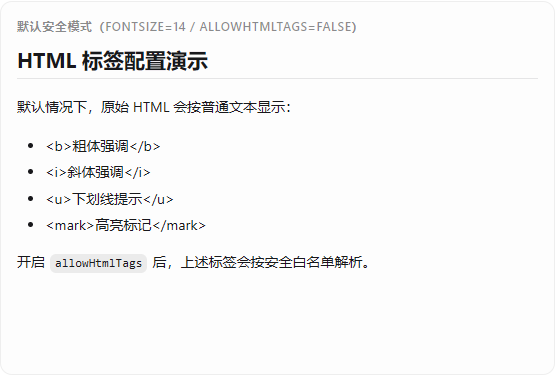
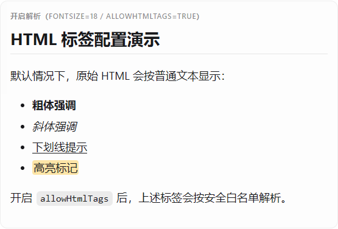
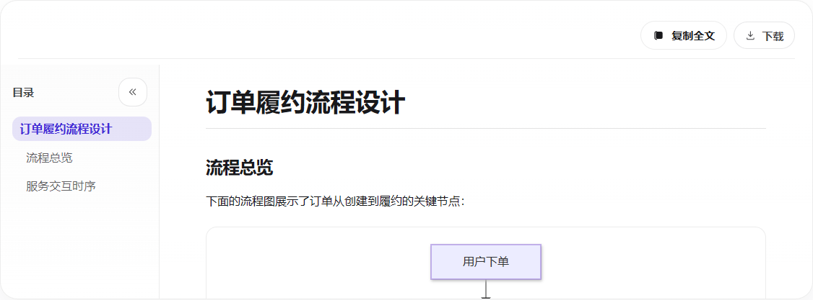
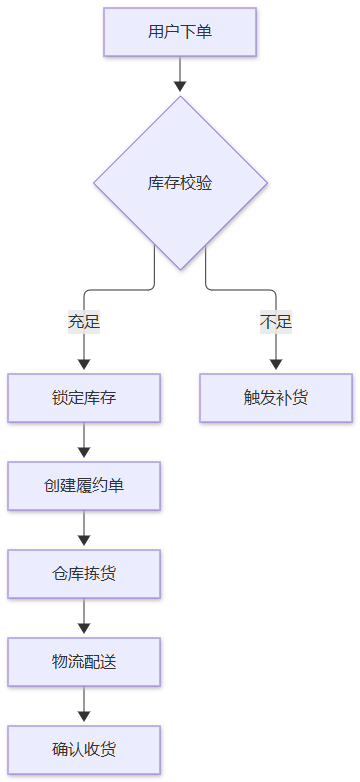
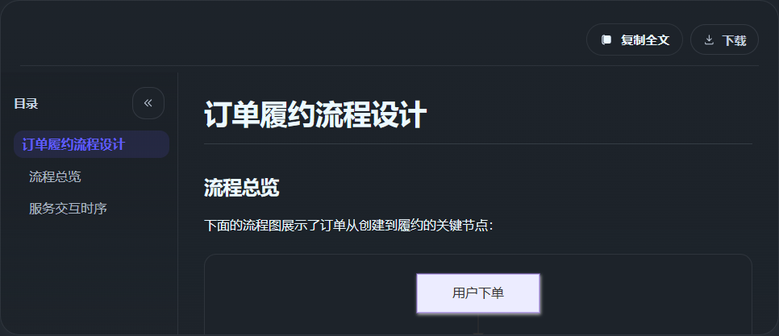

# AI内容、模型调用与知识检索操作指南

[使用指南](../README.md) · [AI配置手册](../configuration/ai.md) · [内容显示参数](../configuration/experience.md#主题语言和ai内容显示)

先确定任务：显示Markdown/编辑文档只需公共UI；聊天需服务端模型凭据；企业知识检索还需分块、`embedding`和向量存储。逐层接通，才能判断故障在界面、模型还是检索。

配置入口、全部主要配置组、默认条件和取值影响集中在[AI手册](../configuration/ai.md)，本页侧重操作和结果。

需要实际运行时，可从仓库执行 `pnpm --filter ai-playground dev`，先打开实验台的「接入指南」。选择能力后，展开「接入示例」即可复制 TypeScript，并核对公开 API、调用参数、返回值和所需配置。没有模型凭据时可先试本地流处理、文件解析、Token、函数工具和本地 MCP。 [AI Playground 接入与运行](../../../apps/ai-playground/README.md)

## 先确认内容如何显示

管理台进入“UI组件库→场景组件”，展开MarkdownRenderer演示，先关HTML并选14px，再允许安全HTML并选18px，比较相同内容。





```svelte
<script lang="ts">
  import { MarkdownRenderer } from '@h-ai/ui'
  const content = '# 操作说明\n\n<b>请先保存</b>'
</script>

<MarkdownRenderer {content} fontSize="18px" allowHtmlTags={true} />
```

关闭时不生成b元素；开启后仍清理危险标签、属性与链接，不执行脚本。比较字号、窄屏和代码复制，不能只确认“有内容”。

AiDocumentEditor检查Mermaid节点文字、箭头、预览与代码切换。渲染保持严格安全策略，不通过删除SVG全部style隐藏CSS文字。





打开完整预览检查阅读区以外的节点和连线。切深色确认工具栏、下载菜单和表格背景/对比度；切三语确认正文和复制按钮的可访问名称同步。



## LLM 配置与模型选择

按[模型配置](../configuration/ai.md#模型协议与场景路由)注入真实测试模型和私有密钥，初始化依赖及AI后检查success，再发送一条无敏感信息的请求。检查实际模型id、协议、场景路由与输出，不把应用注册id和厂商`model`混为一谈。

用无效密钥、未知模型、取消和超时验证安全错误与资源释放，日志保留 `traceId`。模型失败应作为请求失败展示。真实模型接入还须检查供应商响应，配置校验和界面示例只验证各自边界。

### 按网关能力选择结构化输出

`ai.llm.generateObject` 默认使用 `responseFormat: 'json_schema'`，将严格 JSON Schema 发给上游。`schemaName` 仅在此模式使用，默认为 `result`。仅提供通用 JSON 模式的 Chat 网关用 `'json_object'`，框架将 Schema 加入提示词。两种模式都使用同一个 Zod Schema 做本地校验，`maxRepairs` 默认允许再尝试一次。

```ts
import { ai } from '@h-ai/ai'
import { z } from 'zod'

const result = await ai.llm.generateObject({
  schema: z.object({ title: z.string() }), // 要求结果包含标题字符串。
  messages: [{ role: 'user', content: '为发布检查表生成标题。' }], // 本次输入。
  responseFormat: 'json_object', // 请求通用 JSON。
})
if (result.success) process.stdout.write(result.data.title) // 例如：发布检查表。
```

## 临时 Store 与共享持久化

`ai.memory.scoped({ objectId })` 要求非空且非纯空白的主体 ID，参数非法时立即抛 `TypeError`。公共 `clear({ scope: {} })` 等空范围返回失败，跨主体全清必须调用显式管理员入口。原生记忆的访问统计使用版本校验，迟到读取无法复活已删除记录。Persona 按 `[objectId, id]` 隔离，省略 `objectId` 访问 system 平台角色。

按[存储与记忆配置](../configuration/ai.md#会话记忆压缩与检索)先初始化共享RelDB/网络VecDB或显式StoreProvider，再AI。开发临时Store在关闭/换进程后丢失，生产拒绝以临时Store、SQLite和本地向量冒充共享持久化。

用可信用户绑定 `objectId`/`sessionId` 写入，重启后由另一实例读取，再试跨用户不可见；客户端自报 ID 不能决定授权。关闭先等待在途任务并处理 flush 失败，再反序关依赖。

原生记忆使用默认数据库 Store 时，`add`、`update`、`remove` 和清理操作提交关系记录时一并登记待同步的向量。成功代表关系数据已提交，向量索引可能仍在同步。向量库暂时不可用时，读取继续使用已提交的记录，已删记忆立即从结果中移除。恢复连接或重启后，任一共享同一数据库和向量集合的 AI 实例都可继续处理待同步记录。应用按 `HaiResult` 处理关系库失败，避免因索引延迟重复添加记忆。 [配置与后端要求](../configuration/ai.md#会话记忆压缩与检索)

向量清理以关系库当前版本为准。即使旧写入在对应待办已经删除后才抵达，后续扫描仍会清理。所有节点共享一条扫描进度。`hai_ai_memory_vectors` 必须由同一套关系库独占，避免把其他应用的记忆误判为失效。 [存储与备份要求](../configuration/ai.md#会话记忆压缩与检索)

## 知识分块与检索

按[知识与embedding](../configuration/ai.md#知识分块与embedding)准备同维度模型/集合。用一份可公开文档导入，核对来源、分块、版本和已知查询命中，再发布新版本并确认旧版不可见。分块失败停止`embedding`，`cleanupPending`通过repair处理。

图来自本地Datapipe，不需要外部模型；帮助选边界，不证明语义召回质量。真实检索还要评估正确性、引用和用户权限。

## 工具、MCP、音视频与 A2A

按[工具和执行配置](../configuration/ai.md#mcp和a2a)先校验工具schema、用途授权、期限和副作用；工具内容和模型输出不扩大权限。HTTP completion默认非流式，流式需独立`endpoint`；业务授权后才执行工具并按tool_call_id回传结果。

使用已登记的第三方 MCP 工具时，先从 IAM 取得当前主体，再在授权函数里检查工具用途和实际参数。框架读取最新目录并为每次调用创建独立的上游 MCP 会话。网络中断后先核对远端操作结果，再决定是否重试。

```ts
import { ai, type MCPServiceAuthorization } from '@h-ai/ai'

// 应用已成功初始化 ai，authorization 来自可信服务端。
async function searchManual(query: string, authorization: MCPServiceAuthorization) {
  const result = await ai.mcp.services.invoke({
    serviceId: 'manual',
    tool: 'search_manual',
    arguments: { query },
  }, authorization)
  if (!result.success) return result
  return result.data.content
}
```

让 ACP Agent 调用该工具时，在执行节点挂载 `ai.mcp.services.createBroker` 返回的 HTTP 处理器。应用为会话绑定精确工具列表，Agent 使用短期 Bearer，入口按实际参数复核权限。入口地址需能从该节点的 Agent 容器访问。挂载和绑定示例见 [ACP 工具入口](../../../packages/cli/templates/skills/hai-ai/acp.md#为受管会话绑定第三方工具)。

音频/图片先测试大小与时间预算拒绝，再用合法测试材料连接真实 Provider 并验证取消。A2A 按任务 ID 订阅/取消，unknown 先查副作用，不能自动重放。完整 Provider 方法见[AI参考](../../../packages/ai/REFERENCE.md)。

## ACP 智能体与工程会话

`ai.acp` 管理原生 ACP Agent、工作区和会话：embedded 本机进程、builtin-service Podman/Docker 容器、custom-service 已有原生 HTTP/WS 服务。前两者引用 `llm.models`，远程服务自行管理模型；仅使用明确支持的传输。多 Git 工程逐一指定主分支，创建 session 时可选 worktree；更新主分支和合并/推送都是显式调用。

完整接入步骤、示例、能力限制和故障恢复见 [ACP 接入指南](ai-acp.md)。容器模式挂持久 workspace/state volume；进程停止后才释放占用，worktree 不承担安全沙箱职责。协议层保留原生事件和权限回调，业务的 SDD、评审规则、预览和部署由应用负责。

A2A 使用协议 1.0（SDK 1.3）。`ai.a2a.getAgentCard()` 返回可直接用于 HTTP 发现响应的标准 ProtoJSON，端点列于 `supportedInterfaces`。请求方法使用 `SendMessage`、`SendStreamingMessage`、`GetTask`、`CancelTask`、`SubscribeToTask`；非阻塞发送使用 `configuration.returnImmediately: true`。执行器从 `@h-ai/ai` 导入 `AgentEvent` 与 `Message`/`Task` 构建器发布包装事件；SDK 内部消息与状态使用 `Role`/`TaskState` 数值枚举，HTTP 协议使用 `ROLE_*`/`TASK_STATE_*` 名称。`callRemoteAgent` 继续接收实际 JSON-RPC 地址并返回已解码结果。

`memory.provider: mem0` 为 Mem0 数据格式适配，复用框架 Embedding，经原生 HTTP 访问 Qdrant ≥1.19，不加载完整上游引擎、遥测、历史数据库或额外 SDK。HTTP 请求禁止重定向，30 秒完整响应超时、16 MiB 上限。更新由服务端主体/版本条件和 `update_only` 原子保护，迟到写入不能复活已删除记录；写入失败的实际效果仍按 `requiresEffectReconciliation` 与已知 ID 核对。
