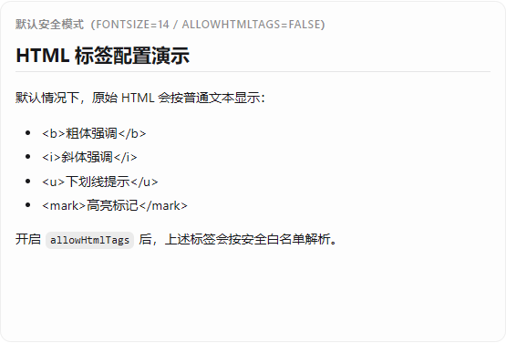
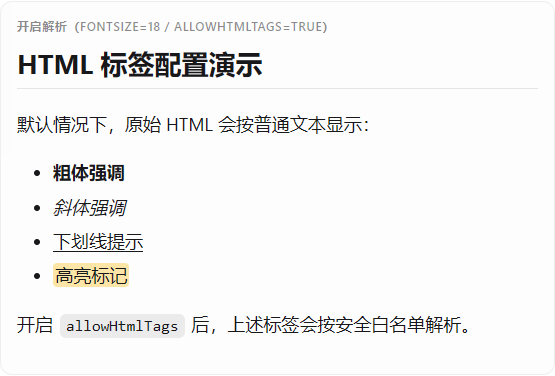
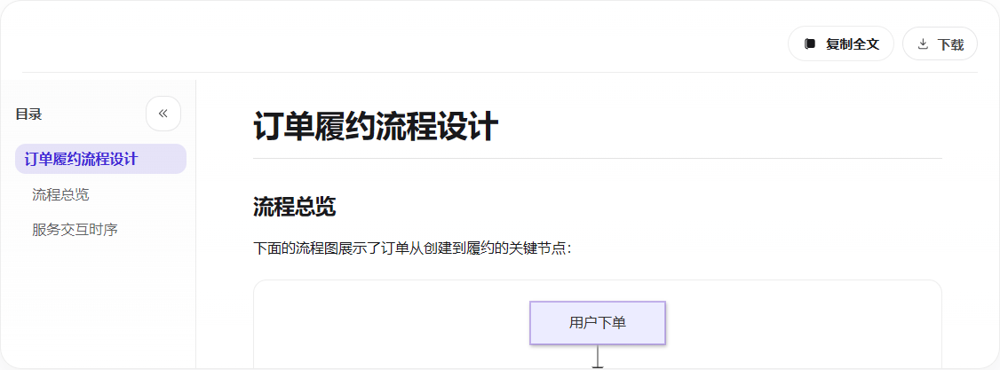
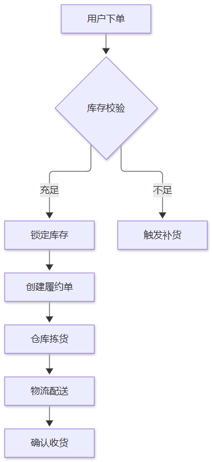
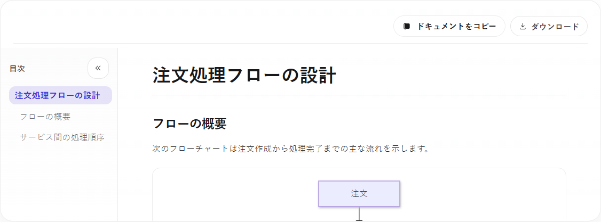
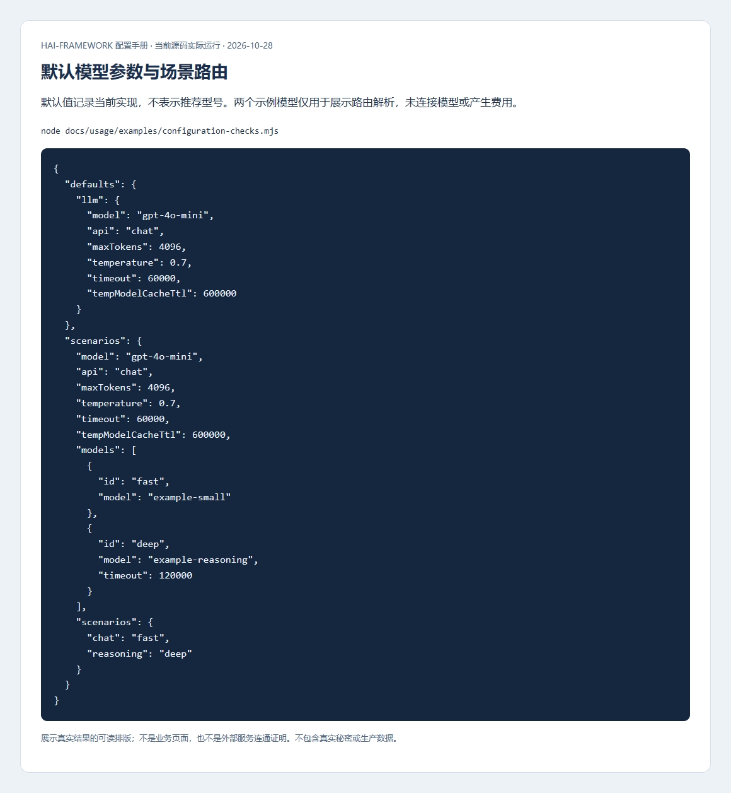

# AI内容、模型调用与知识检索操作指南

[使用指南](../README.md) · [AI配置手册](../configuration/ai.md) · [内容显示参数](../configuration/experience.md#主题语言和ai内容显示)

先确定任务：显示Markdown/编辑文档只需公共UI；聊天需服务端模型凭据；企业知识检索还需分块、embedding和向量存储。逐层接通，才能判断故障在界面、模型还是检索。

配置入口、全部主要配置组、默认条件和取值影响集中在[AI手册](../configuration/ai.md)，本页侧重操作和结果。

## 先确认内容如何显示

管理台进入“UI组件库→场景组件”，展开MarkdownRenderer演示，先关HTML并选14px，再允许安全HTML并选18px，比较相同内容。





```svelte
<script lang="ts">
  import { MarkdownRenderer } from '@h-ai/ui'
  const content = '# 操作说明\n\n<b>请先保存</b>'
</script>

<MarkdownRenderer {content} fontSize="18px" allowHtmlTags={true} />
```

关闭时不生成b元素；开启后仍清理危险标签、属性与链接，不执行脚本。比较字号、窄屏和代码复制，不能只确认“有内容”。

AiDocumentEditor检查Mermaid节点文字、箭头、预览与代码切换。渲染保持严格安全策略，不通过删除SVG全部style隐藏CSS文字。





完整图单独截图避免固定高度阅读区裁切，没有改图形内容。切深色确认工具栏、下载菜单和表格背景/对比度；切三语确认正文和复制可访问名称同步。




## LLM 配置与模型选择

按[模型配置](../configuration/ai.md#模型协议与场景路由)注入真实测试模型和私有密钥，初始化依赖及AI后检查success，再发送一条无敏感信息的请求。检查实际模型id、协议、场景路由与输出，不把应用注册id和厂商model混为一谈。

用无效密钥、未知模型、取消和超时验证安全错误与资源释放，日志保留traceId。模型失败不能当作聊天正文返回。Schema图不证明供应商可用，本手册没有为截图调用付费模型。



## 临时 Store 与共享持久化

按[存储与记忆配置](../configuration/ai.md#会话记忆压缩与检索)先初始化共享RelDB/网络VecDB或显式StoreProvider，再AI。开发临时Store在关闭/换进程后丢失，生产拒绝以临时Store、SQLite和本地向量冒充共享持久化。

用可信用户绑定objectId/sessionId写入，重启后由另一实例读取，再试跨用户不可见；客户端自报ID不能决定授权。关闭先等待在途任务并处理flush失败，再反序关依赖。本页没有把配置通过称为真实共享服务验收。

## 知识分块与检索

按[知识与embedding](../configuration/ai.md#知识分块与embedding)准备同维度模型/集合。用一份可公开文档导入，核对来源、分块、版本和已知查询命中，再发布新版本并确认旧版不可见。分块失败停止embedding，cleanupPending通过repair处理。


图来自本地Datapipe，不需要外部模型；帮助选边界，不证明语义召回质量。真实检索还要评估正确性、引用和用户权限。

## 工具、MCP、音视频与 A2A

按[工具和执行配置](../configuration/ai.md#mcp和a2a)先校验工具schema、用途授权、期限和副作用；工具内容和模型输出不扩大权限。HTTP completion默认非流式，流式需独立endpoint；业务授权后才执行工具并按tool_call_id回传结果。

音频/图片先测试大小与时间预算拒绝，再用合法测试材料连接真实Provider并验证取消。A2A按任务ID订阅/取消，unknown先查副作用，不能自动重放。完整Provider方法见[AI参考](../../../packages/ai/REFERENCE.md)；本轮未为手册调用真实音视频/图片模型或跨进程A2A服务。
