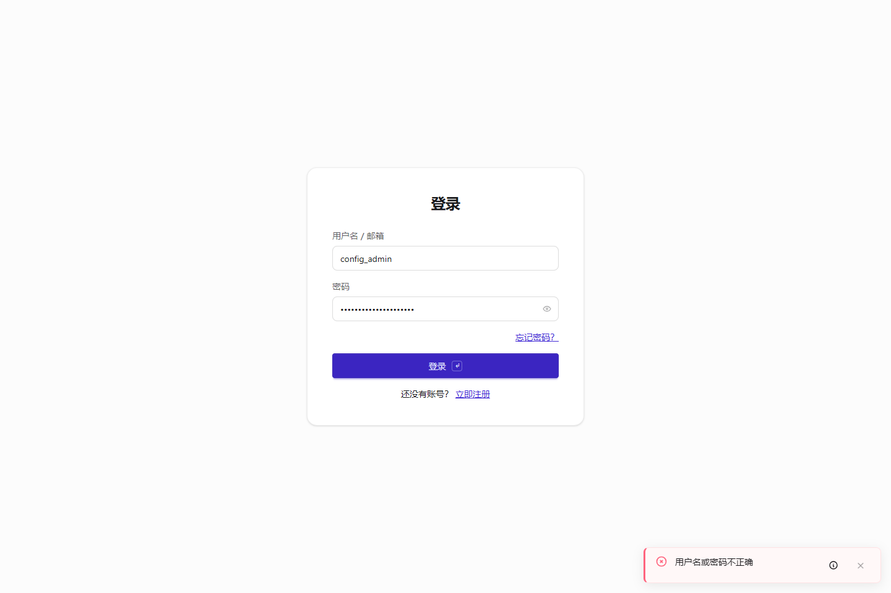
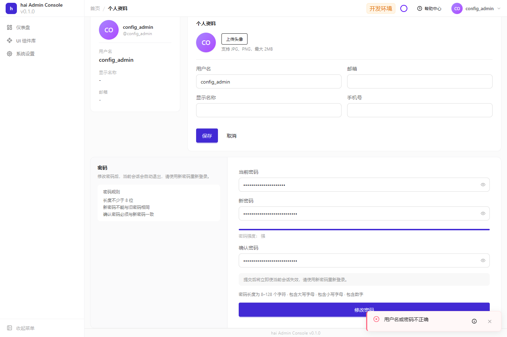

# 登录、改密与退出的操作指南

[使用指南](../README.md) · [身份与安全配置手册](../configuration/identity.md)

本页按最终用户实际步骤走一次登录、改密和退出。密码复杂度、会话、锁定、来源、权限和界面参数集中在[配置手册](../configuration/identity.md)，这里不重复维护默认值。

## 先让登录页正确呈现

先RelDB/Cache，再IAM。生成工程已接标准认证；自定义宿主用`await iam.getPublicConfig()`的成功数据装配AuthPanel，不能把服务端密钥配置下发页面。

按[登录页配置](../configuration/identity.md#登录页外观)设置split并放好站内图片，重启后打开`/auth/login`，检查品牌区、表单和协议入口。缩窄页面仍应优先保留可操作空间：

图片只影响外观。选择的登录方式必须已有服务端策略及真实依赖；LDAP需目录服务、OTP需通知通道，不能只显示按钮。

用专用账号输入一次错误密码，检查输入保留、提示清楚、可复制排查编号；不泄露账号是否存在、密码哈希和内部目录错误。

## 密码复杂度、首次修改与复用

按[密码策略](../configuration/identity.md#密码复杂度初始密码与复用)准备受管账号，发放初始凭据后登录。只有被标为初始凭据的账号进入首次改密；单改开关不会把全部老账号打上标记。

先输入与当前相同的新密码，确认被拒绝；再用符合策略的不同密码完成修改。新密码与确认不一致时，不应发送请求。字段错误用Toast提示，修正后清除，失败保留输入。

修改成功后旧会话失效，重新用新密码登录。个人中心改密还需正确旧密码，错误时保持页面上下文：

确认密码使用原始字符串，不做trim或Unicode归一化。生产恢复流程应先准备真实通知、一次性链接和过期测试，不能用“日志已输出”代替送达。

## 会话有效期与终端配额

在[会话章节](../configuration/identity.md#会话有效期与终端配额)配置后重新登录，用独立浏览器上下文登录到配额，确认额外登录拒绝；退出一个会话后再试。用可控时钟分别验证闲置、绝对和刷新期限，它们不能互相替代。

自动刷新不延长业务闲置，关闭页面通知仅尽力送达。生产使用共享DB/Redis测试跨节点撤销；浏览器清空本地变量不等于服务端会话撤销。

## 登录锁定与计算挑战

只在隔离测试账号上按[锁定与挑战配置](../configuration/identity.md#锁定验证码与登录来源)执行失败阈值、锁定后等待、过期和重复挑战。检查提示说明等待/恢复方式并保留安全编号。低性能移动设备还需验证求解耗时；Schema通过不能代替负载与设备验收。

## 可信登录来源与权限

先装配[可信代理](../configuration/http.md#cors与可信代理)，再启用[来源和时段策略](../configuration/identity.md#锁定验证码与登录来源)。从允许/拒绝地址和窗口分别试新登录，任意X-Forwarded-For不能绕过。时间窗口结束不自动踢已有会话。

用普通用户、管理员、跨用户资源ID和受限API Key验证服务端权限。敏感动作进入二次认证，取消不发业务请求，证明按当前用户/会话/用途单次消费；按钮隐藏不等于权限已保护。完整配置和账号休眠见[身份手册](../configuration/identity.md#权限二次认证与账号休眠)。
