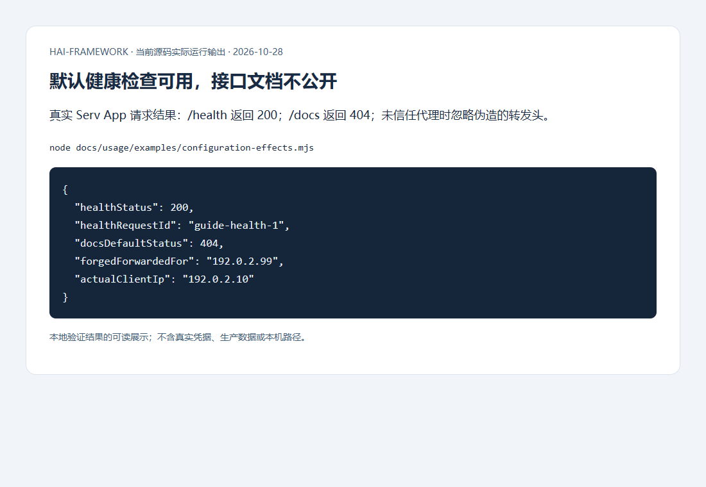

# 前后端分离与HTTP接入操作指南

[使用指南](../README.md) · [HTTP配置手册](../configuration/http.md)

先确定浏览器与API是否同源，再选择宿主。配置字段和默认值统一在[HTTP手册](../configuration/http.md)，本页按启动服务、接入客户端和验证边界执行。

## 选择宿主

| 场景 | 组合 | 创建方式 |
| --- | --- | --- |
| Web/App/Desktop共用API | api-contract→serv→api-client | hai create orders --type fullstack --frontends web --defaults |
| 单个独立API | api-contract+serv | hai create orders --type api --defaults |
| 同源SvelteKit页面与API | kit+业务服务+UI | admin/website/h5模板，保持hooks与文件路由宿主控制流 |

contract定义输入输出，不初始化连接或授予权限；Serv是App工厂，Kit是适配器。Node宿主关闭HTTP后反序关闭业务依赖，不臆造serv.init/kit.close。

## 监听、健康检查与文档入口

按[监听与路由](../configuration/http.md#serv监听和路由)配置并校验，将http/cors/transport传createApp、server传listen；生成工程已有装配。请求health/ready，确认健康不返回连接串或私有配置。

在仓库运行`node docs/usage/examples/configuration-effects.mjs`，可得到真实本地Serv请求结果：



默认健康可用，文档不公开；需要文档时显式开启并核对认证。容器监听和暴露端口按实际网络选择，不用本机成功代替Ingress/防火墙验收。

## 可信代理与跨域 Cookie

按[代理与CORS](../configuration/http.md#cors与可信代理)列真实入口地址和确定前端来源，测试预检和真实请求。图中伪造转发地址没有替代可信对端；Fetch适配显式提供remoteAddress。

带Cookie的跨源请求须匹配允许来源、credentials和Cookie属性。再从不可信来源/任意X-Forwarded-For请求确认不能绕过权限。CORS不是后端或脚本请求的访问授权。

## 传输加密与容量

按[三端装配](../configuration/http.md#加密传输与容量)先Crypto/共享registry，再服务端transport，再客户端transport。服务端ring跨节点/重启持久，协商失败不能自动降级。

测试成功请求、缺认证标记、篡改、重放、超限和取消清理。大材料通过单独路由预算，不把所有请求一起放大；同步检查反馈总预算和代理body上限。生产保持HTTPS与时钟同步，不能只凭加密登录通过认定多节点防重放验收完成。

## 客户端与资源授权

以下放已有客户端启动入口，替换真实地址；SSR/Node为每个请求创建隔离客户端与memory storage，原生使用安全存储。浏览器通常消费同源/明确跨源Cookie流程。

```ts
import { apiClient } from '@h-ai/api-client'

const initialized = await apiClient.init({
  baseUrl: 'https://api.example.invalid/api/v1',
  auth: {},
  timeout: 15000,
})
if (!initialized.success) throw new Error(initialized.error.message)
```

按shared contract创建typed业务客户端，每次先判断success。退出调用服务端logout成功撤销，再清理客户端；清内存不能删除服务端HttpOnly Cookie或撤销会话。期限与刷新策略见[客户端参数](../configuration/http.md#api客户端地址期限和恢复)，超时不表示服务端副作用取消。

Storage procedures提供authorize，覆盖列表/批删等全部key；AI默认当前用户objectId，跨主体访问需显式authorizeObject。模型输出、工具参数和客户端资源ID不赋予权限。

409/422/429合法HaiResult保留业务原因和traceId，5xx隐藏内部原因。用真实反馈冲突验证[提示与恢复](../operations/feedback.md#用户提示与诊断关联)，失败不重复写入。Kit限流store需共享原子后端，依赖失败明确返回失败，不静默放行。
