# 开发一个清楚、可操作的业务页面

[返回使用指南](../README.md) · [组件 API](../../../packages/ui/README.md) · [配置入口](../configuration-reference.md)

业务页面通常包含查询、结果、编辑和操作反馈。先把这条流程接通，再调整视觉细节。`@h-ai/ui` 提供公共布局、表单、表格、弹窗和提示；这些能力通过组件参数和主题控制，没有统一的 `_ui.yml`。

本页截图来自当前管理台的真实组件演示和设置页面。表单与列表演示用于观察公共组件行为；示例数据不代表后台业务已经保存。真实反馈处理流程见[运行维护](../operations/feedback.md)。

## 页面骨架与列表

后台页面优先复用 `WorkspaceLayout` 和 `CrudPage`。导航已经显示页面名称时，正文不必再重复一个大标题。把可滚动的数据区放在剩余空间内，保留 `min-height: 0`，让分页和主要操作容易找到。

开始开发列表时，先确定服务端支持哪些查询和排序条件。筛选栏的输入是草稿，点击“查询”或按 Enter 才提交；翻页和排序应沿用已提交的条件。不要把只能在当前页计算的字段显示为全量排序。

管理台“组件库 → 组合组件”的列表示例可以实际切换以下状态：

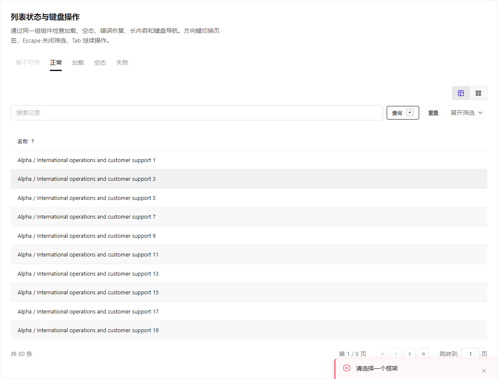

正常状态保留明确的查询入口和分页。扩展筛选默认折叠，收起条件不等于清空条件；接入 `activeCount` 和重置动作，用户才能知道仍有哪些条件生效。

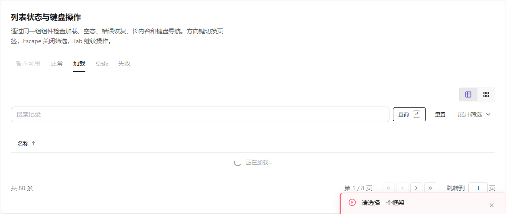

加载中保持页面结构，并使用 `aria-busy` 和文字说明当前状态。不要在查询进行时先显示“没有数据”，否则用户会把等待误认为查询结束。

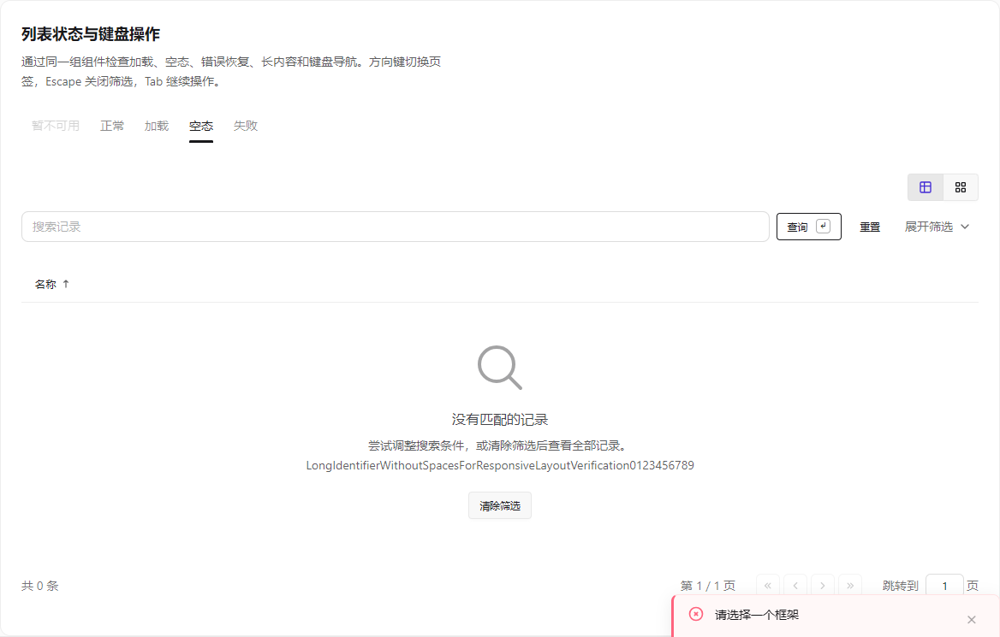

无结果时说明可能与筛选有关，并提供“清除筛选”。这与“系统从未创建数据”是不同场景，业务应用应使用对应文案。

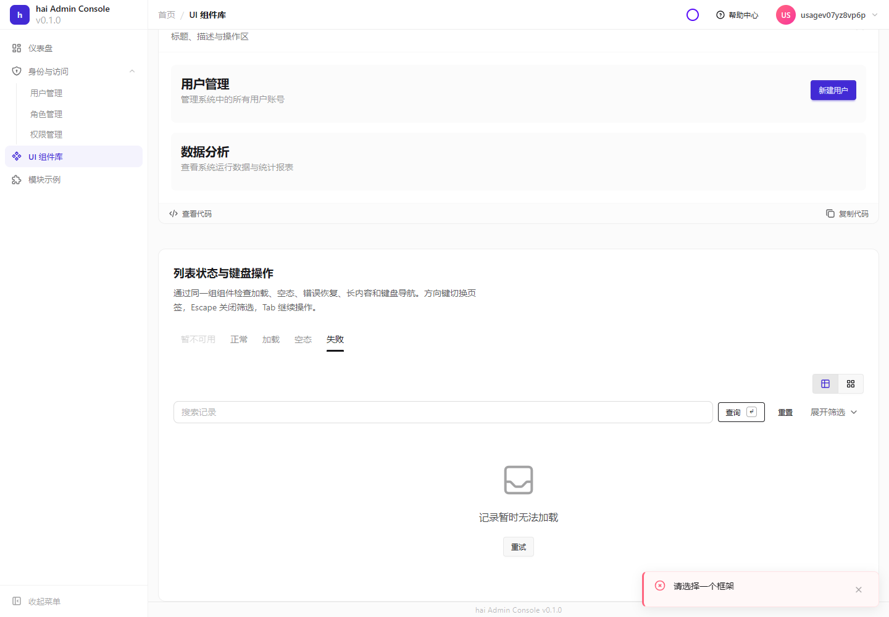

失败时保留查询条件和重试入口。截图中的失败是演示页主动切换的状态；浏览器测试实际点击了“重试”，确认结果恢复为十条记录：

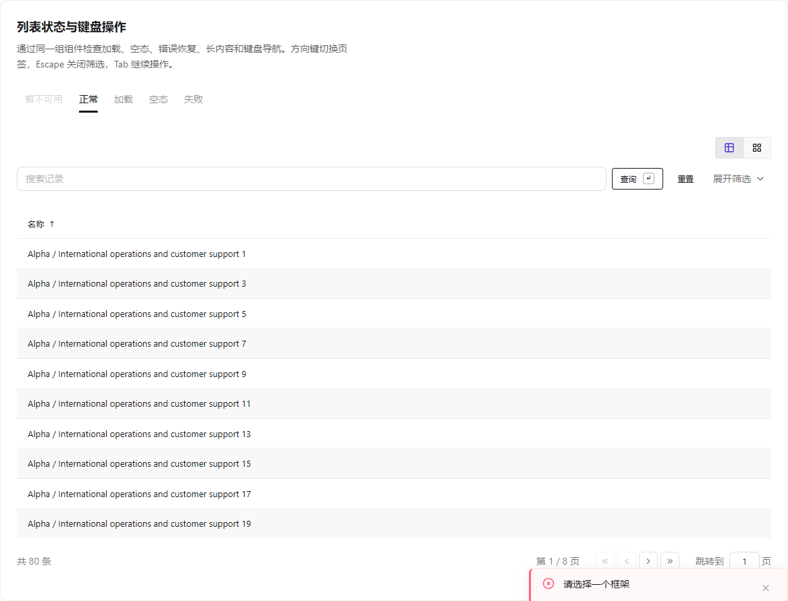

## 表单与重复提交

`Form` / `FormLayout` 默认一列、标签在上。字段较多且容器足够宽时，可以设置 `columns={2}`；希望标签对齐时设置 `labelPosition="left"` 和 `labelWidth`。这些是组件参数，修改后立即影响布局，不需要重启后端。

```svelte
<script lang="ts">
  import { FormLayout, FormField, Input } from '@h-ai/ui'
  // m 由应用自己的翻译模块导入。
  let name = $state('')
</script>

<FormLayout columns={2} labelPosition="left" labelWidth="6rem">
  <FormField label={() => m.userName()} for="name">
    <Input id="name" bind:value={name} required />
  </FormField>
</FormLayout>
```

在组合组件页找到表单示例，先选择“单列”和“标签在上”，再切换“双列”和“标签在左”，可以直接比较效果：

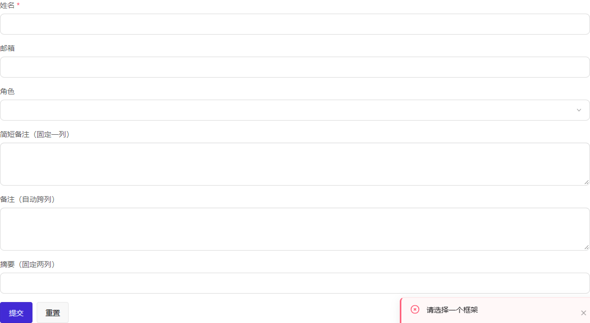

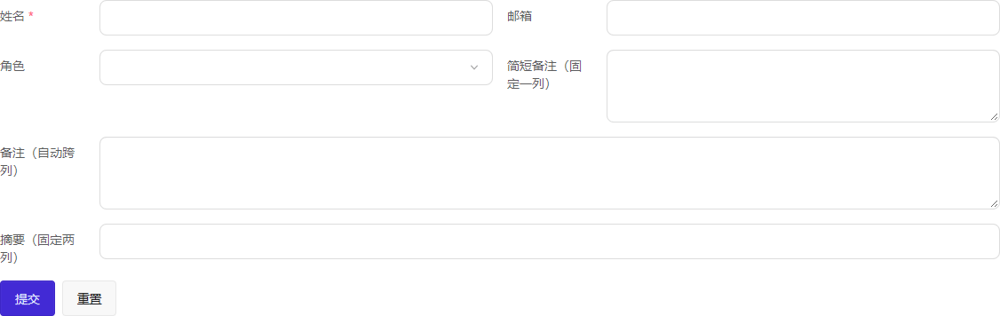

`FormField.colSpan` 默认 `auto`。多行文本、上传、多选等宽控件会占满一行；可显式指定 `colSpan={1}` 或 `2`。自定义宽控件可用 `data-form-wide` 标记。布局按容器宽度收拢，390 像素下仍按正常阅读顺序显示：

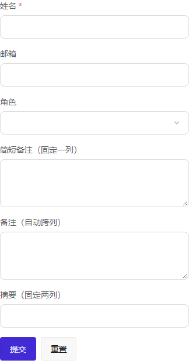

标签使用 `for` 与控件 ID 关联。未填写的字段留到提交时提示；已经出现的校验错误应在输入修正后更新。异步提交期间禁用重复操作，失败保留输入，成功后刷新相关数据。浏览器校验改善体验，服务端仍须再次校验权限和输入。

组件演示页的预设错误不会在打开页面时自动弹出。点击对应示例的“显示校验提示”观察字段和Toast，再点击“清除校验提示”恢复；未配置加密的示例也需明确打开，避免演示信息阻塞真实操作的结果。

认证表单应复用 `AuthPanel`、`ChangePasswordForm` 等组件，直接消费 IAM 的公开策略，避免前端和服务端各写一套密码规则。首次改密的实际流程见[认证指南](authentication.md#密码复杂度首次修改与复用)。

## 统一提示与问题追踪编号

所有警告和错误均由 `ToastContainer` 展示，包括字段校验、权限不足和操作失败。保存成功等即时结果也使用同一容器。字段保留错误边框、`aria-invalid` 和读屏关联说明；重试、返回等恢复操作仍在原位置，用户能直接继续处理。`Alert` 仅用于 `info` / `success` 持续信息。只在根布局挂载一个 `ToastContainer`，避免重复显示。

```svelte
<script lang="ts">
  import { ToastContainer } from '@h-ai/ui'
  import { notifyError, notifySuccess } from '@h-ai/ui/toast'
  // 保存成功：notifySuccess(m.saved())
  // 保存失败：notifyError(result.error, m.saveFailed())
</script>

<ToastContainer />
```

| 设置 | 默认值 | 用户看到的变化 |
| --- | --- | --- |
| `position` | `bottom-right` | 可改为左/中/右的顶部或底部，共六个位置 |
| `duration` | 3000 毫秒 | `0` 表示保留到手动关闭；不要让永久消息阻塞后续消息 |
| `dismissible` | `true` | 设为 `false` 后不显示关闭按钮 |
| `traceId` | 无 | 有合法编号时出现“查看排查信息”图标；正文不显示编号 |
| `notifyError` / `notifyWarning` 的时长 | 5000 毫秒 | 比成功提示留出更多阅读时间 |

所有位置共用一个队列，按顺序逐条显示；计时从实际展示开始，悬停、聚焦或展开排查信息时暂停，交互结束后从剩余时间继续。错误使用 `alert/assertive`，其他消息使用 `status/polite`，文字、图标和颜色共同说明状态。

默认提示只说明发生了什么、接下来怎么做。下面是真实并发处理冲突：另一位管理员已经修改记录，当前页面提示刷新重试，不把技术编号混入正文。

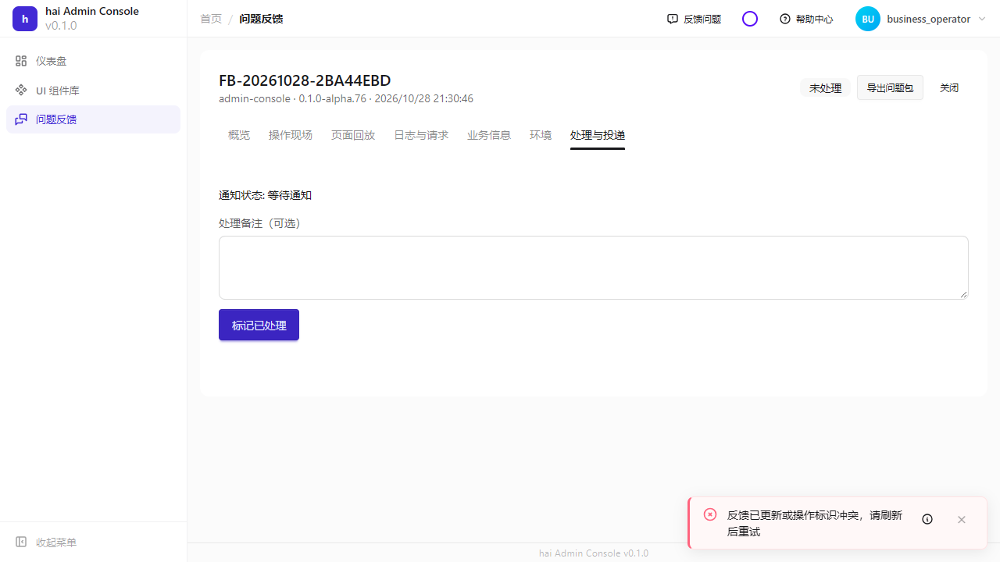

需要进一步排查时，点击右侧的小信息图标。展开后显示“问题追踪编号”，说明联系客户支持或开发人员时应提供此编号，并提供复制按钮。编号只是日志关联标识，不展示异常堆栈、SQL、密钥或内部对象。

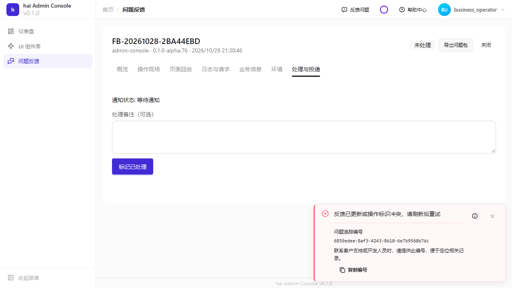

复制成功显示“编号已复制”；浏览器拒绝剪贴板访问时，提示选中编号手动复制。窄屏会折行，展开期间不会自动消失：

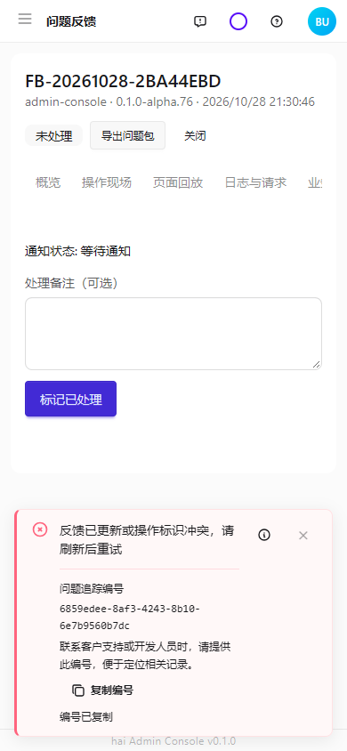

已有 `errorMessage` / `authErrorMessage` 返回的 `(traceId: …)` 会由 Toast 自动分离；新代码也可直接传 `toast.add({ message: m.retry(), variant: 'warning', traceId })`。`m.retry()` 为应用翻译函数，traceId 使用本次请求的公开标识，不能填入凭据或业务隐私。

迁移已有页面时，将 `Alert variant="warning"/"error"` 改为 `toast.warning`、`notifyError` 或组件初始化时的 `useToastFeedback(() => error)`；Alert 的类型已收窄，编译器会指出遗漏调用。响应式提示更新或清空时会替换或移除该来源的旧通知，同类、同文案、同编号的待显示通知合并；组件卸载不会撤销已经发出的通知。

直接传入完整 `HaiError`，可以保留安全的业务原因和 traceId。需要向组件抛出异常时，使用 `new Error(result.error.message, { cause: result.error })`。`errorMessage` / `notifyError` 能读取这条来源链；未知异常和 5xx 仍显示安全兜底，不能把数据库或密钥细节展示给用户。

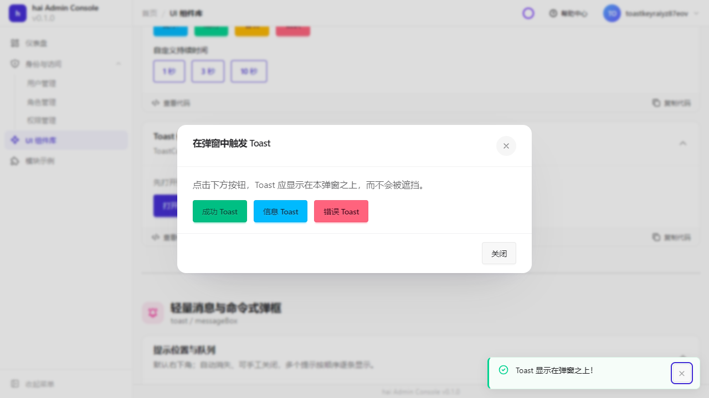

在弹窗内触发提示后，按 F8 将焦点移到提示，再按 F8 返回原控件。Escape 关闭可关闭的提示，Enter 操作关闭按钮；提示消失后恢复焦点，弹窗保持打开。以上路径已通过实际键盘操作验证。

## 主题、语言与可访问性

主题来自已编译的主题 CSS 与 design tokens；默认主题由宿主选择。`@h-ai/ui/theme` 的 `applyTheme` / `getSavedTheme` 管理应用与持久化。可选主题必须在应用 CSS 中存在，不能只给选择器增加名称。

在管理台“系统设置 → 外观”选择主题，刷新后仍应保持选择。下面是同一页面的实际明暗对比：

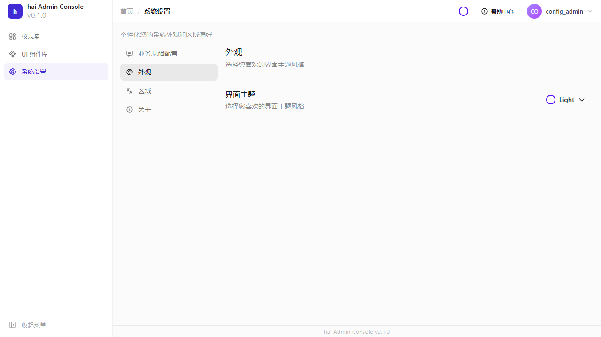

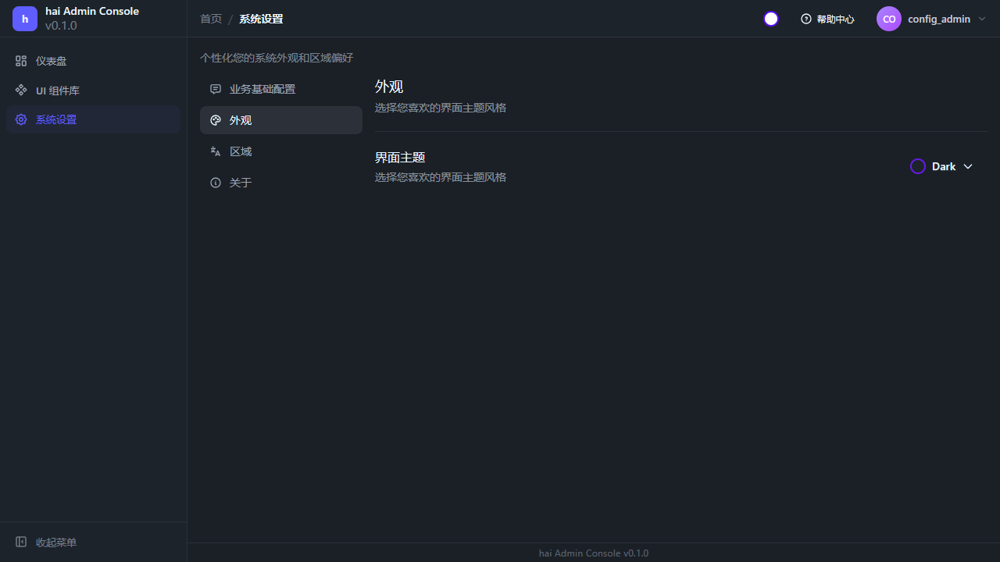

业务文字使用应用 i18n；公共组件使用 UI 字典。标题、占位符、校验、空状态、提示以及无障碍标签都需要翻译。组件演示页已接入三语，长说明改为换行：

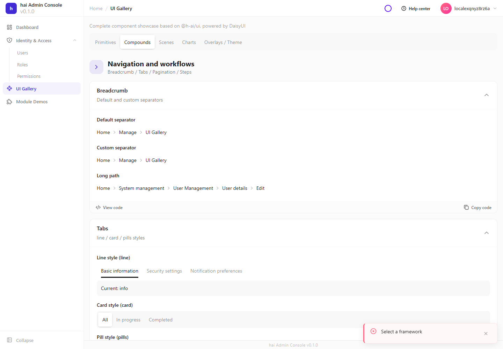

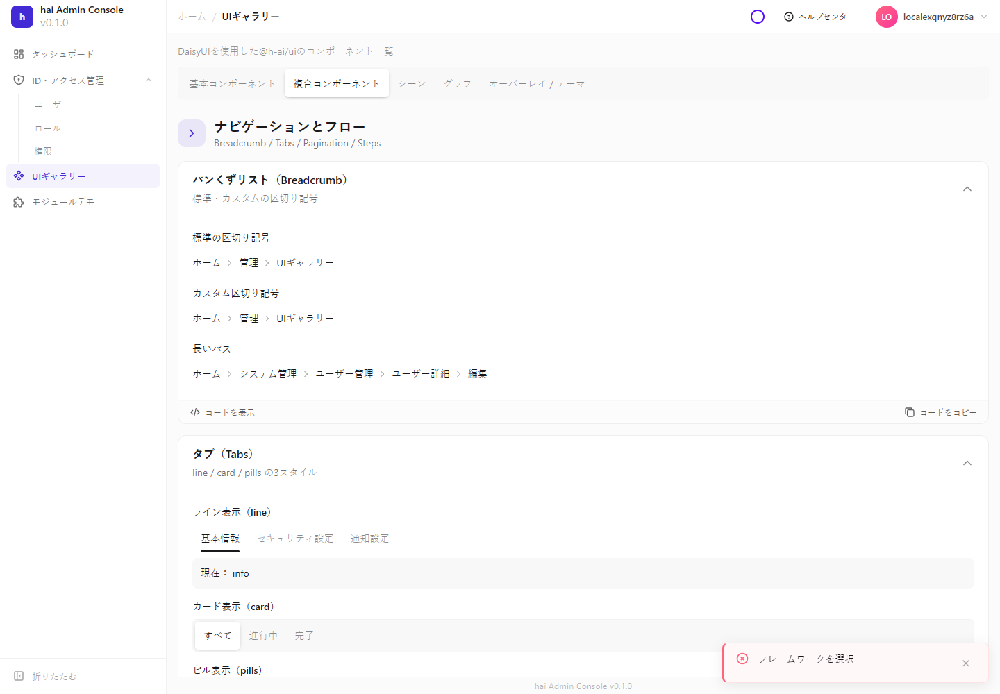

实际验收至少检查窄屏、键盘焦点、弹窗关闭后的焦点恢复、语言切换和失败恢复。当前截图与测试覆盖浏览器；读屏软件和原生宿主需在目标环境另行验收，详细边界见[验证说明](../governance/verification.md)。
