# @h-ai/ai API reference

<!-- translation: partial -->

[Chinese source](ai.md) · [Configuration](../configuration/ai.en.md) · [Data structures](../data/ai.en.md)

## Quick start

Initialize the configured provider before invoking AI. Start with chat or embeddings, then add tools, retrieval and durable sessions as needed. Assign the authenticated scope on the server and apply tool authorization there.

```ts
import { ai } from '@h-ai/ai'

const init = await ai.init({
  llm: {
    model: 'gpt-4o-mini',
    apiKey: process.env.HAI_AI_LLM_APIKEY,
  },
})
if (!init.success)
  throw new Error(init.error.message)

try {
  const result = await ai.llm.chat({
    messages: [
      { role: 'user', content: '你好！' }
    ],
  })
  if (!result.success)
    throw new Error(result.error.message)
  const reply = result.data.choices[0]?.message.content ?? ''
}
finally {
  await ai.close()
}
```

<a id="api-list"></a>

<a id="api-reference"></a>

## Features

Each section lists individual interfaces, then follows the calls through a task. Parameters and defaults describe the arguments; call examples show the invocation, and returns describe the result or successful data as noted below. Check `success` on `HaiResult` before reading `data`. Detailed parameter defaults and advanced constraints remain linked to the Chinese reference.

Import the module as in the quick start. Except for lifecycle examples, run scenarios after initialization and before closure. The value helper checks HaiResult.success and preserves the original error. Use isolated test data and explicit cleanup.

```ts
import type { HaiResult } from '@h-ai/core'

function value<T>(result: HaiResult<T>): T {
  if (!result.success)
    throw new Error(result.error.message, { cause: result.error })
  return result.data
}
```

<a id="lifecycle"></a>

### Prepare models and stores: `ai`

Choose models and state storage before starting in dependency order. Temporary development stores differ from shared production stores.

#### Interface list

| API | Purpose | Parameters and defaults | Return value or failure | Call example |
| --- | --- | --- | --- | --- |
| `ai.init` | 准备服务 | `AIConfigInput?, AIInitOptions?` | `HaiResult<void>; validate dependencies before use` | `ai.init({ llm: { apiKey: process.env.HAI_AI_LLM_APIKEY } })` |
| `ai.close` | 反序释放服务 | `none` | `Promise<void>; wait for cleanup` | `ai.close()` |
| `ai.config` | 诊断当前配置 | `none` | `redacted AIConfig or null` | `ai.config` |
| `ai.isInitialized` | 检查生命周期状态 | `none` | `boolean` | `ai.isInitialized` |
| `resolveModelEntry` | Resolve a model entry by identifier | `resolveModelEntry(llmConfig, 'summary')` → `HaiResult<ResolvedModelEntry>` | `HaiResult<ResolvedModelEntry>` | `resolveModelEntry(llmConfig, 'summary')` |
| `resolveModelApi` | Resolve model API capabilities | `resolveModelApi(llmConfig, 'claude')` → 当前模型协议（`chat`、`responses` 或 `anthropic`） | `ApiType` (`'chat'`, `'responses'`, `'anthropic'`) | `resolveModelApi(llmConfig, 'claude')` |
| `resolveImageModel` | Resolve an image model | `resolveImageModel(imageConfig)` → `HaiResult<ResolvedImageModel>` | `HaiResult<ResolvedImageModel>` | `resolveImageModel(imageConfig)` |
| `resolveAudioModel` | Resolve an audio model | `resolveAudioModel(audioConfig, 'transcribe')` → `HaiResult<ResolvedAudioModel>` | `HaiResult<ResolvedAudioModel>` | `resolveAudioModel(audioConfig, 'transcribe')` |
| `ensureAudioCredential` | Check audio model credentials | 在解析成功的分支调用 `ensureAudioCredential(model.data)`，返回凭据缺失错误或 `null` | `HaiError or null` | `ensureAudioCredential(model)` |

#### Scenario: Prepare models and stores

The quick start covers init/close. config is a sanitized snapshot and isInitialized a boolean. Resolvers take validated settings and return resolved models or failures; ensureAudioCredential returns an error or null without calling a model.

[Detailed parameters and workflows](ai.md#lifecycle)

<a id="chat"></a>

### Chat, structured output and models: `ai.llm`

Chat returns a complete response while streams yield chunks. Model management and history queries follow current identity and storage capabilities.

#### Interface list

| API | Purpose | Parameters and defaults | Return value or failure | Call example |
| --- | --- | --- | --- | --- |
| `ai.llm.chat` | 单次回答 | `ChatCompletionRequest: messages, model?, signal?, tools?` | `ChatCompletionResponse: choices, model, usage?` | `ai.llm.chat({ messages: [{ role: "user", content: "你好" }] })` |
| `ai.llm.chatStream` | 逐块回答 | `same ChatCompletionRequest` | `AsyncIterable<ChatCompletionChunk>; iteration may throw` | `ai.llm.chatStream({ messages })` |
| `ai.llm.ask` | 纯文本问答 | `question: string, AskOptions?` | `string answer` | `ai.llm.ask("解释共享状态")` |
| `ai.llm.askStream` | 纯文本流 | `question: string, AskOptions?` | `AsyncIterable<string>` | `ai.llm.askStream("解释共享状态")` |
| `ai.llm.generateObject` | 受 Schema 约束的答案 | `Zod schema, messages, model?, responseFormat?, maxRepairs?, signal?` | `schema-inferred T` | `ai.llm.generateObject({ schema: AnswerSchema, messages })` |
| `ai.llm.listModels` | 查询模型 | `none` | `string[] model IDs` | `ai.llm.listModels()` |
| `ai.llm.getHistory` | 读取对话历史 | `{ objectId, sessionId }, { limit?, order? }?` | `ChatRecord[]` | `ai.llm.getHistory({ objectId: "u1", sessionId: "s1" })` |
| `ai.llm.listSessions` | 列出主体会话 | `objectId: string` | `SessionInfo[]` | `ai.llm.listSessions("u1")` |
| `ai.llm.models.list` | 列出合并清单 | `none` | `HaiResult<AIResourceEntry[]>; config wins, list has no database version` | `ai.llm.models.list()` |
| `ai.llm.models.get` | 读取来源和版本 | `id: string` | `HaiResult<AIResourceEntry> with value/source/version?` | `ai.llm.models.get("coding")` |
| `ai.llm.models.register` | 登记数据库定义 | `ModelEntry input (id/model/protocol/credentials/capabilities)` | `HaiResult<AIResourceEntry>; config entries are read-only` | `ai.llm.models.register(modelDefinition)` |
| `ai.llm.models.update` | 按版本替换定义 | `ModelEntry input (id/model/protocol/credentials/capabilities), expectedVersion?` | `HaiResult<AIResourceEntry>; full replacement, conflict fails` | `ai.llm.models.update(modelDefinition, current.version)` |
| `ai.llm.models.remove` | 删除数据库定义 | `id, expectedVersion?; ACP definitions must have no session references` | `HaiResult<void>; external files/services are retained` | `ai.llm.models.remove("coding", current.version)` |

#### Scenario: Chat, structured output and models

```ts
const reply = value(await ai.llm.chat({ messages: [{ role: 'user', content: 'Explain order status in one sentence.' }] }))
const text = reply.choices[0]?.message.content // model-generated text, not a fixed literal
const answer = value(await ai.llm.ask('What does pending mean?')) // string answer
for await (const chunk of ai.llm.chatStream({ messages: [{ role: 'user', content: 'Hello' }] })) {
  const delta = chunk.choices[0]?.delta?.content // incremental text when present
}
for await (const delta of ai.llm.askStream('Hello')) {
  // consume each returned text fragment; handle stream errors outside the loop
}
const models = value(await ai.llm.listModels()) // configured model summaries
```

Questions are concrete, but model text varies. Structured generation validates against a local schema below. Resource CRUD uses one stable model name; history uses server-verified identities and sessions.

[Detailed parameters and workflows](ai.md#chat)


#### Scenario: Maintain a stored definition

Supply a validated complete definition with an unused demo ID. File-backed entries are read-only. get supplies the version, update replaces the full definition, and remove retains external resources.

```ts
async function maintain_llm_models(definition: Parameters<typeof ai.llm.models.register>[0]) {
  const created = value(await ai.llm.models.register(definition))
  const listed = value(await ai.llm.models.list())
  const current = value(await ai.llm.models.get(definition.id))
  const updated = value(await ai.llm.models.update(definition, current.version))
  value(await ai.llm.models.remove(definition.id, updated.version))
  return { created, listed, updated } // entries include value/source and database version
}
```

<a id="model-tools"></a>

### Give models business tools: `ai.tools`

Adapt Tools definitions to model protocols and combine built-in or remote tools under host authorization.

#### Interface list

| API | Purpose | Parameters and defaults | Return value or failure | Call example |
| --- | --- | --- | --- | --- |
| `ai.tools.adapt` | 将中立工具适配给模型 | `registry: @h-ai/tools ToolRegistryOperations` | `ToolRegistryOperations; no init required` | `ai.tools.adapt(registry)` |
| `ai.tools.createBuiltinTools` | 组合图片、语音、文档改写与可选网址视频 | `BuiltinToolOptions: context, files, executeJob?` | `direct ToolSet; model calls run only during execution` | `ai.tools.createBuiltinTools(options)` |
| `ai.tools.createMcpTools` | 将已登记 MCP 纳入统一执行 | `McpToolOptions: context, definitions, authorize` | `HaiResult<ToolSet>` | `ai.tools.createMcpTools(options)` |
| `ai.tools.createBroker` | 向原生 Agent 开放同一工具服务 | `BuiltinToolBrokerOptions: service, url` | `HaiResult<BuiltinToolBroker>` | `ai.tools.createBroker({ service, url })` |
| `modelTools.getDefinitions` | 传给模型的定义 | 无 | `ToolDefinition[]` | `modelTools.getDefinitions()` |
| `modelTools.execute` | 执行模型工具调用 | `ToolCall, ToolExecutionOptions?` | `Promise<HaiResult<ToolMessage>>` | `modelTools.execute(toolCall, { objectId: "u1" })` |
| `modelTools.executeAll` | 批量执行模型工具调用 | `ToolCall[], { parallel?, ...executionOptions }` | `Promise<HaiResult<ToolMessage[]>>` | `modelTools.executeAll(toolCalls)` |

#### Scenario: Give models business tools

Create modelTools, pass getDefinitions to the model and execute its calls with trusted context. Results are business outputs; model arguments cannot claim identity. Media and documents use authorized artifact references.

[Detailed parameters and workflows](ai.md#model-tools)

<a id="streams"></a>

### Process streams and SSE: `ai.stream`

Process chunks, collect responses and encode/decode SSE without initializing AI.

#### Interface list

| API | Purpose | Parameters and defaults | Return value or failure | Call example |
| --- | --- | --- | --- | --- |
| `ai.stream.createProcessor` | 积累增量文本 | `none` | `direct StreamProcessor` | `ai.stream.createProcessor()` |
| `ai.stream.collect` | 完整消费聊天流 | `AsyncIterable<ChatCompletionChunk>` | `Promise<StreamResult>; stream failure rejects` | `ai.stream.collect(ai.llm.chatStream({ messages }))` |
| `ai.stream.createSSEDecoder` | 跨片段解码 SSE | `none` | `direct SSEDecoder with decode/reset` | `ai.stream.createSSEDecoder()` |
| `ai.stream.encodeSSE` | 编码事件流 | `SSEEvent: data, event?, id?, retry?` | `direct string; invalid metadata throws` | `ai.stream.encodeSSE({ data: "Hello" })` |

#### Scenario: Process streams and SSE

Input is SSE text and a real chat stream. decode waits for the blank event delimiter; collect consumes a complete stream and rejects on failure.

```ts
const encoded = ai.stream.encodeSSE({ data: 'ready' })
const decoder = ai.stream.createSSEDecoder()
const first = [...decoder.decode(encoded.slice(0, 5))] // []
const second = [...decoder.decode(encoded.slice(5))] // [{ event: 'message', data: 'ready', ... }]
decoder.reset()
const processor = ai.stream.createProcessor()
processor.process({ id: 'demo', object: 'chat.completion.chunk', created: 0, model: 'configured-model', choices: [{ index: 0, delta: { content: 'Hello' }, finish_reason: 'stop' }] })
processor.getResult() // accumulated text and optional usage/tool calls
processor.toAssistantMessage() // assistant message containing Hello
processor.reset()
const collected = await ai.stream.collect(ai.llm.chatStream({ messages: [{ role: 'user', content: 'Hello' }] }))
// collected contains the full stream result; text is produced by the model.
```

<a id="embeddings"></a>

### Generate text embeddings: `ai.embedding`

Use the same model and dimensions for documents and queries; batch outputs retain input indices.

#### Interface list

| API | Purpose | Parameters and defaults | Return value or failure | Call example |
| --- | --- | --- | --- | --- |
| `ai.embedding.embed` | 通用向量请求 | `EmbeddingRequest with input/model?` | `EmbeddingResponse` | `ai.embedding.embed({ input: "产品说明" })` |
| `ai.embedding.embedText` | 单段向量 | `text: string` | `number[]` | `ai.embedding.embedText("产品说明")` |
| `ai.embedding.embedBatch` | 批量向量 | `texts: string[]` | `number[][] in input order` | `ai.embedding.embedBatch(["简介", "部署"])` |

#### Scenario: Generate text embeddings

```ts
const one = value(await ai.embedding.embedText('Order installation guide')) // number[]
const batch = value(await ai.embedding.embedBatch(['Install', 'Refund'])) // vectors in input order
const detailed = value(await ai.embedding.embed({ input: ['Install', 'Refund'] })) // model, data, usage
```

The inputs contain one or two texts. Values and dimensions depend on the model; index 0 identifies Install in the detailed response.

[Detailed parameters and workflows](ai.md#embeddings)

<a id="mcp"></a>

### Publish and call MCP: `ai.mcp`

Distinguish local registrations from remote services and authorize each remote call using current identity.

#### Interface list

| API | Purpose | Parameters and defaults | Return value or failure | Call example |
| --- | --- | --- | --- | --- |
| `ai.mcp.registerTool` | 注册本进程工具 | `MCPToolDefinition, typed handler` | `void` | `ai.mcp.registerTool(mcpToolDefinition, toolHandler)` |
| `ai.mcp.registerResource` | 注册资源 | `MCPResource, async content handler` | `void` | `ai.mcp.registerResource(resourceDefinition, readContent)` |
| `ai.mcp.registerPrompt` | 注册提示词 | `MCPPrompt, args => Promise<MCPPromptMessage[]>` | `void` | `ai.mcp.registerPrompt(promptDefinition, buildMessages)` |
| `ai.mcp.callTool` | 调用已注册工具 | `name, arguments, MCPContext?` | `unknown tool result` | `ai.mcp.callTool("search", { query: "配置" })` |
| `ai.mcp.readResource` | 读取资源 | `resource URI` | `MCPResourceContent with exactly text or blob` | `ai.mcp.readResource("docs://intro")` |
| `ai.mcp.getPrompt` | 构建提示词 | `name, Record<string,string> arguments` | `MCPPromptMessage[]` | `ai.mcp.getPrompt("review", { topic: "API" })` |
| `ai.mcp.services.invoke` | 调用授权的远程工具 | 请求、认证主体和授权函数 | `HaiResult<CallToolResult>` | `ai.mcp.services.invoke(request, authorization)` |
| `ai.mcp.services.createBroker` | 为 ACP 会话挂载工具入口 | 固定 URL 和实时授权函数 | `HaiResult<MCPServiceBroker>` | `ai.mcp.services.createBroker(brokerOptions)` |
| `ai.mcp.servers.list` | 列出合并清单 | `none` | `HaiResult<AIResourceEntry[]>; config wins, list has no database version` | `ai.mcp.servers.list()` |
| `ai.mcp.servers.get` | 读取来源和版本 | `id: string` | `HaiResult<AIResourceEntry> with value/source/version?` | `ai.mcp.servers.get("tools")` |
| `ai.mcp.servers.register` | 登记数据库定义 | `MCPExternalServer input (id/transport/url or command)` | `HaiResult<AIResourceEntry>; config entries are read-only` | `ai.mcp.servers.register(mcpServerDefinition)` |
| `ai.mcp.servers.update` | 按版本替换定义 | `MCPExternalServer input (id/transport/url or command), expectedVersion?` | `HaiResult<AIResourceEntry>; full replacement, conflict fails` | `ai.mcp.servers.update(mcpServerDefinition, current.version)` |
| `ai.mcp.servers.remove` | 删除数据库定义 | `id, expectedVersion?; ACP definitions must have no session references` | `HaiResult<void>; external files/services are retained` | `ai.mcp.servers.remove("tools", current.version)` |

#### Scenario: Publish and call MCP

Register tools/resources/prompts, then call or read them. Remote server CRUD and services.invoke/createBroker have distinct inputs and authorization. Use and close returned brokers.

[Detailed parameters and workflows](ai.md#mcp)


#### Scenario: Maintain a stored definition

Supply a validated complete definition with an unused demo ID. File-backed entries are read-only. get supplies the version, update replaces the full definition, and remove retains external resources.

```ts
async function maintain_mcp_servers(definition: Parameters<typeof ai.mcp.servers.register>[0]) {
  const created = value(await ai.mcp.servers.register(definition))
  const listed = value(await ai.mcp.servers.list())
  const current = value(await ai.mcp.servers.get(definition.id))
  const updated = value(await ai.mcp.servers.update(definition, current.version))
  value(await ai.mcp.servers.remove(definition.id, updated.version))
  return { created, listed, updated } // entries include value/source and database version
}
```

<a id="retrieval"></a>

### Register sources and rerank: `ai.retrieval`, `ai.rerank`

Register source collections before retrieval and optionally rerank the candidates afterward.

#### Interface list

| API | Purpose | Parameters and defaults | Return value or failure | Call example |
| --- | --- | --- | --- | --- |
| `ai.retrieval.addSource` | 登记检索源 | `RetrievalSource: id, collection, optional metadata` | `void` | `ai.retrieval.addSource({ id: "docs", collection: "manual" })` |
| `ai.retrieval.removeSource` | 撤销检索源 | `sourceId: string` | `void` | `ai.retrieval.removeSource("docs")` |
| `ai.retrieval.listSources` | 列出可用检索源 | `none` | `direct Promise<RetrievalSource[]>` | `ai.retrieval.listSources()` |
| `ai.retrieval.retrieve` | 向量检索 | `RetrievalRequest: query, sources?, topK?, minScore?, enableRerank?` | `RetrievalResult` | `ai.retrieval.retrieve({ query: "部署" })` |
| `ai.rerank.rerank` | 重排文档对象 | `RerankRequest: query, documents, model?, topN?` | `RerankResponse with model/results` | `ai.rerank.rerank({ query: "部署", documents: ["配置说明"] })` |
| `ai.rerank.rerankTexts` | 重排文本候选 | `query, string[] texts, topN?` | `RerankItem[] with index/relevanceScore` | `ai.rerank.rerankTexts("部署", ["配置说明"], 1)` |
| `ai.retrieval.sources.list` | 列出合并清单 | `none` | `HaiResult<AIResourceEntry[]>; config wins, list has no database version` | `ai.retrieval.sources.list()` |
| `ai.retrieval.sources.get` | 读取来源和版本 | `id: string` | `HaiResult<AIResourceEntry> with value/source/version?` | `ai.retrieval.sources.get("docs")` |
| `ai.retrieval.sources.register` | 登记数据库定义 | `RetrievalSource input (id/collection)` | `HaiResult<AIResourceEntry>; config entries are read-only` | `ai.retrieval.sources.register(sourceDefinition)` |
| `ai.retrieval.sources.update` | 按版本替换定义 | `RetrievalSource input (id/collection), expectedVersion?` | `HaiResult<AIResourceEntry>; full replacement, conflict fails` | `ai.retrieval.sources.update(sourceDefinition, current.version)` |
| `ai.retrieval.sources.remove` | 删除数据库定义 | `id, expectedVersion?; ACP definitions must have no session references` | `HaiResult<void>; external files/services are retained` | `ai.retrieval.sources.remove("docs", current.version)` |

#### Scenario: Register sources and rerank

Prepare a populated manual collection matching the embedding dimensions, then register docs. Scores depend on the backend; removing a source retains its documents.

```ts
value(await ai.retrieval.addSource({ id: 'docs', collection: 'manual' }))
try {
  const sources = await ai.retrieval.listSources() // direct RetrievalSource[]
  const found = value(await ai.retrieval.retrieve({ query: 'deployment', sources: ['docs'], topK: 5 }))
  const ranked = value(await ai.rerank.rerank({ query: 'deployment', documents: ['Deployment guide', 'Refund policy'] }))
  const texts = value(await ai.rerank.rerankTexts('deployment', ['Deployment guide', 'Refund policy'], 1))
  // found has source candidates; ranked/texts carry original indexes and relevance scores.
}
finally {
  value(await ai.retrieval.removeSource('docs'))
}
```


#### Scenario: Maintain a stored definition

Supply a validated complete definition with an unused demo ID. File-backed entries are read-only. get supplies the version, update replaces the full definition, and remove retains external resources.

```ts
async function maintain_retrieval_sources(definition: Parameters<typeof ai.retrieval.sources.register>[0]) {
  const created = value(await ai.retrieval.sources.register(definition))
  const listed = value(await ai.retrieval.sources.list())
  const current = value(await ai.retrieval.sources.get(definition.id))
  const updated = value(await ai.retrieval.sources.update(definition, current.version))
  value(await ai.retrieval.sources.remove(definition.id, updated.version))
  return { created, listed, updated } // entries include value/source and database version
}
```

<a id="rag"></a>

### Answer with sources and citations: `ai.rag`

Pass the question and registered sources to RAG, retain citations with answers and consume stream events incrementally.

#### Interface list

| API | Purpose | Parameters and defaults | Return value or failure | Call example |
| --- | --- | --- | --- | --- |
| `ai.rag.query` | 带引用回答 | `query: string, RagOptions?` | `RagResult: answer, context, citations, query, model` | `ai.rag.query("如何部署？", { sources: ["docs"] })` |
| `ai.rag.queryStream` | 带引用流式回答 | `query: string, RagOptions?` | `AsyncIterable<RagStreamEvent>` | `ai.rag.queryStream("如何部署？", { sources: ["docs"] })` |

#### Scenario: Answer with sources and citations

```ts
const answer = value(await ai.rag.query('How do I deploy?', { sources: ['docs'] }))
// answer contains answer, context, citations, query and model
for await (const event of ai.rag.queryStream('How do I deploy?', { sources: ['docs'] })) {
  // Render only events applicable to the UI; preserve citation events as references.
}
```

docs must be registered and authorized. Text varies and citations refer to retrieved content. A failed stream must not become a complete successful answer.

[Detailed parameters and workflows](ai.md#rag)

<a id="knowledge"></a>

### Publish, search and revoke knowledge: `ai.knowledge`

Publish document revisions from text or files, then retrieve or ask questions. Revoke visibility before cleanup and repair residual vectors.

#### Interface list

| API | Purpose | Parameters and defaults | Return value or failure | Call example |
| --- | --- | --- | --- | --- |
| `ai.knowledge.setup` | 准备集合 | `KnowledgeSetupOptions?` | `void; collection ready for ingest` | `ai.knowledge.setup()` |
| `ai.knowledge.ingest` | 发布文本资料 | `{ documentId, content, title?, collection?, ...metadata }` | `KnowledgeIngestResult with revision/cleanupPending` | `ai.knowledge.ingest({ documentId: "intro", content: "入门正文" })` |
| `ai.knowledge.ingestFile` | 导入文件 | `KnowledgeIngestFileInput including file bytes and document identity` | `KnowledgeIngestResult` | `ai.knowledge.ingestFile(fileInput)` |
| `ai.knowledge.ingestBatch` | 批量导入 | `KnowledgeIngestInput[], onProgress?` | `KnowledgeIngestBatchResult with per-document outcomes` | `ai.knowledge.ingestBatch(documentInputs, onProgress)` |
| `ai.knowledge.retrieve` | 检索发布版本 | `query: string, KnowledgeRetrieveOptions?` | `KnowledgeRetrieveResult` | `ai.knowledge.retrieve("部署说明")` |
| `ai.knowledge.ask` | 基于知识回答 | `query: string, KnowledgeAskOptions?` | `KnowledgeAskResult` | `ai.knowledge.ask("如何恢复备份？")` |
| `ai.knowledge.findByEntity` | 按实体找资料 | `entityName: string, EntityQueryOptions?` | `EntityDocumentResult[]` | `ai.knowledge.findByEntity("订单")` |
| `ai.knowledge.listEntities` | 实体清单 | `EntityListOptions?` | `KnowledgeEntity[]` | `ai.knowledge.listEntities()` |
| `ai.knowledge.listDocuments` | 文档清单 | `KnowledgeDocumentListOptions?` | `KnowledgeDocumentInfo[]` | `ai.knowledge.listDocuments()` |
| `ai.knowledge.removeDocument` | 撤销文档 | `documentId, KnowledgeDocumentRemoveOptions?` | `void; may fail after visibility revocation if cleanup fails` | `ai.knowledge.removeDocument("intro")` |
| `ai.knowledge.repair` | 补偿残留向量 | `{ collection?, offset?, limit? }` | `KnowledgeRepairResult with progress` | `ai.knowledge.repair({ offset: 0, limit: 100 })` |
| `ai.knowledge.deleteCollection` | 撤销整个集合 | `collection name?` | `void; cleanup tombstone remains` | `ai.knowledge.deleteCollection("retired-manual")` |

#### Scenario: Publish, search and revoke knowledge

Existing vectors do not make a revision visible. This distinguishes revision preparation, conditional publication and cleanup of old vectors.



Only a published revision becomes current for retrieval. Cleanup failure can leave cleanupPending for repair. Removal revokes visibility before cleanup. Retrieval must check the published revision rather than trusting any old chunk still in the vector store.

```ts
value(await ai.knowledge.setup())
const published = value(await ai.knowledge.ingest({ documentId: 'demo-intro', content: 'Restart the service after updating configuration.' }))
const matches = value(await ai.knowledge.retrieve('When should the service restart?'))
const answer = value(await ai.knowledge.ask('When should the service restart?'))
const documents = value(await ai.knowledge.listDocuments())
const entities = value(await ai.knowledge.listEntities())
const related = value(await ai.knowledge.findByEntity('service'))
value(await ai.knowledge.removeDocument('demo-intro')) // no longer visible to retrieval
const repaired = value(await ai.knowledge.repair({ offset: 0, limit: 100 })) // cleanup progress
```

Use an isolated test collection. Revisions, retrieval and cleanup depend on storage and models. File/batch ingestion, progress callbacks, entity queries and collection deletion follow.

[Detailed parameters and workflows](ai.md#knowledge)

<a id="memory"></a>

### Save and recall scoped memory: `ai.memory`

Bind a trusted objectId and optional topic scope before memory access; keep administrative deletion separate.

#### Interface list

| API | Purpose | Parameters and defaults | Return value or failure | Call example |
| --- | --- | --- | --- | --- |
| `ai.memory.scoped` | 绑定可信主体 | `{ objectId: nonempty string, scope? }` | `direct ScopedMemoryOperations; invalid binding throws TypeError` | `ai.memory.scoped({ objectId: "u1", scope: { topicId: "orders" } })` |
| `ai.memory.extract` | 提取事实记忆 | `ChatMessage[], { objectId, scope?, model?, signal?, ...options }` | `MemoryEntry[]` | `ai.memory.extract(messages, { objectId: "u1" })` |
| `ai.memory.add` | 保存明确事实 | `MemoryEntryInput: objectId, content, type, scope?` | `MemoryEntry` | `ai.memory.add({ objectId: "u1", content: "偏好中文", type: "preference" })` |
| `ai.memory.get` | 授权读取记忆 | `memoryId, { objectId, scope? } for untrusted IDs` | `MemoryEntry` | `ai.memory.get(memoryId, { objectId: "u1" })` |
| `ai.memory.update` | 更新已有事实 | `memoryId, MemoryUpdateInput, trusted access scope` | `MemoryEntry` | `ai.memory.update(memoryId, { content: "偏好日文" }, { objectId: "u1" })` |
| `ai.memory.remove` | 删除授权记忆 | `memoryId, trusted access scope` | `void` | `ai.memory.remove(memoryId, { objectId: "u1" })` |
| `ai.memory.recall` | 召回相关事实 | `query, { objectId, scope?, topK?, types?, ...options }` | `MemoryEntry[]` | `ai.memory.recall("语言偏好", { objectId: "u1" })` |
| `ai.memory.injectMemories` | 补充对话上下文 | `ChatMessage[], { objectId, scope?, topK?, ...options }` | `ChatMessage[]` | `ai.memory.injectMemories(messages, { objectId: "u1" })` |
| `ai.memory.list` | 读取完整列表 | `MemoryListOptions with objectId/scope filters` | `MemoryEntry[]; incomplete scan fails` | `ai.memory.list({ objectId: "u1" })` |
| `ai.memory.listPage` | 分页浏览记忆 | `MemoryListPageOptions with objectId/pagination` | `StorePage<MemoryEntry>` | `ai.memory.listPage({ objectId: "u1", offset: 0, limit: 20 })` |
| `ai.memory.clear` | 清理指定范围 | `nonempty MemoryClearOptions` | `void; empty filters are rejected` | `ai.memory.clear({ objectId: "u1" })` |
| `ai.memory.admin.clearAll` | 可信管理员全清 | `{ confirm: true }; require host administrator authorization` | `void; destructive across subjects` | `ai.memory.admin.clearAll({ confirm: true })` |

#### Scenario: Save and recall scoped memory

Use a trusted session subject throughout. Add, read, update, recall and remove only the demo entry; administrator-wide clearing is a separate operation.

```ts
async function rememberPreference(objectId: string) {
  const memory = ai.memory.scoped({ objectId, scope: { topicId: 'demo-preference' } })
  const saved = value(await memory.add({ content: 'Prefers Chinese replies', type: 'preference' }))
  const access = { objectId, scope: { topicId: 'demo-preference' } }
  value(await ai.memory.get(saved.id, access))
  value(await ai.memory.update(saved.id, { content: 'Prefers Japanese replies' }, access))
  const recalled = value(await memory.recall('language preference'))
  const messages = [{ role: 'user' as const, content: 'Hello' }]
  const enriched = value(await ai.memory.injectMemories(messages, access))
  const extracted = value(await ai.memory.extract(messages, access))
  const all = value(await ai.memory.list(access))
  const page = value(await ai.memory.listPage({ ...access, offset: 0, limit: 20 }))
  value(await ai.memory.remove(saved.id, access))
  value(await memory.clear({ types: ['preference'] }))
  return { recalled, enriched, extracted, all, page }
}
```

<a id="personas"></a>

### Maintain personas and prompts: `ai.persona`

Personas define role and tone while memory stores facts. Identical persona names remain isolated by owner.

#### Interface list

| API | Purpose | Parameters and defaults | Return value or failure | Call example |
| --- | --- | --- | --- | --- |
| `ai.persona.save` | 保存角色 | `PersonaProfileInput: id, name, systemPrompt, objectId?, traits?` | `PersonaProfile` | `ai.persona.save(personaProfile)` |
| `ai.persona.get` | 读取角色 | `id, { objectId }?; omitted subject selects system profile` | `PersonaProfile` | `ai.persona.get("tutor", { objectId: "u1" })` |
| `ai.persona.update` | 更新角色 | `id, PersonaProfileUpdate, { objectId }?` | `PersonaProfile` | `ai.persona.update("tutor", updates, { objectId: "u1" })` |
| `ai.persona.remove` | 删除角色 | `id, { objectId }?` | `void` | `ai.persona.remove("tutor", { objectId: "u1" })` |
| `ai.persona.list` | 列出主体角色 | `{ objectId }?` | `PersonaProfile[]` | `ai.persona.list({ objectId: "u1" })` |
| `ai.persona.compose` | 生成系统提示词 | `id, { objectId }?` | `string prompt` | `ai.persona.compose("tutor", { objectId: "u1" })` |

#### Scenario: Maintain personas and prompts

Use demo-tutor under one subject; compose returns prompt text without changing model permissions.

```ts
async function usePersona(objectId: string) {
  const access = { objectId }
  value(await ai.persona.save({ id: 'demo-tutor', objectId, name: 'Tutor', systemPrompt: 'Explain terms clearly.' }))
  value(await ai.persona.get('demo-tutor', access))
  value(await ai.persona.update('demo-tutor', { name: 'Order tutor' }, access))
  const profiles = value(await ai.persona.list(access))
  const prompt = value(await ai.persona.compose('demo-tutor', access))
  value(await ai.persona.remove('demo-tutor', access))
  return { profiles, prompt }
}
```

<a id="token-summary"></a>

### Estimate and compress context: `ai.token`, `summary`, `compress`

Estimate message budgets before summarizing or compressing. Estimates are not exact provider billing counts.

#### Interface list

| API | Purpose | Parameters and defaults | Return value or failure | Call example |
| --- | --- | --- | --- | --- |
| `ai.token.estimateText` | 估算单段 Token | `text: string` | `direct number; estimate, not billing usage` | `ai.token.estimateText("Hello 世界")` |
| `ai.token.estimateMessages` | 估算消息 Token | `ChatMessage[]` | `direct number including protocol overhead` | `ai.token.estimateMessages(messages)` |
| `ai.summary.generate` | 生成摘要文本 | `ChatMessage[], SummaryOptions?` | `string` | `ai.summary.generate(messages)` |
| `ai.summary.summarize` | 生成摘要及覆盖信息 | `ChatMessage[], SummaryOptions?` | `{ summary, tokenCount, coveredMessages }` | `ai.summary.summarize(messages)` |
| `ai.compress.tryCompress` | 按预算压缩 | `ChatMessage[], { strategy?, maxTokens?, preserveLastN?, ...options }` | `CompressResult: messages and original/compressed token counts` | `ai.compress.tryCompress(messages, { maxTokens: 4000 })` |

#### Scenario: Estimate and compress context

```ts
const messages = [{ role: 'user' as const, content: 'Order is pending.' }]
const textTokens = ai.token.estimateText('Order is pending.') // estimate number
const messageTokens = ai.token.estimateMessages(messages) // estimate including message overhead
```

Concrete text and messages produce nonnegative estimates. Summary and compression call real models; options determine summaries and preserved messages.

[Detailed parameters and workflows](ai.md#token-summary)

<a id="contexts"></a>

### Manage sessions and turns: `ai.context`

Create or restore a manager, add messages, chat and persist. Commit voice turns after confirmed delivery.

#### Interface list

| API | Purpose | Parameters and defaults | Return value or failure | Call example |
| --- | --- | --- | --- | --- |
| `ai.context.createManager` | 开始多轮对话 | `ContextManagerOptions with scope { objectId, sessionId }` | `ContextManager` | `ai.context.createManager({ scope: { objectId: "u1", sessionId: "s1" } })` |
| `ai.context.restoreManager` | 恢复对话 | `{ objectId, sessionId }, options?` | `ContextManager` | `ai.context.restoreManager({ objectId: "u1", sessionId: "s1" })` |
| `ai.context.listSessions` | 列出可恢复会话 | `objectId` | `SessionInfo[]` | `ai.context.listSessions("u1")` |
| `ai.context.renameSession` | 修改会话标题 | `scope, title` | `void` | `ai.context.renameSession({ objectId: "u1", sessionId: "s1" }, "订单讨论")` |
| `ai.context.removeSession` | 删除指定会话 | `scope` | `void; tombstone prevents scope reuse` | `ai.context.removeSession({ objectId: "u1", sessionId: "s1" })` |
| `manager.addMessage` | 补充对话消息 | `ChatMessage` | `Promise<HaiResult<void>>` | `manager.addMessage({ role: "user", content: "你好" })` |
| `manager.getMessages` | 读取对话快照 | `none` | `HaiResult<ChatMessage[]>` | `manager.getMessages()` |
| `manager.reload` | 刷新共享快照 | `none` | `Promise<HaiResult<void>>` | `manager.reload()` |
| `manager.getTokenUsage` | 观察上下文预算 | `none` | `HaiResult<{ current, budget }>` | `manager.getTokenUsage()` |
| `manager.getSummaries` | 读取摘要 | `none` | `HaiResult<SummaryResult[]>` | `manager.getSummaries()` |
| `manager.save` | 持久保存 | `none` | `Promise<HaiResult<void>>` | `manager.save()` |
| `manager.flush` | 等待后台记忆写入 | `none` | `Promise<HaiResult<void>>` | `manager.flush()` |
| `manager.reset` | 终止并重置对话 | `ContextResetOptions?` | `Promise<HaiResult<void>>` | `manager.reset({ preserveSystemPrompt: true })` |
| `manager.getTurns` | 读取真实轮次 | `none` | `HaiResult<ConversationTurn[]>` | `manager.getTurns()` |
| `manager.markTurnSpeaking` | 记录开始播放 | `turnId` | `Promise<HaiResult<void>>` | `manager.markTurnSpeaking(turnId)` |
| `manager.commitTurn` | 提交已表达内容 | `turnId, { text? }` | `Promise<HaiResult<void>>` | `manager.commitTurn(turnId, { text: spokenText })` |
| `manager.interruptTurn` | 提交打断前内容 | `turnId, { text? }` | `Promise<HaiResult<void>>` | `manager.interruptTurn(turnId, { text: spokenText })` |
| `manager.consolidate` | 固化长期记忆 | `ConsolidateOptions?` | `Promise<HaiResult<{ summary, memories }>>` | `manager.consolidate({ scope: { personaId: "tutor" } })` |
| `manager.chat` | 多轮回答 | `message: string, ContextChatOptions?` | `Promise<HaiResult<ContextChatResult>>` | `manager.chat("请继续")` |
| `manager.chatStream` | 多轮流式回答 | `message: string, ContextChatOptions?` | `AsyncIterable<ContextStreamEvent>` | `manager.chatStream("请继续")` |

#### Scenario: Manage sessions and turns

Several requests or nodes may share one scope. This shows chat generation and persistence; streamed audio uses prepareTurn / commitTurn to retain what was actually played.



Execution ownership precedes turn mutation, and final writes still verify version and deadline. reject returns busy; queue waits. Memory extraction may continue in the background. Check save/flush results: generation completion does not prove persistence or memory success.

Factories and manager methods below connect messages, budget, chat, save/flush, reload/reset and turn commits. Session listing, renaming and deletion address persisted data, not an automatically managed background service.

[Detailed parameters and workflows](ai.md#contexts)

<a id="files"></a>

### Parse text and files: `ai.file`

Validate file type and size before extracting text; OCR formats require configured models.

#### Interface list

| API | Purpose | Parameters and defaults | Return value or failure | Call example |
| --- | --- | --- | --- | --- |
| `ai.file.parse` | 识别文件并提取 | `FileParseRequest with content, filename, options?` | `FileParseResult; extraction is not HTML sanitization` | `ai.file.parse({ content: "<p>正文</p>", filename: "intro.html" })` |
| `ai.file.parseText` | 直接提取文本 | `Buffer\|string content, filename?` | `string` | `ai.file.parseText("Hello", "intro.txt")` |

#### Scenario: Parse text and files

```ts
const plain = value(await ai.file.parseText('Order status: pending.')) // parsed text result
```

parse takes a file input and parseText takes text. Outputs carry text and metadata for later chunking/indexing. Unsupported formats or read failures stop ingestion.

[Detailed parameters and workflows](ai.md#files)

<a id="reasoning"></a>

### Run multi-step reasoning: `ai.reasoning`

Use an explicit reasoning request for complex tasks and consume final results or stream events under host tool authorization.

#### Interface list

| API | Purpose | Parameters and defaults | Return value or failure | Call example |
| --- | --- | --- | --- | --- |
| `ai.reasoning.run` | 多步骤求解 | `query, ReasoningOptions including strategy/tools?` | `ReasoningResult` | `ai.reasoning.run("审查方案", { strategy: "cot" })` |
| `ai.reasoning.runStream` | 观察推理过程 | `query, ReasoningOptions?` | `AsyncIterable<ReasoningStreamEvent>` | `ai.reasoning.runStream("审查方案", { strategy: "react" })` |

#### Scenario: Run multi-step reasoning

run takes a problem/options and returns a reasoning result. runStream yields events; text and order depend on the model and iteration failures must be reported.

[Detailed parameters and workflows](ai.md#reasoning)

<a id="audio"></a>

### Transcribe and synthesize audio: `ai.audio`

Inspect model capabilities before choosing complete or streaming audio. Browser WebSockets authenticate with server-issued short-lived tickets.

#### Interface list

| API | Purpose | Parameters and defaults | Return value or failure | Call example |
| --- | --- | --- | --- | --- |
| `ai.audio.transcribe` | 识别完整音频 | `TranscriptionRequest: audio, language?, model?, signal?` | `TranscriptionResult: text, language?, segments?` | `ai.audio.transcribe({ audio: { data: wavBytes, format: "wav" } })` |
| `ai.audio.transcribeStream` | 持续语音识别 | `TranscriptionStreamRequest: chunks or complete audio` | `AsyncIterable<TranscriptionEvent>` | `ai.audio.transcribeStream(transcriptionInput)` |
| `ai.audio.synthesize` | 合成完整语音 | `SynthesisRequest: text, language?, model?, signal?` | `SynthesisResult: audio and duration metadata` | `ai.audio.synthesize({ text: "你好" })` |
| `ai.audio.synthesizeStream` | 按段合成 | `SynthesisStreamRequest: text segment or async segments` | `AsyncIterable<SynthesisEvent>` | `ai.audio.synthesizeStream(synthesisInput)` |
| `ai.audio.getCapabilities` | 先检查模型能力 | `{ operation: transcribe\|synthesize, model? }` | `AudioModelCapabilities` | `ai.audio.getCapabilities({ operation: "synthesize" })` |
| `ai.audio.models.list` | 列出合并清单 | `none` | `HaiResult<AIResourceEntry[]>; config wins, list has no database version` | `ai.audio.models.list()` |
| `ai.audio.models.get` | 读取来源和版本 | `id: string` | `HaiResult<AIResourceEntry> with value/source/version?` | `ai.audio.models.get("speech")` |
| `ai.audio.models.register` | 登记数据库定义 | `AudioModelEntry input (id/provider/model/operations)` | `HaiResult<AIResourceEntry>; config entries are read-only` | `ai.audio.models.register(audioModelDefinition)` |
| `ai.audio.models.update` | 按版本替换定义 | `AudioModelEntry input (id/provider/model/operations), expectedVersion?` | `HaiResult<AIResourceEntry>; full replacement, conflict fails` | `ai.audio.models.update(audioModelDefinition, current.version)` |
| `ai.audio.models.remove` | 删除数据库定义 | `id, expectedVersion?; ACP definitions must have no session references` | `HaiResult<void>; external files/services are retained` | `ai.audio.models.remove("speech", current.version)` |

#### Scenario: Transcribe and synthesize audio

ASR takes real audio bytes and TTS text, returning transcription or formatted audio. Stream methods yield events/bytes. Model CRUD uses stable names; credential checks are described in lifecycle.

[Detailed parameters and workflows](ai.md#audio)


#### Scenario: Maintain a stored definition

Supply a validated complete definition with an unused demo ID. File-backed entries are read-only. get supplies the version, update replaces the full definition, and remove retains external resources.

```ts
async function maintain_audio_models(definition: Parameters<typeof ai.audio.models.register>[0]) {
  const created = value(await ai.audio.models.register(definition))
  const listed = value(await ai.audio.models.list())
  const current = value(await ai.audio.models.get(definition.id))
  const updated = value(await ai.audio.models.update(definition, current.version))
  value(await ai.audio.models.remove(definition.id, updated.version))
  return { created, listed, updated } // entries include value/source and database version
}
```

<a id="images"></a>

### Generate images and manage models: `ai.image`

Generate images from prompts and configured models. Successful results contain image bytes and MIME types; the application stores and displays them.

#### Interface list

| API | Purpose | Parameters and defaults | Return value or failure | Call example |
| --- | --- | --- | --- | --- |
| `ai.image.generate` | 生成或参考图片 | `{ prompt, referenceImages?, model?, size?, signal? }` | `{ images: GeneratedImage[] } with bytes/MIME` | `ai.image.generate({ prompt: "一座灯塔" })` |
| `ai.image.models.list` | 列出合并清单 | `none` | `HaiResult<AIResourceEntry[]>; config wins, list has no database version` | `ai.image.models.list()` |
| `ai.image.models.get` | 读取来源和版本 | `id: string` | `HaiResult<AIResourceEntry> with value/source/version?` | `ai.image.models.get("poster")` |
| `ai.image.models.register` | 登记数据库定义 | `ImageModelEntry input (id/provider/model)` | `HaiResult<AIResourceEntry>; config entries are read-only` | `ai.image.models.register(imageModelDefinition)` |
| `ai.image.models.update` | 按版本替换定义 | `ImageModelEntry input (id/provider/model), expectedVersion?` | `HaiResult<AIResourceEntry>; full replacement, conflict fails` | `ai.image.models.update(imageModelDefinition, current.version)` |
| `ai.image.models.remove` | 删除数据库定义 | `id, expectedVersion?; ACP definitions must have no session references` | `HaiResult<void>; external files/services are retained` | `ai.image.models.remove("poster", current.version)` |

#### Scenario: Generate images and manage models

generate takes a prompt and returns image data with model information. Format, size and storage prerequisites follow. Model management does not generate images.

[Detailed parameters and workflows](ai.md#images)


#### Scenario: Maintain a stored definition

Supply a validated complete definition with an unused demo ID. File-backed entries are read-only. get supplies the version, update replaces the full definition, and remove retains external resources.

```ts
async function maintain_image_models(definition: Parameters<typeof ai.image.models.register>[0]) {
  const created = value(await ai.image.models.register(definition))
  const listed = value(await ai.image.models.list())
  const current = value(await ai.image.models.get(definition.id))
  const updated = value(await ai.image.models.update(definition, current.version))
  value(await ai.image.models.remove(definition.id, updated.version))
  return { created, listed, updated } // entries include value/source and database version
}
```

<a id="acp"></a>

### Manage agents, workspaces and ACP sessions: `ai.acp`

Bind trusted identity, register agents/workspaces and create sessions. Verify approved snapshots and patches before repository publication.

#### Interface list

| API | Purpose | Parameters and defaults | Return value or failure | Call example |
| --- | --- | --- | --- | --- |
| `ai.acp.scoped` | 给当前工作区或用户创建限定范围的 Agent API | 由应用认证后提供 `RunnerScope` | `plan`; `sessions`; `tasks`; `approvals` | `const agent = ai.acp.scoped(identity)` |
| `scoped.tasks.findSubmission` | Recover an accepted turn receipt | Original session ID and submission idempotency key | `HaiResult<{ taskId, status }\|null>` with `null` when no execution is found | `await scoped.tasks.findSubmission(sessionId, turnKey)` |
| `ai.acp.agents.list` | 列出合并清单 | `none` | `HaiResult<AIResourceEntry[]>; config wins, list has no database version` | `ai.acp.agents.list()` |
| `ai.acp.agents.get` | 读取来源和版本 | `id: string` | `HaiResult<AIResourceEntry> with value/source/version?` | `ai.acp.agents.get("coder")` |
| `ai.acp.agents.register` | 登记数据库定义 | `ACPAgent input (id/mode/adapter/modelIds)` | `HaiResult<AIResourceEntry>; config entries are read-only` | `ai.acp.agents.register(agentDefinition)` |
| `ai.acp.agents.update` | 按版本替换定义 | `ACPAgent input (id/mode/adapter/modelIds), expectedVersion?` | `HaiResult<AIResourceEntry>; full replacement, conflict fails` | `ai.acp.agents.update(agentDefinition, current.version)` |
| `ai.acp.agents.remove` | 删除数据库定义 | `id, expectedVersion?; ACP definitions must have no session references` | `HaiResult<void>; external files/services are retained` | `ai.acp.agents.remove("coder", current.version)` |
| `ai.acp.workspaces.list` | 列出合并清单 | `none` | `HaiResult<AIResourceEntry[]>; config wins, list has no database version` | `ai.acp.workspaces.list()` |
| `ai.acp.workspaces.get` | 读取来源和版本 | `id: string` | `HaiResult<AIResourceEntry> with value/source/version?` | `ai.acp.workspaces.get("project")` |
| `ai.acp.workspaces.register` | 登记数据库定义 | `ACPWorkspace input (id/storage/repositories)` | `HaiResult<AIResourceEntry>; config entries are read-only` | `ai.acp.workspaces.register(workspaceDefinition)` |
| `ai.acp.workspaces.update` | 按版本替换定义 | `ACPWorkspace input (id/storage/repositories), expectedVersion?` | `HaiResult<AIResourceEntry>; full replacement, conflict fails` | `ai.acp.workspaces.update(workspaceDefinition, current.version)` |
| `ai.acp.workspaces.remove` | 删除数据库定义 | `id, expectedVersion?; ACP definitions must have no session references` | `HaiResult<void>; external files/services are retained` | `ai.acp.workspaces.remove("project", current.version)` |
| `ai.acp.agents.initialize` | 预检适配器配置 | `agentId, modelId?` | `HaiResult<{ agentId, mode, modelIds }>; no credentials` | `ai.acp.agents.initialize("coder")` |
| `ai.acp.agents.check` | 实际连接并握手 | `agentId, { workspaceId?, ...ACPClientOptions }` | `HaiResult<native initialize response>; owned connection is closed` | `ai.acp.agents.check("coder", { workspaceId: "project" })` |
| `ai.acp.workspaces.prepare` | 准备工作目录 | `workspaceId` | `HaiResult<main absolute path>; dirty content is retained` | `ai.acp.workspaces.prepare("project")` |
| `ai.acp.workspaces.importFiles` | 导入受控文件 | `workspaceId, { path: relative path, content: string\|Uint8Array }[]` | `HaiResult<{ imported: string[] }>; no overwrite` | `ai.acp.workspaces.importFiles("project", [{ path: "notes.txt", content: "需求" }])` |
| `ai.acp.sessions.create` | 启动受管开发会话 | `ACPCreateSessionOptions: agentId/workspaceId/newWorktree?` | `HaiResult<managed session handle>` | `ai.acp.sessions.create({ agentId: "coder", workspaceId: "project", newWorktree: true })` |
| `ai.acp.sessions.get` | 读取会话句柄 | `framework session id` | `HaiResult<managed session handle>; does not resume` | `ai.acp.sessions.get("task-1")` |
| `ai.acp.sessions.list` | 查询受管会话 | `workspaceId?` | `HaiResult<ACPSessionInfo[]>` | `ai.acp.sessions.list("project")` |
| `ai.acp.sessions.resume` | 恢复原生会话 | `framework session id, ACPClientOptions?` | `HaiResult<managed session handle>; definition changes may reject` | `ai.acp.sessions.resume("task-1")` |
| `ai.acp.sessions.close` | 停止拥有的执行环境 | `framework session id` | `HaiResult<void>; source and native history retained` | `ai.acp.sessions.close("task-1")` |
| `ai.acp.sessions.reclaimWorktree` | 回收干净检出目录 | `closed framework session id; preview stopped and changes saved` | `HaiResult<void>; branch and normal files retained` | `ai.acp.sessions.reclaimWorktree("task-1")` |
| `ai.acp.sessions.remove` | 移除会话记录 | `closed or failed framework session id` | `HaiResult<void>; worktree and native history retained` | `ai.acp.sessions.remove("task-1")` |
| `ai.acp.connect` | 接入原生传输 | `ACPTransport: stdio/http/ws, ACPClientOptions?` | `HaiResult<connection handle>` | `ai.acp.connect({ type: "http", url: "https://agent.example.com/acp" })` |
| `ai.acp.close` | 关闭子系统 | `none; normally call ai.close()` | `Promise<void>; cleanup may throw` | `ai.acp.close()` |
| `session.info` | 读取受管会话 | `none` | `Promise<HaiResult<ACPSessionInfo>>` | `session.info()` |
| `session.prompt` | 执行一轮开发 | `ContentBlock[], AbortSignal?` | `Promise<HaiResult<{ text, stopReason, events }>>` | `session.prompt([{ type: "text", text: "检查工程" }])` |
| `session.promptStructured` | 校验一份 JSON | `ContentBlock[], Zod schema, AbortSignal?` | `Promise<HaiResult<schema-inferred T>>` | `session.promptStructured(content, OutputSchema)` |
| `session.stream` | 观察原生事件 | `ContentBlock[], AbortSignal?` | `AsyncIterable<SessionNotification>; failure throws` | `session.stream([{ type: "text", text: "检查工程" }])` |
| `session.cancel` | 取消当前轮次 | `none` | `Promise<HaiResult<void>>` | `session.cancel()` |
| `session.setMode` | 选择已公布模式 | `native mode ID` | `Promise<HaiResult<native mode response>>` | `session.setMode("code")` |
| `session.setConfigOption` | 设置已公布选项 | `native option key and allowed value` | `Promise<HaiResult<native config response>>` | `session.setConfigOption("model", "coding")` |
| `session.updateMain` | 仅快进更新主分支 | `none; execution and preview must be stopped` | `Promise<HaiResult<ACPGitReport[]>>; partial failure reports in cause` | `session.updateMain()` |
| `session.publish` | 提交并推送 | `{ mode, message, author }; managed isolated session only` | `Promise<HaiResult<ACPGitReport[]>>` | `session.publish(publishOptions)` |
| `session.close` | 停止执行保留状态 | `none` | `Promise<HaiResult<void>>` | `session.close()` |
| `connection.authenticate` | 原生认证 | `advertised authentication method ID` | `Promise<HaiResult<native auth response>>` | `connection.authenticate("api-key")` |
| `connection.createSession` | 创建低层原生会话 | `absolute remote cwd, McpServer[]?` | `Promise<HaiResult<{ id, prompt, cancel }>>` | `connection.createSession("/workspace/project", [])` |
| `connection.listSessions` | 原生分页会话 | `cursor?` | `Promise<HaiResult<native paginated response>>` | `connection.listSessions()` |
| `connection.deleteSession` | 删除原生会话 | `native session ID` | `Promise<HaiResult<native delete response>>` | `connection.deleteSession(nativeId)` |
| `connection.close` | 关闭低层连接 | `none` | `Promise<HaiResult<void>>` | `connection.close()` |
| `ai.acp.registerManagedExecutors` | Register managed ACP executors with Runner | No arguments; called during normal initialization | `void` | `ai.acp.registerManagedExecutors()` |
| `ai.acp.workspaces.readGitSnapshot` | Read a workspace Git snapshot | `{ directory, revision, maxBytes? }`: authorized absolute repository path and revision; `maxBytes` defaults to 16 MiB; optional second argument `signal` cancels the operation | `Promise<HaiResult<ACPProjectSnapshot>>` | `await ai.acp.workspaces.readGitSnapshot({ directory, revision })` |
| `ai.acp.workspaces.diffSnapshot` | Compare workspace snapshots | `before, after: Record<string, string>`: relative paths mapped to Base64 file contents; optional third argument `signal` | `Promise<HaiResult<ACPProjectChanges>>` | `await ai.acp.workspaces.diffSnapshot(before, after)` |
| `ai.acp.workspaces.publishSnapshot` | Publish an approved workspace snapshot | `ACPPublishSnapshot`: source directory, remote, base revision, approved patch, task branch, date and author; optional second argument `signal` | `Promise<HaiResult<{ branch: string, commit: string }>>` | `await ai.acp.workspaces.publishSnapshot(approvedSnapshot)` |

#### Scenario: Manage agents, workspaces and ACP sessions

Managed ACP connects application identity, durable Runner tasks and the native agent. plan describes resources without allocating a container.


submit returns a resumable receipt; run waits for its result. Acceptance is not completion. After disconnect, use the same identity and taskId for events/get. Cancellation requires checking execution and cleanup; publishing a patch requires renewed authorization and user approval.

If the submission response is lost, load the original session ID and idempotency key from durable storage and call `tasks.findSubmission`. It also restores the receipt index. Use the returned `taskId` to read events, check status or request cancellation. A `null` result means no execution record is currently available and the application can keep the turn pending verification.

The workflow covers resource CRUD, preparation, sessions and returned handles. Identity comes from the server. updateMain/publish mutate repositories; documentation checks do not publish anything.

[Detailed parameters and workflows](ai.md#acp)

#### Scenario: Preview a Git change before publication

Run this on Node.js after authorizing the absolute repository directory and revision. The sample revision has no `notes.txt`. Reading and comparing snapshots produces a patch without changing or pushing the source repository.

```ts
import type { ACPPublishSnapshot } from '@h-ai/ai'
import { ai } from '@h-ai/ai'

async function previewChange(directory: string, revision: string) {
  const snapshot = await ai.acp.workspaces.readGitSnapshot({ directory, revision })
  if (!snapshot.success)
    return snapshot
  const before = snapshot.data.files
  const after = { ...before, 'notes.txt': 'aGVsbG8K' }
  const changes = await ai.acp.workspaces.diffSnapshot(before, after)
  if (!changes.success)
    return changes
  return { revision: snapshot.data.revision, ...changes.data }
}

async function publishApprovedChange(approvedSnapshot: ACPPublishSnapshot) {
  const result = await ai.acp.workspaces.publishSnapshot(approvedSnapshot)
  if (!result.success)
    return result
  return result.data
}
```

The Base64 value decodes to `hello` plus a newline. Preview returns the resolved revision, `paths: ['notes.txt']` and its Git patch. Call the second function only after rechecking authorization and obtaining approval for the exact remote, `agent/` branch and patch. Publication returns the branch and actual commit ID; on failure inspect the remote before retrying. Normal `ai.init(..., { runner })` already calls `ai.acp.registerManagedExecutors()`.


#### Scenario: Maintain a stored definition

Supply a validated complete definition with an unused demo ID. File-backed entries are read-only. get supplies the version, update replaces the full definition, and remove retains external resources.

```ts
async function maintain_acp_agents(definition: Parameters<typeof ai.acp.agents.register>[0]) {
  const created = value(await ai.acp.agents.register(definition))
  const listed = value(await ai.acp.agents.list())
  const current = value(await ai.acp.agents.get(definition.id))
  const updated = value(await ai.acp.agents.update(definition, current.version))
  value(await ai.acp.agents.remove(definition.id, updated.version))
  return { created, listed, updated } // entries include value/source and database version
}
```

<a id="a2a"></a>

### Publish and call remote agents: `ai.a2a`

Publish Agent Cards, register executors and handle A2A requests with host-validated addresses, identity and task ownership.

#### Interface list

| API | Purpose | Parameters and defaults | Return value or failure | Call example |
| --- | --- | --- | --- | --- |
| `ai.a2a.registerExecutor` | 注册任务执行器 | `SDK AgentExecutor` | `void` | `ai.a2a.registerExecutor(executor)` |
| `ai.a2a.getAgentCard` | 提供标准发现文档 | `none; configured a2a card` | `A2AAgentCardDocument (A2A 1.0 ProtoJSON)` | `ai.a2a.getAgentCard()` |
| `ai.a2a.handleRequest` | 处理认证的协议请求 | `unknown JSON-RPC body, trusted context.agentId?` | `direct Promise<A2AHandleResult>; JSON-RPC/SSE outcome` | `ai.a2a.handleRequest(body, { agentId: trustedAgentId })` |
| `ai.a2a.listMessages` | 可信管理查询 | `A2ATaskFilter: callerId?, contextId?, since?, pagination?` | `StorePage<A2AMessageRecord>` | `ai.a2a.listMessages(messageFilter)` |
| `ai.a2a.callRemoteAgent` | 调用获准远端 | `allowlisted HTTPS URL, message, A2ACallOptions?` | `A2ACallResult` | `ai.a2a.callRemoteAgent("https://agent.example.com/a2a", "请分析订单")` |

#### Scenario: Publish and call remote agents

getAgentCard returns public capabilities; handleRequest maps protocol input to JSON/events, callRemoteAgent returns remote results and listMessages reads authorized task messages. Protocol construction grants no authorization.

[Detailed parameters and workflows](ai.md#a2a)
