# @h-ai/ai API リファレンス

<!-- translation: partial -->

[原文（中国語）](ai.md) · [設定](../configuration/ai.ja.md) · [データ構造](../data/ai.ja.md)

<a id="quick-start"></a>

## クイックスタート

AI を呼び出す前にプロバイダーを初期化します。チャットまたは埋め込みから始め、必要に応じてツール、検索、永続セッションを追加します。認証済みのスコープとツールの認可はサーバーで決定します。

```ts
import { ai } from '@h-ai/ai'

// 環境変数の鍵で gpt-4o-mini を初期化する。成功時データなしで LLM を利用でき、初期化失敗時は要求を送らない。
const init = await ai.init({
  llm: {
    model: 'gpt-4o-mini',
    apiKey: process.env.HAI_AI_LLM_APIKEY,
  },
})
if (!init.success)
  throw new Error(init.error.message)

try {
  // 下のユーザーメッセージを設定済みモデルに送る。成功時は choices に回答が入り、上流失敗はエラーになる。
  const result = await ai.llm.chat({
    messages: [
      { role: 'user', content: '你好！' }
    ],
  })
  if (!result.success)
    throw new Error(result.error.message)
  const reply = result.data.choices[0]?.message.content ?? ''
}
finally {
  // 引数なしで AI が所有する資源を解放する。業務データはなく、ホストが提供した依存先はホストが別に閉じる。
  await ai.close()
}
```

<a id="api-一覧"></a>

<a id="api-reference"></a>

## 機能

各節では個別のインターフェースを列挙し、その後に作業の流れを説明します。入力欄は呼び出し例、出力欄は成功時のデータです。`HaiResult` は `success` を確認してから `data` を読みます。引数の詳細な既定値と高度な制約は中国語の対応節を参照してください。

モジュールの import は入門例と同じです。開始・終了の例以外は初期化成功後、終了前に実行します。各呼び出しで HaiResult.success を確認し、失敗時は元の結果を返し、成功時だけ data を読みます。関数宣言のない例はアプリの非同期業務関数内の断片です。独立したテストデータと明示した後片付けを使います。


<a id="lifecycle"></a>

### モデルと保存先の準備：`ai`

モデルと保存先を選び、依存順に起動します。開発用の一時保存と本番共有保存を区別します。

#### インターフェース一覧

| API | 用途 | 引数と既定値 | 戻り値・失敗 | 呼び出し例 |
| --- | --- | --- | --- | --- |
| `ai.init(config?, options?)` | 准备服务 | `config?: AIConfigInput, options?: AIInitOptions`。設定項目は [AI の設定](../configuration/ai.ja.md)を参照してください。オプションで `storeProvider`、実行用の `runner`、ACP の認可 `acpPolicy` とアダプター `acpAdapters`、MCP ジョブ向けのファイルアクセス `mcpJobFiles` を渡せます。 | `HaiResult<void>; validate dependencies before use` | `ai.init({ llm: { apiKey: process.env.HAI_AI_LLM_APIKEY } })` |
| `ai.close()` | 反序释放服务 | 引数なし | `Promise<void>; wait for cleanup` | `ai.close()` |
| `ai.config` | 诊断当前配置 | `none` | `redacted AIConfig or null` | `ai.config` |
| `ai.isInitialized` | 检查生命周期状态 | `none` | `boolean` | `ai.isInitialized` |
| `ai.resolveModelEntry(llmConfig, scenario, explicit?, options?)` | 識別名でモデル情報を解決 | `llmConfig: LLMConfig, scenario: ModelScenario, explicit?: string, options?: ResolveRequiredModelEntryOptions` | `HaiResult<ResolvedModelEntry>` | `ai.resolveModelEntry(llmConfig, 'summary')` |
| `ai.resolveModelApi(llmConfig, explicitModel?, tempApi?)` | モデル API の能力を取得 | `llmConfig: LLMConfig, explicitModel?: string, tempApi?: ApiType` | `ApiType` (`'chat'`, `'responses'`, `'anthropic'`) | `ai.resolveModelApi(llmConfig, 'claude')` |
| `ai.resolveImageModel(imageConfig, explicit?)` | 画像モデルを選択 | `imageConfig: ImageConfig, explicit?: string` | `HaiResult<ResolvedImageModel>` | `ai.resolveImageModel(imageConfig)` |
| `ai.resolveAudioModel(audioConfig, operation, explicit?, llmApiKey?)` | 音声モデルを選択 | `audioConfig: AudioConfig, operation: 'transcribe' \| 'synthesize', explicit?: string, llmApiKey?: string` | `HaiResult<ResolvedAudioModel>` | `ai.resolveAudioModel(audioConfig, 'transcribe')` |
| `ai.ensureAudioCredential(model)` | 音声モデルの資格情報を確認 | `model: ResolvedAudioModel` | `HaiError or null` | `ai.ensureAudioCredential(model)` |

#### 初期化依存とモデル選択の引数

| メソッドまたはオブジェクト | 項目 | 必須条件、既定値、条件 |
| --- | --- | --- |
| `init`、`AIInitOptions` | `config`、`runner`、`storeProvider` | 設定とオプションは任意。モデルなどの項目は [AI の設定](../configuration/ai.ja.md)を参照。Runner の初期化と終了はホストが担当。明示したストアを優先し、省略時は初期化済み RelDB + VecDB または許可された一時ストアを使う |
| `AIInitOptions` | `acpPolicy`、`acpAdapters`、`mcpJobFiles` | 任意のホストポリシー、アダプター名から実装への対応、MCP ジョブの読み取り・一時公開コールバック。必要な管理機能で渡す。[ACP](#acp) と [MCP](#mcp) を参照 |
| `ai.resolveModelEntry`、`ai.resolveModelApi` | `llmConfig`、`scenario`、`explicit/explicitModel`、`options.missingApiKeyMessage`、`tempApi` | 検証済み LLM 設定を渡す。モデル選択にはシナリオが必須で、明示モデル、シナリオ、既定シナリオ、グローバルの順。認証情報がない場合のメッセージを指定でき、プロトコル照会は `tempApi` で上書きできる |
| `ai.resolveImageModel` | `imageConfig`、`explicit` | 検証済みの画像設定と任意のモデルを渡す。省略時は設定済み生成モデル |
| `ai.resolveAudioModel`、`ai.ensureAudioCredential` | `audioConfig`、`operation`、`explicit`、`llmApiKey`、`model` | 検証済み音声設定と認識・合成の操作を渡す。省略時は操作の既定モデル。LLM 認証情報は継承を有効にした場合のみ使う。別途、解決済みモデルを認証情報の検証に渡すとエラーまたは `null` が返る |

`scenarios: { summary: 'brief' }` の場合、`ai.resolveModelEntry(config, 'summary')` は brief のモデルを選びます。有効な認証情報があれば、モデルのプロトコルと実行設定が返ります。

#### 利用例：モデルと保存先の準備

入門例に init/close、config はマスク済み設定、isInitialized は真偽値です。解決関数は検証済み設定からモデルか失敗を返し、ensureAudioCredential は不足エラーか null で通信しません。

未翻訳：記憶、知識、メディア、遠隔エージェントの利用手順。[中国語の該当節](ai.md#detailed-workflow)を参照してください。

[引数と手順の詳細](ai.md#lifecycle)

<a id="chat"></a>

### 対話・構造化出力・モデル：`ai.llm`

通常対話は完全な応答、ストリームは断片を返します。モデル管理と履歴は主体・保存先の条件に従います。

モデルの `protocol` が `"responses"` の場合、`chat` と `chatStream` はユーザーメッセージのテキストと画像を指定順に送信します。画像には URL または Base64 の Data URL を使用でき、`detail` の既定値は `auto` です。構造化出力を要求するには `response_format` を指定します。`json_object` または `schema` を指定した `json_schema` が、プロバイダーへのリクエストの `text.format` に変換されます。

#### インターフェース一覧

| API | 用途 | 引数と既定値 | 戻り値・失敗 | 呼び出し例 |
| --- | --- | --- | --- | --- |
| `ai.llm.chat(request)` | 单次回答 | `request: ChatCompletionRequest` | `ChatCompletionResponse: choices, model, usage?` | `ai.llm.chat({ messages: [{ role: "user", content: "你好" }] })` |
| `ai.llm.chatStream(request)` | 逐块回答 | `request: ChatCompletionRequest` | `AsyncIterable<ChatCompletionChunk>; iteration may throw` | `ai.llm.chatStream({ messages })` |
| `ai.llm.ask(question, options?)` | 纯文本问答 | `question: string, options?: AskOptions` | `string answer` | `ai.llm.ask("解释共享状态")` |
| `ai.llm.askStream(question, options?)` | 纯文本流 | `question: string, options?: AskOptions` | `AsyncIterable<string>` | `ai.llm.askStream("解释共享状态")` |
| `ai.llm.generateObject(request)` | 受 Schema 约束的答案 | `request: GenerateObjectRequest<T>` | `schema-inferred T` | `ai.llm.generateObject({ schema: AnswerSchema, messages })` |
| `ai.llm.listModels()` | 查询模型 | 引数なし | `string[] model IDs` | `ai.llm.listModels()` |
| `ai.llm.getHistory(scope, options?)` | 会話履歴を取得 | `scope: InteractionScope, options?: ChatHistoryOptions`。セッション ID を省略すると、主体の履歴をセッション横断で取得します。 | `ChatRecord[]` | `ai.llm.getHistory({ objectId: "u1", sessionId: "s1" })` |
| `ai.llm.listSessions(objectId)` | 列出主体会话 | `objectId: string` | `SessionInfo[]` | `ai.llm.listSessions("u1")` |
| `ai.llm.models.list()` | 列出合并清单 | 引数なし | `HaiResult<AIResourceEntry[]>; config wins, list has no database version` | `ai.llm.models.list()` |
| `ai.llm.models.get(id)` | 读取来源和版本 | `id: string` | `HaiResult<AIResourceEntry> with value/source/version?` | `ai.llm.models.get("coding")` |
| `ai.llm.models.register(input)` | 登记数据库定义 | `input: z.input<typeof ModelEntrySchema>` | `HaiResult<AIResourceEntry>; config entries are read-only` | `ai.llm.models.register(modelDefinition)` |
| `ai.llm.models.update(input, expectedVersion?)` | 按版本替换定义 | `input: z.input<typeof ModelEntrySchema>, expectedVersion?: string` | `HaiResult<AIResourceEntry>; full replacement, conflict fails` | `ai.llm.models.update(modelDefinition, current.version)` |
| `ai.llm.models.remove(id, expectedVersion?)` | データベースのモデル定義を削除 | `id: string, expectedVersion?: string`。最後に読み取った版を指定すると並行更新を検知します。 | `HaiResult<void>` | `ai.llm.models.remove("coding", current.version)` |

#### 対話・構造化出力・履歴の引数

| API | 項目 | 動作と既定値 |
| --- | --- | --- |
| `chat`、`chatStream` | `messages`、`model` | 送信順に並べたメッセージ配列は必須。設定済みモデル ID を指定でき、省略時は既定の対話モデルを使う。ストリームの有無はメソッドで決まる |
| `chat`、`chatStream` | `temperature`、`max_tokens`、`tools`、`tool_choice`、`response_format` | サンプリング、出力予算、利用できるツール、ツールの選び方、出力形式を設定する。他の標準項目はインストール済みの OpenAI SDK の型を参照する。対応項目はモデルとプロトコルによる |
| `ask`、`askStream` | `question`、`systemPrompt`、`temperature` | 質問テキストは必須。任意のシステムプロンプトは質問の前に置かれる。たとえば `0.2` で既定のサンプリング温度を上書きできる |
| `chat`、`chatStream`、`ask`、`askStream` | `objectId`、`sessionId`、`enablePersist` | サーバーで確認した主体とセッションに履歴を関連付ける。履歴ストアと主体 ID があれば既定で保存し、セッション ID の省略時は `default` を用いる。`enablePersist: false` で履歴書き込みを省く |
| 上記の呼び出しと `generateObject` | `model`、`tempModel`、`signal` | `tempModel` で今回の一時エンドポイントを選ぶと、`model` より優先される。リクエストの `AbortSignal` で取り消せる |
| `tempModel` | `model`、`protocol`、`apiKey`、`baseUrl` | プロバイダーの実モデル名は必須。プロトコルは `chat`、`responses`、`anthropic` のいずれか。省略時はグローバル設定、その次に `chat` を使う。認証情報とアドレスはサーバーで渡し、省略時は該当するグローバル設定やプロトコルの既定値を使う |
| `tempModel` | `maxTokens`、`temperature`、`timeout` | 出力トークン上限、サンプリング温度、タイムアウトのミリ秒数を上書きする。`timeout: 15000` は十五秒。リクエストに出力上限と温度を明示するとそちらが優先される |
| `generateObject` | `schema`、`messages`、`systemPrompt`、`temperature` | ローカル検証用の Zod スキーマとメッセージは必須。最初にシステムプロンプトを追加したり、サンプリング温度を上書きしたりできる |
| `generateObject` | `responseFormat`、`schemaName`、`maxRepairs` | `responseFormat` の既定は `json_schema`。`json_object` も選べる。`schemaName` は `json_schema` 用で既定は `result`。ローカルの解析・検証に失敗すると既定で一回修復し、`maxRepairs: 0` では一回だけ要求する |
| `generateObject` | `maxTokens`, `preview` | 出力トークン数を制限する。任意のコールバックで指定した最上位フィールドを先行表示し、最終結果はスキーマで検証する。 |
| `getHistory`、`listSessions` | `objectId`、`sessionId`、`limit`、`order` | どちらも信頼できる主体 ID は必須。`getHistory` ではセッションで絞り込み、第二引数で件数と時刻順を指定できる。既定の `desc` は新しい順、`asc` は古い順。`listSessions` は主体 ID を直接受け取る |
| `models.register`、`models.update`、`models.remove` | モデル定義、`expectedVersion` | 登録と置換にはモデル設定の項目を使う。更新や削除では `models.get` が返したデータベース定義の版を渡すと、並行変更を確認できる |

モデルの項目と既定値は [AI の設定](../configuration/ai.ja.md)を参照してください。

#### 利用例：対話・構造化出力・モデル

```ts
// アプリの非同期業務関数内の断片です。失敗結果は呼び出し元へ返します。
// 注文状態の質問を既定モデルに送る。回答は completion の choices に入り、上流失敗時は元の結果を返す。
const replyResult = await ai.llm.chat({ messages: [{ role: 'user', content: 'Explain order status in one sentence.' }] })
if (!replyResult.success)
  return replyResult
const reply = replyResult.data
const text = reply.choices[0]?.message.content // model-generated text, not a fixed literal
// pending の意味を既定モデルに尋ねる。成功時は回答文字列、上流失敗時は元の結果を返す。
const answerResult = await ai.llm.ask('What does pending mean?')
if (!answerResult.success)
  return answerResult
const answer = answerResult.data // string answer
// Hello を既定モデルに送り completion の差分を順に読む。接続や生成の失敗はストリームから例外になる。
for await (const chunk of ai.llm.chatStream({ messages: [{ role: 'user', content: 'Hello' }] })) {
  const delta = chunk.choices[0]?.delta?.content // incremental text when present
}
// テキスト Hello を送って回答の文字差分を読む。上流失敗で反復が中断し、例外になる。
for await (const delta of ai.llm.askStream('Hello')) {
  // consume each returned text fragment; handle stream errors outside the loop
}
// 引数なしで現在のモデル一覧を取得する。取得失敗時は元の結果を返す。
const modelsResult = await ai.llm.listModels()
if (!modelsResult.success)
  return modelsResult
const models = modelsResult.data // configured model summaries
```

具体的な質問を入力しても文言はモデル依存です。構造化出力は以下の Schema で検証し、モデル管理は同じ名前、履歴は確認済み主体で扱います。

[引数と手順の詳細](ai.md#chat)


#### 利用例：保存済み定義を管理

未使用のデモ ID を持つ検証済み完全定義を入力。設定ファイルの定義は読み取り専用です。get の版で全置換し、remove は外部リソースを削除しません。

```ts
async function maintain_llm_models(definition: Parameters<typeof ai.llm.models.register>[0]) {
  // 渡された言語モデル定義を DB に保存して版を取得する。ID 重複や設定由来 ID は失敗。
  const createdResult = await ai.llm.models.register(definition)
  if (!createdResult.success)
    return createdResult
  const created = createdResult.data
  // 引数なしで設定と DB の言語モデル一覧を読む。同一 ID は設定優先で、今登録した項目も含まれる。
  const listedResult = await ai.llm.models.list()
  if (!listedResult.success)
    return listedResult
  const listed = listedResult.data
  // 保存した ID で言語モデル定義と DB の版を読む。該当 ID がなければ失敗。
  const currentResult = await ai.llm.models.get(definition.id)
  if (!currentResult.success)
    return currentResult
  const current = currentResult.data
  // 読み取った版を条件に同じ ID の言語モデル定義を置き換え、新しい版を受け取る。古い版や設定由来の項目は失敗。
  const updatedResult = await ai.llm.models.update(definition, current.version)
  if (!updatedResult.success)
    return updatedResult
  const updated = updatedResult.data
  // 最新の版を条件に例の言語モデル項目を削除する。成功時データなし、競合や設定項目なら失敗。
  const removeResult = await ai.llm.models.remove(definition.id, updated.version)
  if (!removeResult.success)
    return removeResult
  return { created, listed, updated } // entries include value/source and database version
}
```

<a id="model-tools"></a>

### モデルへの業務ツール接続：`ai.tools`

Tools の定義をモデル用に変換し、内蔵・遠隔ツールをホストの認可で実行します。

#### インターフェース一覧

| API | 用途 | 引数と既定値 | 戻り値・失敗 | 呼び出し例 |
| --- | --- | --- | --- | --- |
| `ai.tools.adapt(registry)` | 将中立工具适配给模型 | `registry: ToolRegistryOperations`。[Tools レジストリ](tools.ja.md)を渡します。 | `ToolRegistryOperations; no init required` | `ai.tools.adapt(registry)` |
| `ai.tools.createBuiltinTools(options)` | 组合图片、语音、文档改写与可选网址视频 | `options: BuiltinToolOptions`。コンテキストとファイルアクセスを指定します。`executeJob` は任意です。 | `direct ToolSet; model calls run only during execution` | `ai.tools.createBuiltinTools(options)` |
| `ai.tools.createMcpTools(options)` | 将已登记 MCP 纳入统一执行 | `options: McpToolOptions`。コンテキスト、MCP 定義、認可コールバックを指定します。 | `HaiResult<ToolSet>` | `ai.tools.createMcpTools(options)` |
| `ai.tools.createBroker(options)` | 向原生 Agent 开放同一工具服务 | `options: BuiltinToolBrokerOptions`。ツールサービスと固定 URL を指定します。 | `HaiResult<BuiltinToolBroker>` | `ai.tools.createBroker({ service, url })` |
| `modelTools.getDefinitions()` | 传给模型的定义 | 引数なし | `ToolDefinition[]` | `modelTools.getDefinitions()` |
| `modelTools.execute(toolCall, options?)` | 执行模型工具调用 | `toolCall: ToolCall, options?: ToolExecutionOptions` | `Promise<HaiResult<ToolMessage>>` | `modelTools.execute(toolCall, { objectId: "u1" })` |
| `modelTools.executeAll(toolCalls, options?)` | 批量执行模型工具调用 | `toolCalls: ToolCall[], options?: ToolExecutionOptions & { parallel?: boolean }` | `Promise<HaiResult<ToolMessage[]>>` | `modelTools.executeAll(toolCalls)` |

#### ツールの組み合わせと実行項目

| オブジェクトまたはメソッド | 項目 | 既定値、条件、用途 |
| --- | --- | --- |
| `BuiltinToolOptions` | `context`、`files`、`executeJob` | 信頼済みコンテキストと認可済み成果物のコールバックは必須。[Tools のファイルアクセス](tools.ja.md#artifact-jobs)を参照。任意の `executeJob(request, context)` を省略すると URL 動画ジョブを含めない |
| `McpToolOptions` | `context`、`definitions`、`authorize` | すべて必須。各定義には名前、説明、JSON Schema、サービス ID、リモート名を含める。コールバックが実際の呼び出しを認可する |
| `BuiltinToolBrokerOptions` | `service`、`url` | どちらも必須。作成済みのローカルツールサービスとホスト管理の固定エンドポイントを渡す |
| `modelTools.execute/executeAll` | `toolCall/toolCalls`、`options` | モデルのツール呼び出しを一件以上渡す。[Tools の実行オプション](tools.ja.md#call-options)を使用できる。既定は順次実行で、独立した操作では `parallel: true` を使う |

`{ context, files }` のみを渡すと、画像・音声・文書などのツールが得られます。URL 動画を含めるには `executeJob` を構成します。

#### 利用例：モデルへの業務ツール接続

modelTools の定義をモデルに渡し、信頼する実行情報で execute/executeAll します。引数で主体を自称させず、文書やメディアは許可されたファイル参照を使います。

[引数と手順の詳細](ai.md#model-tools)

<a id="streams"></a>

### ストリームと SSE：`ai.stream`

AI の初期化なしで断片処理・収集・SSE の変換を行えます。

#### インターフェース一覧

| API | 用途 | 引数と既定値 | 戻り値・失敗 | 呼び出し例 |
| --- | --- | --- | --- | --- |
| `ai.stream.createProcessor()` | 积累增量文本 | 引数なし | `direct StreamProcessor` | `ai.stream.createProcessor()` |
| `ai.stream.collect(stream)` | 完整消费聊天流 | `stream: AsyncIterable<ChatCompletionChunk>` | `Promise<StreamResult>; stream failure rejects` | `ai.stream.collect(ai.llm.chatStream({ messages }))` |
| `ai.stream.createSSEDecoder()` | 跨片段解码 SSE | 引数なし | `direct SSEDecoder with decode/reset` | `ai.stream.createSSEDecoder()` |
| `ai.stream.encodeSSE(event)` | 编码事件流 | `event: SSEEvent` | `direct string; invalid metadata throws` | `ai.stream.encodeSSE({ data: "Hello" })` |

#### ストリームとイベントの項目

`collect` は通常 `ai.llm.chatStream` が返す `AsyncIterable<ChatCompletionChunk>` を最後まで消費します。反復の失敗は呼び出し側へ伝わります。

| `SSEEvent` の項目 | 用途 |
| --- | --- |
| `data` | 任意の文字列。改行は別々のデータ行になる |
| `event`、`id` | 任意のイベント種別とカーソル。種別を省略すると復号オブジェクトに `event` が入らず、EventSource の利用側は `message` として扱える。`id: ''` でカーソルを消去する。どちらも改行を拒否し、ID は NUL も拒否する |
| `retry` | 任意の再接続間隔（ミリ秒）。非負の安全な整数 |
| `ai.stream.createJsonFieldPreview` | JSON text preview | `field, maxLength? (12000), maxInputLength? (1000000)` | `push(fragment)` → prefix or `undefined`; invalid limits and excess input throw | `ai.stream.createJsonFieldPreview('text')` |

`encodeSSE({ data: 'one' + String.fromCharCode(10) + 'two', retry: 1500 })` は再接続間隔の行、データ二行、空行を返します。復号時は二行を結合した `data` と 1500 の `retry` が得られます。

#### 利用例：ストリームと SSE

オブジェクト生成中に説明を表示する場合は、`ai.llm.generateObject` に `preview: { field: "text", onPrefix }` を渡します。コールバックは指定したトップレベル文字列の先頭から現在までを受け取り、試行が失敗すると空文字列で表示を消します。最終結果は `success` を確認してから、スキーマ検証済みの `data` を読みます。アプリが再試行を管理する場合は試行ごとにプレビューを作成します。

```ts
import { ai } from '@h-ai/ai'

// 応答ごとのパーサーを作成し、トップレベルの text の先頭から現在までをプレビューします。
const preview = ai.stream.createJsonFieldPreview('text', { maxLength: 1000 })
// 最初の JSON 断片を渡すと、オブジェクトの完了前でも受信済みの文字を表示できます。
const first = preview.push('{"text":"Done') // "Done"
// 対象のフィールドを完了します。ready は最終オブジェクトに含まれます。
const next = preview.push(' today","ready":true}') // "Done today"
```

SSE テキストと実際のチャットストリームを入力。decode は空行まで待ち、collect は全体を読み失敗時に拒否します。

```ts
// ready を既定イベントの SSE テキストフレームにする。
const encoded = ai.stream.encodeSSE({ data: 'ready' })
// 引数なしで SSE デコーダーを作る。不完全なフレームは次の入力まで保持する。
const decoder = ai.stream.createSSEDecoder()
// 先頭五文字を渡す。フレームが未完成なのでイベントはない。
const first = [...decoder.decode(encoded.slice(0, 5))] // []
// 残りの文字を渡してフレームを完成させる。data が ready の message イベントが返る。
const second = [...decoder.decode(encoded.slice(5))] // [{ event: 'message', data: 'ready', ... }]
// 引数なしでデコーダーのバッファを空にし、新しいストリームに備える。
decoder.reset()
// 引数なしで completion 差分の集約器を作る。初期状態にテキストや呼び出しはない。
const processor = ai.stream.createProcessor()
// 模擬 Hello チャンクを処理して、本文と stop の終了理由を蓄積する。
processor.process({ id: 'demo', object: 'chat.completion.chunk', created: 0, model: 'configured-model', choices: [{ index: 0, delta: { content: 'Hello' }, finish_reason: 'stop' }] })
// 引数なしで蓄積した Hello と利用可能な使用量・ツール呼び出しを読む。
processor.getResult() // accumulated text and optional usage/tool calls
// 引数なしで蓄積内容をアシスタントメッセージに変換する。本文は Hello。
processor.toAssistantMessage() // assistant message containing Hello
// 引数なしで蓄積したテキストと呼び出しを消去し、次のストリームに備える。
processor.reset()
// chatStream は Hello を既定モデルに送り、collect は全差分を読んで集約結果を返す。ストリーム失敗なら Promise が拒否される。
const collected = await ai.stream.collect(ai.llm.chatStream({ messages: [{ role: 'user', content: 'Hello' }] }))
// collected contains the full stream result; text is produced by the model.
```

<a id="embeddings"></a>

### テキストのベクトル化：`ai.embedding`

索引と検索で同じモデル・次元を使い、一括結果は入力順に対応させます。

#### インターフェース一覧

| API | 用途 | 引数と既定値 | 戻り値・失敗 | 呼び出し例 |
| --- | --- | --- | --- | --- |
| `ai.embedding.embed(request)` | 通用向量请求 | `request: EmbeddingRequest` | `EmbeddingResponse` | `ai.embedding.embed({ input: "产品说明" })` |
| `ai.embedding.embedText(text)` | 单段向量 | `text: string` | `number[]` | `ai.embedding.embedText("产品说明")` |
| `ai.embedding.embedBatch(texts)` | 批量向量 | `texts: string[]` | `number[][] in input order` | `ai.embedding.embedBatch(["简介", "部署"])` |

#### テキスト埋め込みの引数

| 項目 | 必須条件、既定値、用途 |
| --- | --- |
| `input`、`text`、`texts` | テキストは必須。`embed` は文字列または配列、`embedText` は一件の文字列、`embedBatch` は配列を受け取る |
| `model` | `embed` で埋め込みシナリオのモデルを上書きできる。省略時は現在の設定 |
| `dimensions` | `embed` でベクトルの次元を指定できる。省略時は設定値またはモデル出力を使用する。対応するモデルで指定し、保存先のコレクションの次元に合わせる |

`embed({ input: ['デプロイ', 'ロールバック'] })` は二件のレコードを返し、`index` が元の入力位置を表します。ベクトル配列だけが必要なら `embedBatch(['デプロイ', 'ロールバック'])` を使います。

#### 利用例：テキストのベクトル化

```ts
// アプリの非同期業務関数内の断片です。失敗結果は呼び出し元へ返します。
// 指定されたインストール案内を一つの数値ベクトルに変換する。上流失敗時は元の結果を返す。
const oneResult = await ai.embedding.embedText('Order installation guide')
if (!oneResult.success)
  return oneResult
const one = oneResult.data // number[]
// Install と Refund をまとめてベクトル化し、対応する二つのベクトルを返す。上流失敗時は元の結果を返す。
const batchResult = await ai.embedding.embedBatch(['Install', 'Refund'])
if (!batchResult.success)
  return batchResult
const batch = batchResult.data // vectors in input order
// 同じ入力で完全な埋め込み応答を得る。各項目にベクトルと位置が入り、要求失敗時は元の結果を返す。
const detailedResult = await ai.embedding.embed({ input: ['Install', 'Refund'] })
if (!detailedResult.success)
  return detailedResult
const detailed = detailedResult.data // model, data, usage
```

一つまたは二つの文字列を入力します。数値と次元はモデル依存で、詳細応答の index 0 が Install に対応します。

[引数と手順の詳細](ai.md#embeddings)

<a id="mcp"></a>

### MCP の公開と呼び出し：`ai.mcp`

ローカル登録と遠隔サービスを区別し、現在の主体で毎回認可します。

#### インターフェース一覧

| API | 用途 | 引数と既定値 | 戻り値・失敗 | 呼び出し例 |
| --- | --- | --- | --- | --- |
| `ai.mcp.registerTool(definition, handler)` | 注册本进程工具 | `definition: MCPToolDefinition, handler: MCPToolHandler<TInput, TOutput>` | `void` | `ai.mcp.registerTool(mcpToolDefinition, toolHandler)` |
| `ai.mcp.registerResource(resource, handler)` | 注册资源 | `resource: MCPResource, handler: () => Promise<MCPResourceContent>` | `void` | `ai.mcp.registerResource(resourceDefinition, readContent)` |
| `ai.mcp.registerPrompt(prompt, handler)` | 注册提示词 | `prompt: MCPPrompt, handler: (args: Record<string, string>) => Promise<MCPPromptMessage[]>` | `void` | `ai.mcp.registerPrompt(promptDefinition, buildMessages)` |
| `ai.mcp.callTool(name, args, context?)` | 调用已注册工具 | `name: string, args: unknown, context?: MCPContext`。`args` には登録済みツールの入力仕様に従う値を渡します。 | `unknown tool result` | `ai.mcp.callTool("search", { query: "配置" })` |
| `ai.mcp.readResource(uri)` | 读取资源 | `uri: string` | `MCPResourceContent with exactly text or blob` | `ai.mcp.readResource("docs://intro")` |
| `ai.mcp.getPrompt(name, args)` | 构建提示词 | `name: string, args: Record<string, string>` | `MCPPromptMessage[]` | `ai.mcp.getPrompt("review", { topic: "API" })` |
| `ai.mcp.services.invoke(request, authorization)` | 调用授权的远程工具 | `request: MCPServiceRequest, authorization: MCPServiceAuthorization`。リクエストと、サーバーで確認した主体および認可コールバックを渡します。 | `HaiResult<CallToolResult>` | `ai.mcp.services.invoke(request, authorization)` |
| `ai.mcp.services.createBroker(options)` | 为 ACP 会话挂载工具入口 | `options: MCPServiceBrokerOptions`。固定 URL とリクエストごとの認可コールバックを指定します。 | `HaiResult<MCPServiceBroker>` | `ai.mcp.services.createBroker(brokerOptions)` |
| `ai.mcp.servers.list()` | 列出合并清单 | 引数なし | `HaiResult<AIResourceEntry[]>; config wins, list has no database version` | `ai.mcp.servers.list()` |
| `ai.mcp.servers.get(id)` | 读取来源和版本 | `id: string` | `HaiResult<AIResourceEntry> with value/source/version?` | `ai.mcp.servers.get("tools")` |
| `ai.mcp.servers.register(input)` | 登记数据库定义 | `input: z.input<typeof MCPExternalServerSchema>` | `HaiResult<AIResourceEntry>; config entries are read-only` | `ai.mcp.servers.register(mcpServerDefinition)` |
| `ai.mcp.servers.update(input, expectedVersion?)` | 按版本替换定义 | `input: z.input<typeof MCPExternalServerSchema>, expectedVersion?: string` | `HaiResult<AIResourceEntry>; full replacement, conflict fails` | `ai.mcp.servers.update(mcpServerDefinition, current.version)` |
| `ai.mcp.servers.remove(id, expectedVersion?)` | 删除数据库定义 | `id: string, expectedVersion?: string` | `HaiResult<void>; external files/services are retained` | `ai.mcp.servers.remove("tools", current.version)` |

#### MCP の登録と呼び出し引数

| 入力オブジェクトまたはメソッド | 項目 | 既定値、条件、結果 |
| --- | --- | --- |
| `MCPToolDefinition` | `name`、`description`、`inputSchema` | すべて必須。一意の名前と JSON Schema を指定する。ハンドラーの実行前に `args` がスキーマで検証される |
| `registerTool` | `handler(input, context)` | 必須。検証済みの入力とコンテキストを受け取り、値または Promise を返す。失敗はツールエラーになる |
| `MCPContext` | `requestId`、`clientInfo`、`metadata` | すべて任意。リクエスト ID の省略時は UUID が生成される。クライアント情報の `name` と `version`、アプリの補足メタデータを渡せる |
| `MCPResource` | `uri`、`name`、`description`、`mimeType` | URI と名称が必須。説明と MIME 型は任意。`readResource` は登録済み URI で選択し、引数なしのハンドラーから URI と `text` または Base64 の `blob` を受け取る |
| `MCPPrompt` | `name`、`description`、`arguments` | 名前は必須。任意の引数を `{ name, description?, required? }` の配列で宣言できる。`required` の既定は `false` |
| `getPrompt` | `name`、`args` | 登録名と文字列のマップを渡す。必須項目はオブジェクト自身のプロパティであること。検証後にハンドラーがプロンプトメッセージを組み立てる |
| `MCPServiceRequest` | `serviceId`、`tool`、`arguments` | サービス ID とツール名は必須。任意の引数はリモートツールの定義に従う。接続先と認証設定はサーバー側の一覧から取得する |
| `MCPServiceAuthorization` | `principal`、`authorize`、`taskId`、`signal` | 主体には信頼済みの `tenantId` と `userId` が必要。コールバックが主体、リクエスト、取消信号を受け取って認可する。任意のタスク ID はサーバーで紐付け、`signal` で待機を取り消せる |
| `MCPServiceBrokerOptions` | `url`、`authorize` | どちらも必須。実行環境から到達できる固定エンドポイントを指定する。コールバックは呼び出しごとに主体、ツール、実引数、タスク ID を確認する |
| `servers.register/update/remove` | サーバー入力、`id`、`expectedVersion` | サーバー項目は [AI の設定](../configuration/ai.ja.md)を参照。`get` は ID で取得する。更新と削除では直近のデータベース版を並行更新の条件にできる |

`explain` に `arguments: [{ name: 'topic', required: true }]` を設定すると、`getPrompt('explain', { topic: 'キャッシュ' })` はハンドラーに題材を渡し、メッセージを生成します。`{}` ではハンドラー実行前に引数エラーが返ります。

#### 利用例：MCP の公開と呼び出し

tool/resource/prompt を登録して各結果を取得します。遠隔サーバーの管理と invoke/createBroker は別の入力・認可条件で、戻された Broker も解放します。

[引数と手順の詳細](ai.md#mcp)


#### 利用例：保存済み定義を管理

未使用のデモ ID を持つ検証済み完全定義を入力。設定ファイルの定義は読み取り専用です。get の版で全置換し、remove は外部リソースを削除しません。

```ts
async function maintain_mcp_servers(definition: Parameters<typeof ai.mcp.servers.register>[0]) {
  // 渡されたMCP サーバー定義を DB に保存して版を取得する。ID 重複や設定由来 ID は失敗。
  const createdResult = await ai.mcp.servers.register(definition)
  if (!createdResult.success)
    return createdResult
  const created = createdResult.data
  // 引数なしで設定と DB のMCP サーバー一覧を読む。同一 ID は設定優先で、今登録した項目も含まれる。
  const listedResult = await ai.mcp.servers.list()
  if (!listedResult.success)
    return listedResult
  const listed = listedResult.data
  // 保存した ID でMCP サーバー定義と DB の版を読む。該当 ID がなければ失敗。
  const currentResult = await ai.mcp.servers.get(definition.id)
  if (!currentResult.success)
    return currentResult
  const current = currentResult.data
  // 読み取った版を条件に同じ ID のMCP サーバー定義を置き換え、新しい版を受け取る。古い版や設定由来の項目は失敗。
  const updatedResult = await ai.mcp.servers.update(definition, current.version)
  if (!updatedResult.success)
    return updatedResult
  const updated = updatedResult.data
  // 最新の版を条件に例のMCP サーバー項目を削除する。成功時データなし、競合や設定項目なら失敗。
  const removeResult = await ai.mcp.servers.remove(definition.id, updated.version)
  if (!removeResult.success)
    return removeResult
  return { created, listed, updated } // entries include value/source and database version
}
```

<a id="retrieval"></a>

### 検索元の登録と再順位付け：`ai.retrieval`・`ai.rerank`

先にベクトル集合を検索元として登録し、必要に応じて候補を再評価します。

#### インターフェース一覧

| API | 用途 | 引数と既定値 | 戻り値・失敗 | 呼び出し例 |
| --- | --- | --- | --- | --- |
| `ai.retrieval.addSource(source)` | 登记检索源 | `source: RetrievalSource` | `void` | `ai.retrieval.addSource({ id: "docs", collection: "manual" })` |
| `ai.retrieval.removeSource(sourceId)` | 撤销检索源 | `sourceId: string` | `void` | `ai.retrieval.removeSource("docs")` |
| `ai.retrieval.listSources()` | 列出可用检索源 | 引数なし | `direct Promise<RetrievalSource[]>` | `ai.retrieval.listSources()` |
| `ai.retrieval.retrieve(request)` | 向量检索 | `request: RetrievalRequest` | `RetrievalResult` | `ai.retrieval.retrieve({ query: "部署" })` |
| `ai.rerank.rerank(request)` | 重排文档对象 | `request: RerankRequest` | `RerankResponse with model/results` | `ai.rerank.rerank({ query: "部署", documents: ["配置说明"] })` |
| `ai.rerank.rerankTexts(query, texts, topN?)` | 重排文本候选 | `query: string, texts: string[], topN?: number` | `RerankItem[] with index/relevanceScore` | `ai.rerank.rerankTexts("部署", ["配置说明"], 1)` |
| `ai.retrieval.sources.list()` | 列出合并清单 | 引数なし | `HaiResult<AIResourceEntry[]>; config wins, list has no database version` | `ai.retrieval.sources.list()` |
| `ai.retrieval.sources.get(id)` | 读取来源和版本 | `id: string` | `HaiResult<AIResourceEntry> with value/source/version?` | `ai.retrieval.sources.get("docs")` |
| `ai.retrieval.sources.register(input)` | 登记数据库定义 | `input: z.input<typeof RetrievalSourceSchema>` | `HaiResult<AIResourceEntry>; config entries are read-only` | `ai.retrieval.sources.register(sourceDefinition)` |
| `ai.retrieval.sources.update(input, expectedVersion?)` | 按版本替换定义 | `input: z.input<typeof RetrievalSourceSchema>, expectedVersion?: string` | `HaiResult<AIResourceEntry>; full replacement, conflict fails` | `ai.retrieval.sources.update(sourceDefinition, current.version)` |
| `ai.retrieval.sources.remove(id, expectedVersion?)` | データベースの定義を削除 | `id: string, expectedVersion?: string`。最後に読み取った版を指定すると並行更新を検知します。 | `HaiResult<void>` | `ai.retrieval.sources.remove("docs", current.version)` |

#### 検索元・検索・再順位付けの引数

| API またはオブジェクト | 項目 | 動作と既定値 |
| --- | --- | --- |
| `RetrievalSource` | `id`、`collection` | どちらも必須。リクエストは `id` で検索元を選び、`collection` はデータを登録済みのベクトルコレクションを指す |
| `RetrievalSource` | `name`、`url` | 任意の表示名と出典アドレス。ベクトルレコードにタイトルやアドレスがない場合は、引用にこの値を使用する |
| `RetrievalSource` | `topK`、`minScore`、`filter` | 検索元ごとの候補数は既定で `5`。類似度の下限と、ベクトル基盤が扱えるメタデータ条件を指定できる。例は `{ category: 'deployment' }` |
| `retrieve` | `query`、`sources` | 検索テキストは必須。検索元 ID の配列 `['docs']` などを指定できる。省略時と `[]` は登録済みのすべての検索元を検索する |
| `retrieve` | `topK`、`minScore` | `topK` は各検索元の候補数と統合結果の上限を設定する。省略時は検索元ごとの指定値または `5` を使い、統合結果は最大 `10` 件。`minScore` は検索元の類似度下限を上書きする |
| `retrieve` | `enableRerank`、`rerankModel` | 既定はベクトルスコア順。`enableRerank: true` で初期化済みの再順位付けを使用し、モデルも指定できる。利用できない場合や失敗時はベクトルスコアを使う |
| `rerank` | `query`、`documents` | どちらも必須。候補の文字列配列を渡す。業務上の文書 ID を保持するには `{ text, id? }` の配列を渡す |
| `rerank` | `model`、`topN`、`returnDocuments` | 既定は設定済みの再順位付けモデル。`topN` で件数を制限し、省略時は全候補を要求する。`returnDocuments` は既定で `false`。`true` で本文も返す |
| `rerankTexts` | `query`、`texts`、`topN` | 検索テキストと候補の文字列配列は必須。結果件数は任意。`topN: 1` は最上位の一件を要求する |
| `sources.update`、`sources.remove` | `expectedVersion` | `sources.get` で最後に取得したデータベース定義の版を指定する。指定した版が一致しない場合は競合エラーになる |

#### 利用例：検索元の登録と再順位付け

埋め込み次元と一致する登録済み manual 集合を準備して docs を登録。スコアはバックエンド依存で、取得元の削除は文書を消しません。

```ts
// アプリの非同期業務関数内の断片です。失敗結果は呼び出し元へ返します。
// manual ベクトルコレクションを参照する docs を登録する。成功時データなし、ID 重複は失敗。
const addSourceResult = await ai.retrieval.addSource({ id: 'docs', collection: 'manual' })
if (!addSourceResult.success)
  return addSourceResult
try {
  // 引数なしで検索ソースの配列を読む。今は docs が含まれる。
  const sources = await ai.retrieval.listSources() // direct RetrievalSource[]
  // docs に絞って deployment の候補を最大五件取得する。引用を含み、ソースや検索の失敗時は元の結果を返す。
  const foundResult = await ai.retrieval.retrieve({ query: 'deployment', sources: ['docs'], topK: 5 })
  if (!foundResult.success)
    return foundResult
  const found = foundResult.data
  // 二つの文書を deployment との関連度で並べ替える。順位とスコアが返り、失敗時は元の結果を返す。
  const rankedResult = await ai.rerank.rerank({ query: 'deployment', documents: ['Deployment guide', 'Refund policy'] })
  if (!rankedResult.success)
    return rankedResult
  const ranked = rankedResult.data
  // 同じ二つのテキストを並べ替え、最上位の一件だけを返す。
  const textsResult = await ai.rerank.rerankTexts('deployment', ['Deployment guide', 'Refund policy'], 1)
  if (!textsResult.success)
    return textsResult
  const texts = textsResult.data
  // found has source candidates; ranked/texts carry original indexes and relevance scores.
}
finally {
  // この例で登録した docs を削除する。成功時データなし、ソースがなければ失敗。
  const removeSourceResult = await ai.retrieval.removeSource('docs')
  if (!removeSourceResult.success)
    return removeSourceResult
}
```


#### 利用例：保存済み定義を管理

未使用のデモ ID を持つ検証済み完全定義を入力。設定ファイルの定義は読み取り専用です。get の版で全置換し、remove は外部リソースを削除しません。

```ts
async function maintain_retrieval_sources(definition: Parameters<typeof ai.retrieval.sources.register>[0]) {
  // 渡された検索ソース定義を DB に保存して版を取得する。ID 重複や設定由来 ID は失敗。
  const createdResult = await ai.retrieval.sources.register(definition)
  if (!createdResult.success)
    return createdResult
  const created = createdResult.data
  // 引数なしで設定と DB の検索ソース一覧を読む。同一 ID は設定優先で、今登録した項目も含まれる。
  const listedResult = await ai.retrieval.sources.list()
  if (!listedResult.success)
    return listedResult
  const listed = listedResult.data
  // 保存した ID で検索ソース定義と DB の版を読む。該当 ID がなければ失敗。
  const currentResult = await ai.retrieval.sources.get(definition.id)
  if (!currentResult.success)
    return currentResult
  const current = currentResult.data
  // 読み取った版を条件に同じ ID の検索ソース定義を置き換え、新しい版を受け取る。古い版や設定由来の項目は失敗。
  const updatedResult = await ai.retrieval.sources.update(definition, current.version)
  if (!updatedResult.success)
    return updatedResult
  const updated = updatedResult.data
  // 最新の版を条件に例の検索ソース項目を削除する。成功時データなし、競合や設定項目なら失敗。
  const removeResult = await ai.retrieval.sources.remove(definition.id, updated.version)
  if (!removeResult.success)
    return removeResult
  return { created, listed, updated } // entries include value/source and database version
}
```

<a id="rag"></a>

### 出典付きで回答する：`ai.rag`

質問と登録済み出典を RAG に渡し、引用を回答と一緒に保ち、ストリームはイベントごとに読みます。

#### インターフェース一覧

| API | 用途 | 引数と既定値 | 戻り値・失敗 | 呼び出し例 |
| --- | --- | --- | --- | --- |
| `ai.rag.query(query, options?)` | 带引用回答 | `query: string, options?: RagOptions` | `RagResult: answer, context, citations, query, model` | `ai.rag.query("如何部署？", { sources: ["docs"] })` |
| `ai.rag.queryStream(query, options?)` | 带引用流式回答 | `query: string, options?: RagOptions` | `AsyncIterable<RagStreamEvent>` | `ai.rag.queryStream("如何部署？", { sources: ["docs"] })` |

#### 質問と `RagOptions`

どちらのメソッドも、必須の `query` 文字列と任意の `options` オブジェクトを受け取ります。

| オプション | 動作と既定値 |
| --- | --- |
| `sources` | 検索元 ID の配列。省略時と `[]` は登録済みのすべての検索元を検索する。デプロイ資料だけを検索する場合は、アプリで利用を許可した `['docs']` を渡す |
| `topK`、`minScore` | `topK` は既定で `5`。検索元ごとの候補数と回答に渡す文脈の合計件数を制限する。`minScore` は検索元の類似度下限を上書きし、省略時は検索元の設定を使う |
| `enableRerank`、`rerankModel` | `true` で初期化済みの再順位付けを使用し、必要に応じてモデルを指定する。既定はベクトルスコア順 |
| `model`、`temperature` | 回答モデルとサンプリング温度を上書きできる。省略時は LLM 設定を使う。たとえば `temperature: 0.2` でサンプリングのばらつきを抑える |
| `systemPrompt`、`messages` | 出典に基づいて回答する既定の指示は `systemPrompt` で置き換えられ、検索した文脈は引き続き付加される。`messages` には過去のメッセージを渡す。現在の `query` はその後に追加される |
| `formatContext` | 検索結果 `RagContextItem[]` を、モデルに渡す文字列に変換する。既定は出典付きの番号リスト。たとえば `items => items.map(item => item.content).join('\n\n')` なら、抜粋の本文だけをプロンプトに渡す |
| `objectId`、`sessionId` | 内部 LLM の履歴用に、サーバーで決定した主体 ID とセッション ID を渡す。主体 ID があり履歴保存が有効な場合、セッション ID を省略すると `default` を使用する |
| `enablePersist` | 既定では内部 LLM による履歴保存を許可する。アプリがこのターンを記録済みの場合は `false` を渡す |
| `signal` | 任意のリクエスト `AbortSignal`。LLM の生成段階を中止する |

#### 利用例：出典付きで回答する

```ts
// アプリの非同期業務関数内の断片です。失敗結果は呼び出し元へ返します。
// docs からデプロイ情報を検索してモデルに渡す。成功時は回答・文脈・引用、検索・生成失敗時は元の結果を返す。
const answerResult = await ai.rag.query('How do I deploy?', { sources: ['docs'] })
if (!answerResult.success)
  return answerResult
const answer = answerResult.data
// answer contains answer, context, citations, query and model
// 同じ質問を docs でストリーム検索し、検索文脈、テキスト差分、終了イベントを順に受け取る。
for await (const event of ai.rag.queryStream('How do I deploy?', { sources: ['docs'] })) {
  // Render only events applicable to the UI; preserve citation events as references.
}
```

docs を登録・許可済みにします。文言は変わり、引用は実際の取得内容です。途中失敗を完成した成功回答にしません。

[引数と手順の詳細](ai.md#rag)

<a id="knowledge"></a>

### 知識の公開・検索・取消：`ai.knowledge`

本文やファイルから文書の版を公開し、検索・質問します。削除では公開を先に止め、残存ベクトルを repair します。

#### インターフェース一覧

| API | 用途 | 引数と既定値 | 戻り値・失敗 | 呼び出し例 |
| --- | --- | --- | --- | --- |
| `ai.knowledge.setup(options?)` | 准备集合 | `options?: KnowledgeSetupOptions` | `void; collection ready for ingest` | `ai.knowledge.setup()` |
| `ai.knowledge.ingest(input)` | テキスト文書を公開 | `input: KnowledgeIngestInput`。`documentId` と `content` は必須です。`cleanOptions` と `chunkOptions` でこの文書の処理設定を上書きできます。 | `revision` と `cleanupPending` を含む `KnowledgeIngestResult`。整形または分割に失敗すると `KNOWLEDGE_INGEST_FAILED` が返る | `ai.knowledge.ingest({ documentId: "intro", content: "使い始めるには" })` |
| `ai.knowledge.ingestFile(input)` | サーバー上のテキストファイルを取り込む | `input: KnowledgeIngestFileInput`。`filePath` は必須です。文字エンコーディング、文書情報、整形・分割の設定は任意です。 | `KnowledgeIngestResult` | `ai.knowledge.ingestFile({ filePath: "docs/intro.md" })` |
| `ai.knowledge.ingestBatch(inputs, onProgress?)` | 批量导入 | `inputs: KnowledgeIngestInput[], onProgress?: (progress: KnowledgeIngestBatchProgress) => void` | `KnowledgeIngestBatchResult with per-document outcomes` | `ai.knowledge.ingestBatch(documentInputs, onProgress)` |
| `ai.knowledge.retrieve(query, options?)` | 检索发布版本 | `query: string, options?: KnowledgeRetrieveOptions` | `KnowledgeRetrieveResult` | `ai.knowledge.retrieve("部署说明")` |
| `ai.knowledge.ask(query, options?)` | 基于知识回答 | `query: string, options?: KnowledgeAskOptions` | `KnowledgeAskResult` | `ai.knowledge.ask("如何恢复备份？")` |
| `ai.knowledge.findByEntity(entityName, options?)` | 按实体找资料 | `entityName: string, options?: EntityQueryOptions` | `EntityDocumentResult[]` | `ai.knowledge.findByEntity("订单")` |
| `ai.knowledge.listEntities(options?)` | 实体清单 | `options?: EntityListOptions` | `KnowledgeEntity[]` | `ai.knowledge.listEntities()` |
| `ai.knowledge.listDocuments(options?)` | 文档清单 | `options?: KnowledgeDocumentListOptions` | `KnowledgeDocumentInfo[]` | `ai.knowledge.listDocuments()` |
| `ai.knowledge.removeDocument(documentId, options?)` | 撤销文档 | `documentId: string, options?: KnowledgeDocumentRemoveOptions` | `void; may fail after visibility revocation if cleanup fails` | `ai.knowledge.removeDocument("intro")` |
| `ai.knowledge.repair(options?)` | 补偿残留向量 | `options?: KnowledgeRepairOptions` | `KnowledgeRepairResult with progress` | `ai.knowledge.repair({ offset: 0, limit: 100 })` |
| `ai.knowledge.deleteCollection(collection?)` | 撤销整个集合 | `collection?: string` | `void; cleanup tombstone remains` | `ai.knowledge.deleteCollection("retired-manual")` |

#### コレクション・取り込み・検索の引数

取り込みや検索を始める前に、利用するコレクションごとに `setup` を実行します。

| API | 項目 | 動作と既定値 |
| --- | --- | --- |
| `setup` | `collection`、`dimension` | `knowledge.collection` と `knowledge.dimension` を上書きする。既定値は `hai_ai_knowledge` と `1536`。次元は埋め込みモデルに合わせる |
| `ingest` | `documentId`、`content` | どちらも必須。同じコレクションで ID を再利用すると、その文書の新版が公開される。`content` に元のテキストを渡す |
| `ingest` | `title`、`url`、`metadata` | 引用のタイトルとアドレス、チャンクに付加するメタデータはいずれも任意。たとえば `{ category: 'deployment' }` を `metadata` に保存し、検索時に同じ項目で絞り込む |
| `ingest`、`ingestFile` | `collection`、`enableEntityExtraction` | 既定はナレッジのコレクションとエンティティ抽出の設定。`enableEntityExtraction: false` でも検索用の埋め込みは生成する |
| `ingest`、`ingestFile` | `cleanOptions` | 整形設定を項目ごとに上書きする。既定では字下げを保持する。プレーンテキストの空白を整形するには `normalizeWhitespace: true, trim: true` を渡す |
| `ingest`、`ingestFile` | `chunkOptions` | 指定する場合は `mode` が必須。他の項目はナレッジの設定を上書きする。既定は `markdown`、`maxSize: 1500`、`overlap: 200`。たとえば `{ mode: 'paragraph', maxSize: 100, overlap: 10 }` で重複幅を明示的に小さくし、`overlap < maxSize` を満たす |
| `ingestFile` | `filePath`、`encoding` | Node.js ホスト上にある信頼できるテキストファイルのパスは必須。`encoding` の既定値は `utf-8`。ファイルの本文を取り込み、パスを引用に保存する |
| `ingestFile` | `documentId`、`title`、`metadata` | ID とタイトルはそれぞれファイル名が既定。同名ファイルを別文書として保存するには異なる ID を指定する。メタデータはチャンクに付加する |
| `ingestBatch` | `inputs`、`onProgress` | `ingest` の入力を配列で順番に処理する。任意の同期コールバックは、文書ごとに `completed`、`total`、`currentDocumentId` と、その文書の `result` または `error` を受け取る。部分的な失敗は `data.failureCount` と `data.results` で確認する |
| `retrieve`、`ask` | `query`、`collection` | 検索テキストまたは質問は必須。既定のコレクションは `knowledge.collection` |
| `retrieve`、`ask` | `topK`、`minScore`、`enableEntityBoost` | 最大 `topK` 件を返す。既定は `10`。ベクトルスコアの下限を指定できる。エンティティによる加点は既定で有効。`false` を指定するとベクトルスコア順になる |
| `retrieve`、`ask` | `filter` | ベクトル基盤に渡すメタデータ条件。たとえば `{ category: 'deployment' }` で絞り込む。LanceDB はトップレベルの文字列、有限の数値、真偽値、`null` を受け付ける。すべてのキーが一致する必要があり、`null` は明示的な空値に一致する |
| `ask` | `model`、`temperature`、`systemPrompt`、`messages` | モデル、温度、ナレッジ回答用の指示を上書きしたり、会話履歴を渡したりできる。検索した文脈は指示に付加され、今回の質問は過去のメッセージの後に追加される |
| `findByEntity` | `entityName`、`collection`、`type` | 検索名は必須。既定のデータベースストアでは、名前と別名の一部に大小文字を区別せず一致する。種類による絞り込みやコレクションの上書きも可能 |
| `listEntities` | `collection`、`type`、`keyword`、`limit` | すべて任意。既定のデータベースストアは、全コレクションの公開版から取得して名前順に並べる。`keyword` は名前と別名に一致し、`limit` で件数を制限する |
| `listDocuments` | `collection`、`offset`、`limit` | 設定済みのコレクションを使う。既定のストアは `0` から開始し、`limit` を省略すると残りの公開文書を返す。`{ offset: 20, limit: 20 }` は先頭の二十件を飛ばす |
| `removeDocument`、`deleteCollection` | `documentId`、`collection` | `removeDocument` の文書 ID は必須。第二引数の `{ collection }` でコレクションを指定する。`deleteCollection` はコレクション名を直接取る。どちらも既定は `knowledge.collection` |
| `repair` | `collection`、`offset`、`limit` | 設定済みのコレクションを使う。記録のオフセットは既定で `0`。削除済み文書の後処理記録も対象。`limit` の既定値は `100` で、`1–1000` の整数を指定できる |

整形と分割の個別項目は [Datapipe の引数](datapipe.ja.md#call-options)を参照してください。

#### 利用例：知識の公開・検索・取消

ベクトルが存在しても検索対象とは限りません。新しい版の準備、条件付き公開、旧ベクトルの削除を分けます。


公開が成功して初めて現在の検索対象になります。旧データの削除が失敗した場合は cleanupPending を repair で補います。削除では先に可視性を取り消します。残存する古いチャンクを現在の資料として扱いません。

以下の Markdown 文書には字下げしたコード行が含まれます。既定の整形では行頭の四つの空白が保持されるため、`# maintenance note` はコード行に残り、文書全体が一つのチャンクになります。プレーンテキストの空白を整形するには、呼び出し時に `cleanOptions: { normalizeWhitespace: true, trim: true }` を指定します。整形または分割に失敗すると、埋め込みの生成前に取り込みを中止します。失敗結果は元の原因を保持し、公開済みの版は引き続き検索できます。[ナレッジ取り込みの設定](../configuration/ai.ja.md#knowledge)

```ts
// アプリの非同期業務関数内の断片です。失敗結果は呼び出し元へ返します。
// 引数なしで既定の知識コレクションと版の記録を作る。成功時データなし、準備失敗時は取り込まない。
const setupResult = await ai.knowledge.setup()
if (!setupResult.success)
  return setupResult
const restartGuide = '# Restart the service\n\n    # maintenance note\n\nRestart the service after updating configuration.'
// 字下げコードを含む再起動ガイドを demo-intro として取り込む。既定値で一つのチャンクを公開し、整形や分割の失敗時はエラーを返す。
const publishedResult = await ai.knowledge.ingest({ documentId: 'demo-intro', content: restartGuide })
if (!publishedResult.success)
  return publishedResult
const published = publishedResult.data
// 既定コレクションで再起動条件を探し、該当部分と引用を得る。検索失敗時は元の結果を返す。
const matchesResult = await ai.knowledge.retrieve('When should the service restart?')
if (!matchesResult.success)
  return matchesResult
const matches = matchesResult.data
// 同じ再起動の質問に検索結果を用いて回答する。成功時は回答と出典、失敗時は元の結果を返す。
const answerResult = await ai.knowledge.ask('When should the service restart?')
if (!answerResult.success)
  return answerResult
const answer = answerResult.data
// 既定コレクションの表示可能な文書を読む。demo-intro が含まれる。
const documentsResult = await ai.knowledge.listDocuments()
if (!documentsResult.success)
  return documentsResult
const documents = documentsResult.data
// 引数なしで抽出した実体を列挙する。項目は実際の抽出結果による。
const entitiesResult = await ai.knowledge.listEntities()
if (!entitiesResult.success)
  return entitiesResult
const entities = entitiesResult.data
// 実体 service に関連する文書を探す。該当なしなら一覧は空。
const relatedResult = await ai.knowledge.findByEntity('service')
if (!relatedResult.success)
  return relatedResult
const related = relatedResult.data
// 取り込み時の ID で公開版を削除する。成功時データなし、後処理の失敗を扱う。
const removeDocumentResult = await ai.knowledge.removeDocument('demo-intro')
if (!removeDocumentResult.success)
  return removeDocumentResult
// no longer visible to retrieval
// オフセット 0 から最大 100 件の期限切れ一時データや古いベクトルを修復する。修復の進み具合が返る。
const repairedResult = await ai.knowledge.repair({ offset: 0, limit: 100 })
if (!repairedResult.success)
  return repairedResult
const repaired = repairedResult.data // cleanup progress
```

独立したテストコレクションを使います。版・候補・回答・修復進捗は実際のストレージとモデルによります。

#### 利用例：ファイルの取り込みと一括処理の進捗

コレクションを準備し、アプリが管理する `docs/intro.md` を置いた Node.js サービスで実行します。ファイルに文書 ID を指定した後、二つのプレーンテキストの手順を一括で取り込みます。

```ts
// UTF-8 ファイルを読み込んで intro-file を公開する。読み込みや取り込みの失敗時はエラーを返す。
const file = await ai.knowledge.ingestFile({ filePath: 'docs/intro.md', encoding: 'utf-8', documentId: 'intro-file' })
if (!file.success)
  return file

const progress: string[] = []
// 二つの手順を順番に取り込む。コールバックで一件ずつ進捗を記録し、集計で各結果やエラーを受け取る。
const batch = await ai.knowledge.ingestBatch([
  { documentId: 'startup', content: 'Start the service after updating its configuration.' },
  { documentId: 'backup', content: 'Verify the backup before upgrading.' },
], ({ completed, total, currentDocumentId }) => {
  progress.push(`${completed}/${total}: ${currentDocumentId}`)
})
if (!batch.success)
  return batch
const failedIds = batch.data.results.filter(item => item.error).map(item => item.documentId)
```

二件とも処理すると、`progress` に `1/2: startup`、`2/2: backup` の順で記録されます。`failedIds` にはこの一括取り込みで確認が必要な文書 ID が入ります。

[引数と手順の詳細](ai.md#knowledge)

<a id="memory"></a>

### 主体ごとの記憶と想起：`ai.memory`

信頼する objectId と話題範囲を結び、通常操作と管理者の全消去を分けます。

#### インターフェース一覧

| API | 用途 | 引数と既定値 | 戻り値・失敗 | 呼び出し例 |
| --- | --- | --- | --- | --- |
| `ai.memory.scoped(binding)` | 绑定可信主体 | `binding: ScopedMemoryBinding`。空でない信頼済みの `objectId` と任意のスコープを渡します。 | `direct ScopedMemoryOperations; invalid binding throws TypeError` | `ai.memory.scoped({ objectId: "u1", scope: { topicId: "orders" } })` |
| `ai.memory.extract(messages, options?)` | 提取事实记忆 | `messages: ChatMessage[], options?: MemoryExtractOptions` | `MemoryEntry[]` | `ai.memory.extract(messages, { objectId: "u1" })` |
| `ai.memory.add(entry)` | 保存明确事实 | `entry: MemoryEntryInput` | `MemoryEntry` | `ai.memory.add({ objectId: "u1", content: "偏好中文", type: "preference" })` |
| `ai.memory.get(memoryId, accessScope?)` | 授权读取记忆 | `memoryId: string, accessScope?: MemoryAccessScope`。外部から受け取った記憶 ID を扱う場合は、現在の主体に基づいてサーバーが確認したアクセス範囲を渡します。 | `MemoryEntry` | `ai.memory.get(memoryId, { objectId: "u1" })` |
| `ai.memory.update(memoryId, updates, accessScope?)` | 更新已有事实 | `memoryId: string, updates: MemoryUpdateInput, accessScope?: MemoryAccessScope`。外部から受け取った記憶 ID を扱う場合は、現在の主体に基づいてサーバーが確認したアクセス範囲を渡します。 | `MemoryEntry` | `ai.memory.update(memoryId, { content: "偏好日文" }, { objectId: "u1" })` |
| `ai.memory.remove(memoryId, accessScope?)` | 删除授权记忆 | `memoryId: string, accessScope?: MemoryAccessScope`。外部から受け取った記憶 ID を扱う場合は、現在の主体に基づいてサーバーが確認したアクセス範囲を渡します。 | `void` | `ai.memory.remove(memoryId, { objectId: "u1" })` |
| `ai.memory.recall(query, options?)` | 召回相关事实 | `query: string, options?: MemoryRecallOptions` | `MemoryEntry[]` | `ai.memory.recall("语言偏好", { objectId: "u1" })` |
| `ai.memory.injectMemories(messages, options?)` | 补充对话上下文 | `messages: ChatMessage[], options?: MemoryInjectionOptions` | `ChatMessage[]` | `ai.memory.injectMemories(messages, { objectId: "u1" })` |
| `ai.memory.list(options?)` | 读取完整列表 | `options?: MemoryListOptions` | `MemoryEntry[]; incomplete scan fails` | `ai.memory.list({ objectId: "u1" })` |
| `ai.memory.listPage(options?)` | 分页浏览记忆 | `options?: MemoryListPageOptions` | `StorePage<MemoryEntry>` | `ai.memory.listPage({ objectId: "u1", offset: 0, limit: 20 })` |
| `ai.memory.clear(options?)` | 清理指定范围 | `options?: MemoryClearOptions` | `void; empty filters are rejected` | `ai.memory.clear({ objectId: "u1" })` |
| `ai.memory.admin.clearAll(options)` | 可信管理员全清 | `options: MemoryClearAllOptions`。ホスト側で管理者を認可し、`confirm: true` を渡します。 | `void; destructive across subjects` | `ai.memory.admin.clearAll({ confirm: true })` |

#### 記憶の書き込み・絞り込み・注入オプション

| 入力オブジェクトまたはメソッド | 項目 | 既定値、条件、結果 |
| --- | --- | --- |
| `ScopedMemoryBinding`、`MemoryAccessScope` | `objectId`、`scope` | 主体 ID は必須で、サーバーの認証情報から取得する。任意の `{ topicId: 'shipping' }` などのスコープでキーと値を照合する。外部の記憶 ID を `get/update/remove` に渡す場合は、信頼済みのアクセス範囲も指定する |
| `MemoryEntryInput` | `content`、`type`、`importance`、`objectId`、`scope`、`metadata` | 本文と種類は必須。種類は `fact/preference/event/entity/instruction`。重要度の範囲は 0〜1 で、ネイティブプロバイダーの既定は 0.5。主体、スコープ、メタデータは任意。主体の分離には紐付け済みインスタンスを使う |
| `MemoryUpdateInput` | `content`、`type`、`importance`、`metadata` | 更新する項目だけ指定する。本文が変わると古いベクトルが無効になり、ベクトル更新が始まる |
| `MemoryExtractOptions` | `types`、`model`、`systemPrompt`、`minImportance`、`objectId`、`scope`、`tempModel`、`signal` | `extract` は渡したメッセージから抽出する。種類と重要度を絞り込み、重要度の下限は既定で 0。モデル、プロンプト、一時モデル、取消信号を指定できる。主体とスコープで帰属が決まる |
| `MemoryRecallOptions` | `topK`、`candidateMultiplier`、`types`、`minImportance`、`recencyWeight`、`objectId`、`scope` | `recall` には検索文字列を渡す。件数と候補倍率の既定値は [AI の設定](../configuration/ai.ja.md)を参照。候補を広げた後で種類、重要度、スコープにより絞る。新しさの重みは 0〜1。省略時、ネイティブは `1 - recencyDecay`、Mem0 は検索順を使う |
| `MemoryInjectionOptions` | `topK`、`candidateMultiplier`、`maxTokens`、`position`、`objectId`、`scope`、`types`、`minImportance` | メッセージからクエリを取り出し、既定で最大 5 件を注入する。想起の条件を指定できる。正数の `maxTokens` は注入テキストの推定トークン数を制限する。既定の `system` はシステムメッセージに追加し、`before-last` は最後のユーザーメッセージの前に挿入する |
| `MemoryListOptions`、`MemoryListPageOptions` | `types`、`objectId`、`scope`、`limit`、ページの `offset` | 同じ主体とスコープの条件を使い、`list` の最大件数も指定できる。ページの `offset` の既定は 0、`limit` は 20 |
| `MemoryClearOptions`、`MemoryClearAllOptions` | `types`、`objectId`、`scope`、`confirm` | 通常の削除は主体と条件の範囲内で実行する。全削除にはホストでの管理者認可と明示した `confirm: true` が必要 |

たとえば `memory.scoped({ objectId: 'reader-1', scope: { topicId: 'shipping' } })` で紐付けて、`'配送の好み'` を `{ topK: 2, types: ['preference'] }` で検索します。成功時は主体、話題、種類に一致する最大二件が返ります。

#### 利用例：主体ごとの記憶と想起

信頼できる主体を全操作に使用。例の記憶だけ追加・取得・更新・想起・削除し、管理者による全消去とは分離します。

```ts
async function rememberPreference(objectId: string) {
  // 信頼済み主体と demo-preference トピックを記憶インスタンスに結び付け、以降の操作に引き継ぐ。
  const memory = ai.memory.scoped({ objectId, scope: { topicId: 'demo-preference' } })
  // 結び付けた範囲に中国語応答の好みを保存する。成功時は項目と ID、保存・埋め込み失敗時は元の結果を返す。
  const savedResult = await memory.add({ content: 'Prefers Chinese replies', type: 'preference' })
  if (!savedResult.success)
    return savedResult
  const saved = savedResult.data
  const access = { objectId, scope: { topicId: 'demo-preference' } }
  // 保存済み ID を同じ主体とトピックで読む。未登録や範囲外は失敗。
  const getResult = await ai.memory.get(saved.id, access)
  if (!getResult.success)
    return getResult
  getResult.data
  // 範囲内の好みを日本語応答に変更する。成功時は再計算した埋め込みを持つ項目、失敗時は元の結果を返す。
  const updateResult = await ai.memory.update(saved.id, { content: 'Prefers Japanese replies' }, access)
  if (!updateResult.success)
    return updateResult
  updateResult.data
  // 結び付けた範囲で language preference に関連する記憶を取得する。該当なしは空配列。
  const recalledResult = await memory.recall('language preference')
  if (!recalledResult.success)
    return recalledResult
  const recalled = recalledResult.data
  const messages = [{ role: 'user' as const, content: 'Hello' }]
  // 同じ主体とトピックの関連記憶を Hello のメッセージに加えた、新しい配列を返す。
  const enrichedResult = await ai.memory.injectMemories(messages, access)
  if (!enrichedResult.success)
    return enrichedResult
  const enriched = enrichedResult.data
  // Hello のメッセージを分析して抽出した記憶を同じ範囲に保存する。結果が空配列の場合もある。
  const extractedResult = await ai.memory.extract(messages, access)
  if (!extractedResult.success)
    return extractedResult
  const extracted = extractedResult.data
  // 同じ主体・トピックの記憶を一覧にする。読み取り失敗時は元の結果を返す。
  const allResult = await ai.memory.list(access)
  if (!allResult.success)
    return allResult
  const all = allResult.data
  // 範囲内の項目を先頭から最大 20 件、ページ情報とともに取得する。
  const pageResult = await ai.memory.listPage({ ...access, offset: 0, limit: 20 })
  if (!pageResult.success)
    return pageResult
  const page = pageResult.data
  // 元の好みを ID と同じ範囲で削除する。成功時データなし、範囲の不一致は失敗。
  const removeResult = await ai.memory.remove(saved.id, access)
  if (!removeResult.success)
    return removeResult
  // 結び付けた主体とトピック内に残る preference だけを消す。成功時データなし。
  const clearResult = await memory.clear({ types: ['preference'] })
  if (!clearResult.success)
    return clearResult
  return { recalled, enriched, extracted, all, page }
}
```

<a id="personas"></a>

### 人格とプロンプトの管理：`ai.persona`

人格は役割と口調、記憶は事実を表します。同名でも所有する主体で分離します。

#### インターフェース一覧

| API | 用途 | 引数と既定値 | 戻り値・失敗 | 呼び出し例 |
| --- | --- | --- | --- | --- |
| `ai.persona.save(profile)` | 保存角色 | `profile: PersonaProfileInput` | `PersonaProfile` | `ai.persona.save(personaProfile)` |
| `ai.persona.get(id, options?)` | 读取角色 | `id: string, options?: PersonaScopeOptions`。主体を省略するとシステムペルソナを取得します。 | `PersonaProfile` | `ai.persona.get("tutor", { objectId: "u1" })` |
| `ai.persona.update(id, updates, options?)` | 更新角色 | `id: string, updates: PersonaProfileUpdate, options?: PersonaScopeOptions` | `PersonaProfile` | `ai.persona.update("tutor", updates, { objectId: "u1" })` |
| `ai.persona.remove(id, options?)` | 删除角色 | `id: string, options?: PersonaScopeOptions` | `void` | `ai.persona.remove("tutor", { objectId: "u1" })` |
| `ai.persona.list(options?)` | 列出主体角色 | `options?: PersonaScopeOptions` | `PersonaProfile[]` | `ai.persona.list({ objectId: "u1" })` |
| `ai.persona.compose(id, options?)` | 生成系统提示词 | `id: string, options?: PersonaScopeOptions` | `string prompt` | `ai.persona.compose("tutor", { objectId: "u1" })` |

#### ペルソナ定義・更新・範囲

| 入力オブジェクト | 項目 | 必須条件、既定値、用途 |
| --- | --- | --- |
| `PersonaProfileInput` | `id`、`systemPrompt`、`name`、`objectId`、`traits`、`metadata` | ID とシステムプロンプトは必須。表示名とメタデータは任意。特性は文字列配列で既定は空。主体の省略時はシステムペルソナの範囲を使う |
| `PersonaProfileUpdate` | `name`、`systemPrompt`、`traits`、`metadata` | すべて任意。変更する項目を渡す。ペルソナ ID は別引数 |
| `PersonaScopeOptions` | `objectId` | 任意の信頼済み主体。`get/update/remove/list/compose` はこの範囲を使い、省略時にシステムペルソナを対象にする |

システムと reader-1 のカスタムペルソナがどちらも `guide` の場合、`get('guide', { objectId: 'reader-1' })` は主体側を返します。同じ範囲の `compose` はシステムプロンプトと特性をまとめます。

#### 利用例：人格とプロンプトの管理

同じ主体の demo-tutor を操作し、compose はプロンプト文字列を返します。権限は変更しません。

```ts
async function usePersona(objectId: string) {
  const access = { objectId }
  // 現在の主体に説明用プロンプト付き demo-tutor を保存する。成功時は完全なプロファイル、保存失敗時は元の結果を返す。
  const saveResult = await ai.persona.save({ id: 'demo-tutor', objectId, name: 'Tutor', systemPrompt: 'Explain terms clearly.' })
  if (!saveResult.success)
    return saveResult
  saveResult.data
  // 同じ主体の範囲からこの ID のプロファイルを取得する。存在しなければ元の失敗結果を返す。
  const getResult = await ai.persona.get('demo-tutor', access)
  if (!getResult.success)
    return getResult
  getResult.data
  // 同じ主体の demo-tutor の名前だけを Order tutor に変え、更新済みプロファイルを返す。
  const updateResult = await ai.persona.update('demo-tutor', { name: 'Order tutor' }, access)
  if (!updateResult.success)
    return updateResult
  updateResult.data
  // この主体のプロファイルを列挙する。更新した項目が含まれる。
  const profilesResult = await ai.persona.list(access)
  if (!profilesResult.success)
    return profilesResult
  const profiles = profilesResult.data
  // この主体と ID のシステムプロンプトを組み立てる。成功時は文字列、プロファイルがなければ失敗。
  const promptResult = await ai.persona.compose('demo-tutor', access)
  if (!promptResult.success)
    return promptResult
  const prompt = promptResult.data
  // この主体に作った例のプロファイルを削除する。成功時データなし。
  const removeResult = await ai.persona.remove('demo-tutor', access)
  if (!removeResult.success)
    return removeResult
  return { profiles, prompt }
}
```

<a id="token-summary"></a>

### 文脈量の見積と圧縮：`ai.token`・`summary`・`compress`

メッセージ量を見積もり、必要なら要約・圧縮します。課金 token の正確な数ではありません。

#### インターフェース一覧

| API | 用途 | 引数と既定値 | 戻り値・失敗 | 呼び出し例 |
| --- | --- | --- | --- | --- |
| `ai.token.estimateText(text)` | 估算单段 Token | `text: string` | `direct number; estimate, not billing usage` | `ai.token.estimateText("Hello 世界")` |
| `ai.token.estimateMessages(messages)` | 估算消息 Token | `messages: ChatMessage[]` | `direct number including protocol overhead` | `ai.token.estimateMessages(messages)` |
| `ai.summary.generate(messages, options?)` | 生成摘要文本 | `messages: ChatMessage[], options?: SummaryOptions` | `string` | `ai.summary.generate(messages)` |
| `ai.summary.summarize(messages, options?)` | 生成摘要及覆盖信息 | `messages: ChatMessage[], options?: SummaryOptions` | `{ summary, tokenCount, coveredMessages }` | `ai.summary.summarize(messages)` |
| `ai.compress.tryCompress(messages, options?)` | 按预算压缩 | `messages: ChatMessage[], options?: CompressOptions` | `CompressResult: messages and original/compressed token counts` | `ai.compress.tryCompress(messages, { maxTokens: 4000 })` |

#### 要約・予算・圧縮方針の項目

見積もりには単一の `text` または順序付き `messages` を渡します。要約と圧縮はメッセージ配列を受け取り、見積もり値を予算に使います。

| 入力オブジェクト | 項目 | 既定値と用途 |
| --- | --- | --- |
| `SummaryOptions` | `model`、`temperature`、`systemPrompt`、`previousSummary` | モデルは要約設定に従い、温度の既定は 0.3。指示を上書きでき、過去の要約を渡せば新着メッセージと統合する |
| `CompressOptions` | `strategy`、`maxTokens` | 既定値は [AI の設定](../configuration/ai.ja.md)を参照。`sliding-window` は古いメッセージを削り、`summary` は古い内容を要約し、`hybrid` は順に両方を試す。予算の単位はトークン。0 はモデル予算の 80% |
| `CompressOptions` | `preserveSystem`、`preserveLastN`、`summaryModel` | 既定でシステムメッセージを保持。直近件数は設定に従い、要約モデルを上書きできる。保護対象だけで超過すると `CONTEXT_BUDGET_EXCEEDED` |

`{ strategy: 'sliding-window', maxTokens: 100, preserveLastN: 2 }` の成功結果では推定 `compressedTokens` が 100 以下で、直近二件を保護します。

#### 利用例：文脈量の見積と圧縮

```ts
const messages = [{ role: 'user' as const, content: 'Order is pending.' }]
// 指定したテキストのトークン数をローカルで概算する。
const textTokens = ai.token.estimateText('Order is pending.') // estimate number
// 上のユーザーメッセージ一件を、メッセージ構造の分も含めて概算する。
const messageTokens = ai.token.estimateMessages(messages) // estimate including message overhead
```

具体的な本文とメッセージから非負の見積値を得ます。要約・圧縮は実モデルを使い、引数で保つ内容を決めます。

[引数と手順の詳細](ai.md#token-summary)

<a id="contexts"></a>

### セッションと会話ターン：`ai.context`

管理器を作成・復元し、メッセージ・対話・保存を進めます。音声ターンは実際に話したことを確認して確定します。

#### インターフェース一覧

| API | 用途 | 引数と既定値 | 戻り値・失敗 | 呼び出し例 |
| --- | --- | --- | --- | --- |
| `ai.context.createManager(options)` | 开始多轮对话 | `options: ContextManagerOptions`。`scope.objectId` と `scope.sessionId` は必須です。 | `ContextManager` | `ai.context.createManager({ scope: { objectId: "u1", sessionId: "s1" } })` |
| `ai.context.restoreManager(scope, options?)` | 恢复对话 | `scope: InteractionScope, options?: Omit<ContextManagerOptions, 'scope'>` | `ContextManager` | `ai.context.restoreManager({ objectId: "u1", sessionId: "s1" })` |
| `ai.context.listSessions(objectId)` | 列出可恢复会话 | `objectId: string` | `SessionInfo[]` | `ai.context.listSessions("u1")` |
| `ai.context.renameSession(scope, title)` | 修改会话标题 | `scope: InteractionScope, title: string` | `void` | `ai.context.renameSession({ objectId: "u1", sessionId: "s1" }, "订单讨论")` |
| `ai.context.removeSession(scope)` | 删除指定会话 | `scope: InteractionScope` | `void; tombstone prevents scope reuse` | `ai.context.removeSession({ objectId: "u1", sessionId: "s1" })` |
| `manager.addMessage(message)` | 补充对话消息 | `message: ChatMessage` | `Promise<HaiResult<void>>` | `manager.addMessage({ role: "user", content: "你好" })` |
| `manager.getMessages()` | 读取对话快照 | 引数なし | `HaiResult<ChatMessage[]>` | `manager.getMessages()` |
| `manager.reload()` | 刷新共享快照 | 引数なし | `Promise<HaiResult<void>>` | `manager.reload()` |
| `manager.getTokenUsage()` | 观察上下文预算 | 引数なし | `HaiResult<{ current, budget }>` | `manager.getTokenUsage()` |
| `manager.getSummaries()` | 读取摘要 | 引数なし | `HaiResult<SummaryResult[]>` | `manager.getSummaries()` |
| `manager.save()` | 持久保存 | 引数なし | `Promise<HaiResult<void>>` | `manager.save()` |
| `manager.flush()` | 等待后台记忆写入 | 引数なし | `Promise<HaiResult<void>>` | `manager.flush()` |
| `manager.reset(options?)` | 终止并重置对话 | `options?: ContextResetOptions` | `Promise<HaiResult<void>>` | `manager.reset({ preserveSystemPrompt: true })` |
| `manager.getTurns()` | 读取真实轮次 | 引数なし | `HaiResult<ConversationTurn[]>` | `manager.getTurns()` |
| `manager.markTurnSpeaking(turnId)` | 记录开始播放 | `turnId: string` | `Promise<HaiResult<void>>` | `manager.markTurnSpeaking(turnId)` |
| `manager.commitTurn(turnId, input?)` | 提交已表达内容 | `turnId: string, input?: CommitTurnInput` | `Promise<HaiResult<void>>` | `manager.commitTurn(turnId, { text: spokenText })` |
| `manager.interruptTurn(turnId, input?)` | 提交打断前内容 | `turnId: string, input?: CommitTurnInput` | `Promise<HaiResult<void>>` | `manager.interruptTurn(turnId, { text: spokenText })` |
| `manager.consolidate(options?)` | 固化长期记忆 | `options?: ConsolidateOptions` | `Promise<HaiResult<{ summary, memories }>>` | `manager.consolidate({ scope: { personaId: "tutor" } })` |
| `manager.chat(message, options?)` | 多轮回答 | `message: string, options?: ContextChatOptions` | `Promise<HaiResult<ContextChatResult>>` | `manager.chat("请继续")` |
| `manager.chatStream(message, options?)` | 多轮流式回答 | `message: string, options?: ContextChatOptions` | `AsyncIterable<ContextStreamEvent>` | `manager.chatStream("请继续")` |

#### セッション範囲・生成・確定の引数

| 入力オブジェクトまたはメソッド | 項目 | 既定値、条件、結果 |
| --- | --- | --- |
| `createManager`、`restoreManager` | `scope`、`systemPrompt`、`model`、`temperature` | スコープにはサーバーで確認した空でない `objectId` と `sessionId` が必須。作成時はオプションに含め、復元時は別引数で渡す。作成時にシステムプロンプトを先頭に追加でき、モデルと温度は生成設定を上書きする |
| `ContextManagerOptions` | `turnCommit`、`concurrency` | 既定の `auto` は生成全文を確定する。`manual` は未確定のターンを返す。既定の `reject` は同じスコープに進行中のターンがあると `CONTEXT_BUSY` を返し、`queue` は直前のターンの終了を待機する。待機は取り消し可能 |
| `ContextManagerOptions` | `compress` | [圧縮オプション](#token-summary)で既定値を上書きする。`auto` は既定で `true`、`false` で自動圧縮を省く |
| `ContextManagerOptions.memory` | `enable`、`enableExtract`、`scope`、`types`、`minImportance` | 注入と自動抽出は別々に有効化し、どちらも既定で無効。残りの項目で [記憶操作](#memory) を業務範囲、種類、重要度により制限する |
| `ContextManagerOptions.memory` | `topK`、`maxTokens`、`position`、`extractionModel`、`extractionSystemPrompt` | 最初の三つは注入件数、推定トークン上限、挿入位置。残り二つは自動抽出のモデルと指示を上書きする |
| `ContextManagerOptions` | `rag`、`reasoning`、`tools`、`maxToolRounds` | RAG と推論は既定で無効。`enable` で有効化し、[RAG](#rag) の `sources/topK/minScore/enableRerank/rerankModel` または [推論](#reasoning) の `strategy/maxRounds` を指定する。[許可済みツールレジストリ](tools.ja.md#registry)を渡せる。ツール実行の上限は既定で 10 ラウンド |
| `manager.chat/chatStream` | `message`、`model`、`temperature`、`enablePersist`、`signal` | ユーザーテキストは必須。そのターンのモデル・温度を上書きでき、生成を取り消せる。内部 LLM の `enablePersist` は既定で無効で、コンテキストは管理器が保存する |
| `commitTurn/interruptTurn`、`markTurnSpeaking` | `turnId`、`input.text` | 対象ターン ID を渡す。実際に再生・表示した本文を指定できる。省略すると確定は生成全文、中断は空文字列を使う。再生中の印にはターン ID のみを渡す |
| `reset` | `preserveSystemPrompt`、`cancelActiveTurn`、`waitForMemoryTasks` | 既定は順に `true`、`true`、`false`。待機を有効にした場合、バックグラウンドの記憶処理に失敗すると現在のコンテキストを保持する |
| `consolidate` | `scope`、`types`、`model`、`extractionSystemPrompt` | 長期記憶の業務範囲、抽出の種類、要約・抽出モデル、抽出指示を指定できる。範囲の省略時は管理器の記憶設定に従う |
| `listSessions/renameSession/removeSession`、`addMessage` | `objectId`、`scope`、`title`、`message` | 一覧には信頼済み主体 ID を渡す。改名と削除には完全なスコープ、改名には新しいタイトルも渡す。追加には `{ role: 'user', content: '送料は？' }` のような `ChatMessage` を使う |

たとえば `turnCommit: 'manual'` で「明日に届く予定です。お知らせをご確認ください」と生成した後、最初の文だけを再生した場合は、`interruptTurn(turnId, { text: '明日に届く予定です。' })` を呼び出します。成功後のコンテキストには実際に再生した文が残ります。

#### 利用例：セッションと会話ターン

同じ scope を複数の要求・ノードが使う場合があります。chat の生成と保存の境界を示し、音声では prepareTurn／commitTurn で実際に再生した内容を残します。


実行資格を得てから更新し、確定時も版と期限を確認します。reject はビジーを返し、queue は待機します。記憶抽出は裏で続くため save／flush の結果を確認します。生成完了だけでは保存・記憶処理の成功を意味しません。

工場と manager でメッセージ・予算・対話・保存・再読込・ターン確定をつなぎます。一覧・改名・削除は永続データに対する操作です。

[引数と手順の詳細](ai.md#contexts)

<a id="files"></a>

### 本文とファイルの解析：`ai.file`

Node はインストール済みの PDF と DOCX のパーサーを Worker で呼び出し、大きな HTML の抽出も Worker に渡します。ローカルパーサーが失敗すると OCR に切り替えられます。動画ツールはキャプチャーの検証と展開、プロジェクトの圧縮を Worker で行い、管理対象ジョブが動画を描画します。

型とサイズを確認してから本文を抽出します。OCR 形式には設定済みモデルが必要です。

#### インターフェース一覧

| API | 用途 | 引数と既定値 | 戻り値・失敗 | 呼び出し例 |
| --- | --- | --- | --- | --- |
| `ai.file.parse(request)` | 识别文件并提取 | `request: FileParseRequest` (`signal` optional) | `FileParseResult; extraction is not HTML sanitization` | `ai.file.parse({ content: "<p>正文</p>", filename: "intro.html" })` |
| `ai.file.parseText(content, filename?)` | 直接提取文本 | `content: Uint8Array \| string, filename?: string` | `string` | `ai.file.parseText("Hello", "intro.txt")` |

#### ファイル内容と解析オプション

| 項目 | 必須条件、既定値、用途 |
| --- | --- |
| `content`、`filename` | 内容は必須。テキストは文字列、バイナリーは `Buffer`。任意のファイル名が MIME 型検出に使われる。`parseText` はこの二引数を直接受け取り、本文を返す |
| `options.mimeType`、`options.useOcr` | MIME 型で検出結果を上書きできる。`useOcr: true` は対応ファイルを視覚モデルで解析する |
| `options.model`、`options.systemPrompt` | OCR 時のみ有効。省略時は OCR シナリオのモデルと、設定済みまたは組み込みのファイル用プロンプトを使う |
| `options.maxPages`、`options.outputFormat` | PDF のネイティブ解析はページ数を制限でき、既定は全ページ。出力は既定で `text`。対応形式では `markdown` で見出しなどを保持する |

たとえば `'<h1>表題</h1><p>本文</p>'` を `guide.html` として `{ outputFormat: 'markdown' }` で解析すると、成功時は `method: 'html'` と Markdown の見出しを含む本文が返ります。

#### 利用例：本文とファイルの解析

```ts
// アプリの非同期業務関数内の断片です。失敗結果は呼び出し元へ返します。
// 指定した注文状態の平文を共通文書の結果へ変換する。解析失敗時は元の結果を返す。
const plainResult = await ai.file.parseText('Order status: pending.')
if (!plainResult.success)
  return plainResult
const plain = plainResult.data // parsed text result
```

parse はファイル、parseText は文字列を受け取り、後の分割・索引用の本文とメタデータを返します。未対応・読込失敗なら投入を止めます。

[引数と手順の詳細](ai.md#files)

<a id="bounded-local-files"></a>

非公開の添付ファイルには `options.mode: "local"` を指定します。PDF には `pdfjs-dist`、DOCX には `mammoth` のインストールが必要です。Node Worker で処理し、AI 初期化前にも使えます。通常モードは OCR に切り替えられます。ローカルの既定値は入力 4 MiB、PDF 100 ページ、DOCX 512 項目と展開後 24 MiB、本文 12000 UTF-16 単位、20 秒です。ページ数や本文長で切り詰める場合、省略記号と `metadata.truncated: true` を返します。入力超過、空の本文、タイムアウト、キャンセル、混雑時は失敗結果を返します。

```ts
import { ai } from '@h-ai/ai'

// AI を初期化せず Node で非公開のテキストを解析します。本文を読む前に結果を確認します。
const parsed = await ai.file.parse({
  content: new TextEncoder().encode('Internal review'),
  filename: 'review.txt',
  options: { mode: 'local', maxInputBytes: 1024, timeoutMs: 5000 },
})
if (parsed.success) {
  const body = parsed.data.text // "Internal review"
}
else {
  const errorCode = parsed.error.code
}
```

<a id="reasoning"></a>

### 複数段階の推論：`ai.reasoning`

複雑な作業に推論要求を使い、最終結果かイベントを読みます。ツール権限は引き続きホストで管理します。

#### インターフェース一覧

| API | 用途 | 引数と既定値 | 戻り値・失敗 | 呼び出し例 |
| --- | --- | --- | --- | --- |
| `ai.reasoning.run(query, options?)` | 多步骤求解 | `query: string, options?: ReasoningOptions` | `ReasoningResult` | `ai.reasoning.run("审查方案", { strategy: "cot" })` |
| `ai.reasoning.runStream(query, options?)` | 观察推理过程 | `query: string, options?: ReasoningOptions` | `AsyncIterable<ReasoningStreamEvent>` | `ai.reasoning.runStream("审查方案", { strategy: "react" })` |

#### 推論オプション

| 項目 | 既定値と用途 |
| --- | --- |
| `query`、`options.strategy`、`maxRounds` | 質問文字列は必須。既定の戦略は `react`。一回生成の `cot`、計画後に実行する `plan-execute` も選べる。反復上限は既定 10 |
| `model`、`planModel`、`executeModel` | 推論モデルを上書きできる。計画と実行のモデルは `plan-execute` のみ有効で、`model`、該当段階のモデル、推論モデルの順に代替する |
| `systemPrompt`、`messages`、`temperature` | 戦略のプロンプトを上書きし、質問前に履歴を挿入し、サンプリング温度を設定できる |
| `objectId`、`sessionId`、`enablePersist` | 任意の信頼済み主体とセッション。内部 LLM の記録は既定で許可され、コンテキストで保存済みなら無効にできる |
| `tools`、`signal` | `react` と `plan-execute` は認可済みツールレジストリを使える。信号で待機と生成を取り消す |

`{ strategy: 'cot', enablePersist: false }` では一回の戦略呼び出しを実行し、成功すると生成結果を返します。この例ではツールレジストリは不要です。

#### 利用例：複数段階の推論

run は問題と設定から結果、runStream はイベントを返します。文言と順序はモデル依存で、途中の例外を捨てません。

[引数と手順の詳細](ai.md#reasoning)

<a id="audio"></a>

### 音声の文字起こしと合成：`ai.audio`

モデル能力を確認して一括・ストリームを選びます。WebSocket はサーバー発行の短期 ticket で認証します。

#### インターフェース一覧

| API | 用途 | 引数と既定値 | 戻り値・失敗 | 呼び出し例 |
| --- | --- | --- | --- | --- |
| `ai.audio.transcribe(request)` | 识别完整音频 | `request: TranscriptionRequest` | `TranscriptionResult: text, language?, segments?` | `ai.audio.transcribe({ audio: { data: wavBytes, format: "wav" } })` |
| `ai.audio.transcribeStream(request)` | 持续语音识别 | `request: TranscriptionStreamRequest`。音声全体または音声チャンクのストリームを渡します。 | `AsyncIterable<TranscriptionEvent>` | `ai.audio.transcribeStream(transcriptionInput)` |
| `ai.audio.synthesize(request)` | 合成完整语音 | `request: SynthesisRequest` | `SynthesisResult: audio and duration metadata` | `ai.audio.synthesize({ text: "你好" })` |
| `ai.audio.synthesizeStream(request)` | 按段合成 | `request: SynthesisStreamRequest`。テキストまたは非同期テキストセグメントのストリームを渡します。 | `AsyncIterable<SynthesisEvent>` | `ai.audio.synthesizeStream(synthesisInput)` |
| `ai.audio.getCapabilities(request)` | 先检查模型能力 | `request: AudioCapabilitiesRequest`。`operation` は `transcribe` または `synthesize` を選び、モデルは省略できます。 | `AudioModelCapabilities` | `ai.audio.getCapabilities({ operation: "synthesize" })` |
| `ai.audio.models.list()` | 列出合并清单 | 引数なし | `HaiResult<AIResourceEntry[]>; config wins, list has no database version` | `ai.audio.models.list()` |
| `ai.audio.models.get(id)` | 读取来源和版本 | `id: string` | `HaiResult<AIResourceEntry> with value/source/version?` | `ai.audio.models.get("speech")` |
| `ai.audio.models.register(input)` | 登记数据库定义 | `input: z.input<typeof AudioModelEntrySchema>` | `HaiResult<AIResourceEntry>; config entries are read-only` | `ai.audio.models.register(audioModelDefinition)` |
| `ai.audio.models.update(input, expectedVersion?)` | 按版本替换定义 | `input: z.input<typeof AudioModelEntrySchema>, expectedVersion?: string` | `HaiResult<AIResourceEntry>; full replacement, conflict fails` | `ai.audio.models.update(audioModelDefinition, current.version)` |
| `ai.audio.models.remove(id, expectedVersion?)` | 删除数据库定义 | `id: string, expectedVersion?: string` | `HaiResult<void>; external files/services are retained` | `ai.audio.models.remove("speech", current.version)` |

#### 認識・合成・機能照会の項目

| 入力オブジェクト | 項目 | 必須条件、既定値、条件 |
| --- | --- | --- |
| `AudioContent`、`AudioInputStream` | `data` または `chunks`、`format`、`sampleRate`、`channels` | バイト列または非同期バイトストリームと形式が必須。形式は `pcm16/wav/mp3/opus`。ストリームと生 PCM にはサンプルレート（Hz）が必須。チャンネルは 1 または 2 で既定は 1 |
| `TranscriptionOptions` | `language`、`contextHints`、`timestampGranularities`、`vad` | 言語ヒント、用語、時間情報の粒度、音声区間検出は任意。言語は省略時にモデルが判定する。粒度は `segment` または `word`。対応はモデルごとに確認する |
| `SynthesisRequest`、`SynthesisStreamRequest` | `text` | 一括合成は文字列、ストリームは `{ id, text }` またはその非同期列を受け取る。ID が音声イベントの対応付けに使われる |
| `SynthesisOptions` | `language`、`voice`、`speakerReference`、`styleReference`、`styleStrength`、`instruction` | 言語、音色、話者とスタイルの参照、強度、指示は任意。参照は `audio` と任意の `transcript/language` を持つ。強度は 0〜1、音色は省略時にモデルの既定値 |
| `SynthesisOptions` | `speed`、`format`、`sampleRate` | 速度は倍率で 1 が標準。形式は省略時にモデルの既定値。任意のサンプルレートの単位は Hz |
| 一括合成のみ | `targetDurationMs`、`durationToleranceMs` | 目標時間は正の整数ミリ秒。許容差は非負の整数ミリ秒で目標時間が必要。目標時間と `speed` は同時指定不可で、モデルの対応が必要 |
| 認識・合成オプション | `model`、`strictCapabilities`、`signal` | モデルの省略時は操作別の設定を使う。厳格モードは既定で無効。有効時は非対応の高度な機能を要求すると送信前に失敗する。信号で取消可能 |
| `AudioCapabilitiesRequest` と `models` リソース | `operation`、`model`、定義と版 | 照会では `transcribe` または `synthesize` を選び、モデルを指定できる。登録・更新項目は [AI の設定](../configuration/ai.ja.md)を参照。版はモデル一覧から取得した値 |
| `ai.blobToWav` | Convert browser audio | `Blob, sampleRate or limits` | `Promise<Blob>`, audio/wav; rejects on invalid input | `ai.blobToWav(blob, { maxDurationSeconds: 30 })` |
| `ai.createAudioRecorder` | Manage microphone recording | `audio?, encoding?, timesliceMs?, maxDurationSeconds?, maxInputBytes?, onStop, onError?` | Browser recorder with `start/stop/snapshot/close` | `ai.createAudioRecorder({ onStop })` |

準備済みの音声で `{ timestampGranularities: ['word'], strictCapabilities: true }` を指定します。対応モデルでは単語の開始・終了時刻をミリ秒で取得でき、非対応モデルでは送信前に機能エラーが返ります。

#### 利用例：音声の文字起こしと合成

ASR は実音声、TTS は本文から文字起こし・形式付き音声を得ます。ストリームは断片ごとに読み、モデルは同じ名前で管理します。

[引数と手順の詳細](ai.md#audio)


<a id="browser-recording"></a>

#### 利用例：ブラウザーで録音して音声を変換する

ユーザー操作からマイクへのアクセスを要求します。録音中の `snapshot()` で文字起こしするか、`onStop` に完全な録音が届いてから処理できます。取り消しや画面の破棄時は `close()` でトラックを解放し、録音を破棄します。

```ts
import { ai } from '@h-ai/ai/client'

function setupRecording(onReady: (wav: Blob) => void, onError: (error: unknown) => void) {
  // 30 秒と 1 MiB の制限付きで録音セッションを作ります。開始時にマイクへアクセスします。
  const recorder = ai.createAudioRecorder({
    maxDurationSeconds: 30,
    maxInputBytes: 1_048_576,
    onError,
    onStop(recorded) {
      // 録音全体をモノラル PCM16 に変換します。最後のデータが遅れた場合は 30 秒に切り詰めます。
      void ai.blobToWav(recorded, { maxInputBytes: 1_048_576, maxDurationSeconds: 30, overflow: 'truncate' })
        .then(onReady, onError)
    },
  })
  return {
    // マイクへのアクセスを要求して録音します。拒否されると Promise が失敗します。
    start: () => recorder.start(),
    // 正常終了すると onStop に最後のデータを含む録音が届きます。
    stop: () => recorder.stop(),
    // キャンセルやアンマウント時に録音を破棄し、マイクを解放します。
    cancel: () => recorder.close(),
  }
}
```

Blob のサイズはデコード前に、時間はデコード後に確認します。`ai.blobToWav(recorded, 16000)` の数値引数は引き続き使えます。時間を超えた場合の既定値はエラーです。`overflow: "truncate"` を指定すると先頭部分を保持します。サーバーでもアップロード済み音声を検証します。

#### 利用例：保存済み定義を管理

未使用のデモ ID を持つ検証済み完全定義を入力。設定ファイルの定義は読み取り専用です。get の版で全置換し、remove は外部リソースを削除しません。

```ts
async function maintain_audio_models(definition: Parameters<typeof ai.audio.models.register>[0]) {
  // 渡された音声モデル定義を DB に保存して版を取得する。ID 重複や設定由来 ID は失敗。
  const createdResult = await ai.audio.models.register(definition)
  if (!createdResult.success)
    return createdResult
  const created = createdResult.data
  // 引数なしで設定と DB の音声モデル一覧を読む。同一 ID は設定優先で、今登録した項目も含まれる。
  const listedResult = await ai.audio.models.list()
  if (!listedResult.success)
    return listedResult
  const listed = listedResult.data
  // 保存した ID で音声モデル定義と DB の版を読む。該当 ID がなければ失敗。
  const currentResult = await ai.audio.models.get(definition.id)
  if (!currentResult.success)
    return currentResult
  const current = currentResult.data
  // 読み取った版を条件に同じ ID の音声モデル定義を置き換え、新しい版を受け取る。古い版や設定由来の項目は失敗。
  const updatedResult = await ai.audio.models.update(definition, current.version)
  if (!updatedResult.success)
    return updatedResult
  const updated = updatedResult.data
  // 最新の版を条件に例の音声モデル項目を削除する。成功時データなし、競合や設定項目なら失敗。
  const removeResult = await ai.audio.models.remove(definition.id, updated.version)
  if (!removeResult.success)
    return removeResult
  return { created, listed, updated } // entries include value/source and database version
}
```

<a id="images"></a>

### 画像の生成とモデル管理：`ai.image`

プロンプトと設定済みモデルで画像を作り、URL/Base64 は方式と要求の設定に従います。

#### インターフェース一覧

| API | 用途 | 引数と既定値 | 戻り値・失敗 | 呼び出し例 |
| --- | --- | --- | --- | --- |
| `ai.image.generate(request)` | 生成或参考图片 | `request: GenerateImageRequest` | `{ images: GeneratedImage[] } with bytes/MIME` | `ai.image.generate({ prompt: "一座灯塔" })` |
| `ai.image.models.list()` | 列出合并清单 | 引数なし | `HaiResult<AIResourceEntry[]>; config wins, list has no database version` | `ai.image.models.list()` |
| `ai.image.models.get(id)` | 读取来源和版本 | `id: string` | `HaiResult<AIResourceEntry> with value/source/version?` | `ai.image.models.get("poster")` |
| `ai.image.models.register(input)` | 登记数据库定义 | `input: z.input<typeof ImageModelEntrySchema>` | `HaiResult<AIResourceEntry>; config entries are read-only` | `ai.image.models.register(imageModelDefinition)` |
| `ai.image.models.update(input, expectedVersion?)` | 按版本替换定义 | `input: z.input<typeof ImageModelEntrySchema>, expectedVersion?: string` | `HaiResult<AIResourceEntry>; full replacement, conflict fails` | `ai.image.models.update(imageModelDefinition, current.version)` |
| `ai.image.models.remove(id, expectedVersion?)` | 删除数据库定义 | `id: string, expectedVersion?: string` | `HaiResult<void>; external files/services are retained` | `ai.image.models.remove("poster", current.version)` |

#### 画像リクエストの項目

| 項目 | 必須条件、既定値、条件 |
| --- | --- |
| `prompt`、`model` | 説明テキストは必須。モデルを省略すると画像生成設定を使用する |
| `size` | 任意の `{ width, height }`。正の整数ピクセルで、対応サイズはモデルによる。省略するとモデルが選ぶ |
| `referenceImages` | 任意の配列。各画像に空でない `data: Uint8Array` と `image/*` の MIME 型を渡す。枚数とバイト数の上限は [AI の設定](../configuration/ai.ja.md)を参照し、既定は 4 枚、各 20 MiB |
| `signal` | プロバイダー要求と画像ダウンロードを取り消す。モデルのタイムアウトが操作全体を制限する |
| `models` の定義・ID・版 | 画像モデルの設定項目を使って登録・置換する。取得・削除は ID、更新・削除では直前のデータベース版を条件にできる |

対応モデルに `{ prompt: '白黒の線画の灯台', size: { width: 1024, height: 1024 } }` を渡すと、成功結果に生成した画像のバイト列と MIME 型が含まれます。

#### 利用例：画像の生成とモデル管理

generate は具体的な prompt から画像とモデル情報を返します。形式・大きさ・保存条件は後述します。モデル管理だけでは生成しません。

[引数と手順の詳細](ai.md#images)


#### 利用例：保存済み定義を管理

未使用のデモ ID を持つ検証済み完全定義を入力。設定ファイルの定義は読み取り専用です。get の版で全置換し、remove は外部リソースを削除しません。

```ts
async function maintain_image_models(definition: Parameters<typeof ai.image.models.register>[0]) {
  // 渡された画像モデル定義を DB に保存して版を取得する。ID 重複や設定由来 ID は失敗。
  const createdResult = await ai.image.models.register(definition)
  if (!createdResult.success)
    return createdResult
  const created = createdResult.data
  // 引数なしで設定と DB の画像モデル一覧を読む。同一 ID は設定優先で、今登録した項目も含まれる。
  const listedResult = await ai.image.models.list()
  if (!listedResult.success)
    return listedResult
  const listed = listedResult.data
  // 保存した ID で画像モデル定義と DB の版を読む。該当 ID がなければ失敗。
  const currentResult = await ai.image.models.get(definition.id)
  if (!currentResult.success)
    return currentResult
  const current = currentResult.data
  // 読み取った版を条件に同じ ID の画像モデル定義を置き換え、新しい版を受け取る。古い版や設定由来の項目は失敗。
  const updatedResult = await ai.image.models.update(definition, current.version)
  if (!updatedResult.success)
    return updatedResult
  const updated = updatedResult.data
  // 最新の版を条件に例の画像モデル項目を削除する。成功時データなし、競合や設定項目なら失敗。
  const removeResult = await ai.image.models.remove(definition.id, updated.version)
  if (!removeResult.success)
    return removeResult
  return { created, listed, updated } // entries include value/source and database version
}
```

<a id="acp"></a>

### エージェント・作業領域・ACP：`ai.acp`

信頼する主体とエージェント・作業領域を設定してから会話を作り、公開前に承認済みの差分を確認します。

#### インターフェース一覧

| API | 用途 | 引数と既定値 | 戻り値・失敗 | 呼び出し例 |
| --- | --- | --- | --- | --- |
| `ai.acp.scoped(scope)` | 给当前工作区或用户创建限定范围的 Agent API | `scope: RunnerScope`。アプリが認証済みの主体からスコープを指定します。 | `plan`; `sessions`; `tasks`; `approvals` | `const agent = ai.acp.scoped(identity)` |
| `scoped.tasks.findSubmission(sessionId, idempotencyKey)` | 受理済みターンの受領情報を復元 | `sessionId: string, idempotencyKey: string`。元のセッションと、送信時に使った冪等キーを指定します。 | `HaiResult<{ taskId, status }\|null>`。実行記録が見つからない場合は `null` | `await scoped.tasks.findSubmission(sessionId, turnKey)` |
| `ai.acp.agents.list()` | 列出合并清单 | 引数なし | `HaiResult<AIResourceEntry[]>; config wins, list has no database version` | `ai.acp.agents.list()` |
| `ai.acp.agents.get(id)` | 读取来源和版本 | `id: string` | `HaiResult<AIResourceEntry> with value/source/version?` | `ai.acp.agents.get("coder")` |
| `ai.acp.agents.register(input)` | 登记数据库定义 | `input: z.input<typeof ACPAgentSchema>` | `HaiResult<AIResourceEntry>; config entries are read-only` | `ai.acp.agents.register(agentDefinition)` |
| `ai.acp.agents.update(input, version?)` | 按版本替换定义 | `input: z.input<typeof ACPAgentSchema>, version?: string` | `HaiResult<AIResourceEntry>; full replacement, conflict fails` | `ai.acp.agents.update(agentDefinition, current.version)` |
| `ai.acp.agents.remove(id, version?)` | 删除数据库定义 | `id: string, version?: string`。削除するには、エージェントを参照するセッションがないことが必要です。 | `HaiResult<void>; external files/services are retained` | `ai.acp.agents.remove("coder", current.version)` |
| `ai.acp.workspaces.list()` | 列出合并清单 | 引数なし | `HaiResult<AIResourceEntry[]>; config wins, list has no database version` | `ai.acp.workspaces.list()` |
| `ai.acp.workspaces.get(id)` | 读取来源和版本 | `id: string` | `HaiResult<AIResourceEntry> with value/source/version?` | `ai.acp.workspaces.get("project")` |
| `ai.acp.workspaces.register(input)` | 登记数据库定义 | `input: z.input<typeof ACPWorkspaceSchema>` | `HaiResult<AIResourceEntry>; config entries are read-only` | `ai.acp.workspaces.register(workspaceDefinition)` |
| `ai.acp.workspaces.update(input, version?)` | 按版本替换定义 | `input: z.input<typeof ACPWorkspaceSchema>, version?: string` | `HaiResult<AIResourceEntry>; full replacement, conflict fails` | `ai.acp.workspaces.update(workspaceDefinition, current.version)` |
| `ai.acp.workspaces.remove(id, version?)` | 删除数据库定义 | `id: string, version?: string`。削除するには、ワークスペースを参照するセッションがないことが必要です。 | `HaiResult<void>; external files/services are retained` | `ai.acp.workspaces.remove("project", current.version)` |
| `ai.acp.agents.initialize(id, modelId?)` | 预检适配器配置 | `id: string, modelId?: string` | `HaiResult<{ agentId, mode, modelIds }>; no credentials` | `ai.acp.agents.initialize("coder")` |
| `ai.acp.agents.check(id, options?)` | 实际连接并握手 | `id: string, options?: ACPClientOptions & { workspaceId?: string }` | `HaiResult<native initialize response>; owned connection is closed` | `ai.acp.agents.check("coder", { workspaceId: "project" })` |
| `ai.acp.workspaces.prepare(id)` | 准备工作目录 | `id: string` | `HaiResult<main absolute path>; dirty content is retained` | `ai.acp.workspaces.prepare("project")` |
| `ai.acp.workspaces.importFiles(id, files)` | 导入受控文件 | `id: string, files: Array<{ path: string, content: string \| Uint8Array }>`。各ファイルのパスはワークスペースからの相対パスです。 | `HaiResult<{ imported: string[] }>; no overwrite` | `ai.acp.workspaces.importFiles("project", [{ path: "notes.txt", content: "需求" }])` |
| `ai.acp.sessions.create(options)` | 启动受管开发会话 | `options: ACPCreateSessionOptions` | `HaiResult<managed session handle>` | `ai.acp.sessions.create({ agentId: "coder", workspaceId: "project", newWorktree: true })` |
| `ai.acp.sessions.get(id)` | 读取会话句柄 | `id: string` | `HaiResult<managed session handle>; does not resume` | `ai.acp.sessions.get("task-1")` |
| `ai.acp.sessions.list(workspaceId?)` | 查询受管会话 | `workspaceId?: string` | `HaiResult<ACPSessionInfo[]>` | `ai.acp.sessions.list("project")` |
| `ai.acp.sessions.resume(id, options?)` | ネイティブセッションを再開または作り直す | `id: string, options?: ACPClientOptions & { restartNative?: boolean }`。`restartNative` の既定値は `false` です。 | `HaiResult` にセッションハンドルを返す。定義の変更、無効な作業ツリー、使用中のセッションはエラー | `ai.acp.sessions.resume("task-1")` |
| `ai.acp.sessions.close(id)` | 停止拥有的执行环境 | `id: string` | `HaiResult<void>; source and native history retained` | `ai.acp.sessions.close("task-1")` |
| `ai.acp.sessions.reclaimWorktree(id)` | 回收干净检出目录 | `id: string`。回収前にセッションを閉じ、プレビューを停止し、変更を保存します。 | `HaiResult<void>; branch and normal files retained` | `ai.acp.sessions.reclaimWorktree("task-1")` |
| `ai.acp.sessions.remove(id)` | 移除会话记录 | `id: string`。終了または失敗したフレームワークセッションの ID を渡します。 | `HaiResult<void>; worktree and native history retained` | `ai.acp.sessions.remove("task-1")` |
| `ai.acp.connect(transport, options?)` | 接入原生传输 | `transport: ACPTransport, options?: ACPClientOptions`。トランスポートは `stdio`、`http`、`ws` のいずれかです。 | `HaiResult<connection handle>` | `ai.acp.connect({ type: "http", url: "https://agent.example.com/acp" })` |
| `ai.acp.close()` | 关闭子系统 | 引数なし。通常は `ai.close()` でライフサイクル全体を終了します。 | `Promise<void>; cleanup may throw` | `ai.acp.close()` |
| `session.info()` | 读取受管会话 | 引数なし | `Promise<HaiResult<ACPSessionInfo>>` | `session.info()` |
| `session.prompt(content, signal?)` | 执行一轮开发 | `content: ContentBlock[], signal?: AbortSignal` | `Promise<HaiResult<{ text, stopReason, events }>>` | `session.prompt([{ type: "text", text: "检查工程" }])` |
| `session.promptStructured(content, schema, signal?)` | 校验一份 JSON | `content: ContentBlock[], schema: z.ZodType<T>, signal?: AbortSignal` | `Promise<HaiResult<schema-inferred T>>` | `session.promptStructured(content, OutputSchema)` |
| `session.stream(content, signal?)` | 观察原生事件 | `content: ContentBlock[], signal?: AbortSignal` | `AsyncIterable<SessionNotification>; failure throws` | `session.stream([{ type: "text", text: "检查工程" }])` |
| `session.cancel()` | 取消当前轮次 | 引数なし | `Promise<HaiResult<void>>` | `session.cancel()` |
| `session.setMode(mode)` | 选择已公布模式 | `mode: string` | `Promise<HaiResult<native mode response>>` | `session.setMode("code")` |
| `session.setConfigOption(key, value)` | 设置已公布选项 | `key: string, value: string` | `Promise<HaiResult<native config response>>` | `session.setConfigOption("model", "coding")` |
| `session.updateMain()` | 仅快进更新主分支 | 引数なし。実行とプレビューの停止が必要です。 | `Promise<HaiResult<ACPGitReport[]>>; partial failure reports in cause` | `session.updateMain()` |
| `session.publish(request)` | 提交并推送 | `request: z.input<typeof ACPPublishSchema>`。管理された隔離セッションで `mode`、`message`、`author` を指定します。 | `Promise<HaiResult<ACPGitReport[]>>` | `session.publish(publishOptions)` |
| `session.close()` | 停止执行保留状态 | 引数なし | `Promise<HaiResult<void>>` | `session.close()` |
| `connection.authenticate(method)` | 原生认证 | `method: string`。ハンドシェイクで公開された認証方式 ID を指定します。 | `Promise<HaiResult<native auth response>>` | `connection.authenticate("api-key")` |
| `connection.createSession(cwd, mcpServers?)` | 创建低层原生会话 | `cwd: string, mcpServers?: McpServer[]`。`cwd` は相手側から参照できる絶対パスです。 | `Promise<HaiResult<{ id, prompt, cancel }>>` | `connection.createSession("/workspace/project", [])` |
| `connection.listSessions(cursor?)` | 原生分页会话 | `cursor?: string` | `Promise<HaiResult<native paginated response>>` | `connection.listSessions()` |
| `connection.deleteSession(id)` | 删除原生会话 | `id: string` | `Promise<HaiResult<native delete response>>` | `connection.deleteSession(nativeId)` |
| `connection.close()` | 关闭低层连接 | 引数なし | `Promise<HaiResult<void>>` | `connection.close()` |
| `ai.acp.registerManagedExecutors()` | Runner に管理 ACP の実行関数を登録 | 引数なし。通常の初期化で実行器が登録されます。 | `void` | `ai.acp.registerManagedExecutors()` |
| `ai.acp.workspaces.readGitSnapshot(input, signal?)` | ワークスペースの Git スナップショットを取得 | `input: { directory: string, revision: string, maxBytes?: number }, signal?: AbortSignal`。認可済みリポジトリの絶対ディレクトリとコミット参照を渡します。`maxBytes` の既定値は 16 MiB です。 | `Promise<HaiResult<ACPProjectSnapshot>>` | `await ai.acp.workspaces.readGitSnapshot({ directory, revision })` |
| `ai.acp.workspaces.diffSnapshot(before, after, signal?)` | ワークスペースのスナップショットを比較 | `before: Record<string, string>, after: Record<string, string>, signal?: AbortSignal`。どちらのスナップショットも、相対パスと Base64 のファイル内容の対応表です。 | `Promise<HaiResult<ACPProjectChanges>>` | `await ai.acp.workspaces.diffSnapshot(before, after)` |
| `ai.acp.workspaces.publishSnapshot(input, signal?)` | 承認済みのスナップショットを公開 | `input: ACPPublishSnapshot, signal?: AbortSignal`。入力にはソースディレクトリ、リモート、基準コミット、承認済みパッチ、タスクブランチ、日付、作成者が含まれます。 | `Promise<HaiResult<{ branch: string, commit: string }>>` | `await ai.acp.workspaces.publishSnapshot(approvedSnapshot)` |

#### 接続・セッション・ワークスペースの引数

| 入力オブジェクトまたはメソッド | 項目 | 既定値、条件、結果 |
| --- | --- | --- |
| `ACPTransport` | `type`、`command/args/cwd/env`、`url/headers` | `stdio` はコマンドが必須で、引数配列、作業ディレクトリ、一時的な環境変数を指定できる。`http` または `ws` にはプロトコルに対応する URL が必須で、接続用認証ヘッダーは任意 |
| `ACPClientOptions` | `onEvent`、`handlers`、`capabilities`、`signal` | すべて任意。イベントには作成完了前の通知もあり、コールバックが例外を投げると接続が閉じる。ホストで実装済みの機能を宣言し、許可コールバックの省略時は拒否する。接続の取消信号とターンの信号は別に渡す |
| `agents.initialize/check`、`workspaces.prepare/importFiles` | `id`、`modelId`、`options.workspaceId`、`files` | 登録済みエージェントまたはワークスペース ID を使う。事前確認のモデル、接続確認のワークスペースとコールバックを指定できる。ファイルは `{ path, content }[]` とし、相対パスと文字列または `Uint8Array` を渡す |
| `ACPCreateSessionOptions` | `id`、`agentId`、`workspaceId`、`repositoryId`、`cwd` | エージェントは必須。セッション ID の省略時は UUID を生成する。管理モードはワークスペースが必須でディレクトリを算出し、登録リポジトリを選択できる。カスタムリモートモードでは相手側の絶対 `cwd` を渡す |
| `ACPCreateSessionOptions` | `newWorktree`、`branch`、`modelId`、`mcpServers`、`mcpServerIds` | `newWorktree` の既定は `false`。有効時のブランチの既定は `acp/<セッション ID>`。モデルはそのエージェントの `modelIds` から選ぶ。ネイティブ MCP 定義と登録済みサービス ID を組み合わせ、上記の接続オプションも使える |
| `sessions.get/list/resume/close/reclaimWorktree/remove` | `id`、`workspaceId`、`options.restartNative` | フレームワークのセッション ID を使う。一覧はワークスペースで絞り込める。復元は既定でネイティブ履歴を継ぐ。再作成は排他的な実行権を持ち、最初のターンが未送信と確認したホストに限る |
| `session.prompt/promptStructured/stream` | `content`、`schema`、`signal` | `[{ type: 'text', text: '見出しを一覧にしてください' }]` のようなネイティブ内容ブロックは必須。構造化出力では解析結果を Zod スキーマで検証する。ターンの信号で生成を中止できる |
| `session.setMode/setConfigOption`、`connection.authenticate/createSession/listSessions/deleteSession` | `mode`、`key/value`、`method`、`cwd`、`mcpServers`、`cursor`、`id` | モード、項目、値、認証方式は相手側の宣言に従う。ネイティブセッションの作成は相手側から見える絶対ディレクトリと任意の MCP サーバー配列を使う。ページングは直前のカーソル、削除はネイティブ ID を渡す |
| `session.publish`、`workspaces.publishSnapshot` | セッションの公開要求、`ACPPublishSnapshot` | セッション公開には `mode`（`merge-main` または `push-branch`）、コミットメッセージ、作成者が必要。スナップショット公開には元のディレクトリ、リモート、基準コミット、承認済みパッチ、タスクブランチ、日付、作成者が必要。公開を承認した後に呼び出す |
| リソースの `get/register/update/remove` | `id`、定義、`version` | ID で取得する。定義項目は [ACP の設定](../configuration/ai.ja.md)を参照。更新、削除では直前のデータベース版を指定できる。セッションから参照中の定義は削除できない |

たとえば初期化済みのテスト設定で `{ agentId: 'editor', workspaceId: 'manual', newWorktree: true }` を指定します。作成が成功すると、返されたハンドルの `info()` からフレームワークのセッション ID、ブランチ、ディレクトリを確認できます。

#### 利用例：エージェント・作業領域・ACP

管理 ACP は本人情報、Runner の永続タスク、ネイティブ Agent をつなぎます。plan は資源の説明だけで、コンテナーを確保しません。



submit は再読込可能な受付情報、run は今回の結果を待ちます。受理は完了ではありません。切断後は同じ本人と taskId で events／get を読み、取消後は実行・資源の停止を確認します。パッチの公開には再認可と承認が必要です。

送信応答が失われた場合は、永続ストレージのセッション ID と元の冪等キーで `tasks.findSubmission` を呼び出します。受領情報の索引も復元します。返された `taskId` で状態確認、イベント取得、キャンセルを行えます。`null` の場合、アプリで確認待ちの状態を維持できます。

以下で CRUD・準備・会話と戻されたハンドルを扱います。主体はサーバー由来です。updateMain/publish はリポジトリを変えるため、文書確認で実際に公開しません。

元のネイティブ履歴は `ai.acp.sessions.resume(id)` で復元します。エージェントの設定は JSON の内容で比較するため、オブジェクトのキーの順番は影響しません。準備中に中断した場合は、信頼できるサーバーがタスクの実行リースを保持し、永続タスク記録で最初のターンが未送信だと確認できたときに限り、`ai.acp.sessions.resume(id, { restartNative: true })` を使えます。元の実行環境が停止し、Git 作業ツリーが有効であれば、新しいネイティブセッションは元のフレームワークのセッション ID、ディレクトリ、ブランチ、ファイルを使用します。最初のターンが送信済み、または送信状況が不明な場合は、既定の復元を使います。

[引数と手順の詳細](ai.md#acp)

#### 利用例：公開前に Git の差分を確認

Node.js で、認可済みリポジトリの絶対パスとリビジョンを入力します。この例のコミットには `notes.txt` がありません。スナップショットの取得と比較では元のリポジトリを変更せず、push もしません。

```ts

import { type ACPPublishSnapshot, ai } from '@h-ai/ai'

async function previewChange(directory: string, revision: string) {
  // 渡されたディレクトリと Git 版からファイルの写しと解決済みの版を読む。読み取り失敗はエラー。
  const snapshot = await ai.acp.workspaces.readGitSnapshot({ directory, revision })
  if (!snapshot.success)
    return snapshot
  const before = snapshot.data.files
  const after = { ...before, 'notes.txt': 'aGVsbG8K' }
  // スナップショットと notes.txt を加えた写しを比較する。成功時は変更パスと Git パッチ、失敗はエラー。
  const changes = await ai.acp.workspaces.diffSnapshot(before, after)
  if (!changes.success)
    return changes
  return { revision: snapshot.data.revision, ...changes.data }
}

async function publishApprovedChange(approvedSnapshot: ACPPublishSnapshot) {
  // 承認済みの写しを許可されたブランチに公開する。成功時はブランチとコミット ID、公開失敗はエラー。
  const result = await ai.acp.workspaces.publishSnapshot(approvedSnapshot)
  if (!result.success)
    return result
  return result.data
}
```

Base64 の値は `hello` と改行です。プレビューは確定したコミット、`paths: ['notes.txt']` と Git パッチを返します。公開は再認可し、リモート・`agent/` ブランチ・具体的なパッチが承認されてから実行します。成功時はブランチと実際のコミット ID、失敗時は再試行前にリモートを確認します。通常の `ai.init(..., { runner })` では `ai.acp.registerManagedExecutors()` は登録済みです。


#### 利用例：保存済み定義を管理

未使用のデモ ID を持つ検証済み完全定義を入力。設定ファイルの定義は読み取り専用です。get の版で全置換し、remove は外部リソースを削除しません。

```ts
async function maintain_acp_agents(definition: Parameters<typeof ai.acp.agents.register>[0]) {
  // 渡されたACP エージェント定義を DB に保存して版を取得する。ID 重複や設定由来 ID は失敗。
  const createdResult = await ai.acp.agents.register(definition)
  if (!createdResult.success)
    return createdResult
  const created = createdResult.data
  // 引数なしで設定と DB のACP エージェント一覧を読む。同一 ID は設定優先で、今登録した項目も含まれる。
  const listedResult = await ai.acp.agents.list()
  if (!listedResult.success)
    return listedResult
  const listed = listedResult.data
  // 保存した ID でACP エージェント定義と DB の版を読む。該当 ID がなければ失敗。
  const currentResult = await ai.acp.agents.get(definition.id)
  if (!currentResult.success)
    return currentResult
  const current = currentResult.data
  // 読み取った版を条件に同じ ID のACP エージェント定義を置き換え、新しい版を受け取る。古い版や設定由来の項目は失敗。
  const updatedResult = await ai.acp.agents.update(definition, current.version)
  if (!updatedResult.success)
    return updatedResult
  const updated = updatedResult.data
  // 最新の版を条件に例のACP エージェント項目を削除する。成功時データなし、競合や設定項目なら失敗。
  const removeResult = await ai.acp.agents.remove(definition.id, updated.version)
  if (!removeResult.success)
    return removeResult
  return { created, listed, updated } // entries include value/source and database version
}
```

<a id="a2a"></a>

### 遠隔エージェントとの通信：`ai.a2a`

Agent Card と実行器を公開し、相手先・呼び出し主体・タスク所有者をホストで確認します。

#### インターフェース一覧

| API | 用途 | 引数と既定値 | 戻り値・失敗 | 呼び出し例 |
| --- | --- | --- | --- | --- |
| `ai.a2a.registerExecutor(executor)` | 注册任务执行器 | `executor: AgentExecutor` | `void` | `ai.a2a.registerExecutor(executor)` |
| `ai.a2a.getAgentCard()` | 提供标准发现文档 | 引数なし。設定された Agent Card を読み取ります。 | `A2AAgentCardDocument (A2A 1.0 ProtoJSON)` | `ai.a2a.getAgentCard()` |
| `ai.a2a.handleRequest(requestBody, context?)` | 处理认证的协议请求 | `requestBody: unknown, context?: Record<string, unknown>`。`requestBody` は受信した A2A JSON-RPC リクエストで、入口で検証します。 | `direct Promise<A2AHandleResult>; JSON-RPC/SSE outcome` | `ai.a2a.handleRequest(body, { agentId: trustedAgentId })` |
| `ai.a2a.listMessages(filter)` | 可信管理查询 | `filter: A2ATaskFilter` | `StorePage<A2AMessageRecord>` | `ai.a2a.listMessages(messageFilter)` |
| `ai.a2a.callRemoteAgent(remoteUrl, message, options?)` | 调用获准远端 | `remoteUrl: string, message: string, options?: A2ACallOptions` | `A2ACallResult` | `ai.a2a.callRemoteAgent("https://agent.example.com/a2a", "请分析订单")` |

#### A2A リクエスト・ページング・呼び出し引数

| オブジェクトまたはメソッド | 項目 | 既定値、条件、用途 |
| --- | --- | --- |
| `registerExecutor`、`handleRequest` | `executor`、`requestBody`、`context` | プロトコルタスクをアプリの実行器に渡す。入口は生の JSON-RPC 値と、任意のサーバー確認済みコンテキストを受け取り、検証に失敗するとプロトコルエラーを返す |
| `A2ATaskFilter` | `status`、`contextId`、`callerId`、`since`、`limit`、`offset` | メッセージの役割 `user/agent`、コンテキスト、信頼済み呼び出し元で絞り込む。`since` は Unix ミリ秒の開始時刻。既定はオフセット 0、上限 50 |
| `callRemoteAgent`、`A2ACallOptions` | `remoteUrl`、`message`、`timeout`、`headers` | リモートアドレスと本文は必須。期限は既定 60000 ミリ秒。サーバー側で追加のヘッダーを指定でき、同名項目は大小文字を区別せず上書きする |

`{ callerId: 'docs-reader', status: 'agent', limit: 10 }` はその呼び出し元のエージェントメッセージを最大十件取得します。タスクの結果は対応するタスク結果から取得します。

#### 利用例：遠隔エージェントとの通信

getAgentCard は公開能力、handleRequest は JSON/イベント、callRemoteAgent は相手の結果、listMessages は許可済みメッセージです。オブジェクト作成だけで権限を得ません。

[引数と手順の詳細](ai.md#a2a)
