# @h-ai/ai API リファレンス

<!-- translation: partial -->

[原文（中国語）](ai.md) · [設定](../configuration/ai.ja.md) · [データ構造](../data/ai.ja.md)

<a id="quick-start"></a>

## クイックスタート

AI を呼び出す前にプロバイダーを初期化します。チャットまたは埋め込みから始め、必要に応じてツール、検索、永続セッションを追加します。認証済みのスコープとツールの認可はサーバーで決定します。

```ts
import { ai } from '@h-ai/ai'

// 環境変数の鍵で gpt-4o-mini を初期化する。成功時データなしで LLM を利用でき、初期化失敗時は要求を送らない。
const init = await ai.init({
  llm: {
    model: 'gpt-4o-mini',
    apiKey: process.env.HAI_AI_LLM_APIKEY,
  },
})
if (!init.success)
  throw new Error(init.error.message)

try {
  // 下のユーザーメッセージを設定済みモデルに送る。成功時は choices に回答が入り、上流失敗はエラーになる。
  const result = await ai.llm.chat({
    messages: [
      { role: 'user', content: '你好！' }
    ],
  })
  if (!result.success)
    throw new Error(result.error.message)
  const reply = result.data.choices[0]?.message.content ?? ''
}
finally {
  // 引数なしで AI が所有する資源を解放する。業務データはなく、ホストが提供した依存先はホストが別に閉じる。
  await ai.close()
}
```

<a id="api-一覧"></a>

<a id="api-reference"></a>

## 機能

各節では個別のインターフェースを列挙し、その後に作業の流れを説明します。入力欄は呼び出し例、出力欄は成功時のデータです。`HaiResult` は `success` を確認してから `data` を読みます。引数の詳細な既定値と高度な制約は中国語の対応節を参照してください。

モジュールの import は入門例と同じです。開始・終了の例以外は初期化成功後、終了前に実行します。value は HaiResult.success を確認し元エラーを保持します。独立したテストデータと明示した後片付けを使います。

```ts
import type { HaiResult } from '@h-ai/core'

function value<T>(result: HaiResult<T>): T {
  if (!result.success)
    throw new Error(result.error.message, { cause: result.error })
  return result.data
}
```

<a id="lifecycle"></a>

### モデルと保存先の準備：`ai`

モデルと保存先を選び、依存順に起動します。開発用の一時保存と本番共有保存を区別します。

#### インターフェース一覧

| API | 用途 | 引数と既定値 | 戻り値・失敗 | 呼び出し例 |
| --- | --- | --- | --- | --- |
| `ai.init` | 准备服务 | `AIConfigInput?, AIInitOptions?` | `HaiResult<void>; validate dependencies before use` | `ai.init({ llm: { apiKey: process.env.HAI_AI_LLM_APIKEY } })` |
| `ai.close` | 反序释放服务 | `none` | `Promise<void>; wait for cleanup` | `ai.close()` |
| `ai.config` | 诊断当前配置 | `none` | `redacted AIConfig or null` | `ai.config` |
| `ai.isInitialized` | 检查生命周期状态 | `none` | `boolean` | `ai.isInitialized` |
| `resolveModelEntry` | 識別名でモデル情報を解決 | `resolveModelEntry(llmConfig, 'summary')` → `HaiResult<ResolvedModelEntry>` | `HaiResult<ResolvedModelEntry>` | `resolveModelEntry(llmConfig, 'summary')` |
| `resolveModelApi` | モデル API の能力を取得 | `resolveModelApi(llmConfig, 'claude')` → 当前模型协议（`chat`、`responses` 或 `anthropic`） | `ApiType` (`'chat'`, `'responses'`, `'anthropic'`) | `resolveModelApi(llmConfig, 'claude')` |
| `resolveImageModel` | 画像モデルを選択 | `resolveImageModel(imageConfig)` → `HaiResult<ResolvedImageModel>` | `HaiResult<ResolvedImageModel>` | `resolveImageModel(imageConfig)` |
| `resolveAudioModel` | 音声モデルを選択 | `resolveAudioModel(audioConfig, 'transcribe')` → `HaiResult<ResolvedAudioModel>` | `HaiResult<ResolvedAudioModel>` | `resolveAudioModel(audioConfig, 'transcribe')` |
| `ensureAudioCredential` | 音声モデルの資格情報を確認 | 在解析成功的分支调用 `ensureAudioCredential(model.data)`，返回凭据缺失错误或 `null` | `HaiError or null` | `ensureAudioCredential(model)` |

#### 利用例：モデルと保存先の準備

入門例に init/close、config はマスク済み設定、isInitialized は真偽値です。解決関数は検証済み設定からモデルか失敗を返し、ensureAudioCredential は不足エラーか null で通信しません。

未翻訳：記憶、知識、メディア、遠隔エージェントの利用手順。[中国語の該当節](ai.md#detailed-workflow)を参照してください。

[引数と手順の詳細](ai.md#lifecycle)

<a id="chat"></a>

### 対話・構造化出力・モデル：`ai.llm`

通常対話は完全な応答、ストリームは断片を返します。モデル管理と履歴は主体・保存先の条件に従います。

#### インターフェース一覧

| API | 用途 | 引数と既定値 | 戻り値・失敗 | 呼び出し例 |
| --- | --- | --- | --- | --- |
| `ai.llm.chat` | 单次回答 | `ChatCompletionRequest: messages, model?, signal?, tools?` | `ChatCompletionResponse: choices, model, usage?` | `ai.llm.chat({ messages: [{ role: "user", content: "你好" }] })` |
| `ai.llm.chatStream` | 逐块回答 | `same ChatCompletionRequest` | `AsyncIterable<ChatCompletionChunk>; iteration may throw` | `ai.llm.chatStream({ messages })` |
| `ai.llm.ask` | 纯文本问答 | `question: string, AskOptions?` | `string answer` | `ai.llm.ask("解释共享状态")` |
| `ai.llm.askStream` | 纯文本流 | `question: string, AskOptions?` | `AsyncIterable<string>` | `ai.llm.askStream("解释共享状态")` |
| `ai.llm.generateObject` | 受 Schema 约束的答案 | `Zod schema, messages, model?, responseFormat?, maxRepairs?, signal?` | `schema-inferred T` | `ai.llm.generateObject({ schema: AnswerSchema, messages })` |
| `ai.llm.listModels` | 查询模型 | `none` | `string[] model IDs` | `ai.llm.listModels()` |
| `ai.llm.getHistory` | 读取对话历史 | `{ objectId, sessionId }, { limit?, order? }?` | `ChatRecord[]` | `ai.llm.getHistory({ objectId: "u1", sessionId: "s1" })` |
| `ai.llm.listSessions` | 列出主体会话 | `objectId: string` | `SessionInfo[]` | `ai.llm.listSessions("u1")` |
| `ai.llm.models.list` | 列出合并清单 | `none` | `HaiResult<AIResourceEntry[]>; config wins, list has no database version` | `ai.llm.models.list()` |
| `ai.llm.models.get` | 读取来源和版本 | `id: string` | `HaiResult<AIResourceEntry> with value/source/version?` | `ai.llm.models.get("coding")` |
| `ai.llm.models.register` | 登记数据库定义 | `ModelEntry input (id/model/protocol/credentials/capabilities)` | `HaiResult<AIResourceEntry>; config entries are read-only` | `ai.llm.models.register(modelDefinition)` |
| `ai.llm.models.update` | 按版本替换定义 | `ModelEntry input (id/model/protocol/credentials/capabilities), expectedVersion?` | `HaiResult<AIResourceEntry>; full replacement, conflict fails` | `ai.llm.models.update(modelDefinition, current.version)` |
| `ai.llm.models.remove` | 删除数据库定义 | `id, expectedVersion?; ACP definitions must have no session references` | `HaiResult<void>; external files/services are retained` | `ai.llm.models.remove("coding", current.version)` |

#### 利用例：対話・構造化出力・モデル

```ts
// 注文状態の質問を既定モデルに送る。回答は completion の choices に入り、上流失敗は value が例外にする。
const reply = value(await ai.llm.chat({ messages: [{ role: 'user', content: 'Explain order status in one sentence.' }] }))
const text = reply.choices[0]?.message.content // model-generated text, not a fixed literal
// pending の意味を既定モデルに尋ねる。成功時は回答文字列、上流失敗は value が例外にする。
const answer = value(await ai.llm.ask('What does pending mean?')) // string answer
// Hello を既定モデルに送り completion の差分を順に読む。接続や生成の失敗はストリームから例外になる。
for await (const chunk of ai.llm.chatStream({ messages: [{ role: 'user', content: 'Hello' }] })) {
  const delta = chunk.choices[0]?.delta?.content // incremental text when present
}
// テキスト Hello を送って回答の文字差分を読む。上流失敗で反復が中断し、例外になる。
for await (const delta of ai.llm.askStream('Hello')) {
  // consume each returned text fragment; handle stream errors outside the loop
}
// 引数なしで現在のモデル一覧を取得する。取得失敗は value が例外にする。
const models = value(await ai.llm.listModels()) // configured model summaries
```

具体的な質問を入力しても文言はモデル依存です。構造化出力は以下の Schema で検証し、モデル管理は同じ名前、履歴は確認済み主体で扱います。

[引数と手順の詳細](ai.md#chat)


#### 利用例：保存済み定義を管理

未使用のデモ ID を持つ検証済み完全定義を入力。設定ファイルの定義は読み取り専用です。get の版で全置換し、remove は外部リソースを削除しません。

```ts
async function maintain_llm_models(definition: Parameters<typeof ai.llm.models.register>[0]) {
  // 渡された言語モデル定義を DB に保存して版を取得する。ID 重複や設定由来 ID は失敗。
  const created = value(await ai.llm.models.register(definition))
  // 引数なしで設定と DB の言語モデル一覧を読む。同一 ID は設定優先で、今登録した項目も含まれる。
  const listed = value(await ai.llm.models.list())
  // 保存した ID で言語モデル定義と DB の版を読む。該当 ID がなければ失敗。
  const current = value(await ai.llm.models.get(definition.id))
  // 読み取った版を条件に同じ ID の言語モデル定義を置き換え、新しい版を受け取る。古い版や設定由来の項目は失敗。
  const updated = value(await ai.llm.models.update(definition, current.version))
  // 最新の版を条件に例の言語モデル項目を削除する。成功時データなし、競合や設定項目なら失敗。
  value(await ai.llm.models.remove(definition.id, updated.version))
  return { created, listed, updated } // entries include value/source and database version
}
```

<a id="model-tools"></a>

### モデルへの業務ツール接続：`ai.tools`

Tools の定義をモデル用に変換し、内蔵・遠隔ツールをホストの認可で実行します。

#### インターフェース一覧

| API | 用途 | 引数と既定値 | 戻り値・失敗 | 呼び出し例 |
| --- | --- | --- | --- | --- |
| `ai.tools.adapt` | 将中立工具适配给模型 | `registry: @h-ai/tools ToolRegistryOperations` | `ToolRegistryOperations; no init required` | `ai.tools.adapt(registry)` |
| `ai.tools.createBuiltinTools` | 组合图片、语音、文档改写与可选网址视频 | `BuiltinToolOptions: context, files, executeJob?` | `direct ToolSet; model calls run only during execution` | `ai.tools.createBuiltinTools(options)` |
| `ai.tools.createMcpTools` | 将已登记 MCP 纳入统一执行 | `McpToolOptions: context, definitions, authorize` | `HaiResult<ToolSet>` | `ai.tools.createMcpTools(options)` |
| `ai.tools.createBroker` | 向原生 Agent 开放同一工具服务 | `BuiltinToolBrokerOptions: service, url` | `HaiResult<BuiltinToolBroker>` | `ai.tools.createBroker({ service, url })` |
| `modelTools.getDefinitions` | 传给模型的定义 | 无 | `ToolDefinition[]` | `modelTools.getDefinitions()` |
| `modelTools.execute` | 执行模型工具调用 | `ToolCall, ToolExecutionOptions?` | `Promise<HaiResult<ToolMessage>>` | `modelTools.execute(toolCall, { objectId: "u1" })` |
| `modelTools.executeAll` | 批量执行模型工具调用 | `ToolCall[], { parallel?, ...executionOptions }` | `Promise<HaiResult<ToolMessage[]>>` | `modelTools.executeAll(toolCalls)` |

#### 利用例：モデルへの業務ツール接続

modelTools の定義をモデルに渡し、信頼する実行情報で execute/executeAll します。引数で主体を自称させず、文書やメディアは許可されたファイル参照を使います。

[引数と手順の詳細](ai.md#model-tools)

<a id="streams"></a>

### ストリームと SSE：`ai.stream`

AI の初期化なしで断片処理・収集・SSE の変換を行えます。

#### インターフェース一覧

| API | 用途 | 引数と既定値 | 戻り値・失敗 | 呼び出し例 |
| --- | --- | --- | --- | --- |
| `ai.stream.createProcessor` | 积累增量文本 | `none` | `direct StreamProcessor` | `ai.stream.createProcessor()` |
| `ai.stream.collect` | 完整消费聊天流 | `AsyncIterable<ChatCompletionChunk>` | `Promise<StreamResult>; stream failure rejects` | `ai.stream.collect(ai.llm.chatStream({ messages }))` |
| `ai.stream.createSSEDecoder` | 跨片段解码 SSE | `none` | `direct SSEDecoder with decode/reset` | `ai.stream.createSSEDecoder()` |
| `ai.stream.encodeSSE` | 编码事件流 | `SSEEvent: data, event?, id?, retry?` | `direct string; invalid metadata throws` | `ai.stream.encodeSSE({ data: "Hello" })` |

#### 利用例：ストリームと SSE

SSE テキストと実際のチャットストリームを入力。decode は空行まで待ち、collect は全体を読み失敗時に拒否します。

```ts
// ready を既定イベントの SSE テキストフレームにする。
const encoded = ai.stream.encodeSSE({ data: 'ready' })
// 引数なしで SSE デコーダーを作る。不完全なフレームは次の入力まで保持する。
const decoder = ai.stream.createSSEDecoder()
// 先頭五文字を渡す。フレームが未完成なのでイベントはない。
const first = [...decoder.decode(encoded.slice(0, 5))] // []
// 残りの文字を渡してフレームを完成させる。data が ready の message イベントが返る。
const second = [...decoder.decode(encoded.slice(5))] // [{ event: 'message', data: 'ready', ... }]
// 引数なしでデコーダーのバッファを空にし、新しいストリームに備える。
decoder.reset()
// 引数なしで completion 差分の集約器を作る。初期状態にテキストや呼び出しはない。
const processor = ai.stream.createProcessor()
// 模擬 Hello チャンクを処理して、本文と stop の終了理由を蓄積する。
processor.process({ id: 'demo', object: 'chat.completion.chunk', created: 0, model: 'configured-model', choices: [{ index: 0, delta: { content: 'Hello' }, finish_reason: 'stop' }] })
// 引数なしで蓄積した Hello と利用可能な使用量・ツール呼び出しを読む。
processor.getResult() // accumulated text and optional usage/tool calls
// 引数なしで蓄積内容をアシスタントメッセージに変換する。本文は Hello。
processor.toAssistantMessage() // assistant message containing Hello
// 引数なしで蓄積したテキストと呼び出しを消去し、次のストリームに備える。
processor.reset()
// chatStream は Hello を既定モデルに送り、collect は全差分を読んで集約結果を返す。ストリーム失敗なら Promise が拒否される。
const collected = await ai.stream.collect(ai.llm.chatStream({ messages: [{ role: 'user', content: 'Hello' }] }))
// collected contains the full stream result; text is produced by the model.
```

<a id="embeddings"></a>

### テキストのベクトル化：`ai.embedding`

索引と検索で同じモデル・次元を使い、一括結果は入力順に対応させます。

#### インターフェース一覧

| API | 用途 | 引数と既定値 | 戻り値・失敗 | 呼び出し例 |
| --- | --- | --- | --- | --- |
| `ai.embedding.embed` | 通用向量请求 | `EmbeddingRequest with input/model?` | `EmbeddingResponse` | `ai.embedding.embed({ input: "产品说明" })` |
| `ai.embedding.embedText` | 单段向量 | `text: string` | `number[]` | `ai.embedding.embedText("产品说明")` |
| `ai.embedding.embedBatch` | 批量向量 | `texts: string[]` | `number[][] in input order` | `ai.embedding.embedBatch(["简介", "部署"])` |

#### 利用例：テキストのベクトル化

```ts
// 指定されたインストール案内を一つの数値ベクトルに変換する。上流失敗は value が例外にする。
const one = value(await ai.embedding.embedText('Order installation guide')) // number[]
// Install と Refund をまとめてベクトル化し、対応する二つのベクトルを返す。上流失敗は value が例外にする。
const batch = value(await ai.embedding.embedBatch(['Install', 'Refund'])) // vectors in input order
// 同じ入力で完全な埋め込み応答を得る。各項目にベクトルと位置が入り、要求失敗は value が例外にする。
const detailed = value(await ai.embedding.embed({ input: ['Install', 'Refund'] })) // model, data, usage
```

一つまたは二つの文字列を入力します。数値と次元はモデル依存で、詳細応答の index 0 が Install に対応します。

[引数と手順の詳細](ai.md#embeddings)

<a id="mcp"></a>

### MCP の公開と呼び出し：`ai.mcp`

ローカル登録と遠隔サービスを区別し、現在の主体で毎回認可します。

#### インターフェース一覧

| API | 用途 | 引数と既定値 | 戻り値・失敗 | 呼び出し例 |
| --- | --- | --- | --- | --- |
| `ai.mcp.registerTool` | 注册本进程工具 | `MCPToolDefinition, typed handler` | `void` | `ai.mcp.registerTool(mcpToolDefinition, toolHandler)` |
| `ai.mcp.registerResource` | 注册资源 | `MCPResource, async content handler` | `void` | `ai.mcp.registerResource(resourceDefinition, readContent)` |
| `ai.mcp.registerPrompt` | 注册提示词 | `MCPPrompt, args => Promise<MCPPromptMessage[]>` | `void` | `ai.mcp.registerPrompt(promptDefinition, buildMessages)` |
| `ai.mcp.callTool` | 调用已注册工具 | `name, arguments, MCPContext?` | `unknown tool result` | `ai.mcp.callTool("search", { query: "配置" })` |
| `ai.mcp.readResource` | 读取资源 | `resource URI` | `MCPResourceContent with exactly text or blob` | `ai.mcp.readResource("docs://intro")` |
| `ai.mcp.getPrompt` | 构建提示词 | `name, Record<string,string> arguments` | `MCPPromptMessage[]` | `ai.mcp.getPrompt("review", { topic: "API" })` |
| `ai.mcp.services.invoke` | 调用授权的远程工具 | 请求、认证主体和授权函数 | `HaiResult<CallToolResult>` | `ai.mcp.services.invoke(request, authorization)` |
| `ai.mcp.services.createBroker` | 为 ACP 会话挂载工具入口 | 固定 URL 和实时授权函数 | `HaiResult<MCPServiceBroker>` | `ai.mcp.services.createBroker(brokerOptions)` |
| `ai.mcp.servers.list` | 列出合并清单 | `none` | `HaiResult<AIResourceEntry[]>; config wins, list has no database version` | `ai.mcp.servers.list()` |
| `ai.mcp.servers.get` | 读取来源和版本 | `id: string` | `HaiResult<AIResourceEntry> with value/source/version?` | `ai.mcp.servers.get("tools")` |
| `ai.mcp.servers.register` | 登记数据库定义 | `MCPExternalServer input (id/transport/url or command)` | `HaiResult<AIResourceEntry>; config entries are read-only` | `ai.mcp.servers.register(mcpServerDefinition)` |
| `ai.mcp.servers.update` | 按版本替换定义 | `MCPExternalServer input (id/transport/url or command), expectedVersion?` | `HaiResult<AIResourceEntry>; full replacement, conflict fails` | `ai.mcp.servers.update(mcpServerDefinition, current.version)` |
| `ai.mcp.servers.remove` | 删除数据库定义 | `id, expectedVersion?; ACP definitions must have no session references` | `HaiResult<void>; external files/services are retained` | `ai.mcp.servers.remove("tools", current.version)` |

#### 利用例：MCP の公開と呼び出し

tool/resource/prompt を登録して各結果を取得します。遠隔サーバーの管理と invoke/createBroker は別の入力・認可条件で、戻された Broker も解放します。

[引数と手順の詳細](ai.md#mcp)


#### 利用例：保存済み定義を管理

未使用のデモ ID を持つ検証済み完全定義を入力。設定ファイルの定義は読み取り専用です。get の版で全置換し、remove は外部リソースを削除しません。

```ts
async function maintain_mcp_servers(definition: Parameters<typeof ai.mcp.servers.register>[0]) {
  // 渡されたMCP サーバー定義を DB に保存して版を取得する。ID 重複や設定由来 ID は失敗。
  const created = value(await ai.mcp.servers.register(definition))
  // 引数なしで設定と DB のMCP サーバー一覧を読む。同一 ID は設定優先で、今登録した項目も含まれる。
  const listed = value(await ai.mcp.servers.list())
  // 保存した ID でMCP サーバー定義と DB の版を読む。該当 ID がなければ失敗。
  const current = value(await ai.mcp.servers.get(definition.id))
  // 読み取った版を条件に同じ ID のMCP サーバー定義を置き換え、新しい版を受け取る。古い版や設定由来の項目は失敗。
  const updated = value(await ai.mcp.servers.update(definition, current.version))
  // 最新の版を条件に例のMCP サーバー項目を削除する。成功時データなし、競合や設定項目なら失敗。
  value(await ai.mcp.servers.remove(definition.id, updated.version))
  return { created, listed, updated } // entries include value/source and database version
}
```

<a id="retrieval"></a>

### 検索元の登録と再順位付け：`ai.retrieval`・`ai.rerank`

先にベクトル集合を検索元として登録し、必要に応じて候補を再評価します。

#### インターフェース一覧

| API | 用途 | 引数と既定値 | 戻り値・失敗 | 呼び出し例 |
| --- | --- | --- | --- | --- |
| `ai.retrieval.addSource` | 登记检索源 | `RetrievalSource: id, collection, optional metadata` | `void` | `ai.retrieval.addSource({ id: "docs", collection: "manual" })` |
| `ai.retrieval.removeSource` | 撤销检索源 | `sourceId: string` | `void` | `ai.retrieval.removeSource("docs")` |
| `ai.retrieval.listSources` | 列出可用检索源 | `none` | `direct Promise<RetrievalSource[]>` | `ai.retrieval.listSources()` |
| `ai.retrieval.retrieve` | 向量检索 | `RetrievalRequest: query, sources?, topK?, minScore?, enableRerank?` | `RetrievalResult` | `ai.retrieval.retrieve({ query: "部署" })` |
| `ai.rerank.rerank` | 重排文档对象 | `RerankRequest: query, documents, model?, topN?` | `RerankResponse with model/results` | `ai.rerank.rerank({ query: "部署", documents: ["配置说明"] })` |
| `ai.rerank.rerankTexts` | 重排文本候选 | `query, string[] texts, topN?` | `RerankItem[] with index/relevanceScore` | `ai.rerank.rerankTexts("部署", ["配置说明"], 1)` |
| `ai.retrieval.sources.list` | 列出合并清单 | `none` | `HaiResult<AIResourceEntry[]>; config wins, list has no database version` | `ai.retrieval.sources.list()` |
| `ai.retrieval.sources.get` | 读取来源和版本 | `id: string` | `HaiResult<AIResourceEntry> with value/source/version?` | `ai.retrieval.sources.get("docs")` |
| `ai.retrieval.sources.register` | 登记数据库定义 | `RetrievalSource input (id/collection)` | `HaiResult<AIResourceEntry>; config entries are read-only` | `ai.retrieval.sources.register(sourceDefinition)` |
| `ai.retrieval.sources.update` | 按版本替换定义 | `RetrievalSource input (id/collection), expectedVersion?` | `HaiResult<AIResourceEntry>; full replacement, conflict fails` | `ai.retrieval.sources.update(sourceDefinition, current.version)` |
| `ai.retrieval.sources.remove` | 删除数据库定义 | `id, expectedVersion?; ACP definitions must have no session references` | `HaiResult<void>; external files/services are retained` | `ai.retrieval.sources.remove("docs", current.version)` |

#### 利用例：検索元の登録と再順位付け

埋め込み次元と一致する登録済み manual 集合を準備して docs を登録。スコアはバックエンド依存で、取得元の削除は文書を消しません。

```ts
// manual ベクトルコレクションを参照する docs を登録する。成功時データなし、ID 重複は失敗。
value(await ai.retrieval.addSource({ id: 'docs', collection: 'manual' }))
try {
  // 引数なしで検索ソースの配列を読む。今は docs が含まれる。
  const sources = await ai.retrieval.listSources() // direct RetrievalSource[]
  // docs に絞って deployment の候補を最大五件取得する。引用を含み、ソースや検索の失敗は value が例外にする。
  const found = value(await ai.retrieval.retrieve({ query: 'deployment', sources: ['docs'], topK: 5 }))
  // 二つの文書を deployment との関連度で並べ替える。順位とスコアが返り、失敗は value が例外にする。
  const ranked = value(await ai.rerank.rerank({ query: 'deployment', documents: ['Deployment guide', 'Refund policy'] }))
  // 同じ二つのテキストを並べ替え、最上位の一件だけを返す。
  const texts = value(await ai.rerank.rerankTexts('deployment', ['Deployment guide', 'Refund policy'], 1))
  // found has source candidates; ranked/texts carry original indexes and relevance scores.
}
finally {
  // この例で登録した docs を削除する。成功時データなし、ソースがなければ失敗。
  value(await ai.retrieval.removeSource('docs'))
}
```


#### 利用例：保存済み定義を管理

未使用のデモ ID を持つ検証済み完全定義を入力。設定ファイルの定義は読み取り専用です。get の版で全置換し、remove は外部リソースを削除しません。

```ts
async function maintain_retrieval_sources(definition: Parameters<typeof ai.retrieval.sources.register>[0]) {
  // 渡された検索ソース定義を DB に保存して版を取得する。ID 重複や設定由来 ID は失敗。
  const created = value(await ai.retrieval.sources.register(definition))
  // 引数なしで設定と DB の検索ソース一覧を読む。同一 ID は設定優先で、今登録した項目も含まれる。
  const listed = value(await ai.retrieval.sources.list())
  // 保存した ID で検索ソース定義と DB の版を読む。該当 ID がなければ失敗。
  const current = value(await ai.retrieval.sources.get(definition.id))
  // 読み取った版を条件に同じ ID の検索ソース定義を置き換え、新しい版を受け取る。古い版や設定由来の項目は失敗。
  const updated = value(await ai.retrieval.sources.update(definition, current.version))
  // 最新の版を条件に例の検索ソース項目を削除する。成功時データなし、競合や設定項目なら失敗。
  value(await ai.retrieval.sources.remove(definition.id, updated.version))
  return { created, listed, updated } // entries include value/source and database version
}
```

<a id="rag"></a>

### 出典付きで回答する：`ai.rag`

質問と登録済み出典を RAG に渡し、引用を回答と一緒に保ち、ストリームはイベントごとに読みます。

#### インターフェース一覧

| API | 用途 | 引数と既定値 | 戻り値・失敗 | 呼び出し例 |
| --- | --- | --- | --- | --- |
| `ai.rag.query` | 带引用回答 | `query: string, RagOptions?` | `RagResult: answer, context, citations, query, model` | `ai.rag.query("如何部署？", { sources: ["docs"] })` |
| `ai.rag.queryStream` | 带引用流式回答 | `query: string, RagOptions?` | `AsyncIterable<RagStreamEvent>` | `ai.rag.queryStream("如何部署？", { sources: ["docs"] })` |

#### 利用例：出典付きで回答する

```ts
// docs からデプロイ情報を検索してモデルに渡す。成功時は回答・文脈・引用、検索・生成失敗は value が例外にする。
const answer = value(await ai.rag.query('How do I deploy?', { sources: ['docs'] }))
// answer contains answer, context, citations, query and model
// 同じ質問を docs でストリーム検索し、検索文脈、テキスト差分、終了イベントを順に受け取る。
for await (const event of ai.rag.queryStream('How do I deploy?', { sources: ['docs'] })) {
  // Render only events applicable to the UI; preserve citation events as references.
}
```

docs を登録・許可済みにします。文言は変わり、引用は実際の取得内容です。途中失敗を完成した成功回答にしません。

[引数と手順の詳細](ai.md#rag)

<a id="knowledge"></a>

### 知識の公開・検索・取消：`ai.knowledge`

本文やファイルから文書の版を公開し、検索・質問します。削除では公開を先に止め、残存ベクトルを repair します。

#### インターフェース一覧

| API | 用途 | 引数と既定値 | 戻り値・失敗 | 呼び出し例 |
| --- | --- | --- | --- | --- |
| `ai.knowledge.setup` | 准备集合 | `KnowledgeSetupOptions?` | `void; collection ready for ingest` | `ai.knowledge.setup()` |
| `ai.knowledge.ingest` | 发布文本资料 | `{ documentId, content, title?, collection?, ...metadata }` | `KnowledgeIngestResult with revision/cleanupPending` | `ai.knowledge.ingest({ documentId: "intro", content: "入门正文" })` |
| `ai.knowledge.ingestFile` | 导入文件 | `KnowledgeIngestFileInput including file bytes and document identity` | `KnowledgeIngestResult` | `ai.knowledge.ingestFile(fileInput)` |
| `ai.knowledge.ingestBatch` | 批量导入 | `KnowledgeIngestInput[], onProgress?` | `KnowledgeIngestBatchResult with per-document outcomes` | `ai.knowledge.ingestBatch(documentInputs, onProgress)` |
| `ai.knowledge.retrieve` | 检索发布版本 | `query: string, KnowledgeRetrieveOptions?` | `KnowledgeRetrieveResult` | `ai.knowledge.retrieve("部署说明")` |
| `ai.knowledge.ask` | 基于知识回答 | `query: string, KnowledgeAskOptions?` | `KnowledgeAskResult` | `ai.knowledge.ask("如何恢复备份？")` |
| `ai.knowledge.findByEntity` | 按实体找资料 | `entityName: string, EntityQueryOptions?` | `EntityDocumentResult[]` | `ai.knowledge.findByEntity("订单")` |
| `ai.knowledge.listEntities` | 实体清单 | `EntityListOptions?` | `KnowledgeEntity[]` | `ai.knowledge.listEntities()` |
| `ai.knowledge.listDocuments` | 文档清单 | `KnowledgeDocumentListOptions?` | `KnowledgeDocumentInfo[]` | `ai.knowledge.listDocuments()` |
| `ai.knowledge.removeDocument` | 撤销文档 | `documentId, KnowledgeDocumentRemoveOptions?` | `void; may fail after visibility revocation if cleanup fails` | `ai.knowledge.removeDocument("intro")` |
| `ai.knowledge.repair` | 补偿残留向量 | `{ collection?, offset?, limit? }` | `KnowledgeRepairResult with progress` | `ai.knowledge.repair({ offset: 0, limit: 100 })` |
| `ai.knowledge.deleteCollection` | 撤销整个集合 | `collection name?` | `void; cleanup tombstone remains` | `ai.knowledge.deleteCollection("retired-manual")` |

#### 利用例：知識の公開・検索・取消

ベクトルが存在しても検索対象とは限りません。新しい版の準備、条件付き公開、旧ベクトルの削除を分けます。



公開が成功して初めて現在の検索対象になります。旧データの削除が失敗した場合は cleanupPending を repair で補います。削除では先に可視性を取り消します。残存する古いチャンクを現在の資料として扱いません。

```ts
// 引数なしで既定の知識コレクションと版の記録を作る。成功時データなし、準備失敗時は取り込まない。
value(await ai.knowledge.setup())
// 設定変更後の再起動手順を demo-intro として取り込む。成功時は公開版、分割情報、cleanupPending が返る。
const published = value(await ai.knowledge.ingest({ documentId: 'demo-intro', content: 'Restart the service after updating configuration.' }))
// 既定コレクションで再起動条件を探し、該当部分と引用を得る。検索失敗は value が例外にする。
const matches = value(await ai.knowledge.retrieve('When should the service restart?'))
// 同じ再起動の質問に検索結果を用いて回答する。成功時は回答と出典、失敗は value が例外にする。
const answer = value(await ai.knowledge.ask('When should the service restart?'))
// 既定コレクションの表示可能な文書を読む。demo-intro が含まれる。
const documents = value(await ai.knowledge.listDocuments())
// 引数なしで抽出した実体を列挙する。項目は実際の抽出結果による。
const entities = value(await ai.knowledge.listEntities())
// 実体 service に関連する文書を探す。該当なしなら一覧は空。
const related = value(await ai.knowledge.findByEntity('service'))
// 取り込み時の ID で公開版を削除する。成功時データなし、後処理の失敗を扱う。
value(await ai.knowledge.removeDocument('demo-intro')) // no longer visible to retrieval
// オフセット 0 から最大 100 件の期限切れ一時データや古いベクトルを修復する。修復の進み具合が返る。
const repaired = value(await ai.knowledge.repair({ offset: 0, limit: 100 })) // cleanup progress
```

独立したテスト集合を使います。版・候補・回答・修復進捗は実環境によります。以下でファイル・一括投入・進捗・エンティティ・集合削除も扱います。

[引数と手順の詳細](ai.md#knowledge)

<a id="memory"></a>

### 主体ごとの記憶と想起：`ai.memory`

信頼する objectId と話題範囲を結び、通常操作と管理者の全消去を分けます。

#### インターフェース一覧

| API | 用途 | 引数と既定値 | 戻り値・失敗 | 呼び出し例 |
| --- | --- | --- | --- | --- |
| `ai.memory.scoped` | 绑定可信主体 | `{ objectId: nonempty string, scope? }` | `direct ScopedMemoryOperations; invalid binding throws TypeError` | `ai.memory.scoped({ objectId: "u1", scope: { topicId: "orders" } })` |
| `ai.memory.extract` | 提取事实记忆 | `ChatMessage[], { objectId, scope?, model?, signal?, ...options }` | `MemoryEntry[]` | `ai.memory.extract(messages, { objectId: "u1" })` |
| `ai.memory.add` | 保存明确事实 | `MemoryEntryInput: objectId, content, type, scope?` | `MemoryEntry` | `ai.memory.add({ objectId: "u1", content: "偏好中文", type: "preference" })` |
| `ai.memory.get` | 授权读取记忆 | `memoryId, { objectId, scope? } for untrusted IDs` | `MemoryEntry` | `ai.memory.get(memoryId, { objectId: "u1" })` |
| `ai.memory.update` | 更新已有事实 | `memoryId, MemoryUpdateInput, trusted access scope` | `MemoryEntry` | `ai.memory.update(memoryId, { content: "偏好日文" }, { objectId: "u1" })` |
| `ai.memory.remove` | 删除授权记忆 | `memoryId, trusted access scope` | `void` | `ai.memory.remove(memoryId, { objectId: "u1" })` |
| `ai.memory.recall` | 召回相关事实 | `query, { objectId, scope?, topK?, types?, ...options }` | `MemoryEntry[]` | `ai.memory.recall("语言偏好", { objectId: "u1" })` |
| `ai.memory.injectMemories` | 补充对话上下文 | `ChatMessage[], { objectId, scope?, topK?, ...options }` | `ChatMessage[]` | `ai.memory.injectMemories(messages, { objectId: "u1" })` |
| `ai.memory.list` | 读取完整列表 | `MemoryListOptions with objectId/scope filters` | `MemoryEntry[]; incomplete scan fails` | `ai.memory.list({ objectId: "u1" })` |
| `ai.memory.listPage` | 分页浏览记忆 | `MemoryListPageOptions with objectId/pagination` | `StorePage<MemoryEntry>` | `ai.memory.listPage({ objectId: "u1", offset: 0, limit: 20 })` |
| `ai.memory.clear` | 清理指定范围 | `nonempty MemoryClearOptions` | `void; empty filters are rejected` | `ai.memory.clear({ objectId: "u1" })` |
| `ai.memory.admin.clearAll` | 可信管理员全清 | `{ confirm: true }; require host administrator authorization` | `void; destructive across subjects` | `ai.memory.admin.clearAll({ confirm: true })` |

#### 利用例：主体ごとの記憶と想起

信頼できる主体を全操作に使用。例の記憶だけ追加・取得・更新・想起・削除し、管理者による全消去とは分離します。

```ts
async function rememberPreference(objectId: string) {
  // 信頼済み主体と demo-preference トピックを記憶インスタンスに結び付け、以降の操作に引き継ぐ。
  const memory = ai.memory.scoped({ objectId, scope: { topicId: 'demo-preference' } })
  // 結び付けた範囲に中国語応答の好みを保存する。成功時は項目と ID、保存・埋め込み失敗は value が例外にする。
  const saved = value(await memory.add({ content: 'Prefers Chinese replies', type: 'preference' }))
  const access = { objectId, scope: { topicId: 'demo-preference' } }
  // 保存済み ID を同じ主体とトピックで読む。未登録や範囲外は失敗。
  value(await ai.memory.get(saved.id, access))
  // 範囲内の好みを日本語応答に変更する。成功時は再計算した埋め込みを持つ項目、失敗は value が例外にする。
  value(await ai.memory.update(saved.id, { content: 'Prefers Japanese replies' }, access))
  // 結び付けた範囲で language preference に関連する記憶を取得する。該当なしは空配列。
  const recalled = value(await memory.recall('language preference'))
  const messages = [{ role: 'user' as const, content: 'Hello' }]
  // 同じ主体とトピックの関連記憶を Hello のメッセージに加えた、新しい配列を返す。
  const enriched = value(await ai.memory.injectMemories(messages, access))
  // Hello のメッセージを分析して抽出した記憶を同じ範囲に保存する。結果が空配列の場合もある。
  const extracted = value(await ai.memory.extract(messages, access))
  // 同じ主体・トピックの記憶を一覧にする。読み取り失敗は value が例外にする。
  const all = value(await ai.memory.list(access))
  // 範囲内の項目を先頭から最大 20 件、ページ情報とともに取得する。
  const page = value(await ai.memory.listPage({ ...access, offset: 0, limit: 20 }))
  // 元の好みを ID と同じ範囲で削除する。成功時データなし、範囲の不一致は失敗。
  value(await ai.memory.remove(saved.id, access))
  // 結び付けた主体とトピック内に残る preference だけを消す。成功時データなし。
  value(await memory.clear({ types: ['preference'] }))
  return { recalled, enriched, extracted, all, page }
}
```

<a id="personas"></a>

### 人格とプロンプトの管理：`ai.persona`

人格は役割と口調、記憶は事実を表します。同名でも所有する主体で分離します。

#### インターフェース一覧

| API | 用途 | 引数と既定値 | 戻り値・失敗 | 呼び出し例 |
| --- | --- | --- | --- | --- |
| `ai.persona.save` | 保存角色 | `PersonaProfileInput: id, name, systemPrompt, objectId?, traits?` | `PersonaProfile` | `ai.persona.save(personaProfile)` |
| `ai.persona.get` | 读取角色 | `id, { objectId }?; omitted subject selects system profile` | `PersonaProfile` | `ai.persona.get("tutor", { objectId: "u1" })` |
| `ai.persona.update` | 更新角色 | `id, PersonaProfileUpdate, { objectId }?` | `PersonaProfile` | `ai.persona.update("tutor", updates, { objectId: "u1" })` |
| `ai.persona.remove` | 删除角色 | `id, { objectId }?` | `void` | `ai.persona.remove("tutor", { objectId: "u1" })` |
| `ai.persona.list` | 列出主体角色 | `{ objectId }?` | `PersonaProfile[]` | `ai.persona.list({ objectId: "u1" })` |
| `ai.persona.compose` | 生成系统提示词 | `id, { objectId }?` | `string prompt` | `ai.persona.compose("tutor", { objectId: "u1" })` |

#### 利用例：人格とプロンプトの管理

同じ主体の demo-tutor を操作し、compose はプロンプト文字列を返します。権限は変更しません。

```ts
async function usePersona(objectId: string) {
  const access = { objectId }
  // 現在の主体に説明用プロンプト付き demo-tutor を保存する。成功時は完全なプロファイル、保存失敗は value が例外にする。
  value(await ai.persona.save({ id: 'demo-tutor', objectId, name: 'Tutor', systemPrompt: 'Explain terms clearly.' }))
  // 同じ主体の範囲からこの ID のプロファイルを取得する。存在しなければ value が例外にする。
  value(await ai.persona.get('demo-tutor', access))
  // 同じ主体の demo-tutor の名前だけを Order tutor に変え、更新済みプロファイルを返す。
  value(await ai.persona.update('demo-tutor', { name: 'Order tutor' }, access))
  // この主体のプロファイルを列挙する。更新した項目が含まれる。
  const profiles = value(await ai.persona.list(access))
  // この主体と ID のシステムプロンプトを組み立てる。成功時は文字列、プロファイルがなければ失敗。
  const prompt = value(await ai.persona.compose('demo-tutor', access))
  // この主体に作った例のプロファイルを削除する。成功時データなし。
  value(await ai.persona.remove('demo-tutor', access))
  return { profiles, prompt }
}
```

<a id="token-summary"></a>

### 文脈量の見積と圧縮：`ai.token`・`summary`・`compress`

メッセージ量を見積もり、必要なら要約・圧縮します。課金 token の正確な数ではありません。

#### インターフェース一覧

| API | 用途 | 引数と既定値 | 戻り値・失敗 | 呼び出し例 |
| --- | --- | --- | --- | --- |
| `ai.token.estimateText` | 估算单段 Token | `text: string` | `direct number; estimate, not billing usage` | `ai.token.estimateText("Hello 世界")` |
| `ai.token.estimateMessages` | 估算消息 Token | `ChatMessage[]` | `direct number including protocol overhead` | `ai.token.estimateMessages(messages)` |
| `ai.summary.generate` | 生成摘要文本 | `ChatMessage[], SummaryOptions?` | `string` | `ai.summary.generate(messages)` |
| `ai.summary.summarize` | 生成摘要及覆盖信息 | `ChatMessage[], SummaryOptions?` | `{ summary, tokenCount, coveredMessages }` | `ai.summary.summarize(messages)` |
| `ai.compress.tryCompress` | 按预算压缩 | `ChatMessage[], { strategy?, maxTokens?, preserveLastN?, ...options }` | `CompressResult: messages and original/compressed token counts` | `ai.compress.tryCompress(messages, { maxTokens: 4000 })` |

#### 利用例：文脈量の見積と圧縮

```ts
const messages = [{ role: 'user' as const, content: 'Order is pending.' }]
// 指定したテキストのトークン数をローカルで概算する。
const textTokens = ai.token.estimateText('Order is pending.') // estimate number
// 上のユーザーメッセージ一件を、メッセージ構造の分も含めて概算する。
const messageTokens = ai.token.estimateMessages(messages) // estimate including message overhead
```

具体的な本文とメッセージから非負の見積値を得ます。要約・圧縮は実モデルを使い、引数で保つ内容を決めます。

[引数と手順の詳細](ai.md#token-summary)

<a id="contexts"></a>

### セッションと会話ターン：`ai.context`

管理器を作成・復元し、メッセージ・対話・保存を進めます。音声ターンは実際に話したことを確認して確定します。

#### インターフェース一覧

| API | 用途 | 引数と既定値 | 戻り値・失敗 | 呼び出し例 |
| --- | --- | --- | --- | --- |
| `ai.context.createManager` | 开始多轮对话 | `ContextManagerOptions with scope { objectId, sessionId }` | `ContextManager` | `ai.context.createManager({ scope: { objectId: "u1", sessionId: "s1" } })` |
| `ai.context.restoreManager` | 恢复对话 | `{ objectId, sessionId }, options?` | `ContextManager` | `ai.context.restoreManager({ objectId: "u1", sessionId: "s1" })` |
| `ai.context.listSessions` | 列出可恢复会话 | `objectId` | `SessionInfo[]` | `ai.context.listSessions("u1")` |
| `ai.context.renameSession` | 修改会话标题 | `scope, title` | `void` | `ai.context.renameSession({ objectId: "u1", sessionId: "s1" }, "订单讨论")` |
| `ai.context.removeSession` | 删除指定会话 | `scope` | `void; tombstone prevents scope reuse` | `ai.context.removeSession({ objectId: "u1", sessionId: "s1" })` |
| `manager.addMessage` | 补充对话消息 | `ChatMessage` | `Promise<HaiResult<void>>` | `manager.addMessage({ role: "user", content: "你好" })` |
| `manager.getMessages` | 读取对话快照 | `none` | `HaiResult<ChatMessage[]>` | `manager.getMessages()` |
| `manager.reload` | 刷新共享快照 | `none` | `Promise<HaiResult<void>>` | `manager.reload()` |
| `manager.getTokenUsage` | 观察上下文预算 | `none` | `HaiResult<{ current, budget }>` | `manager.getTokenUsage()` |
| `manager.getSummaries` | 读取摘要 | `none` | `HaiResult<SummaryResult[]>` | `manager.getSummaries()` |
| `manager.save` | 持久保存 | `none` | `Promise<HaiResult<void>>` | `manager.save()` |
| `manager.flush` | 等待后台记忆写入 | `none` | `Promise<HaiResult<void>>` | `manager.flush()` |
| `manager.reset` | 终止并重置对话 | `ContextResetOptions?` | `Promise<HaiResult<void>>` | `manager.reset({ preserveSystemPrompt: true })` |
| `manager.getTurns` | 读取真实轮次 | `none` | `HaiResult<ConversationTurn[]>` | `manager.getTurns()` |
| `manager.markTurnSpeaking` | 记录开始播放 | `turnId` | `Promise<HaiResult<void>>` | `manager.markTurnSpeaking(turnId)` |
| `manager.commitTurn` | 提交已表达内容 | `turnId, { text? }` | `Promise<HaiResult<void>>` | `manager.commitTurn(turnId, { text: spokenText })` |
| `manager.interruptTurn` | 提交打断前内容 | `turnId, { text? }` | `Promise<HaiResult<void>>` | `manager.interruptTurn(turnId, { text: spokenText })` |
| `manager.consolidate` | 固化长期记忆 | `ConsolidateOptions?` | `Promise<HaiResult<{ summary, memories }>>` | `manager.consolidate({ scope: { personaId: "tutor" } })` |
| `manager.chat` | 多轮回答 | `message: string, ContextChatOptions?` | `Promise<HaiResult<ContextChatResult>>` | `manager.chat("请继续")` |
| `manager.chatStream` | 多轮流式回答 | `message: string, ContextChatOptions?` | `AsyncIterable<ContextStreamEvent>` | `manager.chatStream("请继续")` |

#### 利用例：セッションと会話ターン

同じ scope を複数の要求・ノードが使う場合があります。chat の生成と保存の境界を示し、音声では prepareTurn／commitTurn で実際に再生した内容を残します。



実行資格を得てから更新し、確定時も版と期限を確認します。reject はビジーを返し、queue は待機します。記憶抽出は裏で続くため save／flush の結果を確認します。生成完了だけでは保存・記憶処理の成功を意味しません。

工場と manager でメッセージ・予算・対話・保存・再読込・ターン確定をつなぎます。一覧・改名・削除は永続データに対する操作です。

[引数と手順の詳細](ai.md#contexts)

<a id="files"></a>

### 本文とファイルの解析：`ai.file`

Node はインストール済みの PDF と DOCX のパーサーを Worker で呼び出し、大きな HTML の抽出も Worker に渡します。ローカルパーサーが失敗すると OCR に切り替えられます。動画ツールはキャプチャーの検証と展開、プロジェクトの圧縮を Worker で行い、管理対象ジョブが動画を描画します。

型とサイズを確認してから本文を抽出します。OCR 形式には設定済みモデルが必要です。

#### インターフェース一覧

| API | 用途 | 引数と既定値 | 戻り値・失敗 | 呼び出し例 |
| --- | --- | --- | --- | --- |
| `ai.file.parse` | 识别文件并提取 | `FileParseRequest with content, filename, options?` | `FileParseResult; extraction is not HTML sanitization` | `ai.file.parse({ content: "<p>正文</p>", filename: "intro.html" })` |
| `ai.file.parseText` | 直接提取文本 | `Buffer\|string content, filename?` | `string` | `ai.file.parseText("Hello", "intro.txt")` |

#### 利用例：本文とファイルの解析

```ts
// 指定した注文状態の平文を共通文書の結果へ変換する。解析失敗は value が例外にする。
const plain = value(await ai.file.parseText('Order status: pending.')) // parsed text result
```

parse はファイル、parseText は文字列を受け取り、後の分割・索引用の本文とメタデータを返します。未対応・読込失敗なら投入を止めます。

[引数と手順の詳細](ai.md#files)

<a id="reasoning"></a>

### 複数段階の推論：`ai.reasoning`

複雑な作業に推論要求を使い、最終結果かイベントを読みます。ツール権限は引き続きホストで管理します。

#### インターフェース一覧

| API | 用途 | 引数と既定値 | 戻り値・失敗 | 呼び出し例 |
| --- | --- | --- | --- | --- |
| `ai.reasoning.run` | 多步骤求解 | `query, ReasoningOptions including strategy/tools?` | `ReasoningResult` | `ai.reasoning.run("审查方案", { strategy: "cot" })` |
| `ai.reasoning.runStream` | 观察推理过程 | `query, ReasoningOptions?` | `AsyncIterable<ReasoningStreamEvent>` | `ai.reasoning.runStream("审查方案", { strategy: "react" })` |

#### 利用例：複数段階の推論

run は問題と設定から結果、runStream はイベントを返します。文言と順序はモデル依存で、途中の例外を捨てません。

[引数と手順の詳細](ai.md#reasoning)

<a id="audio"></a>

### 音声の文字起こしと合成：`ai.audio`

モデル能力を確認して一括・ストリームを選びます。WebSocket はサーバー発行の短期 ticket で認証します。

#### インターフェース一覧

| API | 用途 | 引数と既定値 | 戻り値・失敗 | 呼び出し例 |
| --- | --- | --- | --- | --- |
| `ai.audio.transcribe` | 识别完整音频 | `TranscriptionRequest: audio, language?, model?, signal?` | `TranscriptionResult: text, language?, segments?` | `ai.audio.transcribe({ audio: { data: wavBytes, format: "wav" } })` |
| `ai.audio.transcribeStream` | 持续语音识别 | `TranscriptionStreamRequest: chunks or complete audio` | `AsyncIterable<TranscriptionEvent>` | `ai.audio.transcribeStream(transcriptionInput)` |
| `ai.audio.synthesize` | 合成完整语音 | `SynthesisRequest: text, language?, model?, signal?` | `SynthesisResult: audio and duration metadata` | `ai.audio.synthesize({ text: "你好" })` |
| `ai.audio.synthesizeStream` | 按段合成 | `SynthesisStreamRequest: text segment or async segments` | `AsyncIterable<SynthesisEvent>` | `ai.audio.synthesizeStream(synthesisInput)` |
| `ai.audio.getCapabilities` | 先检查模型能力 | `{ operation: transcribe\|synthesize, model? }` | `AudioModelCapabilities` | `ai.audio.getCapabilities({ operation: "synthesize" })` |
| `ai.audio.models.list` | 列出合并清单 | `none` | `HaiResult<AIResourceEntry[]>; config wins, list has no database version` | `ai.audio.models.list()` |
| `ai.audio.models.get` | 读取来源和版本 | `id: string` | `HaiResult<AIResourceEntry> with value/source/version?` | `ai.audio.models.get("speech")` |
| `ai.audio.models.register` | 登记数据库定义 | `AudioModelEntry input (id/provider/model/operations)` | `HaiResult<AIResourceEntry>; config entries are read-only` | `ai.audio.models.register(audioModelDefinition)` |
| `ai.audio.models.update` | 按版本替换定义 | `AudioModelEntry input (id/provider/model/operations), expectedVersion?` | `HaiResult<AIResourceEntry>; full replacement, conflict fails` | `ai.audio.models.update(audioModelDefinition, current.version)` |
| `ai.audio.models.remove` | 删除数据库定义 | `id, expectedVersion?; ACP definitions must have no session references` | `HaiResult<void>; external files/services are retained` | `ai.audio.models.remove("speech", current.version)` |

#### 利用例：音声の文字起こしと合成

ASR は実音声、TTS は本文から文字起こし・形式付き音声を得ます。ストリームは断片ごとに読み、モデルは同じ名前で管理します。

[引数と手順の詳細](ai.md#audio)


#### 利用例：保存済み定義を管理

未使用のデモ ID を持つ検証済み完全定義を入力。設定ファイルの定義は読み取り専用です。get の版で全置換し、remove は外部リソースを削除しません。

```ts
async function maintain_audio_models(definition: Parameters<typeof ai.audio.models.register>[0]) {
  // 渡された音声モデル定義を DB に保存して版を取得する。ID 重複や設定由来 ID は失敗。
  const created = value(await ai.audio.models.register(definition))
  // 引数なしで設定と DB の音声モデル一覧を読む。同一 ID は設定優先で、今登録した項目も含まれる。
  const listed = value(await ai.audio.models.list())
  // 保存した ID で音声モデル定義と DB の版を読む。該当 ID がなければ失敗。
  const current = value(await ai.audio.models.get(definition.id))
  // 読み取った版を条件に同じ ID の音声モデル定義を置き換え、新しい版を受け取る。古い版や設定由来の項目は失敗。
  const updated = value(await ai.audio.models.update(definition, current.version))
  // 最新の版を条件に例の音声モデル項目を削除する。成功時データなし、競合や設定項目なら失敗。
  value(await ai.audio.models.remove(definition.id, updated.version))
  return { created, listed, updated } // entries include value/source and database version
}
```

<a id="images"></a>

### 画像の生成とモデル管理：`ai.image`

プロンプトと設定済みモデルで画像を作り、URL/Base64 は方式と要求の設定に従います。

#### インターフェース一覧

| API | 用途 | 引数と既定値 | 戻り値・失敗 | 呼び出し例 |
| --- | --- | --- | --- | --- |
| `ai.image.generate` | 生成或参考图片 | `{ prompt, referenceImages?, model?, size?, signal? }` | `{ images: GeneratedImage[] } with bytes/MIME` | `ai.image.generate({ prompt: "一座灯塔" })` |
| `ai.image.models.list` | 列出合并清单 | `none` | `HaiResult<AIResourceEntry[]>; config wins, list has no database version` | `ai.image.models.list()` |
| `ai.image.models.get` | 读取来源和版本 | `id: string` | `HaiResult<AIResourceEntry> with value/source/version?` | `ai.image.models.get("poster")` |
| `ai.image.models.register` | 登记数据库定义 | `ImageModelEntry input (id/provider/model)` | `HaiResult<AIResourceEntry>; config entries are read-only` | `ai.image.models.register(imageModelDefinition)` |
| `ai.image.models.update` | 按版本替换定义 | `ImageModelEntry input (id/provider/model), expectedVersion?` | `HaiResult<AIResourceEntry>; full replacement, conflict fails` | `ai.image.models.update(imageModelDefinition, current.version)` |
| `ai.image.models.remove` | 删除数据库定义 | `id, expectedVersion?; ACP definitions must have no session references` | `HaiResult<void>; external files/services are retained` | `ai.image.models.remove("poster", current.version)` |

#### 利用例：画像の生成とモデル管理

generate は具体的な prompt から画像とモデル情報を返します。形式・大きさ・保存条件は後述します。モデル管理だけでは生成しません。

[引数と手順の詳細](ai.md#images)


#### 利用例：保存済み定義を管理

未使用のデモ ID を持つ検証済み完全定義を入力。設定ファイルの定義は読み取り専用です。get の版で全置換し、remove は外部リソースを削除しません。

```ts
async function maintain_image_models(definition: Parameters<typeof ai.image.models.register>[0]) {
  // 渡された画像モデル定義を DB に保存して版を取得する。ID 重複や設定由来 ID は失敗。
  const created = value(await ai.image.models.register(definition))
  // 引数なしで設定と DB の画像モデル一覧を読む。同一 ID は設定優先で、今登録した項目も含まれる。
  const listed = value(await ai.image.models.list())
  // 保存した ID で画像モデル定義と DB の版を読む。該当 ID がなければ失敗。
  const current = value(await ai.image.models.get(definition.id))
  // 読み取った版を条件に同じ ID の画像モデル定義を置き換え、新しい版を受け取る。古い版や設定由来の項目は失敗。
  const updated = value(await ai.image.models.update(definition, current.version))
  // 最新の版を条件に例の画像モデル項目を削除する。成功時データなし、競合や設定項目なら失敗。
  value(await ai.image.models.remove(definition.id, updated.version))
  return { created, listed, updated } // entries include value/source and database version
}
```

<a id="acp"></a>

### エージェント・作業領域・ACP：`ai.acp`

信頼する主体とエージェント・作業領域を設定してから会話を作り、公開前に承認済みの差分を確認します。

#### インターフェース一覧

| API | 用途 | 引数と既定値 | 戻り値・失敗 | 呼び出し例 |
| --- | --- | --- | --- | --- |
| `ai.acp.scoped` | 给当前工作区或用户创建限定范围的 Agent API | 由应用认证后提供 `RunnerScope` | `plan`; `sessions`; `tasks`; `approvals` | `const agent = ai.acp.scoped(identity)` |
| `scoped.tasks.findSubmission` | 受理済みターンの受領情報を復元 | 元のセッション ID と送信時の冪等キー | `HaiResult<{ taskId, status }\|null>`。実行記録が見つからない場合は `null` | `await scoped.tasks.findSubmission(sessionId, turnKey)` |
| `ai.acp.agents.list` | 列出合并清单 | `none` | `HaiResult<AIResourceEntry[]>; config wins, list has no database version` | `ai.acp.agents.list()` |
| `ai.acp.agents.get` | 读取来源和版本 | `id: string` | `HaiResult<AIResourceEntry> with value/source/version?` | `ai.acp.agents.get("coder")` |
| `ai.acp.agents.register` | 登记数据库定义 | `ACPAgent input (id/mode/adapter/modelIds)` | `HaiResult<AIResourceEntry>; config entries are read-only` | `ai.acp.agents.register(agentDefinition)` |
| `ai.acp.agents.update` | 按版本替换定义 | `ACPAgent input (id/mode/adapter/modelIds), expectedVersion?` | `HaiResult<AIResourceEntry>; full replacement, conflict fails` | `ai.acp.agents.update(agentDefinition, current.version)` |
| `ai.acp.agents.remove` | 删除数据库定义 | `id, expectedVersion?; ACP definitions must have no session references` | `HaiResult<void>; external files/services are retained` | `ai.acp.agents.remove("coder", current.version)` |
| `ai.acp.workspaces.list` | 列出合并清单 | `none` | `HaiResult<AIResourceEntry[]>; config wins, list has no database version` | `ai.acp.workspaces.list()` |
| `ai.acp.workspaces.get` | 读取来源和版本 | `id: string` | `HaiResult<AIResourceEntry> with value/source/version?` | `ai.acp.workspaces.get("project")` |
| `ai.acp.workspaces.register` | 登记数据库定义 | `ACPWorkspace input (id/storage/repositories)` | `HaiResult<AIResourceEntry>; config entries are read-only` | `ai.acp.workspaces.register(workspaceDefinition)` |
| `ai.acp.workspaces.update` | 按版本替换定义 | `ACPWorkspace input (id/storage/repositories), expectedVersion?` | `HaiResult<AIResourceEntry>; full replacement, conflict fails` | `ai.acp.workspaces.update(workspaceDefinition, current.version)` |
| `ai.acp.workspaces.remove` | 删除数据库定义 | `id, expectedVersion?; ACP definitions must have no session references` | `HaiResult<void>; external files/services are retained` | `ai.acp.workspaces.remove("project", current.version)` |
| `ai.acp.agents.initialize` | 预检适配器配置 | `agentId, modelId?` | `HaiResult<{ agentId, mode, modelIds }>; no credentials` | `ai.acp.agents.initialize("coder")` |
| `ai.acp.agents.check` | 实际连接并握手 | `agentId, { workspaceId?, ...ACPClientOptions }` | `HaiResult<native initialize response>; owned connection is closed` | `ai.acp.agents.check("coder", { workspaceId: "project" })` |
| `ai.acp.workspaces.prepare` | 准备工作目录 | `workspaceId` | `HaiResult<main absolute path>; dirty content is retained` | `ai.acp.workspaces.prepare("project")` |
| `ai.acp.workspaces.importFiles` | 导入受控文件 | `workspaceId, { path: relative path, content: string\|Uint8Array }[]` | `HaiResult<{ imported: string[] }>; no overwrite` | `ai.acp.workspaces.importFiles("project", [{ path: "notes.txt", content: "需求" }])` |
| `ai.acp.sessions.create` | 启动受管开发会话 | `ACPCreateSessionOptions: agentId/workspaceId/newWorktree?` | `HaiResult<managed session handle>` | `ai.acp.sessions.create({ agentId: "coder", workspaceId: "project", newWorktree: true })` |
| `ai.acp.sessions.get` | 读取会话句柄 | `framework session id` | `HaiResult<managed session handle>; does not resume` | `ai.acp.sessions.get("task-1")` |
| `ai.acp.sessions.list` | 查询受管会话 | `workspaceId?` | `HaiResult<ACPSessionInfo[]>` | `ai.acp.sessions.list("project")` |
| `ai.acp.sessions.resume` | 恢复原生会话 | `framework session id, ACPClientOptions?` | `HaiResult<managed session handle>; definition changes may reject` | `ai.acp.sessions.resume("task-1")` |
| `ai.acp.sessions.close` | 停止拥有的执行环境 | `framework session id` | `HaiResult<void>; source and native history retained` | `ai.acp.sessions.close("task-1")` |
| `ai.acp.sessions.reclaimWorktree` | 回收干净检出目录 | `closed framework session id; preview stopped and changes saved` | `HaiResult<void>; branch and normal files retained` | `ai.acp.sessions.reclaimWorktree("task-1")` |
| `ai.acp.sessions.remove` | 移除会话记录 | `closed or failed framework session id` | `HaiResult<void>; worktree and native history retained` | `ai.acp.sessions.remove("task-1")` |
| `ai.acp.connect` | 接入原生传输 | `ACPTransport: stdio/http/ws, ACPClientOptions?` | `HaiResult<connection handle>` | `ai.acp.connect({ type: "http", url: "https://agent.example.com/acp" })` |
| `ai.acp.close` | 关闭子系统 | `none; normally call ai.close()` | `Promise<void>; cleanup may throw` | `ai.acp.close()` |
| `session.info` | 读取受管会话 | `none` | `Promise<HaiResult<ACPSessionInfo>>` | `session.info()` |
| `session.prompt` | 执行一轮开发 | `ContentBlock[], AbortSignal?` | `Promise<HaiResult<{ text, stopReason, events }>>` | `session.prompt([{ type: "text", text: "检查工程" }])` |
| `session.promptStructured` | 校验一份 JSON | `ContentBlock[], Zod schema, AbortSignal?` | `Promise<HaiResult<schema-inferred T>>` | `session.promptStructured(content, OutputSchema)` |
| `session.stream` | 观察原生事件 | `ContentBlock[], AbortSignal?` | `AsyncIterable<SessionNotification>; failure throws` | `session.stream([{ type: "text", text: "检查工程" }])` |
| `session.cancel` | 取消当前轮次 | `none` | `Promise<HaiResult<void>>` | `session.cancel()` |
| `session.setMode` | 选择已公布模式 | `native mode ID` | `Promise<HaiResult<native mode response>>` | `session.setMode("code")` |
| `session.setConfigOption` | 设置已公布选项 | `native option key and allowed value` | `Promise<HaiResult<native config response>>` | `session.setConfigOption("model", "coding")` |
| `session.updateMain` | 仅快进更新主分支 | `none; execution and preview must be stopped` | `Promise<HaiResult<ACPGitReport[]>>; partial failure reports in cause` | `session.updateMain()` |
| `session.publish` | 提交并推送 | `{ mode, message, author }; managed isolated session only` | `Promise<HaiResult<ACPGitReport[]>>` | `session.publish(publishOptions)` |
| `session.close` | 停止执行保留状态 | `none` | `Promise<HaiResult<void>>` | `session.close()` |
| `connection.authenticate` | 原生认证 | `advertised authentication method ID` | `Promise<HaiResult<native auth response>>` | `connection.authenticate("api-key")` |
| `connection.createSession` | 创建低层原生会话 | `absolute remote cwd, McpServer[]?` | `Promise<HaiResult<{ id, prompt, cancel }>>` | `connection.createSession("/workspace/project", [])` |
| `connection.listSessions` | 原生分页会话 | `cursor?` | `Promise<HaiResult<native paginated response>>` | `connection.listSessions()` |
| `connection.deleteSession` | 删除原生会话 | `native session ID` | `Promise<HaiResult<native delete response>>` | `connection.deleteSession(nativeId)` |
| `connection.close` | 关闭低层连接 | `none` | `Promise<HaiResult<void>>` | `connection.close()` |
| `ai.acp.registerManagedExecutors` | Runner に管理 ACP の実行関数を登録 | 引数なし。通常の初期化で登録済み | `void` | `ai.acp.registerManagedExecutors()` |
| `ai.acp.workspaces.readGitSnapshot` | ワークスペースの Git スナップショットを取得 | `{ directory, revision, maxBytes? }`：認可済みリポジトリの絶対パスとリビジョン。`maxBytes` は既定 16 MiB。第 2 引数 `signal?` で中止 | `Promise<HaiResult<ACPProjectSnapshot>>` | `await ai.acp.workspaces.readGitSnapshot({ directory, revision })` |
| `ai.acp.workspaces.diffSnapshot` | ワークスペースのスナップショットを比較 | `before, after: Record<string, string>`：相対パスから Base64 ファイル内容へのマップ。第 3 引数 `signal?` | `Promise<HaiResult<ACPProjectChanges>>` | `await ai.acp.workspaces.diffSnapshot(before, after)` |
| `ai.acp.workspaces.publishSnapshot` | 承認済みのスナップショットを公開 | `ACPPublishSnapshot`：元ディレクトリ、リモート、基準コミット、承認済みパッチ、作業ブランチ、日時、作成者。第 2 引数 `signal?` | `Promise<HaiResult<{ branch: string, commit: string }>>` | `await ai.acp.workspaces.publishSnapshot(approvedSnapshot)` |

#### 利用例：エージェント・作業領域・ACP

管理 ACP は本人情報、Runner の永続タスク、ネイティブ Agent をつなぎます。plan は資源の説明だけで、コンテナーを確保しません。


submit は再読込可能な受付情報、run は今回の結果を待ちます。受理は完了ではありません。切断後は同じ本人と taskId で events／get を読み、取消後は実行・資源の停止を確認します。パッチの公開には再認可と承認が必要です。

送信応答が失われた場合は、永続ストレージのセッション ID と元の冪等キーで `tasks.findSubmission` を呼び出します。受領情報の索引も復元します。返された `taskId` で状態確認、イベント取得、キャンセルを行えます。`null` の場合、アプリで確認待ちの状態を維持できます。

以下で CRUD・準備・会話と戻されたハンドルを扱います。主体はサーバー由来です。updateMain/publish はリポジトリを変えるため、文書確認で実際に公開しません。

[引数と手順の詳細](ai.md#acp)

#### 利用例：公開前に Git の差分を確認

Node.js で、認可済みリポジトリの絶対パスとリビジョンを入力します。この例のコミットには `notes.txt` がありません。スナップショットの取得と比較では元のリポジトリを変更せず、push もしません。

```ts
import type { ACPPublishSnapshot } from '@h-ai/ai'
import { ai } from '@h-ai/ai'

async function previewChange(directory: string, revision: string) {
  // 渡されたディレクトリと Git 版からファイルの写しと解決済みの版を読む。読み取り失敗はエラー。
  const snapshot = await ai.acp.workspaces.readGitSnapshot({ directory, revision })
  if (!snapshot.success)
    return snapshot
  const before = snapshot.data.files
  const after = { ...before, 'notes.txt': 'aGVsbG8K' }
  // スナップショットと notes.txt を加えた写しを比較する。成功時は変更パスと Git パッチ、失敗はエラー。
  const changes = await ai.acp.workspaces.diffSnapshot(before, after)
  if (!changes.success)
    return changes
  return { revision: snapshot.data.revision, ...changes.data }
}

async function publishApprovedChange(approvedSnapshot: ACPPublishSnapshot) {
  // 承認済みの写しを許可されたブランチに公開する。成功時はブランチとコミット ID、公開失敗はエラー。
  const result = await ai.acp.workspaces.publishSnapshot(approvedSnapshot)
  if (!result.success)
    return result
  return result.data
}
```

Base64 の値は `hello` と改行です。プレビューは確定したコミット、`paths: ['notes.txt']` と Git パッチを返します。公開は再認可し、リモート・`agent/` ブランチ・具体的なパッチが承認されてから実行します。成功時はブランチと実際のコミット ID、失敗時は再試行前にリモートを確認します。通常の `ai.init(..., { runner })` では `ai.acp.registerManagedExecutors()` は登録済みです。


#### 利用例：保存済み定義を管理

未使用のデモ ID を持つ検証済み完全定義を入力。設定ファイルの定義は読み取り専用です。get の版で全置換し、remove は外部リソースを削除しません。

```ts
async function maintain_acp_agents(definition: Parameters<typeof ai.acp.agents.register>[0]) {
  // 渡されたACP エージェント定義を DB に保存して版を取得する。ID 重複や設定由来 ID は失敗。
  const created = value(await ai.acp.agents.register(definition))
  // 引数なしで設定と DB のACP エージェント一覧を読む。同一 ID は設定優先で、今登録した項目も含まれる。
  const listed = value(await ai.acp.agents.list())
  // 保存した ID でACP エージェント定義と DB の版を読む。該当 ID がなければ失敗。
  const current = value(await ai.acp.agents.get(definition.id))
  // 読み取った版を条件に同じ ID のACP エージェント定義を置き換え、新しい版を受け取る。古い版や設定由来の項目は失敗。
  const updated = value(await ai.acp.agents.update(definition, current.version))
  // 最新の版を条件に例のACP エージェント項目を削除する。成功時データなし、競合や設定項目なら失敗。
  value(await ai.acp.agents.remove(definition.id, updated.version))
  return { created, listed, updated } // entries include value/source and database version
}
```

<a id="a2a"></a>

### 遠隔エージェントとの通信：`ai.a2a`

Agent Card と実行器を公開し、相手先・呼び出し主体・タスク所有者をホストで確認します。

#### インターフェース一覧

| API | 用途 | 引数と既定値 | 戻り値・失敗 | 呼び出し例 |
| --- | --- | --- | --- | --- |
| `ai.a2a.registerExecutor` | 注册任务执行器 | `SDK AgentExecutor` | `void` | `ai.a2a.registerExecutor(executor)` |
| `ai.a2a.getAgentCard` | 提供标准发现文档 | `none; configured a2a card` | `A2AAgentCardDocument (A2A 1.0 ProtoJSON)` | `ai.a2a.getAgentCard()` |
| `ai.a2a.handleRequest` | 处理认证的协议请求 | `unknown JSON-RPC body, trusted context.agentId?` | `direct Promise<A2AHandleResult>; JSON-RPC/SSE outcome` | `ai.a2a.handleRequest(body, { agentId: trustedAgentId })` |
| `ai.a2a.listMessages` | 可信管理查询 | `A2ATaskFilter: callerId?, contextId?, since?, pagination?` | `StorePage<A2AMessageRecord>` | `ai.a2a.listMessages(messageFilter)` |
| `ai.a2a.callRemoteAgent` | 调用获准远端 | `allowlisted HTTPS URL, message, A2ACallOptions?` | `A2ACallResult` | `ai.a2a.callRemoteAgent("https://agent.example.com/a2a", "请分析订单")` |

#### 利用例：遠隔エージェントとの通信

getAgentCard は公開能力、handleRequest は JSON/イベント、callRemoteAgent は相手の結果、listMessages は許可済みメッセージです。オブジェクト作成だけで権限を得ません。

[引数と手順の詳細](ai.md#a2a)
