# @h-ai/ai 功能说明

[English](ai.en.md) · [日本語](ai.ja.md)

在 Node.js 服务端用 `ai` 调用模型、执行工具、搜索知识库或连接其他智能体。浏览器的聊天页面通过应用提供的 HTTP 接口发送消息。需要录音或播放时，从 `@h-ai/ai/client` 创建浏览器语音客户端。

模型、工具和知识库的服务端操作从 `ai` 调用。浏览器语音客户端、MCP 服务端工厂和 A2A 协议消息类型有独立导入路径，下文分别注明。

[模块 README](../../../packages/ai/README.md) · [配置清单](../configuration/ai.md) · [数据结构](../data/ai.md) · [AI 接入](../development/ai.md)

<a id="quick-start"></a>

## 最小接入示例

`ai.close()` 等待已开始的初始化完成并清理，合并并发关闭；重初始化先清理旧实例，关闭期间不接受新初始化。

### 开发 LLM-only（零数据库依赖）

```ts
import { ai } from '@h-ai/ai'

// 用环境中的密钥初始化 gpt-4o-mini；成功无数据并启用 LLM，配置或初始化失败不发请求。
const init = await ai.init({
  llm: {
    model: 'gpt-4o-mini',
    apiKey: process.env.HAI_AI_LLM_APIKEY,
  },
})
if (!init.success)
  throw new Error(init.error.message)

try {
  // 把下方一条用户消息发给已配置模型；成功从 choices 中读取回答，上游失败进入错误分支。
  const result = await ai.llm.chat({
    messages: [
      { role: 'user', content: '你好！' }
    ],
  })
  if (!result.success)
    throw new Error(result.error.message)
  const reply = result.data.choices[0]?.message.content ?? ''
}
finally {
  // 无参释放 AI 自有资源，不返回业务数据；宿主提供的数据库等由宿主另行关闭。
  await ai.close()
}
```

开发/显式测试未初始化 reldb/vecdb 时，AI 使用进程内临时 Store；关闭、退出或切换实例后不保留。`NODE_ENV` 或 `HAI_CORE_ENV` 为 production 时，临时 Store、SQLite 或本地向量后端会使初始化失败。生产必须先初始化共享 RelDB 与网络 vecdb，或传入满足同等原子契约的共享 Provider。

<a id="api-reference"></a>

## 功能说明

下面的场景代码从本页最小接入中导入模块；除连接/关闭场景外，均在初始化成功后、关闭前运行。`value` 先检查 `HaiResult.success`，失败保留原错误，成功返回 data；只用于读取结果。各场景使用独立测试数据，不能把相邻片段当成无需清理的生产脚本。

```ts
import type { HaiResult } from '@h-ai/core'

function value<T>(result: HaiResult<T>): T {
  if (!result.success)
    throw new Error(result.error.message, { cause: result.error })
  return result.data
}
```

<a id="lifecycle"></a>

### 准备模型与存储：`ai`

先选择模型和状态存储，再按依赖顺序启动；开发临时存储与生产共享存储的边界不同。

#### 接口清单

| API | 用途 | 参数与默认值 | 返回值或失败 | 调用示例 |
| --- | --- | --- | --- | --- |
| `ai.init` | 准备服务 | `AIConfigInput?, AIInitOptions?` | `HaiResult<void>; validate dependencies before use` | `ai.init({ llm: { apiKey: process.env.HAI_AI_LLM_APIKEY } })` |
| `ai.close` | 反序释放服务 | `none` | `Promise<void>; wait for cleanup` | `ai.close()` |
| `ai.config` | 诊断当前配置 | `none` | `redacted AIConfig or null` | `ai.config` |
| `ai.isInitialized` | 检查生命周期状态 | `none` | `boolean` | `ai.isInitialized` |
| `resolveModelEntry` | 按标识解析模型条目 | 已校验 LLM 配置、场景、可选名称及运行选项 | `HaiResult<ResolvedModelEntry>` | `resolveModelEntry(llmConfig, 'summary')` |
| `resolveModelApi` | 读取模型 API 能力 | 已校验 LLM 配置、可选模型及请求协议覆盖 | `ApiType` (`'chat'`, `'responses'`, `'anthropic'`) | `resolveModelApi(llmConfig, 'claude')` |
| `resolveImageModel` | 选择图片模型 | 已校验图像配置、可选模型名 | `HaiResult<ResolvedImageModel>` | `resolveImageModel(imageConfig)` |
| `resolveAudioModel` | 选择语音模型 | 已校验语音配置、操作、可选模型与 LLM 凭据 | `HaiResult<ResolvedAudioModel>` | `resolveAudioModel(audioConfig, 'transcribe')` |
| `ensureAudioCredential` | 检查语音模型凭据 | 已解析的语音模型 | `HaiError or null` | `ensureAudioCredential(model)` |

#### 场景：准备模型与存储

最小接入展示 init/close；config 是脱敏快照，isInitialized 是就绪布尔值。下面模型解析工具输入已校验配置，输出解析结果或失败；ensureAudioCredential 返回缺失凭据错误或 null，不会发起模型请求。

除标明“direct”、AsyncIterable 或 Promise 直接结果的项目外，输出列均指 HaiResult 成功后的 data；先检查 success。表中 request/definition/options 等变量必须按该行真实输入类型在应用提供，不能把类型名当成运行时值。流和显式工具可能抛错，应在消费边界处理。

表中的调用片段使用各节示例已经打开的服务或建立的对象。示例变量由应用提供，例如当前 HTTP 请求、用于校验输入的 Schema、资源定义或配置。返回 Promise 时用 `await` 等待。返回 `HaiResult` 时先判断 `success`，再读取数据或错误。

- `ai.tools.adapt`：将 Tools 注册器转换为模型工具定义与消息；定义和业务执行使用 [Tools](tools.md)。无需初始化。
- `ai.stream`：ChatCompletion 流式 chunk 处理；无需初始化。
- `ai.llm`：非流式/流式对话、模型列表、历史记录。
- `ai.mcp` / `createMcpServer`：内置 MCP 注册表与独立 MCP Server。
- `ai.embedding`：单条/批量文本向量化。
- `ai.memory`：记忆提取、存储、召回、注入。
- `ai.persona`：AI 角色人格档案（系统提示词 + 特征）与系统提示词组合。
- `ai.retrieval` / `ai.rag`：多源向量检索与检索增强问答。
- `ai.knowledge`：文档入库、实体增强检索、知识问答。
- `ai.context`：LLM + Memory + RAG + 压缩的一体化会话管理。
- `ai.file` / `ai.rerank`：文件解析/OCR 与文本重排序。
- `ai.audio`：语音识别（ASR）与语音合成（TTS），支持完整与流式调用，覆盖 OpenAI / MiMo / Qwen / 豆包平台。
- `ai.image`：文生图，覆盖 OpenAI GPT Image、Google Gemini Image / Nano Banana、Qwen-Image 2.0/3.0、Seedream 4.x/5.x 与 Pollinations 免费额度模型。
- `ai.a2a`：Agent-to-Agent 请求处理与远端调用。
- `@h-ai/ai/client`：独立浏览器 Audio WebSocket 客户端。

`@h-ai/ai/client` 仅提供 `createAudioClient({ url, getTicket })` 与 Audio 客户端类型。HTTP 使用 `@h-ai/api-client` 的 typed 领域方法；默认聊天补全非流式，流与 A2A 使用应用自行绑定的 contract。浏览器不导出 Node 单例 `ai`。

```ts
import { apiClient } from '@h-ai/api-client'

// 用应用的 API 基地址初始化客户端，成功无数据；配置无效不发 LLM 请求。
const ready = await apiClient.init({ baseUrl: 'https://api.example.com/api/v1' })
if (!ready.success)
  throw new Error(ready.error.message)
try {
  // 把下方用户消息发给宿主 Chat API；成功从 choices 读取模型回复，HTTP 或服务失败由结果承载。
  const response = await apiClient.ai.chats.createCompletion({
    messages: [
      { role: 'user', content: '你好' }
    ]
  })
  if (!response.success)
    throw new Error(response.error.message)
  const reply = response.data.choices[0]?.message.content
}
finally {
  // 无参关闭当前 API 客户端，完成后 Promise 无业务数据。
  await apiClient.close()
}
```

- `AIStoreProvider`：统一存储抽象；生产要求 `stateScope: 'shared'`，内置实现须先初始化 PostgreSQL/MySQL 与网络 vecdb。开发/显式测试无数据库时使用临时 Store。

更完整的方法清单、错误码与长示例见 [REFERENCE.md](../../../packages/ai/REFERENCE.md)。

#### 场景：连接持久化存储

```ts
import { ai } from '@h-ai/ai'
import { reldb } from '@h-ai/reldb'
import { vecdb } from '@h-ai/vecdb'

// 开发/测试使用本地后端；生产改为共享 PostgreSQL/MySQL 与网络 vecdb。
const failures: unknown[] = []
try {
  // 用开发文件 ai.db 启动 SQLite，成功无数据，失败时不初始化后续依赖。
  const database = await reldb.init({ type: 'sqlite', database: './ai.db' })
  if (!database.success)
    throw new Error(database.error.message)
  // 用开发路径 ai-vec.db 准备 LanceDB，成功无数据，失败时停止 AI 初始化。
  const vectors = await vecdb.init({ type: 'lancedb', path: './ai-vec.db' })
  if (!vectors.success)
    throw new Error(vectors.error.message)
  // 在已准备的 RelDB 和 VecDB 上以环境密钥启动 gpt-4o-mini；配置或依赖失败时不发请求。
  const initialized = await ai.init({
    llm: { model: 'gpt-4o-mini', apiKey: process.env.HAI_AI_LLM_APIKEY },
  })
  if (!initialized.success)
    throw new Error(initialized.error.message)
  // 把下方一条用户消息发给已配置模型；成功从 choices 中读取回答，上游失败进入错误分支。
  const result = await ai.llm.chat({
    messages: [
      { role: 'user', content: 'Hello!' }
    ]
  })
  if (!result.success)
    throw new Error(result.error.message)
  const reply = result.data.choices[0]?.message.content ?? ''
}
catch (error) {
  failures.push(error)
}
finally {
  // 无参释放 AI 自有资源，不返回业务数据；宿主提供的数据库等由宿主另行关闭。
  await ai.close()
  for (const service of [vecdb, reldb]) {
    // 依次关闭宿主拥有的 VecDB 和 RelDB；成功无数据，清理失败加入独立的汇总错误。
    const closed = await service.close()
    if (!closed.success)
      failures.push(new Error(closed.error.message))
  }
}
if (failures.length)
  throw new AggregateError(failures, 'AI operation or cleanup failed')
```

多个服务节点首次连接同一 PostgreSQL 时，或部署包含新表结构的版本时，都可以调用 `ai.init()`。数据库锁会让各节点按顺序建表、建索引或准备写入控制记录。失败时回滚数据库事务，修复权限或结构后可以重试。事务提交后，后台再重建向量索引。某个服务节点退出时，其他节点继续处理剩余工作。

MySQL 首次初始化允许多个节点并发建索引：仅接受 mysql2 明确的 ER_DUP_KEYNAME/1061，并重新核对列及顺序、非唯一完整列、升序可见 BTREE 和无表达式；已有同名错误结构仍失败。账户需要建表和 INDEX 权限，元数据读取、权限或其他 DDL 错误使 ai.init 返回 CONFIGURATION_ERROR。返回前等待全部已启动 DDL 结束；MySQL DDL 不回滚，失败保留已创建结构，修复权限/结构后再重试。逐步检查初始化结果，失败不接收业务请求，并逆序关闭 AI、vecdb、reldb。

#### 场景：接入已有状态存储

如果应用已经有自己的状态存储，可以把实现了 `AIStoreProvider` 的对象交给启动函数。生产环境的实现必须报告 `stateScope: 'shared'` 并提供约定的原子操作。检查初始化结果成功后才调用 AI；应用退出时调用 `ai.close()`，它会等待自定义存储的关闭。

```ts
import type { AIStoreProvider } from '@h-ai/ai'
import { ai } from '@h-ai/ai'

export function startWithStore(storeProvider: AIStoreProvider) {
  // 用环境密钥和 gpt-4o-mini 初始化，并使用调用方注入的 Store；成功无数据，配置或依赖失败返回错误。
  return ai.init(
    { llm: { model: 'gpt-4o-mini', apiKey: process.env.HAI_AI_LLM_APIKEY } },
    { storeProvider },
  )
}
```

#### 返回结果与运行环境

- 对外只通过 `ai` 服务对象和少量独立工厂（如 `createMcpServer`）访问。
- 生命周期为 `await ai.init(config, options?)` / `await ai.close()`；关闭会等待自定义 `AIStoreProvider.close()`。
- 领域方法返回 `HaiResult<T>` 或 `Promise<HaiResult<T>>`；业务失败通过 `result.success === false` 和 `result.error.code` 表达。流式 `AsyncIterable`、客户端传输和第三方回调在建立或迭代期间可能抛异常。
- `ai.tools` 与 `ai.stream` 是纯函数子系统，无需初始化即可使用。
- 开发/测试缺少 reldb/vecdb 时使用临时 Store；两者均已初始化时自动使用 DB Provider。生产校验真实数据库与向量后端共享能力，自定义 Provider 必须如实声明 `stateScope`。

如果要用自己的存储系统，实现 `AIStoreProvider` 后在 `ai.init()` 时传入。接入模型时在 LLM 配置里设置供应商和模型参数。应用可通过公开的历史查询接口读取 `ChatRecord`。

<a id="detailed-workflow"></a>

#### 场景：区分配置定义与数据库定义

`llm.models`、`audio.models`、`image.models`、`mcp.servers`、`retrieval.sources`、`acp.agents/workspaces` 合并配置和数据库。配置同 ID 优先且只读，数据库支持 list/get/register/update/remove；条目返回 value/source/version，更新可检查版本。异步调用读取最新定义，音频同步能力查询使用最近刷新快照。资源错误为 090–094。管理定义可能含模型密钥，仅在可信服务端使用。

[Resource catalogs](../../../packages/cli/templates/skills/hai-ai/resources.md) · [ACP](../../../packages/cli/templates/skills/hai-ai/acp.md)

#### 工具授权与远端地址

- Prompt、检索文档和模型输出都按不可信输入处理；不要把用户内容拼进不可覆盖的系统规则。
- Zod 只校验工具参数形状，不代表调用者有权限。高权限工具必须在 handler 内再次校验身份、租户、资源归属与配额，并只把允许自动执行的工具注册给模型。
- `callRemoteAgent()` 是独立客户端能力，只依赖 `ai.init()`，不要求配置 Agent Card 或注册本地 executor。它拒绝非 HTTP(S) 和 URL 内嵌凭据，但应用仍必须对远端 origin 配置白名单，并在出口代理处限制 DNS 重绑定、重定向到私网和云元数据地址。
- 不记录完整 Prompt、工具参数、A2A headers、临时模型凭据或带 query 的远端 URL；确需审计时仅保存脱敏摘要。

<a id="chat"></a>

### 对话、结构化结果与模型：`ai.llm`

单次聊天返回完整响应，流式聊天逐块消费；模型配置管理与历史查询按当前主体和存储能力执行。

#### 接口清单

| API | 用途 | 参数与默认值 | 返回值或失败 | 调用示例 |
| --- | --- | --- | --- | --- |
| `ai.llm.chat` | 单次回答 | `ChatCompletionRequest: messages, model?, signal?, tools?` | `ChatCompletionResponse: choices, model, usage?` | `ai.llm.chat({ messages: [{ role: "user", content: "你好" }] })` |
| `ai.llm.chatStream` | 逐块回答 | `same ChatCompletionRequest` | `AsyncIterable<ChatCompletionChunk>; iteration may throw` | `ai.llm.chatStream({ messages })` |
| `ai.llm.ask` | 纯文本问答 | `question: string, AskOptions?` | `string answer` | `ai.llm.ask("解释共享状态")` |
| `ai.llm.askStream` | 纯文本流 | `question: string, AskOptions?` | `AsyncIterable<string>` | `ai.llm.askStream("解释共享状态")` |
| `ai.llm.generateObject` | 受 Schema 约束的答案 | `Zod schema, messages, model?, responseFormat?, maxRepairs?, signal?` | `schema-inferred T` | `ai.llm.generateObject({ schema: AnswerSchema, messages })` |
| `ai.llm.listModels` | 查询模型 | `none` | `string[] model IDs` | `ai.llm.listModels()` |
| `ai.llm.getHistory` | 读取对话历史 | `{ objectId, sessionId }, { limit?, order? }?` | `ChatRecord[]` | `ai.llm.getHistory({ objectId: "u1", sessionId: "s1" })` |
| `ai.llm.listSessions` | 列出主体会话 | `objectId: string` | `SessionInfo[]` | `ai.llm.listSessions("u1")` |
| `ai.llm.models.list` | 列出合并清单 | `none` | `HaiResult<AIResourceEntry[]>; config wins, list has no database version` | `ai.llm.models.list()` |
| `ai.llm.models.get` | 读取来源和版本 | `id: string` | `HaiResult<AIResourceEntry> with value/source/version?` | `ai.llm.models.get("coding")` |
| `ai.llm.models.register` | 登记数据库定义 | `ModelEntry input (id/model/protocol/credentials/capabilities)` | `HaiResult<AIResourceEntry>; config entries are read-only` | `ai.llm.models.register(modelDefinition)` |
| `ai.llm.models.update` | 按版本替换定义 | `ModelEntry input (id/model/protocol/credentials/capabilities), expectedVersion?` | `HaiResult<AIResourceEntry>; full replacement, conflict fails` | `ai.llm.models.update(modelDefinition, current.version)` |
| `ai.llm.models.remove` | 删除数据库定义 | `id, expectedVersion?; ACP definitions must have no session references` | `HaiResult<void>; external files/services are retained` | `ai.llm.models.remove("coding", current.version)` |

#### 场景：对话、结构化结果与模型

```ts
// 把订单状态问题送到默认模型，返回完整 completion，正文位于 choices；模型错误由 value 抛出。
const reply = value(await ai.llm.chat({ messages: [{ role: 'user', content: 'Explain order status in one sentence.' }] }))
const text = reply.choices[0]?.message.content // model-generated text, not a fixed literal
// 把 pending 的问题交给默认模型，直接得到回答字符串，上游失败由 value 抛出。
const answer = value(await ai.llm.ask('What does pending mean?')) // string answer
// 以 Hello 启动默认模型的流式请求，迭代得到 completion 增量块；连接或生成错误从流抛出。
for await (const chunk of ai.llm.chatStream({ messages: [{ role: 'user', content: 'Hello' }] })) {
  const delta = chunk.choices[0]?.delta?.content // incremental text when present
}
// 用纯文本 Hello 请求流式回答，每轮取得文本增量；上游错误终止迭代并抛出。
for await (const delta of ai.llm.askStream('Hello')) {
  // consume each returned text fragment; handle stream errors outside the loop
}
// 无参读取当前模型目录，返回模型列表；目录读取失败由 value 抛出。
const models = value(await ai.llm.listModels()) // configured model summaries
```

输入具体问题；输出文字由模型决定。generateObject 下面给出本地 Schema 校验示例；模型资源的 list/get/register/update/remove 用同一名称串联，历史使用服务端确认的会话与主体。

#### 场景：取消请求与选择模型

```ts
import { HaiAIError } from '@h-ai/ai'

const messages = [{ role: 'user' as const, content: 'Hello' }]
// 把 messages 中的 Hello 发给默认模型；成功返回 completion，未初始化或服务失败时返回 error。
const result = await ai.llm.chat({ messages })
// 用同一 Hello 消息开启流并读取 choices 的正文增量；上游异常从迭代器抛出。
for await (const chunk of ai.llm.chatStream({ messages })) {
  const delta = chunk.choices[0]?.delta?.content
  if (delta) {
    process.stdout.write(delta)
  }
}

// 请求取消：传入 AbortSignal，主持人打断/用户切换时 abort() 立即请求上游停止生成
const controller = new AbortController()
// 为 Hello 请求传入控制器的信号，返回待完成的 HaiResult；触发取消后本调用不再等待生成结果。
const cancellable = ai.llm.chat({ messages, signal: controller.signal })
// controller.abort()

// 多协议：模型的 protocol 决定底层走 Chat Completions / Responses / Anthropic，公共请求响应形状不变
// - chat（默认）：OpenAI Chat Completions（兼容绝大多数厂商）
// - responses：OpenAI Responses API（/v1/responses）
// - anthropic：Anthropic Messages API（Claude 原生协议，环境变量 ANTHROPIC_API_KEY / ANTHROPIC_BASE_URL）
// 把 Hello 发给配置 ID 为 claude 的模型，仍按公共 completion 形状读取结果；找不到或上游失败时返回错误。
const claude = await ai.llm.chat({ messages, model: 'claude' }) // 该模型配置 protocol: anthropic

// 临时模型：单次请求绕过配置注册模型，直接指定端点与凭据（chat/chatStream/ask/askStream 均支持）
// 临时客户端按 TTL 缓存（llm.tempModelCacheTtl，默认 10 分钟），与常驻模型客户端隔离
// 将 Hello 送往本次临时指定的 Claude 模型，认证取自 TEMP_LLM_API_KEY；成功返回 completion，临时配置或请求失败则返回错误。
const temp = await ai.llm.chat({
  messages,
  tempModel: { model: 'claude-3-5-sonnet', protocol: 'anthropic', apiKey: process.env.TEMP_LLM_API_KEY },
})
```

SSE 文本解码遵循 [WHATWG 事件流规则](https://html.spec.whatwg.org/multipage/server-sent-events.html#event-stream-interpretation)：LF/CRLF/CR 跨片、多行 data、仅去冒号后一个空格、继承有效 id/retry；空或缺省 event 按 message，EOF 不补空行派发残余事件。encodeSSE 规范化 data 换行，并对 id/event 换行、id 的 NUL 或无效 retry 显式抛错。Anthropic/MiMo 共用内部 UTF-8 流读取；消费方退出、取消、协议结束和失败均取消正文并释放 reader，不自动重连或重放业务。Anthropic timeout 覆盖正文，MiMo 保留每个 HTTP 请求的独立 timeout。

#### 场景：让输出通过 Schema 校验

按模型或网关的响应能力选择 `responseFormat`。默认 `json_schema` 向上游发送严格 JSON Schema，`schemaName` 只用于此模式，默认 `result`。仅支持通用 JSON 的 Chat 网关使用 `json_object`，框架将 Schema 放入提示词。两种模式都在本地用同一个 Zod Schema 校验，解析或校验失败时可按 `maxRepairs` 修复，默认一次。

```ts
import { ai } from '@h-ai/ai'
import { z } from 'zod'

// 已初始化 AI，llm 使用支持通用 JSON 模式的文本模型。
// 对下方用户提示生成符合 Zod title 字段的对象；成功即验证后的 data，解析或校验在一次修复后仍失败则返回 error。
const result = await ai.llm.generateObject({
  schema: z.object({
    title: z.string()
  }), // 要求返回含 title 字符串的对象。
  messages: [
    { role: 'user', content: '为发布检查表生成标题。' }
  ], // 本次输入。
  responseFormat: 'json_object', // 请求通用 JSON，仍会执行本地 Zod 校验。
  maxRepairs: 1, // 解析或校验失败时允许再请求一次。
})
if (result.success)
  process.stdout.write(result.data.title) // 例如：发布检查表。
```


#### 场景：维护数据库中的定义

输入为应用校验后的完整定义，使用未占用的演示 ID；配置文件中的同名条目只读，不能用此流程覆盖。get 取得版本，update 为完整替换；remove 只删除定义，不删除外部服务或文件。

```ts
async function maintain_llm_models(definition: Parameters<typeof ai.llm.models.register>[0]) {
  // 将调用方的完整语言模型定义保存为数据库条目，取得语言模型版本；ID 重复或为静态配置时失败。
  const created = value(await ai.llm.models.register(definition))
  // 无参读取静态配置与数据库合并的语言模型目录；同 ID 时配置优先，本次注册项也在目录中。
  const listed = value(await ai.llm.models.list())
  // 按刚保存的 ID 读回语言模型定义及数据库版本；没有该 ID 时失败。
  const current = value(await ai.llm.models.get(definition.id))
  // 用刚读取的版本作为条件完整替换同 ID 的语言模型定义，返回新版本；读到旧版本或遇到配置项时失败。
  const updated = value(await ai.llm.models.update(definition, current.version))
  // 按最新版本删除示例语言模型条目，成功无数据；版本冲突或配置来源时拒绝删除。
  value(await ai.llm.models.remove(definition.id, updated.version))
  return { created, listed, updated } // entries include value/source and database version
}
```

<a id="model-tools"></a>

### 让模型使用业务工具：`ai.tools`

把 Tools 定义适配为模型协议，选择内置或远程工具，再由可信宿主授权执行。

#### 接口清单

| API | 用途 | 参数与默认值 | 返回值或失败 | 调用示例 |
| --- | --- | --- | --- | --- |
| `ai.tools.adapt` | 将中立工具适配给模型 | `registry: @h-ai/tools ToolRegistryOperations` | `ToolRegistryOperations; no init required` | `ai.tools.adapt(registry)` |
| `ai.tools.createBuiltinTools` | 组合图片、语音、文档改写与可选网址视频 | `BuiltinToolOptions: context, files, executeJob?` | `direct ToolSet; model calls run only during execution` | `ai.tools.createBuiltinTools(options)` |
| `ai.tools.createMcpTools` | 将已登记 MCP 纳入统一执行 | `McpToolOptions: context, definitions, authorize` | `HaiResult<ToolSet>` | `ai.tools.createMcpTools(options)` |
| `ai.tools.createBroker` | 向原生 Agent 开放同一工具服务 | `BuiltinToolBrokerOptions: service, url` | `HaiResult<BuiltinToolBroker>` | `ai.tools.createBroker({ service, url })` |
| `modelTools.getDefinitions` | 传给模型的定义 | 无 | `ToolDefinition[]` | `modelTools.getDefinitions()` |
| `modelTools.execute` | 执行模型工具调用 | `ToolCall, ToolExecutionOptions?` | `Promise<HaiResult<ToolMessage>>` | `modelTools.execute(toolCall, { objectId: "u1" })` |
| `modelTools.executeAll` | 批量执行模型工具调用 | `ToolCall[], { parallel?, ...executionOptions }` | `Promise<HaiResult<ToolMessage[]>>` | `modelTools.executeAll(toolCalls)` |

#### 场景：让模型使用业务工具

下面先创建 modelTools，再 getDefinitions 交给模型，execute/executeAll 输入模型请求及可信执行上下文，输出业务结果。工具调用参数不能自报主体；图片、文档、网页和视频产物使用受权文件引用。

#### 场景：授权并执行业务工具

```ts
import { ai } from '@h-ai/ai'
import { tools } from '@h-ai/tools'
import { z } from 'zod'

export async function runExample(objectId: string) {
  // 创建只允许 orders-operator 调用 order_status 的空注册器。
  const registry = tools.createRegistry({
    // 演示规则：只有服务端传入的订单操作员可执行。
    authorize: ({ toolName, context }) => context.objectId === 'orders-operator'
      && toolName === 'order_status',
  })
  // 用下方处理器定义 order_status，再登记到注册器；定义不合法会抛错，注册同名失败，成功无数据。
  const registered = registry.register(tools.define({
    name: 'order_status',
    description: 'Look up the status of an order',
    parameters: z.object({ id: z.string().min(1) }),
    handler: ({ id }) => ({ status: id === 'order-42' ? 'shipped' : null }),
    timeoutMs: 10_000,
  }))
  if (!registered.success)
    return registered

  // 把已注册工具及其授权入口适配成模型可执行对象；适配不会执行工具。
  const modelTools = ai.tools.adapt(registry)
  // 将模型发出的 order_status JSON 参数按已认证的 objectId 执行，order-42 返回 shipped；参数或授权失败不调用处理器。
  return modelTools.execute({
    id: 'call-order-42',
    type: 'function',
    function: { name: 'order_status', arguments: JSON.stringify({ id: 'order-42' }) },
  }, { objectId })
}
```

`ai.tools.adapt(registry)` 无需初始化 AI，它保留注册器的业务执行和授权。示例由服务端传入可信主体：`runExample('orders-operator')` 成功后从 `result.data` 得到对应的模型工具消息，其 `content` 是 JSON 字符串 `{"status":"shipped"}`；其他主体授权失败。连接模型时把 `modelTools.getDefinitions()` 用于模型可用工具定义，执行时仍用注册器，并检查返回的 `HaiResult`。批量调用默认串行；只有确认工具没有相互影响时才显式启用并行。

#### 场景：组合现有 AI 工具

`ai.tools.createBuiltinTools({context,files,executeJob?})` 把已有 AI 能力包装为中立 `ToolSet`：image_generate、audio_synthesize、audio_transcribe、document_rewrite。注入可信 executeJob 回调后增加 website_video，通过同一 ToolsService 依次采集网页、生成脚本/分镜、配音、组装可编辑 HTML 工程并渲染 MP4。保留脚本、分镜、配音、字幕、封面、工程与最终视频，支持复用产物分阶段重做；document_rewrite 返回提议，不自动保存。

工具创建不代表启用，仍由统一服务选择工具组并在提交/执行时授权。资源字节由授权回调读取/保存，任务结果只传引用；借用 Runner 的服务和 Broker 不关闭 Runner。`ai.tools.createMcpTools` 可把成熟 MCP 服务纳入同一目录，`ai.tools.createBroker` 让原生 Agent 使用同一服务的短期授权。参数、资源回调、视频限制与生命周期见 [AI 工具指南](../../../packages/cli/templates/skills/hai-ai/tools.md)。

<a id="streams"></a>

### 处理流与 SSE：`ai.stream`

处理模型片段、汇总结果或编解码 SSE；这些纯工具不需要 ai.init。

#### 接口清单

| API | 用途 | 参数与默认值 | 返回值或失败 | 调用示例 |
| --- | --- | --- | --- | --- |
| `ai.stream.createProcessor` | 积累增量文本 | `none` | `direct StreamProcessor` | `ai.stream.createProcessor()` |
| `ai.stream.collect` | 完整消费聊天流 | `AsyncIterable<ChatCompletionChunk>` | `Promise<StreamResult>; stream failure rejects` | `ai.stream.collect(ai.llm.chatStream({ messages }))` |
| `ai.stream.createSSEDecoder` | 跨片段解码 SSE | `none` | `direct SSEDecoder with decode/reset` | `ai.stream.createSSEDecoder()` |
| `ai.stream.encodeSSE` | 编码事件流 | `SSEEvent: data, event?, id?, retry?` | `direct string; invalid metadata throws` | `ai.stream.encodeSSE({ data: "Hello" })` |

#### 场景：处理流与 SSE

输入是一份事件文本和实际聊天流。decode 会等待空行再输出事件；collect 完整读取模型流，失败拒绝 Promise。

```ts
// 把 ready 数据编码为一个 SSE 文本帧，未指定 event 时使用默认事件。
const encoded = ai.stream.encodeSSE({ data: 'ready' })
// 无参创建独立 SSE 解码器，能够在多次输入之间保留未完整帧。
const decoder = ai.stream.createSSEDecoder()
// 传编码文本的前五个字符，只有部分帧，所以此步不产出事件。
const first = [...decoder.decode(encoded.slice(0, 5))] // []
// 传剩余字符完成上一帧，产出 data 为 ready 的默认 message 事件。
const second = [...decoder.decode(encoded.slice(5))] // [{ event: 'message', data: 'ready', ... }]
// 无参清空解码器缓冲，使下一条流不继承此前残留。
decoder.reset()
// 无参创建一个 completion 分块累积器，初始未收集文本或调用。
const processor = ai.stream.createProcessor()
// 处理模拟的 Hello 终止分块，累积正文与 stop 完成原因。
processor.process({ id: 'demo', object: 'chat.completion.chunk', created: 0, model: 'configured-model', choices: [{ index: 0, delta: { content: 'Hello' }, finish_reason: 'stop' }] })
// 无参读取当前已累积的 Hello 文本和可用用量或工具调用。
processor.getResult() // accumulated text and optional usage/tool calls
// 无参把当前累积内容转为助手消息，本例正文是 Hello。
processor.toAssistantMessage() // assistant message containing Hello
// 无参丢弃已累积的文本和工具调用，以便处理下一条流。
processor.reset()
// chatStream 把 Hello 发到默认模型，collect 读取这些增量直到完成并返回汇总；流异常拒绝 Promise。
const collected = await ai.stream.collect(ai.llm.chatStream({ messages: [{ role: 'user', content: 'Hello' }] }))
// collected contains the full stream result; text is produced by the model.
```

<a id="embeddings"></a>

### 生成文本向量：`ai.embedding`

为索引和查询使用相同模型与维度；批量结果按输入索引对应。

#### 接口清单

| API | 用途 | 参数与默认值 | 返回值或失败 | 调用示例 |
| --- | --- | --- | --- | --- |
| `ai.embedding.embed` | 通用向量请求 | `EmbeddingRequest with input/model?` | `EmbeddingResponse` | `ai.embedding.embed({ input: "产品说明" })` |
| `ai.embedding.embedText` | 单段向量 | `text: string` | `number[]` | `ai.embedding.embedText("产品说明")` |
| `ai.embedding.embedBatch` | 批量向量 | `texts: string[]` | `number[][] in input order` | `ai.embedding.embedBatch(["简介", "部署"])` |

#### 场景：生成文本向量

```ts
// 将指定订单安装文字送给嵌入模型，data 是单个数值向量；上游失败由 value 抛出。
const one = value(await ai.embedding.embedText('Order installation guide')) // number[]
// 批量嵌入 Install 与 Refund，返回对应的两个向量，模型失败由 value 抛出。
const batch = value(await ai.embedding.embedBatch(['Install', 'Refund'])) // vectors in input order
// 用相同文本读取完整嵌入响应，其中 data 项包含向量与索引；请求失败由 value 抛出。
const detailed = value(await ai.embedding.embed({ input: ['Install', 'Refund'] })) // model, data, usage
```

输入分别为单条和两条文本。向量数值与维度取决于模型，详细响应中 index=0 对应 Install；不得伪造可复用的固定向量。

<a id="mcp"></a>

### 发布与调用 MCP 工具：`ai.mcp`

区分本进程注册的资源与远程服务；每次远程执行都要带当前身份和授权函数。

#### 接口清单

| API | 用途 | 参数与默认值 | 返回值或失败 | 调用示例 |
| --- | --- | --- | --- | --- |
| `ai.mcp.registerTool` | 注册本进程工具 | `MCPToolDefinition, typed handler` | `void` | `ai.mcp.registerTool(mcpToolDefinition, toolHandler)` |
| `ai.mcp.registerResource` | 注册资源 | `MCPResource, async content handler` | `void` | `ai.mcp.registerResource(resourceDefinition, readContent)` |
| `ai.mcp.registerPrompt` | 注册提示词 | `MCPPrompt, args => Promise<MCPPromptMessage[]>` | `void` | `ai.mcp.registerPrompt(promptDefinition, buildMessages)` |
| `ai.mcp.callTool` | 调用已注册工具 | `name, arguments, MCPContext?` | `unknown tool result` | `ai.mcp.callTool("search", { query: "配置" })` |
| `ai.mcp.readResource` | 读取资源 | `resource URI` | `MCPResourceContent with exactly text or blob` | `ai.mcp.readResource("docs://intro")` |
| `ai.mcp.getPrompt` | 构建提示词 | `name, Record<string,string> arguments` | `MCPPromptMessage[]` | `ai.mcp.getPrompt("review", { topic: "API" })` |
| `ai.mcp.services.invoke` | 调用授权的远程工具 | 请求、认证主体和授权函数 | `HaiResult<CallToolResult>` | `ai.mcp.services.invoke(request, authorization)` |
| `ai.mcp.services.createBroker` | 为 ACP 会话挂载工具入口 | 固定 URL 和实时授权函数 | `HaiResult<MCPServiceBroker>` | `ai.mcp.services.createBroker(brokerOptions)` |
| `ai.mcp.servers.list` | 列出合并清单 | `none` | `HaiResult<AIResourceEntry[]>; config wins, list has no database version` | `ai.mcp.servers.list()` |
| `ai.mcp.servers.get` | 读取来源和版本 | `id: string` | `HaiResult<AIResourceEntry> with value/source/version?` | `ai.mcp.servers.get("tools")` |
| `ai.mcp.servers.register` | 登记数据库定义 | `MCPExternalServer input (id/transport/url or command)` | `HaiResult<AIResourceEntry>; config entries are read-only` | `ai.mcp.servers.register(mcpServerDefinition)` |
| `ai.mcp.servers.update` | 按版本替换定义 | `MCPExternalServer input (id/transport/url or command), expectedVersion?` | `HaiResult<AIResourceEntry>; full replacement, conflict fails` | `ai.mcp.servers.update(mcpServerDefinition, current.version)` |
| `ai.mcp.servers.remove` | 删除数据库定义 | `id, expectedVersion?; ACP definitions must have no session references` | `HaiResult<void>; external files/services are retained` | `ai.mcp.servers.remove("tools", current.version)` |

#### 场景：发布与调用 MCP 工具

下面注册 tool/resource/prompt，再用 callTool/readResource/getPrompt 取得各自结果；远程 servers 资源管理与 services.invoke/createBroker 另列输入与访问边界。工厂返回 Broker 后还需处理它的调用与清理。

#### 场景：建立独立 MCP 服务

`ai.mcp` 是进程内注册表，独立 `createMcpServer` 使用 SDK transport，两者不会自动互相注册。`ai.mcp` 在注册时编译工具 JSON Schema，调用时校验输入；资源输出必须恰好含 `text` / `blob` 之一；提示词参数与 SDK 消息输出均校验，支持图片和音频内容。HTTP 示例只展示 transport 连接，应用仍须挂载请求处理与认证，并在退出时关闭 server。

```ts
import { createMcpServer, StreamableHTTPServerTransport } from '@h-ai/ai'
import { z } from 'zod'

// 用 my-server/1.0.0 创建独立 MCP Server 供登记工具，尚未连接传输。
const server = createMcpServer({ name: 'my-server', version: '1.0.0' })
// 为 MCP 登记接收字符串 query 的 search，处理器返回含该查询的文本块；重复名称等无效登记会抛错。
server.registerTool('search', {
  description: '搜索',
  inputSchema: {
    query: z.string()
  },
}, async ({ query }) => ({
  content: [
    { type: 'text', text: `Results for ${query}` }
  ],
}))
// 用下方随机会话 ID 生成器创建 HTTP 传输并连接 MCP Server；成功后可接收请求，连接失败拒绝 Promise。
await server.connect(new StreamableHTTPServerTransport({
  sessionIdGenerator: () => globalThis.crypto.randomUUID()
}))
```

独立 MCP Server 也可连接 `StdioServerTransport`（进程 stdin/stdout）或 `SSEServerTransport`（已有 Node HTTP 响应及接收消息地址）。每种 transport 对应独立的服务实例和退出清理。

```ts
import { createMcpServer, StdioServerTransport } from '@h-ai/ai'

const stdio = createMcpServer({ name: 'reports', version: '1.0.0' }) // 以服务名和版本创建独立 MCP Server。
await stdio.connect(new StdioServerTransport()) // 无额外参数，连接标准输入输出；连接故障拒绝 Promise。
```

`new SSEServerTransport('/mcp/messages', response)` 使用 POST 消息地址与当前 Node `ServerResponse` 创建传输对象，然后调用 `server.connect(transport)`。应用要为新建 SSE 会话及后续 POST 消息各注册一条 HTTP 路由。

#### 场景：调用已授权的远程工具

在 `mcp.servers` 的 `transport: http` 条目中登记第三方 Streamable HTTP 地址和 `allowedTools`。需要认证时用 `headerEnv` 引用服务器环境变量。`transport: job` 可用同一套调用接口运行离线文档、Office 和 OCR 工具。为作业配置 `environmentId`、允许操作和可选 `pool`，将 Runner 与 `mcpJobFiles` 传给 `ai.init`。作业请求只传已授权的 `fileId`，执行节点再次检查文件权限，产物以对象 ID 返回。浏览器镜像由部署方单独运行。详见 [MCP 配置](../configuration/ai.md#mcp和a2a) 与 [工具镜像](../../../packages/tools/jobs/README.md)。

```ts
import type { MCPServiceAuthorization } from '@h-ai/ai' // 应用从 IAM 构造主体和按实际参数复核权限的回调。
import { ai } from '@h-ai/ai' // 服务端已初始化，并登记了 manual 与 office 服务。

async function searchManual(access: MCPServiceAuthorization, query: string) {
  // 按宿主 access 运行下方目录中已登记的工具，成功返回 MCP 工具结果；授权或上游失败时保留错误。
  const result = await ai.mcp.services.invoke({
    serviceId: 'manual',
    tool: 'search_manual',
    arguments: { query }
  }, access) // 目录和授权通过后得到标准 MCP 工具结果。
  if (!result.success)
    return result // 权限拒绝或上游失败时保留错误。
  return result.data.content // 例如 [{ type: 'text', text: '...' }]。
}

async function convertDocument(access: MCPServiceAuthorization, fileId: string) {
  // 按宿主 access 运行下方目录中已登记的工具，成功返回 MCP 工具结果；授权或上游失败时保留错误。
  const result = await ai.mcp.services.invoke({
    serviceId: 'office',
    tool: 'office.convert',
    arguments: { fileId }
  }, access) // 用授权对象 ID 提交离线转换。
  if (!result.success)
    return result
  return result.data.structuredContent // 成功示例 { fileId: 'pdf-123', name: 'result.pdf' }，下载需再次验权。
}
```

```ts
import type { MCPServiceAuthorization, MCPServiceBrokerOptions } from '@h-ai/ai' // url 由部署方指定，authorize 每次检查当前主体、任务和参数。
import { createServer } from 'node:http' // 提供示例 HTTP 请求入口。
import { ai } from '@h-ai/ai' // 服务端已初始化，并登记了 manual 服务。

function mountTools(options: MCPServiceBrokerOptions) {
  // 传入部署地址和可信权限复核策略创建 Broker，成功得到 bind、handleRequest 与 close，配置错误阻止挂载。
  const result = ai.mcp.services.createBroker(options) // 成功返回 bind、handleRequest 和 close。
  if (!result.success)
    throw new Error(result.error.message)
  const broker = result.data // 每个执行节点创建自己的入口。
  const server = createServer((req, res) => {
    // 用宿主 HTTP 请求/响应处理 Broker 协议，绑定或授权失败时由 Broker 返回错误响应。
    void broker.handleRequest(req, res)
  }) // 处理绑定地址上的 MCP 请求。
  return { broker, server } // 应用服务器监听固定地址，并通过 HTTPS 保护传输，关闭时调用 broker.close() 和 server.close()。
}

async function bindManual(broker: ReturnType<typeof mountTools>['broker'], principal: MCPServiceAuthorization['principal'], sessionId: string, signal: AbortSignal) {
  // 把可信主体及当前 sessionId 绑定到 manual_search，信号结束可撤销。成功返回 MCP servers 与 revoke，失败不下发凭据。
  const result = await broker.bind({
    principal,
    taskId: sessionId,
    signal,
    tools: [
      {
        id: 'manual_search',
        serviceId: 'manual',
        tool: 'search_manual', // 模型可见名称与清单名称分开配置。
        description: 'Search authorized manuals', // 提供给模型的说明。
        inputSchema: {
          type: 'object',
          properties: {
            query: { type: 'string' }
          },
          required: ['query'],
          additionalProperties: false
        }, // 调用时校验工具参数。
      }
    ]
  }) // 成功为 { servers, revoke }，servers 含当前会话的短期 Bearer。
  if (!result.success)
    throw new Error(result.error.message)
  return result.data // 可从 ACPPlatformPolicy.bindTools 返回；会话结束时撤销凭据。
}
```


#### 场景：维护数据库中的定义

输入为应用校验后的完整定义，使用未占用的演示 ID；配置文件中的同名条目只读，不能用此流程覆盖。get 取得版本，update 为完整替换；remove 只删除定义，不删除外部服务或文件。

```ts
async function maintain_mcp_servers(definition: Parameters<typeof ai.mcp.servers.register>[0]) {
  // 将调用方的完整MCP 服务定义保存为数据库条目，取得MCP 服务版本；ID 重复或为静态配置时失败。
  const created = value(await ai.mcp.servers.register(definition))
  // 无参读取静态配置与数据库合并的MCP 服务目录；同 ID 时配置优先，本次注册项也在目录中。
  const listed = value(await ai.mcp.servers.list())
  // 按刚保存的 ID 读回MCP 服务定义及数据库版本；没有该 ID 时失败。
  const current = value(await ai.mcp.servers.get(definition.id))
  // 用刚读取的版本作为条件完整替换同 ID 的MCP 服务定义，返回新版本；读到旧版本或遇到配置项时失败。
  const updated = value(await ai.mcp.servers.update(definition, current.version))
  // 按最新版本删除示例MCP 服务条目，成功无数据；版本冲突或配置来源时拒绝删除。
  value(await ai.mcp.servers.remove(definition.id, updated.version))
  return { created, listed, updated } // entries include value/source and database version
}
```

<a id="retrieval"></a>

### 登记检索源并排序：`ai.retrieval`、`ai.rerank`

先登记向量集合来源，再检索候选；需要时用 rerank 对候选做第二次排序。

#### 接口清单

| API | 用途 | 参数与默认值 | 返回值或失败 | 调用示例 |
| --- | --- | --- | --- | --- |
| `ai.retrieval.addSource` | 登记检索源 | `RetrievalSource: id, collection, optional metadata` | `void` | `ai.retrieval.addSource({ id: "docs", collection: "manual" })` |
| `ai.retrieval.removeSource` | 撤销检索源 | `sourceId: string` | `void` | `ai.retrieval.removeSource("docs")` |
| `ai.retrieval.listSources` | 列出可用检索源 | `none` | `direct Promise<RetrievalSource[]>` | `ai.retrieval.listSources()` |
| `ai.retrieval.retrieve` | 向量检索 | `RetrievalRequest: query, sources?, topK?, minScore?, enableRerank?` | `RetrievalResult` | `ai.retrieval.retrieve({ query: "部署" })` |
| `ai.rerank.rerank` | 重排文档对象 | `RerankRequest: query, documents, model?, topN?` | `RerankResponse with model/results` | `ai.rerank.rerank({ query: "部署", documents: ["配置说明"] })` |
| `ai.rerank.rerankTexts` | 重排文本候选 | `query, string[] texts, topN?` | `RerankItem[] with index/relevanceScore` | `ai.rerank.rerankTexts("部署", ["配置说明"], 1)` |
| `ai.retrieval.sources.list` | 列出合并清单 | `none` | `HaiResult<AIResourceEntry[]>; config wins, list has no database version` | `ai.retrieval.sources.list()` |
| `ai.retrieval.sources.get` | 读取来源和版本 | `id: string` | `HaiResult<AIResourceEntry> with value/source/version?` | `ai.retrieval.sources.get("docs")` |
| `ai.retrieval.sources.register` | 登记数据库定义 | `RetrievalSource input (id/collection)` | `HaiResult<AIResourceEntry>; config entries are read-only` | `ai.retrieval.sources.register(sourceDefinition)` |
| `ai.retrieval.sources.update` | 按版本替换定义 | `RetrievalSource input (id/collection), expectedVersion?` | `HaiResult<AIResourceEntry>; full replacement, conflict fails` | `ai.retrieval.sources.update(sourceDefinition, current.version)` |
| `ai.retrieval.sources.remove` | 删除数据库定义 | `id, expectedVersion?; ACP definitions must have no session references` | `HaiResult<void>; external files/services are retained` | `ai.retrieval.sources.remove("docs", current.version)` |

#### 场景：登记检索源并排序

先准备与 embedding 维度匹配并已入库的 manual 集合，再登记 docs。结果分数由实际后端决定；移除来源不删除文档。

```ts
// 登记指向 manual 向量集合的 docs 源，成功无数据；重复 ID 会失败。
value(await ai.retrieval.addSource({ id: 'docs', collection: 'manual' }))
try {
  // 无参读取当前检索源数组，本例已含 docs；这里直接返回数组。
  const sources = await ai.retrieval.listSources() // direct RetrievalSource[]
  // 只在 docs 查询 deployment 的最多五个候选，结果含匹配项和引用；来源不可用或检索失败由 value 抛出。
  const found = value(await ai.retrieval.retrieve({ query: 'deployment', sources: ['docs'], topK: 5 }))
  // 用 deployment 作为相关性查询重排两篇固定候选，返回排序项及分数；模型失败由 value 抛出。
  const ranked = value(await ai.rerank.rerank({ query: 'deployment', documents: ['Deployment guide', 'Refund policy'] }))
  // 以相同查询对两篇文本重排，只返回最高分的一条正文。
  const texts = value(await ai.rerank.rerankTexts('deployment', ['Deployment guide', 'Refund policy'], 1))
  // found has source candidates; ranked/texts carry original indexes and relevance scores.
}
finally {
  // 删除本例登记的 docs 源，成功无业务数据；找不到源会失败。
  value(await ai.retrieval.removeSource('docs'))
}
```


#### 场景：维护数据库中的定义

输入为应用校验后的完整定义，使用未占用的演示 ID；配置文件中的同名条目只读，不能用此流程覆盖。get 取得版本，update 为完整替换；remove 只删除定义，不删除外部服务或文件。

```ts
async function maintain_retrieval_sources(definition: Parameters<typeof ai.retrieval.sources.register>[0]) {
  // 将调用方的完整检索源定义保存为数据库条目，取得检索源版本；ID 重复或为静态配置时失败。
  const created = value(await ai.retrieval.sources.register(definition))
  // 无参读取静态配置与数据库合并的检索源目录；同 ID 时配置优先，本次注册项也在目录中。
  const listed = value(await ai.retrieval.sources.list())
  // 按刚保存的 ID 读回检索源定义及数据库版本；没有该 ID 时失败。
  const current = value(await ai.retrieval.sources.get(definition.id))
  // 用刚读取的版本作为条件完整替换同 ID 的检索源定义，返回新版本；读到旧版本或遇到配置项时失败。
  const updated = value(await ai.retrieval.sources.update(definition, current.version))
  // 按最新版本删除示例检索源条目，成功无数据；版本冲突或配置来源时拒绝删除。
  value(await ai.retrieval.sources.remove(definition.id, updated.version))
  return { created, listed, updated } // entries include value/source and database version
}
```

<a id="rag"></a>

### 基于来源回答并引用：`ai.rag`

把问题与已登记来源传给 RAG，消费回答时同时保留引用，流式场景逐事件读取。

#### 接口清单

| API | 用途 | 参数与默认值 | 返回值或失败 | 调用示例 |
| --- | --- | --- | --- | --- |
| `ai.rag.query` | 带引用回答 | `query: string, RagOptions?` | `RagResult: answer, context, citations, query, model` | `ai.rag.query("如何部署？", { sources: ["docs"] })` |
| `ai.rag.queryStream` | 带引用流式回答 | `query: string, RagOptions?` | `AsyncIterable<RagStreamEvent>` | `ai.rag.queryStream("如何部署？", { sources: ["docs"] })` |

#### 场景：基于来源回答并引用

```ts
// 从 docs 检索部署信息并交给模型作答，结果含答案、上下文和引用，检索或模型失败由 value 抛出。
const answer = value(await ai.rag.query('How do I deploy?', { sources: ['docs'] }))
// answer contains answer, context, citations, query and model
// 对同一部署问题和 docs 源流式查询，依次消费检索上下文、文本增量及结束事件。
for await (const event of ai.rag.queryStream('How do I deploy?', { sources: ['docs'] })) {
  // Render only events applicable to the UI; preserve citation events as references.
}
```

docs 必须是已登记且可访问的来源。回答文字不固定，引用指向实际检索内容；迭代失败需要上报，不能把半段文字当完整成功。

<a id="knowledge"></a>

### 发布、搜索与撤销知识：`ai.knowledge`

从文本或文件发布文档修订，再检索或问答；删除先撤销可见性，残留向量由 repair 补偿。

#### 接口清单

| API | 用途 | 参数与默认值 | 返回值或失败 | 调用示例 |
| --- | --- | --- | --- | --- |
| `ai.knowledge.setup` | 准备集合 | `KnowledgeSetupOptions?` | `void; collection ready for ingest` | `ai.knowledge.setup()` |
| `ai.knowledge.ingest` | 发布文本资料 | `{ documentId, content, title?, collection?, ...metadata }` | `KnowledgeIngestResult with revision/cleanupPending` | `ai.knowledge.ingest({ documentId: "intro", content: "入门正文" })` |
| `ai.knowledge.ingestFile` | 导入文件 | `KnowledgeIngestFileInput including file bytes and document identity` | `KnowledgeIngestResult` | `ai.knowledge.ingestFile(fileInput)` |
| `ai.knowledge.ingestBatch` | 批量导入 | `KnowledgeIngestInput[], onProgress?` | `KnowledgeIngestBatchResult with per-document outcomes` | `ai.knowledge.ingestBatch(documentInputs, onProgress)` |
| `ai.knowledge.retrieve` | 检索发布版本 | `query: string, KnowledgeRetrieveOptions?` | `KnowledgeRetrieveResult` | `ai.knowledge.retrieve("部署说明")` |
| `ai.knowledge.ask` | 基于知识回答 | `query: string, KnowledgeAskOptions?` | `KnowledgeAskResult` | `ai.knowledge.ask("如何恢复备份？")` |
| `ai.knowledge.findByEntity` | 按实体找资料 | `entityName: string, EntityQueryOptions?` | `EntityDocumentResult[]` | `ai.knowledge.findByEntity("订单")` |
| `ai.knowledge.listEntities` | 实体清单 | `EntityListOptions?` | `KnowledgeEntity[]` | `ai.knowledge.listEntities()` |
| `ai.knowledge.listDocuments` | 文档清单 | `KnowledgeDocumentListOptions?` | `KnowledgeDocumentInfo[]` | `ai.knowledge.listDocuments()` |
| `ai.knowledge.removeDocument` | 撤销文档 | `documentId, KnowledgeDocumentRemoveOptions?` | `void; may fail after visibility revocation if cleanup fails` | `ai.knowledge.removeDocument("intro")` |
| `ai.knowledge.repair` | 补偿残留向量 | `{ collection?, offset?, limit? }` | `KnowledgeRepairResult with progress` | `ai.knowledge.repair({ offset: 0, limit: 100 })` |
| `ai.knowledge.deleteCollection` | 撤销整个集合 | `collection name?` | `void; cleanup tombstone remains` | `ai.knowledge.deleteCollection("retired-manual")` |

#### 场景：发布、搜索与撤销知识

文档向量存在，不等于该修订已对检索可见。下图区分新修订准备、条件发布和旧向量清理。



新修订只有发布成功后才成为检索使用的当前版本。旧向量清理失败时，成功结果可能带 cleanupPending，由 repair 后续补偿；删除则先撤销可见性再清理。搜索必须核对已发布版本，不能把向量库中仍存在的旧块重新当成当前资料。

```ts
// 无参创建默认知识集合和版本清单，成功无数据；初始化失败不导入文档。
value(await ai.knowledge.setup())
// 把配置更新后重启的说明按 demo-intro 导入，成功返回已发布版本、分块及 cleanupPending。
const published = value(await ai.knowledge.ingest({ documentId: 'demo-intro', content: 'Restart the service after updating configuration.' }))
// 在默认知识库检索重启条件，返回相关片段及引用，存储不可用等失败由 value 抛出。
const matches = value(await ai.knowledge.retrieve('When should the service restart?'))
// 以相同问题在检索上下文上生成回答，返回答案与信源；检索或模型失败由 value 抛出。
const answer = value(await ai.knowledge.ask('When should the service restart?'))
// 无参读默认集合的可见文档清单，本例包含 demo-intro。
const documents = value(await ai.knowledge.listDocuments())
// 无参读取导入产生的实体列表，实际项由提取结果决定。
const entities = value(await ai.knowledge.listEntities())
// 按 service 实体查询关联文档，没有匹配时列表可为空。
const related = value(await ai.knowledge.findByEntity('service'))
// 按导入时的 ID 删除文档的可见版本，成功无业务数据；清理失败按错误处理。
value(await ai.knowledge.removeDocument('demo-intro')) // no longer visible to retrieval
// 从偏移 0 恢复至多 100 条清单的过期暂存或旧向量清理，返回恢复进度。
const repaired = value(await ai.knowledge.repair({ offset: 0, limit: 100 })) // cleanup progress
```

使用独立测试集合；输出文档修订、匹配、回答和清理进度依真实存储/模型而定。下面补充文件/批量导入、进度回调、实体查询和 deleteCollection；删除集合会撤销整组资料。

#### 发布修订与补偿清理

Knowledge 每次导入生成唯一 `revision` 和分块 ID，先完整准备分块、向量及实体，再持久化暂存清单、写入向量，最后通过共享 Store CAS 一次发布正文、实体和元数据。相同文档并发重建只允许一个写入者；失败时保留完整旧版，缩短文档不会留下可见旧尾块。检索只接受当前发布版本，并在发布穿插时重试，持续冲突返回错误供调用方重试。向量候选可能按需扩大，清理积压会增加查询成本。

`ingest` 成功结果包含 `revision` 与 `cleanupPending`：后者为 true 表示新版本已经发布，但旧向量删除仍待补偿。调用 `repair({ collection, offset, limit })` 分页重试；`setup` 自动检查前 100 份清单，生产环境应定期扫描全部页。暂存期限为存储端时钟的 5 分钟，超时写入者不能发布；故障暂存的永久墓碑用于反复删除迟到的外部写入，不能随日志保留期删除。SQL 与 vecdb 不组成跨库事务，恢复依赖持久清单和持续补偿。`removeDocument` / `deleteCollection` 先撤销可见性，清理失败返回错误；集合删除保留空向量集合及代际墓碑以支持补偿，重新 setup 不显示上一代内容。

默认 DB Store 传播集合查询/创建及向量写入失败。LanceDB 使用持久主键原子 merge；Qdrant 写入/删除等待应用完成，计数使用精确计数。多节点必须共享关系存储和服务端向量后端；自定义 `KnowledgeStore` 须实现相同的版本发布与补偿契约。

使用 LanceDB 时，集合维度与 metric 随 Arrow schema 持久化；连接 metric 只影响新集合。重启后复用同一持久目录，embedding 维数改变时重建匹配集合；多个节点各自的本地路径不会自动共享，分布式 Knowledge 推荐服务端向量后端。

Knowledge 的 `retrieve/ask` 及默认 DB Store 会将 `filter` 传给向量 Provider，过滤校验/查询失败会向上传播；Knowledge 返回 `KNOWLEDGE_RETRIEVE_FAILED`（ask 包装为 `RAG_FAILED`），不会伪装成空结果。LanceDB 的过滤只支持顶层键的 string/有限 number/boolean/null AND 精确匹配，例如 `{ tenant: 'acme', active: true }`；null 不匹配缺失字段，不支持对象/数组/undefined。条件在向量 topK 前执行；其它后端的 null/复杂值语义须单独核对。LanceDB 元数据改用原生 JSON 字段，仍可保存嵌套 JSON；旧字符串元数据集合须重建后才能写入或过滤。

Knowledge 分块直接遵循 datapipe 的单位与硬上限：word 为词，其他为 Unicode code point，保留清洗后文本的分隔符；AI 默认 chunkOptions 仍为 markdown/maxSize=1500/overlap=200，覆盖较小 maxSize 时须同时保证继承的 overlap 小于它。分块配置/表达式失败返回 KNOWLEDGE_INGEST_FAILED，embedding 与版本发布均不会执行，不退回整篇文本绕过预算。

<a id="memory"></a>

### 按主体保存与召回记忆：`ai.memory`

把可信 objectId 与可选话题范围绑定后再读写记忆；管理员全量清理与普通用户操作分开。

#### 接口清单

| API | 用途 | 参数与默认值 | 返回值或失败 | 调用示例 |
| --- | --- | --- | --- | --- |
| `ai.memory.scoped` | 绑定可信主体 | `{ objectId: nonempty string, scope? }` | `direct ScopedMemoryOperations; invalid binding throws TypeError` | `ai.memory.scoped({ objectId: "u1", scope: { topicId: "orders" } })` |
| `ai.memory.extract` | 提取事实记忆 | `ChatMessage[], { objectId, scope?, model?, signal?, ...options }` | `MemoryEntry[]` | `ai.memory.extract(messages, { objectId: "u1" })` |
| `ai.memory.add` | 保存明确事实 | `MemoryEntryInput: objectId, content, type, scope?` | `MemoryEntry` | `ai.memory.add({ objectId: "u1", content: "偏好中文", type: "preference" })` |
| `ai.memory.get` | 授权读取记忆 | `memoryId, { objectId, scope? } for untrusted IDs` | `MemoryEntry` | `ai.memory.get(memoryId, { objectId: "u1" })` |
| `ai.memory.update` | 更新已有事实 | `memoryId, MemoryUpdateInput, trusted access scope` | `MemoryEntry` | `ai.memory.update(memoryId, { content: "偏好日文" }, { objectId: "u1" })` |
| `ai.memory.remove` | 删除授权记忆 | `memoryId, trusted access scope` | `void` | `ai.memory.remove(memoryId, { objectId: "u1" })` |
| `ai.memory.recall` | 召回相关事实 | `query, { objectId, scope?, topK?, types?, ...options }` | `MemoryEntry[]` | `ai.memory.recall("语言偏好", { objectId: "u1" })` |
| `ai.memory.injectMemories` | 补充对话上下文 | `ChatMessage[], { objectId, scope?, topK?, ...options }` | `ChatMessage[]` | `ai.memory.injectMemories(messages, { objectId: "u1" })` |
| `ai.memory.list` | 读取完整列表 | `MemoryListOptions with objectId/scope filters` | `MemoryEntry[]; incomplete scan fails` | `ai.memory.list({ objectId: "u1" })` |
| `ai.memory.listPage` | 分页浏览记忆 | `MemoryListPageOptions with objectId/pagination` | `StorePage<MemoryEntry>` | `ai.memory.listPage({ objectId: "u1", offset: 0, limit: 20 })` |
| `ai.memory.clear` | 清理指定范围 | `nonempty MemoryClearOptions` | `void; empty filters are rejected` | `ai.memory.clear({ objectId: "u1" })` |
| `ai.memory.admin.clearAll` | 可信管理员全清 | `{ confirm: true }; require host administrator authorization` | `void; destructive across subjects` | `ai.memory.admin.clearAll({ confirm: true })` |

#### 场景：按主体保存与召回记忆

输入主体来自可信会话，所有读写都沿用同一主体。示例新增、读取、更新、召回并清理该条演示记忆；管理员全清仅列出独立接口，不作为普通场景自动执行。

```ts
async function rememberPreference(objectId: string) {
  // 把服务端主体与 demo-preference 主题绑定到记忆实例，后续调用自动带此范围。
  const memory = ai.memory.scoped({ objectId, scope: { topicId: 'demo-preference' } })
  // 在绑定范围内写入中文回复偏好，返回完整记忆及 ID；写入或向量生成失败由 value 抛出。
  const saved = value(await memory.add({ content: 'Prefers Chinese replies', type: 'preference' }))
  const access = { objectId, scope: { topicId: 'demo-preference' } }
  // 用写入返回的 ID 和同一主体/主题读记忆；不存在或范围不符时失败。
  value(await ai.memory.get(saved.id, access))
  // 按同一范围把已存偏好改为日语回复，成功返回重算向量后的记忆；无权或更新失败由 value 抛出。
  value(await ai.memory.update(saved.id, { content: 'Prefers Japanese replies' }, access))
  // 在绑定范围内按 language preference 搜索，返回相关记忆列表，没有匹配时为空。
  const recalled = value(await memory.recall('language preference'))
  const messages = [{ role: 'user' as const, content: 'Hello' }]
  // 用同一主体和主题向 Hello 消息副本注入相关记忆，返回新的消息列表。
  const enriched = value(await ai.memory.injectMemories(messages, access))
  // 分析 Hello 消息并把可提取的事项存入同一范围，返回成功提取的记忆数组，可能为空。
  const extracted = value(await ai.memory.extract(messages, access))
  // 使用相同主体和主题查当前记忆列表；读错由 value 抛出。
  const all = value(await ai.memory.list(access))
  // 从绑定范围的偏移 0 读取最多 20 项及分页信息。
  const page = value(await ai.memory.listPage({ ...access, offset: 0, limit: 20 }))
  // 以写入返回的 ID 在同一作用域删除已存偏好，成功无数据，范围不符时失败。
  value(await ai.memory.remove(saved.id, access))
  // 仅清除绑定主体/主题里的剩余 preference 记录，成功无数据。
  value(await memory.clear({ types: ['preference'] }))
  return { recalled, enriched, extracted, all, page }
}
```

#### 场景：把会话记忆固化为长期记忆

会话进行中，每轮对话按 `scope: { sessionId }` 提取**短期会话记忆**；会话结束时用 `consolidate()`
把「短期记忆 + 摘要」沉淀为**跨会话长期记忆**，形成 `Session Memory → Summary → Long-term Memory` 闭环：

```ts
// 会话结束时固化：整合摘要 → 提取长期记忆（写入不含 sessionId 的持久作用域）
// 针对下方的主体和会话创建 ContextManager，成功返回用于会话的实例，选项或依赖不可用时失败。
const created = ai.context.createManager({
  scope: { objectId: 'user-001', sessionId: 'sess-001' }
})
if (!created.success)
  return created
// 用长期范围 user-001/xiaoq 固化当前会话，成功返回摘要与写入的记忆；依赖失败返回错误。
const result = await created.data.consolidate({
  scope: { userId: 'user-001', personaId: 'xiaoq' }
})
if (result.success) {
  // result.data.summary  —— 本次会话整合摘要
  // result.data.memories —— 固化到长期记忆的条目
}
```

#### 记忆归属与版本写入

`ai.memory.scoped({ objectId })` 要求非空且非纯空白的主体 ID，否则工厂立即抛 `TypeError`，不会创建未绑定实例。公共 `clear({ scope: {} })` 等空范围返回失败；跨主体全清必须调用显式管理员入口。原生记忆的访问统计与更新使用版本 CAS，迟到读取不会复活已删除记录；关系事务失败通过 HaiResult 返回。向量同步会自动重试，调用方无需重新提交业务操作。

<a id="personas"></a>

### 维护角色人格与提示词：`ai.persona`

人格定义 AI 的职责和语气，记忆定义当前主体的事实；同名人格仍按所属主体隔离。

#### 接口清单

| API | 用途 | 参数与默认值 | 返回值或失败 | 调用示例 |
| --- | --- | --- | --- | --- |
| `ai.persona.save` | 保存角色 | `PersonaProfileInput: id, name, systemPrompt, objectId?, traits?` | `PersonaProfile` | `ai.persona.save(personaProfile)` |
| `ai.persona.get` | 读取角色 | `id, { objectId }?; omitted subject selects system profile` | `PersonaProfile` | `ai.persona.get("tutor", { objectId: "u1" })` |
| `ai.persona.update` | 更新角色 | `id, PersonaProfileUpdate, { objectId }?` | `PersonaProfile` | `ai.persona.update("tutor", updates, { objectId: "u1" })` |
| `ai.persona.remove` | 删除角色 | `id, { objectId }?` | `void` | `ai.persona.remove("tutor", { objectId: "u1" })` |
| `ai.persona.list` | 列出主体角色 | `{ objectId }?` | `PersonaProfile[]` | `ai.persona.list({ objectId: "u1" })` |
| `ai.persona.compose` | 生成系统提示词 | `id, { objectId }?` | `string prompt` | `ai.persona.compose("tutor", { objectId: "u1" })` |

#### 场景：维护角色人格与提示词

同一主体下用 demo-tutor 串联角色操作，compose 返回提示词文本；不会自动改变模型权限。

```ts
async function usePersona(objectId: string) {
  const access = { objectId }
  // 为当前主体保存带英文系统提示的 demo-tutor 档案，成功返回完整档案；持久化失败由 value 抛出。
  value(await ai.persona.save({ id: 'demo-tutor', objectId, name: 'Tutor', systemPrompt: 'Explain terms clearly.' }))
  // 在同一主体范围按 ID 读取该档案，找不到时由 value 抛出。
  value(await ai.persona.get('demo-tutor', access))
  // 仅把该主体的 demo-tutor 显示名改为 Order tutor，成功返回更新档案。
  value(await ai.persona.update('demo-tutor', { name: 'Order tutor' }, access))
  // 列出当前主体全部角色档案，包含刚更新的一项。
  const profiles = value(await ai.persona.list(access))
  // 按当前主体和 ID 组合系统提示词，成功返回字符串；档案不存在会失败。
  const prompt = value(await ai.persona.compose('demo-tutor', access))
  // 删除当前主体下本例创建的档案，成功无数据。
  value(await ai.persona.remove('demo-tutor', access))
  return { profiles, prompt }
}
```

#### 场景：为角色组合系统提示词

Memory 用 `objectId` / `scope` 回答「谁的记忆」；Persona 回答「AI 是谁」——为每个 AI 角色定义
稳定的系统提示词与性格特征，并通过 `scope: { personaId }` 关联其长期记忆：

```ts
// 用下方中文系统提示和特征创建或覆盖系统角色 xiaoq；返回保存后的档案，失败由 value 抛出。
value(await ai.persona.save({
  id: 'xiaoq',
  name: '小Q',
  systemPrompt: '你是一位经济学家，善于从长期视角分析问题。',
  traits: ['数据驱动', '偏好引用真实案例'],
}))

// 组合出可直接喂给 ContextManager 的系统提示词（systemPrompt + traits）
// 按 xiaoq 读取系统作用域档案并组合系统提示词；成功返回字符串，不存在时保留失败。
const composed = await ai.persona.compose('xiaoq')
if (!composed.success)
  return composed
// 用下方主体、会话和管理设置创建 ContextManager，返回可发起对话的实例；选项无效时不创建。
const manager = ai.context.createManager({
  scope: { objectId: 'user-001', sessionId: 'persona-session' },
  systemPrompt: composed.data,
  memory: {
    enable: true,
    enableExtract: true,
    scope: { personaId: 'xiaoq' }
  },
})
```

`ai.persona` 提供 `save` / `get` / `update` / `remove` / `list` / `compose`，按 `[objectId, id]` 隔离角色。保存时传 `objectId`，其余操作传 `{ objectId }`；省略时访问 `system` 平台角色。租户业务应绑定可信认证主体，不能把客户端传入的角色 ID 当作授权。

<a id="token-summary"></a>

### 估算与压缩上下文：`ai.token`、`summary`、`compress`

先估算消息预算，再按需要总结或压缩；估算不是模型计费的精确 token 数。

#### 接口清单

| API | 用途 | 参数与默认值 | 返回值或失败 | 调用示例 |
| --- | --- | --- | --- | --- |
| `ai.token.estimateText` | 估算单段 Token | `text: string` | `direct number; estimate, not billing usage` | `ai.token.estimateText("Hello 世界")` |
| `ai.token.estimateMessages` | 估算消息 Token | `ChatMessage[]` | `direct number including protocol overhead` | `ai.token.estimateMessages(messages)` |
| `ai.summary.generate` | 生成摘要文本 | `ChatMessage[], SummaryOptions?` | `string` | `ai.summary.generate(messages)` |
| `ai.summary.summarize` | 生成摘要及覆盖信息 | `ChatMessage[], SummaryOptions?` | `{ summary, tokenCount, coveredMessages }` | `ai.summary.summarize(messages)` |
| `ai.compress.tryCompress` | 按预算压缩 | `ChatMessage[], { strategy?, maxTokens?, preserveLastN?, ...options }` | `CompressResult: messages and original/compressed token counts` | `ai.compress.tryCompress(messages, { maxTokens: 4000 })` |

#### 场景：估算与压缩上下文

```ts
const messages = [{ role: 'user' as const, content: 'Order is pending.' }]
// 估算该文本的 token 数，不调用模型，数值为近似。
const textTokens = ai.token.estimateText('Order is pending.') // estimate number
// 对上面单条用户消息估算 token，还计入消息结构开销。
const messageTokens = ai.token.estimateMessages(messages) // estimate including message overhead
```

输入具体文本和消息；输出非负估算数。summary.generate/summarize 和 compress.tryCompress 使用实际模型，下面的输入选项决定是否生成摘要以及保留哪些消息。

<a id="contexts"></a>

### 管理会话与轮次：`ai.context`

先创建或恢复管理器，再添加消息、调用对话并持久化；语音轮次在确认说出后提交。

#### 接口清单

| API | 用途 | 参数与默认值 | 返回值或失败 | 调用示例 |
| --- | --- | --- | --- | --- |
| `ai.context.createManager` | 开始多轮对话 | `ContextManagerOptions with scope { objectId, sessionId }` | `ContextManager` | `ai.context.createManager({ scope: { objectId: "u1", sessionId: "s1" } })` |
| `ai.context.restoreManager` | 恢复对话 | `{ objectId, sessionId }, options?` | `ContextManager` | `ai.context.restoreManager({ objectId: "u1", sessionId: "s1" })` |
| `ai.context.listSessions` | 列出可恢复会话 | `objectId` | `SessionInfo[]` | `ai.context.listSessions("u1")` |
| `ai.context.renameSession` | 修改会话标题 | `scope, title` | `void` | `ai.context.renameSession({ objectId: "u1", sessionId: "s1" }, "订单讨论")` |
| `ai.context.removeSession` | 删除指定会话 | `scope` | `void; tombstone prevents scope reuse` | `ai.context.removeSession({ objectId: "u1", sessionId: "s1" })` |
| `manager.addMessage` | 补充对话消息 | `ChatMessage` | `Promise<HaiResult<void>>` | `manager.addMessage({ role: "user", content: "你好" })` |
| `manager.getMessages` | 读取对话快照 | `none` | `HaiResult<ChatMessage[]>` | `manager.getMessages()` |
| `manager.reload` | 刷新共享快照 | `none` | `Promise<HaiResult<void>>` | `manager.reload()` |
| `manager.getTokenUsage` | 观察上下文预算 | `none` | `HaiResult<{ current, budget }>` | `manager.getTokenUsage()` |
| `manager.getSummaries` | 读取摘要 | `none` | `HaiResult<SummaryResult[]>` | `manager.getSummaries()` |
| `manager.save` | 持久保存 | `none` | `Promise<HaiResult<void>>` | `manager.save()` |
| `manager.flush` | 等待后台记忆写入 | `none` | `Promise<HaiResult<void>>` | `manager.flush()` |
| `manager.reset` | 终止并重置对话 | `ContextResetOptions?` | `Promise<HaiResult<void>>` | `manager.reset({ preserveSystemPrompt: true })` |
| `manager.getTurns` | 读取真实轮次 | `none` | `HaiResult<ConversationTurn[]>` | `manager.getTurns()` |
| `manager.markTurnSpeaking` | 记录开始播放 | `turnId` | `Promise<HaiResult<void>>` | `manager.markTurnSpeaking(turnId)` |
| `manager.commitTurn` | 提交已表达内容 | `turnId, { text? }` | `Promise<HaiResult<void>>` | `manager.commitTurn(turnId, { text: spokenText })` |
| `manager.interruptTurn` | 提交打断前内容 | `turnId, { text? }` | `Promise<HaiResult<void>>` | `manager.interruptTurn(turnId, { text: spokenText })` |
| `manager.consolidate` | 固化长期记忆 | `ConsolidateOptions?` | `Promise<HaiResult<{ summary, memories }>>` | `manager.consolidate({ scope: { personaId: "tutor" } })` |
| `manager.chat` | 多轮回答 | `message: string, ContextChatOptions?` | `Promise<HaiResult<ContextChatResult>>` | `manager.chat("请继续")` |
| `manager.chatStream` | 多轮流式回答 | `message: string, ContextChatOptions?` | `AsyncIterable<ContextStreamEvent>` | `manager.chatStream("请继续")` |

#### 场景：管理会话与轮次

同一 scope 可能由多个请求或节点访问。下图展示 chat 的生成与保存边界；流式语音另用 prepareTurn / commitTurn 保留实际播放的内容。



取得执行资格后才更新本轮上下文，提交时仍核验版本和期限，避免旧节点覆盖新会话。concurrency=reject 返回忙，queue 才排队。记忆提取可以在后台继续；save/flush 要检查结果，生成结束不代表持久化和记忆任务已全部成功。

下面同时列出工厂与 manager 方法，按消息→预算→聊天→save/flush→reload/reset→轮次提交的流程解释输入输出。list/rename/removeSession 操作持久会话，返回的句柄不是自动关闭的后台服务。

#### 共享会话与后台记忆的边界

自动记忆提取在本节点后台运行；`pendingMemoryTasks=0` 不代表全部成功。`flush()` 等待本批任务，异常和失败 HaiResult 都返回 `MEMORY_EXTRACT_FAILED`（含失败数量），同轮并发观察者共享结果。返回即确认该批报告，后续只观察新任务，不自动重放可能部分完成的提取。`save()`、`reset({ waitForMemoryTasks: true })`、`consolidate()` 遇到该失败立即返回，不继续后续状态或记忆写入。进程崩溃后的外部效果仍须人工核对。

创建对话上下文时必须给出 `scope: { objectId, sessionId }`，分别标识数据归属和会话。连接同一存储的服务节点按这一对值读写同一个上下文。添加消息、向客户端输出每段生成文本及提交最终结果时都会保存进度。`manager.save()` 刷新当前实例、等待本节点启动的记忆任务，并更新会话列表里的记录。

`manager.getMessages()`、`getTurns()`、`getSummaries()` 和 `getTokenUsage()` 读到的是本实例最近成功读取或写入的副本。需要查看其他节点已经更新的内容时，先调用 `await manager.reload()`，或通过 `ai.context.restoreManager()` 重新取得实例。

并发限制按共享 scope 生效；`reject` 立即返回忙，`queue` 可取消地轮询（不承诺 FIFO）。生成租约为存储端时钟 30 秒，每 10 秒续租，最终写入同时校验版本、owner 和期限。失联生成过期后由下一次操作标为 interrupted，保留生成记录，不自动重放 LLM、工具或记忆提取。manual 的 pending 不自动过期，可在另一节点/重启后按同一 turnId 提交；相同终态与文本重复提交幂等，不同内容拒绝。外部工具/LLM/后台记忆不与上下文跨系统原子提交，进程失联后须核对未知副作用，不能据此承诺外部恰好一次。`reset` 更换共享纪元；`removeSession` 清空正文并保留永久墓碑，同一 scope 不复用，旧节点不能重建。

自定义 `AIRelStore` 必须提供 `readVersioned`、`compareAndSwap` 和存储端 `currentTime`；普通 save/saveMany 也要更换不可复用版本。CAS 的 `expectedVersion: undefined` 仅创建，`notAfter` 在最终写入以存储时钟严格检查，冲突/截止返回 undefined，存储故障抛错。默认 PostgreSQL/MySQL/SQLite 实现均执行这些条件；SQLite 仅供开发/测试，生产使用 PostgreSQL/MySQL。新 schema 含 version 列，不提供旧表自动迁移。

```ts
// 用下方主体、会话和管理设置创建 ContextManager，返回可发起对话的实例；选项无效时不创建。
const manager = ai.context.createManager({
  scope: { objectId: 'user-001', sessionId: 'sess-001' },
  compress: { auto: true, strategy: 'hybrid', maxTokens: 8000 },
  memory: { enable: true, enableExtract: true },
  concurrency: 'reject', // 单活动生成（默认）：活动生成期间的新 chat 返回 CONTEXT_BUSY；'queue' 则排队
})
if (manager.success) {
  // 用已创建会话发出你好，成功返回一轮回复；并发生成被拒或上游失败时返回错误。
  const reply = await manager.data.chat('你好')
  // 无参把当前会话内容保存至存储，成功无业务数据；持久化失败则返回错误而不继续重置。
  const saved = await manager.data.save()
  if (!saved.success)
    return saved
  // reset 生命周期完整：终止活动生成、清空消息/摘要/轮次，默认保留系统提示词
  // 无参重置这次会话，清空消息和轮次、保留系统提示词，结果为 HaiResult。
  await manager.data.reset() // 可传 { preserveSystemPrompt, cancelActiveTurn, waitForMemoryTasks }
}
```

同一 scope 默认实行**跨节点单活动生成**，避免「上一轮 AI 尚未退出，下一轮 user 消息先写入」导致的消息乱序；`reset()` 现为异步并会终止活动生成、释放并发屏障、清空轮次并默认重新写入 Persona/System Prompt。

#### 场景：只提交实际播放的内容

默认（`turnCommit: 'auto'`）下，`chat` / `chatStream` 会把**模型生成的完整文本**写入上下文。但在「模型生成 → TTS 合成 → 实际播放」链路中，AI 可能说到一半就被打断——此时进入下一轮所有参与者可见的对话状态，应当是**实际播放出去的部分**，而非模型本想说完的全文。

设置 `turnCommit: 'manual'` 后，生成结果不会自动写入上下文，而是返回一个 `turnId`；由调用方在确定「实际发生了什么」后显式提交真实文本。

`chatStream` 在**调用上游模型前**就登记轮次并产出 `turn_started`（事件序列 `turn_started → delta* → done`，中途取消时 `turn_started → delta* → cancelled`）。因此即使生成到一半被 `AbortSignal` 取消，也能拿到 `turnId` 与已生成文本，用真实内容提交：

```ts
async function runSpokenTurn(playback: {
  enqueue: (text: string) => void
  finish: () => Promise<void>
  stop: () => void
  spokenText: () => string
}, signal: AbortSignal) {
  // 针对下方的主体和会话创建 ContextManager，成功返回用于会话的实例，选项或依赖不可用时失败。
  const created = ai.context.createManager({
    scope: { objectId: 'user-001', sessionId: 'sess-001' },
    turnCommit: 'manual',
  })
  if (!created.success)
    return created
  const manager = created.data

  // 发送请展开讲讲并传入调用方取消信号；流返回轮次开始、生成增量与结束/取消事件，生成完成尚不等于播放完成。
  for await (const event of manager.chatStream('请展开讲讲', { signal })) {
    if (event.type === 'turn_started') {
      // 用开始事件给出的 turnId 标记表达中，成功无数据；轮次不存在时失败。
      value(await manager.markTurnSpeaking(event.turnId))
    }
    else if (event.type === 'delta') {
      playback.enqueue(event.text)
    }
    else if (event.type === 'done') {
      await playback.finish() // 等到音频实际播放完，再记录确实说出的文字。
      const spoken = { text: playback.spokenText() }
      value(await (signal.aborted
        // 信号已停止时，用本轮 ID 和播放器实际已播文本登记 interrupted。
        ? manager.interruptTurn(event.turnId, spoken)
        // 未取消时，用相同轮次和实际已播文本提交为 completed；过期或冲突通过 value 抛出。
        : manager.commitTurn(event.turnId, spoken)))
    }
    else if (event.type === 'cancelled') {
      playback.stop()
      // 收到取消事件后，用该轮 ID 和播放器已播出的部分保留实际表达，未播文本不提交。
      value(await manager.interruptTurn(event.turnId, { text: playback.spokenText() }))
    }
  }
  // 无参读取这一会话发生顺序的轮次，分别显示已生成、已提交的文本及状态。
  return manager.getTurns() // HaiResult：各轮的 generated / committed / status。
}
```

输入的 `playback` 是应用自己的 TTS/播放器适配对象，不是 AI 模块接口：`enqueue` 把文字送入有容量上限的合成队列，`finish` 必须等到实际播放结束，`spokenText` 只返回已经播放的文字。`signal` 由调用方控制；用户打断时应同时取消生成并停止播放器。`done` 只表示模型生成结束，不能据此认定用户已听完。流迭代或播放器失败时，应用同样要停止播放并处理未提交轮次。

- `commitTurn(turnId, { text? })` — 提交真实文本（缺省用完整生成文本），状态转 `completed`。
- `interruptTurn(turnId, { text? })` — 只写入实际表达出去的部分（缺省视为未表达，不写入），状态转 `interrupted`。
- 只有 `committed` 的内容进入上下文与记忆提取；未提交/被打断丢弃的部分不会污染后续轮次。
- 若轮次在流完成前已被 `interruptTurn` 打断（如主持人抢话，同时上游模型恰好正常结束），`chatStream` **不会再产出 `done`**，避免业务层误判为正常完成后继续提交文本。

#### 返回对象的来源

下面各对象由 API 创建，后续方法直接在返回对象上调用。用 `tools.createRegistry()` 得到业务注册器，再通过 `ai.tools.adapt(registry)` 得到 `modelTools`；注册管理见 [Tools 手册](tools.md)。用 `ai.context.createManager()` 或 `ai.context.restoreManager()` 的成功结果取得 `manager`。受管 ACP 的 `session` 由作用域对象的 `sessions.create()`、`sessions.get()` 或 `sessions.resume()` 返回，`connection` 由 `ai.acp.connect()` 返回。已通过 `ai.memory.scoped()` 创建的记忆对象始终以同一个用户和作用域执行，不再单独传这两个字段。

<a id="files"></a>

### 解析文本与文件：`ai.file`

Node 在 Worker 中调用已安装的 PDF 和 DOCX 解析器，也将大 HTML 的提取交给 Worker。原生解析器返回失败时可沿用 OCR 路径。AI 视频工具同样在 Worker 中校验和解压采集包、压缩渲染项目，实际渲染由受管作业执行。

先按类型和容量检查文件字节，再抽取文本；需要 OCR 的格式依赖已配置模型。

#### 接口清单

| API | 用途 | 参数与默认值 | 返回值或失败 | 调用示例 |
| --- | --- | --- | --- | --- |
| `ai.file.parse` | 识别文件并提取 | `FileParseRequest with content, filename, options?` | `FileParseResult; extraction is not HTML sanitization` | `ai.file.parse({ content: "<p>正文</p>", filename: "intro.html" })` |
| `ai.file.parseText` | 直接提取文本 | `Buffer\|string content, filename?` | `string` | `ai.file.parseText("Hello", "intro.txt")` |

#### 场景：解析文本与文件

```ts
// 把给定订单状态纯文本解析为统一文档结果；文本在解析结果中，失败由 value 抛出。
const plain = value(await ai.file.parseText('Order status: pending.')) // parsed text result
```

parse 的输入是文件参数，parseText 的输入是文字；输出保留可供后续分块/索引的文本与元数据。格式不支持或读取失败必须停止后续导入。

#### 文件解析与页面展示的边界

向 `ai.file.parse({ content, filename, options: { outputFormat: 'markdown' } })` 传入业务文件内容和名称；先检查 `success`，再读取 `data.text`，纯文本输出选择 `outputFormat: 'text'`。HTML 使用 parse5 解析结构并迭代提取，忽略 script/style，保留标题、列表、链接、图片、引用、代码和表格等常见 Markdown 结构，不以截断正常文档规避畸形标签的正则回溯。

结果是文本或 Markdown，不是可信 HTML；界面使用文本绑定或框架的 `MarkdownRenderer`，不要直接交给 `{@html}`。配置、调用参数和错误码保持原有契约。

<a id="reasoning"></a>

### 执行多步推理：`ai.reasoning`

为复杂任务显式选择推理请求，消费最终结果或流式事件；工具权限仍由宿主控制。

#### 接口清单

| API | 用途 | 参数与默认值 | 返回值或失败 | 调用示例 |
| --- | --- | --- | --- | --- |
| `ai.reasoning.run` | 多步骤求解 | `query, ReasoningOptions including strategy/tools?` | `ReasoningResult` | `ai.reasoning.run("审查方案", { strategy: "cot" })` |
| `ai.reasoning.runStream` | 观察推理过程 | `query, ReasoningOptions?` | `AsyncIterable<ReasoningStreamEvent>` | `ai.reasoning.runStream("审查方案", { strategy: "react" })` |

#### 场景：执行多步推理

run 输入问题和选项输出推理结果，runStream 对同类请求输出事件流；事件顺序与文本由实际模型决定，迭代期间的异常不能吞掉。

<a id="audio"></a>

### 转写与合成语音：`ai.audio`

先查询模型能力，再选择完整音频或流式调用；客户端 WebSocket 通过服务端签发的短期 ticket 认证。

#### 接口清单

| API | 用途 | 参数与默认值 | 返回值或失败 | 调用示例 |
| --- | --- | --- | --- | --- |
| `ai.audio.transcribe` | 识别完整音频 | `TranscriptionRequest: audio, language?, model?, signal?` | `TranscriptionResult: text, language?, segments?` | `ai.audio.transcribe({ audio: { data: wavBytes, format: "wav" } })` |
| `ai.audio.transcribeStream` | 持续语音识别 | `TranscriptionStreamRequest: chunks or complete audio` | `AsyncIterable<TranscriptionEvent>` | `ai.audio.transcribeStream(transcriptionInput)` |
| `ai.audio.synthesize` | 合成完整语音 | `SynthesisRequest: text, language?, model?, signal?` | `SynthesisResult: audio and duration metadata` | `ai.audio.synthesize({ text: "你好" })` |
| `ai.audio.synthesizeStream` | 按段合成 | `SynthesisStreamRequest: text segment or async segments` | `AsyncIterable<SynthesisEvent>` | `ai.audio.synthesizeStream(synthesisInput)` |
| `ai.audio.getCapabilities` | 先检查模型能力 | `{ operation: transcribe\|synthesize, model? }` | `AudioModelCapabilities` | `ai.audio.getCapabilities({ operation: "synthesize" })` |
| `ai.audio.models.list` | 列出合并清单 | `none` | `HaiResult<AIResourceEntry[]>; config wins, list has no database version` | `ai.audio.models.list()` |
| `ai.audio.models.get` | 读取来源和版本 | `id: string` | `HaiResult<AIResourceEntry> with value/source/version?` | `ai.audio.models.get("speech")` |
| `ai.audio.models.register` | 登记数据库定义 | `AudioModelEntry input (id/provider/model/operations)` | `HaiResult<AIResourceEntry>; config entries are read-only` | `ai.audio.models.register(audioModelDefinition)` |
| `ai.audio.models.update` | 按版本替换定义 | `AudioModelEntry input (id/provider/model/operations), expectedVersion?` | `HaiResult<AIResourceEntry>; full replacement, conflict fails` | `ai.audio.models.update(audioModelDefinition, current.version)` |
| `ai.audio.models.remove` | 删除数据库定义 | `id, expectedVersion?; ACP definitions must have no session references` | `HaiResult<void>; external files/services are retained` | `ai.audio.models.remove("speech", current.version)` |

#### 场景：转写与合成语音

下面 ASR 输入真实音频字节，TTS 输入文本，输出转写文本或带格式的音频；流式方法逐事件/字节块消费。模型资源 CRUD 使用稳定名称，ensureAudioCredential 在生命周期节说明。

#### 场景：按模型能力转写与合成

先在 `ai.init()` 中注册语音模型并映射默认识别/合成模型。凭据默认回退到平台环境变量；只有 LLM 与语音模型确认使用同一凭据时，才显式启用 `inheritLlmApiKey`：

平台（`provider`）表示调用协议而非部署位置：`openai` / `mimo` / `qwen` / `doubao` 为云服务；`whisper`（ASR）/ `indextts`（TTS）为可自托管协议，无 canonical 端点，必须显式配置 `baseUrl`，同一协议可切换多个 Endpoint（云 / 内网 / 本地）而不改业务代码。云平台缺少凭据返回 `CONFIGURATION_ERROR`；自托管平台可无凭据（配置 `apiKey` 后按 `Authorization: Bearer` 发送）。

```ts
// 用下方实时和自托管配置初始化语音模型，默认识别 asr、合成 tts；配置错误时不开始会话。
const initializedAudio = await ai.init({
  llm: {
    apiKey: process.env.HAI_AI_LLM_APIKEY,
  },
  audio: {
    inheritLlmApiKey: true,
    models: [
      {
        id: 'asr',
        provider: 'qwen',
        model: 'qwen3-asr-flash-realtime',
        operations: ['transcribe']
      },
      {
        id: 'tts',
        provider: 'qwen',
        model: 'qwen3-tts-flash-realtime',
        operations: ['synthesize']
      },
      // 自托管：whisper / indextts 必须显式配置 baseUrl
      {
        id: 'whisper',
        provider: 'whisper',
        model: 'faster-whisper-large-v3',
        operations: ['transcribe'],
        baseUrl: 'http://127.0.0.1:8101/v1'
      },
      {
        id: 'indextts',
        provider: 'indextts',
        model: 'indextts-2.5',
        operations: ['synthesize'],
        baseUrl: 'http://127.0.0.1:8102/v1'
      },
    ],
    transcribeModel: 'asr',
    synthesizeModel: 'tts',
  },
})

if (!initializedAudio.success)
  throw new Error(initializedAudio.error.message)

// 实时会话启动前按操作校验模型能力
// 按合成操作检查配置 ID tts 的能力，成功读到流式音频开关；模型未知或不支持操作时失败。
const caps = ai.audio.getCapabilities({ operation: 'synthesize', model: 'tts' })
if (caps.success && caps.data.synthesize?.streamingAudioOutput) { /* 可实时 TTS */ }
```

完整识别输入应用读取的 WAV 字节，成功返回文本、检测语言及可选时间轴；时间单位为毫秒。说话人参考指定音色，风格参考指定表达方式，两者都传带格式的 `AudioContent`，不是裸字节：

```ts
import type { AudioContent } from '@h-ai/ai'

async function transcribeFile(wavBytes: Uint8Array) {
  // 将调用方 WAV 字节送往 whisper，要求中文、语音检测及段/字级时间戳；成功返回转录结果，模型或输入失败返回错误。
  return ai.audio.transcribe({
    audio: { data: wavBytes, format: 'wav' },
    language: 'zh',
    contextHints: ['专有名词'],
    timestampGranularities: ['segment', 'word'],
    vad: true,
    model: 'whisper',
  }) // HaiResult<TranscriptionResult>；调用方先检查 success。
}

async function cloneVoice(speakerWav: AudioContent, styleWav: AudioContent) {
  // 把下方文本和讲话人/风格参考交给 indextts，目标约 3280 毫秒；成功含音频和时长匹配状态，不触发播放。
  return ai.audio.synthesize({
    text: '我们下午三点出发。', language: 'zh', model: 'indextts',
    speakerReference: { audio: speakerWav, language: 'ja' },
    styleReference: { audio: styleWav },
    styleStrength: 0.8,
    targetDurationMs: 3280, // 目标时长，与 speed 互斥。
    durationToleranceMs: 120,
  }) // 成功含音频字节及 metadata.durationMatched；不自动播放。
}
```

流式识别输入应用提供的16 kHz单声道 PCM16 分片；流式合成输入带稳定编号的文本段。下面的 `onEvent` 由应用实现，分别更新转写结果、准备解码器或写入播放器。逐事件等待消费，不把整段录音或音频无限积压在数组中；应用结束会话时中止传入的 signal，并关闭录音与播放资源。

```ts
import type { SynthesisEvent, TranscriptionEvent } from '@h-ai/ai'

async function readMicrophone(
  chunks: AsyncIterable<Uint8Array>,
  onEvent: (event: TranscriptionEvent) => Promise<void>,
  signal: AbortSignal,
) {
  // 把采集器的 16 kHz 单声道 PCM16 分块和取消信号交给流式识别，得到转录或语音边界事件；上游失败从流抛出。
  for await (const event of ai.audio.transcribeStream({
    audio: { chunks, format: 'pcm16', sampleRate: 16000, channels: 1 }, signal,
  })) {
    await onEvent(event)
  }
}

async function streamSpeech(onEvent: (event: SynthesisEvent) => Promise<void>, signal: AbortSignal) {
  // 用 answer-1 文本、Cherry 音色、语气提示和取消信号合成音频。迭代收到分段与音频事件，上游失败从流抛出。
  for await (const event of ai.audio.synthesizeStream({
    text: { id: 'answer-1', text: '欢迎参加访谈。' },
    voice: 'Cherry', instruction: '用轻快的语气', signal,
  })) {
    await onEvent(event)
  }
}
```

识别事件包括 `speech_started`、`transcript`、`speech_stopped`，以模型能力为准。合成按 `segment_started → audio* → segment_done` 输出；第一种事件提供真实编码、采样率和声道数，audio 携带字节。`segment_done` 仅表示该段合成完毕，实际播放完毕必须由播放器确认。流迭代的异常应由调用方捕获并结束本次会话。

`ai.audio.synthesize` 返回统一的 `AudioContent` 字节。需要通过 API 返回浏览器可播放的 Base64 负载时，使用 `serializePlayableAudio(result.data)`；该函数会将 `pcm16` 补齐为 WAV 容器，并透传 WAV/MP3：

```ts
import { ai, serializePlayableAudio } from '@h-ai/ai'

export async function createPreviewAudio(text: string) {
  // 用默认合成模型和 Cherry 音色合成调用方传入的文本，成功得到音频字节与格式；上游失败直接返回。
  const synthesized = await ai.audio.synthesize({ text, voice: 'Cherry' })
  if (!synthesized.success)
    return synthesized
  // 把合成成功的字节编码成可通过 JSON 传输的音频 DTO；格式或内容不合法时返回失败。
  return serializePlayableAudio(synthesized.data)
}
```

本例假设已经初始化 AI，并选用了支持 `Cherry` 音色的合成模型。调用 `createPreviewAudio('欢迎参加访谈。')` 后检查 `success`，成功时将可播放负载交给浏览器；失败时保留合成或序列化的错误。

`OptionalSecretSchema` 统一用于 LLM、Audio 与 Image 的可选密钥字段：YAML `null`、空字符串和纯空白字符串都会规范化为 `undefined`。语音密钥优先级为模型条目 `apiKey` → 启用继承后的 LLM `apiKey` → 对应平台环境变量；`inheritLlmApiKey` 默认关闭，避免跨供应商误用密钥。

> `synthesizeStream` 严格按 `segment_started → audio* → segment_done` 产出事件。`segment_started` 携带服务端解析 Provider 后的**真实输出音频参数**（`format` / `sampleRate` / `channels`），播放器据此正确解码，不应按请求参数猜测格式。播放器只有在对应音频真正播放完成后才应把该段文本计入 `spokenText`；播放状态仍由应用管理。

取消/超时/连接错误统一为领域错误：`AbortSignal` 触发 → `AUDIO_CANCELLED`（超时 → `AUDIO_TIMEOUT`），连接失败或 `end` 前异常断连 → `AUDIO_CONNECTION_FAILED`。实时连接时长受 `audio.maxStreamDurationMs`（默认 5 分钟）限制。

浏览器 / 移动端通过 `@h-ai/serv` 暴露的统一语音 WebSocket 入口访问，`@h-ai/ai/client` 提供与 Node 端一致的 `audio.*` API（传输细节内部隐藏）。浏览器客户端严格区分正常结束、取消（`AUDIO_CANCELLED`）与异常断连（`AUDIO_CONNECTION_FAILED`）：取消或在 `end` 前断连会抛出对应领域错误码，`synthesize` 不会把未完成的部分音频当作成功结果返回。

IndexTTS 的 Node HTTP 请求使用同版本 Undici fetch/Agent 与 multipart 类型，避免混用 Node 内置 fetch 的调度器协议；模型 `timeout` 覆盖响应头与正文等待。主动取消返回 `AUDIO_CANCELLED`，超时返回 `AUDIO_TIMEOUT`，成功、失败和取消均关闭独立连接；按段流式降级仍在迭代时抛出领域错误。

> 自托管模型服务（faster-whisper / IndexTTS / Qwen3-4B 的 CPU/GPU Docker 镜像、权重下载与离线打包）见 [`models/`](../../../packages/ai/models/README.md)。镜像与权重下载优先使用 ModelScope，自动回退 HuggingFace 镜像。

#### 场景：在浏览器转换音频

Node 和浏览器根入口都导出模型解析器与配置 Schema。配置含凭据时，仅在服务端解析并限制结果的可见范围。

```ts
import { blobToWav } from '@h-ai/ai/client'

async function prepareAudio(recorded: Blob) { // 输入浏览器采集且可被 AudioContext 解码的音频。
  return await blobToWav(recorded, 16_000) // 返回指定采样率的 WAV Blob；解码失败会拒绝 Promise。
}
```


#### 场景：维护数据库中的定义

输入为应用校验后的完整定义，使用未占用的演示 ID；配置文件中的同名条目只读，不能用此流程覆盖。get 取得版本，update 为完整替换；remove 只删除定义，不删除外部服务或文件。

```ts
async function maintain_audio_models(definition: Parameters<typeof ai.audio.models.register>[0]) {
  // 将调用方的完整语音模型定义保存为数据库条目，取得语音模型版本；ID 重复或为静态配置时失败。
  const created = value(await ai.audio.models.register(definition))
  // 无参读取静态配置与数据库合并的语音模型目录；同 ID 时配置优先，本次注册项也在目录中。
  const listed = value(await ai.audio.models.list())
  // 按刚保存的 ID 读回语音模型定义及数据库版本；没有该 ID 时失败。
  const current = value(await ai.audio.models.get(definition.id))
  // 用刚读取的版本作为条件完整替换同 ID 的语音模型定义，返回新版本；读到旧版本或遇到配置项时失败。
  const updated = value(await ai.audio.models.update(definition, current.version))
  // 按最新版本删除示例语音模型条目，成功无数据；版本冲突或配置来源时拒绝删除。
  value(await ai.audio.models.remove(definition.id, updated.version))
  return { created, listed, updated } // entries include value/source and database version
}
```

<a id="images"></a>

### 生成图片与管理模型：`ai.image`

按提示词与已配置模型生成图片；成功结果统一返回图片字节和 MIME，保存与展示由应用负责。

#### 接口清单

| API | 用途 | 参数与默认值 | 返回值或失败 | 调用示例 |
| --- | --- | --- | --- | --- |
| `ai.image.generate` | 生成或参考图片 | `{ prompt, referenceImages?, model?, size?, signal? }` | `{ images: GeneratedImage[] } with bytes/MIME` | `ai.image.generate({ prompt: "一座灯塔" })` |
| `ai.image.models.list` | 列出合并清单 | `none` | `HaiResult<AIResourceEntry[]>; config wins, list has no database version` | `ai.image.models.list()` |
| `ai.image.models.get` | 读取来源和版本 | `id: string` | `HaiResult<AIResourceEntry> with value/source/version?` | `ai.image.models.get("poster")` |
| `ai.image.models.register` | 登记数据库定义 | `ImageModelEntry input (id/provider/model)` | `HaiResult<AIResourceEntry>; config entries are read-only` | `ai.image.models.register(imageModelDefinition)` |
| `ai.image.models.update` | 按版本替换定义 | `ImageModelEntry input (id/provider/model), expectedVersion?` | `HaiResult<AIResourceEntry>; full replacement, conflict fails` | `ai.image.models.update(imageModelDefinition, current.version)` |
| `ai.image.models.remove` | 删除数据库定义 | `id, expectedVersion?; ACP definitions must have no session references` | `HaiResult<void>; external files/services are retained` | `ai.image.models.remove("poster", current.version)` |

#### 场景：生成图片与管理模型

generate 输入具体 prompt，输出图像数组及模型信息；下文注明格式、尺寸与存储前提。模型管理 list/get/register/update/remove 不会自动预生成图片。

#### 场景：从提示词生成图片

在 `ai.init()` 注册模型后，调用方只接收标准化图片字节，不感知厂商 Base64、内联数据或临时 URL：

```ts
// 登记下方 OpenAI/Pollinations 生成模型，默认使用 image；配置失败不调用生图。
const initializedImage = await ai.init({
  image: {
    models: [
      { id: 'image', provider: 'openai', model: 'gpt-image-2' },
      { id: 'free', provider: 'pollinations', model: 'zimage' },
    ],
    generateModel: 'image',
  },
})

if (!initializedImage.success)
  throw new Error(initializedImage.error.message)

async function generateWithReference(referenceBytes: Uint8Array) {
  // 将中文提示、1024×1024 画布和调用方提供的 PNG 参考图送至默认模型；成功返回产物，能力不匹配或上游出错返回失败。
  return ai.image.generate({
    prompt: '一个正在构建开源框架的友好机器人',
    size: { width: 1024, height: 1024 },
    referenceImages: [{ data: referenceBytes, mimeType: 'image/png' }],
  })
}
```

应用读取参考 PNG 后，把字节传给 `generateWithReference`；成功结果的 `data.images` 是图片数组，每项含 `data: Uint8Array` 与 `mimeType`。检查 success 后再按应用存储策略保存；失败结果不含可保存的图片，也不会自动写入文件。

`referenceImages` 可省略；公共层只接受图片字节与 MIME，multipart、`inlineData`、Data URL 等差异由 Provider 转换。凭据可在模型条目传入，或使用 `HAI_AI_IMAGE_<PROVIDER>_APIKEY` / 厂商环境变量。Qwen 与 Seedream 返回的临时 URL 会在 Provider 内立即下载，不会泄漏到公共返回值。完整接口差异与模型说明见 [REFERENCE.md](../../../packages/ai/REFERENCE.md#image)。

图片下载只允许无凭证、默认 443 端口的公网 HTTPS，每次 socket DNS 解析校验全部地址并直接使用该批地址；阻止 IPv4/IPv6 私网、回环、链路本地、映射/转换及保留地址，重定向最多 3 次且每跳重新校验。下载使用独立连接，不传递厂商认证头或应用 Cookie。`baseUrl` 是可信运维配置，厂商 API 请求拒绝重定向。

`image.maxImageBytes` 默认 20971520（20 MiB，最大 100 MiB），限制单张输出和参考图；`image.maxImages` 默认 4（最大 16），限制输出与参考图数量，临时 URL 串行下载。实际读取（含解压后）超过上限立即取消；JSON 响应最多 `max(64 KiB, 2 × maxImageBytes)`，错误正文最多 64 KiB。模型 `timeout` 默认 120000ms，覆盖厂商请求、重定向和全部下载；`signal` 可取消整个过程。输出仅支持 PNG/JPEG/GIF/WebP 的 MIME 与魔数匹配，拒绝 SVG；魔数校验不等于完整图片解码或尺寸核验。拒绝地址、超限、超时分别返回 `IMAGE_DOWNLOAD_BLOCKED`、`IMAGE_TOO_LARGE`、`IMAGE_TIMEOUT`，调用方须先检查 success。


#### 场景：维护数据库中的定义

输入为应用校验后的完整定义，使用未占用的演示 ID；配置文件中的同名条目只读，不能用此流程覆盖。get 取得版本，update 为完整替换；remove 只删除定义，不删除外部服务或文件。

```ts
async function maintain_image_models(definition: Parameters<typeof ai.image.models.register>[0]) {
  // 将调用方的完整图像模型定义保存为数据库条目，取得图像模型版本；ID 重复或为静态配置时失败。
  const created = value(await ai.image.models.register(definition))
  // 无参读取静态配置与数据库合并的图像模型目录；同 ID 时配置优先，本次注册项也在目录中。
  const listed = value(await ai.image.models.list())
  // 按刚保存的 ID 读回图像模型定义及数据库版本；没有该 ID 时失败。
  const current = value(await ai.image.models.get(definition.id))
  // 用刚读取的版本作为条件完整替换同 ID 的图像模型定义，返回新版本；读到旧版本或遇到配置项时失败。
  const updated = value(await ai.image.models.update(definition, current.version))
  // 按最新版本删除示例图像模型条目，成功无数据；版本冲突或配置来源时拒绝删除。
  value(await ai.image.models.remove(definition.id, updated.version))
  return { created, listed, updated } // entries include value/source and database version
}
```

<a id="acp"></a>

### 管理智能体、工作区和 ACP 会话：`ai.acp`

先绑定可信主体并登记智能体/工作区，再创建会话；仓库发布前核对批准的快照和补丁。

#### 接口清单

| API | 用途 | 参数与默认值 | 返回值或失败 | 调用示例 |
| --- | --- | --- | --- | --- |
| `ai.acp.scoped` | 给当前工作区或用户创建限定范围的 Agent API | 由应用认证后提供 `RunnerScope` | 包含 `plan`、`sessions`、`tasks` 和 `approvals` 等方法的对象 | `const agent = ai.acp.scoped(identity)` |
| `scoped.tasks.findSubmission` | 核对原轮次的受理回执 | 原会话 ID、提交的幂等键 | `HaiResult<{ taskId, status }\|null>`，无记录时返回 `null` | `await scoped.tasks.findSubmission(sessionId, turnKey)` |
| `ai.acp.agents.list` | 列出合并清单 | `none` | `HaiResult<AIResourceEntry[]>; config wins, list has no database version` | `ai.acp.agents.list()` |
| `ai.acp.agents.get` | 读取来源和版本 | `id: string` | `HaiResult<AIResourceEntry> with value/source/version?` | `ai.acp.agents.get("coder")` |
| `ai.acp.agents.register` | 登记数据库定义 | `ACPAgent input (id/mode/adapter/modelIds)` | `HaiResult<AIResourceEntry>; config entries are read-only` | `ai.acp.agents.register(agentDefinition)` |
| `ai.acp.agents.update` | 按版本替换定义 | `ACPAgent input (id/mode/adapter/modelIds), expectedVersion?` | `HaiResult<AIResourceEntry>; full replacement, conflict fails` | `ai.acp.agents.update(agentDefinition, current.version)` |
| `ai.acp.agents.remove` | 删除数据库定义 | `id, expectedVersion?; ACP definitions must have no session references` | `HaiResult<void>; external files/services are retained` | `ai.acp.agents.remove("coder", current.version)` |
| `ai.acp.workspaces.list` | 列出合并清单 | `none` | `HaiResult<AIResourceEntry[]>; config wins, list has no database version` | `ai.acp.workspaces.list()` |
| `ai.acp.workspaces.get` | 读取来源和版本 | `id: string` | `HaiResult<AIResourceEntry> with value/source/version?` | `ai.acp.workspaces.get("project")` |
| `ai.acp.workspaces.register` | 登记数据库定义 | `ACPWorkspace input (id/storage/repositories)` | `HaiResult<AIResourceEntry>; config entries are read-only` | `ai.acp.workspaces.register(workspaceDefinition)` |
| `ai.acp.workspaces.update` | 按版本替换定义 | `ACPWorkspace input (id/storage/repositories), expectedVersion?` | `HaiResult<AIResourceEntry>; full replacement, conflict fails` | `ai.acp.workspaces.update(workspaceDefinition, current.version)` |
| `ai.acp.workspaces.remove` | 删除数据库定义 | `id, expectedVersion?; ACP definitions must have no session references` | `HaiResult<void>; external files/services are retained` | `ai.acp.workspaces.remove("project", current.version)` |
| `ai.acp.agents.initialize` | 预检适配器配置 | `agentId, modelId?` | `HaiResult<{ agentId, mode, modelIds }>; no credentials` | `ai.acp.agents.initialize("coder")` |
| `ai.acp.agents.check` | 实际连接并握手 | `agentId, { workspaceId?, ...ACPClientOptions }` | `HaiResult<native initialize response>; owned connection is closed` | `ai.acp.agents.check("coder", { workspaceId: "project" })` |
| `ai.acp.workspaces.prepare` | 准备工作目录 | `workspaceId` | `HaiResult<main absolute path>; dirty content is retained` | `ai.acp.workspaces.prepare("project")` |
| `ai.acp.workspaces.importFiles` | 导入受控文件 | `workspaceId, { path: relative path, content: string\|Uint8Array }[]` | `HaiResult<{ imported: string[] }>; no overwrite` | `ai.acp.workspaces.importFiles("project", [{ path: "notes.txt", content: "需求" }])` |
| `ai.acp.sessions.create` | 启动受管开发会话 | `ACPCreateSessionOptions: agentId/workspaceId/newWorktree?` | `HaiResult<managed session handle>` | `ai.acp.sessions.create({ agentId: "coder", workspaceId: "project", newWorktree: true })` |
| `ai.acp.sessions.get` | 读取会话句柄 | `framework session id` | `HaiResult<managed session handle>; does not resume` | `ai.acp.sessions.get("task-1")` |
| `ai.acp.sessions.list` | 查询受管会话 | `workspaceId?` | `HaiResult<ACPSessionInfo[]>` | `ai.acp.sessions.list("project")` |
| `ai.acp.sessions.resume` | 恢复或重开原生会话 | 框架会话 ID，连接回调及可选的 `restartNative`（默认 `false`） | `HaiResult` 包含会话句柄。定义改变、工作树失效或会话占用时失败 | `ai.acp.sessions.resume("task-1")` |
| `ai.acp.sessions.close` | 停止拥有的执行环境 | `framework session id` | `HaiResult<void>; source and native history retained` | `ai.acp.sessions.close("task-1")` |
| `ai.acp.sessions.reclaimWorktree` | 回收干净检出目录 | `closed framework session id; preview stopped and changes saved` | `HaiResult<void>; branch and normal files retained` | `ai.acp.sessions.reclaimWorktree("task-1")` |
| `ai.acp.sessions.remove` | 移除会话记录 | `closed or failed framework session id` | `HaiResult<void>; worktree and native history retained` | `ai.acp.sessions.remove("task-1")` |
| `ai.acp.connect` | 接入原生传输 | `ACPTransport: stdio/http/ws, ACPClientOptions?` | `HaiResult<connection handle>` | `ai.acp.connect({ type: "http", url: "https://agent.example.com/acp" })` |
| `ai.acp.close` | 关闭子系统 | `none; normally call ai.close()` | `Promise<void>; cleanup may throw` | `ai.acp.close()` |
| `session.info` | 读取受管会话 | `none` | `Promise<HaiResult<ACPSessionInfo>>` | `session.info()` |
| `session.prompt` | 执行一轮开发 | `ContentBlock[], AbortSignal?` | `Promise<HaiResult<{ text, stopReason, events }>>` | `session.prompt([{ type: "text", text: "检查工程" }])` |
| `session.promptStructured` | 校验一份 JSON | `ContentBlock[], Zod schema, AbortSignal?` | `Promise<HaiResult<schema-inferred T>>` | `session.promptStructured(content, OutputSchema)` |
| `session.stream` | 观察原生事件 | `ContentBlock[], AbortSignal?` | `AsyncIterable<SessionNotification>; failure throws` | `session.stream([{ type: "text", text: "检查工程" }])` |
| `session.cancel` | 取消当前轮次 | `none` | `Promise<HaiResult<void>>` | `session.cancel()` |
| `session.setMode` | 选择已公布模式 | `native mode ID` | `Promise<HaiResult<native mode response>>` | `session.setMode("code")` |
| `session.setConfigOption` | 设置已公布选项 | `native option key and allowed value` | `Promise<HaiResult<native config response>>` | `session.setConfigOption("model", "coding")` |
| `session.updateMain` | 仅快进更新主分支 | `none; execution and preview must be stopped` | `Promise<HaiResult<ACPGitReport[]>>; partial failure reports in cause` | `session.updateMain()` |
| `session.publish` | 提交并推送 | `{ mode, message, author }; managed isolated session only` | `Promise<HaiResult<ACPGitReport[]>>` | `session.publish(publishOptions)` |
| `session.close` | 停止执行保留状态 | `none` | `Promise<HaiResult<void>>` | `session.close()` |
| `connection.authenticate` | 原生认证 | `advertised authentication method ID` | `Promise<HaiResult<native auth response>>` | `connection.authenticate("api-key")` |
| `connection.createSession` | 创建低层原生会话 | `absolute remote cwd, McpServer[]?` | `Promise<HaiResult<{ id, prompt, cancel }>>` | `connection.createSession("/workspace/project", [])` |
| `connection.listSessions` | 原生分页会话 | `cursor?` | `Promise<HaiResult<native paginated response>>` | `connection.listSessions()` |
| `connection.deleteSession` | 删除原生会话 | `native session ID` | `Promise<HaiResult<native delete response>>` | `connection.deleteSession(nativeId)` |
| `connection.close` | 关闭低层连接 | `none` | `Promise<HaiResult<void>>` | `connection.close()` |
| `ai.acp.registerManagedExecutors` | 为已装配的 Runner 登记 ACP 执行器 | 无参数；正常初始化流程已调用 | `void` | `ai.acp.registerManagedExecutors()` |
| `ai.acp.workspaces.readGitSnapshot` | 读取工作区 Git 快照 | `{ directory, revision, maxBytes? }`：已授权仓库的绝对目录和提交引用；`maxBytes` 默认 16 MiB；第二参数 `signal?` 取消操作 | `Promise<HaiResult<ACPProjectSnapshot>>` | `await ai.acp.workspaces.readGitSnapshot({ directory, revision })` |
| `ai.acp.workspaces.diffSnapshot` | 比较工作区快照 | `before, after: Record<string, string>`：相对路径到 Base64 文件内容的映射；第三参数 `signal?` | `Promise<HaiResult<ACPProjectChanges>>` | `await ai.acp.workspaces.diffSnapshot(before, after)` |
| `ai.acp.workspaces.publishSnapshot` | 发布已批准的工作区快照 | `ACPPublishSnapshot`：来源目录、远端、基准提交、已批准补丁、任务分支、日期和作者；第二参数 `signal?` | `Promise<HaiResult<{ branch: string, commit: string }>>` | `await ai.acp.workspaces.publishSnapshot(approvedSnapshot)` |

#### 场景：管理智能体、工作区和 ACP 会话

受管 ACP 将应用身份、Runner 的持久任务和原生智能体连接起来。plan 只说明将采用的资源，不领取容器。



submit 返回可续读的任务回执；run 等待本次结果；两者的受理事件都不能当作执行完成。断线后按同一主体和 taskId 续读 events/get。取消后要核对执行与资源停止状态；向业务分支发布补丁需要再次授权和用户批准。

下面覆盖资源 CRUD、initialize/check/prepare/importFiles、会话 create/get/list/resume/close/reclaim/remove，以及 session/connection 句柄操作。输入归属来自服务端，updateMain/publish 会修改仓库，示例只说明调用契约，不在文档校验中执行真实发布。

使用默认 `ai.acp.sessions.resume(id)` 恢复已有原生历史。智能体配置按 JSON 内容比较，字段顺序变化不影响恢复。准备阶段中断时，可信服务端须持有任务执行租约，并根据持久化任务记录确认首轮尚未发送，才能调用 `ai.acp.sessions.resume(id, { restartNative: true })`。原执行环境停止且原 Git 工作树有效时，新原生会话沿用框架会话 ID、工作目录、分支和文件。首轮已发送或发送状态不明时，使用默认恢复。

#### 场景：选择智能体与工作区

`ai.acp` 在 Node 服务端接入原生 ACP 智能体：`embedded` 本机进程、`builtin-service` Podman/Docker 容器（自动选择优先 Podman）、`custom-service` 已有 HTTP/WS 服务。Codex/dsh 当前使用 stdio；不自动转换不支持的传输。

Podman 关闭远程服务代理变量的自动继承；代理通过 Agent/workspace 的 `environmentRefs` 显式配置，并使用容器可达的地址。

Goose 1.57.0 镜像提供原生 `goose serve` HTTP/WS `/acp` 服务，通过 custom-service 和 `X-Secret-Key` 接入。模型由 Goose 服务维护，工作区与状态卷由部署方挂载；真实远程 E2E 按握手能力验收恢复。

- `agents.register/get/list/update/remove/initialize/check` 维护智能体。`codex`、`deepseek-harness` 适配器引用 `llm.models`；其他原生程序用 `generic` 或可信 `AIInitOptions.acpAdapters`。自定义服务自行管理模型。
- `workspaces.register/prepare/importFiles` 管理目录或持久 volume、多 Git 工程和普通文件；每个 Git 明确 `mainBranch`。prepare 不覆盖脏目录。
- 私有仓库用 workspace 的 `gitEnvironmentRefs` 将凭据仅提供给远程 Git；Agent 专用变量放在 agent 的 `environmentRefs`。旧 workspace 的 `environmentRefs` 仍共用。
- `sessions.create/resume/get/list/close` 管理会话；`newWorktree: true` 从各本地主分支建同名 worktree。可用 `repositoryId` 从指定仓库根目录启动与恢复，让 Agent 按该仓库发现规则和技能。prompt/stream/strict promptStructured、权限回调、MCP、模式配置、取消和能力检查沿用 ACP。
- `session.info().data.workspace` 在成功时提供本机或同节点卷的工作树位置，可在 Agent 关闭后用于预览。先停止预览并保存改动，再用 `sessions.reclaimWorktree(id)` 定向回收干净工作树，保留分支、普通文件、原生历史和卷。
- `session.updateMain()` 只 fetch/ff-only 更新明确主分支；`publish({ mode: 'merge-main' | 'push-branch', message, author })` 仅发布受管隔离 session，逐仓库报告部分失败，不强推。操作前停止执行环境，继续任务显式 resume。

模型容量、模态和推理能力填 `llm.models[].capabilities`，未知不猜。Codex 要求原生 Responses；Hai 现有转换不是反向服务网关。关闭后保留代码/状态卷，确认拥有的进程停止才释放 CAS 占用；worktree 不是安全沙箱。

DeepSeek Harness 直连官方 DeepSeek Chat 时，在模型条目中设置 `protocol: 'chat'` 和 `baseUrl: 'https://api.deepseek.com'`。内部中继可保留官方模型名 `deepseek-flash` 或 `deepseek-v4-pro` 以启用相同的兼容设置。Harness 用 `system` 发送指令，按 DeepSeek 格式发送输出上限，并在工具结果回传时保留 `reasoning_content`。 [DeepSeek Chat API](https://api-docs.deepseek.com/api/create-chat-completion/)

接入示例与限制见 [ACP 指南](../../../packages/cli/templates/skills/hai-ai/acp.md)。构建 Agent 时可选 `minimal`、`documents`、`office`、`browser`、`developer`，默认精简镜像含 Git、Node 和原生 Agent，Codex 还含 bubblewrap。运行环境可登记镜像 ID 或远程清单 digest。[Agent 镜像](../../../packages/ai/models/agents/README.md) 普通 API 返回 HaiResult，stream 失败抛出，ACP 运行入口位于 Node 服务端。

托管 Git 遇到子模块或 Git LFS 属性时明确返回 ACP_UNSUPPORTED，避免将不完整工程报告为就绪。

#### 场景：按可信主体运行受管任务

服务启动时先初始化 RelDB 和 [Runner](../../../packages/runner/README.md)，再将已启动的实例传给 `ai.init(config, { runner, acpPolicy })`。在 `acp.agents` 注册 Agent，并用 `environmentIds` 绑定 Runner 的固定镜像环境，用 `modelIds` 绑定 `llm.models` 的模型。Codex 需要 Responses 网关。API 和执行节点使用共享数据库与相同环境定义。关闭服务时先关闭 AI，再关闭 Runner 和数据库。

`task` 为本次会话启动独占 Worker，`user` 可在同一主体与启动配置下复用。`auto` 先检查共享条件，再按应用策略决定能否复用个人 Worker，其余使用独占 Worker。`shared` 只允许使用只读会话，且限于无需私有上下文、工作区或工具的请求。固定版本 DeepSeek Harness 0.2.1-rc.5 可显式启用 `sharedMode`。内置 Codex 和 Goose 使用个人或独占模式。配置示例见 [ACP 配置](../configuration/ai.md#acp-接入与模型能力)。

```ts
import type { RunnerScope } from '@h-ai/runner' // tenantId 和 userId 来自已认证的应用会话。
import { ai } from '@h-ai/ai' // 使用已注入 Runner 的服务端实例。

async function summarize(identity: RunnerScope, requestId: string) {
  // 用服务端认证的租户与用户绑定 ACP 实例，后续会话和任务操作限在该主体范围。
  const agent = ai.acp.scoped(identity) // 将后续任务、会话和权限访问绑定到此主体。
  const options = {
    agentId: 'assistant',
    execution: { mode: 'auto' as const }
  } // assistant 是已登记的 Agent。
  // 为 assistant 与 auto 执行模式计算部署计划，返回实际环境/模型/配额；不能运行时不提交任务。
  const plan = await agent.plan(options) // 返回实际模式、环境、模型和资源设置，不领取容器。
  if (!plan.success)
    return plan // 环境或权限不满足时不提交。
  // 以同一计划和稳定 requestId 执行发布检查提示，成功含任务 ID、工具输出与生效选项；失败不读事件。
  const result = await agent.run({ ...options, prompt: '列出三条发布检查项', idempotencyKey: requestId }) // 返回 taskId、output 和生效选项。
  if (!result.success)
    return result // 提交、执行或清理失败时返回 HaiResult 错误。
  // 以任务回执从游标 0 读前 20 条持久事件，返回按序号排列的数组，没有则为空。
  const events = await agent.tasks.events(result.data.taskId, 0, 20) // 读取前 20 个持久事件，空页为 []。
  if (!events.success)
    return events
  return { result: result.data, events: events.data } // 例如 output.text 是模型回答，events 含按序号排列的事件。
}
```

```ts
import type { RunnerScope } from '@h-ai/runner' // 服务端认证主体。
import { ai } from '@h-ai/ai' // assistant 已登记，并允许在同一用户内复用 Worker。

async function continueWork(identity: RunnerScope) {
  // 用服务端认证的租户与用户绑定 ACP 实例，后续会话和任务操作限在该主体范围。
  const agent = ai.acp.scoped(identity) // 成功访问只限当前主体的资源。
  // 在当前主体内为 assistant 创建 user 执行模式的会话，成功得到含 id 的实例；配置或创建失败返回错误。
  const created = await agent.sessions.create({
    agentId: 'assistant',
    execution: { mode: 'user' }
  }) // 成功得到含 id 的会话句柄。
  if (!created.success)
    return created
  const session = created.data // 句柄提供 prompt、stream、changeExecution 和 close。
  const run = async () => {
    // 在刚创建的复用会话里发送记下验收目标，成功得到本轮 taskId 和 output；生成失败不切换执行模式。
    const first = await session.prompt('记下验收目标') // 返回这一轮的 taskId、output 与生效选项。
    if (!first.success)
      return first
    // 接受新原生会话并切换到 task 隔离，成功保留业务会话 ID；环境或权限失败不继续发送提示。
    const switched = await session.changeExecution({ mode: 'task', acceptNewSession: true }) // 保留业务 id，建立新的原生会话。
    if (!switched.success)
      return switched
    // 在切换后的隔离会话发出这一新提示，返回本轮执行结果或原始错误。
    return await session.prompt('给出独立验收清单') // 模型回答位于成功结果的 data.output。
  }
  return run().finally(async () => {
    // 无参关闭例中创建的会话，成功无数据并释放资源；失败由下方报告。
    const closed = await session.close() // 成功的 data 为 undefined，释放会话或独占任务环境。
    if (!closed.success)
      throw new Error(closed.error.message)
  })
}
```

使用 `agents.describe(agentId)` 查询内置适配器的能力，`sessions.get(id)` 由同一主体在其他 API 节点取得句柄，`session.stream(prompt, options)` 迭代持久事件并在失败时抛错。`tasks.get(taskId)` 返回执行回执，`tasks.cancel(taskId)` 接受取消并返回当前状态。可在 `run` 或 `prompt` 的 `onEvent` 中取得 `accepted` 事件的 `taskId`，然后用另一请求查看或取消。

提交响应丢失时，从可靠存储取回原会话 ID 和该轮幂等键，通过 `tasks.findSubmission` 查询受理。查询还会补写任务回执索引。查到 `taskId` 后可继续调用 `tasks.get`、`tasks.events` 或 `tasks.cancel`。`null` 表示目前查不到执行记录，应用可保留待核对状态。

`acpPolicy` 负责 `workspaceId` 快照、知识库、记忆、文件、Skills 和工具的业务授权。`allowTools` 与 `bindTools` 可接入下文的 MCP 入口。应用取得 `approval` 事件中的 `approvalId` 后，从同一主体调用 `approvals.respond(id, 'allow-once' | 'allow-session' | 'always-allow' | 'deny')`，成功返回 `undefined`。`approvals.rules(offset, limit)` 分页返回仍可用的规则和 `expiresAt`，`approvals.revoke(ruleId)` 撤销当前主体的规则。`full-access` 需要应用明确允许且使用 `task`。`session.submit({ prompt, idempotencyKey, context })` 返回可续读的任务回执。浏览器带 `taskId` 和已读序号调用 `tasks.events`。`session.status()` 可发现空闲回收的会话，创建新会话时可带入用户确认的 `historySummary`。`workspaces.readGitSnapshot` 为独占环境读取普通文件树，成功后可保存改动补丁，并在用户确认后调用 `workspaces.publishSnapshot` 发布独立任务分支。更多示例见 [Agent 工作台](../../../apps/agent/README.md) 和 [受管调用](../development/ai-acp.md#多用户应用的受管调用)。

#### 场景：检查工作区快照

以下 ACP 调用运行在 Node.js。`directory` 是应用已授权的仓库绝对路径，`revision` 是完整提交 ID 或 `refs/heads/main` 等完整引用；示例假定该提交没有 `notes.txt`。读取快照取得提交 ID 和“相对路径 → Base64 内容”的文件表，再将 `hello` 加入测试文件，生成补丁供用户检查。这一步不会修改原仓库或推送。

```ts
import type { ACPPublishSnapshot } from '@h-ai/ai'
import { ai } from '@h-ai/ai'

async function previewChange(directory: string, revision: string) {
  // 用宿主提供的目录及 Git 版本读取文件快照和解析后的 revision；无法读取时返回错误。
  const snapshot = await ai.acp.workspaces.readGitSnapshot({ directory, revision })
  if (!snapshot.success)
    return snapshot
  const before = snapshot.data.files
  const after = { ...before, 'notes.txt': 'aGVsbG8K' } // Base64 解码后是 hello 加换行。
  // 比较快照与添加 notes.txt 后的内存副本，成功返回变更路径与 Git 补丁；计算失败保留错误。
  const changes = await ai.acp.workspaces.diffSnapshot(before, after)
  if (!changes.success)
    return changes
  return { revision: snapshot.data.revision, ...changes.data }
  // paths 为 ['notes.txt']；patch 为对应 Git 补丁，内容依实际仓库而定。
}

// 仅在应用重新验权、用户已批准目标远端、分支和具体补丁后调用。
async function publishApprovedChange(approvedSnapshot: ACPPublishSnapshot) {
  // 把应用重新授权且用户已批准的快照发到指定分支，成功返回分支和提交 ID；发布失败保留错误。
  const result = await ai.acp.workspaces.publishSnapshot(approvedSnapshot)
  if (!result.success)
    return result
  return result.data // { branch: 'agent/…', commit: '实际生成的提交 ID' }
}
```

发布输入还包含来源目录、远端、基准提交、补丁、`agent/` 任务分支、日期和作者；不能直接信任浏览器提交的路径或远端。失败不表示远端一定没有产生效果，应核对分支和提交再决定重试。正常 `ai.init(..., { runner })` 已调用 `ai.acp.registerManagedExecutors()`，普通应用无需重复登记。工作区接入见[ACP 生命周期与发布](../development/ai-acp.md)。

#### 场景：维护数据库中的定义

输入为应用校验后的完整定义，使用未占用的演示 ID；配置文件中的同名条目只读，不能用此流程覆盖。get 取得版本，update 为完整替换；remove 只删除定义，不删除外部服务或文件。

```ts
async function maintain_acp_agents(definition: Parameters<typeof ai.acp.agents.register>[0]) {
  // 将调用方的完整ACP Agent定义保存为数据库条目，取得ACP Agent版本；ID 重复或为静态配置时失败。
  const created = value(await ai.acp.agents.register(definition))
  // 无参读取静态配置与数据库合并的ACP Agent目录；同 ID 时配置优先，本次注册项也在目录中。
  const listed = value(await ai.acp.agents.list())
  // 按刚保存的 ID 读回ACP Agent定义及数据库版本；没有该 ID 时失败。
  const current = value(await ai.acp.agents.get(definition.id))
  // 用刚读取的版本作为条件完整替换同 ID 的ACP Agent定义，返回新版本；读到旧版本或遇到配置项时失败。
  const updated = value(await ai.acp.agents.update(definition, current.version))
  // 按最新版本删除示例ACP Agent条目，成功无数据；版本冲突或配置来源时拒绝删除。
  value(await ai.acp.agents.remove(definition.id, updated.version))
  return { created, listed, updated } // entries include value/source and database version
}
```

<a id="a2a"></a>

### 发布与调用远程智能体：`ai.a2a`

发布 Agent Card、登记执行器并处理 A2A 请求；远程地址、调用者身份和任务归属都由宿主校验。

#### 接口清单

| API | 用途 | 参数与默认值 | 返回值或失败 | 调用示例 |
| --- | --- | --- | --- | --- |
| `ai.a2a.registerExecutor` | 注册任务执行器 | `SDK AgentExecutor` | `void` | `ai.a2a.registerExecutor(executor)` |
| `ai.a2a.getAgentCard` | 提供标准发现文档 | `none; configured a2a card` | `A2AAgentCardDocument (A2A 1.0 ProtoJSON)` | `ai.a2a.getAgentCard()` |
| `ai.a2a.handleRequest` | 处理认证的协议请求 | `unknown JSON-RPC body, trusted context.agentId?` | `direct Promise<A2AHandleResult>; JSON-RPC/SSE outcome` | `ai.a2a.handleRequest(body, { agentId: trustedAgentId })` |
| `ai.a2a.listMessages` | 可信管理查询 | `A2ATaskFilter: callerId?, contextId?, since?, pagination?` | `StorePage<A2AMessageRecord>` | `ai.a2a.listMessages(messageFilter)` |
| `ai.a2a.callRemoteAgent` | 调用获准远端 | `allowlisted HTTPS URL, message, A2ACallOptions?` | `A2ACallResult` | `ai.a2a.callRemoteAgent("https://agent.example.com/a2a", "请分析订单")` |

#### 场景：发布与调用远程智能体

getAgentCard 输出公开能力文档，handleRequest 输入协议请求输出 JSON 或事件流；callRemoteAgent 输出远程结果，listMessages 只读取有权访问的任务消息。构建协议对象不自动授予调用权限。

#### 场景：构造协议消息

实现自定义 A2A 执行器时，根入口再导出 SDK 的 `Message`、`Part`、`SendMessageRequest`、`Task`、`TaskStatus`、`TaskArtifactUpdateEvent`、`TaskStatusUpdateEvent`。这些协议构建器提供 `.fromJSON(input)` 解析协议对象及 `.toJSON(value)` 生成 JSON 表示。事件工厂 `AgentEvent.message(message)`、`AgentEvent.task(task)`、`AgentEvent.statusUpdate(event)`、`AgentEvent.artifactUpdate(event)` 接收同类 SDK 对象并生成对应执行事件。Agent Card 和请求上下文等类型通过 `import type` 使用。

```ts
import { AgentEvent, Message } from '@h-ai/ai'

// 把含消息 ID m1、角色 Agent 和文本 Done 的 ProtoJSON 转为 SDK 消息对象。
const message = Message.fromJSON({
  messageId: 'm1',
  role: 'ROLE_AGENT',
  parts: [
    { text: 'Done' }
  ]
}) // 将一条 ProtoJSON 消息转换为 SDK 消息。
// 将刚构造的协议消息转换回可序列化 JSON，保留其 ID、角色和文本。
const json = Message.toJSON(message) // 把 SDK 对象转回可序列化的协议表示。
// 用上述消息创建 A2A 消息事件对象，供调用方交给事件总线，不在此调用发布。
const event = AgentEvent.message(message) // 包装成可交给执行器事件总线的 A2A 消息事件。
```

<a id="a2a-协议边界"></a>

#### A2A 请求身份与恢复边界

远端调用的自定义请求头按名称大小写不敏感地覆盖。固定 JSON-RPC 地址拒绝 HTTP 重定向，认证头不会被转发到重定向目标。

`ai.a2a.getAgentCard()` 返回可直接用于 HTTP 发现响应的标准 A2A 1.0 ProtoJSON，含 `supportedInterfaces`、MIME 和 streaming 能力；Kit 默认发现路径为 `/.well-known/agent-card.json`。`handleRequest()` 始终返回 JSON-RPC/SSE 处理结果，未初始化返回 JSON-RPC 错误。可信 HTTP 认证上下文的 `agentId` 映射为 executor 的 `context.user.userName`。当前支持 JSON-RPC/SSE，不声明 push notifications、gRPC 或 REST 支持；业务资源授权仍由应用负责。

A2A 的 journal、context 归属与消息表在 `ai.init()` 阶段初始化。任务按可信 `agentId` 隔离（含获取、取消和续接）；匿名请求共享匿名主体，生产应在可信传输层认证。`listMessages` 是服务端管理接口，支持 `callerId`、`contextId`、`since`，不能向未授权客户端暴露。

A2A 任务记录及其事件保存在同一处共享存储，可以在另一个服务节点上继续读取事件。push notification 配置和 authenticated extended card RPC 返回 SDK 标准“不支持/未配置”错误，不执行任务；executor 相关类型保留公开导出，内部 handler/Store 装配类型不属于公共契约。

入站消息必须持久化后才进入 executor，并在等待后重新校验共享执行代际与期限；agent 消息在同一有界事件队列内等待日志成功后才提交 journal。日志失败会产生 failed/interrupted Task，不会发布虚假的成功结果；同一消息重试不重新执行。日志与 journal 不是跨记录事务，已有日志不等于成功交付，最终以 Task 的 `requiresEffectReconciliation` 标记核对可能已发生的业务效果。消息查询失败返回 `A2A_LIST_MESSAGES_FAILED`（984），不暴露原始 SQL 或连接详情。

Task 与事件一次 CAS 持久化，任意节点可订阅；相同 message ID/内容重试仅返回同一轮结果，改变内容或重复旧轮消息失败。跨节点取消由真实执行 owner 调用 executor.cancelTask，取消未确认期间同一 Task 不接受新消息，避免迟到取消作用于新执行；input-required 可在节点重启后续接。DB 租约过期、绝对期限到达或执行器只返回 working 时标记 failed/interrupted，并设置 `metadata.haiExecution.requiresEffectReconciliation=true`；旧节点恢复不能写入，不自动重放未知外部效果。`a2a.execution` 默认 `leaseMs: 30000`、`pollIntervalMs: 250`、`maxExecutionMs: 300000`。单消息 1 MiB、journal 8 MiB、单轮 2048 事件、Task 256 回执、32 个 reference tasks，超限明确失败。外部副作用须使用稳定业务幂等键并核对未知结果；详细部署/验证边界见[共享状态能力表](../../../.agents/instructions/distributed-state.md)。

## 错误处理

```ts
import { HaiAIError } from '@h-ai/ai'

const messages = [{ role: 'user' as const, content: 'Hello' }]
// 把 messages 中的 Hello 发给默认模型；成功返回 completion，未初始化或服务失败时返回 error。
const result = await ai.llm.chat({ messages })
if (!result.success) {
  switch (result.error.code) {
    case HaiAIError.NOT_INITIALIZED.code:
      // 先调用 ai.init()
      break
    case HaiAIError.API_ERROR.code:
      // 上游模型服务失败，可重试或降级
      break
  }
}
```

常见错误段位：

- `hai:ai:010-012`：初始化/配置。
- `hai:ai:100-107`：LLM 与历史记录。
- `hai:ai:300-302`：Embedding。
- `hai:ai:600-701`：Retrieval/RAG。
- `hai:ai:800-805`：Knowledge。
- `hai:ai:050-059`：Audio。
- `hai:ai:060-068`：Image，含下载地址拒绝、资源超限与总超时。
- `hai:ai:900-906`：Memory。
- `hai:ai:980-984`：A2A。
