# @h-ai/api-client API Reference

<!-- translation: partial -->

[Chinese source](api-client.md) · [Configuration](../configuration/api-client.en.md) · [Data structures](../data/api-client.en.md)

## Quick start

Create one typed client from the same contract used by Serv or Kit. Initialize it before requests, handle each `HaiResult`, and close it when the owner releases it.

```ts

import { type IamAuthLoginInput, apiClient } from '@h-ai/api-client'

async function loginAndLoadProfile(input: IamAuthLoginInput) {
  // Start the default client at /api/v1 with default authentication storage. Return initialization errors before using the client.
  const initialized = await apiClient.init({ baseUrl: '/api/v1', auth: {} })
  if (!initialized.success)
    return initialized
  try {
    // Build auth actions bound to the initialized default client. Subsequent actions use its URL and credential storage.
    const actions = apiClient.createAuthActions(apiClient)
    // Send the caller's login input. Success supplies the session and stores the issued tokens. Return a failed login result unchanged.
    const loggedIn = await actions.login(input)
    if (!loggedIn.success)
      return loggedIn
    // Fetch the signed-in user with the current credentials. Success includes the profile and permissions; return a failure unchanged.
    const profile = await apiClient.iam.auth.currentUser()
    if (!profile.success)
      return profile
    return profile
  }
  catch (writeError) {
    try {
      // Clear any credentials left by a failed write. Storage cleanup can reject and is combined with the original error.
      await apiClient.auth.clear()
    }
    catch (cleanupError) {
      throw new AggregateError([writeError, cleanupError], 'Credential persistence and cleanup failed')
    }
    throw writeError
  }
  finally {
    // Close the default client and release local state and observers. The promise resolves without data.
    await apiClient.close()
  }
}
```

<a id="api-reference"></a>

## Features

Each section lists individual interfaces, then follows the calls through a task. Parameters and defaults describe the arguments; call examples show the invocation, and returns describe the result or successful data as noted below. Check `success` on `HaiResult` before reading `data`. Detailed parameter defaults and advanced constraints remain linked to the Chinese reference.

Import the module as in the quick start. Scenarios using an existing client run after initialization and before closure. Check `HaiResult.success` before reading data from standard business calls. See [custom responses](#custom-response-results) for bare values and streams. Scenarios without a function declaration are fragments inside an async application function. Use isolated test data and explicit cleanup.

<a id="client-lifecycle"></a>

### Prepare isolated clients: `apiClient`

Browsers may use the default client; SSR creates an isolated client per request to prevent identity leakage.

#### Interface list

| API | Purpose | Parameters and defaults | Return value or failure | Call example |
| --- | --- | --- | --- | --- |
| `apiClient.init(config)` | Prepare the default client | Required `config` with the API `baseUrl`. See [client settings](#call-options) for optional fields. | `Promise<HaiResult<void>>` | `await apiClient.init({ baseUrl: '/api/v1', auth: {} })` |
| `apiClient.close()` | Close the default client | None | `Promise<void>` | `await apiClient.close()` |
| `apiClient.create(contract)` | Create an isolated client | Required `contract`, the route contract shared with the server. | `ApiClient<TContract>` | `apiClient.create(contract)` |
| `apiClient.config` | Read the current redacted client config | Read-only property; no arguments | `ApiClientConfig \| null` | `apiClient.config` |
| `apiClient.isInitialized` | Check whether the default client is ready | Read-only property; no arguments | `boolean` | `apiClient.isInitialized` |

<a id="call-options"></a>

##### Call arguments and integration options

Call `apiClient.init(config)` to configure the default client. If your application defines its own contract, call `apiClient.create(contract)` and pass the settings to that instance's `init(config)`. The browser sends and stores cookies through Fetch and the server's responses. For SSR, create a separate client and token store per request.

Initialization resolves a root path against the browser origin, including its scheme, host, and port. API calls, token refresh, and the encryption handshake share the resolved URL. Omit user information, query parameters, and fragments. Protocol-relative URLs such as `//example.com` are rejected at initialization.

| Field | Default or requirement | Meaning |
| --- | --- | --- |
| `baseUrl` | Required | An absolute HTTP(S) API URL or a same-origin root path such as `/api/v1` in the browser. |
| `timeout` | `30000` ms | Deadline for headers and JSON. Streaming reads use the caller's abort signal. |
| `clientName` | `hai-api-client` | Value of `x-request-client` for diagnostics. |
| `headers` | No additional headers | Static object or a sync or async function returning headers. |
| `fetch` | Global `fetch` | Fetch-compatible function; preserve cancellation and cookie handling when providing one. |
| `auth` | `undefined` | Pass `{}` to enable default authentication and refresh. |
| `auth.storage` | `apiClient.tokenStorage.httpOnlyCookie()` | Access token in browser memory. Refresh cookie remains server-managed. |
| `auth.refreshPath` | `/auth/refresh` | Endpoint relative to the base URL. |
| `auth.refreshTimeoutMs` | `10000` | Refresh deadline in milliseconds. Keep existing credentials on timeout. |
| `auth.terminalType` | `web` | Allowed IAM terminal type: `web`, `app`, `desktop`, or `api`. |
| `auth.recoverSession` | Optional | Restore the same user after a definitive refresh failure. A successful recovery permits one retry if the request is active and still bound to that user and client lifetime. |
| `auth.onTokenRefreshed` | May be omitted | Called after a successful refresh. Use it to update signed-in state. |
| `auth.onRefreshFailed` | May be omitted | Called after a definitive failure. Use it to prompt the user to sign in. |
| `transport` | `undefined` | Pass an object to enable application-level request encryption. |
| `transport.crypto` | Required | Initialized `@h-ai/crypto` instance when transport encryption is used. |
| `transport.keyExchangePath` | `/_hai/key-exchange` | Key exchange path relative to the base URL. |
| `transport.maxPlaintextBytes` | Optional | Uses the server limit unless the caller sets a smaller limit. |

The refresh response determines how stored credentials are handled. A `401` clears the credentials and reports session expiry. Other failures such as `429`, `408` and `409`, or a timeout, keep the existing credentials. For a valid failed `HaiResult` inside HTTP 200, use `error.httpStatus`. A later business request can trigger refresh again.

<a id="client-integration"></a>

##### Client addresses, deadlines and recovery

This integration guide was moved from the configuration handbook because it describes code arguments. The complete walkthrough is currently available in [Chinese](api-client.md#client-integration); this subsection is partially translated.

[Detailed parameters and workflows](api-client.md#client-lifecycle)

#### Scenario: Prepare isolated clients

```ts
// Keep imports at module scope; run the remaining fragment inside an async application function and return failures to its caller.
import { apiContract } from '@h-ai/api-contract'
apiClient.isInitialized // default client readiness
const settings = apiClient.config // redacted config or null
// Compose the supplied IAM router and create an independent client exposing its procedures. No connection is established here.
const client = apiClient.create(apiContract.create({ iam: apiContract.iam }))
// Initialize that client for the HTTPS API and default auth options. Return the failed result on initialization failure.
const initResult = await client.init({ baseUrl: 'https://api.example.com/api/v1', auth: {} })
if (!initResult.success)
  return initResult
try {
  // Fetch public authentication settings from this client's server. Read data only on success and return the original result on failure.
  const policyResult = await client.iam.auth.publicConfig()
  if (!policyResult.success)
    return policyResult
  const policy = policyResult.data // IamPublicConfig from this server
}
finally {
  // Close only the independent client used in this try block. Its local resources are released.
  await client.close() // undefined; local resources released
}
```

Replace the address with a deployed test service. `create` returns an isolated client. Initialize it before sending requests. `then` is a reserved property, so clients and domain groups pass through `await` or `Promise.resolve` as ordinary values. Access a conditional domain with `client.payment?.orders`. See [conditional domains](api-contract.en.md#conditional-domains) for composition.

Use the application's logout endpoint to revoke the server session and let the browser receive the response that clears the refresh cookie. Then use `client.auth.clear()` to remove local credentials. `client.close()` ends that client lifetime and waits for active credential writes. The host can reuse its supplied storage afterwards.

<a id="credentials"></a>

### Store and refresh credentials: `apiClient.auth`, `tokenStorage`

Let the client coordinate persistence and refresh. Use isolated memory for SSR/tests and httpOnly cookies for browser refresh.

#### Interface list

| API | Purpose | Parameters and defaults | Return value or failure | Call example |
| --- | --- | --- | --- | --- |
| `apiClient.auth.setTokens(tokens)` | Store current credentials | `tokens` is a trusted authentication `TokenPair` with access token, lifetime in seconds, and optional refresh token. | `Promise<void>` | `await apiClient.auth.setTokens(tokens)` |
| `apiClient.auth.clear()` | Clear current credentials | No arguments | `Promise<void>` | `await apiClient.auth.clear()` |
| `apiClient.auth.onTokenRefreshed(callback)` | Subscribe to token rotation | callback(TokenPair) | `() => void` | `apiClient.auth.onTokenRefreshed(() => refreshProfile())` |
| `apiClient.tokenStorage.memory()` | Create in-memory credential storage | No arguments | `TokenStorage` | `apiClient.tokenStorage.memory()` |
| `apiClient.tokenStorage.httpOnlyCookie()` | Use server-managed refresh cookies | No arguments | `TokenStorage` | `apiClient.tokenStorage.httpOnlyCookie()` |
| `storage.getAccessToken()` | Read the access token | — | `Promise<string \| null>` | `await storage.getAccessToken()` |
| `storage.setAccessToken(token)` | Store the access token | Required `token`, the access token string from a trusted authentication response. | `Promise<void>` | `await storage.setAccessToken(accessToken)` |
| `storage.getRefreshToken()` | Read the refresh token | — | `Promise<string \| null>` | `await storage.getRefreshToken()` |
| `storage.setRefreshToken(token)` | Store the refresh token | Required `token`, the refresh token string from a trusted response. The server manages refresh credentials with the cookie adapter. | `Promise<void>` | `await storage.setRefreshToken(refreshToken)` |
| `storage.clear()` | Clear stored credentials | — | `Promise<void>` | `await storage.clear()` |

#### Scenario: Store and refresh credentials

This expands the session-expiry branch for business requests. Login, registration and refresh endpoints are excluded from this recovery loop.



Each logical request is bound to the client lifetime and identity active when it starts. The client checks that binding while resolving headers, sending, refreshing or recovering. Concurrent refreshes share one attempt. A definite authentication rejection can lead to one retry with fresh credentials for the same identity. A sensitive operation may need a fresh ticket. After sign-out, an account change or closure, requests already sent can still return their original responses. These requests cannot trigger recovery or retries, and stale refresh or sign-in results cannot update local credentials. Cancellation, timeout, network failure and writes with unknown outcomes are returned to the caller.

To restore a session in place, bind `auth.recoverSession` to `recovery.recover` from `ui.createSessionRecovery` and use the standard auth actions in `SessionRecoveryDialog`. Bind the dialog to the original user and public IAM settings. Call `recovery.cancel()` when dismissing the recovery dialog, signing out or disposing the layout. Pass an `AbortSignal` to cancel an individual request. Return `true` from recovery only after the same client saves the replacement credentials once. The IAM sign-in input `expectedUserId` binds the recovery to the original user.

Input is a trusted login token pair. Storage failures reject; finally removes the observer and clears local credentials. Server logout is a separate operation.

```ts
async function useIssuedTokens(tokens: Parameters<typeof apiClient.auth.setTokens>[0]) {
  // Create a fresh in-process credential store. It starts without an access or refresh token.
  const storage = apiClient.tokenStorage.memory()
  // Write the issued access token into this memory store. Completion has no result data.
  await storage.setAccessToken(tokens.accessToken)
  if (tokens.refreshToken)
    // Write the supplied refresh token when present. The write only changes this memory instance.
    await storage.setRefreshToken(tokens.refreshToken)
  // Read back both tokens. access is the issued access token, and refresh is the provided refresh token or null.
  const stored = { access: await storage.getAccessToken(), refresh: await storage.getRefreshToken() }
  // Remove both tokens from this store. Subsequent reads return null.
  await storage.clear()
  // Read the access token after the clear. It is null.
  const afterClear = await storage.getAccessToken() // null
  // Create the browser cookie-backed adapter. It holds access credentials in memory and relies on the browser for the HttpOnly refresh cookie.
  const browserStorage = apiClient.tokenStorage.httpOnlyCookie() // refresh cookie is not readable
  let refreshCount = 0
  // Subscribe to client refresh events and increment the counter on each event. The returned function removes this subscription.
  const stop = apiClient.auth.onTokenRefreshed(() => { refreshCount += 1 })
  try {
    // Give the client's active auth store the issued pair. Persistence failure rejects; successful assignment alone is not a refresh event.
    await apiClient.auth.setTokens(tokens)
    return { stored, afterClear, refreshCount }
  }
  finally {
    // Remove the callback registered above. Later refreshes no longer update refreshCount.
    stop()
    // Clear credentials from the client's active auth store. This can reject if storage cleanup fails.
    await apiClient.auth.clear()
  }
}
```

<a id="auth-actions"></a>

### Drive authentication forms: `apiClient.createAuthActions`

Give UI the public policy and invoke login, registration, OTP, password recovery or reauthentication according to the user flow.

#### Interface list

| API | Purpose | Parameters and defaults | Return value or failure | Call example |
| --- | --- | --- | --- | --- |
| `apiClient.createAuthActions(client)` | Build authentication form actions | Required `client` with the standard IAM routes and credential management API. Initialize it before using the returned actions. | `Auth actions object` | `apiClient.createAuthActions(apiClient)` |
| `actions.publicConfig()` | Read public authentication policy | — | `Promise<HaiResult<T>>` → IamPublicConfig | `await actions.publicConfig()` |
| `actions.createCaptcha(input)` | Create an operation challenge | `input` object. Required `operation`: `login`, `register`, `sendOtp`, `passwordReset`, or `renewPassword`. | `Promise<HaiResult<T>>` → IamCaptchaChallenge | `await actions.createCaptcha({ operation: 'login' })` |
| `actions.login(input)` | Submit login credentials | `input` object. Required account `identifier` and `password`. Optional operation proof `captcha` and `expectedUserId` for same-user recovery. | `Promise<HaiResult<T>>` | `await actions.login({ identifier, password })` |
| `actions.register(input)` | Submit registration | `input` object. Required `username` and `password`. Optional `email`, `phone`, `displayName`, `metadata`, and `captcha`. | `Promise<HaiResult<T>>` | `await actions.register({ username, password })` |
| `actions.sendOtp(identifier, options?)` | Request a one-time code | Required account identifier string `identifier`. When the server requires CAPTCHA, pass the proof for this operation in `options.captcha`. | `Promise<HaiResult<T>>` → { expiresAt } | `await actions.sendOtp(identifier)` |
| `actions.requestPasswordReset(identifier, options?)` | Request password reset delivery | Required account identifier string `identifier`. When the server requires CAPTCHA, pass the proof for this operation in `options.captcha`. | `Promise<HaiResult<T>>` → void | `await actions.requestPasswordReset(identifier)` |
| `actions.confirmPasswordReset(token, newPassword)` | Submit reset credentials and a new password | Required reset token `token` and new password `newPassword`, both strings. The server applies its password policy. | `Promise<HaiResult<T>>` → void | `await actions.confirmPasswordReset(resetToken, newPassword)` |
| `actions.renewPassword(input)` | Replace an expired or initial password | `input` object. Required account `identifier`, prior `password`, and `newPassword`. Optional `captcha` for this operation. | `Promise<HaiResult<T>>` → void | `await actions.renewPassword({ identifier, password, newPassword })` |
| `actions.reauthenticate(password, operation)` | Reauthenticate for a sensitive operation | Required current `password` and a server-registered `operation` such as `users:delete`. | `Promise<HaiResult<T>>` | `await actions.reauthenticate(password, 'users:delete')` |
| `actions.bindPageExit(options?)` | Bind page-exit session behavior | `options.enabled` is off by default. `true` binds the browser page-exit listener. | `() => void` | `actions.bindPageExit({ enabled: endOnPageHide })` |

#### Scenario: Drive authentication forms

The form supplies inputs and actions await credential persistence. If the user signs out, switches identity or closes the client before a sign-in or sign-up completes, the action returns `HaiApiClientError.UNAUTHORIZED` (`hai:api-client:004`). Each handler below belongs to a separate user flow. AuthPanel supplies captcha when required.

```ts
// Fragment inside an async application function; return failed results to its caller.
// Bind auth actions to the initialized API client and its current credential store.
const actions = apiClient.createAuthActions(apiClient)
// Load the server's public IAM settings, or null when unavailable. Return the failed result a failed result.
const configResult = await actions.publicConfig()
if (!configResult.success)
  return configResult
const config = configResult.data // IamPublicConfig | null
if (!config)
  throw new Error('Public authentication settings are unavailable')
// Bind page-exit session ending only when the returned setting enables it. Keep the function that unbinds the listener.
const unbind = actions.bindPageExit({ enabled: config.session.endOnPageHide })
async function login(input: Parameters<typeof actions.login>[0]) {
  // Submit the caller's login input. Success returns authenticated identity and tokens. Return the failed result the preserved failure.
  const loginResult = await actions.login(input)
  if (!loginResult.success)
    return loginResult
  return loginResult.data // authenticated user and tokens; the failure branch above returns the original result
}
async function register(input: Parameters<typeof actions.register>[0]) {
  // Submit the caller's registration input. Success returns the registration result. Return the failed result on failed registration.
  const registerResult = await actions.register(input)
  if (!registerResult.success)
    return registerResult
  return registerResult.data // registration/authentication result
}
async function sendCode(identifier: string) {
  // Request an OTP for the supplied identifier. Success returns its expiry. Return the failed result a failed request.
  const sendOtpResult = await actions.sendOtp(identifier)
  if (!sendOtpResult.success)
    return sendOtpResult
  return sendOtpResult.data // expiresAt
}
async function requestReset(identifier: string) {
  // Request a password reset for the identifier. Success has no data. Return the failed result if the request fails.
  const requestPasswordResetResult = await actions.requestPasswordReset(identifier)
  if (!requestPasswordResetResult.success)
    return requestPasswordResetResult
}
async function resetPassword(token: string, newPassword: string) {
  // Send the supplied reset token and new password. Success completes the reset without data. Return the failed result on failure.
  const confirmPasswordResetResult = await actions.confirmPasswordReset(token, newPassword)
  if (!confirmPasswordResetResult.success)
    return confirmPasswordResetResult
}
async function renew(input: Parameters<typeof actions.renewPassword>[0]) {
  // Submit the caller's renewal input. Success confirms renewal without data. Return the failed result on failure.
  const renewPasswordResult = await actions.renewPassword(input)
  if (!renewPasswordResult.success)
    return renewPasswordResult
}
async function confirmSensitive(password: string) {
  // Exchange the current password for a credential scoped to users:delete. Return the failed result on a failed reauthentication.
  const reauthenticateResult = await actions.reauthenticate(password, 'users:delete')
  if (!reauthenticateResult.success)
    return reauthenticateResult
  return reauthenticateResult.data // one-operation credential
}
// Request a CAPTCHA for login. Check success before handing the returned challenge to AuthPanel.
const challenge = await actions.createCaptcha({ operation: 'login' }) // check success; solve through AuthPanel
// Remove the page-exit handler registered above when the page leaves.
unbind() // call when this page is destroyed
```

<a id="iam-requests"></a>

### Call identity and administration APIs: `apiClient.iam`

Use standard HTTP contracts for accounts, users, roles and permissions. The server checks each operation and resource scope.

#### Interface list

| API | Purpose | Parameters and defaults | Return value or failure | Call example |
| --- | --- | --- | --- | --- |
| `apiClient.iam.auth.publicConfig(input?, options?)` | 读取公开认证配置 | There is no procedure input. Omit `input` or pass `undefined` before the second argument. Optional `options` controls [this request](#request-options). | 当前登录注册、密码、协议等公开策略 | `await apiClient.iam.auth.publicConfig()` |
| `apiClient.iam.auth.createCaptcha(input, options?)` | 生成挑战 | `input` object. Required `operation`: `login`, `register`, `sendOtp`, `passwordReset`, or `renewPassword`. Optional `options` controls [this request](#request-options). | 登录挑战与凭证 | `await apiClient.iam.auth.createCaptcha({ operation: 'login' })` |
| `apiClient.iam.auth.login(input, options?)` | 密码登录 | `input` object. Required account `identifier` and `password`. Optional operation proof `captcha` and `expectedUserId` for same-user recovery. Optional `options` controls [this request](#request-options). | 已认证用户与 Token | `await apiClient.iam.auth.login({ identifier, password })` |
| `apiClient.iam.auth.loginWithLdap(input, options?)` | LDAP 登录 | `input` object. Required LDAP `username` and `password`. Optional operation proof `captcha` and same-user recovery `expectedUserId`. Optional `options` controls [this request](#request-options). | 已认证用户与 Token | `await apiClient.iam.auth.loginWithLdap({ username, password })` |
| `apiClient.iam.auth.sendOtp(input, options?)` | 发送一次性验证码 | `input` object. Required account `identifier`; optional operation proof `captcha`. Optional `options` controls [this request](#request-options). | 验证码失效时间 | `await apiClient.iam.auth.sendOtp({ identifier })` |
| `apiClient.iam.auth.loginWithOtp(input, options?)` | 验证码登录 | `input` object. Required account `identifier` and OTP string `code`. Optional `captcha` proof and same-user recovery `expectedUserId`. Optional `options` controls [this request](#request-options). | 已认证用户与 Token | `await apiClient.iam.auth.loginWithOtp({ identifier, code })` |
| `apiClient.iam.auth.register(input, options?)` | 注册 | `input` object. Required `username` and `password`. Optional `email`, `phone`, `displayName`, `metadata`, and `captcha`. Optional `options` controls [this request](#request-options). | 新用户与 Token | `await apiClient.iam.auth.register({ username, password })` |
| `apiClient.iam.auth.currentUser(input?, options?)` | 读取当前账号 | There is no procedure input. Omit `input` or pass `undefined` before the second argument. Optional `options` controls [this request](#request-options). | 当前用户以及角色和权限 | `await apiClient.iam.auth.currentUser()` |
| `apiClient.iam.auth.updateCurrentUser(input, options?)` | 更新本人资料 | `input` object. Optional `username`, `email`, `displayName`, `avatarUrl`, `phone`, and `metadata`. Send the fields to update. Optional `options` controls [this request](#request-options). | 更新后的用户资料 | `await apiClient.iam.auth.updateCurrentUser({ displayName: 'Mina' })` |
| `apiClient.iam.auth.changePassword(input, options?)` | 已登录用户修改密码 | `input` object. Required current `oldPassword` and replacement `newPassword`. Optional `options` controls [this request](#request-options). | 无业务数据 | `await apiClient.iam.auth.changePassword({ oldPassword, newPassword })` |
| `apiClient.iam.auth.renewPassword(input, options?)` | 密码到期后续密 | `input` object. Required account `identifier`, prior `password`, and `newPassword`. Optional `captcha` for this operation. Optional `options` controls [this request](#request-options). | 无业务数据 | `await apiClient.iam.auth.renewPassword({ identifier, password, newPassword })` |
| `apiClient.iam.auth.requestPasswordReset(input, options?)` | 申请密码重置 | `input` object. Required account `identifier` and optional operation `captcha`. Optional `options` controls [this request](#request-options). | 无业务数据 | `await apiClient.iam.auth.requestPasswordReset({ identifier })` |
| `apiClient.iam.auth.confirmPasswordReset(input, options?)` | 使用重置凭证 | `input` object. Required one-time reset `token` from the notification and `newPassword`. Optional `options` controls [this request](#request-options). | 无业务数据 | `await apiClient.iam.auth.confirmPasswordReset({ token, newPassword })` |
| `apiClient.iam.auth.reauthenticate(input, options?)` | 申请敏感操作票据 | `input` object. Required current `password` and operation ID `operation`, which is 1–128 characters after trimming. Optional `options` controls [this request](#request-options). | 票据和到期时间 | `await apiClient.iam.auth.reauthenticate({ password, operation: 'users:delete' })` |
| `apiClient.iam.auth.refresh(input, options?)` | 刷新凭据 | `input` object. Required `refreshToken` string in client-managed refresh flows. Optional `options` controls [this request](#request-options). | 新 Token；通常由客户端刷新流程调用 | `await apiClient.iam.auth.refresh({ refreshToken })` |
| `apiClient.iam.auth.logout(input, options?)` | 主动退出 | Required `input` object. Use `{}` to use the current bearer access token, or `{ accessToken }` to specify the token to revoke. Optional `options` controls [this request](#request-options). | 无业务数据 | `await apiClient.iam.auth.logout({})` |
| `apiClient.iam.auth.closeSession(input, options?)` | 请求结束当前会话 | Required `input` object. Use `{}` to use the current bearer access token, or `{ accessToken }` to specify the token to revoke. Optional `options` controls [this request](#request-options). | 无业务数据 | `await apiClient.iam.auth.closeSession({})` |
| `apiClient.iam.users.list(input, options?)` | 分页查询用户 | Required `input` object, which can be `{}`. See [IAM administration fields](#iam-admin-inputs) for pagination, sorting, and filters. Optional `options` controls [this request](#request-options). | 用户分页 | `await apiClient.iam.users.list({ page: 1, pageSize: 20 })` |
| `apiClient.iam.users.get(input, options?)` | Get a user | Required `input.id`, the user identifier string from a prior result. Optional `options` controls [this request](#request-options). | User details, or `null` when absent | `await apiClient.iam.users.get({ id: userId })` |
| `apiClient.iam.users.create(input, options?)` | 创建用户 | Required `input.username` and `input.password`. See [IAM administration fields](#iam-admin-inputs) for account type, expiry, and profile. Optional `options` controls [this request](#request-options). | 新用户资料 | `await apiClient.iam.users.create({ username, password })` |
| `apiClient.iam.users.invite(input, options?)` | 发出邀请 | Required `input.username`. Supply `email` or `phone` for the notification channel. `accountStatus` only accepts `active`. See [IAM administration fields](#iam-admin-inputs). Optional `options` controls [this request](#request-options). | 已创建的待激活用户资料 | `await apiClient.iam.users.invite({ username, email })` |
| `apiClient.iam.users.update(input, options?)` | 修改用户 | Required `input.id`. Supply other fields to update and use `accountExpiresAt: null` to clear expiry. See [IAM administration fields](#iam-admin-inputs). Optional `options` controls [this request](#request-options). | 更新后的用户资料 | `await apiClient.iam.users.update({ id: userId, displayName: 'Mina' })` |
| `apiClient.iam.users.delete(input, options?)` | 删除用户 | Required `input.id`, the user identifier string from a prior result. Optional `options` controls [this request](#request-options). | 无业务数据 | `await apiClient.iam.users.delete({ id: userId })` |
| `apiClient.iam.users.resetPassword(input, options?)` | 管理员重置密码 | Required `input.id` user identifier and `input.newPassword`, both nonempty strings. Optional `options` controls [this request](#request-options). | 无业务数据 | `await apiClient.iam.users.resetPassword({ id: userId, newPassword })` |
| `apiClient.iam.roles.list(input?, options?)` | 查询角色 | There is no procedure input. Omit `input` or pass `undefined` before the second argument. Optional `options` controls [this request](#request-options). | 角色分页 | `await apiClient.iam.roles.list()` |
| `apiClient.iam.roles.get(input, options?)` | Get a role | Required `input.id`, the role identifier string from a prior result. Optional `options` controls [this request](#request-options). | Role record, or `null` when absent | `await apiClient.iam.roles.get({ id: roleId })` |
| `apiClient.iam.roles.create(input, options?)` | 创建角色 | Required role code `input.code` and display `input.name`. Optional `description` and `isSystem`. Optional `options` controls [this request](#request-options). | 新角色 | `await apiClient.iam.roles.create({ code: 'reader', name: 'Reader' })` |
| `apiClient.iam.roles.update(input, options?)` | 更新角色 | Required `input.id`. Optional replacement `name` and `description`. Optional `options` controls [this request](#request-options). | 更新后的角色 | `await apiClient.iam.roles.update({ id: roleId, name: 'Report reader' })` |
| `apiClient.iam.roles.delete(input, options?)` | 删除角色 | Required `input.id`, the role identifier string from a prior result. Optional `options` controls [this request](#request-options). | 无业务数据 | `await apiClient.iam.roles.delete({ id: roleId })` |
| `apiClient.iam.permissions.list(input, options?)` | 分页查询权限 | Required `input` object, which can be `{}`. See [IAM administration fields](#iam-admin-inputs) for pagination and the `type` and `search` filters. Optional `options` controls [this request](#request-options). | 权限分页 | `await apiClient.iam.permissions.list({ page: 1, type: 'api' })` |
| `apiClient.iam.permissions.get(input, options?)` | 读取权限 | Required `input.id`, the permission identifier string from a prior result. Optional `options` controls [this request](#request-options). | `null` | `await apiClient.iam.permissions.get({ id: permissionId })` |
| `apiClient.iam.permissions.create(input, options?)` | 创建权限 | Required `input.code` and `input.name`. See [IAM administration fields](#iam-admin-inputs) for optional `description`, `resource`, `action`, `type`, and `sensitiveOperations`. Optional `options` controls [this request](#request-options). | 新权限 | `await apiClient.iam.permissions.create({ code: 'reports:read', name: 'Read reports' })` |
| `apiClient.iam.permissions.setSensitiveOperations(input, options?)` | 配置敏感操作 | Required permission identifier `input.id`. Supply up to 1000 `sensitiveOperations` IDs, each 1–128 characters. `[]` clears the list. Optional `options` controls [this request](#request-options). | 无业务数据 | `await apiClient.iam.permissions.setSensitiveOperations({ id: permissionId, sensitiveOperations: ['users:delete'] })` |
| `apiClient.iam.permissions.delete(input, options?)` | 删除权限 | Required `input.id`, the permission identifier string from a prior result. Optional `options` controls [this request](#request-options). | 无业务数据 | `await apiClient.iam.permissions.delete({ id: permissionId })` |

<a id="iam-admin-inputs"></a>

#### IAM administration fields

| Field | Usage and defaults |
| --- | --- |
| `page`、`pageSize` | For user and permission lists. `page` starts at 1 and defaults to 1. `pageSize` accepts 1–100 and defaults to 20. |
| `sortBy`、`sortDirection` | On user lists, sort by `username`, `email`, `displayName`, `accountStatus`, or `createdAt`, in `asc` or `desc` order. Omission uses server ordering. |
| `search`、`roleCode`、`accountStatus` | Use `search` to find users or permissions. User lists can use a 1–100 character `roleCode` or `accountStatus` (`active`, `dormant`, or `closed`). Omission does not filter by that field. |
| `accountType`、`accountStatus`、`accountExpiresAt` | Optional account settings for create, invite, or update. Type is `permanent` or `temporary`, and invite only accepts `active` status. Supply an expiry date, or `null` on update to clear it. |
| `email`、`phone`、`displayName`、`avatarUrl`、`metadata`、`roleIds` | Optional email, phone, and display name. Updates can include `avatarUrl`. `metadata` stores application fields. `roleIds` is an array of role IDs to assign. |
| `type`、`resource`、`action`、`description`、`sensitiveOperations` | Permission `type` is `menu`, `api`, or `button` and also filters lists. Create accepts optional resource, action, and description. `sensitiveOperations` accepts up to 1000 operation IDs of 1–128 characters each and defaults to `[]`. |

For example, in a session with administrative permissions, list users with `{ page: 1, pageSize: 20, accountStatus: 'active' }`. Success returns at most 20 active entries in `data.items`. Read `error` on failure.

<a id="request-options"></a>

##### Per-call request options

Pass the contract input first. For a procedure with no business input, pass `undefined` before the optional second argument.

| Field in the second argument | When omitted | Effect when supplied |
| --- | --- | --- |
| `signal` | No caller cancellation | Pass an `AbortController.signal` to cancel waiting and transmission. A server-side write may already be in progress. |
| `context.autoRefresh` | Inherits the client's refresh policy | `false` disables credential refresh for this call, for example while the application handles its own recovery. The client still sends the current access token according to its configuration. |
| `context.keepalive` | Uses Fetch defaults | `true` sets Fetch `keepalive`. Browser limits still apply, and delivery after page exit is best effort. |
| `context.reauthentication` | Sends no operation credential | Sends an operation credential obtained from an authentication action in `X-Hai-Reauthentication` for this request. |
| `context.reauthorize` | Obtains no new credential on retry | Optional asynchronous callback for an eligible retry after a definite rejection of the session or operation credential. Return the new credential string, `null` to cancel, or `undefined` to allow the retry without the header. |

```ts
import { apiClient } from '@h-ai/api-client'

// Use this fragment in an async application function with an initialized client authorized to list users.
// Call controller.abort() when the page is disposed.
const controller = new AbortController()
// Request page 1 with up to 20 users. The signal cancels waiting. Success contains a visible page and failure keeps its error.
const users = await apiClient.iam.users.list({ page: 1, pageSize: 20 }, { signal: controller.signal })
if (!users.success)
  return users
const visibleUsers = users.data.items
```

[Detailed parameters and workflows](api-client.md#iam-requests)

#### Scenario: Call identity and administration APIs

```ts
// Fragment inside an async application function; return failed results to its caller.
// Fetch the authenticated current user with no explicit input. Success supplies the profile. Missing authorization or other failures are thrown below.
const current = await apiClient.iam.auth.currentUser()
if (!current.success)
  throw new Error(current.error.message)
// Fetch authorized page 1 with at most 20 users. Return the failed result the failure instead of returning a page.
const usersResult = await apiClient.iam.users.list({ page: 1, pageSize: 20 })
if (!usersResult.success)
  return usersResult
const users = usersResult.data
// users.items is the authorized user page, not every user in the database
// Use default role filters. Success yields the roles visible to the caller. Return the failed result on failure.
const rolesResult = await apiClient.iam.roles.list()
if (!rolesResult.success)
  return rolesResult
const roles = rolesResult.data // configured roles visible to this caller
// Use default permission filters. Success contains visible permission records. Return the failed result on failure.
const permissionsResult = await apiClient.iam.permissions.list({})
if (!permissionsResult.success)
  return permissionsResult
const permissions = permissionsResult.data // permitted permission records
```

The list gives per-method inputs and success data. Use IDs from prior successful responses. Results depend on server state and authorization; a signed-in browser does not automatically have administration rights.

<a id="business-requests"></a>

### Call file and AI APIs: `apiClient.storage`, `apiClient.ai`

Use signed URLs for direct object transfers and the declared AI routes for chats, memory and sessions. Internal server methods are separate.

#### Interface list

| API | Purpose | Parameters and defaults | Return value or failure | Call example |
| --- | --- | --- | --- | --- |
| `apiClient.storage.files.list(input, options?)` | 必须传对象，可填 `prefix`、`maxKeys`、`continuationToken`、`delimiter` | Required `input`, or `{}`. `prefix` filters keys, `maxKeys` accepts 1–1000, `delimiter` groups keys, and `continuationToken` comes from the prior page. Optional `options` controls [this request](#request-options). | 文件列表和继续分页所需的信息 | `await apiClient.storage.files.list({ prefix: 'reports/', maxKeys: 20 })` |
| `apiClient.storage.files.getMetadata(input, options?)` | 读对象元数据 | Required `input.key`, an object key the caller is allowed to read. Optional `options` controls [this request](#request-options). | 键、大小、类型等 | `await apiClient.storage.files.getMetadata({ key })` |
| `apiClient.storage.files.delete(input, options?)` | 删除单个对象 | Required `input.key`, an object key the caller is allowed to delete. Optional `options` controls [this request](#request-options). | 无业务数据 | `await apiClient.storage.files.delete({ key })` |
| `apiClient.storage.files.deleteMany(input, options?)` | 批量删除对象 | Required nonempty object-key array `input.keys`. The server checks deletion permission for each key. Optional `options` controls [this request](#request-options). | 已确认删除的键与空失败列表 | `await apiClient.storage.files.deleteMany({ keys: [key] })` |
| `apiClient.storage.presignedUrls.createUpload(input, options?)` | 签发上传地址 | Required `input.key`. Optional `contentType` defaults to `application/octet-stream` and `expiresIn` to 900 seconds. Optional `options` controls [this request](#request-options). | 临时上传 URL 和对象键 | `await apiClient.storage.presignedUrls.createUpload({ key, contentType: 'application/pdf' })` |
| `apiClient.storage.presignedUrls.createDownload(input, options?)` | 签发下载地址 | Required `input.key`. Optional `expiresIn` is the signed URL lifetime in seconds, default 900. Optional `options` controls [this request](#request-options). | 临时下载 URL 和对象键 | `await apiClient.storage.presignedUrls.createDownload({ key, expiresIn: 60 })` |
| `apiClient.ai.chats.createCompletion(input, options?)` | `messages` 必填 | Required nonempty `input.messages`. See [AI request fields](#ai-input-fields) for generation, tool, and session fields. Optional `options` controls [this request](#request-options). | 补全文本及响应元信息 | `await apiClient.ai.chats.createCompletion({ messages: [{ role: 'user', content: 'Hello' }] })` |
| `apiClient.ai.chats.sendMessage(input, options?)` | 发送会话消息 | Required `input.message`. `sessionId` defaults to `default`. Optional `objectId`, `systemPrompt`, `model`, and `temperature` (0–2). Optional `options` controls [this request](#request-options). | 回复与当前会话信息 | `await apiClient.ai.chats.sendMessage({ message, sessionId })` |
| `apiClient.ai.chats.listHistory(input, options?)` | 查询历史 | Required `input.sessionId`. Optional owner `objectId`, `limit` (1–200), and `order` (`asc` or `desc`). Optional `options` controls [this request](#request-options). | 聊天记录列表 | `await apiClient.ai.chats.listHistory({ sessionId, limit: 20 })` |
| `apiClient.ai.memories.list(input, options?)` | 查询记忆 | Required `input` object, or `{}`. Optional `objectId`, `types` array, zero-based `offset`, and `limit` (1–100). Optional `options` controls [this request](#request-options). | 记忆列表 | `await apiClient.ai.memories.list({ objectId, limit: 20 })` |
| `apiClient.ai.memories.recall(input, options?)` | 按内容检索记忆 | Required `input.query`. Optional owner `objectId`, count `topK` (at least 1), `types` array, and `minImportance` (0–1). Optional `options` controls [this request](#request-options). | 召回的记忆项 | `await apiClient.ai.memories.recall({ query: 'preferred language', topK: 3 })` |
| `apiClient.ai.sessions.list(input, options?)` | 查询对象的会话 | Required `input`, or `{}` for the current authenticated owner. Optional `objectId` selects an authorized owner. Optional `options` controls [this request](#request-options). | 会话列表 | `await apiClient.ai.sessions.list({ objectId })` |

<a id="ai-input-fields"></a>

#### Chat completion request fields

| Field | Usage and defaults |
| --- | --- |
| `messages` | Required nonempty array. Roles are `system`, `user`, `assistant`, and `tool`. Content can be a string or text parts `{ type: 'text', text }`. Only user messages accept `image_url` parts with `{ url, detail? }`, where detail is `auto`, `low`, or `high`. |
| `messages[].tool_calls`、`messages[].tool_call_id` | Assistant messages can contain function calls with `id`, `type: 'function'`, `function.name`, and JSON string `function.arguments`. With no `content`, at least one call is required. Tool messages require the original `tool_call_id`. |
| `objectId`、`sessionId`、`model` | Optional owner, session, and model. Defaults are authenticated owner, the `default` session, and server model settings. Cross-owner access requires authorization. |
| `temperature`、`top_p`、`max_tokens` | Optional temperature 0–2, sampling probability 0–1, and positive integer `max_tokens`. Omission uses model defaults. |
| `tools`、`tool_choice` | Optional function tools require `type: 'function'` and `function.name`; description, JSON Schema parameters, and strict mode are optional. Choose `auto`, `none`, `required`, or `{ type: 'function', function: { name } }`. Required or named choices need matching tools. |

For example, pass `{ messages: [{ role: 'user', content: 'Hello' }], max_tokens: 15, tool_choice: 'none' }`. Success returns a completion from the configured model. Its text varies by model.

#### Scenario: Call file and AI APIs

```ts
// Fragment inside an async application function; return failed results to its caller.
// List up to 20 authorized entries under reports/. Success includes file metadata and pagination. Return the failed result on failure.
const filesResult = await apiClient.storage.files.list({ prefix: 'reports/', maxKeys: 20 })
if (!filesResult.success)
  return filesResult
const files = filesResult.data
// files contains metadata and pagination for this authorized prefix
// List the AI sessions visible to the caller using default filters. Return the failed result on request failure.
const sessionsResult = await apiClient.ai.sessions.list({})
if (!sessionsResult.success)
  return sessionsResult
const sessions = sessionsResult.data // visible AI sessions
```

Per-method examples use reports/ objects and session IDs from successful responses. Deletion changes real state; signatures return URLs, keys and expiry. AI wording is model-dependent.

[Detailed parameters and workflows](api-client.md#business-requests)

<a id="transport-observation"></a>

### Encrypt transport and observe outcomes: `apiClient`

Inject transport during initialization. Logical request observers receive sanitized outcomes for the overall business call.

#### Interface list

| API | Purpose | Parameters and defaults | Return value or failure | Call example |
| --- | --- | --- | --- | --- |
| `apiClient.observeRequests(observer)` | Observe final logical request results | Required synchronous `observer(record)` that receives an `ApiRequestRecord` when a logical request settles. | `() => void` | `apiClient.observeRequests(record => reportOutcome(record))` |

#### Scenario: Encrypt transport and observe outcomes

```ts
const outcomes: string[] = []
// Register an observer that collects sanitized logical request outcomes. The returned function removes it.
const stop = apiClient.observeRequests(record => { outcomes.push(JSON.stringify(record)) })
try {
  // Read this server's public IAM settings. The logical request is observed even if the call fails, and failure throws below.
  const result = await apiClient.iam.auth.publicConfig()
  if (!result.success)
    throw new Error(result.error.message)
  // outcomes now contains the sanitized logical request record for this call
}
finally {
  // Unsubscribe the request observer created above.
  stop()
}
```

Input is an observer; output is its unsubscribe function. Records omit raw tokens; refresh or retry internals do not imply multiple business successes. HTTP and capacity boundaries follow.

<a id="encrypted-requests"></a>

#### Scenario: Enable transport encryption

First mount the IAM routes and configure `serv.createApp({ transport: { crypto, serverKeyRing, keyStore } })` on the server. Run this example in a separate process so it can initialize and close its local crypto instance. Replace the API base URL with your test server's HTTPS address.

```ts
import { apiClient } from '@h-ai/api-client'
import { apiContract } from '@h-ai/api-contract'
import { crypto } from '@h-ai/crypto'

const initialized = await crypto.init()
if (!initialized.success)
  throw new Error(initialized.error.message)

const client = apiClient.create(apiContract.create({ iam: apiContract.iam }))
try {
  // Use the initialized crypto instance. The default key exchange path is /api/v1/_hai/key-exchange.
  const ready = await client.init({ baseUrl: 'https://api.example.com/api/v1', transport: { crypto } })
  if (!ready.success)
    throw new Error(ready.error.message)

  // The first request performs key exchange and fetches the public IAM settings.
  const config = await client.iam.auth.publicConfig()
  if (!config.success)
    throw new Error(config.error.message)
}
finally {
  await client.close()
  await crypto.close()
}
```

For cross-origin encrypted calls, allow the `X-Hai-Transport` request header and expose the response header of the same name in the server's CORS settings. HTTPS authenticates the server that supplies the key exchange public key. The server still checks IAM permissions for resource access.

<a id="plain-https-requests"></a>

#### Scenario: Call a route that accepts ordinary HTTPS

Set the server route's `encryption` to `disabled`, or add a route that does not require encryption to the server's `transport.excludePaths`. For example, exclude the enabled `/health` endpoint and call it with `fetch`. For routes included in the app contract, you can also create a separate typed client and omit `transport` from its `init` configuration. Enabling `transport` applies to every request sent through that client instance.

```ts
// The service accepts ordinary HTTPS for GET /health. Replace api.example.com with its deployed host.
const response = await fetch('https://api.example.com/health')
if (!response.ok)
  throw new Error(`Health check failed (HTTP ${response.status})`)
const health = await response.json() // { status: 'ok' }
```

[Detailed parameters and workflows](api-client.md#transport-observation)

<a id="custom-response-results"></a>

#### Scenario: Read a custom value and an SSE response

Custom endpoints can return a bare JSON value or SSE. On success, the client preserves the declared value or async iterator. If the call or stream setup fails, it returns the failure branch of `HaiResult<never>`. HTTP JSON outputs with a convertible Zod JSON Schema are checked. A mismatch returns `HaiApiClientError.VALIDATION_FAILED` (`hai:api-client:007`). Validation preserves wire values such as ISO date strings. After SSE setup, iteration and cancellation follow the stream's normal behavior.

Create the client from this shared contract. The test service returns a number from `/status/count` and progress events from `/status/events`. Pass the initialized client and the page's cancellation signal to `readProgress`.

```ts
import type { ApiClient } from '@h-ai/api-client'
import { apiContract } from '@h-ai/api-contract'
import { eventIterator } from '@orpc/contract'
import { z } from 'zod'

const contract = {
  count: apiContract.route({ method: 'GET', path: '/status/count' }).output(z.number()),
  events: apiContract.route({ method: 'GET', path: '/status/events' })
    .output(eventIterator(z.object({ completed: z.number() }))),
}

async function readProgress(client: ApiClient<typeof contract>, signal: AbortSignal, update: (completed: number) => void) {
  // A successful call returns the number. Return a failure with its original error.
  const count = await client.count(undefined, { signal })
  if (typeof count !== 'number')
    return count
  update(count)

  // Check that a stream was established before iterating. Use signal to cancel the stream.
  const events = await client.events(undefined, { signal })
  if (!(Symbol.asyncIterator in events))
    return events
  for await (const event of events)
    update(event.completed)
}
```
