# @h-ai/api-client API リファレンス

<!-- translation: partial -->

[原文（中国語）](api-client.md) · [設定](../configuration/api-client.ja.md) · [データ構造](../data/api-client.ja.md)

<a id="quick-start"></a>

## クイックスタート

Serv や Kit と同じ契約から型付きクライアントを作成します。リクエストの前に初期化し、各 `HaiResult` を確認し、所有元の終了時に閉じます。

```ts
import type { IamAuthLoginInput } from '@h-ai/api-client'
import { apiClient } from '@h-ai/api-client'

async function loginAndLoadProfile(input: IamAuthLoginInput) {
  // Start the default client at /api/v1 with default authentication storage. Return initialization errors before using the client.
  const initialized = await apiClient.init({ baseUrl: '/api/v1', auth: {} })
  if (!initialized.success)
    return initialized
  try {
    // Build auth actions bound to the initialized default client. Subsequent actions use its URL and credential storage.
    const actions = apiClient.createAuthActions(apiClient)
    // Send the caller's login input. Success supplies the session and stores the issued tokens. Return a failed login result unchanged.
    const loggedIn = await actions.login(input)
    if (!loggedIn.success)
      return loggedIn
    // Fetch the signed-in user with the current credentials. Success includes the profile and permissions; return a failure unchanged.
    const profile = await apiClient.iam.auth.currentUser()
    if (!profile.success)
      return profile
    return profile
  }
  catch (writeError) {
    try {
      // Clear any credentials left by a failed write. Storage cleanup can reject and is combined with the original error.
      await apiClient.auth.clear()
    }
    catch (cleanupError) {
      throw new AggregateError([writeError, cleanupError], 'Credential persistence and cleanup failed')
    }
    throw writeError
  }
  finally {
    // Close the default client and release local state and observers. The promise resolves without data.
    await apiClient.close()
  }
}
```

<a id="api-reference"></a>

## 機能

各節では個別のインターフェースを列挙し、その後に作業の流れを説明します。入力欄は呼び出し例、出力欄は成功時のデータです。`HaiResult` は `success` を確認してから `data` を読みます。引数の詳細な既定値と高度な制約は中国語の対応節を参照してください。

モジュールの import は入門例と同じです。開始・終了の例以外は初期化成功後、終了前に実行します。各呼び出しで HaiResult.success を確認し、失敗時は元の結果を返して、成功時だけ data を読みます。関数宣言のない例はアプリの非同期業務関数内の断片です。独立したテストデータと明示した後片付けを使います。

<a id="client-lifecycle"></a>

### クライアントの準備と分離：`apiClient`

ブラウザでは既定インスタンス、SSR では要求ごとに別のインスタンスを作り、主体の混在を防ぎます。

#### インターフェース一覧

| API | 用途 | 引数と既定値 | 戻り値・失敗 | 呼び出し例 |
| --- | --- | --- | --- | --- |
| `apiClient.init(config)` | 既定クライアントを準備 | `config` と API の `baseUrl` は必須。任意の項目は[接続オプション](#call-options)を参照。 | `Promise<HaiResult<void>>` | `await apiClient.init({ baseUrl: '/api/v1', auth: {} })` |
| `apiClient.close()` | 既定クライアントを終了 | 引数なし | `Promise<void>` | `await apiClient.close()` |
| `apiClient.create(contract)` | 独立クライアントを作成 | サーバーと共有するルート契約 `contract` が必須。 | `ApiClient<TContract>` | `apiClient.create(contract)` |
| `apiClient.config` | 現在のマスク済みクライアント設定を取得 | 読み取り専用プロパティ、引数なし | `ApiClientConfig \| null` | `apiClient.config` |
| `apiClient.isInitialized` | 既定クライアントの準備状態を確認 | 読み取り専用プロパティ、引数なし | `boolean` | `apiClient.isInitialized` |

#### 利用例：クライアントの準備と分離

```ts
// import はモジュールの先頭へ置き、残りはアプリの非同期業務関数内で実行します。失敗結果は呼び出し元へ返します。
import { apiContract } from '@h-ai/api-contract'
apiClient.isInitialized // default client readiness
const settings = apiClient.config // redacted config or null
// Compose the supplied IAM router and create an independent client exposing its procedures. No connection is established here.
const client = apiClient.create(apiContract.create({ iam: apiContract.iam }))
// Initialize that client for the HTTPS API and default auth options. Return the failed result on initialization failure.
const initResult = await client.init({ baseUrl: 'https://api.example.com/api/v1', auth: {} })
if (!initResult.success)
  return initResult
try {
  // Fetch public authentication settings from this client's server. Read data only on success and return the original result on failure.
  const policyResult = await client.iam.auth.publicConfig()
  if (!policyResult.success)
    return policyResult
  const policy = policyResult.data // IamPublicConfig from this server
}
finally {
  // Close only the independent client used in this try block. Its local resources are released.
  await client.close() // undefined; local resources released
}
```

実際のテストサービスの URL に置き換えます。create は通信せず、使用前に初期化します。close はサーバーのログアウトではありません。

ローカルトークンの削除とサーバー側のログアウトは別の操作です。サーバーで無効化するには IAM のログアウトを呼び出します。認証の復旧では同じ利用者のセッションを復元してください。

未翻訳：既定の各 API、認証フォーム用操作、更新処理の詳細。[中国語の該当節](api-client.md#detailed-workflow)を参照してください。

<a id="call-options"></a>

#### 呼び出し引数と接続オプション

既定のクライアントには `apiClient.init(config)` で設定を渡します。アプリ独自の契約を使う場合は `apiClient.create(contract)` でクライアントを作成し、戻り値の `init(config)` を呼びます。ブラウザーはサーバーの応答に従って Cookie を保存し、Fetch で送信します。SSR ではクライアントとトークンの保存先をリクエストごとに作ります。

初期化時にルート相対パスをブラウザーのオリジン（スキーム、ホスト、ポート）で解決します。API 呼び出し、トークン更新、暗号化ハンドシェイクは解決済みの URL を共用します。ユーザー情報、クエリ、フラグメントは省略してください。`//example.com` のようなスキーム相対 URL は初期化時に拒否されます。

| 項目 | 既定値・必須条件 | 用途 |
| --- | --- | --- |
| `baseUrl` | 必須 | HTTP(S) の絶対 API URL、またはブラウザーでは `/api/v1` のような同一オリジンのルート相対パス。 |
| `timeout` | `30000` ms | ヘッダーと JSON 読み取りの期限。ストリームの読み取りは呼び出し元の中断シグナルを使う。 |
| `clientName` | `hai-api-client` | 診断用の `x-request-client` の値。 |
| `headers` | 追加なし | 固定のヘッダーまたはヘッダーを返す同期・非同期関数。 |
| `fetch` | グローバルの `fetch` | Fetch 互換の関数。差し替える場合はキャンセルと Cookie の扱いを維持する。 |
| `auth` | `undefined` | 既定の認証と更新を有効にするには `{}` を指定。 |
| `auth.storage` | `apiClient.tokenStorage.httpOnlyCookie()` | アクセストークンはブラウザーのメモリー。更新 Cookie はサーバーで管理。 |
| `auth.refreshPath` | `/auth/refresh` | ベース URL からの相対パス。 |
| `auth.refreshTimeoutMs` | `10000` | 更新の期限（ミリ秒）。タイムアウトでは認証情報を保持。 |
| `auth.terminalType` | `web` | IAM が許可する端末種別。 `web`、`app`、`desktop`、`api`。 |
| `auth.recoverSession` | 省略可 | 更新の確定失敗後に同じセッションを復元。true を返すと元のリクエストを一回再試行。 |
| `auth.onTokenRefreshed` | 省略可 | 更新の成功後に呼ぶ。表示中のログイン状態を更新できる。 |
| `auth.onRefreshFailed` | 省略可 | 更新できないことが確定したときに呼ぶ。再ログインを案内できる。 |
| `transport` | `undefined` | オブジェクトを指定するとアプリ層の通信暗号化が有効。 |
| `transport.crypto` | 必須 | 暗号化を使う場合に初期化済みの `@h-ai/crypto` を指定。 |
| `transport.keyExchangePath` | `/_hai/key-exchange` | ベース URL からの鍵交換の相対パス。 |
| `transport.maxPlaintextBytes` | 省略可 | サーバーの上限を使用。小さい上限を指定した場合はその値を採用。 |

更新結果に応じて保存済み認証情報を扱います。`401` の場合は認証情報を削除し、セッション失効を通知します。`429`、`408`、`409` などの失敗やタイムアウト時は既存の認証情報を保持します。HTTP 200 内の有効な失敗 `HaiResult` は `error.httpStatus` で判定します。後続の業務リクエストで再度更新できます。

<a id="client-integration"></a>

#### クライアントのアドレス・期限・復旧

コード引数を扱うため設定手冊から移動しました。完全な手順は現在[中国語](api-client.md#client-integration)にあり、この節は部分翻訳です。

[引数と手順の詳細](api-client.md#client-lifecycle)

<a id="credentials"></a>

### 資格情報の保存と更新：`apiClient.auth`・`tokenStorage`

保存と更新はクライアントに任せます。SSR/テストは分離メモリ、ブラウザの更新用トークンは httpOnly Cookie です。

#### インターフェース一覧

| API | 用途 | 引数と既定値 | 戻り値・失敗 | 呼び出し例 |
| --- | --- | --- | --- | --- |
| `apiClient.auth.setTokens(tokens)` | 現在の資格情報を保存 | `tokens` は信頼できる認証応答の `TokenPair`。アクセストークン、秒単位の有効期間、任意の更新トークンを含む。 | `Promise<void>` | `await apiClient.auth.setTokens(tokens)` |
| `apiClient.auth.clear()` | 現在の資格情報を削除 | 引数なし | `Promise<void>` | `await apiClient.auth.clear()` |
| `apiClient.auth.onTokenRefreshed(callback)` | トークン更新を購読 | callback(TokenPair) | `() => void` | `apiClient.auth.onTokenRefreshed(() => refreshProfile())` |
| `apiClient.tokenStorage.memory()` | メモリー資格情報ストアを作成 | 引数なし | `TokenStorage` | `apiClient.tokenStorage.memory()` |
| `apiClient.tokenStorage.httpOnlyCookie()` | サーバー管理の更新 Cookie を利用 | 引数なし | `TokenStorage` | `apiClient.tokenStorage.httpOnlyCookie()` |
| `storage.getAccessToken()` | アクセストークンを取得 | — | `Promise<string \| null>` | `await storage.getAccessToken()` |
| `storage.setAccessToken(token)` | アクセストークンを保存 | 信頼済みの認証応答に含まれるアクセストークン文字列 `token` が必須。 | `Promise<void>` | `await storage.setAccessToken(accessToken)` |
| `storage.getRefreshToken()` | 更新トークンを取得 | — | `Promise<string \| null>` | `await storage.getRefreshToken()` |
| `storage.setRefreshToken(token)` | 更新トークンを保存 | 信頼済みの応答に含まれる更新トークン文字列 `token` が必須。Cookie アダプターではサーバーが更新トークンを管理。 | `Promise<void>` | `await storage.setRefreshToken(refreshToken)` |
| `storage.clear()` | 全資格情報を削除 | — | `Promise<void>` | `await storage.clear()` |

#### 利用例：資格情報の保存と更新

業務要求で会話が無効になった場合を示します。ログイン、登録、更新用のエンドポイント自身はこの回復処理の対象外です。



並行する更新は 1 回の refresh を共有します。新しい資格情報、未中止の要求、同じ本人状態が必要で、機密操作は再度の証明も必要です。通信障害を会話失効とみなさず、回復や再試行の失敗は呼び出し元へ返します。

信頼できるログインのトークンを入力。保存失敗は拒否し、finally で購読と端末の認証情報を消します。サーバーのログアウトは別操作です。

```ts
async function useIssuedTokens(tokens: Parameters<typeof apiClient.auth.setTokens>[0]) {
  // Create a fresh in-process credential store. It starts without an access or refresh token.
  const storage = apiClient.tokenStorage.memory()
  // Write the issued access token into this memory store. Completion has no result data.
  await storage.setAccessToken(tokens.accessToken)
  if (tokens.refreshToken)
    // Write the supplied refresh token when present. The write only changes this memory instance.
    await storage.setRefreshToken(tokens.refreshToken)
  // Read back both tokens. access is the issued access token, and refresh is the provided refresh token or null.
  const stored = { access: await storage.getAccessToken(), refresh: await storage.getRefreshToken() }
  // Remove both tokens from this store. Subsequent reads return null.
  await storage.clear()
  // Read the access token after the clear. It is null.
  const afterClear = await storage.getAccessToken() // null
  // Create the browser cookie-backed adapter. It holds access credentials in memory and relies on the browser for the HttpOnly refresh cookie.
  const browserStorage = apiClient.tokenStorage.httpOnlyCookie() // refresh cookie is not readable
  let refreshCount = 0
  // Subscribe to client refresh events and increment the counter on each event. The returned function removes this subscription.
  const stop = apiClient.auth.onTokenRefreshed(() => { refreshCount += 1 })
  try {
    // Give the client's active auth store the issued pair. Persistence failure rejects; successful assignment alone is not a refresh event.
    await apiClient.auth.setTokens(tokens)
    return { stored, afterClear, refreshCount }
  }
  finally {
    // Remove the callback registered above. Later refreshes no longer update refreshCount.
    stop()
    // Clear credentials from the client's active auth store. This can reject if storage cleanup fails.
    await apiClient.auth.clear()
  }
}
```

<a id="auth-actions"></a>

### 認証フォームの接続：`apiClient.createAuthActions`

公開方針を UI に渡し、ログイン・登録・OTP・パスワード回復・再認証を手順に沿って実行します。

#### インターフェース一覧

| API | 用途 | 引数と既定値 | 戻り値・失敗 | 呼び出し例 |
| --- | --- | --- | --- | --- |
| `apiClient.createAuthActions(client)` | 認証フォームの操作を作成 | 標準 IAM ルートと認証情報の管理 API を備えた `client` が必須。返された操作を実行する前に初期化する。 | `Auth actions object` | `apiClient.createAuthActions(apiClient)` |
| `actions.publicConfig()` | 公開認証方針を取得 | — | `Promise<HaiResult<T>>` → IamPublicConfig | `await actions.publicConfig()` |
| `actions.createCaptcha(input)` | 操作用チャレンジを取得 | `input` オブジェクト。`operation` は必須で `login`、`register`、`sendOtp`、`passwordReset`、`renewPassword` のいずれか。 | `Promise<HaiResult<T>>` → IamCaptchaChallenge | `await actions.createCaptcha({ operation: 'login' })` |
| `actions.login(input)` | ログインフォームを送信 | `input` オブジェクト。アカウント `identifier` と `password` が必須。操作証明 `captcha` と同一利用者の復旧に使う `expectedUserId` は省略可。 | `Promise<HaiResult<T>>` | `await actions.login({ identifier, password })` |
| `actions.register(input)` | 登録フォームを送信 | `input` オブジェクト。`username`、`password` が必須。`email`、`phone`、`displayName`、`metadata`、`captcha` は省略可。 | `Promise<HaiResult<T>>` | `await actions.register({ username, password })` |
| `actions.sendOtp(identifier, options?)` | ワンタイムコードを要求 | アカウントの識別子 `identifier` が必須。サーバーが CAPTCHA を要求する場合は `options.captcha` にその操作の証明を渡す。 | `Promise<HaiResult<T>>` → { expiresAt } | `await actions.sendOtp(identifier)` |
| `actions.requestPasswordReset(identifier, options?)` | 再設定通知を要求 | アカウントの識別子 `identifier` が必須。サーバーが CAPTCHA を要求する場合は `options.captcha` にその操作の証明を渡す。 | `Promise<HaiResult<T>>` → void | `await actions.requestPasswordReset(identifier)` |
| `actions.confirmPasswordReset(token, newPassword)` | 再設定資格情報と新パスワードを送信 | 再設定用の `token` と新しい `newPassword` が必須。いずれも文字列で、サーバーがパスワード方針を適用。 | `Promise<HaiResult<T>>` → void | `await actions.confirmPasswordReset(resetToken, newPassword)` |
| `actions.renewPassword(input)` | 期限切れ・初期パスワードを変更 | `input` オブジェクト。アカウント `identifier`、元の `password`、`newPassword` が必須。操作用 `captcha` は省略可。 | `Promise<HaiResult<T>>` → void | `await actions.renewPassword({ identifier, password, newPassword })` |
| `actions.reauthenticate(password, operation)` | 機密操作のため再認証 | 現在の `password` とサーバーに登録した `operation`（例 `users:delete`）が必須。 | `Promise<HaiResult<T>>` | `await actions.reauthenticate(password, 'users:delete')` |
| `actions.bindPageExit(options?)` | ページ離脱時のセッション処理を設定 | `options.enabled` は既定で無効。`true` にするとブラウザーの離脱リスナーを登録。 | `() => void` | `actions.bindPageExit({ enabled: endOnPageHide })` |

#### 利用例：認証フォームの接続

フォーム入力を受け、actions が保存完了を待ちます。以下の関数は別々の操作用で、実アカウントに順次実行しません。必要な captcha は AuthPanel が渡します。

```ts
// アプリの非同期業務関数内の断片です。失敗結果は呼び出し元へ返します。
// Bind auth actions to the initialized API client and its current credential store.
const actions = apiClient.createAuthActions(apiClient)
// Load the server's public IAM settings, or null when unavailable. Return the failed result a failed result.
const configResult = await actions.publicConfig()
if (!configResult.success)
  return configResult
const config = configResult.data // IamPublicConfig | null
if (!config)
  throw new Error('Public authentication settings are unavailable')
// Bind page-exit session ending only when the returned setting enables it. Keep the function that unbinds the listener.
const unbind = actions.bindPageExit({ enabled: config.session.endOnPageHide })
async function login(input: Parameters<typeof actions.login>[0]) {
  // Submit the caller's login input. Success returns authenticated identity and tokens. Return the failed result the preserved failure.
  const loginResult = await actions.login(input)
  if (!loginResult.success)
    return loginResult
  return loginResult.data // authenticated user and tokens; the failure branch above returns the original result
}
async function register(input: Parameters<typeof actions.register>[0]) {
  // Submit the caller's registration input. Success returns the registration result. Return the failed result on failed registration.
  const registerResult = await actions.register(input)
  if (!registerResult.success)
    return registerResult
  return registerResult.data // registration/authentication result
}
async function sendCode(identifier: string) {
  // Request an OTP for the supplied identifier. Success returns its expiry. Return the failed result a failed request.
  const sendOtpResult = await actions.sendOtp(identifier)
  if (!sendOtpResult.success)
    return sendOtpResult
  return sendOtpResult.data // expiresAt
}
async function requestReset(identifier: string) {
  // Request a password reset for the identifier. Success has no data. Return the failed result if the request fails.
  const requestPasswordResetResult = await actions.requestPasswordReset(identifier)
  if (!requestPasswordResetResult.success)
    return requestPasswordResetResult
}
async function resetPassword(token: string, newPassword: string) {
  // Send the supplied reset token and new password. Success completes the reset without data. Return the failed result on failure.
  const confirmPasswordResetResult = await actions.confirmPasswordReset(token, newPassword)
  if (!confirmPasswordResetResult.success)
    return confirmPasswordResetResult
}
async function renew(input: Parameters<typeof actions.renewPassword>[0]) {
  // Submit the caller's renewal input. Success confirms renewal without data. Return the failed result on failure.
  const renewPasswordResult = await actions.renewPassword(input)
  if (!renewPasswordResult.success)
    return renewPasswordResult
}
async function confirmSensitive(password: string) {
  // Exchange the current password for a credential scoped to users:delete. Return the failed result on a failed reauthentication.
  const reauthenticateResult = await actions.reauthenticate(password, 'users:delete')
  if (!reauthenticateResult.success)
    return reauthenticateResult
  return reauthenticateResult.data // one-operation credential
}
// Request a CAPTCHA for login. Check success before handing the returned challenge to AuthPanel.
const challenge = await actions.createCaptcha({ operation: 'login' }) // check success; solve through AuthPanel
// Remove the page-exit handler registered above when the page leaves.
unbind() // call when this page is destroyed
```

<a id="iam-requests"></a>

### 認証と管理 API の呼び出し：`apiClient.iam`

標準 HTTP 契約でアカウント・利用者・ロール・権限を扱い、各操作と資源の権限はサーバーで確認します。

#### インターフェース一覧

| API | 用途 | 引数と既定値 | 戻り値・失敗 | 呼び出し例 |
| --- | --- | --- | --- | --- |
| `apiClient.iam.auth.publicConfig(input?, options?)` | 读取公开认证配置 | 業務入力がないため `input` は省略可。第 2 引数を渡す場合は `undefined` を使う。 任意の `options` で[今回のリクエスト](#request-options)を指定。 | 当前登录注册、密码、协议等公开策略 | `await apiClient.iam.auth.publicConfig()` |
| `apiClient.iam.auth.createCaptcha(input, options?)` | 生成挑战 | `input` オブジェクト。`operation` は必須で `login`、`register`、`sendOtp`、`passwordReset`、`renewPassword` のいずれか。 任意の `options` で[今回のリクエスト](#request-options)を指定。 | 登录挑战与凭证 | `await apiClient.iam.auth.createCaptcha({ operation: 'login' })` |
| `apiClient.iam.auth.login(input, options?)` | 密码登录 | `input` オブジェクト。アカウント `identifier` と `password` が必須。操作証明 `captcha` と同一利用者の復旧に使う `expectedUserId` は省略可。 任意の `options` で[今回のリクエスト](#request-options)を指定。 | 已认证用户与 Token | `await apiClient.iam.auth.login({ identifier, password })` |
| `apiClient.iam.auth.loginWithLdap(input, options?)` | LDAP 登录 | `input` オブジェクト。LDAP の `username` と `password` が必須。操作証明 `captcha` と同一利用者の復旧用 `expectedUserId` は省略可。 任意の `options` で[今回のリクエスト](#request-options)を指定。 | 已认证用户与 Token | `await apiClient.iam.auth.loginWithLdap({ username, password })` |
| `apiClient.iam.auth.sendOtp(input, options?)` | 发送一次性验证码 | `input` オブジェクト。アカウント `identifier` が必須。任意の操作証明 `captcha`。 任意の `options` で[今回のリクエスト](#request-options)を指定。 | 验证码失效时间 | `await apiClient.iam.auth.sendOtp({ identifier })` |
| `apiClient.iam.auth.loginWithOtp(input, options?)` | 验证码登录 | `input` オブジェクト。アカウント `identifier` と OTP 文字列 `code` が必須。`captcha` と復旧する同じ利用者の `expectedUserId` は省略可。 任意の `options` で[今回のリクエスト](#request-options)を指定。 | 已认证用户与 Token | `await apiClient.iam.auth.loginWithOtp({ identifier, code })` |
| `apiClient.iam.auth.register(input, options?)` | 注册 | `input` オブジェクト。`username`、`password` が必須。`email`、`phone`、`displayName`、`metadata`、`captcha` は省略可。 任意の `options` で[今回のリクエスト](#request-options)を指定。 | 新用户与 Token | `await apiClient.iam.auth.register({ username, password })` |
| `apiClient.iam.auth.currentUser(input?, options?)` | 读取当前账号 | 業務入力がないため `input` は省略可。第 2 引数を渡す場合は `undefined` を使う。 任意の `options` で[今回のリクエスト](#request-options)を指定。 | 当前用户以及角色和权限 | `await apiClient.iam.auth.currentUser()` |
| `apiClient.iam.auth.updateCurrentUser(input, options?)` | 更新本人资料 | `input` オブジェクト。`username`、`email`、`displayName`、`avatarUrl`、`phone`、`metadata` は省略可。更新する項目だけ送信。 任意の `options` で[今回のリクエスト](#request-options)を指定。 | 更新后的用户资料 | `await apiClient.iam.auth.updateCurrentUser({ displayName: 'Mina' })` |
| `apiClient.iam.auth.changePassword(input, options?)` | 已登录用户修改密码 | `input` オブジェクト。現在の `oldPassword` と新しい `newPassword` が必須。 任意の `options` で[今回のリクエスト](#request-options)を指定。 | 无业务数据 | `await apiClient.iam.auth.changePassword({ oldPassword, newPassword })` |
| `apiClient.iam.auth.renewPassword(input, options?)` | 密码到期后续密 | `input` オブジェクト。アカウント `identifier`、元の `password`、`newPassword` が必須。操作用 `captcha` は省略可。 任意の `options` で[今回のリクエスト](#request-options)を指定。 | 无业务数据 | `await apiClient.iam.auth.renewPassword({ identifier, password, newPassword })` |
| `apiClient.iam.auth.requestPasswordReset(input, options?)` | 申请密码重置 | `input` オブジェクト。アカウント `identifier` が必須。操作用 `captcha` は省略可。 任意の `options` で[今回のリクエスト](#request-options)を指定。 | 无业务数据 | `await apiClient.iam.auth.requestPasswordReset({ identifier })` |
| `apiClient.iam.auth.confirmPasswordReset(input, options?)` | 使用重置凭证 | `input` オブジェクト。通知に含まれる一回限りの `token` と `newPassword` が必須。 任意の `options` で[今回のリクエスト](#request-options)を指定。 | 无业务数据 | `await apiClient.iam.auth.confirmPasswordReset({ token, newPassword })` |
| `apiClient.iam.auth.reauthenticate(input, options?)` | 申请敏感操作票据 | `input` オブジェクト。現在の `password` と操作 ID `operation` が必須。後者は空白除去後に 1～128 文字。 任意の `options` で[今回のリクエスト](#request-options)を指定。 | 票据和到期时间 | `await apiClient.iam.auth.reauthenticate({ password, operation: 'users:delete' })` |
| `apiClient.iam.auth.refresh(input, options?)` | 刷新凭据 | `input` オブジェクト。クライアント管理の更新処理で、文字列 `refreshToken` が必須。 任意の `options` で[今回のリクエスト](#request-options)を指定。 | 新 Token；通常由客户端刷新流程调用 | `await apiClient.iam.auth.refresh({ refreshToken })` |
| `apiClient.iam.auth.logout(input, options?)` | 主动退出 | `input` オブジェクトが必須。`{}` で現在の Bearer アクセストークンを使用するか、無効化するトークンを `{ accessToken }` で指定。 任意の `options` で[今回のリクエスト](#request-options)を指定。 | 无业务数据 | `await apiClient.iam.auth.logout({})` |
| `apiClient.iam.auth.closeSession(input, options?)` | 请求结束当前会话 | `input` オブジェクトが必須。`{}` で現在の Bearer アクセストークンを使用するか、無効化するトークンを `{ accessToken }` で指定。 任意の `options` で[今回のリクエスト](#request-options)を指定。 | 无业务数据 | `await apiClient.iam.auth.closeSession({})` |
| `apiClient.iam.users.list(input, options?)` | 分页查询用户 | `input` オブジェクトが必須で `{}` も可。ページング、ソート、絞り込みは[IAM 管理用項目](#iam-admin-inputs)を参照。 任意の `options` で[今回のリクエスト](#request-options)を指定。 | 用户分页 | `await apiClient.iam.users.list({ page: 1, pageSize: 20 })` |
| `apiClient.iam.users.get(input, options?)` | ユーザーを取得 | 前の処理で取得した利用者の ID 文字列 `input.id` が必須。 任意の `options` で[今回のリクエスト](#request-options)を指定。 | ユーザー情報。該当なしの場合は `null` | `await apiClient.iam.users.get({ id: userId })` |
| `apiClient.iam.users.create(input, options?)` | 创建用户 | `input.username` と `input.password` が必須。種類、有効期限、プロフィールは[IAM 管理用項目](#iam-admin-inputs)を参照。 任意の `options` で[今回のリクエスト](#request-options)を指定。 | 新用户资料 | `await apiClient.iam.users.create({ username, password })` |
| `apiClient.iam.users.invite(input, options?)` | 发出邀请 | `input.username` が必須。通知経路に応じ `email` または `phone` を指定。`accountStatus` は `active` のみ。[IAM 管理用項目](#iam-admin-inputs)を参照。 任意の `options` で[今回のリクエスト](#request-options)を指定。 | 已创建的待激活用户资料 | `await apiClient.iam.users.invite({ username, email })` |
| `apiClient.iam.users.update(input, options?)` | 修改用户 | `input.id` が必須。更新する項目を渡し、`accountExpiresAt: null` で期限を解除。[IAM 管理用項目](#iam-admin-inputs)を参照。 任意の `options` で[今回のリクエスト](#request-options)を指定。 | 更新后的用户资料 | `await apiClient.iam.users.update({ id: userId, displayName: 'Mina' })` |
| `apiClient.iam.users.delete(input, options?)` | 删除用户 | 前の処理で取得した利用者の ID 文字列 `input.id` が必須。 任意の `options` で[今回のリクエスト](#request-options)を指定。 | 无业务数据 | `await apiClient.iam.users.delete({ id: userId })` |
| `apiClient.iam.users.resetPassword(input, options?)` | 管理员重置密码 | 利用者 ID `input.id` と `input.newPassword` が必須。いずれも空でない文字列。 任意の `options` で[今回のリクエスト](#request-options)を指定。 | 无业务数据 | `await apiClient.iam.users.resetPassword({ id: userId, newPassword })` |
| `apiClient.iam.roles.list(input?, options?)` | 查询角色 | 業務入力がないため `input` は省略可。第 2 引数を渡す場合は `undefined` を使う。 任意の `options` で[今回のリクエスト](#request-options)を指定。 | 角色分页 | `await apiClient.iam.roles.list()` |
| `apiClient.iam.roles.get(input, options?)` | ロールを取得 | 前の処理で取得したロールの ID 文字列 `input.id` が必須。 任意の `options` で[今回のリクエスト](#request-options)を指定。 | ロール情報。該当なしの場合は `null` | `await apiClient.iam.roles.get({ id: roleId })` |
| `apiClient.iam.roles.create(input, options?)` | 创建角色 | ロールコード `input.code` と表示名 `input.name` が必須。`description` と `isSystem` は省略可。 任意の `options` で[今回のリクエスト](#request-options)を指定。 | 新角色 | `await apiClient.iam.roles.create({ code: 'reader', name: 'Reader' })` |
| `apiClient.iam.roles.update(input, options?)` | 更新角色 | `input.id` が必須。新しい `name` と `description` は省略可。 任意の `options` で[今回のリクエスト](#request-options)を指定。 | 更新后的角色 | `await apiClient.iam.roles.update({ id: roleId, name: 'Report reader' })` |
| `apiClient.iam.roles.delete(input, options?)` | 删除角色 | 前の処理で取得したロールの ID 文字列 `input.id` が必須。 任意の `options` で[今回のリクエスト](#request-options)を指定。 | 无业务数据 | `await apiClient.iam.roles.delete({ id: roleId })` |
| `apiClient.iam.permissions.list(input, options?)` | 分页查询权限 | `input` は必須で `{}` も可。ページングと `type`、`search` は[IAM 管理用項目](#iam-admin-inputs)を参照。 任意の `options` で[今回のリクエスト](#request-options)を指定。 | 权限分页 | `await apiClient.iam.permissions.list({ page: 1, type: 'api' })` |
| `apiClient.iam.permissions.get(input, options?)` | 读取权限 | 前の処理で取得した権限の ID 文字列 `input.id` が必須。 任意の `options` で[今回のリクエスト](#request-options)を指定。 | `null` | `await apiClient.iam.permissions.get({ id: permissionId })` |
| `apiClient.iam.permissions.create(input, options?)` | 创建权限 | `input.code` と `input.name` が必須。任意の `description`、`resource`、`action`、`type`、`sensitiveOperations` は[IAM 管理用項目](#iam-admin-inputs)を参照。 任意の `options` で[今回のリクエスト](#request-options)を指定。 | 新权限 | `await apiClient.iam.permissions.create({ code: 'reports:read', name: 'Read reports' })` |
| `apiClient.iam.permissions.setSensitiveOperations(input, options?)` | 配置敏感操作 | 権限 ID `input.id` が必須。`sensitiveOperations` は 1～128 文字の操作 ID を最大 1000 件。`[]` でクリア。 任意の `options` で[今回のリクエスト](#request-options)を指定。 | 无业务数据 | `await apiClient.iam.permissions.setSensitiveOperations({ id: permissionId, sensitiveOperations: ['users:delete'] })` |
| `apiClient.iam.permissions.delete(input, options?)` | 删除权限 | 前の処理で取得した権限の ID 文字列 `input.id` が必須。 任意の `options` で[今回のリクエスト](#request-options)を指定。 | 无业务数据 | `await apiClient.iam.permissions.delete({ id: permissionId })` |

<a id="iam-admin-inputs"></a>

#### IAM 管理用項目

| 項目 | 用途と既定値 |
| --- | --- |
| `page`、`pageSize` | 利用者と権限一覧で使用可。`page` は 1 からで既定 1。`pageSize` は 1～100、既定 20。 |
| `sortBy`、`sortDirection` | 利用者一覧を `username`、`email`、`displayName`、`accountStatus`、`createdAt` で `asc` または `desc` に整列。省略時はサーバー順。 |
| `search`、`roleCode`、`accountStatus` | `search` は利用者・権限を検索。利用者一覧では 1～100 文字の `roleCode`、`active` / `dormant` / `closed` の `accountStatus` で絞り込み可。省略した項目は絞り込まない。 |
| `accountType`、`accountStatus`、`accountExpiresAt` | 作成・招待・更新の任意項目。種類は `permanent` / `temporary`、招待の状態は `active` のみ。期限は日付、更新時の `null` で解除。 |
| `email`、`phone`、`displayName`、`avatarUrl`、`metadata`、`roleIds` | メール、電話、表示名は任意。更新時は `avatarUrl` も指定可。`metadata` はアプリの項目、`roleIds` は割り当てるロール ID の配列。 |
| `type`、`resource`、`action`、`description`、`sensitiveOperations` | 権限 `type` は `menu`、`api`、`button`。一覧の絞り込みにも使用。作成時の資源、操作、説明は省略可。`sensitiveOperations` は 1～128 文字の操作 ID 最大 1000 件、既定 `[]`。 |

管理権限を持つセッションで `{ page: 1, pageSize: 20, accountStatus: 'active' }` を指定すると、成功時の `data.items` は有効アカウント最大 20 件。失敗時は `error` を確認。

#### 利用例：認証と管理 API の呼び出し

```ts
// アプリの非同期業務関数内の断片です。失敗結果は呼び出し元へ返します。
// Fetch the authenticated current user with no explicit input. Success supplies the profile. Missing authorization or other failures are thrown below.
const current = await apiClient.iam.auth.currentUser()
if (!current.success)
  throw new Error(current.error.message)
// Fetch authorized page 1 with at most 20 users. Return the failed result the failure instead of returning a page.
const usersResult = await apiClient.iam.users.list({ page: 1, pageSize: 20 })
if (!usersResult.success)
  return usersResult
const users = usersResult.data
// users.items is the authorized user page, not every user in the database
// Use default role filters. Success yields the roles visible to the caller. Return the failed result on failure.
const rolesResult = await apiClient.iam.roles.list()
if (!rolesResult.success)
  return rolesResult
const roles = rolesResult.data // configured roles visible to this caller
// Use default permission filters. Success contains visible permission records. Return the failed result on failure.
const permissionsResult = await apiClient.iam.permissions.list({})
if (!permissionsResult.success)
  return permissionsResult
const permissions = permissionsResult.data // permitted permission records
```

一覧に個々の入力と成功データを示しています。ID は前の成功応答から取得し、内容は実サービスと権限によります。ログインだけで管理権限は得られません。

<a id="request-options"></a>

#### 呼び出しごとのオプション

第 1 引数には契約が定める業務入力を渡します。入力のない手続きに第 2 引数を渡すときは、第 1 引数を `undefined` にします。

| 第 2 引数の項目 | 省略時 | 指定した場合 |
| --- | --- | --- |
| `signal` | 呼び出し元からの中断なし | `AbortController.signal` で応答待ちと送受信を中断できます。サーバーで開始済みの書き込みは完了することがあります。 |
| `context.autoRefresh` | クライアントの更新方針を継承 | `false` でこの呼び出しからの認証情報の更新を停止します。現在のアクセストークンはクライアント設定に従って送信します。 |
| `context.keepalive` | Fetch の既定値 | `true` で Fetch の `keepalive` を有効にします。ブラウザーの制限があり、ページ離脱後の送信は保証されません。 |
| `context.reauthentication` | 操作用の証明を送信しない | 認証操作から得た証明を、このリクエストの `X-Hai-Reauthentication` ヘッダーに設定します。 |
| `context.reauthorize` | 再試行用の証明を取得しない | 再承認が必要な再試行の前に呼ぶ任意の非同期コールバックです。新しい証明文字列、再試行を取り消す `null`、証明なしで再試行を許可する `undefined` を返します。 |

```ts
import { apiClient } from '@h-ai/api-client'

// アプリの非同期関数内で実行します。初期化済みのクライアントには利用者一覧の権限があります。
// ページ破棄時は controller.abort() を呼びます。
const controller = new AbortController()
// 1 ページ目を最大 20 件取得します。signal で応答待ちを中断でき、成功時は閲覧可能な一覧、失敗時は元のエラーを返します。
const users = await apiClient.iam.users.list({ page: 1, pageSize: 20 }, { signal: controller.signal })
if (!users.success)
  return users
const visibleUsers = users.data.items
```

[引数と手順の詳細](api-client.md#iam-requests)

<a id="business-requests"></a>

### ファイルと AI API：`apiClient.storage`・`apiClient.ai`

署名 URL は直接転送に使い、チャット・記憶・セッションは定義済みの AI 経路から取得します。サーバー内部 API とは別です。

#### インターフェース一覧

| API | 用途 | 引数と既定値 | 戻り値・失敗 | 呼び出し例 |
| --- | --- | --- | --- | --- |
| `apiClient.storage.files.list(input, options?)` | 必须传对象，可填 `prefix`、`maxKeys`、`continuationToken`、`delimiter` | `input` は必須で `{}` も可。`prefix` は接頭辞、`maxKeys` は 1～1000、`delimiter` はグループ化の区切り、`continuationToken` は前ページから取得。 任意の `options` で[今回のリクエスト](#request-options)を指定。 | 文件列表和继续分页所需的信息 | `await apiClient.storage.files.list({ prefix: 'reports/', maxKeys: 20 })` |
| `apiClient.storage.files.getMetadata(input, options?)` | 读对象元数据 | 現在の呼び出し元が読み取れるオブジェクトキー `input.key` が必須。 任意の `options` で[今回のリクエスト](#request-options)を指定。 | 键、大小、类型等 | `await apiClient.storage.files.getMetadata({ key })` |
| `apiClient.storage.files.delete(input, options?)` | 删除单个对象 | 現在の呼び出し元が削除できるオブジェクトキー `input.key` が必須。 任意の `options` で[今回のリクエスト](#request-options)を指定。 | 无业务数据 | `await apiClient.storage.files.delete({ key })` |
| `apiClient.storage.files.deleteMany(input, options?)` | 批量删除对象 | 空でないオブジェクトキー配列 `input.keys` が必須。サーバーは各キーの削除権限を確認。 任意の `options` で[今回のリクエスト](#request-options)を指定。 | 已确认删除的键与空失败列表 | `await apiClient.storage.files.deleteMany({ keys: [key] })` |
| `apiClient.storage.presignedUrls.createUpload(input, options?)` | 签发上传地址 | `input.key` が必須。任意の `contentType` は既定 `application/octet-stream`、`expiresIn` は既定 900 秒。 任意の `options` で[今回のリクエスト](#request-options)を指定。 | 临时上传 URL 和对象键 | `await apiClient.storage.presignedUrls.createUpload({ key, contentType: 'application/pdf' })` |
| `apiClient.storage.presignedUrls.createDownload(input, options?)` | 签发下载地址 | `input.key` が必須。任意の `expiresIn` は署名付き URL の有効時間（秒）、既定 900。 任意の `options` で[今回のリクエスト](#request-options)を指定。 | 临时下载 URL 和对象键 | `await apiClient.storage.presignedUrls.createDownload({ key, expiresIn: 60 })` |
| `apiClient.ai.chats.createCompletion(input, options?)` | `messages` 必填 | 空でない `input.messages` が必須。生成、ツール、セッションは[AI リクエスト項目](#ai-input-fields)を参照。 任意の `options` で[今回のリクエスト](#request-options)を指定。 | 补全文本及响应元信息 | `await apiClient.ai.chats.createCompletion({ messages: [{ role: 'user', content: 'Hello' }] })` |
| `apiClient.ai.chats.sendMessage(input, options?)` | 发送会话消息 | `input.message` が必須。`sessionId` の既定値は `default`。`objectId`、`systemPrompt`、`model`、`temperature`（0～2）は省略可。 任意の `options` で[今回のリクエスト](#request-options)を指定。 | 回复与当前会话信息 | `await apiClient.ai.chats.sendMessage({ message, sessionId })` |
| `apiClient.ai.chats.listHistory(input, options?)` | 查询历史 | `input.sessionId` が必須。主体 `objectId`、`limit`（1～200）、`order`（`asc` または `desc`）は省略可。 任意の `options` で[今回のリクエスト](#request-options)を指定。 | 聊天记录列表 | `await apiClient.ai.chats.listHistory({ sessionId, limit: 20 })` |
| `apiClient.ai.memories.list(input, options?)` | 查询记忆 | `input` が必須で `{}` も可。`objectId`、`types` 配列、0 以上の `offset`、`limit`（1～100）は省略可。 任意の `options` で[今回のリクエスト](#request-options)を指定。 | 记忆列表 | `await apiClient.ai.memories.list({ objectId, limit: 20 })` |
| `apiClient.ai.memories.recall(input, options?)` | 按内容检索记忆 | `input.query` が必須。主体 `objectId`、`topK`（1 以上）、`types` 配列、`minImportance`（0～1）は省略可。 任意の `options` で[今回のリクエスト](#request-options)を指定。 | 召回的记忆项 | `await apiClient.ai.memories.recall({ query: 'preferred language', topK: 3 })` |
| `apiClient.ai.sessions.list(input, options?)` | 查询对象的会话 | `input` は必須で `{}` の場合は現在の認証主体。許可された主体を `objectId` で指定可。 任意の `options` で[今回のリクエスト](#request-options)を指定。 | 会话列表 | `await apiClient.ai.sessions.list({ objectId })` |

<a id="ai-input-fields"></a>

#### チャット補完の要求項目

| 項目 | 用途と既定値 |
| --- | --- |
| `messages` | 空でない配列が必須。ロールは `system`、`user`、`assistant`、`tool`。本文は文字列または `{ type: 'text', text }` パーツ。利用者メッセージの `image_url` のみ `{ url, detail? }` を追加可。詳細度は `auto`、`low`、`high`。 |
| `messages[].tool_calls`、`messages[].tool_call_id` | アシスタントは `id`、`type: 'function'`、`function.name`、JSON 文字列の `function.arguments` を持つ呼び出しを付加可。`content` を省略する場合は一件以上必要。ツールの結果には元の `tool_call_id` が必須。 |
| `objectId`、`sessionId`、`model` | 主体、セッション、モデルは省略可。既定は認証済み主体、`default` セッション、サーバーのモデル設定。別主体には権限が必要。 |
| `temperature`、`top_p`、`max_tokens` | 任意の温度 0～2、サンプリング確率 0～1、最大生成トークンの正整数。省略時はモデル設定を使用。 |
| `tools`、`tool_choice` | 任意の関数ツールは `type: 'function'` と `function.name` が必須。説明、JSON Schema の引数、strict 設定は省略可。`auto`、`none`、`required`、`{ type: 'function', function: { name } }` を選択。必須または名前指定の選択には対応ツールが必要。 |

例は `{ messages: [{ role: 'user', content: 'Hello' }], max_tokens: 15, tool_choice: 'none' }`。成功時は設定済みのモデルの補完結果を返す。本文はモデルによる。

#### 利用例：ファイルと AI API

```ts
// アプリの非同期業務関数内の断片です。失敗結果は呼び出し元へ返します。
// List up to 20 authorized entries under reports/. Success includes file metadata and pagination. Return the failed result on failure.
const filesResult = await apiClient.storage.files.list({ prefix: 'reports/', maxKeys: 20 })
if (!filesResult.success)
  return filesResult
const files = filesResult.data
// files contains metadata and pagination for this authorized prefix
// List the AI sessions visible to the caller using default filters. Return the failed result on request failure.
const sessionsResult = await apiClient.ai.sessions.list({})
if (!sessionsResult.success)
  return sessionsResult
const sessions = sessionsResult.data // visible AI sessions
```

reports/ と成功応答のセッション ID を使います。削除は実データを変え、署名結果は URL・キー・期限を含みます。AI の文言は固定ではありません。

[引数と手順の詳細](api-client.md#business-requests)

<a id="transport-observation"></a>

### 通信の暗号化と結果の監視：`apiClient`

初期化時に通信設定を渡します。論理要求の監視は一つの業務呼び出しのマスク済み結果を受け取ります。

#### インターフェース一覧

| API | 用途 | 引数と既定値 | 戻り値・失敗 | 呼び出し例 |
| --- | --- | --- | --- | --- |
| `apiClient.observeRequests(observer)` | 論理リクエストの最終結果を監視 | 論理リクエストの完了時に `ApiRequestRecord` を受け取る同期 `observer(record)` が必須。 | `() => void` | `apiClient.observeRequests(record => reportOutcome(record))` |

#### 利用例：通信の暗号化と結果の監視

```ts
const outcomes: string[] = []
// Register an observer that collects sanitized logical request outcomes. The returned function removes it.
const stop = apiClient.observeRequests(record => { outcomes.push(JSON.stringify(record)) })
try {
  // Read this server's public IAM settings. The logical request is observed even if the call fails, and failure throws below.
  const result = await apiClient.iam.auth.publicConfig()
  if (!result.success)
    throw new Error(result.error.message)
  // outcomes now contains the sanitized logical request record for this call
}
finally {
  // Unsubscribe the request observer created above.
  stop()
}
```

監視関数を入力して解除関数を得ます。記録に生のトークンは含めません。更新・再試行の内部段階を複数の業務成功と数えません。

[引数と手順の詳細](api-client.md#transport-observation)
