# @h-ai/api-client 功能说明

[English](api-client.en.md) · [日本語](api-client.ja.md)

通过 `apiClient` 从浏览器、移动应用或 Node.js 调用 HTTP 接口。共享的 API 契约提供参数及返回类型。每个客户端实例管理自己的登录凭据和刷新流程，服务端决定请求能否访问目标资源。

[模块 README](../../../packages/api-client/README.md) · [配置清单](../configuration/api-client.md) · [数据结构](../data/api-client.md) · [前后端接入](../development/frontend-backend.md)

<a id="quick-start"></a>

## 最小接入示例

`apiClient.close()` 停止旧的凭据刷新，并等正在写入的凭据存储操作结束。应用传入的 `TokenStorage` 会保留原有凭据，之后可以交给新的客户端使用。要退出登录，先调用应用的退出接口，再清除本地凭据。

`timeout` 包含等待响应头、读完整的 JSON 正文及读取所有失败响应正文的时间，例如代理返回的 HTML 错误页。请求超时或被取消后，客户端不会再为它刷新令牌。需要取消自定义流时，传入 `AbortSignal` 并用它停止读取。

用内置 Cookie 模式登录或刷新时，请求设置 `credentials: 'include'`。如果服务端和页面地址不同，服务端的 CORS 配置须允许页面的具体 Origin 和凭据。内存和原生存储模式沿用原请求的 Cookie 发送设置。

```ts
import type { IamAuthLoginInput } from '@h-ai/api-client'
import { apiClient } from '@h-ai/api-client'

async function loginAndLoadProfile(input: IamAuthLoginInput) {
  // Start the default client at /api/v1 with default authentication storage. Return initialization errors before using the client.
  const initialized = await apiClient.init({ baseUrl: '/api/v1', auth: {} })
  if (!initialized.success)
    return initialized
  try {
    // Build auth actions bound to the initialized default client. Subsequent actions use its URL and credential storage.
    const actions = apiClient.createAuthActions(apiClient)
    // Send the caller's login input. Success supplies the session and stores the issued tokens. Return a failed login result unchanged.
    const loggedIn = await actions.login(input)
    if (!loggedIn.success)
      return loggedIn
    // Fetch the signed-in user with the current credentials. Success includes the profile and permissions; return a failure unchanged.
    const profile = await apiClient.iam.auth.currentUser()
    if (!profile.success)
      return profile
    return profile
  }
  catch (writeError) {
    try {
      // Clear any credentials left by a failed write. Storage cleanup can reject and is combined with the original error.
      await apiClient.auth.clear()
    }
    catch (cleanupError) {
      throw new AggregateError([writeError, cleanupError], 'Credential persistence and cleanup failed')
    }
    throw writeError
  }
  finally {
    // Close the default client and release local state and observers. The promise resolves without data.
    await apiClient.close()
  }
}
```

<a id="api-reference"></a>

## 功能说明

下面的场景代码从本页最小接入中导入模块；除连接/关闭场景外，均在初始化成功后、关闭前运行。每次调用后先检查 `HaiResult.success`；失败分支返回原结果，成功分支再读取 `data`。未给出函数声明的场景是应用异步业务函数内的片段。各场景使用独立测试数据，不能把相邻片段当成无需清理的生产脚本。

<a id="client-lifecycle"></a>

### 准备与隔离客户端：`apiClient`

浏览器可使用默认客户端；SSR 按请求创建隔离实例，避免身份混用。

#### 接口清单

| API | 用途 | 参数与默认值 | 返回值或失败 | 调用示例 |
| --- | --- | --- | --- | --- |
| `apiClient.init(config)` | 准备默认客户端 | 必填 `config`。`baseUrl` 是 API 基址，其余见[客户端参数](#call-options)。 | `Promise<HaiResult<void>>` | `await apiClient.init({ baseUrl: '/api/v1', auth: {} })` |
| `apiClient.close()` | 释放默认客户端资源 | 无参数 | `Promise<void>` | `await apiClient.close()` |
| `apiClient.create(contract)` | 创建独立客户端 | 必填 `contract`，应用和服务端共享的路由契约。 | `ApiClient<TContract>` | `apiClient.create(contract)` |
| `apiClient.config` | 读取当前脱敏客户端配置 | 只读属性，无参数 | `ApiClientConfig \| null` | `apiClient.config` |
| `apiClient.isInitialized` | 检查默认客户端是否就绪 | 只读属性，无参数 | `boolean` | `apiClient.isInitialized` |

#### 场景：准备与隔离客户端

```ts
// import 放在模块顶部；其余片段位于应用的异步业务函数体内，失败时返回原结果。
import { apiContract } from '@h-ai/api-contract'
apiClient.isInitialized // default client readiness
const settings = apiClient.config // redacted config or null
// Compose the supplied IAM router and create an independent client exposing its procedures. No connection is established here.
const client = apiClient.create(apiContract.create({ iam: apiContract.iam }))
// Initialize that client for the HTTPS API and default auth options. Return the failed result on initialization failure.
const initResult = await client.init({ baseUrl: 'https://api.example.com/api/v1', auth: {} })
if (!initResult.success)
  return initResult
try {
  // Fetch public authentication settings from this client's server. Read data only on success and return the original result on failure.
  const policyResult = await client.iam.auth.publicConfig()
  if (!policyResult.success)
    return policyResult
  const policy = policyResult.data // 该服务端公开的认证配置
}
finally {
  // Close only the independent client used in this try block. Its local resources are released.
  await client.close() // undefined; local resources released
}
```

输入地址必须替换成已部署测试服务；create 不发送请求，init 后才能调用。close 仅释放客户端，不等于服务端注销。

开始调用前先检查 `apiClient.init()` 成功。表中的变量由应用提供并校验，例如订单 ID、登录参数或回调函数。收到 `HaiResult` 时先检查 `success`。凭据保存和清除直接返回 `Promise<void>`，失败会抛出异常。登录界面应等写入完成再显示登录成功。

#### 调用入口

页面或原生应用的启动代码调用 `apiClient.init(config)`，告诉客户端往哪里发请求、如何验证身份，以及是否加密业务数据。多个客户端需要不同地址或认证设置时，用 `apiClient.create(contract)` 创建独立实例，再分别初始化。

`baseUrl` 填运行该客户端的浏览器或设备实际能访问的服务地址。例如 Web 页面和 API 同域时可以用 `/api/v1`，移动端可以用 `https://api.example.com/api/v1`。API 地址可以写入前端配置，服务端私钥和数据库密码应留在服务端。

#### 调用示例

```ts
import { apiClient } from '@h-ai/api-client'

// Initialize the default web client for the HTTPS endpoint with a 15,000 ms timeout. Failure throws before use.
const initialized = await apiClient.init({
  baseUrl: 'https://api.example.com/api/v1',
  auth: { terminalType: 'web' },
  timeout: 15000,
})
if (!initialized.success)
  throw new Error(initialized.error.message)
```

<a id="call-options"></a>

#### 参数清单

初始化时将同源路径锚定到浏览器的来源（协议、主机和端口）。业务请求、刷新与加密握手都使用同一生效地址。地址中省略用户信息、查询参数和片段，协议相对地址（如 `//example.com`）会在初始化时报错。

| 参数                        | 默认值/必填                               | 说明                                                                                                                                                                |
| ----------------------------- | ----------------------------------------- | ------------------------------------------------------------------------------------------------------------------------------------------------------------------- |
| `baseUrl` | 必填 | HTTP(S) 绝对 API 地址或浏览器同源根路径，如 `/api/v1`。 |
| `timeout`                     | `30000`                                   | 请求到响应头及 JSON 正文读取完毕的期限，单位毫秒。读取流式正文时使用调用方的取消信号                                                                                |
| `clientName`                  | `hai-api-client`                          | 写入 `x-request-client`，便于服务端关联诊断                                                                                                                         |
| `headers`                     | 无附加标头                                | 静态对象或返回请求头的同步/异步函数                                                                                                                                 |
| `fetch`                       | 全局 `fetch`                              | 接入原生网络库或测试替身时，传入符合 Fetch 接口的函数，仍须正确处理取消和 Cookie                                                                                    |
| `auth`                        | 不启用自动认证                            | 传入 `{}` 即启用默认行为。登录后客户端自动为请求带上访问令牌，过期后尝试刷新                                                                                        |
| `auth.storage`                | `apiClient.tokenStorage.httpOnlyCookie()` | 浏览器把访问令牌放内存，浏览器自动收发由服务端设置的刷新 Cookie。服务端渲染和测试可为每个客户端单独调用 `apiClient.tokenStorage.memory()`，原生端可使用平台安全存储 |
| `auth.refreshPath`            | `/auth/refresh`                           | 相对于 `baseUrl` 的服务端刷新路径                                                                                                                                   |
| `auth.refreshTimeoutMs`       | `10000`                                   | 刷新请求超时毫秒数，超时保留已有凭据供后续重试                                                                                                                      |
| `auth.terminalType`           | `web`                                     | 会话终端类别，也可用 `app`、`desktop`、`api`。需与 IAM 允许的类别一致                                                                                               |
| `auth.recoverSession`         | 可省略                                    | 刷新明确失效后尝试恢复同一用户会话。返回 `true` 时自动重试原请求一次                                                                                                |
| `auth.onTokenRefreshed`       | 可省略                                    | 刷新成功时调用此函数。应用可用它更新页面上的登录状态                                                                                                                |
| `auth.onRefreshFailed`        | 可省略                                    | 刷新明确失败时调用此函数。应用可用它提示重新登录                                                                                                                    |
| `transport`                   | 不启用加密                                | 传入对象启用端到端应用层传输加密                                                                                                                                    |
| `transport.crypto`            | 启用时必填                                | 已初始化的 `@h-ai/crypto` 运行实例                                                                                                                                  |
| `transport.keyExchangePath`   | `/_hai/key-exchange`                      | 相对于 `baseUrl` 的密钥协商路径。拼接后的完整地址须对应服务端已开启的协商接口                                                                                       |
| `transport.maxPlaintextBytes` | 跟随服务端                                | 可选客户端明文字节上限，指定时取客户端和服务端较小值                                                                                                                |

#### 使用与核对

通过 `apiClient.config` 检查客户端实际使用的设置。它会遮盖密钥等敏感值。验证登录后的请求是否带有身份、会话过期后能否刷新、退出后是否无法继续使用原会话。原生应用还需在真机上检查安全存储。[地址、期限和恢复](api-client.md#client-integration)

<a id="client-integration"></a>

#### API客户端地址、期限和恢复

入口是 `apiClient.init/create` 参数，没有自动加载的 `_api-client.yml`。

完整参数见 [API Client 配置清单](../function/api-client.md#call-options)。客户端停止等待后，已发送请求可能已在服务端产生结果。遇到超时先按业务 ID 查询，再决定是否重试；原地恢复只恢复同一用户的会话。

```ts
import { apiClient } from '@h-ai/api-client'

// Configure the orders-web client with the sample base URL, default auth, and a 15,000 ms timeout. Invalid configuration fails initialization.
const started = await apiClient.init({
  baseUrl: 'https://api.example.invalid/api/v1',
  timeout: 15000,
  auth: {},
  clientName: 'orders-web',
})
if (!started.success) throw new Error(started.error.message)
```

示例显式15秒是业务选择。按真实流程验证请求、401单次恢复、二次认证取消、退出与失败；跨身份请求不能复用旧刷新结果。非 2xx 合法 `HaiResult`保留业务码和`traceId`，5xx仍由实际HTTP状态执行安全隐藏。提示通过`notifyError` / `ToastContainer`，默认不展示编号。

Kit 的 `kit.response.validationError(errors)` 与 `fromError` 使用同一字段白名单，响应 `error.cause` 只含本地化的 `field/message`；rejectedValue、SQL 和其他诊断字段不公开。

<a id="credentials"></a>

### 保存与更新凭据：`apiClient.auth`、`tokenStorage`

由客户端统一更新凭据并处理刷新；独立内存适配器用于 SSR/测试，浏览器 refresh 沿 httpOnly Cookie 管理。

#### 接口清单

| API | 用途 | 参数与默认值 | 返回值或失败 | 调用示例 |
| --- | --- | --- | --- | --- |
| `apiClient.auth.setTokens(tokens)` | 保存当前凭据 | `tokens` 是可信认证返回的 `TokenPair`，含访问令牌、秒数有效期及可选刷新令牌。 | `Promise<void>` | `await apiClient.auth.setTokens(tokens)` |
| `apiClient.auth.clear()` | 清除当前凭据 | 无参数 | `Promise<void>` | `await apiClient.auth.clear()` |
| `apiClient.auth.onTokenRefreshed(callback)` | 订阅凭据轮换 | callback(TokenPair) | `() => void` | `apiClient.auth.onTokenRefreshed(() => refreshProfile())` |
| `apiClient.tokenStorage.memory()` | 创建进程内凭据存储 | 无参数 | `TokenStorage` | `apiClient.tokenStorage.memory()` |
| `apiClient.tokenStorage.httpOnlyCookie()` | 配合服务端 Cookie 管理刷新凭据 | 无参数 | `TokenStorage` | `apiClient.tokenStorage.httpOnlyCookie()` |
| `storage.getAccessToken()` | 读取访问令牌 | — | `Promise<string \| null>` | `await storage.getAccessToken()` |
| `storage.setAccessToken(token)` | 保存访问令牌 | 必填 `token`，可信认证成功响应中的访问令牌字符串。 | `Promise<void>` | `await storage.setAccessToken(accessToken)` |
| `storage.getRefreshToken()` | 读取刷新令牌 | — | `Promise<string \| null>` | `await storage.getRefreshToken()` |
| `storage.setRefreshToken(token)` | 保存刷新令牌 | 必填 `token`，可信认证响应中的刷新令牌字符串。Cookie 适配器由服务端维护刷新令牌。 | `Promise<void>` | `await storage.setRefreshToken(refreshToken)` |
| `storage.clear()` | 清除全部凭据 | — | `Promise<void>` | `await storage.clear()` |

#### 场景：保存与更新凭据

下图只展开业务请求遇到会话失效时的分支。登录、注册和刷新入口本身不进入这一自动恢复循环。



并发刷新共用一次 refresh。只有拿到新凭据，且请求未取消、用户身份未切换时，才允许重试一次；敏感操作还要重新取得有效票据。网络故障或结果未知不会自动当成会话失效，恢复失败或第二次失败交给调用方。

输入参数来自可信登录响应，读写操作失败拒绝 Promise；finally 移除订阅并清理。clear 只清本地凭据，服务端会话由退出接口撤销。

```ts
async function useIssuedTokens(tokens: Parameters<typeof apiClient.auth.setTokens>[0]) {
  // Create a fresh in-process credential store. It starts without an access or refresh token.
  const storage = apiClient.tokenStorage.memory()
  // Write the issued access token into this memory store. Completion has no result data.
  await storage.setAccessToken(tokens.accessToken)
  if (tokens.refreshToken)
    // Write the supplied refresh token when present. The write only changes this memory instance.
    await storage.setRefreshToken(tokens.refreshToken)
  // Read back both tokens. access is the issued access token, and refresh is the provided refresh token or null.
  const stored = { access: await storage.getAccessToken(), refresh: await storage.getRefreshToken() }
  // Remove both tokens from this store. Subsequent reads return null.
  await storage.clear()
  // Read the access token after the clear. It is null.
  const afterClear = await storage.getAccessToken() // null
  // Create the browser cookie-backed adapter. It holds access credentials in memory and relies on the browser for the HttpOnly refresh cookie.
  const browserStorage = apiClient.tokenStorage.httpOnlyCookie() // refresh cookie is not readable
  let refreshCount = 0
  // Subscribe to client refresh events and increment the counter on each event. The returned function removes this subscription.
  const stop = apiClient.auth.onTokenRefreshed(() => { refreshCount += 1 })
  try {
    // Give the client's active auth store the issued pair. Persistence failure rejects; successful assignment alone is not a refresh event.
    await apiClient.auth.setTokens(tokens)
    return { stored, afterClear, refreshCount }
  }
  finally {
    // Remove the callback registered above. Later refreshes no longer update refreshCount.
    stop()
    // Clear credentials from the client's active auth store. This can reject if storage cleanup fails.
    await apiClient.auth.clear()
  }
}
```

<a id="detailed-workflow"></a>

#### 凭据更新与关闭

`auth.clear()` 和 `auth.setTokens()` 会立即取消并作废当前客户端的旧刷新请求。迟到的成功或 401 响应不会恢复已退出会话、覆盖新账号或触发旧刷新回调；存储写入串行提交，方法完成后不会再被之前已开始的异步写入覆盖。退出和切换账号须通过这些方法更新凭据，不直接修改 storage。httpOnly Cookie 和服务端会话仍由服务端退出接口撤销。

已初始化后再次调用 `init()` 会返回 `CONFIG_ERROR`，不会覆盖现有 client；如需切换 `baseUrl` / `fetch` / `transport`，请先 `await apiClient.close()` 再重新初始化。

<a id="auth-actions"></a>

### 驱动认证表单：`apiClient.createAuthActions`

把服务端公开策略交给 UI，再按用户选择调用登录、注册、验证码、续密或再次验证。

#### 接口清单

| API | 用途 | 参数与默认值 | 返回值或失败 | 调用示例 |
| --- | --- | --- | --- | --- |
| `apiClient.createAuthActions(client)` | 把认证接口组合为表单动作 | 必填包含标准 IAM 路由和凭据管理接口的 `client`。在执行返回的动作前初始化客户端。 | `Auth actions object` | `apiClient.createAuthActions(apiClient)` |
| `actions.publicConfig()` | 取得当前公开认证策略 | — | `Promise<HaiResult<T>>` → IamPublicConfig | `await actions.publicConfig()` |
| `actions.createCaptcha(input)` | 取得用途挑战 | `input` 为对象。必填 `operation`，可选 `login`、`register`、`sendOtp`、`passwordReset`、`renewPassword`。 | `Promise<HaiResult<T>>` → IamCaptchaChallenge | `await actions.createCaptcha({ operation: 'login' })` |
| `actions.login(input)` | 提交登录表单 | `input` 为对象。必填账号 `identifier` 和 `password`。可传用途证明 `captcha` 和用于恢复同一会话的 `expectedUserId`。 | `Promise<HaiResult<T>>` → 认证结果与 Token | `await actions.login({ identifier, password })` |
| `actions.register(input)` | 提交注册表单 | `input` 为对象。必填 `username`、`password`，可选 `email`、`phone`、`displayName`、`metadata` 和 `captcha`。 | `Promise<HaiResult<T>>` → 注册认证结果 | `await actions.register({ username, password })` |
| `actions.sendOtp(identifier, options?)` | 请求发送验证码 | 必填账号标识字符串 `identifier`。服务端要求验证码时，通过 `options.captcha` 传本次用途的证明。 | `Promise<HaiResult<T>>` → { expiresAt } | `await actions.sendOtp(identifier)` |
| `actions.requestPasswordReset(identifier, options?)` | 请求发送重置通知 | 必填账号标识字符串 `identifier`。服务端要求验证码时，通过 `options.captcha` 传本次用途的证明。 | `Promise<HaiResult<T>>` → void | `await actions.requestPasswordReset(identifier)` |
| `actions.confirmPasswordReset(token, newPassword)` | 提交重置凭据与新密码 | 必填一次性重置 `token` 与 `newPassword`，均为字符串。密码长度和复杂度由服务端策略校验。 | `Promise<HaiResult<T>>` → void | `await actions.confirmPasswordReset(resetToken, newPassword)` |
| `actions.renewPassword(input)` | 提交到期或首次改密 | `input` 为对象。必填账号 `identifier`、原密码 `password` 和 `newPassword`，可选本次 `captcha`。 | `Promise<HaiResult<T>>` → void | `await actions.renewPassword({ identifier, password, newPassword })` |
| `actions.reauthenticate(password, operation)` | 为敏感操作再次验证密码 | 必填当前 `password` 和服务端登记的 `operation` 标识，例如 `users:delete`。 | `Promise<HaiResult<T>>` → 用途票据 | `await actions.reauthenticate(password, 'users:delete')` |
| `actions.bindPageExit(options?)` | 绑定页面离开时的会话结束策略 | `options.enabled` 默认关闭。显式 `true` 时绑定浏览器离页监听。 | `() => void` | `actions.bindPageExit({ enabled: endOnPageHide })` |

#### 场景：驱动认证表单

从页面取得表单字段，通过 actions 等待凭据保存，再把结果交给 UI。下面返回的处理函数分别对应用户选择的流程，不要连续调用它们来测试真实账号。验证码开启时由 AuthPanel 求解并传递 captcha。

```ts
// 以下为应用异步业务函数体片段；失败时返回原结果。
// Bind auth actions to the initialized API client and its current credential store.
const actions = apiClient.createAuthActions(apiClient)
// Load the server's public IAM settings, or null when unavailable. Return the failed result a failed result.
const configResult = await actions.publicConfig()
if (!configResult.success)
  return configResult
const config = configResult.data // 公开认证配置；未提供时为 null
if (!config)
  throw new Error('Public authentication settings are unavailable')
// Bind page-exit session ending only when the returned setting enables it. Keep the function that unbinds the listener.
const unbind = actions.bindPageExit({ enabled: config.session.endOnPageHide })
async function login(input: Parameters<typeof actions.login>[0]) {
  // Submit the caller's login input. Success returns authenticated identity and tokens. Return the failed result the preserved failure.
  const loginResult = await actions.login(input)
  if (!loginResult.success)
    return loginResult
  return loginResult.data // 已认证用户与凭据；上方失败分支返回原结果
}
async function register(input: Parameters<typeof actions.register>[0]) {
  // Submit the caller's registration input. Success returns the registration result. Return the failed result on failed registration.
  const registerResult = await actions.register(input)
  if (!registerResult.success)
    return registerResult
  return registerResult.data // 注册与认证结果
}
async function sendCode(identifier: string) {
  // Request an OTP for the supplied identifier. Success returns its expiry. Return the failed result a failed request.
  const sendOtpResult = await actions.sendOtp(identifier)
  if (!sendOtpResult.success)
    return sendOtpResult
  return sendOtpResult.data // 验证码有效期 expiresAt
}
async function requestReset(identifier: string) {
  // Request a password reset for the identifier. Success has no data. Return the failed result if the request fails.
  const requestPasswordResetResult = await actions.requestPasswordReset(identifier)
  if (!requestPasswordResetResult.success)
    return requestPasswordResetResult
}
async function resetPassword(token: string, newPassword: string) {
  // Send the supplied reset token and new password. Success completes the reset without data. Return the failed result on failure.
  const confirmPasswordResetResult = await actions.confirmPasswordReset(token, newPassword)
  if (!confirmPasswordResetResult.success)
    return confirmPasswordResetResult
}
async function renew(input: Parameters<typeof actions.renewPassword>[0]) {
  // Submit the caller's renewal input. Success confirms renewal without data. Return the failed result on failure.
  const renewPasswordResult = await actions.renewPassword(input)
  if (!renewPasswordResult.success)
    return renewPasswordResult
}
async function confirmSensitive(password: string) {
  // Exchange the current password for a credential scoped to users:delete. Return the failed result on a failed reauthentication.
  const reauthenticateResult = await actions.reauthenticate(password, 'users:delete')
  if (!reauthenticateResult.success)
    return reauthenticateResult
  return reauthenticateResult.data // 仅用于本次敏感操作的验证凭据
}
// Request a CAPTCHA for login. Check success before handing the returned challenge to AuthPanel.
const challenge = await actions.createCaptcha({ operation: 'login' }) // check success; solve through AuthPanel
// Remove the page-exit handler registered above when the page leaves.
unbind() // call when this page is destroyed
```

#### 配置驱动认证页面

密码登录只提交 `identifier` 和 `password`；`AuthPanel` 将 `LoginForm` 的 `username` 映射为 `identifier`。会话有效期由服务端 `session.maxAge` / `session.refreshTokenMaxAge` 配置决定，登录表单不提供按次登录的持久会话选项。

服务端可在认证配置中提供用户协议和隐私政策的 Markdown 正文或 URL。如果正文和 URL 同时存在，登录页面的弹窗优先显示经过安全处理的 Markdown。

`apiClient.createAuthActions(client)` 为含标准 iam contract 的客户端提供 publicConfig、login、register、sendOtp、requestPasswordReset、confirmPasswordReset。login 输入使用 identifier/password/method/code，method 为 password、ldap、email、sms。成功认证自动调用既有安全 TokenStorage；应用只需把动作传给 AuthPanel，并在 onauthenticated 中刷新自己的用户状态或导航。

[IAM 配置清单](../configuration/iam.md)

#### 可选交互挑战

createAuthActions(client) 提供 createCaptcha({operation})，所有登录映射与续期/注册会保留 captcha；sendOtp(identifier,{captcha})、requestPasswordReset(identifier,{captcha}) 接收可选第二参数。框架 AuthPanel 自动求解，自定义表单复用 ALTCHA 协议，证明不进入安全 TokenStorage。

何时要求验证、验证失败后如何处理，见 [IAM 配置](../configuration/iam.md)和 [IAM 功能说明](./iam.md)。

#### 敏感请求再认证

用户为某个敏感操作再次验证密码后，用本次调用的 `options.context.reauthentication` 传入 `actions.reauthenticate()` 返回的短期凭据。客户端会将它写到该请求的 `X-Hai-Reauthentication` 头。服务端会核对当前权限、请求涉及的资源范围及票据用途，并使票据只能成功使用一次。不要把此票据加入公共请求头、持久存储或日志。

#### 原地恢复过期会话

配置 `auth.recoverSession` 回调可在服务端明确拒绝会话时原地重新登录并保留页面输入。使用 `@h-ai/ui` 的 `createSessionRecovery` / `SessionRecoveryDialog`：根布局绑定公开配置与原用户，回调设为 `recovery.recover`，弹窗使用标准认证 actions，销毁时 `cancel()`。登录的 `expectedUserId` 由 IAM 限定原主体；常规验证码、锁定、改密和登录限制照常执行。只对明确未认证拒绝的原请求续接一次；取消、5xx、超时和结果不明的网络写入不重放。敏感操作证明绑定旧会话时可能需要再次确认，不复用到新会话。未传回调保持原处理方式；配置回调后由恢复流程处理，不再立即调用 onRefreshFailed 导航离开。终端分组通过 auth.terminalType（web/app/desktop/api，默认 web）传入；它不是硬件身份认证。

#### 页面离开会话策略

`session.endOnPageHide` 默认关闭。开启后，在浏览器页面加载时调用 `actions.bindPageExit({ enabled: config.session.endOnPageHide })`，卸载时执行它返回的函数，移除监听器。标准 admin、H5 和 fullstack 模板已接好此步骤。这里的 `actions` 来自 `apiClient.createAuthActions(...)` 或 SvelteKit 的 `kit.client.createAuthActions(...)`。配置从登录页使用的公开认证接口读取。

浏览器触发 `pagehide` 时会尝试调用 `POST /auth/session/close`。这包括刷新或整页导航，但页面进入往返缓存（BFCache）时会跳过。请求沿用 CSRF 防护和已启用的传输加密，并使用 `keepalive` 争取在页面关闭后完成。该请求不会刷新会话，响应也不会清除 Cookie 或本地凭据，以免较早的请求清掉新的登录状态。

浏览器可能根本没有发出请求。服务端仍需用 `idleTimeout` 或 `absoluteTimeout` 限制会话寿命。用户主动退出时，应正常调用应用的 logout 接口，让服务端撤销凭据，并清除客户端保存的登录状态。

敏感调用通过本次 `reauthorize: () => sensitiveActions.authorize(operation)` 重新确认用途：Kit 放 apiFetch 第三参数，typed client 放 options.context。会话刷新/恢复或明确的再认证拒绝后仅续发一次；取消不写入，未提供回调不重放旧证明。

<a id="iam-requests"></a>

### 调用认证与用户管理 API：`apiClient.iam`

使用标准 HTTP 契约管理账号、用户、角色和权限；每次操作的权限与资源范围由服务端检查。

#### 接口清单

| API | 用途 | 参数与默认值 | 返回值或失败 | 调用示例 |
| --- | --- | --- | --- | --- |
| `apiClient.iam.auth.publicConfig(input?, options?)` | 读取公开认证配置 | 无业务参数，`input` 可省略。传第二个参数时使用 `undefined` 占位。 `options` 可选，控制[本次请求](#request-options)。 | 当前登录注册、密码、协议等公开策略 | `await apiClient.iam.auth.publicConfig()` |
| `apiClient.iam.auth.createCaptcha(input, options?)` | 生成挑战 | `input` 为对象。必填 `operation`，可选 `login`、`register`、`sendOtp`、`passwordReset`、`renewPassword`。 `options` 可选，控制[本次请求](#request-options)。 | 登录挑战与凭证 | `await apiClient.iam.auth.createCaptcha({ operation: 'login' })` |
| `apiClient.iam.auth.login(input, options?)` | 密码登录 | `input` 为对象。必填账号 `identifier` 和 `password`。可传用途证明 `captcha` 和用于恢复同一会话的 `expectedUserId`。 `options` 可选，控制[本次请求](#request-options)。 | 已认证用户与 Token | `await apiClient.iam.auth.login({ identifier, password })` |
| `apiClient.iam.auth.loginWithLdap(input, options?)` | LDAP 登录 | `input` 为对象。必填 LDAP `username` 和 `password`。可传用途证明 `captcha` 与同一会话恢复的 `expectedUserId`。 `options` 可选，控制[本次请求](#request-options)。 | 已认证用户与 Token | `await apiClient.iam.auth.loginWithLdap({ username, password })` |
| `apiClient.iam.auth.sendOtp(input, options?)` | 发送一次性验证码 | `input` 为对象。必填账号 `identifier`，可选本次用途的 `captcha`。 `options` 可选，控制[本次请求](#request-options)。 | 验证码失效时间 | `await apiClient.iam.auth.sendOtp({ identifier })` |
| `apiClient.iam.auth.loginWithOtp(input, options?)` | 验证码登录 | `input` 为对象。必填账号 `identifier` 与验证码字符串 `code`。可选用途证明 `captcha` 与会话恢复用户 `expectedUserId`。 `options` 可选，控制[本次请求](#request-options)。 | 已认证用户与 Token | `await apiClient.iam.auth.loginWithOtp({ identifier, code })` |
| `apiClient.iam.auth.register(input, options?)` | 注册 | `input` 为对象。必填 `username`、`password`，可选 `email`、`phone`、`displayName`、`metadata` 和 `captcha`。 `options` 可选，控制[本次请求](#request-options)。 | 新用户与 Token | `await apiClient.iam.auth.register({ username, password })` |
| `apiClient.iam.auth.currentUser(input?, options?)` | 读取当前账号 | 无业务参数，`input` 可省略。传第二个参数时使用 `undefined` 占位。 `options` 可选，控制[本次请求](#request-options)。 | 当前用户以及角色和权限 | `await apiClient.iam.auth.currentUser()` |
| `apiClient.iam.auth.updateCurrentUser(input, options?)` | 更新本人资料 | `input` 为对象。可按需传 `username`、`email`、`displayName`、`avatarUrl`、`phone`、`metadata`。只提交要更新的字段。 `options` 可选，控制[本次请求](#request-options)。 | 更新后的用户资料 | `await apiClient.iam.auth.updateCurrentUser({ displayName: 'Mina' })` |
| `apiClient.iam.auth.changePassword(input, options?)` | 已登录用户修改密码 | `input` 为对象。必填当前密码 `oldPassword` 和新密码 `newPassword`。 `options` 可选，控制[本次请求](#request-options)。 | 无业务数据 | `await apiClient.iam.auth.changePassword({ oldPassword, newPassword })` |
| `apiClient.iam.auth.renewPassword(input, options?)` | 密码到期后续密 | `input` 为对象。必填账号 `identifier`、原密码 `password` 和 `newPassword`，可选本次 `captcha`。 `options` 可选，控制[本次请求](#request-options)。 | 无业务数据 | `await apiClient.iam.auth.renewPassword({ identifier, password, newPassword })` |
| `apiClient.iam.auth.requestPasswordReset(input, options?)` | 申请密码重置 | `input` 为对象。必填账号 `identifier`，可选本次 `captcha`。 `options` 可选，控制[本次请求](#request-options)。 | 无业务数据 | `await apiClient.iam.auth.requestPasswordReset({ identifier })` |
| `apiClient.iam.auth.confirmPasswordReset(input, options?)` | 使用重置凭证 | `input` 为对象。必填通知中的一次性 `token` 和 `newPassword`。 `options` 可选，控制[本次请求](#request-options)。 | 无业务数据 | `await apiClient.iam.auth.confirmPasswordReset({ token, newPassword })` |
| `apiClient.iam.auth.reauthenticate(input, options?)` | 申请敏感操作票据 | `input` 为对象。必填当前 `password` 和操作标识 `operation`，后者裁剪空白后 1–128 字符。 `options` 可选，控制[本次请求](#request-options)。 | 票据和到期时间 | `await apiClient.iam.auth.reauthenticate({ password, operation: 'users:delete' })` |
| `apiClient.iam.auth.refresh(input, options?)` | 刷新凭据 | `input` 为对象。必填 `refreshToken` 字符串。由客户端持有刷新令牌时使用。 `options` 可选，控制[本次请求](#request-options)。 | 新 Token；通常由客户端刷新流程调用 | `await apiClient.iam.auth.refresh({ refreshToken })` |
| `apiClient.iam.auth.logout(input, options?)` | 主动退出 | `input` 对象必填。传 `{}` 时使用当前 Bearer 访问令牌，也可传 `{ accessToken }` 指定要撤销的令牌。 `options` 可选，控制[本次请求](#request-options)。 | 无业务数据 | `await apiClient.iam.auth.logout({})` |
| `apiClient.iam.auth.closeSession(input, options?)` | 请求结束当前会话 | `input` 对象必填。传 `{}` 时使用当前 Bearer 访问令牌，也可传 `{ accessToken }` 指定要撤销的令牌。 `options` 可选，控制[本次请求](#request-options)。 | 无业务数据 | `await apiClient.iam.auth.closeSession({})` |
| `apiClient.iam.users.list(input, options?)` | 分页查询用户 | `input` 必填，可传 `{}`。分页、排序和过滤见 [IAM 管理字段](#iam-admin-inputs)。 `options` 可选，控制[本次请求](#request-options)。 | 用户分页 | `await apiClient.iam.users.list({ page: 1, pageSize: 20 })` |
| `apiClient.iam.users.get(input, options?)` | 读取用户 | `input.id` 必填，为前一步取得的用户编号字符串。 `options` 可选，控制[本次请求](#request-options)。 | 用户资料，或 `null` | `await apiClient.iam.users.get({ id: userId })` |
| `apiClient.iam.users.create(input, options?)` | 创建用户 | 必填 `input.username` 和 `input.password`，账号类型、期限及资料见 [IAM 管理字段](#iam-admin-inputs)。 `options` 可选，控制[本次请求](#request-options)。 | 新用户资料 | `await apiClient.iam.users.create({ username, password })` |
| `apiClient.iam.users.invite(input, options?)` | 发出邀请 | 必填 `input.username`，按通知渠道提供 `email` 或 `phone`。`accountStatus` 只允许 `active`。其他字段见 [IAM 管理字段](#iam-admin-inputs)。 `options` 可选，控制[本次请求](#request-options)。 | 已创建的待激活用户资料 | `await apiClient.iam.users.invite({ username, email })` |
| `apiClient.iam.users.update(input, options?)` | 修改用户 | `input.id` 必填。其他字段按需提交，`accountExpiresAt: null` 清除期限。见 [IAM 管理字段](#iam-admin-inputs)。 `options` 可选，控制[本次请求](#request-options)。 | 更新后的用户资料 | `await apiClient.iam.users.update({ id: userId, displayName: 'Mina' })` |
| `apiClient.iam.users.delete(input, options?)` | 删除用户 | `input.id` 必填，为前一步取得的用户编号字符串。 `options` 可选，控制[本次请求](#request-options)。 | 无业务数据 | `await apiClient.iam.users.delete({ id: userId })` |
| `apiClient.iam.users.resetPassword(input, options?)` | 管理员重置密码 | 必填 `input.id` 用户编号与 `input.newPassword`，均为非空字符串。 `options` 可选，控制[本次请求](#request-options)。 | 无业务数据 | `await apiClient.iam.users.resetPassword({ id: userId, newPassword })` |
| `apiClient.iam.roles.list(input?, options?)` | 查询角色 | 无业务参数，`input` 可省略。传第二个参数时使用 `undefined` 占位。 `options` 可选，控制[本次请求](#request-options)。 | 角色分页 | `await apiClient.iam.roles.list()` |
| `apiClient.iam.roles.get(input, options?)` | 读取角色 | `input.id` 必填，为前一步取得的角色编号字符串。 `options` 可选，控制[本次请求](#request-options)。 | 角色记录，或 `null` | `await apiClient.iam.roles.get({ id: roleId })` |
| `apiClient.iam.roles.create(input, options?)` | 创建角色 | 必填 `input.code` 角色代码和 `input.name` 显示名。可选 `description` 及 `isSystem`。 `options` 可选，控制[本次请求](#request-options)。 | 新角色 | `await apiClient.iam.roles.create({ code: 'reader', name: 'Reader' })` |
| `apiClient.iam.roles.update(input, options?)` | 更新角色 | 必填 `input.id`，可选新的 `name` 和 `description`。 `options` 可选，控制[本次请求](#request-options)。 | 更新后的角色 | `await apiClient.iam.roles.update({ id: roleId, name: 'Report reader' })` |
| `apiClient.iam.roles.delete(input, options?)` | 删除角色 | `input.id` 必填，为前一步取得的角色编号字符串。 `options` 可选，控制[本次请求](#request-options)。 | 无业务数据 | `await apiClient.iam.roles.delete({ id: roleId })` |
| `apiClient.iam.permissions.list(input, options?)` | 分页查询权限 | `input` 必填，可用 `{}`。分页与 `type`、`search` 过滤见 [IAM 管理字段](#iam-admin-inputs)。 `options` 可选，控制[本次请求](#request-options)。 | 权限分页 | `await apiClient.iam.permissions.list({ page: 1, type: 'api' })` |
| `apiClient.iam.permissions.get(input, options?)` | 读取权限 | `input.id` 必填，为前一步取得的权限编号字符串。 `options` 可选，控制[本次请求](#request-options)。 | 权限记录，或 `null` | `await apiClient.iam.permissions.get({ id: permissionId })` |
| `apiClient.iam.permissions.create(input, options?)` | 创建权限 | 必填 `input.code` 与 `input.name`。可选 `description`、`resource`、`action`、`type` 和 `sensitiveOperations`，见 [IAM 管理字段](#iam-admin-inputs)。 `options` 可选，控制[本次请求](#request-options)。 | 新权限 | `await apiClient.iam.permissions.create({ code: 'reports:read', name: 'Read reports' })` |
| `apiClient.iam.permissions.setSensitiveOperations(input, options?)` | 配置敏感操作 | `input.id` 为必填权限编号。`sensitiveOperations` 传最多 1000 个操作标识，每个 1–128 字符，`[]` 清除。 `options` 可选，控制[本次请求](#request-options)。 | 无业务数据 | `await apiClient.iam.permissions.setSensitiveOperations({ id: permissionId, sensitiveOperations: ['users:delete'] })` |
| `apiClient.iam.permissions.delete(input, options?)` | 删除权限 | `input.id` 必填，为前一步取得的权限编号字符串。 `options` 可选，控制[本次请求](#request-options)。 | 无业务数据 | `await apiClient.iam.permissions.delete({ id: permissionId })` |

<a id="iam-admin-inputs"></a>

#### IAM 管理字段

| 字段 | 用法与缺省行为 |
| --- | --- |
| `page`、`pageSize` | 用户和权限列表均可传。`page` 从 1 起，默认 1。`pageSize` 为 1–100，默认 20。 |
| `sortBy`、`sortDirection` | 用户列表可指定按 `username`、`email`、`displayName`、`accountStatus` 或 `createdAt` 排序，方向为 `asc` 或 `desc`。省略时使用服务端默认排序。 |
| `search`、`roleCode`、`accountStatus` | `search` 用于用户或权限搜索。用户列表可用 1–100 字符的 `roleCode`、`active` / `dormant` / `closed` 的 `accountStatus` 过滤。省略项不筛选。 |
| `accountType`、`accountStatus`、`accountExpiresAt` | 创建、邀请或更新用户的可选参数。类型为 `permanent` 或 `temporary`，状态同上，邀请只支持 `active`。有效期可传日期，更新时 `null` 清除期限。 |
| `email`、`phone`、`displayName`、`avatarUrl`、`metadata`、`roleIds` | 前三项可选资料；`avatarUrl` 可用于更新。`metadata` 为应用扩展对象。`roleIds` 是要分配的角色 ID 数组。 |
| `type`、`resource`、`action`、`description`、`sensitiveOperations` | 权限 `type` 可为 `menu`、`api` 或 `button`，列表也可用它过滤。创建权限可选资源、动作和说明。`sensitiveOperations` 为最多 1000 个操作 ID（各 1–128 字符），默认 `[]`。 |

例如在已拥有管理权限的会话中，用 `{ page: 1, pageSize: 20, accountStatus: 'active' }` 查询用户。成功时 `data.items` 最多 20 条，只包含活动账号。失败时读 `error`。

#### 场景：调用认证与用户管理 API

```ts
// 以下为应用异步业务函数体片段；失败时返回原结果。
// Fetch the authenticated current user with no explicit input. Success supplies the profile. Missing authorization or other failures are thrown below.
const current = await apiClient.iam.auth.currentUser()
if (!current.success)
  throw new Error(current.error.message)
// Fetch authorized page 1 with at most 20 users. Return the failed result the failure instead of returning a page.
const usersResult = await apiClient.iam.users.list({ page: 1, pageSize: 20 })
if (!usersResult.success)
  return usersResult
const users = usersResult.data
// users.items is the authorized user page, not every user in the database
// Use default role filters. Success yields the roles visible to the caller. Return the failed result on failure.
const rolesResult = await apiClient.iam.roles.list()
if (!rolesResult.success)
  return rolesResult
const roles = rolesResult.data // 当前调用方可见的角色
// Use default permission filters. Success contains visible permission records. Return the failed result on failure.
const permissionsResult = await apiClient.iam.permissions.list({})
if (!permissionsResult.success)
  return permissionsResult
const permissions = permissionsResult.data // 当前调用方有权读取的权限记录
```

接口清单逐条给出具体输入及成功数据；用户、角色和权限 ID 来自前一步成功响应。列表内容依真实服务与权限而定；管理接口不是浏览器登录用户自动拥有的能力。

<a id="request-options"></a>

#### 标准 HTTP 业务调用

这里列出默认客户端里的业务方法。服务端必须为相同的契约安装处理函数，否则接口会返回找不到路由。第一个参数是契约定义的业务输入。无业务输入时可用 `undefined` 占位，再传可省略的第二个参数。

| 第二个参数的字段 | 省略时 | 传入后的行为 |
| --- | --- | --- |
| `signal` | 应用不主动取消 | 传入 `AbortController.signal`，可取消本次等待和传输。服务器已经开始的写入仍可能完成。 |
| `context.autoRefresh` | 沿用客户端的自动刷新策略 | `false` 禁止此调用触发凭据刷新，例如应用正在自行恢复会话时。当前访问令牌仍按客户端配置发送。 |
| `context.keepalive` | 沿用 Fetch 默认设置 | `true` 将 Fetch 的 `keepalive` 设为 `true`。浏览器仍可限制正文大小，也不保证离页后提交。 |
| `context.reauthentication` | 不附加用途凭据 | 将本次操作的凭据写入 `X-Hai-Reauthentication` 请求头。凭据从认证动作取得。 |
| `context.reauthorize` | 不为重试取得新凭据 | 可选异步回调，在明确需要重新授权且可重试时调用。返回新的凭据字符串、`null` 取消重试、`undefined` 允许本次重试不附带凭据。 |

```ts
import { apiClient } from '@h-ai/api-client'

// 以下为应用异步函数体片段。客户端已初始化，当前用户能查看用户列表。页面卸载时可调用 controller.abort()。
const controller = new AbortController()
// 业务输入为第 1 页、最多 20 条，第二个参数供页面取消等待。成功得到可见用户页，失败保留原错误。
const users = await apiClient.iam.users.list({ page: 1, pageSize: 20 }, { signal: controller.signal })
if (!users.success)
  return users
const visibleUsers = users.data.items
```

#### IAM 认证、资料与会话

认证表单通常使用 `apiClient.createAuthActions` 负责保存 Token、续密和重新认证。直接请求业务端点时，负责凭据生命周期的应用需要根据认证结果更新 `apiClient.auth`。

<a id="business-requests"></a>

### 调用文件与 AI API：`apiClient.storage`、`apiClient.ai`

签名 URL 用于对象存储直传；聊天、记忆和会话从相应服务取得，不把节点内部 API 暴露为浏览器能力。

#### 接口清单

| API | 用途 | 参数与默认值 | 返回值或失败 | 调用示例 |
| --- | --- | --- | --- | --- |
| `apiClient.storage.files.list(input, options?)` | 列出当前用户有权查看的对象 | `input` 必填，可传 `{}`。`prefix` 选前缀，`maxKeys` 为 1–1000，`delimiter` 按分隔符分组，`continuationToken` 来自上一页。 `options` 可选，控制[本次请求](#request-options)。 | 文件列表和继续分页所需的信息 | `await apiClient.storage.files.list({ prefix: 'reports/', maxKeys: 20 })` |
| `apiClient.storage.files.getMetadata(input, options?)` | 读对象元数据 | 必填 `input.key`，为当前调用方有权读取的对象键。 `options` 可选，控制[本次请求](#request-options)。 | 键、大小、类型等 | `await apiClient.storage.files.getMetadata({ key })` |
| `apiClient.storage.files.delete(input, options?)` | 删除单个对象 | 必填 `input.key`，为当前调用方有权删除的对象键。 `options` 可选，控制[本次请求](#request-options)。 | 无业务数据 | `await apiClient.storage.files.delete({ key })` |
| `apiClient.storage.files.deleteMany(input, options?)` | 批量删除对象 | 必填 `input.keys` 为非空对象键数组，服务端检查每个键的删除权限。 `options` 可选，控制[本次请求](#request-options)。 | 已确认删除的键与空失败列表 | `await apiClient.storage.files.deleteMany({ keys: [key] })` |
| `apiClient.storage.presignedUrls.createUpload(input, options?)` | 签发上传地址 | 必填 `input.key`。可选 `contentType` 默认 `application/octet-stream`，`expiresIn` 默认 900 秒。 `options` 可选，控制[本次请求](#request-options)。 | 临时上传 URL 和对象键 | `await apiClient.storage.presignedUrls.createUpload({ key, contentType: 'application/pdf' })` |
| `apiClient.storage.presignedUrls.createDownload(input, options?)` | 签发下载地址 | 必填 `input.key`。可选 `expiresIn` 为签名 URL 有效秒数，默认 900。 `options` 可选，控制[本次请求](#request-options)。 | 临时下载 URL 和对象键 | `await apiClient.storage.presignedUrls.createDownload({ key, expiresIn: 60 })` |
| `apiClient.ai.chats.createCompletion(input, options?)` | 发送不附带会话历史的消息，获取非流式补全结果 | `input.messages` 非空数组必填，其他生成、工具和会话字段见 [AI 请求字段](#ai-input-fields)。 `options` 可选，控制[本次请求](#request-options)。 | 补全文本及响应元信息 | `await apiClient.ai.chats.createCompletion({ messages: [{ role: 'user', content: 'Hello' }] })` |
| `apiClient.ai.chats.sendMessage(input, options?)` | 发送会话消息 | 必填 `input.message`。`sessionId` 默认 `default`，可选 `objectId`、`systemPrompt`、`model`、`temperature`（0–2）。 `options` 可选，控制[本次请求](#request-options)。 | 回复与当前会话信息 | `await apiClient.ai.chats.sendMessage({ message, sessionId })` |
| `apiClient.ai.chats.listHistory(input, options?)` | 查询历史 | 必填 `input.sessionId`。可选主体 `objectId`、条数 `limit`（1–200）及 `order`（`asc` 或 `desc`）。 `options` 可选，控制[本次请求](#request-options)。 | 聊天记录列表 | `await apiClient.ai.chats.listHistory({ sessionId, limit: 20 })` |
| `apiClient.ai.memories.list(input, options?)` | 查询记忆 | `input` 必填，可传 `{}`。可选 `objectId`、`types` 数组、从 0 起的 `offset` 与 `limit`（1–100）。 `options` 可选，控制[本次请求](#request-options)。 | 记忆列表 | `await apiClient.ai.memories.list({ objectId, limit: 20 })` |
| `apiClient.ai.memories.recall(input, options?)` | 按内容检索记忆 | 必填 `input.query`。可选主体 `objectId`、结果数 `topK`（至少 1）、`types` 数组与 `minImportance`（0–1）。 `options` 可选，控制[本次请求](#request-options)。 | 召回的记忆项 | `await apiClient.ai.memories.recall({ query: 'preferred language', topK: 3 })` |
| `apiClient.ai.sessions.list(input, options?)` | 查询对象的会话 | `input` 必填，可传 `{}` 使用当前认证主体。`objectId` 可指定经授权的主体。 `options` 可选，控制[本次请求](#request-options)。 | 会话列表 | `await apiClient.ai.sessions.list({ objectId })` |

<a id="ai-input-fields"></a>

#### 聊天补全请求字段

| 字段 | 用法与缺省行为 |
| --- | --- |
| `messages` | 必填，至少一项。消息角色为 `system`、`user`、`assistant` 或 `tool`。消息内容可以是字符串或文本片段 `{ type: 'text', text }`。只有用户消息可加入 `image_url: { url, detail? }` 图像片段，`detail` 为 `auto`、`low` 或 `high`。 |
| `messages[].tool_calls`、`messages[].tool_call_id` | 助手消息可附工具调用，每项包含 `id`、`type: 'function'`、`function.name` 和 JSON 字符串 `function.arguments`。如不传 `content`，至少有一项调用。工具结果消息必须用 `tool_call_id` 对应原调用。 |
| `objectId`、`sessionId`、`model` | 可选主体、会话与模型。默认绑定认证主体、使用 `default` 会话和服务端模型设置。跨主体需授权。 |
| `temperature`、`top_p`、`max_tokens` | 可选温度 0–2、采样概率 0–1、最大生成 Token 正整数。省略时沿用模型默认。 |
| `tools`、`tool_choice` | 可选函数工具数组，每项含 `type: 'function'`、`function.name`，另可传 `description`、JSON Schema `parameters`、`strict`。选择 `auto`、`none`、`required` 或 `{ type: 'function', function: { name } }`。`required` 要有工具，指定函数必须出现在 `tools`。 |

例如传入 `{ messages: [{ role: 'user', content: 'Hello' }], max_tokens: 15, tool_choice: 'none' }`。服务端成功时返回该模型的补全结果。正文随模型而定。

#### 场景：调用文件与 AI API

```ts
// 以下为应用异步业务函数体片段；失败时返回原结果。
// List up to 20 authorized entries under reports/. Success includes file metadata and pagination. Return the failed result on failure.
const filesResult = await apiClient.storage.files.list({ prefix: 'reports/', maxKeys: 20 })
if (!filesResult.success)
  return filesResult
const files = filesResult.data
// files contains metadata and pagination for this authorized prefix
// List the AI sessions visible to the caller using default filters. Return the failed result on request failure.
const sessionsResult = await apiClient.ai.sessions.list({})
if (!sessionsResult.success)
  return sessionsResult
const sessions = sessionsResult.data // 当前调用方可见的 AI 会话
```

逐接口示例使用 reports/ 对象和成功响应中的会话 ID；删除会产生实际效果，签名结果包含 URL、对象键和期限。AI 文本由模型返回，示例不承诺固定答案。

#### 默认业务领域

默认客户端包含共享契约列出的 IAM、Storage 和 AI 路由。服务端对象另有管理和内部操作。用 `apiClient.create(contract)` 创建自定义客户端时，只可调用该契约声明的接口。

- `apiClient.iam`: IAM 登录/注册/用户/角色/权限 — [API Contract](../../../packages/api-contract/README.md), [IAM](../../../packages/iam/README.md).
- `apiClient.storage`: 存储列表、元数据、预签名和删除 — [API Contract](../../../packages/api-contract/README.md), [Storage](../../../packages/storage/README.md).
- `apiClient.ai`: AI 非流式聊天 — [API Contract](../../../packages/api-contract/README.md), [AI](../../../packages/ai/README.md).

数组型输入/输出、权限与业务错误按实际契约。服务端决定身份和资源授权，客户端配置不能授予权限。

```ts
// List up to 20 accessible entries under reports/. Success includes the file page. A failed request throws below.
const files = await apiClient.storage.files.list({ prefix: 'reports/', maxKeys: 20 })
if (!files.success)
  throw new Error(files.error.message)
// Send the supplied user message to the chat completion endpoint. A successful result contains the generated response. A failure throws below.
const chat = await apiClient.ai.chats.createCompletion({
  messages: [
    { role: 'user', content: 'Summarize this public report.' }
  ],
})
if (!chat.success)
  throw new Error(chat.error.message)
```

`apiClient.config` 是脱敏运行快照（未初始化为 null），不能用于恢复真实密钥；`apiClient.isInitialized` 为就绪 boolean。它们是只读属性，不发起网络请求。需要设置 `fetch` 或刷新回调时，把函数传给 `apiClient.init(config)`，见[配置清单](../function/api-client.md#call-options)。

#### 文件、聊天、记忆与会话

按需通过 `apiClient.create(apiContract.create({ payment: apiContract.payment, feedback: apiContract.feedback }))` 得到包含支付或反馈契约的实例。各调用的路径与权限见[HTTP 契约](./api-contract.md)。

<a id="transport-observation"></a>

### 传输加密与观察逻辑结果：`apiClient`

传输配置在初始化时注入；逻辑请求观察器接收脱敏结果，用于诊断一次业务调用最终发生了什么。

#### 接口清单

| API | 用途 | 参数与默认值 | 返回值或失败 | 调用示例 |
| --- | --- | --- | --- | --- |
| `apiClient.observeRequests(observer)` | 观察逻辑请求的最终结果 | 必填同步 `observer(record)`，每次逻辑请求结算时接收一份 `ApiRequestRecord`。 | `() => void` | `apiClient.observeRequests(record => reportOutcome(record))` |

#### 场景：传输加密与观察逻辑结果

```ts
const outcomes: string[] = []
// Register an observer that collects sanitized logical request outcomes. The returned function removes it.
const stop = apiClient.observeRequests(record => { outcomes.push(JSON.stringify(record)) })
try {
  // Read this server's public IAM settings. The logical request is observed even if the call fails, and failure throws below.
  const result = await apiClient.iam.auth.publicConfig()
  if (!result.success)
    throw new Error(result.error.message)
  // outcomes now contains the sanitized logical request record for this call
}
finally {
  // Unsubscribe the request observer created above.
  stop()
}
```

输入是观察函数；输出取消函数，用完必须调用。记录不包含原始 Token，刷新或重试的内部步骤不应误报为多次业务成功。HTTP 能力与容量限制见本节。

#### 启用传输加密

服务端需先启用 `serv.createApp({ transport: { crypto, serverKeyRing, keyStore } })`；客户端只注入同一个 `@h-ai/crypto` 服务实例，无需手写密钥协商代码。

服务端必须注入受管 serverKeyRing 和共享 registry；客户端只接收 serverKeyId/公钥，并在密文请求带回版本。密钥环/私钥不进入客户端配置。旧版本撤销后，销毁 transport 会话并重新协商；不要自动重放非幂等业务。

```ts
// import 放在模块顶部；其余片段位于应用的异步业务函数体内，失败时返回原结果。
import { apiClient } from '@h-ai/api-client'
import { crypto } from '@h-ai/crypto'

// Initialize crypto with defaults for the transport handshake. Return the failed result if initialization fails.
const initResult = await crypto.init()
if (!initResult.success)
  return initResult

// Configure the HTTPS client with the initialized crypto transport. Return the failed result on a failed initialization.
const initResult2 = await apiClient.init({
  baseUrl: 'https://api.example.com/api/v1',
  auth: {},
  transport: { crypto }, // 默认协商路径：/api/v1/_hai/key-exchange
})
if (!initResult2.success)
  return initResult2

// Close the API client and its transport before releasing its crypto dependency.
await apiClient.close()
// Close the crypto instance after the client. Await completion before exiting.
await crypto.close()
```

加密传输使用 v2 格式。客户端为请求随机选取 SM4-CBC 密钥和 HMAC-SM3 密钥，用 SM2 将密钥加密。客户端用自己的私钥签名请求，服务端用请求选中的服务端密钥版本签名响应。接收端先验签，再核对消息认证码（MAC），最后解密。

认证会核对消息方向、两端的密钥或客户端编号、请求编号、发送时间、HTTP 方法、路径与原始查询字符串。响应还会核对 HTTP 状态码。客户端生成的 128 位随机请求编号也用来防止同一个密文被反复发送。服务端默认只接受 5 分钟内发出的请求，客户端时钟最多可快 30 秒。可用 `maxRequestAgeSeconds`（1 到 600 秒）和 `maxFutureSkewSeconds`（0 到 300 秒）调整。

所有服务节点通过同一套 @h-ai/cache 的共享 Redis 后端登记 `(clientId, requestId)`。重复的编号不会再次接受，登记自请求发出起保留 11 分钟。存储不可用时拒绝请求。Redis 应选择 `noeviction` 并开启可靠的持久化，节点时钟应同步。应用自行重试付款、发信等操作时，应通过自己的业务键去重。

没有正文的 POST 仍需要认证。GET、HEAD 以及 204、205、304 等无正文响应，把认证数据放在 `X-Hai-Transport` 头。其他请求或响应把密文放在 JSON 正文，并设置 `X-Encrypted: true`。客户端收到加密响应会用原请求和实际状态码验证。标记丢失、格式过旧或认证失败时，客户端底层传输拒绝该响应，业务调用返回失败 HaiResult。

如果某个接口必须接收普通 HTTPS 正文，服务端把该路由设为 `encryption: disabled` 或加入 `excludePaths`。浏览器请求同一路由时也应配置客户端的 `excludePaths`。跨域接入还须允许并公开 `X-Hai-Transport` 请求头和响应头。使用 HTTPS 可以验证握手接收的公钥确实来自目标服务器。访问资源前，服务端仍需检查当前用户的 IAM 权限。

#### 输入约束与 HTTP 能力

对象键、上传能力、批量删除及预签名地址的共同规则见[存储 API 能力](./storage.md#存储输入约束与跨端能力)。

#### 逻辑请求观察

`client.observeRequests` 返回可取消的逻辑请求观察：requestId、procedure、耗时、HTTP 状态、最终 success/errorCode 与实际业务请求 attempts。HTTP 200 的失败 HaiResult 也记为失败，自动刷新后的重试保留同一 requestId，整个逻辑调用只产生一次结果。记录不包含正文、Token 或 URL 查询参数。刷新/密钥协商不伪装成用户业务操作；close 清理本实例的订阅，重新 init 后需重新订阅。

```ts
import { apiClient } from '@h-ai/api-client'

// Observe sanitized request outcomes through the supplied callback. The returned function cancels the subscription.
const unsubscribe = apiClient.observeRequests((record) => {
  const failed = !record.success
  const requestId = record.requestId
})
// Remove the observer registered above so later requests do not reach it.
unsubscribe()
```

## 错误处理

业务 API 返回 `HaiResult<T>`：

```ts
// Request the current user's profile without explicit arguments. Success includes roles and permissions. Failure exposes a structured error.
const result = await apiClient.iam.auth.currentUser()
if (!result.success) {
  // result.error.code / result.error.message
}
else {
  // result.data = User & { roles: string[], permissions: string[] }
}
```

未初始化、网络错误、超时、401/403/404 等客户端侧问题也会转换为失败的 `HaiResult`。

服务端以非 2xx HTTP 状态返回合法的失败 `HaiResult` 时，客户端保留业务错误码、消息和 `traceId`，例如 409 冲突仍可提示刷新后重试。`httpStatus` 以真实 HTTP 响应为准；5xx 的内部诊断仍被隐藏，正文不能通过声称 400 绕过脱敏。非框架响应继续使用客户端错误映射。

自动刷新在真实 HTTP 401（`Response.status`）或 HTTP 200 的有效失败 HaiResult（`success=false`、`error.code/message` 为字符串且 `error.httpStatus=401`）后触发，刷新成功后只重试一次原请求。内置登录、注册与配置的 `auth.refreshPath` 不触发自动刷新，403/500 等其它失败也不会触发。serv 普通 procedure 的 HTTP 状态仍为 200；调用方须检查最终结果的 `success` 与 `error.code`，并处理刷新失败后的登录失效。

刷新端点的失败状态决定凭据处理。`401` 清理存储并通知会话失效，`429`、`408`、`409` 等其他失败以及网络超时保留原凭据。若端点以 HTTP 200 返回有效的失败 `HaiResult`，使用其中的 `error.httpStatus`。限流后可由下一次业务请求触发刷新。

### 错误提示与关联日志

客户端以 `debug` 记录 4xx 和携带服务端追踪编号的结构化错误。未关联服务端错误的网络、协议和 5xx 失败使用 `error`，包含错误码及可取得的传输诊断字段。

HTTP 错误向浏览器返回当前语言的提示和追踪编号。编号既在响应的 `error.traceId`，也在 `X-Trace-Id` 响应头，等于本次请求的 `requestId`。用户可在 Toast 的排查信息中展开并复制编号，开发人员可用它查找前后端日志。异常详情、堆栈和操作信息去除凭据后写入服务端日志。字段校验仅返回字段名和可显示的错误提示。

服务端把错误发给浏览器之前，可用 `core.error.toPublic(error, traceId)` 去除内部信息。界面需要重新显示错误时，可用 `core.error.formatMessage(error)` 格式化提示，重复调用也只附一次追踪编号。

写服务端日志时传入完整的 Error 对象，保留堆栈和错误原因。数据库操作失败时，可按驱动错误码、表和列定位问题。日志不记录 SQL 原文、参数值或数据库凭据。
