# @h-ai/api-contract API Reference

[简体中文](api-contract.md) · [日本語](api-contract.ja.md)

`apiContract` declares HTTP methods, paths, inputs, and outputs in TypeScript. Use `route` to declare one endpoint, `create` to compose the endpoints an application exposes, and `pathOf` to read a path from an endpoint definition. Mount the contract with Serv or reuse its schemas in SvelteKit routes with Kit. The same typed client can call either server.

[Module README](../../../packages/api-contract/README.en.md) · [Configuration](../configuration/api-contract.en.md) · [Data structures](../data/api-contract.en.md)

<a id="quick-start"></a>

## Quick start

<a id="module-dependencies"></a>

### Dependencies

| Dependency | Purpose | When required | Setup order |
| --- | --- | --- | --- |
| `@h-ai/api-contract` | Declare endpoints and compose domains. | Wherever the application defines or consumes contracts. | Declare endpoints, then export the contract for the server and client. |
| `zod` | Define input and output schemas. | When the application imports Zod to declare schemas. | Define the schemas before passing them to `.input()` and `.output()`. |
| `@h-ai/serv`, `@h-ai/core` | Mount endpoints and return results from a standalone server. | For [Serv integration](#use-with-serv). The example handler imports Core directly. | Initialize business dependencies, implement the contract, and assemble the app. |
| `@h-ai/kit`, SvelteKit | Validate requests and build responses in `+server.ts`. | For [Kit integration](#use-with-kit). | Add a file-based route in an existing SvelteKit app and import shared schemas. |
| `@h-ai/api-client` | Infer client call inputs and outputs. | For the [typed client](#use-with-client). | Make the service reachable, initialize the client, and close the instance after use. |

oRPC, Core, and the Storage schemas are installed as dependencies of the contract package. A built-in domain needs its runtime module when the application mounts and runs its business implementation.

<a id="example"></a>

### Declare a shared endpoint

Create `shared/report-contract.ts` in a directory the server and client can import. The endpoint `GET /reports/{id}` reads a report's state. The path parameter must start with `r-` and end with digits.

```sh
pnpm add @h-ai/api-contract zod
```

```ts
import { apiContract } from '@h-ai/api-contract'
import { z } from 'zod'

export const ReportIdSchema = z.object({ id: z.string().regex(/^r-[0-9]+$/) })
export const ReportDataSchema = z.object({ id: z.string(), state: z.enum(['pending', 'ready']) })

// Use the report schema for data. The failure branch carries a standard error.
export const ReportResultSchema = apiContract.haiResultSchema(ReportDataSchema)

// Declare GET /reports/{id} with input from path parameters and a report result as output.
const get = apiContract.route({
  method: 'GET',
  path: '/reports/{id}',
  operationId: 'reports.get',
  tags: ['reports'],
}).input(ReportIdSchema).output(ReportResultSchema)

export const reportRoutes = { get }
```

The module exports a route group and schemas that can be imported individually. Next, [compose an application contract](#compose-domains) and choose a server integration. The examples use `r-42` for a ready report, `r-99` for a valid ID with no matching report, and `invalid` for a malformed ID.

<a id="api-list"></a>
<a id="api-reference"></a>

## Features

<a id="routes"></a>
<a id="declare-routes"></a>
<a id="define-and-compose-http-contracts-apicontract"></a>

### Declare an HTTP endpoint with `apiContract.route(route)`

Put the HTTP metadata and the input and output schemas in one definition. In the example, `reportRoutes.get` identifies a single endpoint.

#### Interface list

| API | Purpose | Parameters and defaults | Return or failure | Example call |
| --- | --- | --- | --- | --- |
| `apiContract.route(route)` | Start an endpoint definition. | Required `route: Route`. See the fields below. | oRPC contract procedure builder that accepts chained schema declarations. | `apiContract.route({ method: 'GET', path: '/reports/{id}' })` |
| `builder.input(schema)` | Describe the request input. | Required `schema`, such as `ReportIdSchema` for path parameters. Omit the call for an endpoint with no input schema. | Builder with the input schema. | `builder.input(ReportIdSchema)` |
| `builder.output(schema)` | Describe the endpoint result. | Required `schema`, such as `ReportResultSchema`. | Endpoint definition with the output schema, ready to use in a route group. | `builder.output(ReportResultSchema)` |

<a id="contract-route-options"></a>
<a id="contract-and-route-fields"></a>

##### HTTP route fields

| Field | Type, default, or requirement | Effect |
| --- | --- | --- |
| `method` | `GET`, `HEAD`, `POST`, `PUT`, `PATCH`, or `DELETE`. oRPC defaults to `POST`. | Selects the HTTP method and determines whether compact input uses query data or the body. |
| `path` | Optional path beginning with `/`. Set it explicitly when calling `pathOf`. | `/reports/{id}` is a template with an `id` placeholder. The application sets the API prefix when mounting routes. |
| `operationId` | String. The default is derived from router keys. | Identifies the OpenAPI operation, for example `reports.get`. |
| `summary`, `description` | Optional strings. | Describe the endpoint. |
| `tags`, `deprecated` | Optional string array and optional boolean. | Group the operation in OpenAPI or mark it as deprecated. |
| `successStatus`, `successDescription` | Status in `200–399`, default `200`. Description defaults to `OK`. | Set the success status and its OpenAPI description. |
| `inputStructure` | `compact` by default, or `detailed`. | `compact` merges path parameters with query data or the body. `detailed` uses separate `params`, `query`, `headers`, and `body` fields. |
| `outputStructure` | `compact` by default, or `detailed`. | `compact` uses the result as the body. `detailed` supports separate `status`, `headers`, and `body` fields. Omitting `status` uses `successStatus`. |
| `spec` | Optional OpenAPI Operation Object or callback. | An object replaces the operation. A callback receives the generated operation and can keep its schemas while adding fields. |

<a id="scenario-define-and-compose-http-contracts"></a>

#### Scenario: Check the report endpoint's input and output

The quick-start endpoint uses the default compact structure. The Serv handler and typed client use `{ id: 'r-42' }`. The SvelteKit handler validates `params` directly. The server rejects inputs that fail `ReportIdSchema` before querying a report. A successful body is `{ "success": true, "data": { "id": "r-42", "state": "ready" } }`. An absent report produces a business failure with an `error` field.

<a id="compose-domains"></a>

### Compose an application contract with `apiContract.create(options)`

Name the route groups an application will expose. The key `reports` creates `contract.reports.get` in the contract and `client.reports.get()` in the typed client. The HTTP path comes from the endpoint definition.

#### Interface list

| API | Purpose | Parameters and defaults | Return or failure | Example call |
| --- | --- | --- | --- | --- |
| `apiContract.create(options)` | Compose selected endpoints and route groups. | Required `options: CreateApiContractOptions`. See the entries below. | `CreatedApiContract<typeof options>` with the enabled keys. | `apiContract.create({ reports: reportRoutes })` |

##### Composition options

| Input | Type and default | Result |
| --- | --- | --- |
| `options` | Required object. Pass an empty object to compose an empty contract. | A new application router. |
| `options[domain]` | A domain name chosen by the application, mapped to an existing route group or single endpoint. | The route group or endpoint under the same key. |
| `options[domain]` is `false`, `undefined`, or omitted | Disables a domain. | The runtime object omits the key. The type omits an always-disabled key and treats a conditionally enabled key as optional. |

#### Scenario: Compose the report service contract

In `shared/app-contract.ts`, import `reportRoutes` from the previous step. Serv and the typed client will both import this file.

```ts
import { apiContract } from '@h-ai/api-contract'
import { reportRoutes } from './report-contract.js'

// Keep the report route group under reports. The query endpoint is contract.reports.get.
export const contract = apiContract.create({ reports: reportRoutes })
```

<a id="scenario-enable-an-optional-domain-from-configuration"></a>
<a id="conditional-domains"></a>

#### Scenario: Enable the payment domain from configuration

The application obtains `enablePayment` from its own configuration. Use `satisfies` to check the input and preserve named keys. Annotating the options as the broad dictionary type `CreateApiContractOptions` loses the information TypeScript needs to make specific keys optional.

```ts
import { type CreateApiContractOptions, apiContract } from '@h-ai/api-contract'
import { reportRoutes } from './report-contract.js'

export function buildContract(enablePayment: boolean) {
  const options = {
    reports: reportRoutes,
    payment: enablePayment ? apiContract.payment : false,
  } satisfies CreateApiContractOptions

  // reports is always present. payment is present only when enabled.
  return apiContract.create(options)
}
```

Read an optional endpoint definition with `contract.payment?.orders.get`. Use the same setting to select the existing Serv implementations. On the typed client, a disabled domain appears as `client.payment === undefined`.

<a id="read-route-path"></a>

### Read an endpoint path with `apiContract.pathOf(procedure)`

Middleware, Fetch calls, and tests can read the path template from the contract. Here `procedure` is a single **leaf endpoint**, such as `reportRoutes.get`, `contract.reports.get`, or `apiContract.iam.auth.login`. It comes from `apiContract.route(...).input(...).output(...)` or from a built-in domain.

#### Interface list

| API | Purpose | Parameters and defaults | Return or failure | Example call |
| --- | --- | --- | --- | --- |
| `apiContract.pathOf(procedure)` | Read the business path declared on an endpoint. | Required `procedure: AnyContractProcedure`. Pass a single endpoint with a declared `path`. For explicit typing use `Parameters<typeof apiContract.pathOf>[0]`. | A template beginning with `/`. Throws `Error` if the endpoint has no declared `path`. | `apiContract.pathOf(reportRoutes.get)` returns `/reports/{id}`. |

#### Scenario: Build a report URL

The application has the API prefix `/api/v1` and a validated ID, `r-42`. Pass the endpoint object `contract.reports.get`. The route group `contract.reports` groups definitions, and the server handler and `client.reports.get` execute or call the endpoint.

```ts
import { apiContract } from '@h-ai/api-contract'
import { contract } from './app-contract.js'

// Read /reports/{id}. The application adds its prefix and fills the parameter.
const template = apiContract.pathOf(contract.reports.get)
const reportUrl = '/api/v1' + template.replace('{id}', encodeURIComponent('r-42'))
// reportUrl is /api/v1/reports/r-42.
```

`apiContract.pathOf(apiContract.iam.auth.login)` returns `/auth/login`. With the typed client, pass the ID to `client.reports.get({ id: 'r-42' })` and let it fill the placeholder.

<a id="use-with-serv"></a>

### Mount the contract in a standalone service with `@h-ai/serv`

Serv consumes the application contract and its handlers. It validates input before calling the report handler. The server owns permissions and data access.

#### Interface list

| API | Purpose | Parameters and defaults | Return or failure | Example call |
| --- | --- | --- | --- | --- |
| `serv.implement(contract)` | Start implementing a router. | Required `contract`, the application router from `apiContract.create`. | Builder for registering handlers. | `serv.implement(contract).context<ServContext>()` |
| `builder.route(path, handler)` | Bind an endpoint to a handler. | Required router key path, such as `reports.get`, and `handler` receiving validated `input`. | Builder for registering remaining endpoints. Call `.build()` when complete. | `builder.route('reports.get', handler)` |
| `serv.createApp(options)` | Mount routes in an HTTP app. | The example sets `contract`, `procedures`, and `http.apiPrefix`. | HTTP application. Invalid or incomplete assembly can throw. | `serv.createApp({ contract, procedures, http: { apiPrefix: '/api/v1' } })` |

#### Scenario: Query a report in Serv

Install `@h-ai/serv` and `@h-ai/core`. `reports.get` is the key path in the contract. An HTTP caller uses `/api/v1/reports/r-42`. The figure shows the roles of the shared definition, server implementation, and client. The in-process request exercises the successful path.



```sh
pnpm add @h-ai/serv @h-ai/core
```

```ts
import { core, HaiCommonError } from '@h-ai/core'
import { type ServContext, serv } from '@h-ai/serv'
import { contract } from './shared/app-contract.js'
import { ReportResultSchema } from './shared/report-contract.js'

// Bind reports.get. The contract validates input first. An absent report is a business error.
const procedures = serv.implement(contract).context<ServContext>()
  .route('reports.get', ({ input }) => input.id === 'r-42'
    ? core.ok({ id: input.id, state: 'ready' as const })
    : core.err(HaiCommonError.NOT_FOUND, 'Report not found'))
  .build()

// Mount the contract and handlers under /api/v1. The returned app can receive requests.
const app = serv.createApp({ contract, procedures, http: { apiPrefix: '/api/v1' } })

// Send an in-process GET. Check the HTTP result, decode the body, and check the business result.
const response = await app.request('/api/v1/reports/r-42')
if (!response.ok)
  throw new Error(`HTTP ${response.status}`)
const result = ReportResultSchema.parse(await response.json())
if (!result.success)
  throw new Error(result.error.message)
console.info(result.data.state) // ready
```

With `r-99`, the handler returns a failed `HaiResult`. A standard Serv contract endpoint can carry a business failure in HTTP 200, so callers check `success`. With `invalid`, input validation returns HTTP 400 before the handler runs. The example uses an in-process request. Follow [Serv HTTP application setup](serv.en.md#http-app) to accept requests from another process.

<a id="scenario-mount-the-iam-contract-in-serv"></a>
<a id="serv-iam-wiring"></a>

#### Scenario: Mount IAM in a Serv application

Initialize IAM and its dependencies in the host. Give the endpoint implementation and the Serv application the same IAM instance. Serv then verifies Bearer tokens and supplies a session on protected routes.

```ts
import { apiContract } from '@h-ai/api-contract'
import type { IamFunctions } from '@h-ai/iam'
import { serv } from '@h-ai/serv'

export function mountIam(iam: IamFunctions) {
  // Select the standard IAM endpoints and implement them with the same session source.
  const contract = apiContract.create({ iam: apiContract.iam })
  const procedures = { iam: serv.createIamProcedures({ iam }) }
  // Authenticate requests with the initialized IAM instance and mount the endpoints under /api/v1.
  return serv.createApp({ contract, procedures, iam, http: { apiPrefix: '/api/v1' } })
}
```

Generated OpenAPI declares `security: []` for IAM operations that do not require an access Bearer token, including sign-in, public settings, CAPTCHA, registration, password recovery, and credential refresh. Each operation applies its own input or credential checks. Send an access token obtained at sign-in to call the protected `GET /api/v1/auth/me`.

<a id="use-with-kit"></a>

### Reuse schemas in a SvelteKit route with `@h-ai/kit`

SvelteKit maps the route directory, parameter names, and HTTP method export to an endpoint. Kit imports the schemas from the contract module to validate the request and shape the response. Keep the directory route aligned with the declared method and path.

#### Interface list

| API | Purpose | Parameters and defaults | Return or failure | Example call |
| --- | --- | --- | --- | --- |
| `kit.handler(fn)` | Wrap a `+server.ts` handler. | Required `fn`, which receives a request event and returns a `Response` or `Promise<Response>`. | A handler that can be exported as `GET` or `POST`. | `export const GET = kit.handler(fn)` |
| `kit.validate.params(params, schema)` | Validate SvelteKit path parameters. | Required `params` and path parameter schema. | Validated parameters or an HTTP 400 response thrown and returned by `kit.handler`. | `kit.validate.params(params, ReportIdSchema)` |
| `kit.response.ok(data, requestId?)` | Return a JSON success response. | Required `data` and optional current request ID. | HTTP 200 with `success: true` and `data`. | `kit.response.ok(report)` |
| `kit.response.notFound(message?, requestId?)` | Report an absent resource. | Optional message and request ID. Kit supplies a default message. | HTTP 404 with `success: false` and `error`. | `kit.response.notFound()` |

#### Scenario: Serve the same report endpoint in SvelteKit

Install `@h-ai/kit` in the existing SvelteKit app. Place `report-contract.ts` under `src/lib/shared/`, then create `src/routes/api/v1/reports/[id]/+server.ts`. The `[id]` directory corresponds to `{id}`, and the `GET` export corresponds to `method: 'GET'`.

```sh
pnpm add @h-ai/kit
```

```ts
import { kit } from '@h-ai/kit'
import { ReportDataSchema, ReportIdSchema } from '$lib/shared/report-contract.js'

export const GET = kit.handler(({ params }) => {
  // Validate id with the shared schema. Kit returns HTTP 400 for a malformed ID.
  const { id } = kit.validate.params(params, ReportIdSchema)
  if (id !== 'r-42')
    return kit.response.notFound()

  // Shape the data with the shared schema and return HTTP 200.
  const report = ReportDataSchema.parse({ id, state: 'ready' })
  return kit.response.ok(report)
})
```

`/api/v1/reports/r-42` produces the same success body as Serv. The valid but absent `r-99` produces HTTP 404 in this handler and keeps the `HaiResult` error shape. For automatic mounting from a contract and OpenAPI generation, see [Serv integration](#use-with-serv). More operations are in the [Kit API reference](kit.en.md#api-reference).

<a id="use-with-client"></a>

### Infer calls from the contract with `@h-ai/api-client`

Install `@h-ai/api-client` and import the shared `contract`. The same client can call a Serv or Kit service that exposes the declared HTTP method, path, and body.

#### Interface list

| API | Purpose | Parameters and defaults | Return or failure | Example call |
| --- | --- | --- | --- | --- |
| `apiClient.create(contract)` | Create an isolated typed client. | Required application `contract`. | Methods inferred from contract keys and schemas, plus lifecycle operations. | `apiClient.create(contract)` |
| `client.init(config)` | Configure the HTTP base address. | The example supplies `baseUrl` including `/api/v1`. | `HaiResult<void>`. Call endpoints after initialization succeeds. | `client.init({ baseUrl })` |
| `client.reports.get(input)` | Query a report. | Required `input.id` in the declared input shape. | `Promise<HaiResult<ReportData>>` with business and client failures available for inspection. | `client.reports.get({ id: 'r-42' })` |
| `client.close()` | Release the current instance's runtime resources. | No parameters. | `Promise<void>`. | `await client.close()` |

#### Scenario: Read a report's state

Pass the address of a running Serv or SvelteKit service to `readReport`. If the server listens at `http://127.0.0.1:3000`, pass `http://127.0.0.1:3000/api/v1`. In a same-origin browser app, use `/api/v1`.

```sh
pnpm add @h-ai/api-client
```

```ts
import { apiClient } from '@h-ai/api-client'
import { contract } from './shared/app-contract.js'

export async function readReport(baseUrl: string, id: string) {
  // Configure an isolated client from the shared contract. baseUrl includes the service prefix.
  const client = apiClient.create(contract)
  const initialized = await client.init({ baseUrl })
  if (!initialized.success)
    throw new Error(initialized.error.message)

  try {
    // id fills /reports/{id}. Handle failure before using the report state.
    const result = await client.reports.get({ id })
    if (!result.success)
      return { message: result.error.message }
    return { state: result.data.state }
  }
  finally {
    await client.close()
  }
}
```

`r-42` returns `{ state: 'ready' }`. `r-99` returns a message the caller can display. The host determines the HTTP status, while the envelope carries business `success`. See the [API Client reference](api-client.en.md#api-reference) for credentials, SSR clients, and custom responses. With Kit's browser `apiFetch`, pass the assembled HTTP path and use the shared `ReportResultSchema.safeParse` on the JSON response.

<a id="validate-results-and-pages-apicontractschema"></a>
<a id="response-schemas"></a>

### Reuse result, pagination, and common schemas

Business endpoints can reuse result and page schemas while defining their own payloads. A schema's `safeParse().success` reports structural validity. Business `success` is a field inside the parsed result.

#### Interface list

| API | Purpose | Parameters and defaults | Return or failure | Example call |
| --- | --- | --- | --- | --- |
| `apiContract.haiResultSchema(dataSchema)` | Add success and failure branches. | Required `dataSchema` for the success branch's `data`. | Zod schema distinguished by `success: true` or `success: false`. | `apiContract.haiResultSchema(ReportDataSchema)` |
| `apiContract.voidResultSchema` | Describe success with no business data. | Pass `data: undefined` when validating a JavaScript success value. The serializer omits that value in JSON. | Schema for `HaiResult<void>`. | `apiContract.voidResultSchema.safeParse({ success: true, data: undefined })` |
| `apiContract.paginatedSchema(itemSchema)` | Describe items and page metadata. | Required `itemSchema` for each entry in `items`. | Schema with `items`, `total`, `page`, and `pageSize`. | `apiContract.paginatedSchema(ReportDataSchema)` |
| `PaginationQuerySchema` | Validate a pagination query. | Named root export. Optional integer `page` starts at 1. Optional integer `pageSize` is 1–100. Numeric strings are coerced. | Parsed query. The service supplies defaults for omitted fields. | `PaginationQuerySchema.safeParse({ page: '1', pageSize: '20' })` |
| `IdParamSchema` | Validate a generic resource ID. | Named root export. Required nonempty string `id`. | Object schema with `id`. | `IdParamSchema.safeParse({ id: 'r-42' })` |
| `HaiErrorSchema` | Validate public error data. | Named root export. `code` and `message` are required. Additional fields are in the data reference. | Schema for the failure branch's `error`. | `HaiErrorSchema.safeParse({ code: 'reports:missing', message: 'Report not found' })` |

<a id="scenario-validate-results-and-pages"></a>

#### Scenario: Validate a report list response

The application has read the raw JSON. Use `ReportDataSchema` for each item, `paginatedSchema` for page metadata, and the result envelope for the complete response.

```ts
import { apiContract, PaginationQuerySchema } from '@h-ai/api-contract'
import { ReportDataSchema } from './report-contract.js'

// Parse URL query values. Valid page and pageSize values become numbers.
const query = PaginationQuerySchema.safeParse({ page: '1', pageSize: '20' })
if (!query.success)
  throw query.error

// Combine the item schema, page metadata, and envelope. Check structure before business success.
const responseSchema = apiContract.haiResultSchema(apiContract.paginatedSchema(ReportDataSchema))
const parsed = responseSchema.safeParse({
  success: true,
  data: {
    items: [{ id: 'r-42', state: 'ready' }],
    total: 1,
    page: 1,
    pageSize: 20,
  },
})
if (!parsed.success)
  throw parsed.error
if (!parsed.data.success)
  throw new Error(parsed.data.error.message)
console.info(parsed.data.data.total) // 1
```

Changing `items[0].state` to a number fails structural validation. A well-formed business failure passes structural validation and is identified by `parsed.data.success`. See the [data reference](../data/api-contract.en.md#response-data) for the payload fields.

<a id="select-standard-domains-apicontract"></a>
<a id="domains"></a>

### Choose standard domain contracts

Select existing route groups from the root module. Each domain owns its business configuration, authorization, and persistence.

#### Interface list

| API | Purpose | Parameters and defaults | Return or failure | Example call |
| --- | --- | --- | --- | --- |
| `apiContract.iam` | Authentication, users, roles, and permissions. | Property with no parameters. | IAM router. | `apiContract.iam.auth.login` |
| `apiContract.storage` | Presigned URLs, file lists, metadata, and deletion. | Property with no parameters. | Storage router. | `apiContract.storage.presignedUrls.createUpload` |
| `apiContract.ai` | JSON chat completions, messages, memory, and sessions. | Property with no parameters. | AI router. | `apiContract.ai.chats.createCompletion` |
| `apiContract.payment` | Orders and payment-channel notifications. | Property with no parameters. | Payment router. | `apiContract.payment.orders.create` |
| `apiContract.feedback` | Reports, evidence, attachments, and exports. | Property with no parameters. | Feedback router. | `apiContract.feedback.reports.listMine` |

<a id="scenario-select-standard-domains"></a>

#### Scenario: Select domains and their implementations

- **IAM**. Load policies from `auth.publicConfig` and use the corresponding sign-in, CAPTCHA, and reset routes. See [IAM mounting](#serv-iam-wiring) for protected access. [IAM API reference](iam.en.md#api-reference)
- **Storage**. Use presigned URLs for uploads and file endpoints for lists and metadata. Storage defines object keys, prefixes, deletion, and expiry. [Storage API reference](storage.en.md#api-reference)
- **AI**. `ai.chats.createCompletion` returns non-streaming JSON. Declare a separate endpoint for streaming. [AI API reference](ai.en.md#api-reference)
- **Payment**. Use the channels configured on the server to create or query an order. An acknowledged Alipay notification returns HTTP 200 and plain text `success`. [Alipay notification acknowledgment](payment.en.md#alipay-notification-ack)
- **Feedback**. Users read their reports with `reports.listMine`. Administrators read authorized reports with `reports.list`. `reports.policy` exposes the active capacity. Continue evidence uploads from the acknowledged revision and export the selected revision. [Feedback guide](feedback.en.md)

<a id="feedback-budget"></a>

### Calculate feedback capacity with `apiContract.resolveFeedbackBudget(input?)`

Use the same settings to calculate limits for client-side collection, server-side uploads, and offline packages. Values are uncompressed bytes except for the evidence count.

#### Interface list

| API | Purpose | Parameters and defaults | Return or failure | Example call |
| --- | --- | --- | --- | --- |
| `apiContract.resolveFeedbackBudget(input?)` | Calculate effective capacity from feedback configuration. | Optional `input`. Defaults are 32 MiB total, 5 MiB per attachment, 4 MiB per evidence item, and 2,000 evidence items. The total may lower per-item limits. | `FeedbackBudget`. Throws a schema validation error if the result is out of range. | `apiContract.resolveFeedbackBudget({ maxTotalBytes: 16 * 1024 * 1024 })` |

##### Budget parameters

| Parameter | Type and default | Effect |
| --- | --- | --- |
| `maxTotalBytes` | Integer from 4–40 MiB, default 32 MiB. | Total budget for attachments, evidence, and offline packages. Determines the HTTP payload budget. |
| `maxAttachmentBytes` | Positive integer, default 5 MiB. | Per-attachment budget, capped by the total attachment allowance. |
| `maxEvidenceBytes` | Positive integer, default 4 MiB. | Per-evidence budget, capped at one eighth of the overall total. |
| `maxEvidenceCount` | Positive integer, default 2,000. | Retain up to 2,000 pieces of evidence. |

#### Scenario: Calculate the transport budget from shared feedback limits

A feedback service or offline export client has a configured total of 16 MiB. Use the feedback subpath to calculate individual limits and the full HTTP payload budget.

```ts
import { apiContract } from '@h-ai/api-contract/feedback'

// Derive attachment, evidence, and HTTP plaintext limits from a total of 16 MiB.
const budget = apiContract.resolveFeedbackBudget({ maxTotalBytes: 16 * 1024 * 1024 })
console.info(budget.maxTransportBytes) // 22435160 bytes
```

Use `maxTransportBytes` when setting a limit for endpoints that carry feedback material. The server verifies attachment bytes, sizes, and checksums. [Feedback configuration](../configuration/feedback.en.md)

## Errors

`pathOf` throws a definition error when the endpoint has no explicit HTTP path. Use Zod's `safeParse` to handle structural errors in external data. Business rejections use the failure branch of `HaiResult`. The Serv and Kit scenarios show how each host maps those results to HTTP status codes.
