# @h-ai/api-contract API リファレンス

[简体中文](api-contract.md) · [English](api-contract.en.md)

`apiContract` は HTTP メソッド、パス、入力、出力を TypeScript で宣言します。`route` で個々のエンドポイントを定義し、`create` でアプリが公開するエンドポイントを組み合わせ、`pathOf` でエンドポイント定義からパスを取得します。Serv は契約を HTTP ルートに登録し、SvelteKit では Kit を使って同じ Schema を再利用できます。どちらのサービスも同じ型付きクライアントから呼び出せます。

[モジュール README](../../../packages/api-contract/README.ja.md) · [設定一覧](../configuration/api-contract.ja.md) · [データ構造](../data/api-contract.ja.md)

<a id="quick-start"></a>

## クイックスタート

<a id="module-dependencies"></a>

### 依存関係

| 依存先 | 用途 | 利用条件 | 初期化順序 |
| --- | --- | --- | --- |
| `@h-ai/api-contract` | エンドポイントの定義とドメインの組み合わせ。 | 契約を定義または参照するコード。 | サーバーとクライアントが使えるように、契約を定義してエクスポートします。 |
| `zod` | リクエストとレスポンスの Schema の宣言。 | アプリが Schema を定義し、Zod を直接インポートする場合。 | 先に Schema を定義し、`.input()` と `.output()` に渡します。 |
| `@h-ai/serv`、`@h-ai/core` | 独立した HTTP サービスにエンドポイントを登録し、業務結果を返す。 | [Serv の接続手順](#use-with-serv)を使う場合。例ではハンドラーが Core を直接インポートします。 | 契約を実装してからアプリを組み立てます。ハンドラーが使う業務モジュールも事前に初期化します。 |
| `@h-ai/kit`、SvelteKit | SvelteKit の `+server.ts` でリクエストを検証してレスポンスを返す。 | [Kit の接続手順](#use-with-kit)を使う場合。 | 既存の SvelteKit プロジェクトでファイルルートを作成し、共有 Schema をインポートします。 |
| `@h-ai/api-client` | 契約から引数と戻り値の型を推論する。 | [型付きクライアント](#use-with-client)を使う場合。 | 接続できる HTTP サービスを用意してからクライアントを初期化し、利用後にそのインスタンスを閉じます。 |

oRPC、Core、Storage の Schema は契約パッケージの依存関係としてインストールされます。Storage などの組み込み契約は、ドメインの実装を HTTP サービスで登録して呼び出す段階で、対応するモジュールの実行環境が必要です。

### 共有するエンドポイントを定義する

サーバーとクライアントの両方からインポートできる場所に `shared/report-contract.ts` を作成します。この例では `GET /reports/{id}` でレポートの状態を取得します。パス引数の `id` は `r-` に数字を続けた形式です。

```sh
pnpm add @h-ai/api-contract zod
```

```ts
import { apiContract } from '@h-ai/api-contract'
import { z } from 'zod'

export const ReportIdSchema = z.object({ id: z.string().regex(/^r-[0-9]+$/) })
export const ReportDataSchema = z.object({ id: z.string(), state: z.enum(['pending', 'ready']) })

// 成功時の data にレポートの Schema を使い、失敗時に標準の error を返せる形を作る。
export const ReportResultSchema = apiContract.haiResultSchema(ReportDataSchema)

// GET /reports/{id} を宣言する。入力はパス引数、出力はレポートの結果形式に従う。
const get = apiContract.route({
  method: 'GET',
  path: '/reports/{id}',
  operationId: 'reports.get',
  tags: ['reports'],
}).input(ReportIdSchema).output(ReportResultSchema)

export const reportRoutes = { get }
```

ルートグループと、個別にインポートできる Schema を定義できました。次に[アプリの契約を組み合わせ](#compose-domains)、サーバーへの接続方法を選びます。このページでは `r-42`（準備済みのレポート）、`r-99`（有効な形式だが存在しない ID）、`invalid`（無効な形式の ID）を使います。

<a id="api-reference"></a>

## 機能

<a id="declare-routes"></a>

### HTTP エンドポイントを宣言する：`apiContract.route(route)`

HTTP メタデータ、リクエストの Schema、レスポンスの Schema をまとめて宣言します。クイックスタートの `reportRoutes.get` が個々のエンドポイント定義です。

#### インターフェース一覧

| API | 用途 | 引数と既定値 | 戻り値・失敗 | 呼び出し例 |
| --- | --- | --- | --- | --- |
| `apiContract.route(route)` | エンドポイントのビルダーを作成する。 | `route: Route` が必須。項目ごとの意味は下の表を参照。 | oRPC の契約ビルダー。続けて Schema を指定できます。 | `apiContract.route({ method: 'GET', path: '/reports/{id}' })` |
| `builder.input(schema)` | エンドポイントが受け取る入力を宣言する。 | `schema` が必須。例ではパス引数を検証する `ReportIdSchema`。呼び出しを省略すると入力 Schema は設定されません。 | 入力 Schema が設定されたビルダー。 | `builder.input(ReportIdSchema)` |
| `builder.output(schema)` | エンドポイントが返す出力を宣言する。 | `schema` が必須。例では `ReportResultSchema`。 | 出力 Schema が設定されたエンドポイント定義。ルートグループに格納できます。 | `builder.output(ReportResultSchema)` |

<a id="contract-route-options"></a>

##### HTTP ルートの項目

| 項目 | 型、既定値、または必須条件 | 動作 |
| --- | --- | --- |
| `method` | `GET`、`HEAD`、`POST`、`PUT`、`PATCH`、`DELETE`。oRPC の既定値は `POST`。 | リクエストのメソッドを決めます。`compact` ではメソッドに応じてクエリまたは本文からデータを取得します。 |
| `path` | `/` で始まる業務パス。省略できますが、`pathOf` を使う場合は明示が必須です。 | `/reports/{id}` は `id` を含むパステンプレートです。API のプレフィックスはアプリがルートを登録するときに指定します。 |
| `operationId` | 文字列。省略時はルートツリー内のキーから生成されます。 | `reports.get` など、OpenAPI の操作 ID を指定します。 |
| `summary`、`description` | いずれも省略可の文字列。 | エンドポイントの要約と詳細を設定します。 |
| `tags`、`deprecated` | それぞれ省略可の文字列配列、真偽値。 | OpenAPI 画面でのグループ分けや非推奨の表示に使います。 |
| `successStatus`、`successDescription` | 成功ステータスは `200–399` で既定値は `200`。説明の既定値は `OK`。 | 成功時の HTTP ステータスと OpenAPI での説明を指定します。 |
| `inputStructure` | 既定値は `compact`。`detailed` も指定できます。 | `compact` はパス引数とクエリまたは本文をまとめます。Schema が `params`、`query`、`headers`、`body` を個別に受け取るなら `detailed` を使います。 |
| `outputStructure` | 既定値は `compact`。`detailed` も指定できます。 | `compact` は戻り値をそのまま本文にします。`detailed` は `status`、`headers`、`body` を個別に指定でき、`status` の省略時は `successStatus` を使います。 |
| `spec` | 省略可の OpenAPI Operation Object またはコールバック。 | オブジェクトは生成された操作全体を置き換えます。コールバックなら生成された引数やレスポンスの Schema を残して、必要な項目だけを追加できます。 |

#### 利用例：レポート取得の入力と出力を確認する

クイックスタートの `get` は既定の `compact` を使います。Serv ハンドラーと型付きクライアントは `{ id: 'r-42' }` を扱い、SvelteKit ハンドラーは `params` を直接検証します。`ReportIdSchema` に合わない入力は、サービスがレポートを検索する前に拒否します。レポートが見つかれば、JSON 本文は `{ "success": true, "data": { "id": "r-42", "state": "ready" } }` になります。見つからない場合、業務結果の失敗分岐に `error` が入ります。

<a id="compose-domains"></a>

### アプリの契約を組み合わせる：`apiContract.create(options)`

アプリが公開するルートグループに名前を付けます。`reports` に対応する定義は `contract.reports.get`、クライアントメソッドは `client.reports.get()` です。HTTP パスは各エンドポイントの宣言で決まります。

#### インターフェース一覧

| API | 用途 | 引数と既定値 | 戻り値・失敗 | 呼び出し例 |
| --- | --- | --- | --- | --- |
| `apiContract.create(options)` | 選んだエンドポイントやルートグループをアプリの契約にまとめる。 | `options: CreateApiContractOptions` が必須。キーと値は下の表を参照。 | 有効なキーを含む `CreatedApiContract<typeof options>`。 | `apiContract.create({ reports: reportRoutes })` |

##### 組み合わせのオプション

| 入力 | 型と既定値 | 戻り値に含まれる内容 |
| --- | --- | --- |
| `options` | 必須のオブジェクト。空の契約には空オブジェクトを指定できます。 | アプリの新しいルートツリー。 |
| `options[domain]` | キーはアプリで選んだドメイン名、値は定義済みのルートグループまたは単独のエンドポイント。 | 指定したキーにルートグループまたはエンドポイントを格納します。 |
| `options[domain]` に `false` または `undefined` を指定するか、キーを省略する | ドメインを無効にします。 | 実行時にはキーを含めません。常に無効な場合は型から除外し、条件付きで有効になる場合は省略可能なキーとして推論します。 |

#### 利用例：レポートサービスの契約を組み立てる

`shared/app-contract.ts` で前の手順の `reportRoutes` をインポートします。このファイルを Serv でのルート登録と、型付きクライアントの型推論で共有します。

```ts
import { apiContract } from '@h-ai/api-contract'
import { reportRoutes } from './report-contract.js'

// レポートのグループを reports に格納する。レポートの取得に使う定義は contract.reports.get。
export const contract = apiContract.create({ reports: reportRoutes })
```

<a id="conditional-domains"></a>

#### 利用例：設定に応じて決済ドメインを有効にする

アプリの設定から `enablePayment` を取得します。`satisfies` を使うと、引数を型検査しつつ、具体的なドメインのキーを保持できます。変数をあらかじめ広い文字列インデックス型の `CreateApiContractOptions` で注釈すると、TypeScript はキーごとの省略可否を推論できません。

```ts
import { type CreateApiContractOptions, apiContract } from '@h-ai/api-contract'
import { reportRoutes } from './report-contract.js'

export function buildContract(enablePayment: boolean) {
  const options = {
    reports: reportRoutes,
    payment: enablePayment ? apiContract.payment : false,
  } satisfies CreateApiContractOptions

  // reports は常に含める。payment は決済が有効な場合だけ含める。
  return apiContract.create(options)
}
```

`contract.payment?.orders.get` で省略可能なエンドポイントを取得できます。Serv 側も同じ設定でハンドラーを選びます。決済ドメインが無効なとき、クライアントの `client.payment` は `undefined` になります。

<a id="read-route-path"></a>

### エンドポイント定義からパスを取得する：`apiContract.pathOf(procedure)`

ミドルウェア、Fetch リクエスト、テストで契約のパステンプレートを使えます。ここでいう `procedure` はルートツリーの**末端にあるエンドポイント定義**です。`reportRoutes.get`、`contract.reports.get`、`apiContract.iam.auth.login` が該当します。`apiContract.route(...).input(...).output(...)` の戻り値や、組み込みドメイン内で宣言済みのエンドポイントを渡します。

#### インターフェース一覧

| API | 用途 | 引数と既定値 | 戻り値・失敗 | 呼び出し例 |
| --- | --- | --- | --- | --- |
| `apiContract.pathOf(procedure)` | エンドポイントに宣言された業務パスを取得する。 | `procedure: AnyContractProcedure` が必須。`path` を明示した単独のエンドポイントを渡します。型注釈を書く場合は `Parameters<typeof apiContract.pathOf>[0]` を使えます。 | `/` で始まるパステンプレート。`path` を省略したエンドポイントでは `Error` をスローします。 | `apiContract.pathOf(reportRoutes.get)` は `/reports/{id}` を返す。 |

#### 利用例：レポートへのリンクを作る

アプリの API プレフィックスは `/api/v1`、検証済みのレポート ID は `r-42` とします。`pathOf` には `contract.reports.get` を渡します。`contract.reports` は複数の定義をまとめたグループです。サーバーハンドラーはエンドポイントの処理を実行し、`client.reports.get` はリクエストを送ります。

```ts
import { apiContract } from '@h-ai/api-contract'
import { contract } from './app-contract.js'

// 単独のエンドポイントから /reports/{id} を取得する。引数の置換と API プレフィックスの追加は呼び出し元で行う。
const template = apiContract.pathOf(contract.reports.get)
const reportUrl = '/api/v1' + template.replace('{id}', encodeURIComponent('r-42'))
// reportUrl は /api/v1/reports/r-42。
```

組み込みのパスも、個々のエンドポイントを渡して取得できます。たとえば `apiContract.pathOf(apiContract.iam.auth.login)` は `/auth/login` を返します。型付きクライアントは引数からパスを組み立てるため、`client.reports.get({ id: 'r-42' })` と呼び出せます。

<a id="use-with-serv"></a>

### 独立したサービスに契約を登録する：`@h-ai/serv`

Serv は契約全体とハンドラーを受け取ります。この取得処理では、契約に沿って入力を検証し、ハンドラーが定義どおりの業務結果を返します。権限の確認とデータの読み取りはサーバーが行います。

#### インターフェース一覧

| API | 用途 | 引数と既定値 | 戻り値・失敗 | 呼び出し例 |
| --- | --- | --- | --- | --- |
| `serv.implement(contract)` | 契約のルートツリーの実装を開始する。 | `contract` が必須。`apiContract.create` の戻り値を渡します。 | ハンドラーを登録するためのビルダー。 | `serv.implement(contract).context<ServContext>()` |
| `builder.route(path, handler)` | エンドポイントのキーと業務処理を結び付ける。 | `path` は `reports.get` のようなルートツリー内のキー。`handler` は検証済みの `input` を受け取ります。どちらも必須です。 | 残りのエンドポイントを登録し、完了後に `.build()` を呼び出せます。 | `builder.route('reports.get', handler)` |
| `serv.createApp(options)` | アプリに HTTP ルートを登録する。 | 例では `contract`、`procedures`、`http.apiPrefix` を指定します。 | HTTP アプリ。登録の不足や不整合があるとエラーをスローすることがあります。 | `serv.createApp({ contract, procedures, http: { apiPrefix: '/api/v1' } })` |

#### 利用例：Serv でレポートを取得する

`@h-ai/serv` と `@h-ai/core` を追加します。ハンドラーの登録では契約のキー `reports.get`、HTTP リクエストでは `/api/v1/reports/r-42` を使います。図は共有契約、サーバーでの処理、クライアントからの呼び出しを示します。以下ではプロセス内で HTTP リクエストを実行して成功結果を確かめます。



```sh
pnpm add @h-ai/serv @h-ai/core
```

```ts
import { core, HaiCommonError } from '@h-ai/core'
import { type ServContext, serv } from '@h-ai/serv'
import { contract } from './shared/app-contract.js'
import { ReportResultSchema } from './shared/report-contract.js'

// reports.get を登録する。入力は契約で事前に検証され、レポートが見つからなければ業務エラーを返す。
const procedures = serv.implement(contract).context<ServContext>()
  .route('reports.get', ({ input }) => input.id === 'r-42'
    ? core.ok({ id: input.id, state: 'ready' as const })
    : core.err(HaiCommonError.NOT_FOUND, 'Report not found'))
  .build()

// 契約とハンドラーを /api/v1 に登録し、HTTP リクエストを処理できるアプリを得る。
const app = serv.createApp({ contract, procedures, http: { apiPrefix: '/api/v1' } })

// プロセス内で GET リクエストを送る。HTTP ステータスを確認し、JSON に含まれる業務結果を判定する。
const response = await app.request('/api/v1/reports/r-42')
if (!response.ok)
  throw new Error(`HTTP ${response.status}`)
const result = ReportResultSchema.parse(await response.json())
if (!result.success)
  throw new Error(result.error.message)
console.info(result.data.state) // ready
```

`r-99` に変更すると、ハンドラーが失敗した `HaiResult` を返します。Serv の通常の契約エンドポイントでは業務上の失敗が HTTP 200 で返ることもあるので、呼び出し元で `success` を確認します。`invalid` に変更すると、入力の検証で先に HTTP 400 が返ります。この例はポートを開きません。他プロセスから HTTP リクエストを送る場合は [Serv で HTTP サービスを起動する手順](serv.ja.md#http-app)を参照してください。

<a id="serv-iam-wiring"></a>

#### 利用例：同じ Serv アプリに IAM を登録する

ホストは IAM とその依存関係を先に初期化します。同じ IAM インスタンスをエンドポイント実装と Serv アプリの両方に渡します。Serv は保護されたリクエストの Bearer トークンを検証し、セッション情報を提供します。

```ts
import { apiContract } from '@h-ai/api-contract'
import type { IamFunctions } from '@h-ai/iam'
import { serv } from '@h-ai/serv'

export function mountIam(iam: IamFunctions) {
  // 標準 IAM エンドポイントを選び、同じセッションを扱う IAM 実装からハンドラーを作る。
  const contract = apiContract.create({ iam: apiContract.iam })
  const procedures = { iam: serv.createIamProcedures({ iam }) }
  // 初期化済みの IAM でリクエストを認証し、ルートを /api/v1 に登録する。
  return serv.createApp({ contract, procedures, iam, http: { apiPrefix: '/api/v1' } })
}
```

生成された OpenAPI では、ログイン、公開設定、CAPTCHA、登録、パスワードの再設定、資格情報の更新など、Bearer アクセストークンが不要な IAM 操作を `security: []` として宣言します。各操作は、それぞれのポリシーに従って入力や資格情報を検証します。保護された `GET /api/v1/auth/me` には、ログインで取得したアクセストークンを渡します。

<a id="use-with-kit"></a>

### SvelteKit ルートで Schema を再利用する：`@h-ai/kit`

SvelteKit はディレクトリ構成、パス引数のディレクトリ名、エクスポートされた HTTP メソッドに従ってエンドポイントを公開します。Kit ハンドラーは契約モジュールから共有 Schema をインポートし、リクエストを検証してレスポンスを組み立てます。アプリがファイルルートのメソッドとパスを契約に合わせます。

#### インターフェース一覧

| API | 用途 | 引数と既定値 | 戻り値・失敗 | 呼び出し例 |
| --- | --- | --- | --- | --- |
| `kit.handler(fn)` | `+server.ts` のリクエストハンドラーをラップする。 | `fn` が必須。SvelteKit のリクエストイベントを受け取り、`Response` または `Promise<Response>` を返します。 | `GET`、`POST` などとしてエクスポートできるハンドラー。 | `export const GET = kit.handler(fn)` |
| `kit.validate.params(params, schema)` | SvelteKit から渡されたパス引数を検証する。 | `params` とパス引数の Schema はどちらも必須です。 | 検証済みの引数。失敗時にスローする HTTP 400 レスポンスは `kit.handler` が返します。 | `kit.validate.params(params, ReportIdSchema)` |
| `kit.response.ok(data, requestId?)` | 標準の JSON 成功レスポンスを返す。 | `data` が必須。リクエスト ID は省略できます。 | `success: true` と `data` を本文に含む HTTP 200 の `Response`。 | `kit.response.ok(report)` |
| `kit.response.notFound(message?, requestId?)` | リソースが存在しないことを伝える。 | メッセージとリクエスト ID は省略できます。既定のメッセージは Kit が提供します。 | `success: false` と `error` を本文に含む HTTP 404 の `Response`。 | `kit.response.notFound()` |

#### 利用例：SvelteKit で同じレポートエンドポイントを提供する

既存の SvelteKit プロジェクトに `@h-ai/kit` をインストールします。`report-contract.ts` を `src/lib/shared/` に置き、`src/routes/api/v1/reports/[id]/+server.ts` に以下のハンドラーを書きます。`[id]` は契約の `{id}`、エクスポートする `GET` は `method: 'GET'` に対応します。

```sh
pnpm add @h-ai/kit
```

```ts
import { kit } from '@h-ai/kit'
import { ReportDataSchema, ReportIdSchema } from '$lib/shared/report-contract.js'

export const GET = kit.handler(({ params }) => {
  // 契約と同じ Schema で id を検証する。r-数字の形式と異なる場合、Kit は HTTP 400 を返す。
  const { id } = kit.validate.params(params, ReportIdSchema)
  if (id !== 'r-42')
    return kit.response.notFound()

  // 共有 Schema に沿った成功データを作り、HTTP 200 を返す。
  const report = ReportDataSchema.parse({ id, state: 'ready' })
  return kit.response.ok(report)
})
```

`/api/v1/reports/r-42` は Serv と同じ成功レスポンスを返します。`r-99` は有効な ID ですがレポートが存在しないため、この実装では HTTP 404 と `HaiResult` 形式のエラーが返ります。Kit では共有 Schema を再利用します。契約をもとにルートを登録し、OpenAPI を生成するには [Serv の接続手順](#use-with-serv)を参照してください。リクエストの検証やレスポンスの詳細は [Kit の API リファレンス](kit.ja.md#api-reference)にあります。

<a id="use-with-client"></a>

### 契約から型付きの呼び出しを作る：`@h-ai/api-client`

`@h-ai/api-client` をインストールし、サーバーやテストと共有する `contract` をインポートします。HTTP メソッド、パス、本文が契約に一致すれば、Serv と Kit のどちらも同じクライアントから呼び出せます。

#### インターフェース一覧

| API | 用途 | 引数と既定値 | 戻り値・失敗 | 呼び出し例 |
| --- | --- | --- | --- | --- |
| `apiClient.create(contract)` | 独立した型付きクライアントを作成する。 | アプリの `contract` が必須です。 | 契約のキーと Schema から推論されたメソッド、初期化・終了メソッドを持つクライアント。 | `apiClient.create(contract)` |
| `client.init(config)` | HTTP サービスの接続先を設定する。 | 例の `baseUrl` には `/api/v1` を含めます。 | `HaiResult<void>`。成功後にエンドポイントを呼び出せます。 | `client.init({ baseUrl })` |
| `client.reports.get(input)` | レポートの取得リクエストを送信する。 | `input.id` が必須。契約で宣言した入力構造に従います。 | `Promise<HaiResult<ReportData>>`。業務エラーとクライアントエラーを結果から確認できます。 | `client.reports.get({ id: 'r-42' })` |
| `client.close()` | クライアントの実行状態を解放する。 | 引数なし。 | `Promise<void>`。 | `await client.close()` |

#### 利用例：レポートの状態を取得する

起動済みのローカルの Serv または SvelteKit サービスを `readReport` から呼び出します。たとえばサービスが `http://127.0.0.1:3000` で待ち受けている場合は、`http://127.0.0.1:3000/api/v1` を渡します。ブラウザーで同一オリジンから利用する場合は `/api/v1` を指定できます。

```sh
pnpm add @h-ai/api-client
```

```ts
import { apiClient } from '@h-ai/api-client'
import { contract } from './shared/app-contract.js'

export async function readReport(baseUrl: string, id: string) {
  // 独立したインスタンスで共有契約を使う。baseUrl には API プレフィックスも含める。
  const client = apiClient.create(contract)
  const initialized = await client.init({ baseUrl })
  if (!initialized.success)
    throw new Error(initialized.error.message)

  try {
    // id は /reports/{id} に入る。取得できた場合と、業務または通信の失敗を分けて扱う。
    const result = await client.reports.get({ id })
    if (!result.success)
      return { message: result.error.message }
    return { state: result.data.state }
  }
  finally {
    await client.close()
  }
}
```

`r-42` を渡すと `{ state: 'ready' }` が返り、`r-99` を渡すと画面に表示できる失敗メッセージが得られます。HTTP ステータスはホストが決め、業務の成否は結果の `success` に入ります。ブラウザーの資格情報、独立した SSR インスタンス、独自のレスポンスについては [API Client リファレンス](api-client.ja.md#api-reference)を参照してください。Kit のブラウザー向け `apiFetch` を使う場合は、組み立てた HTTP パスを渡し、読み取った JSON を共有の `ReportResultSchema.safeParse` で検証します。

<a id="response-schemas"></a>

### 業務結果、ページ情報、共通 Schema を再利用する

業務 API で共通の成功・失敗形式とページ情報を使い、ドメインのデータを個別に定義できます。Schema の `safeParse().success` は構造の検証結果を表します。業務上の `success` は検証に成功して取得した業務結果オブジェクトにあります。

#### インターフェース一覧

| API | 用途 | 引数と既定値 | 戻り値・失敗 | 呼び出し例 |
| --- | --- | --- | --- | --- |
| `apiContract.haiResultSchema(dataSchema)` | 業務データに成功・失敗の分岐を加える。 | `dataSchema` が必須。成功時の `data` を定義します。 | `success: true` と `success: false` で判別できる Zod Schema。 | `apiContract.haiResultSchema(ReportDataSchema)` |
| `apiContract.voidResultSchema` | データを返さない業務上の成功を表す。 | Schema のプロパティ。JavaScript の値を検証するときは `data: undefined` を明示します。`undefined` のフィールドは HTTP の JSON にシリアライズすると省略されます。 | `HaiResult<void>` の Schema。 | `apiContract.voidResultSchema.safeParse({ success: true, data: undefined })` |
| `apiContract.paginatedSchema(itemSchema)` | 一覧とページ情報を宣言する。 | `itemSchema` が必須。`items` の 1 件分を定義します。 | `items`、`total`、`page`、`pageSize` を含む Schema。 | `apiContract.paginatedSchema(ReportDataSchema)` |
| `PaginationQuerySchema` | ページ情報付きのリクエストを検証する。 | ルートの名前付きエクスポート。`page` は 1 以上、`pageSize` は 1–100 の整数で、どちらも省略できます。数字の文字列は数値に変換します。 | 省略された項目の既定値は業務サービスが決めます。 | `PaginationQuerySchema.safeParse({ page: '1', pageSize: '20' })` |
| `IdParamSchema` | 汎用のパス ID を検証する。 | ルートの名前付きエクスポート。空でない文字列 `id` が必須です。 | `id` を持つオブジェクトの Schema。 | `IdParamSchema.safeParse({ id: 'r-42' })` |
| `HaiErrorSchema` | 公開エラーのデータを検証する。 | ルートの名前付きエクスポート。`code` と `message` が必須です。他の項目はデータ構造のページを参照してください。 | 失敗時の `error` の Schema。 | `HaiErrorSchema.safeParse({ code: 'reports:missing', message: 'Report not found' })` |

#### 利用例：レポート一覧のレスポンスを検証する

アプリは HTTP レスポンスから生の JSON を取得します。各レポートに `ReportDataSchema`、ページのデータに `paginatedSchema` を使い、レスポンス全体に共通の業務結果形式を適用します。

```ts
import { apiContract, PaginationQuerySchema } from '@h-ai/api-contract'
import { ReportDataSchema } from './report-contract.js'

// URL のクエリを検証する。成功時の page と pageSize は数値で、ページの計算に使える。
const query = PaginationQuerySchema.safeParse({ page: '1', pageSize: '20' })
if (!query.success)
  throw query.error

// 各レポートの形、ページ情報、業務結果を組み合わせる。構造を検証してから業務結果を確認する。
const responseSchema = apiContract.haiResultSchema(apiContract.paginatedSchema(ReportDataSchema))
const parsed = responseSchema.safeParse({
  success: true,
  data: {
    items: [{ id: 'r-42', state: 'ready' }],
    total: 1,
    page: 1,
    pageSize: 20,
  },
})
if (!parsed.success)
  throw parsed.error
if (!parsed.data.success)
  throw new Error(parsed.data.error.message)
console.info(parsed.data.data.total) // 1
```

`items[0].state` を数値に変えると、構造の検証は失敗します。定義に合う業務エラーは構造の検証に成功し、`parsed.data.success` で判定できます。各フィールドについては[データ構造](../data/api-contract.ja.md#response-data)を参照してください。

<a id="domains"></a>

### 標準ドメインの契約を選ぶ

パッケージのルートエントリーから定義済みのグループを選びます。業務設定、認可のルール、データの永続化は各ドメインが担当します。

#### インターフェース一覧

| API | 用途 | 引数と既定値 | 戻り値・失敗 | 呼び出し例 |
| --- | --- | --- | --- | --- |
| `apiContract.iam` | 認証、ユーザー、ロール、権限。 | プロパティ。引数なし。 | IAM ルートグループ。 | `apiContract.iam.auth.login` |
| `apiContract.storage` | 署名付き URL、オブジェクト一覧、メタデータ、削除。 | プロパティ。引数なし。 | Storage ルートグループ。 | `apiContract.storage.presignedUrls.createUpload` |
| `apiContract.ai` | JSON のチャット補完、メッセージ、メモリ、セッション。 | プロパティ。引数なし。 | AI ルートグループ。 | `apiContract.ai.chats.createCompletion` |
| `apiContract.payment` | 注文と決済サービスからの通知。 | プロパティ。引数なし。 | Payment ルートグループ。 | `apiContract.payment.orders.create` |
| `apiContract.feedback` | フィードバックの送信、取得、証拠収集、添付、エクスポート。 | プロパティ。引数なし。 | Feedback ルートグループ。 | `apiContract.feedback.reports.listMine` |

#### 利用例：ドメインと処理を選ぶ

- **IAM**。ログインフォームは `auth.publicConfig` で公開ポリシーを取得し、各ログイン操作、CAPTCHA、パスワード再設定のエンドポイントを利用します。保護された操作は [IAM の接続例](#serv-iam-wiring)を参照してください。[IAM の API リファレンス](iam.ja.md#api-reference)
- **Storage**。アップロードには署名付き URL のエンドポイントを、一覧とメタデータにはファイル用のエンドポイントを選びます。オブジェクトキー、プレフィックス、削除、有効期限のルールは Storage で扱います。[Storage の入力検証](storage.ja.md#key-validation)
- **AI**。`ai.chats.createCompletion` はストリーミングを使わない JSON の結果を返します。ストリーミングが必要なら、アプリで専用のエンドポイントを定義します。[AI の API リファレンス](ai.ja.md#api-reference)
- **Payment**。サーバーが対応する決済手段で注文を作成または照会します。Alipay の通知を受理したときは、決済サービスの仕様に従って HTTP 200 とプレーンテキストの `success` を返します。[Alipay の通知応答](payment.ja.md#alipay-notification-ack)
- **Feedback**。一般のユーザーは `reports.listMine` で自分の報告を、管理者は `reports.list` で権限のある報告を取得します。`reports.policy` は現在の上限を返します。証拠の追加は確認済みのリビジョン番号に従って進め、エクスポートは指定のリビジョンを読み取ります。[Feedback の API リファレンス](feedback.ja.md#api-reference)

<a id="feedback-budget"></a>

### フィードバックの容量を計算する：`apiContract.resolveFeedbackBudget(input?)`

クライアントのフィードバック収集、サーバーのアップロード、オフラインパッケージで同じ設定を使います。証拠の件数を除き、単位は圧縮前のバイトです。

#### インターフェース一覧

| API | 用途 | 引数と既定値 | 戻り値・失敗 | 呼び出し例 |
| --- | --- | --- | --- | --- |
| `apiContract.resolveFeedbackBudget(input?)` | フィードバックの設定から上限を計算する。 | `input` は省略可。既定値は総量 32 MiB、添付 1 件あたり 5 MiB、証拠 1 件あたり 4 MiB、証拠 2,000 件です。実際の個別上限は総量にも制限されます。 | `FeedbackBudget`。計算した上限が許容範囲を外れると Schema の検証エラーをスローします。 | `apiContract.resolveFeedbackBudget({ maxTotalBytes: 16 * 1024 * 1024 })` |

##### 容量の引数

| 引数 | 型と既定値 | 用途 |
| --- | --- | --- |
| `maxTotalBytes` | 4–40 MiB の整数。既定値は 32 MiB。 | 添付、証拠、オフラインパッケージを合わせた総量。HTTP 本文の上限も決めます。 |
| `maxAttachmentBytes` | 正の整数。既定値は 5 MiB。 | 添付 1 件の上限。添付の合計上限にも制限されます。 |
| `maxEvidenceBytes` | 正の整数。既定値は 4 MiB。 | 証拠 1 件の上限。総量の 8 分の 1 までです。 |
| `maxEvidenceCount` | 正の整数。既定値は 2,000。 | 証拠を最大 2,000 件保持します。 |

#### 利用例：共通のフィードバック設定から通信上限を求める

フィードバックサービスまたはオフラインパッケージの作成側で、総量 16 MiB の設定が得られたとします。フィードバックのエントリーから、個別の上限と HTTP リクエスト全体の上限を計算します。

```ts
import { apiContract } from '@h-ai/api-contract/feedback'

// 総量 16 MiB から、添付、証拠、HTTP 平文の上限を算出する。
const budget = apiContract.resolveFeedbackBudget({ maxTotalBytes: 16 * 1024 * 1024 })
console.info(budget.maxTransportBytes) // 22435160 バイト
```

`maxTransportBytes` を使って、フィードバックの資料を送るルートの上限を設定します。実際の添付データのバイト列、サイズ、ダイジェストはサーバーで検証します。[フィードバック設定](../configuration/feedback.ja.md)

<a id="http-contract-extensions"></a>

### 必要な HTTP 契約を有効にする

公開する操作を `apiContract.extensions` から選び、対応する Serv の procedures を登録します。クライアントは同じアプリの契約から生成します。既存の操作と拡張を併用するときは、`chats`、`memories`、`roles`、`files`、`orders` など共通のグループ内で操作を結合します。

#### インターフェース一覧

| API | 用途 | 引数と既定値 | 戻り値とエラー | 呼び出し例 |
| --- | --- | --- | --- | --- |
| `ai.chats.streamCompletion(input)` | 返信を逐次生成 · `POST /ai/chats/completions/stream` | `messages` と任意の対象、セッション、モデル、ツール、生成設定 | SSE `AsyncIterable<AiChatStreamEvent>` | `await client.ai.chats.streamCompletion({ messages }, { signal })` |
| `ai.memories.add(input)` | 記憶を追加 · `POST /ai/memories` | `content`、`type`、任意の `importance`、`objectId` | `HaiResult`。記憶の `id`、`content`、`type` が `data` に入る。 | `await client.ai.memories.add({ content, type: 'fact' })` |
| `ai.memories.update(input)` | 記憶を変更 · `PATCH /ai/memories/{id}` | `id`、変更項目を一つ以上、任意の `objectId` | `HaiResult`。記憶の `id`、`content`、`type` が `data` に入る。 | `await client.ai.memories.update({ id, content })` |
| `ai.memories.remove(input)` | 記憶を削除 · `DELETE /ai/memories/{id}` | `id`、任意の `objectId` | `HaiResult<void>` | `await client.ai.memories.remove({ id })` |
| `ai.memories.clear(input)` | 認可範囲の記憶を消去 · `DELETE /ai/memories` | 任意の `objectId`、`types` | `HaiResult<void>` | `await client.ai.memories.clear({})` |
| `ai.audio.getCapabilities(input)` | 音声機能を照会 · `GET /ai/audio/capabilities` | `operation`、任意の `model` | `HaiResult` | `await client.ai.audio.getCapabilities({ operation: 'transcribe' })` |
| `ai.audio.issueTicket(input)` | 音声接続チケットを発行 · `POST /ai/audio/tickets` | `operation`、任意の `model` | `HaiResult<{ ticket, expiresAt }>` | `await client.ai.audio.issueTicket({ operation: 'synthesize' })` |
| `ai.audio.transcribe(input)` | 録音を書き起こす · `POST /ai/audio/transcriptions` | WAV/MP3 の `audio` ファイル、任意の `language`、`model` | `HaiResult<{ text, language?, durationMs? }>` | `await client.ai.audio.transcribe({ audio })` |
| `ai.audio.synthesize(input)` | テキストから音声を合成 · `POST /ai/audio/speech` | `text`、任意の `voice`、`format`、`model` | `File` (WAV/MP3) | `await client.ai.audio.synthesize({ text, format: 'wav' })` |
| `ai.images.generate(input)` | 画像を生成 · `POST /ai/images/generations` | `prompt`、任意の `width` と `height` の組、任意の `referenceImages`、`model` | `File` | `await client.ai.images.generate({ prompt })` |
| `iam.apiKeys.list(input)` | キーを一覧表示 · `GET /iam/api-keys` | `userId`、任意のページ、絞り込み、並び順 | `HaiResult` | `await client.iam.apiKeys.list({ userId, page: 1 })` |
| `iam.apiKeys.create(input)` | キーを作成 · `POST /iam/api-keys` | `userId`、`name`、任意の `expirationDays`、`scopes` | `HaiResult<{ apiKey, rawKey }>` | `await client.iam.apiKeys.create({ userId, name })` |
| `iam.apiKeys.get(input)` | キーのメタデータを取得 · `GET /iam/api-keys/{id}` | `id` | `HaiResult` | `await client.iam.apiKeys.get({ id })` |
| `iam.apiKeys.revoke(input)` | キーを失効 · `DELETE /iam/api-keys/{id}` | `id` | `HaiResult<void>` | `await client.iam.apiKeys.revoke({ id }, options)` |
| `iam.roles.listPermissions(input)` | ロール権限を照会 · `GET /iam/roles/{id}/permissions` | `id` | `HaiResult<IamPermission[]>` | `await client.iam.roles.listPermissions({ id })` |
| `iam.roles.replacePermissions(input)` | ロール権限を一括置換 · `PUT /iam/roles/{id}/permissions` | `id`、`permissionIds` | `HaiResult<void>` | `await client.iam.roles.replacePermissions({ id, permissionIds }, options)` |
| `storage.files.upload(input)` | オブジェクトをアップロード · `POST /storage/files/upload` | `key`、`file`（最大 5 MiB） | `HaiResult<StorageFileMetadata>` | `await client.storage.files.upload({ key, file })` |
| `storage.files.download(input)` | オブジェクトをダウンロード · `GET /storage/files/download` | `key` | `File` | `await client.storage.files.download({ key })` |
| `audit.logs.list(input)` | ログを照会 · `GET /audit/logs` | 任意のページ、分類、結果、期間、並び順 | `HaiResult` | `await client.audit.logs.list({ page: 1 })` |
| `audit.logs.stats(input)` | 操作回数を集計 · `GET /audit/logs/stats` | 任意のフィルターと `days`（既定値 7） | `HaiResult<{ action, count }[]>` | `await client.audit.logs.stats({ days: 7 })` |
| `audit.backup.run(input)` | 非公開アーカイブを作成 · `POST /audit/backup` | `id`（バックアップの UUID） | `HaiResult<AuditBackupReceipt>` | `await client.audit.backup.run({ id }, options)` |
| `payment.orders.close(input)` | 未払い注文を終了 · `POST /payment/orders/{orderNo}/close` | `provider`、`orderNo` | `HaiResult<void>` | `await client.payment.orders.close({ provider, orderNo })` |

JSON やストリーム開始の失敗は `success` を確認します。ファイルの成功時は `File` が返ります。開始済みのストリームは非同期反復で読み取ります。例の `options` には一回限りの再認証チケットを設定できます。

#### シナリオ：ブラウザーでチャットの差分を受け取る

[エンドポイントと項目 · Serv](serv.ja.md#http-contract-extensions) · [API Client](api-client.ja.md#http-contract-extensions)

## エラー処理

`pathOf` はエンドポイントに HTTP パスが明示されていない場合にエラーをスローします。外部データの読み取りに Zod の `safeParse` を使うと、構造のエラーを扱えます。サーバーの業務上の拒否は `HaiResult` の失敗分岐で表します。Kit と Serv が HTTP ステータスを返す例は、各接続手順を参照してください。
