# @h-ai/api-contract 功能说明

[English](api-contract.en.md) · [日本語](api-contract.ja.md)

`apiContract` 用 TypeScript 声明 HTTP 接口的请求方法、路径、输入与输出。用 `route` 定义单个端点，用 `create` 组合应用提供的端点，用 `pathOf` 从端点定义读取路径。应用可以用 Serv 挂载契约，或在 SvelteKit 路由中通过 Kit 复用契约的 Schema。两种服务都可以由同一个 typed client 调用。

[模块 README](../../../packages/api-contract/README.md) · [配置清单](../configuration/api-contract.md) · [数据结构](../data/api-contract.md)

<a id="quick-start"></a>

## 最小接入示例

<a id="module-dependencies"></a>

### 依赖

| 依赖 | 用途 | 何时需要 | 接入顺序 |
| --- | --- | --- | --- |
| `@h-ai/api-contract` | 定义端点并组合领域。 | 契约的编写端与消费端。 | 描述接口后，将契约导出供宿主和客户端使用。 |
| `zod` | 声明请求与响应 Schema。 | 应用自己定义 Schema 并直接导入 Zod 时。 | 先定义 Schema，再传给 `.input()` 和 `.output()`。 |
| `@h-ai/serv`、`@h-ai/core` | 在独立 HTTP 服务中挂载端点并返回业务结果。 | 选择 [Serv 接入](#use-with-serv)时。下例的 Serv 处理函数直接导入 Core。 | 先实现契约，再装配应用。处理函数使用的业务模块应先初始化。 |
| `@h-ai/kit`、SvelteKit | 在 SvelteKit 的 `+server.ts` 中校验请求并返回响应。 | 选择 [Kit 接入](#use-with-kit)时。 | 在已有 SvelteKit 项目内建立目录路由并导入共享 Schema。 |
| `@h-ai/api-client` | 根据契约推导客户端参数和返回值。 | 选择 [typed client](#use-with-client) 时。 | 先提供可访问的 HTTP 服务，再初始化客户端。调用结束后关闭本次创建的客户端。 |

契约包依赖的 oRPC、Core 和 Storage Schema 随包安装。选择 Storage 等内置契约后，只有实际挂载并调用该领域的业务实现才需要相应的模块运行环境。

### 定义一个可共享的端点

在服务端和客户端都能导入的目录新建 `shared/report-contract.ts`。示例用 `GET /reports/{id}` 查询报告状态，`id` 取自路径，格式为 `r-` 加数字。

```sh
pnpm add @h-ai/api-contract zod
```

```ts
import { apiContract } from '@h-ai/api-contract'
import { z } from 'zod'

export const ReportIdSchema = z.object({ id: z.string().regex(/^r-[0-9]+$/) })
export const ReportDataSchema = z.object({ id: z.string(), state: z.enum(['pending', 'ready']) })

// data 使用报告 Schema，失败分支携带标准 error。
export const ReportResultSchema = apiContract.haiResultSchema(ReportDataSchema)

// 声明 GET /reports/{id}，输入从路径参数取得，输出符合报告结果结构。
const get = apiContract.route({
  method: 'GET',
  path: '/reports/{id}',
  operationId: 'reports.get',
  tags: ['reports'],
}).input(ReportIdSchema).output(ReportResultSchema)

export const reportRoutes = { get }
```

此时已得到一个路由组和可分别导入的 Schema。接下来[组合应用契约](#compose-domains)，再选择一种服务端接入方式。本页的测试数据固定为 `r-42`（报告就绪）、`r-99`（编号有效但查不到报告）和 `invalid`（编号格式无效）。

<a id="api-reference"></a>

## 功能说明

<a id="declare-routes"></a>

### 声明单个 HTTP 端点：`apiContract.route(route)`

把 HTTP 元数据、请求 Schema 和响应 Schema 定义在一起。示例的 `reportRoutes.get` 是单个端点定义。

#### 接口清单

| API | 用途 | 参数与默认值 | 返回值或失败 | 调用示例 |
| --- | --- | --- | --- | --- |
| `apiContract.route(route)` | 创建端点构造器。 | 必填 `route: Route`，各字段见下表。 | oRPC contract procedure builder，可继续链式添加 Schema。 | `apiContract.route({ method: 'GET', path: '/reports/{id}' })` |
| `builder.input(schema)` | 声明端点接收什么。 | 必填 `schema`，例如检查路径参数的 `ReportIdSchema`。省略整次调用则没有输入 Schema。 | 包含输入 Schema 的构造器。 | `builder.input(ReportIdSchema)` |
| `builder.output(schema)` | 声明端点返回什么。 | 必填 `schema`，例如 `ReportResultSchema`。 | 包含输出 Schema 的端点定义，可放入路由组。 | `builder.output(ReportResultSchema)` |

<a id="contract-route-options"></a>

##### HTTP 路由字段

| 字段 | 类型、默认值或必填条件 | 接入效果 |
| --- | --- | --- |
| `method` | `GET`、`HEAD`、`POST`、`PUT`、`PATCH`、`DELETE`；oRPC 默认 `POST`。 | 决定请求方法，影响 compact 输入从查询参数还是正文提取数据。 |
| `path` | 以 `/` 开头的业务路径；可省略。使用 `pathOf` 时必须显式声明。 | `/reports/{id}` 表示带 `id` 参数的路径模板。API 前缀由应用挂载时设置。 |
| `operationId` | 字符串；默认由路由树中的键构成。 | 指定 OpenAPI 操作标识，例如 `reports.get`。 |
| `summary`、`description` | 可选字符串。 | 提供端点简述和详细行为。 |
| `tags`、`deprecated` | 可选字符串数组、可选布尔值。 | 为 OpenAPI 界面分组，或标记弃用。 |
| `successStatus`、`successDescription` | 成功状态范围 `200–399`，默认 `200`；说明默认 `OK`。 | 设置成功响应的 HTTP 状态及其在 OpenAPI 中的说明。 |
| `inputStructure` | 默认 `compact`，也可选 `detailed`。 | `compact` 合并路径参数与查询或正文。若 Schema 需要分别读取 `params`、`query`、`headers`、`body`，使用 `detailed`。 |
| `outputStructure` | 默认 `compact`，也可选 `detailed`。 | `compact` 直接使用返回值作为正文。`detailed` 支持分开设置 `status`、`headers`、`body`，省略 `status` 时采用 `successStatus`。 |
| `spec` | 可选 OpenAPI Operation Object 或回调。 | 对象替换整个生成操作。回调接收生成操作，可保留参数和响应 Schema 并仅补充所需字段。 |

#### 场景：核对报告端点的输入与输出

最小接入中的 `get` 用默认 compact 结构。Serv 处理函数和 typed client 使用 `{ id: 'r-42' }`，SvelteKit 处理函数直接校验 `params`。输入不符合 `ReportIdSchema` 时，服务应在业务查询前拒绝。找到报告后，JSON 正文为 `{ "success": true, "data": { "id": "r-42", "state": "ready" } }`。找不到报告时，业务失败分支携带 `error`。

<a id="compose-domains"></a>

### 组合应用契约：`apiContract.create(options)`

给应用要公开的路由组分配名称。`reports` 对应 `contract.reports.get` 和 `client.reports.get()`。HTTP 路径仍来自各端点声明。

#### 接口清单

| API | 用途 | 参数与默认值 | 返回值或失败 | 调用示例 |
| --- | --- | --- | --- | --- |
| `apiContract.create(options)` | 从选定的端点和路由组构建应用契约。 | 必填 `options: CreateApiContractOptions`，各键值见下表。 | `CreatedApiContract<typeof options>`，包含启用的键。 | `apiContract.create({ reports: reportRoutes })` |

##### 组合选项

| 输入 | 类型与默认值 | 返回对象中的值 |
| --- | --- | --- |
| `options` | 必填对象。可用空对象创建空契约。 | 新的应用路由树。 |
| `options[domain]` | 键是应用选定的名称，值是已有路由组或单个端点。 | 以原键保留该路由组或端点。 |
| `options[domain]` 为 `false`、`undefined`，或省略该键 | 用于关闭领域。 | 运行时省略该键。确定关闭时类型也省略；条件启用时该键在类型中为可选。 |

#### 场景：为报告服务组合应用契约

在 `shared/app-contract.ts` 中导入上一步的 `reportRoutes`。同一文件供 Serv 挂载和客户端推导使用。

```ts
import { apiContract } from '@h-ai/api-contract'
import { reportRoutes } from './report-contract.js'

// 以 reports 为键保存报告路由组。查询端点是 contract.reports.get。
export const contract = apiContract.create({ reports: reportRoutes })
```

<a id="conditional-domains"></a>

#### 场景：按配置启用支付领域

应用从自己的配置取得 `enablePayment`。使用 `satisfies` 检查组合输入并保留具体的领域键。假如提前将变量标注为宽索引 `CreateApiContractOptions`，TypeScript 无法按具体键推导哪些域可选。

```ts
import { type CreateApiContractOptions, apiContract } from '@h-ai/api-contract'
import { reportRoutes } from './report-contract.js'

export function buildContract(enablePayment: boolean) {
  const options = {
    reports: reportRoutes,
    payment: enablePayment ? apiContract.payment : false,
  } satisfies CreateApiContractOptions

  // reports 始终存在。启用支付时保留 payment，否则省略。
  return apiContract.create(options)
}
```

调用方用 `contract.payment?.orders.get` 访问可选的端点定义。Serv 按同一开关选入对应的处理函数，客户端也会在领域关闭时读到 `client.payment === undefined`。

<a id="read-route-path"></a>

### 从端点定义读取路径：`apiContract.pathOf(procedure)`

中间件、普通 Fetch 调用与测试可从契约读取路径模板。这里的 `procedure` 指路由树的**叶节点**，例如 `reportRoutes.get`、`contract.reports.get` 或 `apiContract.iam.auth.login`。它来自 `apiContract.route(...).input(...).output(...)`，或来自已经声明好的内置领域。

#### 接口清单

| API | 用途 | 参数与默认值 | 返回值或失败 | 调用示例 |
| --- | --- | --- | --- | --- |
| `apiContract.pathOf(procedure)` | 读取端点声明的业务路径。 | 必填 `procedure: AnyContractProcedure`，传已声明 `path` 的单个端点。已知端点对象可直接传入，显式标注时可用 `Parameters<typeof apiContract.pathOf>[0]`。 | 返回以 `/` 开头的模板；端点省略 `path` 时抛出 `Error`。 | `apiContract.pathOf(reportRoutes.get)` 得到 `/reports/{id}`。 |

#### 场景：生成报告链接

应用已有 API 前缀 `/api/v1` 和经过校验的报告编号 `r-42`。传给 `pathOf` 的是 `contract.reports.get` 本身。路由组 `contract.reports` 包含多个定义，服务端处理函数和 `client.reports.get` 则负责执行或调用端点。

```ts
import { apiContract } from '@h-ai/api-contract'
import { contract } from './app-contract.js'

// 从单个端点取出 /reports/{id}。参数占位符和 API 前缀由使用方处理。
const template = apiContract.pathOf(contract.reports.get)
const reportUrl = '/api/v1' + template.replace('{id}', encodeURIComponent('r-42'))
// reportUrl 是 /api/v1/reports/r-42。
```

读取内置路径时同样传单个端点，例如 `apiContract.pathOf(apiContract.iam.auth.login)` 得到 `/auth/login`。typed client 会根据输入组装参数，直接调用 `client.reports.get({ id: 'r-42' })` 即可。

<a id="use-with-serv"></a>

### 在独立服务中挂载契约：`@h-ai/serv`

Serv 消费完整的契约和处理函数。在只读查询中，输入先按契约解析，处理函数返回约定的业务结果。服务端负责权限与数据访问。

#### 接口清单

| API | 用途 | 参数与默认值 | 返回值或失败 | 调用示例 |
| --- | --- | --- | --- | --- |
| `serv.implement(contract)` | 开始实现路由树。 | 必填 `contract`，传 `apiContract.create` 的结果。 | 可注册处理函数的构造器。 | `serv.implement(contract).context<ServContext>()` |
| `builder.route(path, handler)` | 将端点键绑定到业务处理函数。 | 必填 `path` 为路由树中的键路径，例如 `reports.get`；必填 `handler` 接收校验后的 `input`。 | 继续注册其余端点；全部注册后可 `.build()`。 | `builder.route('reports.get', handler)` |
| `serv.createApp(options)` | 将 HTTP 路径挂载到应用。 | 示例提供 `contract`、`procedures` 与 `http.apiPrefix`。 | HTTP 应用；组装缺失或不兼容时可能抛错。 | `serv.createApp({ contract, procedures, http: { apiPrefix: '/api/v1' } })` |

#### 场景：在 Serv 中查询报告

另安装 `@h-ai/serv` 与 `@h-ai/core`。处理函数中的 `reports.get` 是契约键路径，HTTP 请求则使用 `/api/v1/reports/r-42`。下图将共享声明、服务端执行和客户端调用分开，下面用进程内请求走通成功路径。



```sh
pnpm add @h-ai/serv @h-ai/core
```

```ts
import { core, HaiCommonError } from '@h-ai/core'
import { type ServContext, serv } from '@h-ai/serv'
import { contract } from './shared/app-contract.js'
import { ReportResultSchema } from './shared/report-contract.js'

// 绑定 reports.get。有效输入由契约先校验，查不到记录时返回业务错误。
const procedures = serv.implement(contract).context<ServContext>()
  .route('reports.get', ({ input }) => input.id === 'r-42'
    ? core.ok({ id: input.id, state: 'ready' as const })
    : core.err(HaiCommonError.NOT_FOUND, 'Report not found'))
  .build()

// 在 /api/v1 下挂载契约与处理函数，返回可直接接收请求的应用。
const app = serv.createApp({ contract, procedures, http: { apiPrefix: '/api/v1' } })

// 进程内发送 GET 请求。先确认 HTTP 结果，再检查解码后的业务结果。
const response = await app.request('/api/v1/reports/r-42')
if (!response.ok)
  throw new Error(`HTTP ${response.status}`)
const result = ReportResultSchema.parse(await response.json())
if (!result.success)
  throw new Error(result.error.message)
console.info(result.data.state) // ready
```

换成 `r-99` 时，处理函数返回失败 `HaiResult`。Serv 的普通契约端点可用 HTTP 200 传递业务失败，调用方仍需检查 `success`。若换成 `invalid`，输入校验先返回 HTTP 400。此示例未创建监听端口。需要让其他进程发起 HTTP 请求时，按 [Serv 启动 HTTP 服务](serv.md#http-app)接入。

<a id="serv-iam-wiring"></a>

#### 场景：在同一 Serv 应用挂载 IAM

宿主先初始化 IAM 与其依赖。将同一个 IAM 实例交给端点实现和 Serv 应用，后者在受保护的请求中验证 Bearer 令牌并提供会话信息。

```ts
import { apiContract } from '@h-ai/api-contract'
import type { IamFunctions } from '@h-ai/iam'
import { serv } from '@h-ai/serv'

export function mountIam(iam: IamFunctions) {
  // 选入标准 IAM 端点，并将其交给负责同一会话的业务实现。
  const contract = apiContract.create({ iam: apiContract.iam })
  const procedures = { iam: serv.createIamProcedures({ iam }) }
  // 使用初始化完毕的 IAM 验证请求身份，路由挂载到 /api/v1。
  return serv.createApp({ contract, procedures, iam, http: { apiPrefix: '/api/v1' } })
}
```

生成的 OpenAPI 对登录、公开配置、验证码、注册、密码恢复与凭据刷新等无需 access Bearer 的 IAM 操作声明 `security: []`。这些操作仍按各自策略核对输入或凭据。访问受保护的 `GET /api/v1/auth/me` 时，携带已登录取得的 access token。

<a id="use-with-kit"></a>

### 在 SvelteKit 路由中复用 Schema：`@h-ai/kit`

SvelteKit 通过目录、路径参数目录名和 HTTP 方法导出挂载端点。Kit 处理函数从契约模块导入共享 Schema，分别校验请求和组织响应。应用负责让目录路由匹配契约中的方法和路径。

#### 接口清单

| API | 用途 | 参数与默认值 | 返回值或失败 | 调用示例 |
| --- | --- | --- | --- | --- |
| `kit.handler(fn)` | 包装 `+server.ts` 的请求处理函数。 | 必填 `fn`，接收 SvelteKit 请求事件，返回 `Response` 或 `Promise<Response>`。 | 可作为 `GET`、`POST` 等导出的请求处理函数。 | `export const GET = kit.handler(fn)` |
| `kit.validate.params(params, schema)` | 校验 SvelteKit 提供的路径参数。 | 必填 `params` 与路径参数 Schema。 | 返回校验后的参数；校验不通过抛 HTTP 400 响应，由 `kit.handler` 返回。 | `kit.validate.params(params, ReportIdSchema)` |
| `kit.response.ok(data, requestId?)` | 返回标准 JSON 成功响应。 | 必填 `data`，可提供本次请求的 ID。 | HTTP 200 `Response`，正文含 `success: true` 和 `data`。 | `kit.response.ok(report)` |
| `kit.response.notFound(message?, requestId?)` | 表示资源不存在。 | 可选用户提示和请求 ID。默认消息由 Kit 提供。 | HTTP 404 `Response`，正文含 `success: false` 和 `error`。 | `kit.response.notFound()` |

#### 场景：在 SvelteKit 中提供同一个报告端点

在既有 SvelteKit 项目安装 `@h-ai/kit`。把 `report-contract.ts` 放在 `src/lib/shared/`，在 `src/routes/api/v1/reports/[id]/+server.ts` 建立下列处理函数。`[id]` 对应契约的 `{id}`，导出的 `GET` 对应 `method: 'GET'`。

```sh
pnpm add @h-ai/kit
```

```ts
import { kit } from '@h-ai/kit'
import { ReportDataSchema, ReportIdSchema } from '$lib/shared/report-contract.js'

export const GET = kit.handler(({ params }) => {
  // 使用和契约相同的 Schema 校验 id。非 r-数字的参数由 Kit 返回 HTTP 400。
  const { id } = kit.validate.params(params, ReportIdSchema)
  if (id !== 'r-42')
    return kit.response.notFound()

  // 按共享成功数据结构组织正文，再返回 HTTP 200。
  const report = ReportDataSchema.parse({ id, state: 'ready' })
  return kit.response.ok(report)
})
```

访问 `/api/v1/reports/r-42` 得到与 Serv 相同的成功正文。有效但不存在的 `r-99` 在此实现中返回 HTTP 404，错误仍使用 `HaiResult` 结构。Kit 复用共享 Schema；从契约自动挂载路由与生成 OpenAPI 的方式见 [Serv 接入](#use-with-serv)。更多请求校验和响应操作见 [Kit 功能说明](kit.md#api-reference)。

<a id="use-with-client"></a>

### 按契约推导调用：`@h-ai/api-client`

安装 `@h-ai/api-client`，导入服务端和测试共用的 `contract`。Serv 或 Kit 只要提供匹配的 HTTP 方法、路径和正文，均可使用相同客户端调用。

#### 接口清单

| API | 用途 | 参数与默认值 | 返回值或失败 | 调用示例 |
| --- | --- | --- | --- | --- |
| `apiClient.create(contract)` | 创建独立 typed client。 | 必填 `contract` 即应用契约。 | 按契约键和 Schema 推导出的方法及生命周期。 | `apiClient.create(contract)` |
| `client.init(config)` | 配置 HTTP 服务地址。 | 示例传 `baseUrl`，其中已含 `/api/v1`。 | `HaiResult<void>`；成功后可调用接口。 | `client.init({ baseUrl })` |
| `client.reports.get(input)` | 发送报告查询。 | 必填 `input.id`，使用契约声明的输入结构。 | `Promise<HaiResult<ReportData>>`，业务和客户端失败均可检查。 | `client.reports.get({ id: 'r-42' })` |
| `client.close()` | 释放当前客户端运行状态。 | 无参数。 | `Promise<void>`。 | `await client.close()` |

#### 场景：读取报告状态

将已启动的本地 Serv 或 SvelteKit 服务传给 `readReport`。例如服务监听 `http://127.0.0.1:3000` 时，传入 `http://127.0.0.1:3000/api/v1`。浏览器同源部署时可用 `/api/v1`。

```sh
pnpm add @h-ai/api-client
```

```ts
import { apiClient } from '@h-ai/api-client'
import { contract } from './shared/app-contract.js'

export async function readReport(baseUrl: string, id: string) {
  // 在独立实例中使用共享契约，并把前缀随 baseUrl 一起配置。
  const client = apiClient.create(contract)
  const initialized = await client.init({ baseUrl })
  if (!initialized.success)
    throw new Error(initialized.error.message)

  try {
    // id 会填入 /reports/{id}。分别处理查询成功和业务或传输失败。
    const result = await client.reports.get({ id })
    if (!result.success)
      return { message: result.error.message }
    return { state: result.data.state }
  }
  finally {
    await client.close()
  }
}
```

传 `r-42` 得到 `{ state: 'ready' }`。传 `r-99` 得到可显示的失败消息。HTTP 状态和业务 `success` 分别由宿主与结果结构表达。浏览器凭据、独立 SSR 实例和自定义响应的处理见 [API Client 功能说明](api-client.md#api-reference)。如果使用 Kit 的浏览器 `apiFetch`，则传拼好的 HTTP 路径，并用共享 `ReportResultSchema.safeParse` 检查读到的 JSON。

<a id="response-schemas"></a>

### 复用结果、分页与通用 Schema

业务接口可以复用通用包络和分页字段，再单独定义领域数据。Schema 的 `safeParse().success` 表示结构校验结果，业务 `success` 位于校验成功后取得的业务对象中。

#### 接口清单

| API | 用途 | 参数与默认值 | 返回值或失败 | 调用示例 |
| --- | --- | --- | --- | --- |
| `apiContract.haiResultSchema(dataSchema)` | 为业务数据添加成功和失败分支。 | 必填 `dataSchema`，只描述成功分支的 `data`。 | 区分 `success: true` 与 `success: false` 的 Zod Schema。 | `apiContract.haiResultSchema(ReportDataSchema)` |
| `apiContract.voidResultSchema` | 表达成功但无需返回数据的业务操作。 | 直接校验 JavaScript 成功对象时传 `data: undefined`；序列化成 HTTP JSON 时会省略该字段。 | `HaiResult<void>` 的 Schema。 | `apiContract.voidResultSchema.safeParse({ success: true, data: undefined })` |
| `apiContract.paginatedSchema(itemSchema)` | 声明列表和页信息。 | 必填 `itemSchema`，描述 `items` 中的一条记录。 | 含 `items`、`total`、`page`、`pageSize` 的 Schema。 | `apiContract.paginatedSchema(ReportDataSchema)` |
| `PaginationQuerySchema` | 检查分页请求。 | 根包命名导出。可选 `page` 为大于等于 1 的整数，`pageSize` 为 1–100 的整数。数字字符串会转为数值。 | 省略字段时由业务服务选择默认值。 | `PaginationQuerySchema.safeParse({ page: '1', pageSize: '20' })` |
| `IdParamSchema` | 检查通用路径编号。 | 根包命名导出。必填 `id` 为非空字符串。 | 带 `id` 的对象 Schema。 | `IdParamSchema.safeParse({ id: 'r-42' })` |
| `HaiErrorSchema` | 校验公开错误数据。 | 根包命名导出。必填 `code` 与 `message`，其他字段见数据页。 | 失败分支 `error` 的 Schema。 | `HaiErrorSchema.safeParse({ code: 'reports:missing', message: 'Report not found' })` |

#### 场景：校验报告列表响应

应用从 HTTP 响应取得原始 JSON。单条报告沿用 `ReportDataSchema`，分页数据交给 `paginatedSchema`，完整响应再加业务包络。

```ts
import { apiContract, PaginationQuerySchema } from '@h-ai/api-contract'
import { ReportDataSchema } from './report-contract.js'

// 检查 URL 查询值；成功后 page 和 pageSize 为数字，服务可用于计算分页。
const query = PaginationQuerySchema.safeParse({ page: '1', pageSize: '20' })
if (!query.success)
  throw query.error

// 组合单条记录、页信息和业务包络。先检查结构，再检查业务结果。
const responseSchema = apiContract.haiResultSchema(apiContract.paginatedSchema(ReportDataSchema))
const parsed = responseSchema.safeParse({
  success: true,
  data: {
    items: [{ id: 'r-42', state: 'ready' }],
    total: 1,
    page: 1,
    pageSize: 20,
  },
})
if (!parsed.success)
  throw parsed.error
if (!parsed.data.success)
  throw new Error(parsed.data.error.message)
console.info(parsed.data.data.total) // 1
```

把示例中的 `items[0].state` 改成数字会使结构校验失败。合法的业务失败也能通过结构校验，随后由 `parsed.data.success` 识别。数据字段详见[数据结构](../data/api-contract.md#response-data)。

<a id="domains"></a>

### 选用标准领域契约

从根入口选择已有路由组。接口所需的业务配置、授权规则及持久化由对应领域负责。

#### 接口清单

| API | 用途 | 参数与默认值 | 返回值或失败 | 调用示例 |
| --- | --- | --- | --- | --- |
| `apiContract.iam` | 认证、用户、角色和权限。 | 属性，无参数。 | IAM 路由组。 | `apiContract.iam.auth.login` |
| `apiContract.storage` | 预签名地址、对象列表、元数据和删除。 | 属性，无参数。 | Storage 路由组。 | `apiContract.storage.presignedUrls.createUpload` |
| `apiContract.ai` | JSON 聊天补全、消息、记忆与会话。 | 属性，无参数。 | AI 路由组。 | `apiContract.ai.chats.createCompletion` |
| `apiContract.payment` | 订单与渠道通知。 | 属性，无参数。 | Payment 路由组。 | `apiContract.payment.orders.create` |
| `apiContract.feedback` | 提交、查询、采集证据、附件和导出反馈。 | 属性，无参数。 | Feedback 路由组。 | `apiContract.feedback.reports.listMine` |

#### 场景：选择领域与处理方式

- **IAM**。登录表单从 `auth.publicConfig` 读公开策略，从各登录、验证码和找回密码接口执行操作。受保护访问见 [IAM 接入](#serv-iam-wiring)。[IAM 功能说明](iam.md#api-reference)
- **Storage**。为上传选择预签名端点，为列表和元数据选择文件端点。对象键、前缀、删除与过期规则由 Storage 规定。[存储输入约束](storage.md#存储输入约束与跨端能力)
- **AI**。`ai.chats.createCompletion` 返回非流式 JSON 结果。需要流时，应用为流声明独立端点。[AI 功能说明](ai.md#api-reference)
- **Payment**。应用按服务端支持的渠道创建或查询订单。支付宝通知按渠道要求成功返回 HTTP 200 和纯文本 `success`。[支付宝通知回执](payment.md#alipay-notification-ack)
- **Feedback**。普通用户通过 `reports.listMine` 读取自己的报告，管理端通过 `reports.list` 读取有权限的报告，`reports.policy` 返回当前有效容量。追加证据后按确认的修订号推进，导出读取指定修订。[反馈功能说明](feedback.md#api-reference)

<a id="feedback-budget"></a>

### 计算反馈容量：`apiContract.resolveFeedbackBudget(input?)`

用同一组配置为客户端反馈采集、服务端上传以及离线包计算预算。参数均按未压缩字节计算，证据条数除外。

#### 接口清单

| API | 用途 | 参数与默认值 | 返回值或失败 | 调用示例 |
| --- | --- | --- | --- | --- |
| `apiContract.resolveFeedbackBudget(input?)` | 从反馈配置计算有效容量。 | 可选 `input`，默认使用 32 MiB 总量、5 MiB 单附件、4 MiB 单证据、2,000 条证据，实际单项会受总量限制。 | `FeedbackBudget`，输入导致预算超出范围时抛 Schema 校验错误。 | `apiContract.resolveFeedbackBudget({ maxTotalBytes: 16 * 1024 * 1024 })` |

##### 容量参数

| 参数 | 类型与默认值 | 作用 |
| --- | --- | --- |
| `maxTotalBytes` | 整数，范围 4–40 MiB，默认 32 MiB。 | 附件、证据与离线包的总预算，决定 HTTP 传输预算。 |
| `maxAttachmentBytes` | 正整数，默认 5 MiB。 | 单个附件的预算，受附件总预算限制。 |
| `maxEvidenceBytes` | 正整数，默认 4 MiB。 | 单份证据的预算，最高为总量的八分之一。 |
| `maxEvidenceCount` | 正整数，默认 2,000。 | 最多保留 2,000 条证据。 |

#### 场景：从统一反馈配置推导传输预算

反馈服务或生成离线包的客户端已取得 16 MiB 的总量配置。用包的反馈入口计算单项和全量 HTTP 预算。

```ts
import { apiContract } from '@h-ai/api-contract/feedback'

// 从 16 MiB 的总量计算实际附件、证据和 HTTP 明文预算。
const budget = apiContract.resolveFeedbackBudget({ maxTotalBytes: 16 * 1024 * 1024 })
console.info(budget.maxTransportBytes) // 22435160 字节
```

应用用 `maxTransportBytes` 设置需要承载反馈材料的接口上限。服务端仍对真实附件字节、大小和摘要做校验。[反馈配置](../configuration/feedback.md)

<a id="http-contract-extensions"></a>

### 按需启用 HTTP 契约

宿主从 `apiContract.extensions` 选取要发布的操作，并在 Serv 中挂载对应的 procedures。客户端用同一份项目契约创建实例。要同时发布基础操作和扩展操作，按 `chats`、`memories`、`roles`、`files` 或 `orders` 逐组展开，保留组内已有的端点。

#### 接口清单

| API | 用途 | 参数与默认值 | 返回值或失败 | 调用示例 |
| --- | --- | --- | --- | --- |
| `ai.chats.streamCompletion(input)` | 逐段生成聊天回复 · `POST /ai/chats/completions/stream` | `messages`，可选主体、会话、模型、工具及生成参数 | SSE `AsyncIterable<AiChatStreamEvent>` | `await client.ai.chats.streamCompletion({ messages }, { signal })` |
| `ai.memories.add(input)` | 新增记忆 · `POST /ai/memories` | `content`、`type`，可选 `importance`、`objectId` | `HaiResult`，`data` 为记忆条目，含 `id`、`content` 和 `type`。 | `await client.ai.memories.add({ content, type: 'fact' })` |
| `ai.memories.update(input)` | 修改记忆 · `PATCH /ai/memories/{id}` | `id`、至少一个待修改字段，可选 `objectId` | `HaiResult`，`data` 为记忆条目，含 `id`、`content` 和 `type`。 | `await client.ai.memories.update({ id, content })` |
| `ai.memories.remove(input)` | 删除记忆 · `DELETE /ai/memories/{id}` | `id`、可选 `objectId` | `HaiResult<void>` | `await client.ai.memories.remove({ id })` |
| `ai.memories.clear(input)` | 清空授权范围的记忆 · `DELETE /ai/memories` | 可选 `objectId`、`types` | `HaiResult<void>` | `await client.ai.memories.clear({})` |
| `ai.audio.getCapabilities(input)` | 查询语音能力 · `GET /ai/audio/capabilities` | `operation`、可选 `model` | `HaiResult` | `await client.ai.audio.getCapabilities({ operation: 'transcribe' })` |
| `ai.audio.issueTicket(input)` | 签发语音连接票据 · `POST /ai/audio/tickets` | `operation`、可选 `model` | `HaiResult<{ ticket, expiresAt }>` | `await client.ai.audio.issueTicket({ operation: 'synthesize' })` |
| `ai.audio.transcribe(input)` | 把录音转为文本 · `POST /ai/audio/transcriptions` | WAV/MP3 `audio` 文件，可选 `language`、`model` | `HaiResult<{ text, language?, durationMs? }>` | `await client.ai.audio.transcribe({ audio })` |
| `ai.audio.synthesize(input)` | 把文本转为语音 · `POST /ai/audio/speech` | `text`，可选 `voice`、`format`、`model` | `File` (WAV/MP3) | `await client.ai.audio.synthesize({ text, format: 'wav' })` |
| `ai.images.generate(input)` | 生成图像 · `POST /ai/images/generations` | `prompt`，可选成对的 `width`、`height`，可选 `referenceImages`、`model` | `File` | `await client.ai.images.generate({ prompt })` |
| `iam.apiKeys.list(input)` | 列出密钥 · `GET /iam/api-keys` | `userId`、可选分页、筛选及排序 | `HaiResult` | `await client.iam.apiKeys.list({ userId, page: 1 })` |
| `iam.apiKeys.create(input)` | 创建密钥 · `POST /iam/api-keys` | `userId`、`name`，可选 `expirationDays`、`scopes` | `HaiResult<{ apiKey, rawKey }>` | `await client.iam.apiKeys.create({ userId, name })` |
| `iam.apiKeys.get(input)` | 读取密钥元数据 · `GET /iam/api-keys/{id}` | `id` | `HaiResult` | `await client.iam.apiKeys.get({ id })` |
| `iam.apiKeys.revoke(input)` | 吊销密钥 · `DELETE /iam/api-keys/{id}` | `id` | `HaiResult<void>` | `await client.iam.apiKeys.revoke({ id }, options)` |
| `iam.roles.listPermissions(input)` | 读取角色权限 · `GET /iam/roles/{id}/permissions` | `id` | `HaiResult<IamPermission[]>` | `await client.iam.roles.listPermissions({ id })` |
| `iam.roles.replacePermissions(input)` | 整组替换角色权限 · `PUT /iam/roles/{id}/permissions` | `id`、`permissionIds` | `HaiResult<void>` | `await client.iam.roles.replacePermissions({ id, permissionIds }, options)` |
| `storage.files.upload(input)` | 上传对象 · `POST /storage/files/upload` | `key`、`file`（最大 5 MiB） | `HaiResult<StorageFileMetadata>` | `await client.storage.files.upload({ key, file })` |
| `storage.files.download(input)` | 下载对象 · `GET /storage/files/download` | `key` | `File` | `await client.storage.files.download({ key })` |
| `audit.logs.list(input)` | 查询日志 · `GET /audit/logs` | 可选分页、分类、状态、时间范围和排序 | `HaiResult` | `await client.audit.logs.list({ page: 1 })` |
| `audit.logs.stats(input)` | 统计操作次数 · `GET /audit/logs/stats` | 可选筛选项及 `days`，默认 7 | `HaiResult<{ action, count }[]>` | `await client.audit.logs.stats({ days: 7 })` |
| `audit.backup.run(input)` | 生成私有归档 · `POST /audit/backup` | `id`，归档任务 UUID | `HaiResult<AuditBackupReceipt>` | `await client.audit.backup.run({ id }, options)` |
| `payment.orders.close(input)` | 关闭待支付订单 · `POST /payment/orders/{orderNo}/close` | `provider`、`orderNo` | `HaiResult<void>` | `await client.payment.orders.close({ provider, orderNo })` |

JSON 操作和连接建立失败的结果先检查 `success`。文件成功时返回 `File`，事件流建立后通过异步迭代读取。示例中的 `options` 可携带单次再认证票据。

#### 场景：在浏览器接收聊天增量

[查看端点与字段 · Serv](serv.md#http-contract-extensions) · [API Client](api-client.md#http-contract-extensions)

## 错误处理

`pathOf` 在端点缺少显式 HTTP 路径时抛出定义错误。读取外部数据时，可用 Zod 的 `safeParse` 处理结构错误。服务端的业务拒绝通过 `HaiResult` 的失败分支表示。Kit 与 Serv 如何映射 HTTP 状态见各自接入示例。
