# @h-ai/audit API Reference

[简体中文](audit.md) · [日本語](audit.ja.md)

Record who did what, the outcome, and the request ID on the server. Query, count, clean up, or archive events, and notify people when a rule reaches its threshold.

[Module README](../../../packages/audit/README.en.md) · [Configuration](../configuration/audit.en.md) · [Data reference](../data/audit.en.md)

<a id="module-dependencies"></a>

## Dependencies

| Dependency | Purpose | When required | Setup order |
| --- | --- | --- | --- |
| Node.js | Runs the Audit service. | All Audit features. | Start Audit on the server. |
| `@h-ai/reldb` | Stores and queries events and persists alert state. | All Audit features. | Start RelDB before Audit. Close them in reverse order. |
| `@h-ai/core` | Provides application configuration, logging, and request context. | Installed with Audit. | Call `core.init()` first when the application loads shared settings or configures logging. |
| `zod` | Validates configuration and event input. | Installed with Audit. | Audit calls it internally. |
| `@h-ai/storage` | Stores private backups. | Install when enabling backups. | Initialize private Storage and pass it to `audit.init({ ...config, storage })`. |
| `@h-ai/reach` | Sends alerts to configured targets. | Install when enabling alerts. | Initialize Reach and configure a notification provider, then pass Reach to `audit.init({ ...config, reach })`. |
| `@h-ai/scheduler` | Runs periodic backups and alert checks. | Install for scheduled backups or alert checks. | Start Audit, then give Scheduler the tasks and hooks in `audit.schedulerPlan`. Close Scheduler first. |

For automatic capture, start Audit before IAM starts or before Kit or Serv receives requests. If you use Payment’s audit integration, start Audit before handling payments. Stop those operations before closing Audit. See [what triggers capture](../configuration/audit.en.md#audit-capture).

## Quick start

### Example

Run `pnpm add @h-ai/audit @h-ai/reldb` in the project directory. Run this script in a Node.js development environment. It uses in-memory SQLite to write an order-creation event and find it again. Use shared RelDB in production.

```ts
import { audit } from '@h-ai/audit'
import { reldb } from '@h-ai/reldb'

// Open the test SQLite connection. Stop if it fails.
const database = await reldb.init({ type: 'sqlite', database: ':memory:' })
if (!database.success) throw new Error(database.error.message, { cause: database.error })

try {
  // Prepare tables using default settings. Stop on initialization failure.
  const ready = await audit.init()
  if (!ready.success) throw new Error(ready.error.message, { cause: ready.error })

  // Record the order creation and get its event ID.
  const written = await audit.log({ action: 'create', resource: 'orders', resourceId: 'order-42' })
  if (!written.success) throw new Error(written.error.message, { cause: written.error })

  // Filter by action and resource, then verify the event is present.
  const found = await audit.list({ action: 'create', resource: 'orders' })
  if (!found.success) throw new Error(found.error.message, { cause: found.error })
  if (!found.data.items.some(event => event.id === written.data.id))
    throw new Error('Expected the new audit event')
}
finally {
  // Close Audit before the RelDB connection it borrows.
  const stopped = await audit.close()
  if (!stopped.success) throw new Error(stopped.error.message, { cause: stopped.error })
  const closed = await reldb.close()
  if (!closed.success) throw new Error(closed.error.message, { cause: closed.error })
}
```


<a id="api-reference"></a>

## Features

Run the fragments in async server functions after Audit has started. Unless noted otherwise, tables list the successful `HaiResult.data` type. Each fragment returns the original failed result to its caller.

<a id="lifecycle"></a>

### Prepare audit services: `audit`

Follow the [quick start](#quick-start) to open and close the services. Read `audit.isInitialized` to check readiness. Closure waits for active audit writes, cleanup, backups, and alert checks.

#### Interface list

| API | Purpose | Parameters and defaults | Return value or failure | Call example |
| --- | --- | --- | --- | --- |
| `audit.init(config?)` | Prepare audit tables using initialized RelDB | Optional `config: AuditInitConfigInput`. See the [configuration reference](../configuration/audit.en.md#configuration-fields). | `Promise<HaiResult<void>>`. An incompatible table returns `CONFIG_ERROR`. | `await audit.init()` |
| `audit.close()` | Cancel pending initialization and wait for operations to drain | None | `Promise<HaiResult<void>>` | `await audit.close()` |
| `audit.isInitialized` | Check whether audit is ready | Read-only property; no arguments | `boolean` | `audit.isInitialized` |
| `audit.schedulerPlan` | Read the backup and alert schedule | Read-only property with no arguments | The plan contains `tasks` and `hooks` if a scheduled task is enabled, or `null` | `const plan = audit.schedulerPlan` |

#### Scenario: Prepare audit services

Closing during startup waits for database preparation already underway and prevents that initialization from publishing the service.

<a id="events"></a>

### Record actions and identity: `audit.log`, `audit.helper`

Call `audit.log()` in application code after an order changes from `pending` to `confirmed`, and supply the order ID and the status change. Integrated framework entry points call `audit.capture()` after events such as a sign-in or HTTP request. The `capture.enabled` and `capture.includeReads` settings govern whether those events are stored. Application code can still use `audit.log()` when automatic capture is off. Both APIs write to the same audit log table. See [capture settings and triggers](../configuration/audit.en.md#audit-capture).

#### Interface list

| API | Purpose | Parameters and defaults | Return value or failure | Call example |
| --- | --- | --- | --- | --- |
| `audit.log(input, tx?)` | Save an explicit audit event | `input: CreateAuditLogInput` Required event. See [event fields](#audit-event-fields). `tx?: DmlWithTxOperations` Optional existing transaction to commit the log with the business operation | `Promise<HaiResult<AuditLog>>` with the event ID on success | `await audit.log(event)` |
| `audit.capture(input, options?)` | Store the event when the capture policy allows it | `input: CreateAuditLogInput` Required event. See [event fields](#audit-event-fields). `options?` Read flag and transaction. See [capture fields](#audit-event-fields) | `Promise<HaiResult<void>>` with no data on write or skip. A write failure returns an error | `await audit.capture(event)` |
| `audit.withContext(context, operation)` | Bind trusted actor and request context | `context: AuditContext` Trusted async context. See [identity fields](#audit-event-fields). `operation: () => T` Run in the context and return its original value | `T` | `audit.withContext(trustedContext, () => saveOrder())` |
| `audit.helper.login(userId, ip?, ua?)` | Record a login | `userId: string` Trusted user ID from the session. `ip?: string, ua?: string` Optional client IP and User-Agent | `void` | `await audit.helper.login(userId)` |
| `audit.helper.logout(userId, ip?, ua?)` | Record a logout | `userId: string` Trusted user ID from the session. `ip?: string, ua?: string` Optional client IP and User-Agent | `void` | `await audit.helper.logout(userId)` |
| `audit.helper.register(userId, ip?, ua?)` | Record registration | `userId: string` Trusted user ID from the session. `ip?: string, ua?: string` Optional client IP and User-Agent | `void` | `await audit.helper.register(userId)` |
| `audit.helper.passwordResetRequest(email, ip?, ua?)` | Record a password reset request | `email: string` Email requesting the reset. `ip?: string, ua?: string` Optional client IP and User-Agent | `void` | `await audit.helper.passwordResetRequest(email)` |
| `audit.helper.passwordResetComplete(userId, ip?, ua?)` | Record a completed password reset | `userId: string \| null` Trusted user ID from the session. Pass `null` for an anonymous reset. `ip?: string, ua?: string` Optional client IP and User-Agent | `void` | `await audit.helper.passwordResetComplete(userId)` |
| `audit.helper.crud(input)` | Record a CRUD operation | `input: CrudAuditInput` Required action (create, read, update, or delete) and resource. Optional resourceId, details, userId, ip, ua and [event fields](#audit-event-fields) | `Promise<HaiResult<void>>` with no data on success | `await audit.helper.crud(event)` |

<a id="audit-event-fields"></a>

##### Event, context, and capture options

| Field | Type | Required and default | Purpose and when it applies |
| --- | --- | --- | --- |
| `CreateAuditLogInput.action / resource` | `string` | Required | Action and resource type, such as update and orders, with length 1–256 after trimming. |
| `CreateAuditLogInput.userId / resourceId` | `string \| null` | Optional | Actor and affected resource identifiers, each up to 256. A system event can have no user. |
| `CreateAuditLogInput.details` | `Record<string, unknown> \| null` | Optional | JSON details to persist, redacted before writing. |
| `category` | `'system' \| 'business' \| null` | Optional | Event category. AuditContext can also supply the default for the current operation. |
| `outcome` | `'success' \| 'failure' \| 'denied' \| null` | Optional | Record the outcome of the operation. |
| `severity` | `'info' \| 'warning' \| 'error' \| 'critical' \| null` | Optional | Mark event severity. |
| `requestId / traceId / scopeId` | `string` | Optional | Trusted request, trace, and scope IDs in the event or context, each up to 256. Event inputs also accept null. |
| `ipAddress / userAgent` | `string` | Optional | Trusted client address of up to 256 and User-Agent of up to 4096. Event inputs also accept null. |
| `actorSnapshot / AuditContext.actor` | `AuditActorSnapshot \| null` | Optional | Capture the actor’s identity at event time. The object requires id and can include username, displayName, and roles. |
| `capture.options.read` | `boolean` | `false` | Mark a read. If read capture is disabled, successful reads are skipped, while failures and denials can still be recorded. |
| `capture.options.tx` | `DmlWithTxOperations` | Optional | Use the business transaction so its audit write can roll back with the business operation. |

Audit masks `details` according to the [privacy settings](../configuration/audit.en.md#configuration-fields). `actorSnapshot` stores identity as it was when the event occurred. With just `userId`, Audit can look up the name using the configured mapping. The ID of an explicit snapshot must match the actor.

#### Scenario: Record actions and identity

For that order update, bind the acting user from the authenticated session and the server request ID in an audit context, then record the status change.

```ts
// Use the authenticated actor and a server-generated request ID.
const written = await audit.withContext({
  actor: { id: 'demo-user', username: 'order-operator' },
  requestId: 'request-42',
}, () => {
  // Record the status change to order-42. Return the stored event on success or the original error on failure.
  return audit.log({
    action: 'update',
    resource: 'orders',
    resourceId: 'order-42',
    details: { before: { status: 'pending' }, after: { status: 'confirmed' } },
  })
})
if (!written.success) return written
```

On success, the [audit log table](../data/audit.en.md#table-hai-audit-logs) gets one row. The table below shows selected columns. The `details` and `actor_snapshot` values show the stored JSON.

| Database column | Stored value |
| --- | --- |
| `id` | Generated event ID with the prefix `audit_`. Read it from `written.data.id`. |
| `user_id` | `demo-user` |
| `actor_snapshot` | `{"id":"demo-user","username":"order-operator"}` |
| `request_id` | `request-42` |
| `action` | `update` |
| `resource` | `orders` |
| `resource_id` | `order-42` |
| `details` | `{"before":{"status":"pending"},"after":{"status":"confirmed"}}` |
| `category` / `outcome` / `severity` | `business` / `success` / `info` |
| `created_at` | Unix milliseconds from the database clock. |

The same request may also produce a framework-generated `request.execute` event. For example, an integrated Kit handler records the HTTP method and response status for the request that updated the order. The request event and the order-status change are separate rows and can share a request ID.

#### Scenario: Save a business change and its audit event together

When an order change requires an audit record, pass the same transaction to the business write and to `audit.log()`. This example assumes a pending `order-42` in the `orders` table.



```ts
const updated = await reldb.tx.wrapResult(async (tx) => {
  // Update the order in the transaction. wrapResult rolls back on failure.
  const order = await tx.execute('UPDATE orders SET status = ? WHERE id = ?', ['confirmed', 'order-42'])
  if (!order.success) return order

  // Write the audit event in the same transaction. Failure rolls back the order change.
  return audit.log({ action: 'confirm', resource: 'orders', resourceId: 'order-42' }, tx)
})
if (!updated.success) return updated
```

On success, the order status and audit record commit together, and `updated.data.id` identifies the event. On failure, return the original error.

#### Scenario: Record an order update

Use `audit.helper.crud()` to record a completed operation with a standard CRUD action. TypeScript restricts `action` to `create`, `read`, `update`, and `delete`. The helper also accepts `ip` and `ua` and maps them to `ipAddress` and `userAgent`. Application code supplies the order ID and status change.

```ts
// Write the CRUD audit event. Success carries no data. Return the original error on failure.
const recorded = await audit.helper.crud({
  userId: 'demo-user',
  requestId: 'request-42',
  action: 'update',
  resource: 'orders',
  resourceId: 'order-42',
  details: { before: { status: 'pending' }, after: { status: 'confirmed' } },
})
if (!recorded.success) return recorded
```

The example below shows another way to record that same update in `hai_audit_logs`. The result is `HaiResult<void>`. Use `audit.log()` when you need the event ID, need to supply a business transaction, or want an action name such as `order.confirm`.

<a id="queries"></a>

### Query and clean old records: `audit`

Use the same filters for event pages and outcome counts. Run `audit.cleanup()` in a separate maintenance task.

#### Interface list

| API | Purpose | Parameters and defaults | Return value or failure | Call example |
| --- | --- | --- | --- | --- |
| `audit.list(options?)` | Filter and paginate events | Optional `options: ListAuditLogsOptions`. See [filter and pagination fields](#audit-list-options). | `PaginatedResult<AuditLogWithUser>` | `await audit.list({ page: 1, pageSize: 20 })` |
| `audit.getUserRecent(userId, limit?)` | Read recent user activity | Required `userId: string` selects the user. Optional `limit: number` defaults to 10 results. | `AuditLog[]` | `await audit.getUserRecent(userId, 10)` |
| `audit.getStats(days?, filters?)` | Aggregate operations over recent days | `days?: number` is a nonnegative integer and defaults to 7. Optional `filters` takes category, outcome, severity, scopeId, userId, and resource from the [list fields](#audit-list-options). | `AuditStatItem[]` | `await audit.getStats(7)` |
| `audit.countByOutcome(options?)` | Count outcomes using the list filters | Optional `options: ListAuditLogsOptions`. Omit it to count all records. | `AuditOutcomeCounts` | `await audit.countByOutcome({ action: 'login' })` |
| `audit.cleanup(olderThanDays?)` | Delete old events under the retention policy | `olderThanDays?: number` is a nonnegative integer and defaults to 90. Cleanup uses the greater of this value and the enabled minimum retention period. | `number` | `await audit.cleanup(90)` |

<a id="audit-list-options"></a>

##### Filters and pagination

| Field | Type | Required and default | Purpose and when it applies |
| --- | --- | --- | --- |
| `requestId / traceId / scopeId` | `string` | Optional | Match the request, trace, or business scope exactly. |
| `userId / action / resource` | `string` | Optional | Match the event user, action, or resource type exactly. |
| `category` | `'system' \| 'business'` | Optional | Select system or business events. |
| `outcome` | `'success' \| 'failure' \| 'denied'` | Optional | Retain only the specified outcome. |
| `severity` | `'info' \| 'warning' \| 'error' \| 'critical'` | Optional | Retain only the specified severity. |
| `startDate / endDate` | `Date` | Optional | Inclusive event timestamps. If both are supplied, start must not be after end. |
| `sortBy` | `'createdAt' \| 'action' \| 'resource' \| 'category' \| 'outcome' \| 'severity'` | `createdAt` | Select the sort key. |
| `sortDirection` | `'asc' \| 'desc'` | `desc` | Set the sort direction. |
| `page / pageSize` | `number` | Page 1, 20 rows | Set the page and rows per page. |

#### Scenario: Query and clean old records

To investigate order permissions, find denied order events in `shop-a`. Pass the same filters to the outcome count. Sorting and pagination do not affect the count.

```ts
const filters = { scopeId: 'shop-a', resource: 'orders', outcome: 'denied' } as const
// Read up to 20 events on the first page, or return the original error.
const page = await audit.list({ ...filters, page: 1 })
if (!page.success) return page
// Count outcomes across all matching events, or return the original error.
const outcomes = await audit.countByOutcome(filters)
if (!outcomes.success) return outcomes

// Get the latest ten events for demo-user.
const recent = await audit.getUserRecent('demo-user')
if (!recent.success) return recent
// Group order events from the past seven days by action.
const stats = await audit.getStats(7, { resource: 'orders' })
if (!stats.success) return stats
```

`page.data.items` contains the page and `outcomes.data.denied` contains the full count. `recent.data` contains the user's latest events and `stats.data` groups events by action. Empty arrays and zero counts are valid results.

#### Scenario: Remove events past their retention period

Verify deletion in a test database first. This example requests a 90-day window. [Retention settings](../configuration/audit.en.md#change-retention) determine the effective cutoff. With `retention.enabled`, database triggers reject changes, deletions, and overwrites during the protection period. Cleanup uses the longer of the requested duration and `retention.minDays`. With a 120-day minimum, `audit.cleanup(90)` removes only events older than 120 days.

```ts
// Calculate the cutoff using the database clock. Return the deletion count or the original failed result.
const removed = await audit.cleanup(90)
if (!removed.success) return removed
```

`removed.data === 0` means no events matched.

<a id="backups"></a>

### Archive and verify backups: `audit.backup`

Archive events to private Storage and verify the format, record count, and SHA-256 hash. See the [archive data reference](../data/audit.en.md#backups) for the output fields.

#### Interface list

| API | Purpose | Parameters and defaults | Return value or failure | Call example |
| --- | --- | --- | --- | --- |
| `audit.backup.run(options?)` | Create or verify a private archive | Optional `options: AuditBackupOptions` sets the ID and scanned interval. See [backup fields](#audit-backup-options). | `AuditBackupInfo` | `await audit.backup.run()` |
| `audit.backup.verify(key, options?)` | Verify archive format and checksum | Required `key: string` comes from the private backup receipt. Optional `options.signal: AbortSignal` cancels verification. | `AuditBackupInfo` | `await audit.backup.verify(backupKey)` |

<a id="audit-backup-options"></a>

##### Archive options

| Field | Type | Required and default | Purpose and when it applies |
| --- | --- | --- | --- |
| `AuditBackupOptions.id` | `string` | Random UUID | Use a stable ID for the same archival run. A matching existing archive is checked and reused. A conflict fails. |
| `AuditBackupOptions.from` | `Date` | No lower bound | Inclusive start of the archive range, copied at call time. |
| `AuditBackupOptions.to` | `Date` | Database clock at archive start | Inclusive upper bound, copied at call time. It must be between `from` and archive start. |
| `signal` | `AbortSignal` | Optional | Both run and verify accept cancellation. |

<a id="scenario-archive-and-verify-backups"></a>

#### Scenario: Create and verify an archive

Inject private Storage and [enable backups](../configuration/audit.en.md#configuration-fields) when initializing Audit. Keep the same ID and time range when retrying the same export.

```ts
// Export the UTC interval in the fixture. Success returns a receipt with a private object key.
const archive = await audit.backup.run({
  id: 'daily-audit-2026-01-01',
  from: new Date('2026-01-01T00:00:00Z'),
  to: new Date('2026-01-02T00:00:00Z'),
})
if (!archive.success) return archive

// Verify the archive using the receipt key. Return the original failed result on error.
const verified = await audit.backup.verify(archive.data.key)
if (!verified.success) return verified
```

Use `verified.data.recordCount` and `verified.data.sha256` to confirm integrity. Keep the object key private. The checksum checks the contents and does not establish who supplied them.

<a id="scheduled-audit"></a>

#### Scenario: Schedule audit backups and alert checks

Enable scheduled backups or alerts in the [configuration file](../configuration/audit.en.md#configuration-fields). Put the following in the server startup routine when Audit provides all Scheduler tasks.

```ts
import { audit } from '@h-ai/audit'
import { type SchedulerConfigInput, scheduler } from '@h-ai/scheduler'

async function startAuditSchedule(settings: SchedulerConfigInput) {
  // Skip registration when no schedule is enabled.
  const plan = audit.schedulerPlan
  if (!plan) return

  // Register the tasks and hooks. Stop startup on failure.
  const ready = await scheduler.init({ ...settings, ...plan })
  if (!ready.success) throw new Error(ready.error.message, { cause: ready.error })

  // Start Scheduler so tasks follow their cron settings.
  const running = scheduler.start()
  if (!running.success) throw new Error(running.error.message, { cause: running.error })
}
```

If the application already has scheduled tasks, append the Audit tasks and route each execution hook by task ID. Check the results in Scheduler's execution history and close Scheduler first on shutdown.

<a id="alerts"></a>

### Check anomalies and notify: `audit.checkAlerts`

Check committed events in the current and previous fixed windows. Attempt a notification once a rule reaches its threshold.

#### Interface list

| API | Purpose | Parameters and defaults | Return value or failure | Call example |
| --- | --- | --- | --- | --- |
| `audit.checkAlerts(options?)` | Evaluate thresholds and attempt notifications | `options?: { signal?: AbortSignal }` Optionally cancel the check or notification. Omit to use the configured behavior | `AuditAlertReport` | `await audit.checkAlerts()` |

<a id="scenario-notify-after-matching-failures-cross-a-threshold"></a>

#### Scenario: Check anomalies and notify

Configure a rule for failed or denied `auth.login` events, then inject initialized Reach. See [alert configuration](../configuration/audit.en.md#configuration-fields).

```ts
// Check the configured windows and notification targets. Return the original error if the check fails.
const report = await audit.checkAlerts()
if (!report.success) return report
```

`report.data.submitted` counts requests accepted by a provider, and `queued` counts Reach queue entries. A successful check can still report a positive `failed` count. With `more: true`, a later check can try remaining targets. See [alert claims](../data/audit.en.md#policy) for pending outcomes.

<a id="http-contract-extensions"></a>

### Enable optional HTTP contracts

An admin UI can use paginated audit logs, counts by action, and manual archival. The host determines query scope. Archival requires `audit:backup` and the `audit.backup` reauthentication policy. [Endpoints and fields](api-contract.en.md#http-contract-extensions)

## Error handling

Business methods return `HaiResult`. On failure, use `result.error.code` and `result.error.traceId` to find the diagnostics. For alerts, also check the report's `failed` count.

| Error | Code | Meaning |
| --- | --- | --- |
| `HaiAuditError.LOG_FAILED` | `hai:audit:001` | Write failed |
| `HaiAuditError.QUERY_FAILED` | `hai:audit:002` | Query failed |
| `HaiAuditError.CLEANUP_FAILED` | `hai:audit:003` | Cleanup failed |
| `HaiAuditError.STATS_FAILED` | `hai:audit:004` | Statistics failed |
| `HaiAuditError.INIT_IN_PROGRESS` | `hai:audit:005` | Initialization in progress |
| `HaiAuditError.NOT_INITIALIZED` | `hai:audit:010` | Module unavailable |
| `HaiAuditError.CONFIG_ERROR` | `hai:audit:012` | Invalid configuration |
| `HaiAuditError.BACKUP_DISABLED` | `hai:audit:020` | Backup disabled |
| `HaiAuditError.BACKUP_FAILED` | `hai:audit:021` | Backup or verification failed |
| `HaiAuditError.BACKUP_INVALID` | `hai:audit:022` | Invalid backup input |
| `HaiAuditError.BACKUP_CONFLICT` | `hai:audit:023` | Archive ID and export conditions conflict |
| `HaiAuditError.ALERTS_DISABLED` | `hai:audit:024` | Alerts disabled |
| `HaiAuditError.ALERTS_FAILED` | `hai:audit:025` | Alert check failed |
