# @h-ai/audit API リファレンス

[简体中文](audit.md) · [English](audit.en.md)

サーバーで操作主体、操作、結果、リクエスト ID を記録します。イベントの照会、集計、削除、アーカイブができ、しきい値に達したときに通知できます。

[モジュール README](../../../packages/audit/README.ja.md) · [設定一覧](../configuration/audit.ja.md) · [データ構造](../data/audit.ja.md)

<a id="module-dependencies"></a>

## 依存関係

| 依存先 | 用途 | 利用条件 | 初期化順序 |
| --- | --- | --- | --- |
| Node.js | Audit サービスを実行します。 | Audit の全機能で使います。 | サーバーで Audit を起動します。 |
| `@h-ai/reldb` | イベントの保存と検索、アラートの処理状態の保存を担います。 | Audit の全機能で使います。 | RelDB の後に Audit を初期化します。終了は逆順です。 |
| `@h-ai/core` | アプリの設定、ログ、リクエストのコンテキストを提供します。 | Audit と一緒にインストールされます。 | 共通設定の読み込みやログ設定を行う場合は先に `core.init()` を呼び出します。 |
| `zod` | 設定とイベントの入力を検証します。 | Audit と一緒にインストールされます。 | Audit が内部で呼び出します。 |
| `@h-ai/storage` | 非公開バックアップを保存します。 | バックアップを有効にする場合にインストールします。 | 非公開の Storage を初期化して `audit.init({ ...config, storage })` に渡します。 |
| `@h-ai/reach` | 設定した宛先へアラートを送信します。 | アラートを有効にする場合にインストールします。 | Reach を初期化して通知プロバイダーを設定し、`audit.init({ ...config, reach })` に渡します。 |
| `@h-ai/scheduler` | バックアップとアラートの確認を定期実行します。 | バックアップまたはアラート確認を定期実行する場合にインストールします。 | Audit の起動後に `audit.schedulerPlan` のタスクとフックを Scheduler に渡します。終了時は Scheduler を先に閉じます。 |

自動収集を使う場合は、IAM の起動や Kit・Serv のリクエスト受付より先に Audit を起動します。Payment の監査連携を使う場合は決済処理より先に起動します。終了時はそれらの処理を止めてから Audit を閉じます。[収集の起点](../configuration/audit.ja.md#audit-capture)を参照してください。

<a id="quick-start"></a>

## クイックスタート

### 利用例

プロジェクトディレクトリで `pnpm add @h-ai/audit @h-ai/reldb` を実行してください。Node.js の開発環境で実行します。インメモリの SQLite を使って注文作成イベントを 1 件記録し、そのイベントを照会します。本番では共有 RelDB を接続してください。

```ts
import { audit } from '@h-ai/audit'
import { reldb } from '@h-ai/reldb'

// テスト用 SQLite へ接続します。接続に失敗したら中断します。
const database = await reldb.init({ type: 'sqlite', database: ':memory:' })
if (!database.success) throw new Error(database.error.message, { cause: database.error })

try {
  // 既定設定で監査テーブルを準備します。初期化に失敗したら中断します。
  const ready = await audit.init()
  if (!ready.success) throw new Error(ready.error.message, { cause: ready.error })

  // 注文作成を記録してイベント ID を取得します。
  const written = await audit.log({ action: 'create', resource: 'orders', resourceId: 'order-42' })
  if (!written.success) throw new Error(written.error.message, { cause: written.error })

  // 操作とリソースで絞り込み、記録したイベントを確認します。
  const found = await audit.list({ action: 'create', resource: 'orders' })
  if (!found.success) throw new Error(found.error.message, { cause: found.error })
  if (!found.data.items.some(event => event.id === written.data.id))
    throw new Error('新しい監査イベントが見つかりません')
}
finally {
  // Audit を先に閉じ、借用していた RelDB を閉じます。
  const stopped = await audit.close()
  if (!stopped.success) throw new Error(stopped.error.message, { cause: stopped.error })
  const closed = await reldb.close()
  if (!closed.success) throw new Error(closed.error.message, { cause: closed.error })
}
```


<a id="api-reference"></a>

## 機能

以下の断片は Audit の準備後、サーバーの非同期関数で実行します。特記のない戻り値は成功時の `HaiResult.data` 型です。失敗時は元の結果を呼び出し元へ返します。

<a id="lifecycle"></a>

### 監査サービスの準備：`audit`

[クイックスタート](#quick-start)の順序で起動および終了してください。準備状態は `audit.isInitialized` で確認できます。終了処理は進行中の書き込み、削除、バックアップ、アラート確認を待ちます。

#### インターフェース一覧

| API | 用途 | 引数と既定値 | 戻り値・失敗 | 呼び出し例 |
| --- | --- | --- | --- | --- |
| `audit.init(config?)` | 初期化済み RelDB に監査テーブルを準備 | 任意の `config: AuditInitConfigInput`。[設定一覧](../configuration/audit.ja.md#configuration-fields)を参照。 | `Promise<HaiResult<void>>`。テーブルが要件を満たさない場合は `CONFIG_ERROR`。 | `await audit.init()` |
| `audit.close()` | 処理中の初期化を取り消し、各操作の終了を待つ | なし | `Promise<HaiResult<void>>` | `await audit.close()` |
| `audit.isInitialized` | 監査サービスの準備状態を確認 | 読み取り専用プロパティ、引数なし | `boolean` | `audit.isInitialized` |
| `audit.schedulerPlan` | バックアップとアラートの実行計画を取得 | 引数なしの読み取り専用プロパティ | 定期タスクが有効なら `tasks` と `hooks`、それ以外は `null` | `const plan = audit.schedulerPlan` |

#### 利用例：監査サービスの準備

起動中に終了した場合は、開始済みの DB 準備を待ち、その初期化によるサービス公開を取り消します。

<a id="events"></a>

### 操作と主体の記録：`audit.log`・`audit.helper`

注文の状態が `pending` から `confirmed` に変わった後、アプリのコードから `audit.log()` を呼び出して注文 ID と状態の変化を渡します。連携済みのフレームワークの入口は、ログインや HTTP リクエストの処理後に `audit.capture()` を呼び出します。保存するかどうかは `capture.enabled` と `capture.includeReads` で決まります。自動収集を無効にしても、アプリは `audit.log()` で業務イベントを保存できます。どちらも同じ監査ログテーブルに書き込みます。[収集の設定と起点](../configuration/audit.ja.md#audit-capture)を参照してください。

#### インターフェース一覧

| API | 用途 | 引数と既定値 | 戻り値・失敗 | 呼び出し例 |
| --- | --- | --- | --- | --- |
| `audit.log(input, tx?)` | 監査イベントを保存 | `input: CreateAuditLogInput` 必須のイベント。[イベント項目](#audit-event-fields)を参照。`tx?: DmlWithTxOperations` 任意の既存トランザクションで業務処理と共にコミット | `Promise<HaiResult<AuditLog>>`。成功時にイベント ID を取得可能 | `await audit.log(event)` |
| `audit.capture(input, options?)` | 収集設定に従ってイベントの保存を判定 | `input: CreateAuditLogInput` 必須のイベント。[イベント項目](#audit-event-fields)を参照。`options?` 読み取りフラグとトランザクション。[収集項目](#audit-event-fields)を参照 | `Promise<HaiResult<void>>`。保存または省略時はデータなし。保存失敗時はエラー | `await audit.capture(event)` |
| `audit.withContext(context, operation)` | 信頼済みの操作主体とリクエストを関連付け | `context: AuditContext` 信頼できる非同期コンテキスト。[主体項目](#audit-event-fields)を参照。`operation: () => T` コンテキスト内で実行し、その戻り値を返します | `T` | `audit.withContext(trustedContext, () => saveOrder())` |
| `audit.helper.login(userId, ip?, ua?)` | ログインを記録 | `userId: string` セッションから得た信頼できるユーザー ID。`ip?: string, ua?: string` 任意のクライアント IP と User-Agent | `void` | `await audit.helper.login(userId)` |
| `audit.helper.logout(userId, ip?, ua?)` | ログアウトを記録 | `userId: string` セッションから得た信頼できるユーザー ID。`ip?: string, ua?: string` 任意のクライアント IP と User-Agent | `void` | `await audit.helper.logout(userId)` |
| `audit.helper.register(userId, ip?, ua?)` | 登録を記録 | `userId: string` セッションから得た信頼できるユーザー ID。`ip?: string, ua?: string` 任意のクライアント IP と User-Agent | `void` | `await audit.helper.register(userId)` |
| `audit.helper.passwordResetRequest(email, ip?, ua?)` | パスワード再設定要求を記録 | `email: string` リセットを要求したメールアドレス。`ip?: string, ua?: string` 任意のクライアント IP と User-Agent | `void` | `await audit.helper.passwordResetRequest(email)` |
| `audit.helper.passwordResetComplete(userId, ip?, ua?)` | パスワード再設定完了を記録 | `userId: string \| null` セッションから得た信頼できるユーザー ID。匿名の再設定には `null` を指定します。`ip?: string, ua?: string` 任意のクライアント IP と User-Agent | `void` | `await audit.helper.passwordResetComplete(userId)` |
| `audit.helper.crud(input)` | リソースの操作を記録 | `input: CrudAuditInput` action（create、read、update、delete）と resource が必須。resourceId、details、userId、ip、ua と[イベント項目](#audit-event-fields)は任意 | `Promise<HaiResult<void>>`。成功時はデータなし | `await audit.helper.crud(event)` |

<a id="audit-event-fields"></a>

##### イベント、コンテキスト、収集オプション

| フィールド | 型 | 必須と既定値 | 用途と適用条件 |
| --- | --- | --- | --- |
| `CreateAuditLogInput.action / resource` | `string` | 必須 | update と orders など、操作名とリソース種別。前後の空白を除いて 1～256。 |
| `CreateAuditLogInput.userId / resourceId` | `string \| null` | 任意 | 操作したユーザーと対象リソースの ID。各最大 256。システムイベントではユーザーなしでも可。 |
| `CreateAuditLogInput.details` | `Record<string, unknown> \| null` | 任意 | 永続化する JSON 詳細。書き込み前にマスクされます。 |
| `category` | `'system' \| 'business' \| null` | 任意 | イベント分類。AuditContext から現在の操作の既定値も設定できます。 |
| `outcome` | `'success' \| 'failure' \| 'denied' \| null` | 任意 | 操作の結果を記録。 |
| `severity` | `'info' \| 'warning' \| 'error' \| 'critical' \| null` | 任意 | イベントの重大度を記録。 |
| `requestId / traceId / scopeId` | `string` | 任意 | イベントまたはコンテキストの信頼できるリクエスト、トレース、範囲 ID。各最大 256。イベント入力では null も可。 |
| `ipAddress / userAgent` | `string` | 任意 | 信頼できるクライアントアドレスは最大 256、User-Agent は最大 4096。イベント入力では null も可。 |
| `actorSnapshot / AuditContext.actor` | `AuditActorSnapshot \| null` | 任意 | イベント時の操作主体。オブジェクトには id が必須で、username、displayName、roles は任意。 |
| `capture.options.read` | `boolean` | `false` | 読み取り操作として指定。読み取り収集が無効なら成功した読み取りは省略し、失敗と拒否は記録できます。 |
| `capture.options.tx` | `DmlWithTxOperations` | 任意 | 業務トランザクションを指定すると、監査の書き込みも業務処理と一緒にロールバックできます。 |

`details` は[プライバシー設定](../configuration/audit.ja.md#configuration-fields)に従ってマスクされます。`actorSnapshot` はイベント発生時の主体を保持します。`userId` だけを渡すと、Audit は設定した項目からユーザー名を検索できます。明示的に渡すスナップショットの ID は操作主体と一致させます。

#### 利用例：操作と主体の記録

上の注文更新では、認証済みセッションの操作主体とサーバーのリクエスト ID を監査コンテキストに設定してから、状態の変化を記録します。

```ts
// 認証済みの操作主体と、サーバーが生成したリクエスト ID を使います。
const written = await audit.withContext({
  actor: { id: 'demo-user', username: 'order-operator' },
  requestId: 'request-42',
}, () => {
  // order-42 の状態の変化を保存します。成功時は監査イベント、失敗時は元のエラーを返します。
  return audit.log({
    action: 'update',
    resource: 'orders',
    resourceId: 'order-42',
    details: { before: { status: 'pending' }, after: { status: 'confirmed' } },
  })
})
if (!written.success) return written
```

成功すると、[監査ログテーブル](../data/audit.ja.md#table-hai-audit-logs)に 1 行が追加されます。下表はその行の一部です。`details` と `actor_snapshot` は保存される JSON の内容です。

| DB 列 | 保存値 |
| --- | --- |
| `id` | `audit_` で始まる自動生成のイベント ID。`written.data.id` から取得できます。 |
| `user_id` | `demo-user` |
| `actor_snapshot` | `{"id":"demo-user","username":"order-operator"}` |
| `request_id` | `request-42` |
| `action` | `update` |
| `resource` | `orders` |
| `resource_id` | `order-42` |
| `details` | `{"before":{"status":"pending"},"after":{"status":"confirmed"}}` |
| `category` / `outcome` / `severity` | `business` / `success` / `info` |
| `created_at` | DB の時計から取得した Unix ミリ秒。 |

同じリクエストからフレームワークの `request.execute` イベントも発生する場合があります。例えば連携済みの Kit で注文の更新リクエストを処理すると、HTTP メソッドとレスポンスのステータスが記録されます。リクエストのイベントと注文状態の変化は別々の行で、同じリクエスト ID で関連付けられます。

#### 利用例：業務変更と監査イベントを同時に確定する

監査が必須の注文変更では、業務の書き込みと `audit.log()` に同じトランザクションを渡します。以下は `orders` テーブルに確認待ちの `order-42` がある場合の例です。



```ts
const updated = await reldb.tx.wrapResult(async (tx) => {
  // トランザクション内で注文を更新します。失敗時は wrapResult がロールバックします。
  const order = await tx.execute('UPDATE orders SET status = ? WHERE id = ?', ['confirmed', 'order-42'])
  if (!order.success) return order

  // 同じトランザクションで監査イベントを保存します。失敗時は注文変更もロールバックします。
  return audit.log({ action: 'confirm', resource: 'orders', resourceId: 'order-42' }, tx)
})
if (!updated.success) return updated
```

成功時は注文状態と監査記録が一緒に確定し、`updated.data.id` でイベントを参照できます。失敗時は元のエラーを返します。

#### 利用例：注文の更新を記録

`audit.helper.crud()` は、完了した業務操作を共通の CRUD 操作名で記録するときに使います。TypeScript では `action` が `create`、`read`、`update`、`delete` の 4 つに限られます。`ip` と `ua` はそれぞれ `ipAddress` と `userAgent` に対応します。注文 ID と状態の変化はアプリのコードが渡します。

```ts
// CRUD の監査イベントを保存します。成功時はデータを返さず、失敗時は元のエラーを返します。
const recorded = await audit.helper.crud({
  userId: 'demo-user',
  requestId: 'request-42',
  action: 'update',
  resource: 'orders',
  resourceId: 'order-42',
  details: { before: { status: 'pending' }, after: { status: 'confirmed' } },
})
if (!recorded.success) return recorded
```

以下は同じ更新を `hai_audit_logs` に記録する別の書き方です。戻り値は `HaiResult<void>` です。イベント ID の取得、業務トランザクションの指定、または `order.confirm` のような独自の操作名が必要な場合は `audit.log()` を使います。

<a id="queries"></a>

### 記録の照会と削除：`audit`

一覧と結果集計には同じ条件を使えます。`audit.cleanup()` は独立した運用ジョブで実行します。

#### インターフェース一覧

| API | 用途 | 引数と既定値 | 戻り値・失敗 | 呼び出し例 |
| --- | --- | --- | --- | --- |
| `audit.list(options?)` | イベントを絞り込みページ取得 | 任意の `options: ListAuditLogsOptions`。[絞り込みとページ指定](#audit-list-options)を参照。 | `PaginatedResult<AuditLogWithUser>` | `await audit.list({ page: 1, pageSize: 20 })` |
| `audit.getUserRecent(userId, limit?)` | ユーザーの最近の操作を取得 | 必須の `userId: string` でユーザーを選択。任意の `limit: number` の既定は 10 件。 | `AuditLog[]` | `await audit.getUserRecent(userId, 10)` |
| `audit.getStats(days?, filters?)` | 直近の日数で操作を集計 | `days?: number` は 0 以上の整数で既定 7 日。任意の `filters` は[一覧フィールド](#audit-list-options)の category、outcome、severity、scopeId、userId、resource を指定可能。 | `AuditStatItem[]` | `await audit.getStats(7)` |
| `audit.countByOutcome(options?)` | 一覧と同じ条件で結果を集計 | 任意の `options: ListAuditLogsOptions`。省略時は全件。 | `AuditOutcomeCounts` | `await audit.countByOutcome({ action: 'login' })` |
| `audit.cleanup(olderThanDays?)` | 保持方針に従い古い記録を削除 | `olderThanDays?: number` は 0 以上の整数で既定 90 日。この値と有効な最短保持日数のうち長い方を使用。 | `number` | `await audit.cleanup(90)` |

<a id="audit-list-options"></a>

##### 絞り込みとページ指定

| フィールド | 型 | 必須と既定値 | 用途と適用条件 |
| --- | --- | --- | --- |
| `requestId / traceId / scopeId` | `string` | 任意 | リクエスト、トレース、業務範囲に完全一致。 |
| `userId / action / resource` | `string` | 任意 | イベントのユーザー、操作、リソース種別に完全一致。 |
| `category` | `'system' \| 'business'` | 任意 | システムまたは業務イベントを選びます。 |
| `outcome` | `'success' \| 'failure' \| 'denied'` | 任意 | 指定した結果だけを取得。 |
| `severity` | `'info' \| 'warning' \| 'error' \| 'critical'` | 任意 | 指定した重大度だけを取得。 |
| `startDate / endDate` | `Date` | 任意 | イベント作成時刻の両端を含む範囲。両方指定する場合は開始が終了以下。 |
| `sortBy` | `'createdAt' \| 'action' \| 'resource' \| 'category' \| 'outcome' \| 'severity'` | `createdAt` | ソート項目を選択。 |
| `sortDirection` | `'asc' \| 'desc'` | `desc` | ソート方向を指定。 |
| `page / pageSize` | `number` | 1 ページ目、20 件 | ページ番号とページごとの件数。 |

#### 利用例：記録の照会と削除

注文権限の問題を調べるために、`shop-a` で拒否された操作を照会します。集計に同じ絞り込み条件を渡します。並び順とページ指定は集計に影響しません。

```ts
const filters = { scopeId: 'shop-a', resource: 'orders', outcome: 'denied' } as const
// 先頭ページから最大 20 件を取得します。失敗時は元の結果を返します。
const page = await audit.list({ ...filters, page: 1 })
if (!page.success) return page
// 条件に合う全イベントを結果別に集計します。失敗時は元の結果を返します。
const outcomes = await audit.countByOutcome(filters)
if (!outcomes.success) return outcomes

// demo-user の直近 10 件を取得します。
const recent = await audit.getUserRecent('demo-user')
if (!recent.success) return recent
// 直近 7 日分の注文イベントを操作別に集計します。
const stats = await audit.getStats(7, { resource: 'orders' })
if (!stats.success) return stats
```

`page.data.items` が先頭ページ、`outcomes.data.denied` が拒否件数です。`recent.data` には利用者の直近の記録、`stats.data` には操作別の集計が入ります。空配列や 0 件も正常です。

#### 利用例：保持期限を過ぎた記録を削除する

先にテスト用データベースで削除を確認します。以下は 90 日を指定します。実際の期限には[保持設定](../configuration/audit.ja.md#change-retention)が適用されます。 `retention.enabled` を有効にすると、保持期間中の更新、削除、上書きを DB トリガーが拒否します。削除には、呼び出しで指定した日数と `retention.minDays` の長い方を使います。最短保持期間を 120 日にした場合、`audit.cleanup(90)` で削除されるのは 120 日を過ぎたイベントだけです。

```ts
// データベース時刻を基準に削除し、削除件数を返します。失敗時は元の結果を返します。
const removed = await audit.cleanup(90)
if (!removed.success) return removed
```

`removed.data === 0` は条件に合う記録がない場合の正常結果です。

<a id="backups"></a>

### アーカイブと検証：`audit.backup`

非公開 Storage にイベントを保存し、形式、件数、SHA-256 を検証します。出力項目は[データ構造](../data/audit.ja.md#backups)を参照してください。

#### インターフェース一覧

| API | 用途 | 引数と既定値 | 戻り値・失敗 | 呼び出し例 |
| --- | --- | --- | --- | --- |
| `audit.backup.run(options?)` | 非公開アーカイブを作成・照合 | 任意の `options: AuditBackupOptions` で ID と対象期間を指定。[アーカイブ項目](#audit-backup-options)を参照。 | `AuditBackupInfo` | `await audit.backup.run()` |
| `audit.backup.verify(key, options?)` | 形式とチェックサムを検証 | 必須の `key: string` は非公開アーカイブの結果から取得。任意の `options.signal: AbortSignal` で中止できます。 | `AuditBackupInfo` | `await audit.backup.verify(backupKey)` |

<a id="audit-backup-options"></a>

##### アーカイブオプション

| フィールド | 型 | 必須と既定値 | 用途と適用条件 |
| --- | --- | --- | --- |
| `AuditBackupOptions.id` | `string` | ランダム UUID | 同じアーカイブ処理に安定した ID を指定。同じ ID の記録が一致すれば確認して再利用し、競合は失敗。 |
| `AuditBackupOptions.from` | `Date` | 下限なし | アーカイブ範囲の下限。境界を含み、呼び出し時に値をコピーします。 |
| `AuditBackupOptions.to` | `Date` | 開始時のデータベース時刻 | アーカイブ範囲の上限。境界を含み、呼び出し時に値をコピーします。`from` からアーカイブ開始までの範囲で指定します。 |
| `signal` | `AbortSignal` | 任意 | run と verify の両方で処理を中止できます。 |

<a id="利用例アーカイブと検証"></a>

#### 利用例：アーカイブを作成して検証

Audit の初期化時に非公開 Storage を渡し、[バックアップを有効にします](../configuration/audit.ja.md#configuration-fields)。同じ出力を再試行するときは ID と対象時間を変えずに指定します。

```ts
// テスト用イベントを UTC の時間範囲で出力します。成功時は非公開オブジェクトキーを含む結果を返します。
const archive = await audit.backup.run({
  id: 'daily-audit-2026-01-01',
  from: new Date('2026-01-01T00:00:00Z'),
  to: new Date('2026-01-02T00:00:00Z'),
})
if (!archive.success) return archive

// 取得したキーで検証します。失敗時は元の結果を返します。
const verified = await audit.backup.verify(archive.data.key)
if (!verified.success) return verified
```

`verified.data.recordCount` と `verified.data.sha256` で内容を確認します。キーは非公開に保ちます。チェックサムは内容の完全性を確認するもので、作成者の証明は別途行います。

<a id="scheduled-audit"></a>

#### 利用例：バックアップとアラート確認を定期実行

[設定ファイル](../configuration/audit.ja.md#configuration-fields)でバックアップまたはアラートの定期実行を有効にします。以下は Audit のタスクだけを登録する場合のサーバー起動処理です。

```ts
import { audit } from '@h-ai/audit'
import { type SchedulerConfigInput, scheduler } from '@h-ai/scheduler'

async function startAuditSchedule(settings: SchedulerConfigInput) {
  // 実行計画がない場合は登録を省略します。
  const plan = audit.schedulerPlan
  if (!plan) return

  // タスクとフックを登録し、失敗時は起動を中断します。
  const ready = await scheduler.init({ ...settings, ...plan })
  if (!ready.success) throw new Error(ready.error.message, { cause: ready.error })

  // Scheduler を起動すると cron に従って実行されます。
  const running = scheduler.start()
  if (!running.success) throw new Error(running.error.message, { cause: running.error })
}
```

既存のタスクがある場合は Audit のタスクを追加し、タスク ID に応じて実行フックを振り分けます。結果は Scheduler の実行履歴で確認でき、終了時は Scheduler を先に閉じます。

<a id="alerts"></a>

### 異常の確認と通知：`audit.checkAlerts`

現在と直前の固定時間枠の確定イベントを調べ、該当する件数がしきい値に達したら通知を試行します。

#### インターフェース一覧

| API | 用途 | 引数と既定値 | 戻り値・失敗 | 呼び出し例 |
| --- | --- | --- | --- | --- |
| `audit.checkAlerts(options?)` | しきい値を調べ通知を試行 | `options?: { signal?: AbortSignal }` 確認または通知を任意で中止。省略時は設定どおり実行 | `AuditAlertReport` | `await audit.checkAlerts()` |

<a id="利用例失敗件数がしきい値に達したら通知する"></a>

#### 利用例：異常の確認と通知

失敗または拒否された `auth.login` を対象にルールを設定し、初期化した Reach を渡します。[アラートの設定](../configuration/audit.ja.md#configuration-fields)を参照してください。

```ts
// 設定済みの時間枠と通知先を確認します。確認に失敗したら元の結果を返します。
const report = await audit.checkAlerts()
if (!report.success) return report
```

`report.data.submitted` はプロバイダーが受理した件数、`queued` は Reach のキューに入った件数です。確認処理が成功しても `failed` に失敗件数が入る場合があります。`more: true` なら次の確認で未処理の宛先を試せます。未確定の状態は[アラート取得のデータ構造](../data/audit.ja.md#policy)を参照してください。

<a id="http-contract-extensions"></a>

### 必要な HTTP 契約を有効にする

管理画面は監査ログのページ取得、操作別集計、手動アーカイブを利用できます。ホストが照会範囲を決めます。アーカイブには `audit:backup` 権限と `audit.backup` の再認証方針を適用します。 [エンドポイントと項目](api-contract.ja.md#http-contract-extensions)

## エラー処理

業務メソッドは `HaiResult` を返します。失敗時は `result.error.code` と `result.error.traceId` で診断を検索します。アラート確認では報告の `failed` も確認します。

| エラー | コード | 説明 |
| --- | --- | --- |
| `HaiAuditError.LOG_FAILED` | `hai:audit:001` | 記録に失敗 |
| `HaiAuditError.QUERY_FAILED` | `hai:audit:002` | 照会に失敗 |
| `HaiAuditError.CLEANUP_FAILED` | `hai:audit:003` | 削除に失敗 |
| `HaiAuditError.STATS_FAILED` | `hai:audit:004` | 集計に失敗 |
| `HaiAuditError.INIT_IN_PROGRESS` | `hai:audit:005` | 初期化中 |
| `HaiAuditError.NOT_INITIALIZED` | `hai:audit:010` | モジュール未初期化 |
| `HaiAuditError.CONFIG_ERROR` | `hai:audit:012` | 設定エラー |
| `HaiAuditError.BACKUP_DISABLED` | `hai:audit:020` | バックアップ無効 |
| `HaiAuditError.BACKUP_FAILED` | `hai:audit:021` | バックアップまたは検証に失敗 |
| `HaiAuditError.BACKUP_INVALID` | `hai:audit:022` | バックアップの入力が無効 |
| `HaiAuditError.BACKUP_CONFLICT` | `hai:audit:023` | アーカイブ ID と出力条件が競合 |
| `HaiAuditError.ALERTS_DISABLED` | `hai:audit:024` | アラート無効 |
| `HaiAuditError.ALERTS_FAILED` | `hai:audit:025` | アラート確認に失敗 |
