# @h-ai/audit 功能说明

[English](audit.en.md) · [日本語](audit.ja.md)

在服务端记录操作人、动作、结果和请求编号。可按条件查询、统计、清理或归档记录，也可在事件达到阈值时发送告警。

[模块 README](../../../packages/audit/README.md) · [配置清单](../configuration/audit.md) · [数据结构](../data/audit.md)

<a id="quick-start"></a>

## 最小接入示例

### 依赖

- `@h-ai/reldb` — 数据库（审计日志持久化），**需在 audit.init() 前初始化**

在项目目录执行 `pnpm add @h-ai/audit @h-ai/reldb`。在 Node.js 开发环境执行下面的脚本。内存 SQLite 用于演示，生产应用应先接入共享 RelDB。脚本写入一条订单创建事件，再查出同一条记录。

```ts
import { audit } from '@h-ai/audit'
import { reldb } from '@h-ai/reldb'

// 打开测试用 SQLite 连接，连接错误会终止脚本。
const database = await reldb.init({ type: 'sqlite', database: ':memory:' })
if (!database.success) throw new Error(database.error.message, { cause: database.error })

try {
  // 以默认配置准备审计表，失败时终止启动。
  const ready = await audit.init()
  if (!ready.success) throw new Error(ready.error.message, { cause: ready.error })

  // 记录订单创建并取得事件 ID。
  const written = await audit.log({ action: 'create', resource: 'orders', resourceId: 'order-42' })
  if (!written.success) throw new Error(written.error.message, { cause: written.error })

  // 按操作和资源查询，验证新写入的事件。
  const found = await audit.list({ action: 'create', resource: 'orders' })
  if (!found.success) throw new Error(found.error.message, { cause: found.error })
  if (!found.data.items.some(event => event.id === written.data.id))
    throw new Error('未找到刚写入的审计事件')
}
finally {
  // 先关闭 Audit，再关闭它借用的 RelDB。
  const stopped = await audit.close()
  if (!stopped.success) throw new Error(stopped.error.message, { cause: stopped.error })
  const closed = await reldb.close()
  if (!closed.success) throw new Error(closed.error.message, { cause: closed.error })
}
```

<a id="api-reference"></a>

## 功能说明

以下场景在 Audit 就绪的服务端运行，代码片段放在异步业务函数内。除特别注明外，表里的返回类型指 `HaiResult.data`。调用失败时返回原失败结果。

<a id="lifecycle"></a>

### 准备审计服务：`audit`

按[最小接入示例](#quick-start)启动并关闭服务。`audit.isInitialized` 可用于检查就绪。关闭会等待进行中的审计写入、清理、备份和告警。

#### 接口清单

| API | 用途 | 参数与默认值 | 返回值或失败 | 调用示例 |
| --- | --- | --- | --- | --- |
| `audit.init(config?)` | 等待审计表准备完成。先连接 RelDB | 可选 `config: AuditInitConfigInput`，见[配置清单](../configuration/audit.md#configuration-fields) | `Promise<HaiResult<void>>`，表结构不符返回 `CONFIG_ERROR` | `await audit.init()` |
| `audit.close()` | 取消未完成的初始化并等待操作排空 | 无 | `Promise<HaiResult<void>>` | `await audit.close()` |
| `audit.isInitialized` | 检查审计服务是否就绪 | 只读属性，无参数 | `boolean` | `audit.isInitialized` |
| `audit.schedulerPlan` | 读取自动备份和告警计划 | 只读属性，无参数 | 启用定时任务时返回 `tasks` 和 `hooks`，其余情况返回 `null` | `const plan = audit.schedulerPlan` |

#### 场景：准备审计服务

启动期间关闭 Audit 时，会等待已开始的数据库准备操作，并取消该次初始化的发布。

<a id="events"></a>

### 记录操作与关联身份：`audit.log`、`audit.helper`

业务代码在订单状态从 `pending` 变为 `confirmed` 后调用 `audit.log()`，传入订单 ID 和状态变化。框架入口会在登录、HTTP 请求等操作结束时调用 `audit.capture()`，由 `capture.enabled` 和 `capture.includeReads` 决定是否落库。即使关闭自动采集，应用仍可用 `audit.log()` 写入业务事件。两种调用写入同一张审计日志表。框架入口与触发条件见[采集配置](../configuration/audit.md#audit-capture)。

#### 接口清单

| API | 用途 | 参数与默认值 | 返回值或失败 | 调用示例 |
| --- | --- | --- | --- | --- |
| `audit.log(input, tx?)` | 保存一条明确的审计事件 | `input: CreateAuditLogInput` 必填事件，见[事件字段](#audit-event-fields)。`tx?: DmlWithTxOperations` 可选已有事务，让日志与业务同提交 | `Promise<HaiResult<AuditLog>>`，成功时可读取事件 ID | `await audit.log(event)` |
| `audit.capture(input, options?)` | 按采集配置决定是否保存事件 | `input: CreateAuditLogInput` 必填事件，见[事件字段](#audit-event-fields)。`options?` 自动采集的 read 标记和事务，见[采集字段](#audit-event-fields) | `Promise<HaiResult<void>>`，写入成功或按配置跳过均无数据，写入失败返回错误 | `await audit.capture(event)` |
| `audit.withContext(context, operation)` | 给操作绑定可信身份与请求信息 | `context: AuditContext` 可信异步上下文，见[身份字段](#audit-event-fields)。`operation: () => T` 在上下文中执行并透传其返回值 | `T` | `audit.withContext(trustedAuditContext, () => saveOrder())` |
| `audit.helper.login(userId, ip?, ua?)` | 记录登录事件 | `userId: string` 会话中的可信用户 ID。`ip?: string, ua?: string` 可选的客户端 IP 和 User-Agent | `void` | `await audit.helper.login(userId)` |
| `audit.helper.logout(userId, ip?, ua?)` | 记录退出事件 | `userId: string` 会话中的可信用户 ID。`ip?: string, ua?: string` 可选的客户端 IP 和 User-Agent | `void` | `await audit.helper.logout(userId)` |
| `audit.helper.register(userId, ip?, ua?)` | 记录注册事件 | `userId: string` 会话中的可信用户 ID。`ip?: string, ua?: string` 可选的客户端 IP 和 User-Agent | `void` | `await audit.helper.register(userId)` |
| `audit.helper.passwordResetRequest(email, ip?, ua?)` | 记录密码重置请求 | `email: string` 申请重置的邮箱。`ip?: string, ua?: string` 可选的客户端 IP 和 User-Agent | `void` | `await audit.helper.passwordResetRequest(email)` |
| `audit.helper.passwordResetComplete(userId, ip?, ua?)` | 记录密码重置完成 | `userId: string \| null` 会话中的可信用户 ID，匿名重置时传 `null`。`ip?: string, ua?: string` 可选的客户端 IP 和 User-Agent | `void` | `await audit.helper.passwordResetComplete(userId)` |
| `audit.helper.crud(input)` | 记录资源增删改查 | `input: CrudAuditInput` 必填 action（create、read、update、delete）和 resource。可带 resourceId、details、userId、ip、ua 及[事件字段](#audit-event-fields) | `Promise<HaiResult<void>>`，成功时无数据 | `await audit.helper.crud(crudEvent)` |

<a id="audit-event-fields"></a>

##### 事件、上下文和自动采集选项

| 字段 | 类型 | 必填与默认 | 用途及生效条件 |
| --- | --- | --- | --- |
| `CreateAuditLogInput.action / resource` | `string` | 必填 | 操作名与资源类别，例如 update 与 orders，去掉首尾空白后长 1–256。 |
| `CreateAuditLogInput.userId / resourceId` | `string \| null` | 可省略 | 操作者与受影响资源的 ID，长度最多 256。系统操作可无用户。 |
| `CreateAuditLogInput.details` | `Record<string, unknown> \| null` | 可省略 | 持久化的 JSON 详情，写入前脱敏。 |
| `category` | `'system' \| 'business' \| null` | 可省略 | 事件类别。AuditContext 也可为当前操作提供默认分类。 |
| `outcome` | `'success' \| 'failure' \| 'denied' \| null` | 可省略 | 记录业务操作的结果。 |
| `severity` | `'info' \| 'warning' \| 'error' \| 'critical' \| null` | 可省略 | 标记事件等级。 |
| `requestId / traceId / scopeId` | `string` | 可省略 | 在事件或上下文提供可信请求、链路和业务范围标识，长度最多 256。事件输入也接受 null。 |
| `ipAddress / userAgent` | `string` | 可省略 | 可信客户端地址长度最多 256，User-Agent 最多 4096。事件输入也接受 null。 |
| `actorSnapshot / AuditContext.actor` | `AuditActorSnapshot \| null` | 可省略 | 记录当时身份。对象必须包含 id，可附 username、displayName、roles。 |
| `capture.options.read` | `boolean` | `false` | 标记读取操作。配置不采集读取时，成功读取会跳过，而失败和拒绝可继续记录。 |
| `capture.options.tx` | `DmlWithTxOperations` | 可省略 | 提供当前业务事务，同一事务记录可与业务一起回滚。 |

<a id="事件输入约束"></a>

`details` 写入前按[隐私配置](../configuration/audit.md#configuration-fields)脱敏。`actorSnapshot` 保存事件发生时的身份；只传 `userId` 时，Audit 可按配置读取用户名。显式身份快照的 ID 须与操作者一致。

#### 场景：记录操作与关联身份

按上例的订单更新，在审计上下文中绑定来自认证会话的操作者和服务端请求编号，再记录这次状态变化。

```ts
// 使用认证会话的操作者和服务端生成的请求编号。
const written = await audit.withContext({
  actor: { id: 'demo-user', username: 'order-operator' },
  requestId: 'request-42',
}, () => {
  // 记录 order-42 的状态变化。成功时返回审计记录，失败时返回原错误。
  return audit.log({
    action: 'update',
    resource: 'orders',
    resourceId: 'order-42',
    details: { before: { status: 'pending' }, after: { status: 'confirmed' } },
  })
})
if (!written.success) return written
```

成功时，[审计日志表](../data/audit.md#table-hai-audit-logs)新增一行。下表节选该行的列。`details` 和 `actor_snapshot` 展示 JSON 内容。

| 数据库列 | 落库值 |
| --- | --- |
| `id` | 模块生成的事件 ID，以 `audit_` 开头。可用 `written.data.id` 获取。 |
| `user_id` | `demo-user` |
| `actor_snapshot` | `{"id":"demo-user","username":"order-operator"}` |
| `request_id` | `request-42` |
| `action` | `update` |
| `resource` | `orders` |
| `resource_id` | `order-42` |
| `details` | `{"before":{"status":"pending"},"after":{"status":"confirmed"}}` |
| `category` / `outcome` / `severity` | `business` / `success` / `info` |
| `created_at` | 数据库时钟给出的 Unix 毫秒。 |

同一请求也可能产生框架的 `request.execute` 事件。例如通过已接入的 Kit 处理订单更新请求时，该事件记录 HTTP 方法和响应状态码。它与上面记录订单状态变化的业务事件是两条独立记录，可用同一请求 ID 关联。

#### 场景：把业务变更与审计记录放进同一事务

当订单变更必须伴随审计记录时，给业务写入和 `audit.log()` 传同一个事务。下面假设 `orders` 表中已有待确认的 `order-42`。



```ts
const updated = await reldb.tx.wrapResult(async (tx) => {
  // 在同一事务内更新订单。执行失败时由 wrapResult 回滚。
  const order = await tx.execute('UPDATE orders SET status = ? WHERE id = ?', ['confirmed', 'order-42'])
  if (!order.success) return order

  // 写入审计，成功时返回事件。写入失败时回滚订单变更。
  return audit.log({ action: 'confirm', resource: 'orders', resourceId: 'order-42' }, tx)
})
if (!updated.success) return updated
```

成功后订单状态和审计记录同时生效，`updated.data.id` 是事件 ID。失败则返回原失败结果。

#### 场景：记录订单更新

`audit.helper.crud()` 适合在业务操作完成后，用统一的增删改查动作名记录结果。TypeScript 将 `action` 限定为 `create`、`read`、`update`、`delete`，还能直接接收 `ip`、`ua`，分别映射到 `ipAddress`、`userAgent`。订单 ID 和状态变化由业务代码提供。

```ts
// 写入 CRUD 审计事件。成功时无业务数据，失败时返回原错误。
const recorded = await audit.helper.crud({
  userId: 'demo-user',
  requestId: 'request-42',
  action: 'update',
  resource: 'orders',
  resourceId: 'order-42',
  details: { before: { status: 'pending' }, after: { status: 'confirmed' } },
})
if (!recorded.success) return recorded
```

下面是同一次更新的另一种写法。它也会写入 `hai_audit_logs`，成功时返回 `HaiResult<void>`。如果下游需要事件 ID、需要传入业务事务，或者要用 `order.confirm` 这样的动作名，使用 `audit.log()`。

<a id="queries"></a>

### 查询与清理旧记录：`audit`

用同一条件查询列表和统计结果。需要清理时，在独立的运维任务中调用 `audit.cleanup()`。

#### 接口清单

| API | 用途 | 参数与默认值 | 返回值或失败 | 调用示例 |
| --- | --- | --- | --- | --- |
| `audit.list(options?)` | 筛选并分页查询事件 | 可选 `options: ListAuditLogsOptions`。见[筛选与分页字段](#audit-list-options)。 | `PaginatedResult<AuditLogWithUser>` | `await audit.list({ page: 1, pageSize: 20 })` |
| `audit.getUserRecent(userId, limit?)` | 查询用户近期活动 | 必填 `userId: string` 指定用户。`limit: number` 可省略，默认最多返回 10 条。 | `AuditLog[]` | `await audit.getUserRecent(userId, 20)` |
| `audit.getStats(days?, filters?)` | 统计指定天数内的操作 | `days?: number` 为非负整数，默认 7 天。`filters` 可传 [列表字段](#audit-list-options)中的 category、outcome、severity、scopeId、userId、resource。 | `AuditStatItem[]` | `await audit.getStats(7)` |
| `audit.countByOutcome(options?)` | 按列表筛选统计结果 | 可选 `options: ListAuditLogsOptions`，省略时统计全部。 | `AuditOutcomeCounts` | `await audit.countByOutcome({ action: 'login' })` |
| `audit.cleanup(olderThanDays?)` | 按保留策略删除旧记录 | `olderThanDays?: number` 为非负整数，默认 90 天。使用调用值与已启用最低保留天数中的较大者。 | `number` | `await audit.cleanup(90)` |

<a id="audit-list-options"></a>

##### 筛选和分页

| 字段 | 类型 | 必填与默认 | 用途及生效条件 |
| --- | --- | --- | --- |
| `requestId / traceId / scopeId` | `string` | 可省略 | 按请求、链路或业务范围精确匹配。 |
| `userId / action / resource` | `string` | 可省略 | 按事件用户、操作或资源类型精确匹配。 |
| `category` | `'system' \| 'business'` | 可省略 | 筛选系统或业务事件。 |
| `outcome` | `'success' \| 'failure' \| 'denied'` | 可省略 | 仅保留指定结果。 |
| `severity` | `'info' \| 'warning' \| 'error' \| 'critical'` | 可省略 | 仅保留指定等级。 |
| `startDate / endDate` | `Date` | 可省略 | 事件创建时间的含端点范围。两值同时传入时起点不能晚于终点。 |
| `sortBy` | `'createdAt' \| 'action' \| 'resource' \| 'category' \| 'outcome' \| 'severity'` | `createdAt` | 选择排序字段。 |
| `sortDirection` | `'asc' \| 'desc'` | `desc` | 指定排序方向。 |
| `page / pageSize` | `number` | 第 1 页，每页 20 条 | 设置查询页码和每页数量。 |

#### 场景：查询与清理旧记录

排查订单权限问题时，查询 `shop-a` 下被拒绝的订单事件。统计总数沿用列表的筛选条件，分页和排序不改变总数。

```ts
const filters = { scopeId: 'shop-a', resource: 'orders', outcome: 'denied' } as const
// 读取首页最多 20 条事件，失败时返回原失败结果。
const page = await audit.list({ ...filters, page: 1 })
if (!page.success) return page
// 汇总全部匹配事件的结果，失败时返回原失败结果。
const outcomes = await audit.countByOutcome(filters)
if (!outcomes.success) return outcomes

// 读取 demo-user 最近 10 条事件。
const recent = await audit.getUserRecent('demo-user')
if (!recent.success) return recent
// 汇总最近 7 天的订单操作。
const stats = await audit.getStats(7, { resource: 'orders' })
if (!stats.success) return stats
```

`page.data.items` 是本页事件，`outcomes.data.denied` 是拒绝总数。`recent.data` 是指定用户的近期记录，`stats.data` 按操作分类。空数组和零计数都是有效结果。

#### 场景：清理超过保留期的记录

先在测试库验证清理结果。下面请求保留 90 天，实际清理范围遵循[保留配置](../configuration/audit.md#change-retention)。启用 `retention.enabled` 后，数据库触发器拒绝保护期内的修改、删除和覆盖。清理使用调用天数与 `retention.minDays` 中的较大值。例如启用 120 天最低保留时，`audit.cleanup(90)` 仅删除超过 120 天的记录。

```ts
// 以数据库时钟计算截止时间，返回删除条数，失败则返回原失败结果。
const removed = await audit.cleanup(90)
if (!removed.success) return removed
```

`removed.data === 0` 表示没有符合条件的记录。

<a id="backups"></a>

### 归档与核对备份：`audit.backup`

将事件保存到私有 Storage，核验格式、记录数和 SHA-256。归档输出和字段见[数据结构](../data/audit.md#backups)。

#### 接口清单

| API | 用途 | 参数与默认值 | 返回值或失败 | 调用示例 |
| --- | --- | --- | --- | --- |
| `audit.backup.run(options?)` | 创建或核对私有归档 | 可选 `options: AuditBackupOptions` 控制 ID 与扫描范围。见[归档字段](#audit-backup-options)。 | `AuditBackupInfo` | `await audit.backup.run()` |
| `audit.backup.verify(key, options?)` | 检查归档格式与校验和 | 必填 `key: string` 来自私有归档回执。可选 `options.signal: AbortSignal` 用于取消。 | `AuditBackupInfo` | `await audit.backup.verify(archiveKey)` |

<a id="audit-backup-options"></a>

##### 归档选项

| 字段 | 类型 | 必填与默认 | 用途及生效条件 |
| --- | --- | --- | --- |
| `AuditBackupOptions.id` | `string` | 随机 UUID | 同一归档任务传稳定 ID。已有同 ID 归档输入相符时核对并复用，冲突时返回失败。 |
| `AuditBackupOptions.from` | `Date` | 无下限 | 含端点的开始时间，在调用时复制。 |
| `AuditBackupOptions.to` | `Date` | 开始归档时的数据库时间 | 含端点的上界，在调用时复制，必须介于 `from` 和归档开始之间。 |
| `signal` | `AbortSignal` | 可省略 | run 与 verify 都可接收取消信号。 |

<a id="场景归档与核对备份"></a>

#### 场景：手工归档后验证完整性

初始化 Audit 时注入私有 Storage 并[启用备份](../configuration/audit.md#configuration-fields)。给同一次导出使用稳定的 ID 和相同的起止时间。

```ts
// 导出测试数据的 UTC 时间范围，成功返回带对象键的归档回执。
const archive = await audit.backup.run({
  id: 'daily-audit-2026-01-01',
  from: new Date('2026-01-01T00:00:00Z'),
  to: new Date('2026-01-02T00:00:00Z'),
})
if (!archive.success) return archive

// 使用回执里的 key 校验，失败时返回原失败结果。
const verified = await audit.backup.verify(archive.data.key)
if (!verified.success) return verified
```

`verified.data.recordCount` 和 `verified.data.sha256` 可用于核对本次导出的完整性。归档对象键仅用于私有访问，完整性校验不能证明数据来源。

<a id="scheduled-audit"></a>

#### 场景：启用私有归档与定时计划

在[配置文件](../configuration/audit.md#configuration-fields)启用定时备份或定时告警。以下代码放在服务端启动流程，适用于只注册 Audit 任务的 Scheduler。

```ts
import { audit } from '@h-ai/audit'
import { type SchedulerConfigInput, scheduler } from '@h-ai/scheduler'

async function startAuditSchedule(settings: SchedulerConfigInput) {
  // 没有计划时跳过注册。
  const plan = audit.schedulerPlan
  if (!plan) return

  // 初始化任务和钩子，失败则停止启动。
  const ready = await scheduler.init({ ...settings, ...plan })
  if (!ready.success) throw new Error(ready.error.message, { cause: ready.error })

  // 启动 Scheduler，使任务按 Cron 执行。
  const running = scheduler.start()
  if (!running.success) throw new Error(running.error.message, { cause: running.error })
}
```

应用已有调度任务时，把 Audit 的任务追加到任务列表，并按任务 ID 分派执行钩子。启动后在 Scheduler 执行记录核对结果，退出时先关闭 Scheduler。

<a id="alerts"></a>

### 检查异常并通知：`audit.checkAlerts`

用已提交事件统计当前和前一个固定窗口的匹配数量，达到规则阈值时尝试通知。

#### 接口清单

| API | 用途 | 参数与默认值 | 返回值或失败 | 调用示例 |
| --- | --- | --- | --- | --- |
| `audit.checkAlerts(options?)` | 检查阈值并尝试通知 | `options?: { signal?: AbortSignal }` 可取消异常检查或通知过程，省略时按配置执行 | `AuditAlertReport` | `await audit.checkAlerts()` |

<a id="场景按异常规则发送通知"></a>

#### 场景：检查异常并通知

配置 `auth.login` 的失败或拒绝达到阈值时发送通知，并在初始化时注入 Reach。见[告警配置](../configuration/audit.md#configuration-fields)。

```ts
// 检查配置的窗口和通知目标。检查失败时返回原失败结果。
const report = await audit.checkAlerts()
if (!report.success) return report
```

`report.data.submitted` 表示渠道接收，`queued` 表示进入 Reach 队列。即使检查成功，`failed` 仍可能大于零。`more: true` 表示后续可继续检查未尝试的目标。核对未决状态见[告警领取](../data/audit.md#policy)。

## 错误处理

业务方法返回 `HaiResult`。失败时用 `result.error.code` 和 `result.error.traceId` 查找诊断。通知是否成功还需检查告警报告的 `failed`。

| 错误码 | code | 说明 |
| --- | --- | --- |
| `HaiAuditError.LOG_FAILED` | `hai:audit:001` | 记录失败 |
| `HaiAuditError.QUERY_FAILED` | `hai:audit:002` | 查询失败 |
| `HaiAuditError.CLEANUP_FAILED` | `hai:audit:003` | 清理失败 |
| `HaiAuditError.STATS_FAILED` | `hai:audit:004` | 统计失败 |
| `HaiAuditError.INIT_IN_PROGRESS` | `hai:audit:005` | 初始化进行中 |
| `HaiAuditError.NOT_INITIALIZED` | `hai:audit:010` | 模块未初始化 |
| `HaiAuditError.CONFIG_ERROR` | `hai:audit:012` | 配置错误 |
| `HaiAuditError.BACKUP_DISABLED` | `hai:audit:020` | 备份未启用 |
| `HaiAuditError.BACKUP_FAILED` | `hai:audit:021` | 备份或校验失败 |
| `HaiAuditError.BACKUP_INVALID` | `hai:audit:022` | 备份输入无效 |
| `HaiAuditError.BACKUP_CONFLICT` | `hai:audit:023` | 归档编号和导出条件冲突 |
| `HaiAuditError.ALERTS_DISABLED` | `hai:audit:024` | 告警未启用 |
| `HaiAuditError.ALERTS_FAILED` | `hai:audit:025` | 告警检查失败 |
