# @h-ai/cache API reference

[中文](cache.md) · [日本語](cache.ja.md)

[Module README](../../../packages/cache/README.en.md) · [Configuration](../configuration/cache.en.md) · [Data structures](../data/cache.en.md)

## Quick start

Start a local Redis server. This example stores user 1's display name under `user:1`.

```ts
import { cache } from '@h-ai/cache'
import { core } from '@h-ai/core'
// Connect to the local Redis server on the default port. Success makes Cache available. Failure stops setup.
const initialized = await cache.init({ type: 'redis', host: 'localhost' })
if (!initialized.success)
  throw new Error(initialized.error.message)
try {
  // Save Alice under user:1 for 3,600 seconds. data=true means it was written. A failed result stops the example.
  const written = await cache.kv.set('user:1', { name: 'Alice' }, { ex: 3600 })
  if (!written.success)
    throw new Error(written.error.message)
  // Read the same key. Expect { name: 'Alice' }, or null if it expired. A failed read stops the example.
  const user = await cache.kv.get<{ name: string }>('user:1')
  if (!user.success)
    throw new Error(user.error.message)
  if (user.data)
    // Log the name from the returned profile at info level.
    core.logger.info('Cached user', { name: user.data.name })
}
finally {
  // Close this Cache instance with no arguments. Success releases its connections. Failure can leave cleanup pending.
  const closed = await cache.close()
  if (!closed.success)
    // Log the close failure's error code for diagnosis.
    core.logger.error('Cache cleanup pending', { code: closed.error.code })
}
```

- `init({ type: 'redis', host: 'localhost' })` connects to the default local port, `6379`. On success, `data` is `undefined`. A connection failure stops the example at startup.
- `kv.set('user:1', { name: 'Alice' }, { ex: 3600 })` saves a JSON snapshot for 3,600 seconds. A successful write returns `true`.
- `kv.get<{ name: string }>('user:1')` reads the same key. The type argument describes the expected value. A hit returns `{ name: 'Alice' }` and the log shows `Alice`. An expired or missing key returns a successful `null`.
- `close()` takes no arguments and releases the Redis connection. On success, `data` is `undefined`, and the key keeps its existing expiry. If cleanup fails, the example logs the error code.

<a id="api-list"></a>

<a id="api-reference"></a>

## Features

The snippets reuse the `cache` and `core` imports from the quick start. For examples that rely on an existing connection, initialize the cache first and use fresh keys for each example. Check `success` before reading `data` or `error`. The interface tables show the successful `data` unless stated otherwise. Configuration and readiness properties can be read directly.

<a id="connection"></a>

### Connect and close: `cache`

Choose a backend at startup, use it after its health check, and close dependent modules before Cache.

#### Interface list

| API | Purpose | Parameters and defaults | Return value or failure | Call example |
| --- | --- | --- | --- | --- |
| `cache.init` | Create an in-process cache or connect to Redis | `config` (required) | `undefined` when the connection is ready | `await cache.init({ type: 'memory' })` |
| `cache.close` | Release the cache instance and discard its in-process data | No arguments | `undefined` when resources have been released | `await cache.close()` |
| `cache.ping` | Check the backend connection | No arguments | `'PONG'` | `await cache.ping()` |
| `cache.config` | Read the current redacted config | Read-only property; no arguments | `CacheConfig \| null` | `cache.config` |
| `cache.isInitialized` | Check whether cache operations are available | Read-only property; no arguments | `boolean` | `cache.isInitialized` |

#### Scenario: Connect and close

```ts
// Initialize a process-local Memory instance. Success makes it available. A failed result stops the example.
const initialized = await cache.init({ type: 'memory' })
if (!initialized.success)
  throw new Error(initialized.error.message)
try {
  // Ping the active instance without arguments. data='PONG' confirms it responds. A failed ping stops the example.
  const health = await cache.ping()
  if (!health.success)
    throw new Error(health.error.message)
  // Log the ping data, ready state (true), and redacted config's backend type ('memory').
  core.logger.info('Cache status', {
    health: health.data,
    initialized: cache.isInitialized,
    backend: cache.config?.type,
  })
}
finally {
  // Close the active Memory instance and discard its data. A failed result is reported below.
  const closed = await cache.close()
  if (!closed.success)
    // Log the code from the failed cleanup.
    core.logger.error('Cache cleanup pending', { code: closed.error.code })
}
```

`init({ type: 'memory' })` creates an in-process instance and returns `undefined` on success. With that instance ready, `ping()` takes no arguments and returns `PONG`, `isInitialized` is `true`, and `config?.type` is `'memory'`. Calling `close()` with no arguments releases the instance and its records. A successful close returns `undefined`. The example throws on initialization or health-check errors and logs the error code on cleanup failure.

`cache.init()` enables operations after the backend is ready. If setup and cleanup both fail, `error.ext.cleanupPending` is `true`. The configuration snapshot hides credentials.

`cache.close()` waits for an in-flight initialization and combines concurrent close calls. When cleanup begins, readiness becomes `false`. Saved operation objects and extracted methods return `NOT_INITIALIZED`. Get fresh operations from `cache` after a new instance is ready. After a cleanup failure, the next close or init retries cleanup before reconnecting. Redis disconnects if QUIT fails and reports success after releasing the connection.

<a id="values"></a>

### Store values, counters and expiry: `cache.kv`

Use business keys for serializable values. Compare and swap prevents replacing a value that has changed since it was read.

#### Interface list

| API | Purpose | Parameters and defaults | Return value or failure | Call example |
| --- | --- | --- | --- | --- |
| `cache.kv.get` | Read a cached value | key | `T \| null` | `await cache.kv.get('u:1')` |
| `cache.kv.set` | Store a value with expiry or a write condition | key, value, options | `boolean` | `await cache.kv.set('u:1', { name: 'Alice' }, { ex: 60 })` |
| `cache.kv.mget` | Read multiple values in input order | keys | `(T \| null)[]`, with `null` for missing or non-KV keys | `await cache.kv.mget('u:1', 'u:2')` |
| `cache.kv.mset` | Store multiple values | entries | `void` | `await cache.kv.mset([['u:1', { name: 'Alice' }]])` |
| `cache.kv.compareAndSwap` | Replace only when the current value matches | key, expected, value, options | `boolean` | `await cache.kv.compareAndSwap('version', 1, 2)` |
| `cache.kv.del` | Delete the specified keys | keys | `number` | `await cache.kv.del('u:1', 'u:2')` |
| `cache.kv.exists` | Count existing keys | keys | `number` | `await cache.kv.exists('u:1', 'u:2')` |
| `cache.kv.type` | Read the stored structure type | key | `string` | `await cache.kv.type('u:1')` |
| `cache.kv.expire` | Set expiry in seconds from now | key, seconds | `boolean` | `await cache.kv.expire('u:1', 60)` |
| `cache.kv.expireAt` | Set an absolute expiry time | key, timestamp | `boolean` | `await cache.kv.expireAt('u:1', Math.floor(Date.now() / 1000) + 60)` |
| `cache.kv.ttl` | Read remaining lifetime in seconds | key | `number` | `await cache.kv.ttl('u:1')` |
| `cache.kv.persist` | Remove expiry | key | `boolean` | `await cache.kv.persist('u:1')` |
| `cache.kv.incr` | Increment by one | key | `number` | `await cache.kv.incr('hits')` |
| `cache.kv.incrBy` | Increment by a given amount | key, increment | `number` | `await cache.kv.incrBy('hits', 2)` |
| `cache.kv.decr` | Decrement by one | key | `number` | `await cache.kv.decr('stock')` |
| `cache.kv.decrBy` | Decrement by a given amount | key, decrement | `number` | `await cache.kv.decrBy('stock', 2)` |
| `cache.kv.keys` | List keys matching a pattern | pattern | `string[]` | `await cache.kv.keys('u:*')` |
| `cache.kv.scan` | Scan matching keys in batches | cursor, options | `[string, string[]]` | `await cache.kv.scan('0', { match: 'u:*', count: 100 })` |

Key operations apply to all structures. TTL is measured in seconds, with `-1` for a persistent key and `-2` for a missing key. `persist` returns `true` only if it removed an expiry. Memory counters accept safe integers or integer strings and preserve the original value if the increment is invalid or the result exceeds the safe integer range.

#### Scenario: Update a value only if its version still matches

Start with a fresh `demo:revision` key. The first call expects `undefined`, writes version `1`, and sets a 60-second expiry with `{ px: 60_000 }`. The second call expects `1`, writes `2`, and preserves the expiry with `{ keepTtl: true }`. If the key stays live and no other writer intervenes, both results have `data: true`.



```ts
// Create demo:revision with value 1 and a 60,000 ms TTL only if it is absent. data=false means it already exists.
// A failed result means the operation failed, so stop before attempting the replacement.
const created = await cache.kv.compareAndSwap('demo:revision', undefined, 1, { px: 60_000 })
if (!created.success)
  throw new Error(created.error.message)
// Replace the expected value 1 with 2 and keep the TTL. data=true means the change applied. Data=false means it did not match.
// A failed result stops the example before logging any outcome.
const replaced = await cache.kv.compareAndSwap('demo:revision', 1, 2, { keepTtl: true })
if (!replaced.success)
  throw new Error(replaced.error.message)
// Log each operation's boolean result. With a fresh key and no competing writes, both are true.
core.logger.info('Revision update', { created: created.data, replaced: replaced.data })
```

The comparison and update of the JSON snapshot run in one operation. If another node changes the stored value before the second call, `replaced.success` is `true` and `replaced.data` is `false`. The existing value and expiry are preserved. An `undefined` expected value matches a missing key. An `undefined` replacement deletes a matching key. A backend error returns `success: false`.

#### Write conditions and expiry

`cache.kv.set()` stores a JSON snapshot. `nx` writes only when the key is absent, and `xx` writes only when it exists. These flags are mutually exclusive. If the condition fails, the result has `success: true` and `data: false` and preserves the value and expiry.

Operations that need to serialize a cache value return `SERIALIZATION_FAILED` if it cannot be encoded as JSON. Examples include circular objects and objects whose `toJSON()` returns `undefined`. If serialization fails during a batch write, no item is written.

Choose one expiry option from `ex` (relative seconds), `px` (relative milliseconds), `exat` (Unix seconds), and `pxat` (Unix milliseconds). `kv.set` returns `INVALID_SET_OPTIONS` for an invalid expiry, a deadline in milliseconds outside the safe integer range, or a combination of expiry and `keepTtl: true`. Expiry values must be positive safe integers. A positive absolute deadline in the past expires the key immediately. Omitting expiry clears any existing TTL. Set `keepTtl: true` to preserve the current TTL or leave a new key without expiry.

#### Scenario: Scan and batch operations in Redis Cluster

Use an initialized Redis Cluster cache. The pattern `demo:user:*` matches user keys and `count: 100` hints how much work to do per scan. Each successful call returns `[nextCursor, batch]`, and the next call takes `nextCursor`. If only `demo:user:1` and `demo:user:2` match, the completed scan logs both logical keys in the order found. This example also imports `ok` from `@h-ai/core`.

```ts
async function scanUserKeys() {
  const keys = new Set<string>()
  let cursor = '0'
  do {
    // Start at '0', then pass back the returned cursor. Match user keys and hint 100 per scan.
    // Success yields [nextCursor, matchingKeys]. Return any failed result, such as a Cluster topology change.
    const page = await cache.kv.scan(cursor, { match: 'demo:user:*', count: 100 })
    if (!page.success)
      return page
    const [next, batch] = page.data
    for (const key of batch)
      keys.add(key)
    cursor = next
  } while (cursor !== '0')
  // Build a successful HaiResult from the deduplicated keys. Data=[] means none matched.
  return ok([...keys])
}
const users = await scanUserKeys()
if (users.success)
  // Log the successful array of matching keys.
  core.logger.info('Matching cache keys', { keys: users.data })
else
  // Log the error code returned by the failed scan.
  core.logger.error('Cache scan failed', { code: users.error.code })
```

Start with the string `'0'` and finish when the returned cursor is `'0'`. Cluster scans all primaries. A scan can resume on another application node with matching configuration and topology. The `count` is a hint and keys can repeat across batches. If the topology, `match`, or `keyPrefix` changes, `SCAN_TOPOLOGY_CHANGED` means discard this scan and restart at `'0'`. Invalid cursors or counts return `INVALID_SCAN`. Both `scan` and `keys` return logical keys without the prefix and treat glob characters in the prefix literally.

`mget`, `del`, and `exists` can execute per key across slots. `mget` preserves input order and duplicates. These operations have no overall atomicity or snapshot. A failed `del` may have deleted some keys. Atomic `mset`, set algebra, and multi-key blocking pops require the same slot. Use a shared `{hash-tag}`; cross-slot calls return `CROSS_SLOT`.

<a id="hashes"></a>

### Update individual fields: `cache.hash`

Use a hash to update one field without replacing the entire object.

#### Interface list

| API | Purpose | Parameters and defaults | Return value or failure | Call example |
| --- | --- | --- | --- | --- |
| `cache.hash.hget` | Read a field | key, field | `T \| null` | `await cache.hash.hget('u:1', 'name')` |
| `cache.hash.hset` | Store one or more fields | `key, field, value` or `key, data` (an object mapping fields to values) | Number of newly added fields | `await cache.hash.hset('u:1', 'name', 'Alice')` or `await cache.hash.hset('u:1', { name: 'Alice', visits: 1 })` |
| `cache.hash.hdel` | Delete fields | key, fields | `number` | `await cache.hash.hdel('u:1', 'name')` |
| `cache.hash.hexists` | Check field existence | key, field | `boolean` | `await cache.hash.hexists('u:1', 'name')` |
| `cache.hash.hgetall` | Read all fields and values | key | `T` | `await cache.hash.hgetall('u:1')` |
| `cache.hash.hkeys` | List field names | key | `string[]` | `await cache.hash.hkeys('u:1')` |
| `cache.hash.hvals` | List field values | key | `T[]` | `await cache.hash.hvals('u:1')` |
| `cache.hash.hlen` | Count fields | key | `number` | `await cache.hash.hlen('u:1')` |
| `cache.hash.hmget` | Read multiple fields in input order | key, fields | `(T \| null)[]` | `await cache.hash.hmget('u:1', 'name', 'age')` |
| `cache.hash.hincrBy` | Increment a numeric field | key, field, increment | `number` | `await cache.hash.hincrBy('u:1', 'visits', 1)` |

#### Scenario: Update individual fields

```ts
// Set name and visits on demo:profile. A fresh hash returns data=2 for two new fields. Failure stops the example.
const written = await cache.hash.hset('demo:profile', { name: 'Ada', visits: 1 })
if (!written.success)
  throw new Error(written.error.message)
// Read name, then missing, from that hash. Expect ['Ada', null] in that order. A failed read stops the example.
const fields = await cache.hash.hmget('demo:profile', 'name', 'missing')
if (!fields.success)
  throw new Error(fields.error.message)
// Log the returned field values in request order.
core.logger.info('Profile fields', { fields: fields.data })
```

`hset('demo:profile', { name: 'Ada', visits: 1 })` stores the name and visit count on a new profile key. Its `data` is `2`, the number of newly added fields. `hmget('demo:profile', 'name', 'missing')` requests two fields and returns `['Ada', null]` in that order. If a value cannot be serialized, the write returns `SERIALIZATION_FAILED` and leaves the batch unchanged.

Memory `hincrBy` requires the field, increment, and result to be safe integers. A missing field starts at zero. Invalid input returns `OPERATION_FAILED` and preserves the field. Redis uses its native integer command and returns a JavaScript `number`.

<a id="lists"></a>

### Queue and read in order: `cache.list`

Lists preserve order and support pushes and pops at both ends. Blocking pops wait for a value or timeout.

#### Interface list

| API | Purpose | Parameters and defaults | Return value or failure | Call example |
| --- | --- | --- | --- | --- |
| `cache.list.lpush` | Push onto the left end | key, values | `number` | `await cache.list.lpush('jobs', 'job-1')` |
| `cache.list.rpush` | Push onto the right end | key, values | `number` | `await cache.list.rpush('jobs', 'job-2')` |
| `cache.list.lpop` | Pop the leftmost value | key | `T \| null` | `await cache.list.lpop('jobs')` |
| `cache.list.rpop` | Pop the rightmost value | key | `T \| null` | `await cache.list.rpop('jobs')` |
| `cache.list.llen` | Read list length | key | `number` | `await cache.list.llen('jobs')` |
| `cache.list.lrange` | Read an inclusive index range | key, start, stop | `T[]` | `await cache.list.lrange('jobs', 0, 9)` |
| `cache.list.lindex` | Read a value at an index | key, index | `T \| null` | `await cache.list.lindex('jobs', 0)` |
| `cache.list.lset` | Replace a value at an index | key, index, value | `void` | `await cache.list.lset('jobs', 0, 'replacement')` |
| `cache.list.ltrim` | Keep only an index range | key, start, stop | `void` | `await cache.list.ltrim('jobs', 0, 99)` |
| `cache.list.blpop` | Wait for and pop a leftmost value | timeout, keys | `[string, T] \| null` | `await cache.list.blpop(5, 'jobs')` |
| `cache.list.brpop` | Wait for and pop a rightmost value | timeout, keys | `[string, T] \| null` | `await cache.list.brpop(5, 'jobs')` |

#### Scenario: Queue and read in order

```ts
// Append job-1 to demo:jobs. A fresh list returns data=1 for its new length. Failed writes stop the example.
const queued = await cache.list.rpush('demo:jobs', 'job-1')
if (!queued.success)
  throw new Error(queued.error.message)
// Pop from the left of the same list, allowing Redis up to one second. Expect ['demo:jobs', 'job-1'], or null on timeout.
// A failed result, such as a canceled wait during close, stops the example.
const next = await cache.list.blpop<string>(1, 'demo:jobs')
if (!next.success)
  throw new Error(next.error.message)
// Log the logical key and popped value, or null if no job was available.
core.logger.info('Queued job', { next: next.data })
```

`rpush('demo:jobs', 'job-1')` appends the job ID to the right end of an empty queue and returns its new length, `1`. `blpop<string>(1, 'demo:jobs')` removes the string ID from the left end, returns `['demo:jobs', 'job-1']`, and leaves the queue empty. The argument `1` is how many seconds Redis waits when no job is available. Memory checks keys in order and immediately returns `null` if none has a value.

Each Redis `blpop` or `brpop` uses a separate connection. The result key excludes `keyPrefix`. Redis waits for `timeout` seconds and returns successful `null` when it expires, or waits indefinitely at `0`. The ordinary `commandTimeout` does not limit this wait. Closing or replacing the backend cancels any pop that is still waiting and returns `OPERATION_FAILED`.

<a id="sets"></a>

### Deduplicate and compare sets: `cache.set_`

Use sets for membership, unions and comparisons. Members have no defined order.

#### Interface list

| API | Purpose | Parameters and defaults | Return value or failure | Call example |
| --- | --- | --- | --- | --- |
| `cache.set_.sadd` | Add unique members | key, members | `number` | `await cache.set_.sadd('roles', 'editor')` |
| `cache.set_.srem` | Remove members | key, members | `number` | `await cache.set_.srem('roles', 'editor')` |
| `cache.set_.smembers` | Read all members | key | `T[]` | `await cache.set_.smembers('roles')` |
| `cache.set_.sismember` | Test membership | key, member | `boolean` | `await cache.set_.sismember('roles', 'editor')` |
| `cache.set_.scard` | Count members | key | `number` | `await cache.set_.scard('roles')` |
| `cache.set_.srandmember` | Sample without removing | key, count | `T \| T[] \| null` | `await cache.set_.srandmember('roles', 2)` |
| `cache.set_.spop` | Remove random members | key, count | `T \| T[] \| null` | `await cache.set_.spop('roles', 1)` |
| `cache.set_.sinter` | Find the intersection | keys | `T[]` | `await cache.set_.sinter('roles:a', 'roles:b')` |
| `cache.set_.sunion` | Find the union | keys | `T[]` | `await cache.set_.sunion('roles:a', 'roles:b')` |
| `cache.set_.sdiff` | Subtract other sets from the first | keys | `T[]` | `await cache.set_.sdiff('roles:a', 'roles:b')` |

#### Scenario: Deduplicate and compare sets

```ts
// Add reader and editor to demo:roles. A fresh set returns data=2 for two new members. Failure stops the example.
const added = await cache.set_.sadd('demo:roles', 'reader', 'editor')
if (!added.success)
  throw new Error(added.error.message)
// Sample one member from that set. Expect ['reader'] or ['editor'], or [] if the key is missing. The set stays intact.
// A failed sample stops the example.
const sampled = await cache.set_.srandmember<string>('demo:roles', 1)
if (!sampled.success)
  throw new Error(sampled.error.message)
// Log the sampled array without assuming which member was selected.
core.logger.info('Sampled roles', { roles: sampled.data })
```

`sadd('demo:roles', 'reader', 'editor')` adds two roles to a fresh set and returns `2`, the number of newly added members. `srandmember<string>('demo:roles', 1)` reads one random string member. It returns an array containing `reader` or `editor` and leaves both roles in the set. Both calls return an operation error if the key holds another structure type.

With no `count`, `srandmember` and `spop` return one member, or `null` for a missing key. With an integer `count`, they return an array and return `[]` for a missing key or zero count. A positive `srandmember` count samples distinct members up to the set size. A negative count returns its absolute number of samples, allowing repeats. `spop` accepts non-negative counts and removes up to the set size.

<a id="scores"></a>

### Rank and filter scores: `cache.zset`

A sorted set associates each member with a score for rankings and range queries.

#### Interface list

| API | Purpose | Parameters and defaults | Return value or failure | Call example |
| --- | --- | --- | --- | --- |
| `cache.zset.zadd` | Store scored members | key, members | `number` | `await cache.zset.zadd('scores', { member: 'u1', score: 10 })` |
| `cache.zset.zrem` | Remove scored members | key, members | `number` | `await cache.zset.zrem('scores', 'u1')` |
| `cache.zset.zscore` | Read a member score | key, member | `number \| null` | `await cache.zset.zscore('scores', 'u1')` |
| `cache.zset.zrank` | Read a zero-based ascending rank | key, member | `number \| null` | `await cache.zset.zrank('scores', 'u1')` |
| `cache.zset.zrevrank` | Read a zero-based descending rank | key, member | `number \| null` | `await cache.zset.zrevrank('scores', 'u1')` |
| `cache.zset.zrange` | Read an ascending rank range | key, start, stop, withScores | `string[] \| ZMember[]` | `await cache.zset.zrange('scores', 0, 9, true)` |
| `cache.zset.zrevrange` | Read a descending rank range | key, start, stop, withScores | `string[] \| ZMember[]` | `await cache.zset.zrevrange('scores', 0, 9, true)` |
| `cache.zset.zrangeByScore` | Read a score range | key, min, max, options | `string[] \| ZMember[]` | `await cache.zset.zrangeByScore('scores', 10, 100, { withScores: true })` |
| `cache.zset.zcard` | Count scored members | key | `number` | `await cache.zset.zcard('scores')` |
| `cache.zset.zcount` | Count members in a score range | key, min, max | `number` | `await cache.zset.zcount('scores', 10, 100)` |
| `cache.zset.zincrBy` | Increment a member score | key, increment, member | `number` | `await cache.zset.zincrBy('scores', 5, 'u1')` |
| `cache.zset.zremRangeByRank` | Remove a rank range | key, start, stop | `number` | `await cache.zset.zremRangeByRank('scores', 0, 9)` |
| `cache.zset.zremRangeByScore` | Remove a score range | key, min, max | `number` | `await cache.zset.zremRangeByScore('scores', 0, 10)` |

#### Scenario: Rank and filter scores

```ts
// Give a and b scores 10 and 20 in demo:scores. A fresh key returns data=2 for both new members. Failure stops the example.
const added = await cache.zset.zadd('demo:scores', { member: 'a', score: 10 }, { member: 'b', score: 20 })
if (!added.success)
  throw new Error(added.error.message)
// Read the first member above 10 in that set. Expect ['b'], or [] if nothing matches. A failed query stops the example.
const aboveTen = await cache.zset.zrangeByScore('demo:scores', '(10', '+inf', { count: 1 })
if (!aboveTen.success)
  throw new Error(aboveTen.error.message)
// Log the returned member names in score order.
core.logger.info('Scores above ten', { members: aboveTen.data })
```

`zadd('demo:scores', …)` adds `a` with 10 points and `b` with 20 points to a fresh leaderboard and returns `2`. `zrangeByScore('demo:scores', '(10', '+inf', { count: 1 })` reads at most one member above 10 points in ascending score order. The example omits `withScores`, so `data` contains the member name only, `['b']`. Invalid scores or range bounds return an operation error.

Members with the same score are ordered by the UTF-8 bytes of their names. Reverse queries reverse that order too. Scores can be positive or negative infinity, while `NaN` returns `OPERATION_FAILED`. Score ranges include endpoints by default. Use `'(10'` to exclude 10 and `'-inf'` or `'+inf'` for unbounded ends. `zrangeByScore` accepts `offset` or `count` independently. Defaults are `0` for offset and `-1` for unlimited count. Any negative count is unlimited and a negative offset returns an empty array.

<a id="locks"></a>

### Coordinate short work: `cache.lock`

One execution can acquire the same lease across nodes. Pass its `owner` through a trusted service-to-service request, and use the same Redis or Redis Cluster backend and key namespace.

#### Interface list

| API | Purpose | Parameters and defaults | Return value or failure | Call example |
| --- | --- | --- | --- | --- |
| `cache.lock.acquire` | Acquire or reenter a lease | `key`, optional `{ ttl: 30 }` for first acquisition or `{ owner }` for reentry | The acquired `owner` or `null` | `await cache.lock.acquire('demo:daily', { ttl: 30 })` |
| `cache.lock.release` | Release one acquisition and unlock on the last release | key, owner | `true` on release, `false` for a missing lease or invalid token | `await cache.lock.release('demo:daily', owner)` |
| `cache.lock.isLocked` | Check whether the lease exists | key | `true` if held | `await cache.lock.isLocked('demo:daily')` |
| `cache.lock.extend` | Update expiry and preserve the acquisition count | key, ttl in seconds, owner | `true` if updated | `await cache.lock.extend('demo:daily', 60, owner)` |

#### Scenario: Delegate a protected step to another node

Node A first acquires `demo:daily`. Node B uses the received `owner` to reenter. This example shows both acquisitions and releases in one process. To run the inner step on B, send the token through a trusted service-to-service request. Keep the token out of logs and public responses.

```ts
const key = 'demo:daily'
// Redis uses keyPrefix + '__lock:' + key. That is __lock:demo:daily by default or orders:__lock:demo:daily with 'orders:'.
// A acquires for 30 seconds. Redis stores the returned raw owner UUID, for example 550e8400-e29b-41d4-a716-446655440000.
// The 30-second TTL is expiry metadata on the Redis key. The string value holds only the owner and, on reentry, the depth.
// If the key is held, data is null and the value stays as it was. Failure stops the example.
const acquired = await cache.lock.acquire(key, { ttl: 30 })
if (!acquired.success)
  throw new Error(acquired.error.message)
if (acquired.data !== null) {
  const owner = acquired.data
  try {
    // B reuses A's token on the same Redis key. The value changes to owner|2, for example 550e8400-e29b-41d4-a716-446655440000|2.
    // data is still the original UUID, and the expiry timestamp stays the same. Null means ownership was lost.
    // A failed result throws and leaves A's cleanup to finally.
    const entered = await cache.lock.acquire(key, { owner })
    if (!entered.success)
      throw new Error(entered.error.message)
    if (entered.data !== null) {
      // In the normal order, B releases its level before A. data=true changes owner|2 back to the raw owner UUID.
      // The Redis key still exists for A and keeps the same expiry timestamp. data=false means B lost ownership.
      // A failed release also throws before checking the lock state.
      const released = await cache.lock.release(key, entered.data)
      if (!released.success)
        throw new Error(released.error.message)
      if (!released.data)
        throw new Error('Lease expired before delegated release')
      // Check the same Redis key. data=true means it exists with A's raw owner in this run. False means it is absent.
      // A failed read throws before logging the state.
      const state = await cache.lock.isLocked(key)
      if (!state.success)
        throw new Error(state.error.message)
      // Log the observed lock state, normally held=true after B leaves.
      core.logger.info('Lease after delegated release', { held: state.data })
    }
  }
  finally {
    // A releases with its original UUID. In the normal B-then-A order, data=true deletes the whole Redis key and its TTL.
    // If A releases first after timing out while B still holds a level, owner|2 becomes owner and keeps its expiry.
    // Whichever holder releases the last level deletes the key. data=false means ownership was lost. A failed release is logged.
    const released = await cache.lock.release(key, owner)
    if (!released.success)
      // Record the failed cleanup's error code at error level.
      core.logger.error('Lease release failed', { code: released.error.code })
    else if (!released.data)
      // Warn that the release succeeded as a call but A no longer owned the key.
      core.logger.warn('Lease was no longer held at release')
  }
}
```

This sequence completes before expiry. `acquire(key, { ttl: 30 })` uses the task key to create a 30-second lease. If it is occupied, `data` is `null` and the example skips the protected step. `acquire(key, { owner })` takes the same key and its original token. Each successful `release(key, owner)` balances one acquisition. After the first release, `isLocked(key)` returns `true` because the lease still exists at the time of observation. An expired or mismatched token makes release return `data: false`. The example handles an operation failure separately through `success: false`.

| Step | Successful result | Lease state |
| --- | --- | --- |
| A acquires | A random `owner` | Held with a TTL of 30 seconds |
| B reenters with that `owner` | The same `owner` | Current TTL is preserved |
| B releases its acquisition | `true` | A still holds the lease |
| A releases the last acquisition | `true` | Unlocked |

The first acquisition defaults to 30 seconds. Acquisition and renewal take a positive safe integer number of seconds whose expiry in milliseconds is also a safe integer. Reentry accepts `owner` alone. Use `extend(key, ttl, owner)` to change only the expiry. A wrong or stale token returns `null` on reentry and `false` on release or renewal.

<a id="two-node-lock"></a>

#### Scenario: Reenter a lease from two application nodes sharing Redis

Node A holds the outer lease and calls node B to prepare a subtotal. A and B run as independent Node processes. They use the same Redis URL, including the database number, the prefix `demo:reentrant:`, and the lock name `daily-summary`.

A sends one `POST /internal/daily-summary` to a trusted endpoint. It puts the service credential in `Authorization` and the lease owner in `X-Lock-Owner`. B authenticates the service before reentering with the fixed lock name for that route and the received owner. Across hosts, use a restricted internal address and TLS. Inject credentials from server-side secret configuration. Keep the owner out of proxy logs, access logs, and public responses.

Save this as `reentrant-lock.mts` in a Node project with `@h-ai/cache` and `@h-ai/core` installed. The same file runs B in `worker` mode and A in `run` mode. The demonstration HTTP server binds to loopback.

```ts
import type { IncomingMessage, ServerResponse } from 'node:http'
import type { HaiResult } from '@h-ai/core'
import { Buffer } from 'node:buffer'
import { timingSafeEqual } from 'node:crypto'
import { createServer } from 'node:http'
import process from 'node:process'
import { setTimeout as delay } from 'node:timers/promises'
import { cache } from '@h-ai/cache'
// Configuration shared by both processes.
const [role, scenario] = process.argv.slice(2)
const redisUrl = process.env.DEMO_REDIS_URL
const serviceToken = process.env.DEMO_SERVICE_TOKEN
const port = Number(process.env.DEMO_WORKER_PORT ?? 4100)
if ((role !== 'worker' && role !== 'run') || !redisUrl || !serviceToken)
  throw new Error('Choose worker or run and set DEMO_REDIS_URL and DEMO_SERVICE_TOKEN')
if (!Number.isInteger(port) || port < 1 || port > 65535)
  throw new Error('Invalid DEMO_WORKER_PORT')
// With keyPrefix 'demo:reentrant:', the shared Redis key for both nodes is demo:reentrant:__lock:daily-summary.
const key = 'daily-summary'
const route = '/internal/daily-summary'
const expectedAuth = Buffer.from(`Bearer ${serviceToken}`)
// Node B authenticates the request before touching the shared lease.
function reply(response: ServerResponse, status: number, body: string): void {
  response.writeHead(status, { 'content-type': 'text/plain; charset=utf-8' }).end(body)
}
async function handleStep(request: IncomingMessage, response: ServerResponse): Promise<void> {
  if (request.method !== 'POST' || request.url !== route)
    return reply(response, 404, 'UNKNOWN_STEP')
  const receivedAuth = Buffer.from(request.headers.authorization ?? '')
  if (receivedAuth.length !== expectedAuth.length || !timingSafeEqual(receivedAuth, expectedAuth))
    return reply(response, 401, 'UNAUTHORIZED')
  const owner = request.headers['x-lock-owner']
  if (typeof owner !== 'string' || owner.length === 0)
    return reply(response, 400, 'OWNER_REQUIRED')
  // B passes the owner from X-Lock-Owner for demo:reentrant:__lock:daily-summary. The value changes from owner to owner|2.
  // With the example UUID from A, the value is now 550e8400-e29b-41d4-a716-446655440000|2.
  // data is still the raw owner UUID, and Redis preserves the original expiry timestamp.
  // If the one-second lease already expired, the key is gone and data is null. B returns HTTP 409. A failed Cache result returns HTTP 503.
  const entered = await cache.lock.acquire(key, { owner })
  if (!entered.success)
    return reply(response, 503, 'REENTRY_FAILED')
  if (entered.data === null)
    return reply(response, 409, 'LEASE_LOST')
  let total: number
  let released: HaiResult<boolean>
  try {
    total = 7 * 6
  }
  finally {
    // In the normal order, B drops its level using the returned owner. data=true changes owner|2 back to the raw UUID on the same Redis key.
    // A still holds one level with the same expiry. data=false returns HTTP 409. A failed release returns HTTP 503.
    released = await cache.lock.release(key, entered.data)
  }
  if (!released.success)
    return reply(response, 503, 'INNER_RELEASE_FAILED')
  if (!released.data)
    return reply(response, 409, 'LEASE_LOST')
  reply(response, 200, String(total))
}
// Stop accepting requests before closing B's Redis connections.
async function startWorker(): Promise<void> {
  const server = createServer((request, response) => {
    void handleStep(request, response).catch(() => reply(response, 503, 'STEP_FAILED'))
  })
  try {
    await new Promise<void>((resolve, reject) => {
      server.once('error', reject)
      server.listen(port, '127.0.0.1', resolve)
    })
    process.stdout.write(`Node B listening on ${port}\n`)
    await new Promise<void>((resolve) => {
      process.once('SIGTERM', resolve)
      process.once('SIGINT', resolve)
    })
  }
  finally {
    if (server.listening) {
      await new Promise<void>((resolve, reject) => {
        server.close(error => error ? reject(error) : resolve())
      })
    }
  }
}
// Node A acquires the outer lease and delegates the subtotal.
async function runJob(): Promise<void> {
  const ttl = scenario === 'expired' ? 1 : 30
  // A creates demo:reentrant:__lock:daily-summary with the raw owner UUID as its value, for example 550e8400-e29b-41d4-a716-446655440000.
  // Redis stores a key expiry of 30 seconds in the normal run or 1 second in the expired run. That TTL lives outside the string.
  // data is the new UUID or null if the key already exists.
  // A failed result stops the job before sending a request.
  const acquired = await cache.lock.acquire(key, { ttl })
  if (!acquired.success)
    throw new Error(`Node A acquire failed (${acquired.error.code})`)
  if (acquired.data === null)
    throw new Error('Another execution holds this lease')
  const owner = acquired.data
  let total: string
  let released: HaiResult<boolean>
  try {
    if (scenario === 'expired')
      // The 1,250 ms delay lets Redis expire the whole key before B receives the owner.
      await delay(1_250)
    // Send B the service credential and A's owner for this job. Expect HTTP 200 with '42' or HTTP 409 after expiry.
    // Other failures still run A's release in finally.
    const response = await fetch(`http://127.0.0.1:${port}${route}`, {
      method: 'POST',
      headers: {
        'Authorization': `Bearer ${serviceToken}`,
        'X-Lock-Owner': owner,
      },
      redirect: 'error',
      signal: AbortSignal.timeout(10_000),
    })
    if (response.status === 409)
      throw new Error('Lease lost. Check the job state before starting a fresh attempt.')
    if (!response.ok)
      throw new Error(`Node B returned ${response.status}`)
    total = await response.text()
    if (!/^\d+$/.test(total))
      throw new Error('Node B returned an invalid total')
  }
  finally {
    // A releases once with its original owner UUID. After B leaves normally, data=true deletes the whole key and its TTL.
    // If the HTTP request timed out and B still holds a level, A's release changes owner|2 back to owner and keeps the expiry.
    // The last release deletes the key. After expiry data=false, and both false and failure mean release was not confirmed.
    released = await cache.lock.release(key, owner)
    if (!released.success)
      process.stderr.write(`Node A release failed (${released.error.code})\n`)
    else if (!released.data)
      process.stderr.write('Node A no longer owns the lease\n')
  }
  if (!released.success || !released.data)
    throw new Error('Node A could not confirm release of its lease')
  process.stdout.write(`Summary prepared: ${total}\n`)
}
// Each process connects with DEMO_REDIS_URL and the shared demo prefix. Success makes Cache available.
// A failed result reports the error code and stops this process before it runs its role.
const initialized = await cache.init({
  type: 'redis',
  url: redisUrl,
  keyPrefix: 'demo:reentrant:',
})
if (!initialized.success)
  throw new Error(`Cache initialization failed (${initialized.error.code})`)
try {
  if (role === 'worker')
    await startWorker()
  else
    await runJob()
}
finally {
  // Close this process's active Cache instance. Success releases its Redis connections. Failure sets a nonzero exit status.
  const closed = await cache.close()
  if (!closed.success) {
    process.stderr.write(`Cache close failed (${closed.error.code})\n`)
    process.exitCode = 1
  }
}
```

| Order | Call and concrete inputs | Output and handling |
| --- | --- | --- |
| A and B start | Each calls `cache.init({ type: 'redis', url: redisUrl, keyPrefix: 'demo:reentrant:' })`. | With `success: true`, `data` is `undefined` and Redis operations are ready. On failure, the process reports the error code and stops startup. |
| A acquires | `cache.lock.acquire('daily-summary', { ttl })`. The normal run uses 30 seconds. The expiry run uses one second. | A successful acquisition returns a new owner. If `data` is `null`, another execution holds the lease, so A skips both the request and release. An operation failure raises the error code. |
| A calls B | `fetch` sends a POST to the fixed internal route with the service credential and current owner. It waits at most 10 seconds and rejects redirects. | `200` carries the subtotal text `42`. `400` means the owner is missing, `401` means authentication failed, `404` means the route or method did not match, `409` means the lease was lost, and `503` means B could not complete a lock or work step. |
| B reenters | `cache.lock.acquire('daily-summary', { owner })` with the owner received after service authentication. | Success returns the same owner, adds one hold, and preserves the original expiry. `success: false` yields HTTP `503`. An invalid or expired owner yields `data: null` and HTTP `409`. B skips the work and release in both cases. |
| B finishes the subtotal | For a successful reentry, B calls `cache.lock.release('daily-summary', entered.data)` once in its `finally`, before replying. | `data: true` removes B's hold. The lease stays locked while A's hold remains valid. Only then does B return `200`. `data: false` yields `409`, and `success: false` yields `503`. |
| A finishes | After the HTTP step returns or throws, A calls `cache.lock.release('daily-summary', owner)` once with the owner from its initial acquisition. | `data: true` removes A's hold and unlocks if B has already released. `data: false` means A no longer owns the lease. A reports the error code on failure and prints the subtotal only after both a valid response and a confirmed release. |
| A and B exit | Each calls `cache.close()` with no arguments. B first stops accepting requests and waits for those in progress. | Success returns `data: undefined` and releases that process's cache connections. Failure reports the error code and exits with a nonzero status. |

With a reachable development Redis, set the environment for both processes in the same shell and start B. Replace the example URL with your Redis endpoint. If port 4100 is in use, set the same `DEMO_WORKER_PORT` for both processes.

```bash
export DEMO_REDIS_URL='redis://127.0.0.1:6379/0'
export DEMO_SERVICE_TOKEN="$(node -p 'require("node:crypto").randomBytes(32).toString("hex")')"
node reentrant-lock.mts worker &
worker_pid=$!
trap 'kill "$worker_pid" 2>/dev/null || true' EXIT
```

After `Node B listening on 4100`, run A. The first command prints `Summary prepared: 42`. The second sends the request after its one-second lease expires. B returns `409`, and A reports the lost lease and exits with a nonzero status.

```bash
node reentrant-lock.mts run
node reentrant-lock.mts run expired
```

When verification is complete, stop B and wait for it to close its connections.

```bash
kill "$worker_pid"
wait "$worker_pid"
trap - EXIT
```

**Expiry or request failure.** B returns `409` if its reentry finds an expired lease. If the lease expires while B is working, its release returns `false` and B discards the subtotal. A stops the current execution and checks whether the job already committed using its stable job ID. It can then decide whether to acquire a fresh lease with a new owner. On `503`, an HTTP timeout, or a lost reply, B's lock operation may already have taken effect. A releases only the hold it confirmed. B releases its own hold, and the TTL clears any remaining lease. A does not resend the POST.

The demo prepares a subtotal. For a real write, store the job version and its deadline in the business datastore that holds the result. Check both in the same conditional write using the datastore clock, so that an expired execution cannot overwrite a later one.

#### Backend and expiry behavior

Redis applies acquisition, reentry, renewal, and release atomically. Memory keeps that state within its own process. During a rolling upgrade, update all participants in the same lock before enabling reentry. If a disconnect leaves the outcome of acquisition or release uncertain, check what happened before retrying a count-changing call.

An old task may keep running after its lease expires. Use a concurrency condition at the final write, such as a version check through CAS or a database transaction with a conditional update.

`__lock:` is an internal storage prefix for locks. Use `cache.lock` for lock operations. Direct KV operations bypass the owner check.

#### Production backend

Production requires shared Redis or Redis Cluster. Redis failures are returned to the caller. When `NODE_ENV` or `HAI_CORE_ENV` is `production`, Memory is allowed only in tests that explicitly set `HAI_E2E=1` or `HAI_E2E_MOCK=1`. [Shared state and recovery](../../../.agents/instructions/distributed-state.md)

<a id="errors"></a>

## Error handling

Cache operations return `HaiResult<T>`. Check `success` before reading `data` or `error`. When logging a failure, keep the error code and trace ID.

| `HaiCacheError` entry | Code | When it occurs |
| --- | --- | --- |
| `CONNECTION_FAILED` | `hai:cache:001` | Connection or resource cleanup failed |
| `OPERATION_FAILED` | `hai:cache:002` | The operation failed |
| `SERIALIZATION_FAILED` | `hai:cache:003` | A cache value could not be serialized as JSON |
| `KEY_NOT_FOUND` | `hai:cache:005` | `lset` tried to update a missing list in Memory |
| `NOT_INITIALIZED` | `hai:cache:010` | Cache is not initialized |
| `CONFIG_ERROR` | `hai:cache:012` | Configuration is invalid or production requires Redis |
| `INVALID_SCAN` | `hai:cache:013` | The cursor or `count` is invalid |
| `SCAN_TOPOLOGY_CHANGED` | `hai:cache:014` | Cluster topology or scan conditions changed |
| `CROSS_SLOT` | `hai:cache:015` | A Cluster command that requires one slot receives keys from different slots |
| `INVALID_SET_OPTIONS` | `hai:cache:016` | `kv.set` received invalid write or expiry options |
